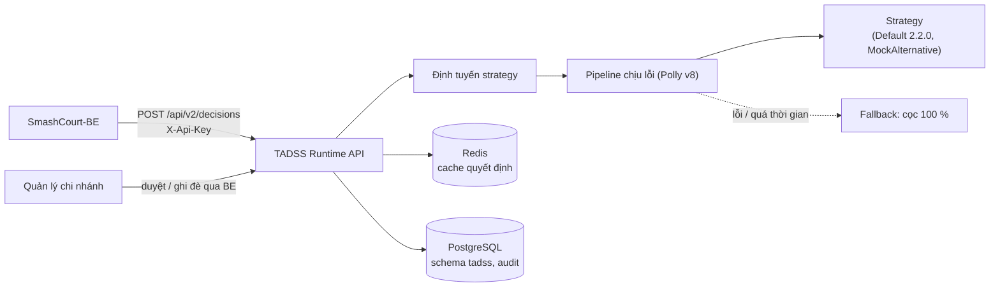

# TADSS Runtime

Trustworthy Adaptive Decision Support System (TADSS): Decision Runtime Engine.

[](https://github.com/NguyenThanhTrung-N2T/TrustworthyAdaptiveDecisionSupportSystem-TADSS/actions/workflows/ci.yml)

-blue)

Nền tảng ra quyết định chịu lỗi cho hệ thống đặt chỗ dịch vụ. Hệ thống đặt chỗ gửi một yêu cầu quyết định (ví dụ: khách này phải đặt cọc bao nhiêu); TADSS chọn strategy phù hợp, chạy strategy trong pipeline chịu lỗi, lưu vết bất biến và cho quản lý duyệt hoặc ghi đè. Ứng dụng đối chứng là **SmashCourt** (hệ thống đặt sân cầu lông, Đồ án 1); repo này là **Đồ án 2**.

## Mục lục

- [Tổng quan](#tổng-quan)
- [Tính năng](#tính-năng)
- [Kiến trúc](#kiến-trúc)
- [Bắt đầu nhanh](#bắt-đầu-nhanh)
- [API](#api)
- [Cấu hình](#cấu-hình)
- [Kiểm thử và chất lượng](#kiểm-thử-và-chất-lượng)
- [Triển khai và vận hành](#triển-khai-và-vận-hành)
- [Cấu trúc thư mục](#cấu-trúc-thư-mục)
- [Tài liệu](#tài-liệu)
- [Trạng thái dự án](#trạng-thái-dự-án)
- [Quy ước đóng góp](#quy-ước-đóng-góp)
- [Giấy phép](#giấy-phép)

## Tổng quan



Mỗi quyết định có một trong ba kết quả:

| Kết quả | Khi nào | SmashCourt xử lý |
| :--- | :--- | :--- |
| `APPROVED` + tỉ lệ cọc | Strategy xác định được mức cọc | Khách thanh toán cọc ngay |
| `NEED_APPROVAL` | Cần người xem xét (đơn giá trị cao, khách nhiều lần không đến) | Quản lý duyệt kèm mức cọc hoặc từ chối; không bao giờ tự duyệt |
| `REJECTED` | Khách nhiều lần giữ chỗ rồi bỏ thanh toán | Từ chối đơn, nhả sân |

Mọi sự cố (strategy lỗi, quá thời gian, mạch ngắt mở, TADSS không phản hồi) đều quy về **cọc 100 %**: khách vẫn đặt được sân, hệ thống không mất tiền. Đặc tả đầy đủ: [INTEGRATION_SPEC](docs/contracts/INTEGRATION_SPEC.md).

## Tính năng

- **Strategy cắm rời** qua SDK `Shared.DecisionContractSDK` (chỉ phụ thuộc BCL); chọn strategy theo từng request bằng luật cấu hình, nạp lại không cần khởi động lại.
- **Chịu lỗi**: pipeline Polly v8 riêng cho từng strategy (timeout, circuit breaker, cách ly strategy không hợp tác), fallback có kiểm soát.
- **Idempotency** theo `X-Idempotency-Key`; ghi audit đồng bộ, bất biến.
- **Quản trị**: hàng chờ duyệt, ghi đè có lý do, báo kết cục (outcome) để đánh giá chất lượng quyết định.
- **Shadow mode**: chạy strategy ứng viên ở nền, so với strategy chính mà không ảnh hưởng kết quả.
- **Bảo mật**: API key băm SHA-256, giới hạn tốc độ theo client, giới hạn kích thước body, security headers, image non-root không chứa bí mật.
- **Quan sát**: OpenTelemetry (metric, trace, log), dashboard Grafana dựng sẵn.
- **Đánh giá một lệnh**: chạy toàn bộ test, tải, tiêm lỗi, mutation, đánh giá trên dữ liệu thật và xuất Evidence Pack.

## Kiến trúc

Clean Architecture nhiều project; hướng phụ thuộc chỉ đi vào trong, được compiler và test kiến trúc (UT-14) cưỡng chế.

| Project | Vai trò | Phụ thuộc |
| :--- | :--- | :--- |
| `src/Shared.DecisionContractSDK` | Hợp đồng v2: domain `Reservation`, DTO, enum, `IReservationDecisionStrategy` | Chỉ BCL |
| `src/TADSS.Application` | Use case (quyết định, truy vấn, duyệt, outcome), port, định tuyến, shadow | SDK |
| `src/TADSS.Infrastructure` | EF Core + PostgreSQL, Redis, pipeline Polly, migration | Application |
| `src/TADSS.Runtime.Api` | Controller, middleware, xử lý lỗi RFC 7807, composition root | Tất cả |
| `src/TADSS.Strategies.*` | `DefaultDecisionStrategy`, `MockAlternativeDecisionStrategy` | SDK |

**Công nghệ:** .NET 8, ASP.NET Core, EF Core 8 + Npgsql, PostgreSQL 16, Redis 7, Polly 8, Serilog, OpenTelemetry; kiểm thử bằng xUnit, FluentAssertions, Testcontainers, Toxiproxy, Stryker.NET, Schemathesis, k6.

Chi tiết: [Software Architecture Specification](docs/architecture/SOFTWARE_ARCHITECTURE_SPECIFICATION.md) · [ADR](docs/architecture/ARCHITECTURE_DECISION_RECORDS.md) · [Phân loại lỗi](docs/architecture/RESILIENCE_AND_FAULT_TAXONOMY.md).

## Bắt đầu nhanh

**Yêu cầu:** .NET 8 SDK · Docker Desktop (integration test, chạy bằng Docker) · Python 3.12 (công cụ đánh giá, tài liệu).

```bash
dotnet restore TADSS.slnx
dotnet build TADSS.slnx -c Release --warnaserror            # bắt buộc 0 warning
dotnet test tests/TADSS.UnitTests -c Release --no-build      # unit test, không cần Docker
dotnet test tests/TADSS.IntegrationTests -c Release --no-build   # cần Docker (Testcontainers)
dotnet run --project src/TADSS.Runtime.Api                   # http://localhost:5296/swagger
```

`dotnet run` cần chuỗi kết nối PostgreSQL và ít nhất một API key trong `appsettings.Development.json` (không commit). Cách tạo API key, chạy bằng Docker và expose qua ngrok: [Developer Guide](docs/guides/DEVELOPER_GUIDE.md).

## API

Mọi endpoint `/api/*` cần header `X-Api-Key`; lỗi trả về `application/problem+json` (RFC 7807).

| Method | Endpoint | Mô tả |
| :--- | :--- | :--- |
| `POST` | `/api/v2/decisions` | Ra quyết định (idempotent theo `X-Idempotency-Key`) |
| `GET` | `/api/v2/decisions/{decisionId}` | Đọc một quyết định đã lưu |
| `GET` | `/api/v2/decisions/pending-approvals` | Hàng chờ duyệt |
| `POST` | `/api/v2/decisions/{decisionId}/override` | Duyệt kèm mức cọc / từ chối |
| `POST` | `/api/v2/decisions/{decisionId}/outcome` | Báo kết cục của đơn |
| `GET` | `/health/live`, `/health/ready` | Health (không cần API key) |

Hợp đồng: [INTEGRATION_SPEC](docs/contracts/INTEGRATION_SPEC.md) · [OpenAPI](docs/contracts/openapi-v2.yaml) (sinh từ mã, test chặn lệch) · [JSON Schema](docs/contracts/schemas/v2/).

## Cấu hình

Mọi nhóm cấu hình có validator chạy lúc khởi động: giá trị sai thì ứng dụng không chạy và báo đúng tên khóa.

| Nhóm | Dùng cho |
| :--- | :--- |
| `ConnectionStrings:DefaultConnection` | PostgreSQL (bắt buộc) |
| `Tadss:Security` | API key, giới hạn tốc độ, kích thước body |
| `Tadss:Routing` | Chọn strategy theo luật (nạp lại nóng) |
| `Tadss:Strategies:*` | Tham số từng strategy (ngưỡng duyệt, tỉ lệ cọc, giảm cọc giờ thấp điểm) |
| `Tadss:Resilience`, `Tadss:Cache`, `Tadss:Shadow` | Timeout và mạch ngắt, cache Redis, shadow mode |

Bảng khóa đầy đủ, giá trị mặc định và ràng buộc: [CONFIGURATION_REFERENCE](docs/guides/CONFIGURATION_REFERENCE.md).

## Kiểm thử và chất lượng

| Loại | Công cụ | Chạy ở |
| :--- | :--- | :--- |
| Unit, kiến trúc (UT-14), drift OpenAPI | xUnit | CI, máy dev |
| Integration (PostgreSQL, Redis, tiêm lỗi mạng) | Testcontainers, Toxiproxy | CI, máy dev |
| Contract, fuzz API | JSON Schema, Schemathesis | Chế độ đánh giá |
| Mutation | Stryker.NET | Chế độ đánh giá |
| Tải, sự cố dưới tải | k6, Toxiproxy | Chế độ đánh giá, môi trường `perf` |
| Đánh giá trên dữ liệu thật | Replay 215 đơn SmashCourt, Hotel Booking Demand | Chế độ đánh giá |

- **Danh mục test** (mã, tiêu chí, KPI SC1–SC8): [phương pháp đánh giá](docs/research/EXPERIMENTAL_DESIGN_AND_BENCHMARK_METHODOLOGY.md), bản máy đọc ở `tests/catalog.yaml`.
- **Báo cáo tổng kết chất lượng** cho người đọc không chuyên: `python perf/board.py update` ⇒ `perf/results/BAO_CAO_MOI_NHAT.html`.
- **Kết quả đo hiệu năng toàn hệ thống:** [PERFORMANCE_REPORT](docs/report/PERFORMANCE_REPORT.md).

## Triển khai và vận hành

- **CI** (`.github/workflows/ci.yml`): restore khóa phiên bản ⇒ quét lỗ hổng ⇒ build ⇒ unit + integration test ⇒ build image, kiểm image không chứa bí mật và không chạy root ⇒ đẩy `ghcr.io/nguyenthanhtrung-n2t/tadss-runtime:sha-<7>`.
- **CD**: runner tự host triển khai đúng image vừa build vào bản deploy, kiểm health và smoke, tự quay về bản trước nếu hỏng (bộ triển khai ở repo SmashCourt-BE, thư mục `deploy/`).
- **Chế độ đánh giá một lệnh**: `docker compose up -d --build` chạy TADSS, ngrok, Grafana và một lượt đánh giá a…f trong stack cô lập.

Mọi lệnh vận hành (bản deploy, CD, Grafana Cloud, lượt đánh giá, đo hiệu năng, xử lý sự cố): [RUNBOOK](docs/guides/RUNBOOK.md).

## Cấu trúc thư mục

```text
TADSS-Runtime/
├── src/                  # 6 project: SDK, Application, Infrastructure, Runtime.Api, 2 strategy
├── tests/                # UnitTests, IntegrationTests, k6 (load/), danh mục test (catalog.yaml)
├── tools/                # evaluation, evidence, docs, ci, security, expose, observability, database, research
├── perf/                 # môi trường đo hiệu năng toàn hệ thống + báo cáo tổng kết chất lượng
├── docs/                 # tài liệu (mục lục: docs/README.md)
├── spec/                 # đặc tả và kế hoạch của phase đang làm (spec/archive/: phase đã xong)
├── docker/, stryker/     # cấu hình stack đánh giá, Stryker.NET
└── docker-compose.yml    # một file compose: vận hành / demo + chế độ đánh giá
```

## Tài liệu

| Cần | Tài liệu |
| :--- | :--- |
| Tổng hợp dự án để review, trình bày | [PROJECT_SUMMARY](docs/PROJECT_SUMMARY.md) |
| Hợp đồng API v2 | [INTEGRATION_SPEC](docs/contracts/INTEGRATION_SPEC.md) |
| Kiến trúc, quyết định kiến trúc | [SAS](docs/architecture/SOFTWARE_ARCHITECTURE_SPECIFICATION.md), [ADR](docs/architecture/ARCHITECTURE_DECISION_RECORDS.md) |
| Phát triển, cấu hình, bảo mật | [DEVELOPER_GUIDE](docs/guides/DEVELOPER_GUIDE.md), [CONFIGURATION_REFERENCE](docs/guides/CONFIGURATION_REFERENCE.md) |
| Chạy và vận hành | [RUNBOOK](docs/guides/RUNBOOK.md) |
| Phương pháp đánh giá, danh mục test | [EXPERIMENTAL_DESIGN_AND_BENCHMARK_METHODOLOGY](docs/research/EXPERIMENTAL_DESIGN_AND_BENCHMARK_METHODOLOGY.md) |
| Kế hoạch, lịch trình | [MASTER_EXECUTION_PLAN](docs/planning/MASTER_EXECUTION_PLAN.md) |
| **Danh sách mọi tài liệu** và quy tắc tài liệu | [docs/README.md](docs/README.md) |

Mỗi chủ đề có đúng một tài liệu sở hữu; khi hai tài liệu khác nhau, tài liệu sở hữu thắng. `python tools/docs/check_docs.py` kiểm bảng kiểm kê, thuật ngữ đã gỡ và mọi link nội bộ (chạy trong CI).

## Trạng thái dự án

| Giai đoạn | Trạng thái |
| :--- | :--- |
| Phase 1–4: contract v1 | Xong; v1 đã gỡ (tra lại qua tag `phase4-baseline`) |
| Phase 5: contract v2, kiểm thử trên hạ tầng thật, chế độ đánh giá | Gate M5 đạt 18/10/2026; contract v2.0.0 đóng băng |
| Phase 6: tích hợp cọc vào SmashCourt (BE, FE), DevOps, đo hiệu năng | Đang làm: [spec Phase 6](spec/PHASE6_DESIGN_SPEC.md), [plan 6C](spec/PHASE6_PLAN_6C_DEVOPS_OBSERVABILITY_PERF.md) |

Lịch trình và gate: [MASTER_EXECUTION_PLAN](docs/planning/MASTER_EXECUTION_PLAN.md).

## Quy ước đóng góp

- Nhánh làm việc `develop`; commit theo [Conventional Commits](https://www.conventionalcommits.org/) (`feat:`, `fix:`, `docs:`, `test:`, `refactor:`, `chore:`).
- Trước khi push: build `--warnaserror` đạt 0 warning, toàn bộ test xanh; sửa tài liệu thì chạy `python tools/docs/check_docs.py`.
- Không sửa `docs/contracts/baseline_public_api.txt`, `openapi-v2.yaml`, `schemas/v2/` để test xanh: đổi public API là một phiên bản lớn mới.
- Không commit bí mật (`appsettings.Development.json`, `.env`); thêm hoặc đổi cấu hình thì cập nhật CONFIGURATION_REFERENCE trong cùng đợt.

Quy ước chi tiết cho người làm việc trong repo: [CLAUDE.md](CLAUDE.md).

## Giấy phép

Phát triển cho mục đích học thuật trong khuôn khổ Đồ án 2 (và mở rộng cho Khóa luận tốt nghiệp).
