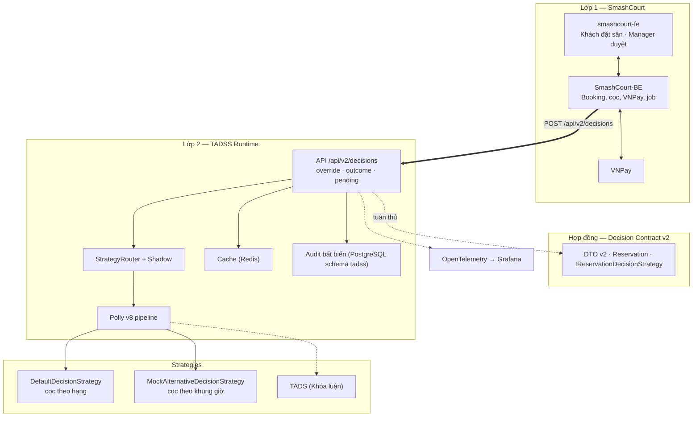
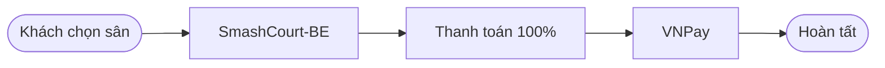
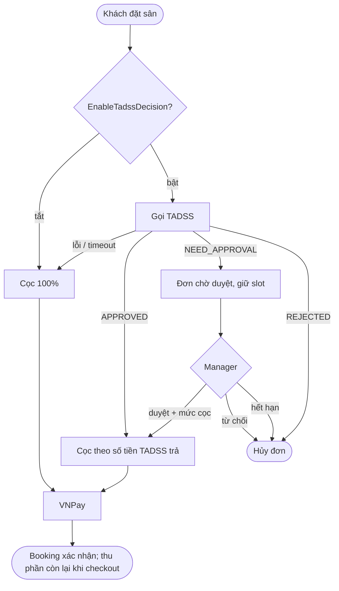
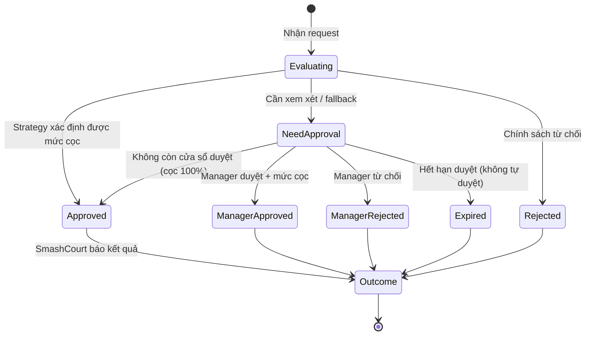

# TỔNG QUAN HỆ THỐNG TADSS (SYSTEM BLUEPRINT) — v2.0

> **Vai trò của tài liệu:** bức tranh tổng thể và các sơ đồ dùng cho báo cáo/slide. Thông số chi tiết nằm ở các file sở hữu (xem bản đồ tài liệu tại Mục III của [`THESIS_DEVELOPMENT_PLAYBOOK.md`](planning/THESIS_DEVELOPMENT_PLAYBOOK.md)).
>
> **Trạng thái (02/10/2026):** Phase 1–4 và Phase R hoàn thành; Phase 5 đã xong gói 5.1 và 5.2a–5.2c — contract v2 là phiên bản duy nhất (`POST`/`GET /api/v2/decisions`, audit PostgreSQL bất biến, kiểm thử trên Testcontainers). Kế hoạch: [`MASTER_EXECUTION_PLAN.md`](planning/MASTER_EXECUTION_PLAN.md).

---

## 1. CÂU CHUYỆN ĐỀ TÀI

```text
┌──────────────────────────────────────────────────────────────────────────────┐
│ ĐỒ ÁN 1 — SMASHCOURT                                                         │
│ Đặt sân online + VNPay. Chính sách duy nhất: thanh toán 100% cho mọi đơn.    │
│ Muốn chính sách linh hoạt thì phải sửa mã CRUD → coupling, lỗi lan truyền,   │
│ không có vết giải trình, quản lý không can thiệp được.                       │
└───────────────────────────────────────┬──────────────────────────────────────┘
                                        ▼
┌──────────────────────────────────────────────────────────────────────────────┐
│ ĐỒ ÁN 2 — TADSS DECISION RUNTIME                                             │
│ Tách quyết định cọc ra runtime độc lập: định tuyến strategy theo request,    │
│ pipeline chịu lỗi, audit bất biến, Manager duyệt kèm mức cọc.                │
│ Kiểm chứng trên hạ tầng thật + pilot người dùng thật.                        │
└───────────────────────────────────────┬──────────────────────────────────────┘
                                        ▼
┌──────────────────────────────────────────────────────────────────────────────┐
│ KHÓA LUẬN — STRATEGY TADS                                                    │
│ Điểm tin cậy + mô hình rủi ro chạy trên TADSS (shadow mode, off-policy).      │
└──────────────────────────────────────────────────────────────────────────────┘
```

---

## 2. KIẾN TRÚC TỔNG THỂ



---

## 3. LUỒNG ĐẶT SÂN: TRƯỚC VÀ SAU

### 3.1. Đồ án 1



### 3.2. Đồ án 2



---

## 4. VÒNG ĐỜI QUYẾT ĐỊNH



Mọi chuyển trạng thái được ghi bằng bản ghi mới (quyết định, override, outcome); không bản ghi nào bị sửa.

---

## 5. TRẠNG THÁI DỰ ÁN

| Hạng mục | Trạng thái |
| :--- | :--- |
| Contract SDK v1, Runtime v1, pipeline chịu lỗi, audit đồng bộ, 510 test tại M4 (InMemory; còn 500 sau Phase R) | ✅ Phase 1–4 |
| Đồng bộ tài liệu, dọn repo | ✅ Phase R (Gate MR 01/10) |
| Contract v2, audit bất biến, routing/shadow, toàn bộ hạ tầng & danh mục kiểm thử | ⏳ Phase 5 (12/10 – 08/11) |
| SmashCourt-BE ∥ smashcourt-fe | ⏳ Phase 6 (09/11 – 06/12) |
| Tích hợp, kiểm thử & sửa lỗi, pilot, Evidence Pack | ⏳ Phase 7–8 (07/12 – 27/12) |
| Báo cáo & bảo vệ | ⏳ Phase 9 (28/12 – 03/01/2027) |
