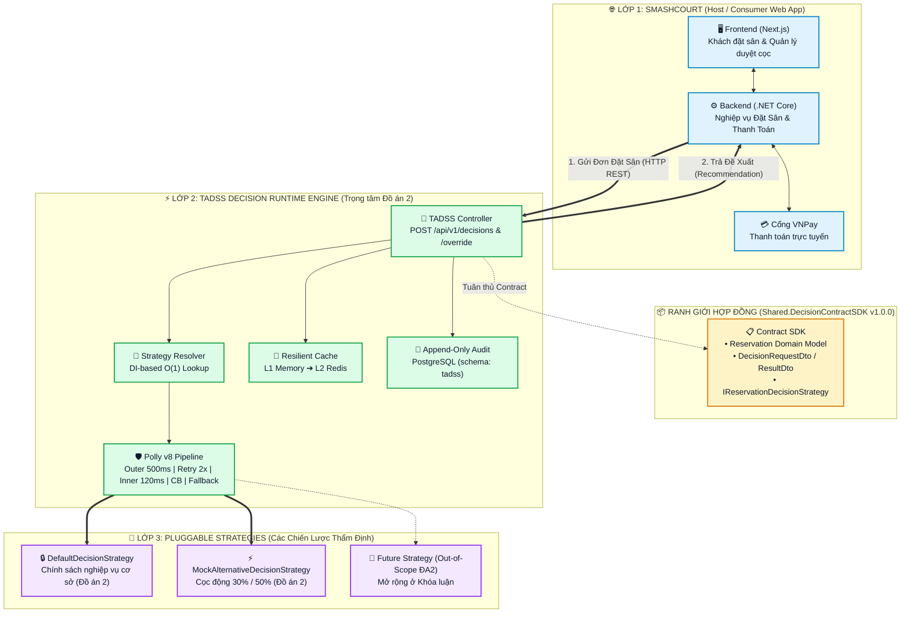
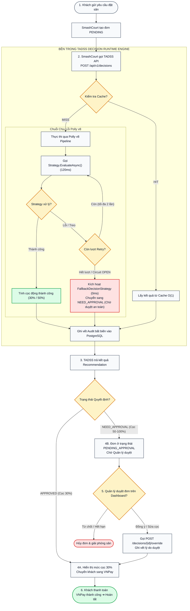
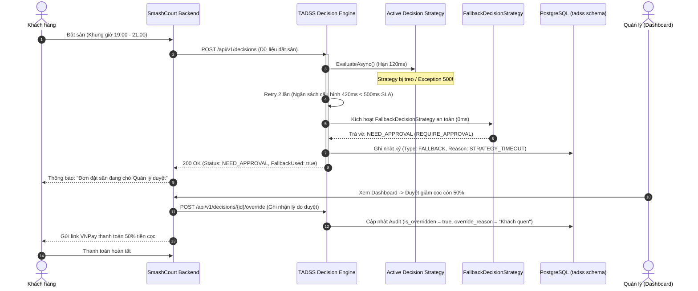
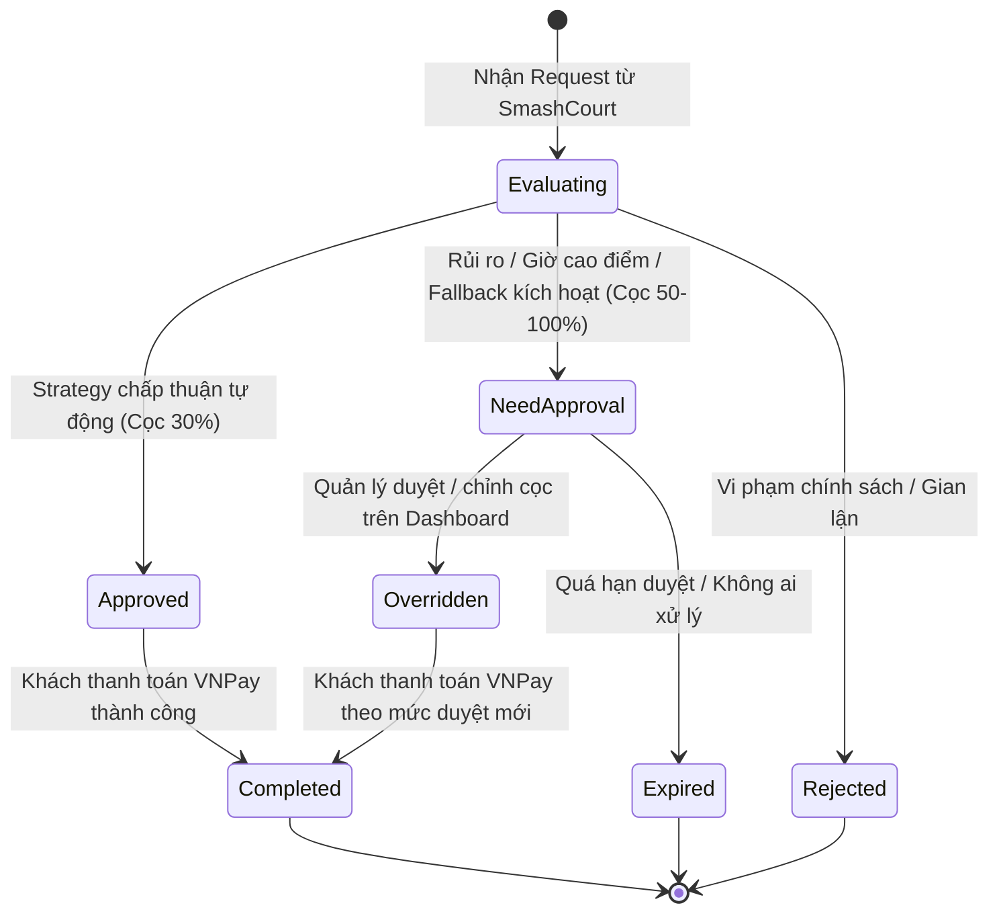
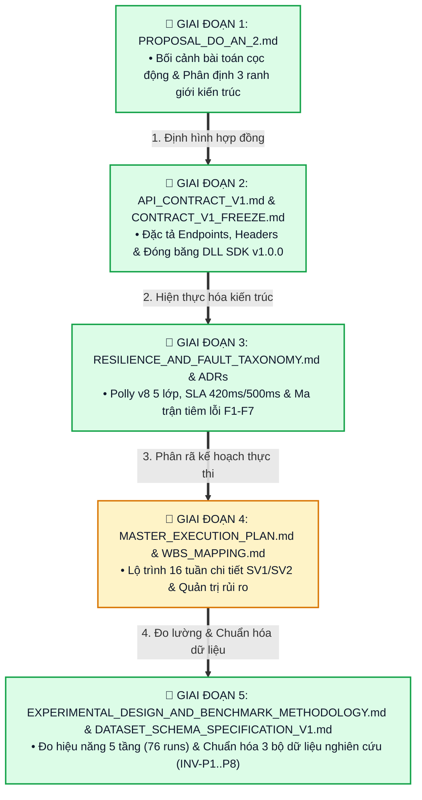

# 🏛️ TỔNG QUAN KIẾN TRÚC & BẢN ĐỒ QUẢN TRỊ DỰ ÁN TADSS
## (TADSS System Blueprint, Architectural Workflows & Executive Documentation Map)

> **Dự án:** TADSS (Trustworthy Adaptive Decision Support System — Nền tảng Decision Runtime Engine)  
> **Phạm vi hiện tại:** **Đồ án 2 (16 tuần)** — Tập trung vào Hạ tầng Runtime Engine Chịu lỗi, Hợp đồng SDK, Bộ nhớ đệm L1/L2, Kiểm toán đồng bộ và Phê duyệt thủ công *(Không bao gồm mô hình AI/ML — thuộc phạm vi mở rộng Khóa luận)*  
> **Hệ thống đối chứng (Host App):** SmashCourt — Hệ thống Đặt Sân Cầu Lông Trực Tuyến  
> **Loại hình:** Hệ thống lai (Decoupled Decision Engine Subsystem + Web Application)  
> **Thời điểm cập nhật:** Hết Tuần 9 (Phase 4 — Milestone 4 Complete: Resilience, Controlled Benchmark & Research Dataset Normalization)  
> **Trạng thái kiểm thử:** 🟢 **507/507 Automated Tests Passed (481 Unit + 26 Integration), 76/76 Benchmark Runs + 50 Governance Lifecycle Cases, & 3 Normalized Datasets (`INV-P1..P8` 100% Passed)**

---

## 📑 MỤC LỤC
1. [Bối Cảnh & Động Lực Đề Tài (The Core Storyline)](#1-bối-cảnh--động-lực-đề-tài-the-core-storyline)
2. [Mô Hình Kiến Trúc Tổng Thể (System Architecture)](#2-mô-hình-kiến-trúc-tổng-thể-system-architecture)
3. [So Sánh Luồng Nghiệp Vụ Đặt Sân (Trước vs Sau khi có TADSS)](#3-so-sánh-luồng-nghiệp-vụ-đặt-sân-trước-vs-sau-khi-có-tadss)
4. [Vòng Đời Quyết Định & Cơ Chế Human-In-The-Loop](#4-vòng-đời-quyết-định--cơ-chế-human-in-the-loop)
5. [Sơ Đồ Pipeline Dự Án Dành Cho PM (5-Stage Delivery Pipeline)](#5-sơ-đồ-pipeline-dự-án-dành-cho-pm-5-stage-delivery-pipeline)
6. [Bảng Tổng Kết Quản Trị Dự Án (Executive Summary Dashboard)](#6-bảng-tổng-kết-quản-trị-dự-án-executive-summary-dashboard)
7. [Bản Đồ Mạng Lưới Toàn Bộ File Tài Liệu Quyết Định](#7-bản-đồ-mạng-lưới-toàn-bộ-26-file-tài-liệu-quyết-định)
8. [Bảng Rà Soát & Chú Giải Chi Tiết Toàn Bộ Tài Liệu Trong Repo](#8-bảng-rà-soát--chú-giải-chi-tiết-toàn-bộ-tài-liệu-trong-repo)

---

## 1. BỐI CẢNH & ĐỘNG LỰC ĐỀ TÀI (THE CORE STORYLINE)

```text
┌─────────────────────────────────────────────────────────────────────────────────────────┐
│ [ĐỒ ÁN 1: SMASHCOURT WEB APPLICATION]                                                   │
│ • Hoàn thiện luồng đặt sân trực tuyến và tích hợp cổng thanh toán VNPay.                │
│ • HẠN CHẾ CỐT LÕI: Chính sách cọc 100% bị HARDCODE cố định trong code CRUD nghiệp vụ.   │
│ • RỦI RO KỸ THUẬT: Khi muốn đổi chính sách hoặc áp dụng chiến lược tính cọc động:       │
│   1. Phải sửa code và deploy lại toàn bộ ứng dụng lớn (Tight Coupling).                 │
│   2. Chiến lược quyết định chậm/sập sẽ làm SẬP TOÀN BỘ luồng đặt sân (SPOF).            │
│   3. Thiếu vết lưu giải trình (Audit Trail) và cổng cho Quản lý can thiệp (No Override).│
└───────────────────────────────────────────┬─────────────────────────────────────────────┘
                                            │
                                            ▼
┌─────────────────────────────────────────────────────────────────────────────────────────┐
│ [ĐỒ ÁN 2: NỀN TẢNG TADSS DECISION RUNTIME ENGINE]                                       │
│ • Tách riêng toàn bộ logic thẩm định thành ĐỘNG CƠ RA QUYẾT ĐỊNH ĐỘC LẬP.               │
│ • Cung cấp cơ chế "CẮM RÚT CHIẾN LƯỢC" (Pluggable qua IReservationDecisionStrategy).    │
│ • Tích hợp CHUỖI CHỊU LỖI ĐA TẦNG POLLY v8 (Outer 500ms -> Retry -> CB -> Fallback 0ms) │
│   ==> Đảm bảo luồng đặt sân không bao giờ bị chết dù Strategy gặp sự cố.                │
│ • Ghi nhật ký kiểm toán bất biến (Append-Only Audit) & Cổng duyệt thủ công cho Quản lý. │
└─────────────────────────────────────────────────────────────────────────────────────────┘
```

---

## 2. MÔ HÌNH KIẾN TRÚC TỔNG THỂ (SYSTEM ARCHITECTURE)

Hệ thống sử dụng mô hình **Decoupled Decision Engine as a Subsystem** kết hợp kiến trúc **Ports & Adapters (Hexagonal Architecture)** và **Strategy Pattern**:



---

## 3. SO SÁNH LUỒNG NGHIỆP VỤ ĐẶT SÂN (TRƯỚC VS SAU KHI CÓ TADSS)

### 3.1. Luồng Trước Kia (Đồ Án 1 - Bị Hardcode Tĩnh)


---

### 3.2. Luồng Hoạt Động Hiện Tại Khi Có TADSS Engine (Activity Diagram)



---

### 3.3. Sơ Đồ Tuần Tự Xử Lý Sự Cố & Tự Động Fallback (Sequence Diagram)



---

## 4. VÒNG ĐỜI QUYẾT ĐỊNH & CƠ CHẾ HUMAN-IN-THE-LOOP



---

## 5. SƠ ĐỒ PIPELINE DỰ ÁN DÀNH CHO PM (5-STAGE DELIVERY PIPELINE)



---

## 6. BẢNG TỔNG KẾT QUẢN TRỊ DỰ ÁN (EXECUTIVE SUMMARY DASHBOARD)

| Giai đoạn (Phase) | Câu hỏi PM quan tâm | File tài liệu Single Source of Truth | Sản phẩm đầu ra cụ thể (Deliverables) | Trạng thái |
|:---|:---|:---|:---|:---:|
| **1. Đề xuất & Phạm vi** *(Why & Scope)* | Tại sao cần làm? Ranh giới hệ thống ở đâu? | `PROPOSAL_DO_AN_2.md` | Phân định ranh giới 3 lớp: SmashCourt (Host) $\leftrightarrow$ TADSS (Engine) $\leftrightarrow$ Strategies. | 🟢 **100% DONE** |
| **2. Giao diện & Hợp đồng** *(What & Contract)* | Hai bên gửi nhận dữ liệu gì? Làm sao không vỡ code nhau? | `API_CONTRACT_V1.md`<br/>`CONTRACT_V1_FREEZE.md` | DLL Class Library `Shared.DecisionContractSDK` v1.0.0 độc lập, đóng băng bất biến. | 🟢 **100% DONE** |
| **3. Kiến trúc & Chịu lỗi** *(How & Resilience)* | Chiến lược sập thì sao? SLA có bị lố 500ms không? | `RESILIENCE_AND_FAULT_TAXONOMY.md`<br/>`ARCHITECTURE_DECISION_RECORDS.md` | Polly v8 5 lớp, Ma trận tiêm lỗi 7 kịch bản (F1 ➔ F7), **507/507 automated tests passed**. | 🟢 **100% DONE (W7)** |
| **4. Kế hoạch Tác chiến** *(When & Execution)* | Chia việc thế nào? Kế hoạch ứng phó rủi ro là gì? | `MASTER_EXECUTION_PLAN.md`<br/>`PROJECT_WBS_MAPPING.md` | Kế hoạch 16 tuần chi tiết cho SV1 (Backend/Resilience) & SV2 (Cache/UI/Report) kèm 7 Milestones. | 🟡 **Đang chạy (Sang Phase 5 - W10)** |
| **5. Đánh giá & Thực nghiệm** *(Metrics & Evidence)* | Lấy số liệu gì để viết báo cáo Đồ án 2? | `EXPERIMENTAL_DESIGN_AND_BENCHMARK_METHODOLOGY.md`<br/>`DATASET_SCHEMA_SPECIFICATION_V1.md`<br/>`WEEK8_BENCHMARK_REPORT.md`<br/>`WEEK9_DATASET_NORMALIZATION_REPORT.md` | Kịch bản đo 5 tầng ($G_0..G_2, R_0..R_3, C_0..C_3, D_0..D_2, E_0..E_4$, 76 runs completed), In-Vivo Audit Harvester & 3 bộ dữ liệu chuẩn hóa CSV/JSONL (`INV-P1..P8` 100% PASS). | 🟢 **100% DONE (Milestone 4)** |

---

## 7. BẢN ĐỒ MẠNG LƯỚI TOÀN BỘ 26 FILE TÀI LIỆU QUYẾT ĐỊNH

```mermaid
flowchart TD
    subgraph G1 ["1. ĐỀ XUẤT, BỐI CẢNH & TỔNG QUAN (Vision & Foundation)"]
        F1["📄 README.md (Root Overview)"]
        F2["📄 PROPOSAL_DO_AN_2.md (Tuyên ngôn đề tài)"]
        F3["📄 THESIS_DEVELOPMENT_PLAYBOOK.md (Phân tầng ĐA2 vs KLTN)"]
    end

    subgraph G2 ["2. GIAO ƯỚC HỢP ĐỒNG & TÍCH HỢP (Contracts & SDK)"]
        F7["📄 API_CONTRACT_V1.md (REST API Spec)"]
        F8["🔒 CONTRACT_V1_FREEZE.md (Đóng băng SDK v1.0.0)"]
        F9["📄 INTEGRATION_SPEC.md (Đặc tả tích hợp SmashCourt)"]
        F10["📄 baseline_metrics.md & baseline_public_api.txt"]
        F11["📄 openapi-v1.yaml & schemas/ (Swagger Schemas)"]
        F12["📄 Shared.DecisionContractSDK/README.md"]
    end

    subgraph G3 ["3. THIẾT KẾ KIẾN TRÚC & QUYẾT ĐỊNH (Architecture & ADRs)"]
        F13["📄 SOFTWARE_ARCHITECTURE_SPECIFICATION.md"]
        F14["📄 ARCHITECTURE_DECISION_RECORDS.md (ADR-001..005)"]
    end

    subgraph G4 ["4. CHỊU LỖI, LƯU TRỮ & DỮ LIỆU (Resilience, Audit & DB)"]
        F15["📄 RESILIENCE_AND_FAULT_TAXONOMY.md (Ma trận F1-F7)"]
        F16["📄 DECISION_PERSISTENCE_INVARIANTS.md (Audit Invariants)"]
        F17["📄 schema_smashcourt.sql (DDL Database)"]
    end

    subgraph G5 ["5. KẾ HOẠCH TÁC CHIẾN & BACKLOG (Planning & Roadmap)"]
        F4["📄 MASTER_EXECUTION_PLAN.md (Kế hoạch 16 Tuần)"]
        F5["📄 PROJECT_WBS_MAPPING.md (WBS & Quản trị rủi ro)"]
        F6["📄 BACKLOG_SPRINTS.md (Danh mục 6 Sprints)"]
    end

    subgraph G6 ["6. THỰC NGHIỆM KỸ THUẬT & CHUẨN HÓA DỮ LIỆU (Benchmarks & Datasets)"]
        F18["📄 EXPERIMENTAL_DESIGN_AND_BENCHMARK_METHODOLOGY.md (RQ1-RQ3)"]
        F22["🔒 DATASET_SCHEMA_SPECIFICATION_V1.md (3 Schemas & INV-P1..P8)"]
        F21["📊 WEEK8_BENCHMARK_REPORT.md (Kết quả 76 Runs / 19 Kịch bản W8)"]
        F23["📊 WEEK9_DATASET_NORMALIZATION_REPORT.md (3 Datasets CSV/JSONL W9)"]
        F19["📄 RESEARCH_PROBLEM_BACKLOG.md [OUT-OF-SCOPE ĐA2]"]
        F20["📄 RESEARCH_THESIS_DEFENSE.md [OUT-OF-SCOPE ĐA2]"]
    end

    F2 -->|1. Sinh yêu cầu hợp đồng| F7
    F7 -->|2. Đóng băng bất biến| F8
    F2 -->|3. Định hướng kiến trúc| F13
    F13 -->|4. Bảo chứng bằng ADRs| F14
    F13 -->|5. Thiết lập chuỗi chịu lỗi| F15
    F15 -->|6. Ràng buộc lưu trữ| F16
    F7 & F13 -->|7. Lập kế hoạch thực thi| F4
    F4 -->|8. Phân rã rủi ro| F5
    F15 & F16 -->|9. Cung cấp kịch bản đo đạc| F18
    F18 -->|10. Xuất báo cáo thực nghiệm W8| F21
    F16 & F18 -->|11. Đóng băng đặc tả Schema W9| F22
    F21 & F22 -->|12. Xuất 3 Dataset chuẩn hóa W9| F23

    classDef c1 fill:#e0f2fe,stroke:#0284c7,stroke-width:2px,color:#0f172a;
    classDef c2 fill:#dcfce7,stroke:#16a34a,stroke-width:2px,color:#0f172a;
    classDef c3 fill:#fef3c7,stroke:#d97706,stroke-width:2px,color:#0f172a;
    classDef c4 fill:#ffe4e6,stroke:#e11d48,stroke-width:2px,color:#0f172a;
    classDef c5 fill:#f3e8ff,stroke:#9333ea,stroke-width:2px,color:#0f172a;
    classDef c6 fill:#f1f5f9,stroke:#475569,stroke-width:2px,color:#0f172a;

    class F1,F2,F3 c1;
    class F7,F8,F9,F10,F11,F12 c2;
    class F13,F14 c3;
    class F15,F16,F17 c4;
    class F4,F5,F6 c5;
    class F18,F22,F21,F23,F19,F20 c6;
```



---

## 8. BẢNG RÀ SOÁT & CHÚ GIẢI CHI TIẾT TOÀN BỘ TÀI LIỆU TRONG REPO

Dưới đây là bảng rà soát đầy đủ **100% tài liệu** hiện có trong repository, giải thích rõ **nội dung file nói cái gì** và **mối quan hệ ràng buộc/kết nối với các tài liệu khác**:

| STT | Tên File Tài Liệu | Nội dung cốt lõi (File này nói cái gì?) | Mối quan hệ liên kết với các file khác |
|:---:|:---|:---|:---|
| **1** | `README.md` (Root) | Tổng quan toàn bộ Solution TADSS-Runtime: Cấu trúc các project C#, hướng dẫn cài đặt, build và chạy bộ 507 automated tests (481 Unit + 26 Integration). | **Cổng vào của toàn bộ repository.** Giới thiệu tổng quát và dẫn dắt lập trình viên tới các tài liệu chi tiết. |
| **2** | `PROPOSAL_DO_AN_2.md` | Tuyên ngôn đề tài: Xác lập bối cảnh, 3 thách thức kỹ thuật (Coupling, SPOF, Lack of Audit), ranh giới 3 lớp kiến trúc và mục tiêu đồ án. | **Gốc rễ của toàn dự án.** Sinh ra các yêu cầu cho Contract (`API_CONTRACT_V1.md`) và Kiến trúc (`SOFTWARE_ARCHITECTURE_SPECIFICATION.md`). |
| **3** | `THESIS_DEVELOPMENT_PLAYBOOK.md` | Cẩm nang quản trị phạm vi: Khóa thuật ngữ (`TADSS` thuộc Đồ án 2 vs `TADS`/`ATDA` thuộc Khóa luận), ma trận phân tầng phạm vi và lối thoát khẩn cấp. | Bảo vệ ranh giới phạm vi giữa Đồ án 2 (`PROPOSAL_DO_AN_2.md`) và định hướng mở rộng giai đoạn sau (`RESEARCH_THESIS_DEFENSE.md`). |
| **4** | `MASTER_EXECUTION_PLAN.md` | Kế hoạch tác chiến 16 tuần: Phân rã chi tiết công việc từng ngày cho Sinh viên 1 (Backend/Resilience) và Sinh viên 2 (Strategy/Cache/UI/Report). | Định hướng lịch trình thực thi dựa trên các yêu cầu từ `PROPOSAL_DO_AN_2.md` và `API_CONTRACT_V1.md`. |
| **5** | `PROJECT_WBS_MAPPING.md` | Bảng ma trận phân rã công việc (WBS), ánh xạ sản phẩm bàn giao (Deliverables) qua 7 Milestones và kịch bản rủi ro kèm giải pháp dự phòng. | Đi kèm `MASTER_EXECUTION_PLAN.md` để quản trị rủi ro tiến độ và kích hoạt kịch bản dự phòng khi tắc nghẽn. |
| **6** | `BACKLOG_SPRINTS.md` | Danh mục Product Backlog chia thành 6 Sprints: Định nghĩa chi tiết các User Stories, Tasks và tiêu chí nghiệm thu (Acceptance Criteria). | Cụ thể hóa `MASTER_EXECUTION_PLAN.md` thành các backlog task để quản lý tiến độ kiểu Agile/Scrum. |
| **7** | `API_CONTRACT_V1.md` | Đặc tả chi tiết chuẩn giao tiếp HTTP REST v1.0.0: Định nghĩa URLs, HTTP Headers (`X-Idempotency-Key`), JSON DTOs, Error Codes và Reason Codes. | Hiện thực hóa yêu cầu từ `PROPOSAL_DO_AN_2.md` thành chuẩn kỹ thuật bắt buộc cho cả SmashCourt và TADSS. |
| **8** | `CONTRACT_V1_FREEZE.md` | Tuyên bố đóng băng DLL SDK `Shared.DecisionContractSDK` v1.0.0 theo nguyên tắc Zero-Mutation (khóa cứng checksum, không bên nào được tự ý sửa). | Bảo vệ tính ổn định của `API_CONTRACT_V1.md` để 2 bên phát triển song song mà không sợ bị vỡ code nhau. |
| **9** | `INTEGRATION_SPEC.md` | Hướng dẫn kỹ thuật tích hợp đầu-cuối: Mô tả chi tiết cách SmashCourt Backend gửi đơn sang TADSS (`POST /api/v1/decisions`) và duyệt cọc (`POST /override`). | Cầu nối thực hành giữa `SmashCourt-BE` và `API_CONTRACT_V1.md`. |
| **10** | `baseline_metrics.md` | Báo cáo đo lường độ ổn định của hợp đồng SDK: Ghi nhận 0 breaking changes, độ bao phủ kiểm thử 99.49% và tính thuần khiết kiến trúc. | Minh chứng kiểm chứng chất lượng cho cam kết đóng băng trong `CONTRACT_V1_FREEZE.md`. |
| **11** | `baseline_public_api.txt` | Danh sách chữ ký kỹ thuật của toàn bộ 32 Public Types (24 primary contract types + 8 auxiliary/supporting types) xuất bản từ `Shared.DecisionContractSDK.dll`. | File tham chiếu cho unit test `PublicApiSurfaceTests.cs` để tự động báo lỗi nếu có ai vô tình sửa interface SDK. |
| **12** | `openapi-v1.yaml` & `schemas/` | Đặc tả máy đọc chuẩn OpenAPI 3.0 và 7 file JSON Schema chi tiết (`decision-request`, `decision-result`, `override...`). | Tương thích 100% với `API_CONTRACT_V1.md`, dùng tạo Swagger UI và chạy kiểm thử Serialization tự động. |
| **13** | `src/Shared.DecisionContractSDK/README.md` | Hướng dẫn lập trình và cài đặt thư viện SDK: Dành cho lập trình viên SmashCourt (phía gọi) và lập trình viên Strategy (phía viết thuật toán). | Tài liệu hướng dẫn sử dụng trực tiếp cho mã nguồn `Shared.DecisionContractSDK`. |
| **14** | `SOFTWARE_ARCHITECTURE_SPECIFICATION.md` | Bản thiết kế kiến trúc chi tiết: Cấu trúc Clean/Hexagonal, cơ chế Dependency Injection Strategy Resolver $O(1)$ và luồng Middleware. | Hiện thực hóa các quyết định từ nhóm ADR thành kiến trúc mã nguồn C# thực tế. |
| **15** | `ARCHITECTURE_DECISION_RECORDS.md` | Tổng hợp 5 bản ghi quyết định kiến trúc then chốt (ADR-001 ➔ ADR-004 cho Đồ án 2; ADR-005 định hướng Khóa luận) kèm bối cảnh, phương án so sánh và hệ quả. | Trả lời câu hỏi *"Tại sao chọn công nghệ này?"* để phục vụ giải trình trước Hội đồng phản biện. |
| **16** | `ADR-001` đến `ADR-005` (5 files) | Chi tiết từng quyết định: ADR-001 (Strategy Pattern), ADR-002 (SDK-first), ADR-003 (Polly v8), ADR-004 (Rich Domain) thuộc Đồ án 2; ADR-005 (CatBoost ML — `[OUT-OF-SCOPE ĐA2]`). | Các nhánh con chi tiết cấu thành nên `ARCHITECTURE_DECISION_RECORDS.md`. |
| **17** | `RESILIENCE_AND_FAULT_TAXONOMY.md` | **Sổ tay chịu lỗi cốt lõi:** Phân loại 3 miền lỗi, cấu hình chuỗi Polly v8 5 lớp, ngân sách SLA (420ms/500ms) và ma trận sự cố F1 ➔ F7. | **Kim chỉ nam cho tầng Resilience.** Làm cơ sở xây dựng bộ test `FaultInjectionTests.cs` (PASS 100%). |
| **18** | `DECISION_PERSISTENCE_INVARIANTS.md` | Các quy tắc bất biến khi lưu trữ Audit Ledger: Dữ liệu quyết định do máy sinh là bất biến; Quản lý chỉ ghi đè metadata kèm Optimistic Locking. | Bảo vệ tính toàn vẹn dữ liệu cho bảng `tadss.decision_executions` trong cơ sở dữ liệu. |
| **19** | `schema_smashcourt.sql` | Toàn bộ script DDL khởi tạo cơ sở dữ liệu PostgreSQL gồm các bảng nghiệp vụ SmashCourt (schema `public`) và bảng audit (schema `tadss`). | Hiện thực hóa vật lý các quy định lưu trữ trong `DECISION_PERSISTENCE_INVARIANTS.md`. |
| **20** | `EXPERIMENTAL_DESIGN_AND_BENCHMARK_METHODOLOGY.md` | **Phương pháp thực nghiệm kỹ thuật (Đồ án 2):** Quy định 3 câu hỏi RQ1–RQ3, 5 tầng thực nghiệm ($G_0..G_2, R_0..R_3, C_0..C_3, D_0..D_2, E_0..E_4$), công thức $DCR$ và Telemetry Dataset. | Dẫn xuất từ `RESILIENCE_AND_FAULT_TAXONOMY.md` để phục vụ đo đạc hiệu năng trong Tuần 8–9 và Chương 4 Báo cáo Đồ án 2. |
| **21** | `DATASET_SCHEMA_SPECIFICATION_V1.md` | **Đặc tả đóng băng 3 Schema Dataset v1.0.0 (Tuần 9):** Quy định từ điển 23/19/31 cột cho 3 bộ dữ liệu, hợp đồng kết nối 1:1 qua `DecisionId` và 8 bất biến nguồn gốc `INV-P1..P8`. | Hợp đồng chuẩn hóa dữ liệu kết nối `DECISION_PERSISTENCE_INVARIANTS.md` và `EXPERIMENTAL_DESIGN_AND_BENCHMARK_METHODOLOGY.md`. |
| **22** | `WEEK8_BENCHMARK_REPORT.md` | **Báo cáo kết quả thực nghiệm Tuần 8:** Kết quả đo lường 76 lượt chạy qua 19 kịch bản ($G_0..G_2, R_0..R_3, C_0..C_3, D_0..D_2, E_0..E_4$ tại 1, 10, 50, 100 VUs), phân phối P50/P95/P99 và kiểm chứng bất biến kiểm toán. | Sản phẩm thực nghiệm trực tiếp hiện thực hóa phương pháp luận trong `EXPERIMENTAL_DESIGN_AND_BENCHMARK_METHODOLOGY.md`. |
| **23** | `WEEK9_DATASET_NORMALIZATION_REPORT.md` | **Báo cáo chuẩn hóa dữ liệu nghiên cứu Tuần 9:** Tổng hợp kết quả thu hoạch In-Vivo 16.400 mẫu đo lường + 50 ca Governance Lifecycle, kiểm định 100% PASS cho `INV-P1..P8` và mã băm SHA-256 của 3 bộ dữ liệu CSV/JSONL. | Minh chứng hoàn thành Milestone 4 (Cuối Tuần 9) và cung cấp dữ liệu sạch cho Chương 4 Báo cáo Đồ án 2. |
| **24** | `RESEARCH_PROBLEM_BACKLOG.md` | **`[OUT-OF-SCOPE ĐỒ ÁN 2]`** Tài liệu lưu trữ khảo sát tiền đề lịch sử (Enterprise AI OS) ở giai đoạn brainstorm trước khi khóa phạm vi đề tài. | Lưu vết lịch sử hình thành ý tưởng ban đầu trước khi thu hẹp về `PROPOSAL_DO_AN_2.md`. |
| **25** | `RESEARCH_THESIS_DEFENSE.md` | **`[OUT-OF-SCOPE ĐỒ ÁN 2]`** Đề cương định hướng nghiên cứu cho giai đoạn Khóa luận tốt nghiệp tiếp theo (Lớp 3 — Chiến lược `TADS` & khung `ATDA`). | Định hướng phát triển giai đoạn sau kế thừa nền tảng hạ tầng của Đồ án 2. |
| **26** | `PROJECT_BLUEPRINT_AND_SYSTEM_OVERVIEW.md` | **Bản đồ tổng thể toàn dự án:** Tích hợp toàn bộ mô hình kiến trúc, luồng hoạt động, state machine, pipeline PM và bản đồ tài liệu. | **Tài liệu Single Source of Truth phục vụ báo cáo và tổng quan dự án.** |

---

*Tài liệu này được lưu trữ tập trung tại: `docs/PROJECT_BLUEPRINT_AND_SYSTEM_OVERVIEW.md`.*
