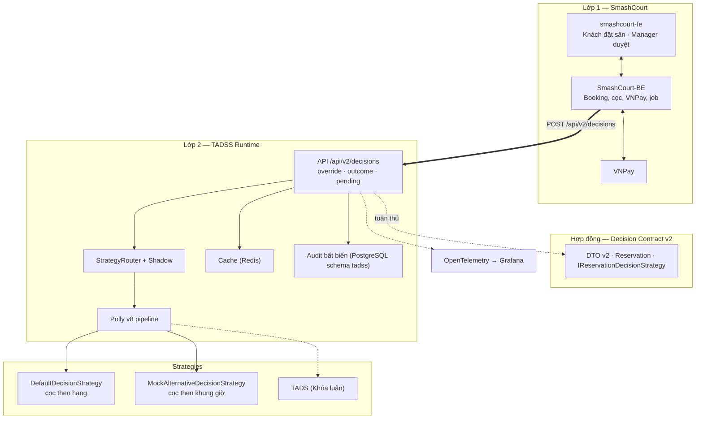
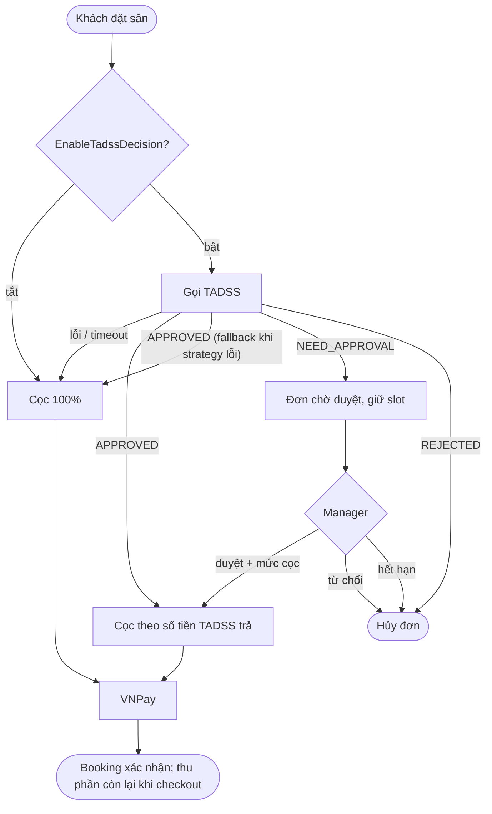
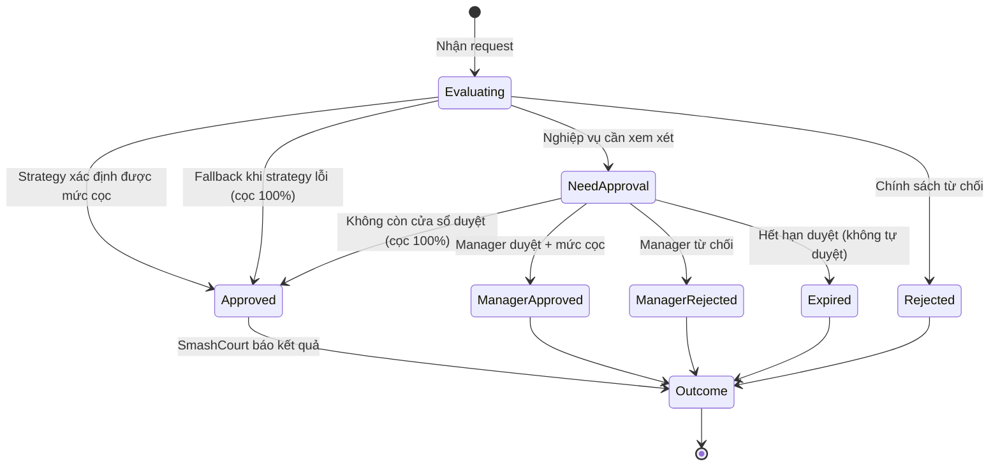

# TỔNG QUAN HỆ THỐNG TADSS (SYSTEM BLUEPRINT) — v2.0

> **Vai trò của tài liệu:** bức tranh tổng thể và các sơ đồ dùng cho báo cáo/slide. Thông số chi tiết nằm ở các file sở hữu (xem bản đồ tài liệu tại Mục III của [`THESIS_DEVELOPMENT_PLAYBOOK.md`](planning/THESIS_DEVELOPMENT_PLAYBOOK.md)).
>
> **Trạng thái (12/10/2026):** Phase 1–4 hoàn thành; Phase 5 (W05–W08, 05/10 – 01/11; bắt đầu thực tế 02/10) đã qua bước 0 (rà soát và điều chỉnh kế hoạch, Gate MR 01/10) và xong các gói 5.1–5.5 và phần mã của 5.6 — contract v2 là phiên bản duy nhất (năm endpoint `/api/v2/decisions`: đánh giá, chi tiết, hàng chờ, override, outcome; audit PostgreSQL bất biến; API key, rate limit, health live/ready; Docker Compose + ngrok; kiểm thử trên Testcontainers; định tuyến strategy + shadow mode; OpenTelemetry + Grafana; chế độ đánh giá chạy bằng một lệnh `docker compose up -d --build`; harness replay và adapter dữ liệu khách sạn, bản nhanh `EV-20261011-EVAL-quick-r1` đạt mọi tiêu chí áp dụng được). Gói 5.7: phần mã và tài liệu đã xong (12/10/2026) — contract v2.0.0 đóng băng ngày 11/10/2026 trước lượt đánh giá đầy đủ, tài liệu có kiểm tự động DOC-1…DOC-4; còn chờ người dùng chạy lượt đánh giá đầy đủ, lưu Evidence Pack và báo cáo Gate M5. Kế hoạch: [`MASTER_EXECUTION_PLAN.md`](planning/MASTER_EXECUTION_PLAN.md).

---

## 1. CÂU CHUYỆN ĐỀ TÀI

```text
┌──────────────────────────────────────────────────────────────────────────────┐
│ ĐỒ ÁN 1 — SMASHCOURT                                                         │
│ Đặt sân online + VNPay. Chính sách duy nhất: thanh toán 100% cho mọi đơn.    │
│ Muốn chính sách linh hoạt thì phải sửa mã CRUD → coupling, lỗi lan truyền,   │
│ không có vết giải trình, quản lý không can thiệp được.                       │
└───────────────────────────────────────┬──────────────────────────────────────┘
                                        ▼
┌──────────────────────────────────────────────────────────────────────────────┐
│ ĐỒ ÁN 2 — TADSS DECISION RUNTIME                                             │
│ Tách quyết định cọc ra runtime độc lập: định tuyến strategy theo request,    │
│ pipeline chịu lỗi, audit bất biến, Manager duyệt kèm mức cọc.                │
│ Kiểm chứng trên hạ tầng thật + đánh giá bằng dữ liệu import.                 │
└───────────────────────────────────────┬──────────────────────────────────────┘
                                        ▼
┌──────────────────────────────────────────────────────────────────────────────┐
│ KHÓA LUẬN — STRATEGY TADS                                                    │
│ Điểm tin cậy + mô hình rủi ro chạy trên TADSS (shadow mode, off-policy).      │
└──────────────────────────────────────────────────────────────────────────────┘
```

---

## 2. KIẾN TRÚC TỔNG THỂ



---

## 3. LUỒNG ĐẶT SÂN: TRƯỚC VÀ SAU

### 3.1. Đồ án 1


### 3.2. Đồ án 2



---

## 4. VÒNG ĐỜI QUYẾT ĐỊNH



Mọi chuyển trạng thái được ghi bằng bản ghi mới (quyết định, override, outcome); không bản ghi nào bị sửa.

---

## 5. TRẠNG THÁI DỰ ÁN

| Hạng mục | Trạng thái |
| :--- | :--- |
| Contract SDK v1, Runtime v1, pipeline chịu lỗi, audit đồng bộ, 510 test tại M4 (InMemory; còn 500 sau bước rà soát đầu Phase 5) | ✅ Phase 1–4 |
| Đồng bộ tài liệu, dọn repo | ✅ Phase 5, bước 0 (Gate MR 01/10) |
| Contract v2, audit bất biến, routing/shadow, toàn bộ hạ tầng & danh mục kiểm thử | ⏳ Phase 5 (W05–W08, 05/10 – 01/11; bắt đầu thực tế 02/10): xong các gói 5.1–5.5 và phần mã của 5.6; gói 5.7: contract v2.0.0 đã đóng băng ngày 11/10/2026 (trước lượt đánh giá đầy đủ), DOC-1…4 xong; lượt đánh giá đầy đủ và Gate M5 đang chờ |
| SmashCourt-BE ∥ smashcourt-fe | ⏳ Phase 6 (02/11 – 29/11) |
| Tích hợp, kiểm thử & sửa lỗi, đánh giá bằng dữ liệu import, Evidence Pack | ⏳ Phase 7–8 (30/11 – 20/12) |
| Báo cáo & bảo vệ | ⏳ Phase 9 (21/12 – 26/12/2026) |
