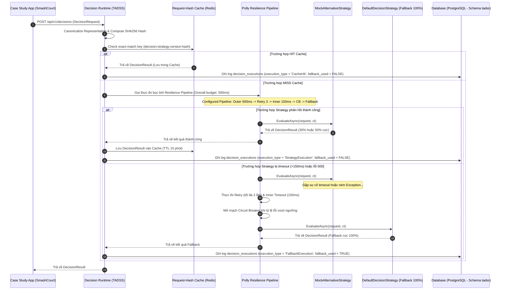

# TÀI LIỆU THIẾT KẾ KIẾN TRÚC PHẦN MỀM CHUẨN (SOFTWARE ARCHITECTURE SPECIFICATION - SAS)

Tài liệu này đặc tả chi tiết kiến trúc phần mềm, các thành phần hệ thống (C4 Model) và thiết kế thực thể miền (Domain Interfaces) của hệ thống **Decision Runtime Platform (TADSS)**.

---

## 1. PHÂN RÃ HỆ THỐNG & NET SOLUTION STRUCTURE

Mô hình phân rã dự án thành các project độc lập trong .NET Solution, loại bỏ liên kết ngược và bảo đảm tính di động (Portability):

```
SmashCourt.sln (Solution)
├── src/
│   ├── 1.Product/
│   │   └── CaseStudy.SmashCourt/            # Web App đặt sân (Case Study Application)
│   │       ├── Controllers/, Hubs/, Services/
│   │       └── CaseStudy.SmashCourt.csproj  # Nhúng DecisionContractSDK
│   │
│   ├── 2.Platform/
│   │   └── DecisionRuntime.TADSS/           # Decision Runtime Platform
│   │       ├── Controllers/                 # DecisionController, OverrideController
│   │       ├── Infrastructure/              # StrategyFactory (DI Lookup), PollyGateway, MediatRHandlers, FeatureFlags
│   │       ├── Options/                     # DecisionRuntimeOptions
│   │       └── DecisionRuntime.TADSS.csproj # Nhúng DecisionContractSDK (Không phụ thuộc trực tiếp vào CaseStudy)
│   │
│   ├── 3.SDK/
│   │   └── Shared.DecisionContractSDK/      # Decision Contract SDK (Shared Kernel)
│   │       ├── Domain/                      # Reservation (Rich Domain Model), Value Objects
│   │       ├── Interfaces/                  # IReservationDecisionStrategy
│   │       ├── Enums/                       # DecisionStatus, ReasonCode, BookingPriority
│   │       ├── DTOs/                        # DecisionRequest, DecisionResult, DecisionError
│   │       └── Shared.DecisionContractSDK.csproj
│   │
│   └── 4.Strategies/
│       ├── Strategy.Default/                # Cài đặt DefaultDecisionStrategy (Conservative Static Fallback 100%)
│       │   └── DefaultDecisionStrategy.cs
│       │
│       ├── Strategy.MockAlternative/        # Cài đặt MockAlternativeDecisionStrategy (Demonstration Policy: 30% / 50%)
│       │   └── MockAlternativeDecisionStrategy.cs
│       │
│       └── Strategy.AdaptiveTrust/          # Cài đặt TrustworthyAdaptiveDecisionStrategy (TADS Research - Khóa luận)
│           ├── TrustModel/
│           ├── MachineLearning/             # CatBoost Predictor
│           ├── TrustworthyAdaptiveDecisionStrategy.cs
│           └── Strategy.AdaptiveTrust.csproj# Nhúng DecisionContractSDK
```

---

## 2. THIẾT KẾ KHUNG THỰC THỂ MIỀN (DOMAIN INTERFACES & SDK STRUCTS)

Chuẩn hóa các thực thể miền bên trong **Shared.DecisionContractSDK** theo mẫu thiết kế DDD.

### 2.1. Cấu trúc Lớp Entity & Aggregate Signatures
*   **Reservation (Aggregate Root)**
    *   `Guid Id`
    *   `CustomerInfo Customer`
    *   `ResourceInfo Resource`
    *   `ReservationSchedule Schedule`
    *   `PaymentPolicy Payment`
    *   `ReservationMetadata Metadata`
    *   *Behaviors:* `EnsureValid()`, `GetDuration()`, `CanBeCancelledWithoutPenalty()`
*   **ReservationMetadata (Value Object)**
    *   `string Source`
    *   `string Tenant`
    *   `Guid CorrelationId`
    *   `JsonElement ExtensionData` (Cho phép schema động không gây leak bộ nhớ)

### 2.2. Giao diện Chiến lược Quyết định: `IReservationDecisionStrategy`
```csharp
namespace Shared.DecisionContractSDK.Interfaces
{
    using System.Threading;
    using System.Threading.Tasks;
    using Shared.DecisionContractSDK.Domain;
    using Shared.DecisionContractSDK.DTOs;

    public interface IReservationDecisionStrategy
    {
        string StrategyName { get; }
        string StrategyVersion { get; }
        Task<DecisionResult> EvaluateAsync(DecisionRequest request, CancellationToken cancellationToken);
    }
}
```

### 2.3. Hợp đồng dữ liệu yêu cầu: `DecisionRequest` DTO
```csharp
namespace Shared.DecisionContractSDK.DTOs
{
    using System;
    using System.Text.Json;
    using Shared.DecisionContractSDK.Domain;

    public class DecisionRequest
    {
        public string ContractVersion { get; set; } = "1.0.0"; // Kiểm soát tính tương thích ngược
        public Reservation Reservation { get; set; }
        public string RequestedBy { get; set; } // Định danh Actor yêu cầu (Customer/Staff)
        public DateTimeOffset Timestamp { get; set; }
        public Guid CorrelationId { get; set; } // UUID trace chéo hệ thống
        public string PolicyVersion { get; set; } // Phiên bản chính sách nghiệp vụ mong muốn
        public JsonElement RequestContext { get; set; } // Các tham số ngữ cảnh mở rộng (IP, Device...)
    }
}
```

### 2.4. Hợp đồng dữ liệu đầu ra: `DecisionResult` DTO
*   **DecisionResult**
    *   `DecisionStatus Status` (Approved, NeedApproval, Rejected)
    *   `BookingPriority Priority` (Low, Medium, High)
    *   `List<ReasonCode> Reasons` (Chứa danh sách lý do: STATIC_POLICY, PEAK_TIME, v.v.)
    *   `double Confidence`
    *   `string StrategyName`
    *   `string StrategyVersion`
    *   `DecisionRecommendation Recommendation`
*   **DecisionRecommendation**
    *   `string SchemaName`
    *   `string SchemaVersion`
    *   `JsonElement Parameters`
    *   `DateTimeOffset? ExpiresAt`

### 2.5. Hợp đồng dữ liệu lỗi: `DecisionError` DTO (RFC 7807 Compliance)
```csharp
namespace Shared.DecisionContractSDK.DTOs
{
    public class DecisionError
    {
        public string Type { get; set; } // Link đến tài liệu định nghĩa lỗi
        public string Title { get; set; } // Tiêu đề lỗi ngắn gọn
        public int Status { get; set; } // Mã trạng thái HTTP (e.g. 408, 500)
        public string Detail { get; set; } // Giải thích chi tiết lỗi xảy ra
        public string Instance { get; set; } // URI định danh request bị lỗi (CorrelationId)
        public Dictionary<string, string[]> Extensions { get; set; } = new(); // Dữ liệu bổ sung
    }
}
```

---

## 3. DECISION EXECUTION ENGINE & INFRASTRUCTURE MODULES

Hệ thống **Decision Runtime Platform (TADSS)** triển khai các module hạ tầng cốt lõi:

```
                  ┌─────────────────────────────────────────┐
                  │        DECISION EXECUTION ENGINE        │
                  └────────────────────┬────────────────────┘
                                       │
      ┌────────────────────────┬───────┼────────┬────────────────────────┐
      ▼                        ▼       ▼        ▼                        ▼
┌───────────┐            ┌──────────┐┌───┐┌──────────┐             ┌───────────┐
│ Strategy  │            │  Policy  ││ O ││Feature   │             │Versioning │
│ Registry  │            │  Engine  ││ b ││Flags     │             │& Migration│
└───────────┘            └──────────┘└───┘└──────────┘             └───────────┘
```

1.  **Strategy Registry (DI-based Strategy Resolution):** Đăng ký các Strategy vào `IServiceCollection` và phân giải qua `StrategyFactory` với độ phức tạp $O(1)$.
2.  **Policy Engine:** Thực thi các chính sách tĩnh mặc định khi Polly kích hoạt chế độ Fallback (`DefaultDecisionStrategy` - cọc 100%).
3.  **Observability (Serilog + OpenTelemetry):** Đo lường và lưu vết thời gian xử lý (`execution_time_ms`), cache hit/miss và failure reasons.
4.  **Feature Flags (`IFeatureFlagProvider`):** Bật/tắt nóng tính năng qua `IOptionsMonitor` dưới 2 giây.
5.  **Versioning & Migration:** Tự động đối chiếu `ContractVersion` để từ chối hoặc fallback khi có breaking changes trong payload.

### 3.1. Polly Resilience Pipeline Configuration (C# Spec)

```csharp
var resiliencePipeline = new ResiliencePipelineBuilder()
    .AddTimeout(TimeSpan.FromMilliseconds(500)) // Outer timeout (Overall Request SLA Budget)
    .AddRetry(new RetryStrategyOptions
    {
        MaxRetryAttempts = 2, // 2 retries = 3 attempts total
        BackoffType = DelayBackoffType.Exponential,
        BaseDelay = TimeSpan.FromMilliseconds(30)
    })
    .AddTimeout(TimeSpan.FromMilliseconds(150)) // Inner per-attempt timeout (150ms limit)
    .AddCircuitBreaker(new CircuitBreakerStrategyOptions
    {
        FailureRatio = 0.5,
        SamplingDuration = TimeSpan.FromSeconds(30),
        MinimumThroughput = 10,
        BreakDuration = TimeSpan.FromSeconds(30)
    })
    .AddFallback(new FallbackStrategyOptions
    {
        // Kích hoạt DefaultDecisionStrategy (thanh toán tĩnh 100%) khi strategy bị timeout hoặc lỗi
        FallbackAction = _ => Outcome.FromResult(DefaultDecisionStrategy.Evaluate())
    })
    .Build();
```

---

## 4. THIẾT KẾ CƠ SỞ DỮ LIỆU (DATABASE SCHEMA: tadss.decision_executions)

### 4.1. DDL Script Bảng Duy nhất `tadss.decision_executions`

```sql
CREATE SCHEMA IF NOT EXISTS tadss;

CREATE TABLE IF NOT EXISTS tadss.decision_executions (
    id UUID PRIMARY KEY DEFAULT gen_random_uuid(),
    decision_id UUID NOT NULL,
    reservation_id UUID NOT NULL,
    strategy_name VARCHAR(100) NOT NULL,
    strategy_version VARCHAR(20) NOT NULL,
    execution_type VARCHAR(50) NOT NULL, -- 'StrategyExecution', 'CacheHit', 'FallbackExecution'
    execution_time_ms INTEGER NOT NULL,
    fallback_used BOOLEAN NOT NULL DEFAULT FALSE,
    failure_reason TEXT NULL,
    cache_hit BOOLEAN NOT NULL DEFAULT FALSE,
    need_approval BOOLEAN NOT NULL DEFAULT FALSE,
    request_hash VARCHAR(64) NOT NULL,
    response_payload JSONB NOT NULL,
    
    -- Các trường Override & Concurrency
    is_overridden BOOLEAN NOT NULL DEFAULT FALSE,
    overridden_by VARCHAR(100) NULL,
    override_reason TEXT NULL,
    idempotency_key VARCHAR(100) NULL,
    version INTEGER NOT NULL DEFAULT 1,
    
    created_at TIMESTAMP WITH TIME ZONE DEFAULT CURRENT_TIMESTAMP,
    updated_at TIMESTAMP WITH TIME ZONE DEFAULT CURRENT_TIMESTAMP,
    
    CONSTRAINT uq_decision_idempotency UNIQUE (decision_id, idempotency_key)
);

CREATE INDEX IF NOT EXISTS idx_decision_executions_request_hash ON tadss.decision_executions (request_hash);
CREATE INDEX IF NOT EXISTS idx_decision_executions_reservation_id ON tadss.decision_executions (reservation_id);
```

---

## 5. CHI TIẾT LUỒNG ĐI CỦA REQUEST (SEQUENCE DIAGRAM)



---

## 6. QUY TẮC PHÊ DUYỆT HUMAN-IN-THE-LOOP & NO AUTO-APPROVE

```
DecisionResult.Status:
  ├── Approved      ──► Tiếp tục luồng đặt sân ──► Tạo giao dịch VNPay
  ├── NeedApproval  ──► Booking.Status = PendingDecisionApproval (TẠM CHẶN VNPAY)
  │                      └── Chờ Manager duyệt trên Dashboard:
  │                            ├── [Approve]  ──► Duyệt mức cọc đề xuất ──► Tiếp tục sang VNPay
  │                            └── [Override] ──► Sửa mức cọc (kèm Reason) ──► Tiếp tục sang VNPay
  │                      └── Hết hạn duyệt (Timeout 15 phút):
  │                            └── Chuyển sang Expired / Cancelled (TUYỆT ĐỐI KHÔNG AUTO-APPROVE)
  └── Rejected      ──► Hủy Booking ──► Thông báo lý do từ chối
```
