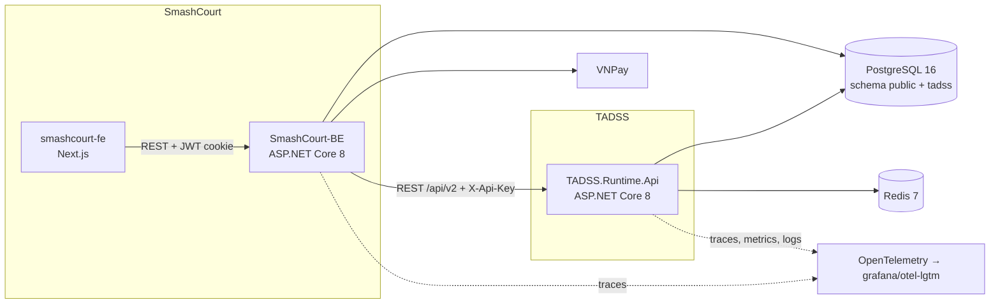
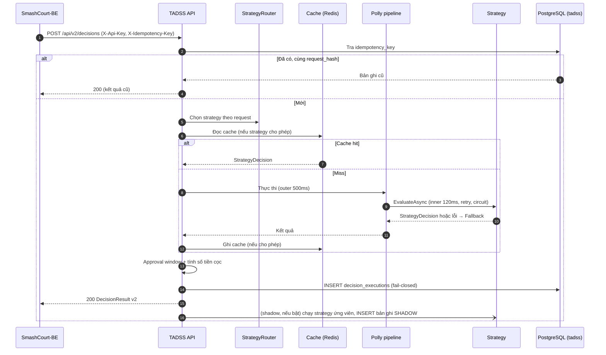

# ĐẶC TẢ KIẾN TRÚC PHẦN MỀM TADSS (SAS) — v2.0

> **Vai trò của tài liệu:** nguồn duy nhất về cấu trúc solution, thành phần runtime, strategy và luồng xử lý — gồm **hiện trạng sau gói 5.2c** (v2 là phiên bản duy nhất; v1 đã gỡ) và **mục tiêu v2** còn lại của Phase 5. Contract HTTP: [`INTEGRATION_SPEC.md`](../contracts/INTEGRATION_SPEC.md). Schema DB: [`DECISION_PERSISTENCE_INVARIANTS.md`](DECISION_PERSISTENCE_INVARIANTS.md). Pipeline chịu lỗi: [`RESILIENCE_AND_FAULT_TAXONOMY.md`](RESILIENCE_AND_FAULT_TAXONOMY.md).

---

## 1. NGỮ CẢNH HỆ THỐNG (C4 — CONTAINER)



- FE chỉ gọi BE; BE là client duy nhất của TADSS trong SmashCourt.
- TADSS và SmashCourt dùng chung máy chủ PostgreSQL nhưng tách schema; không bên nào truy cập bảng của bên kia.

---

## 2. CẤU TRÚC SOLUTION (`TADSS.slnx`)

```text
src/
├── Shared.DecisionContractSDK/        # Hợp đồng dùng chung v2 — chỉ BCL, 0 NuGet (README.md mô tả cây)
│   ├── Common/                        # ErrorCodes, ReasonCodes, PagedResult, TadssJson, converter JSON, ContractValidationException
│   ├── Decisions/                     # StrategyDecision, DecisionContext, StrategyCachePolicy, DecisionRecommendation
│   ├── Domain/                        # Reservation (aggregate root), ReservationItem, CustomerProfile, CustomerHistory, DemandSnapshot, BranchCalendar, PeakWindow + DomainInvariantException
│   ├── DTOs/{Decisions,Governance,Outcomes,Mappings}/
│   ├── Enums/                         # Channel, CustomerTier, DecisionStatus, ExecutionType, RecommendationType, OverrideAction, DecisionOutcome
│   └── Interfaces/                    # IReservationDecisionStrategy
├── TADSS.Runtime.Api/
│   ├── Common/                        # HttpHeaderNames
│   ├── Controllers/                   # DecisionsController (POST + GET /api/v2/decisions)
│   ├── Services/                      # DecisionService, DecisionQueryService, RequestHasher, CanonicalNumberFormatter
│   │   ├── Decisions/                 # DecisionResponseComposer, ApprovalWindowPolicy, DepositCalculator, ItemDurationPolicy
│   │   └── Strategies/                # StrategyRegistry, StrategyRegistrations, OptionsFingerprintBuilder
│   ├── Middlewares/                   # CorrelationIdMiddleware, GlobalExceptionHandler, ExceptionClassifier, PersistenceFailureDetector, exception types
│   ├── Configuration/                 # DependencyInjection, DecisionRuntimeServiceCollectionExtensions, *Options + validators, Swagger filters
│   └── Infrastructure/
│       ├── Data/                      # TadssDbContext, Entities, Configurations, EfDecisionAuditStore, DecisionAuditMapper, Migrations
│       ├── Resilience/                # StrategyPipeline, FallbackDecisionPolicy, ResilienceOptions(+Validator)
│       └── Caching/                   # StrategyDecisionCache (Redis + memory), StrategyDecisionCacheKey
├── TADSS.Strategies.Default/          # DefaultDecisionStrategy — chỉ phụ thuộc SDK
└── TADSS.Strategies.MockAlternative/  # MockAlternativeDecisionStrategy — chỉ phụ thuộc SDK
tests/
├── TADSS.UnitTests/                   # Common, Contracts, Controllers, Configuration, Decisions, Domain, Services, Strategies, Infrastructure, Middlewares, Architecture, TestData, TestDoubles
└── TADSS.IntegrationTests/            # API qua WebApplicationFactory trên Testcontainers (PostgreSQL 16, Redis 7, Toxiproxy): Migrations, Persistence, FaultInjection, endpoint/idempotency/cache
```

Health check: `/health/live`, `/health/ready` (PostgreSQL), `/health` — khai báo trong `Program.cs`.

---

## 3. v1 — ĐÃ GỠ Ở GÓI 5.2c

Runtime v1 (`/api/v1/decisions`, `StrategyResolver`, `DecisionResiliencePipeline`, `FallbackDecisionStrategy`, `ResilientDecisionCacheService`, handler audit qua MediatR, `AuditTimestampInterceptor`), SDK v1 và `TADSS.BenchmarkRunner` không còn trong mã. Hồ sơ v1 giữ nguyên trong `docs/contracts/CONTRACT_V1_FREEZE.md`, `API_CONTRACT_V1.md`, `openapi-v1.yaml` và `docs/research/benchmarks/`. Test `NoLegacyV1Tests` (UT-09) khóa việc không còn namespace/thư mục `V2`, kiểu v1 đã gỡ và MediatR.

**Hạn chế của v1 và trạng thái sau 5.2c:**

- Đã khắc phục ở v2: strategy chọn một lần lúc khởi động (nay `IStrategyRegistry`, định tuyến theo request ở 5.4); strategy tự sinh `DecisionId`/`ExecutionTimeMs`/`EvaluatedAt` (nay thuộc runtime); `IsPeakHour` theo UTC (nay theo `branchTimeZone` + `Tadss:Calendar`); `request_hash` phụ thuộc múi giờ máy chủ (INV-3); key cache chứa `reservationId`/`customerId` (nay key theo hash request); `InvalidOperationException`/`ArgumentException` đều thành 400 (nay `ExceptionClassifier`).
- Còn mở: không có xác thực `X-Api-Key` (gói 5.3); inner timeout chỉ có hiệu lực khi strategy tôn trọng `CancellationToken` (`IsolatedStrategyInvoker`, 5.4); Redis lỗi thì lần gọi cache chờ tới `RedisTimeoutMs` (circuit breaker + metric `bypass`, 5.4).

---

## 4. KIẾN TRÚC MỤC TIÊU v2 (Phase 5)

### 4.1. Hợp đồng strategy v2

Strategy chỉ trả **quyết định nghiệp vụ**; runtime chịu trách nhiệm định danh, thời gian, quy đổi số tiền và telemetry.

```csharp
public interface IReservationDecisionStrategy
{
    string StrategyName { get; }
    string StrategyVersion { get; }
    StrategyCachePolicy CachePolicy { get; }          // Disabled | Enabled(Ttl)
    Task<StrategyDecision> EvaluateAsync(Reservation reservation, DecisionContext context, CancellationToken ct);
}

public sealed record StrategyDecision(
    DecisionStatus Status,
    decimal? DepositRate,                              // bắt buộc khi Approved
    string ReasonCode,
    IReadOnlyList<string> Reasons,
    IReadOnlyList<DecisionRecommendation> Recommendations);
```

`DecisionContext` cung cấp thời điểm hiện tại theo giờ chi nhánh (`IClock` + `branchTimeZone`) để strategy không tự đọc đồng hồ hệ thống — giúp test tất định.

### 4.2. Thành phần runtime v2

> **Tiến độ (sau gói 5.2c):** v2 là runtime duy nhất, nằm ở vị trí chuẩn của Mục 2 (đã dời khỏi thư mục `V2/`, mọi thành phần đăng ký trong `AddDecisionRuntime`). Hiện thực và có test: `DecisionService`, `DecisionQueryService`, `EfDecisionAuditStore`, `StrategyPipeline`, `StrategyDecisionCache`, `ExceptionClassifier` nối vào `GlobalExceptionHandler`, `DecisionsController` (`POST /api/v2/decisions`, `GET /api/v2/decisions/{decisionId}`). Chưa có: xác thực `X-Api-Key`, override, outcome, hàng chờ (5.3), `StrategyRouter`/`ShadowExecutor`/`IsolatedStrategyInvoker`/breaker Redis (5.4) — các hàng dưới đây đánh dấu rõ phần đã có. Runtime chỉ dùng kiểu SDK v2 và mọi thời gian lấy từ `TimeProvider` (không gọi đồng hồ hệ thống trực tiếp).

| Thành phần | Trách nhiệm |
| :--- | :--- |
| `ApiKeyAuthenticationHandler` | Xác thực `X-Api-Key`; gắn client id vào log/trace. *Chưa hiện thực — gói 5.3* |
| `DecisionService` | Điều phối: idempotency → định tuyến → cache → pipeline → approval window → ghi audit → response. *Đã hiện thực (5.2b, đăng ký DI và nối controller ở 5.2c)*: một mốc `nowUtc` từ `TimeProvider` (cắt về µs) cho cả lần đánh giá; lỗi cache chỉ là miss; lỗi ghi audit lan ra (fail-closed, INV-10); chọn strategy tạm bằng `IStrategyRegistry.ResolveActive()` cho tới khi có `StrategyRouter` (5.4) |
| `IDecisionAuditStore` | Hợp đồng lưu audit `decision_executions` theo use case của `DecisionService`: `FindPrimaryByIdempotencyKeyAsync`, `InsertExecutionAsync` (append-only; tranh chấp `uq_decision_idempotency_key` trả bản đã thắng; lỗi tạm thời → `PersistenceUnavailableException` → 503). *Đã hiện thực (5.2c)* bằng `EfDecisionAuditStore` (EF Core, scoped; có `GetDecisionDetailAsync` cho `DecisionQueryService`); pending/override/outcome thêm ở 5.3 |
| `DecisionResponseComposer` | Ghép `DecisionResultDto` và `DecisionExecutionRecord` từ cùng một nguồn (response ⇔ `response_payload`); áp approval window và quy đổi cọc; `CACHE_HIT` sinh `decisionId`/`created_at` mới |
| `StrategyRouter` (`Tadss:Routing`) | Chọn strategy theo từng request dựa trên quy tắc cấu hình (ví dụ giờ cao điểm → `MockAlternativeDecisionStrategy`; mặc định → `DefaultDecisionStrategy`); reload cấu hình không cần restart |
| `ShadowExecutor` (`Tadss:Shadow`) | Chạy strategy ứng viên song song sau khi có kết quả chính; lưu bản ghi `SHADOW`; không ảnh hưởng response và độ trễ trả về |
| `IsolatedStrategyInvoker` | Thực thi strategy sao cho timeout cắt được cả strategy không hợp tác |
| `DecisionResiliencePipeline` | Giữ nguyên cấu hình Polly v8. *Đã hiện thực (5.2b) là `IStrategyPipeline`/`StrategyPipeline` cho strategy v2* (cùng `ResilienceOptions`; `ResilienceOptionsValidator` kiểm tra ngân sách `OuterTimeoutMs` ≥ tổng thời gian tối đa của inner timeout + retry và chặn khởi động nếu sai); pipeline theo strategy và `IsolatedStrategyInvoker` thuộc 5.4 |
| `ApprovalWindowPolicy` (`Tadss:Approval`) | Tính `approvalExpiresAt`; đổi `NEED_APPROVAL` → `APPROVED` 100% khi không còn cửa sổ duyệt (`reasonCode` = `APPROVAL_WINDOW_UNAVAILABLE`, `reasons` là một câu giải thích, kết quả gốc của strategy giữ ở `strategy_status`). *Đã hiện thực (5.2b)* |
| `DepositCalculator` | `amount = round(totalPrice × rate)` theo đơn vị tiền tệ. *Đã hiện thực (5.2b)*; quy đổi `amount → rate` cho override thêm ở 5.3 |
| `DecisionCacheService` | Chỉ cache khi strategy khai báo `Enabled`; key gồm hash request + tên/phiên bản strategy; circuit breaker cho Redis. *Đã hiện thực (5.2b) là `IStrategyDecisionCache`*: chỉ lưu `StrategyDecision` (không lưu response — mỗi lần cache hit nhận `decisionId` mới), chỉ ghi kết quả `AUTOMATED` (không ghi fallback), key `tadss:v2:{tên}:{phiên bản}:{optionsFingerprint}:{request_hash}` (fingerprint của mọi strategy gồm cả lịch cao điểm `Tadss:Calendar`), hai tầng Redis/memory, lỗi cache chỉ là miss. Circuit breaker Redis và metric `bypass` thuộc 5.4 |
| `ExceptionClassifier` | Bảng map exception → HTTP/`code` v2 (INTEGRATION_SPEC §3.8; lỗi PostgreSQL tạm thời `40001`/`40P01`/transient → 503 kèm `Retry-After`). *Đã hiện thực thành hàm thuần (5.2b) và là nguồn duy nhất của `GlobalExceptionHandler` (5.2c)*; gồm `MISSING_HEADER` (header thiếu), `DECISION_NOT_FOUND` (404) và `PersistenceFailureDetector` (duyệt cả `AggregateException`). 415 do MVC trả mặc định, không đi qua bảng này |
| `OverrideService`, `OutcomeService` | Ghi `decision_overrides`, `decision_outcomes`; xử lý idempotency và xung đột |
| `PendingApprovalQuery` | Truy vấn hàng chờ theo Mục B.5 của DECISION_PERSISTENCE_INVARIANTS |
| OpenTelemetry | Trace (ASP.NET Core, HttpClient, Npgsql, Redis), metric, log (Serilog → OTLP) |

**MediatR đã gỡ ở gói 5.2c** cùng với v1 (D-02): ghi audit là lời gọi đồng bộ qua `IDecisionAuditStore`, không còn handler `*AuditNotificationHandler`. `created_at` do `DecisionService` gán, không còn interceptor.

### 4.3. Strategy v2 (tham số mặc định, chỉnh qua cấu hình)

**`DefaultDecisionStrategy` 2.0.0 — cọc theo hạng thành viên** (`Tadss:Strategies:Default`)

| Điều kiện (kiểm tra theo thứ tự) | Kết quả | `reasonCode` |
| :--- | :--- | :--- |
| `totalPrice ≥ 2.000.000` | `NEED_APPROVAL` | `HIGH_VALUE_REVIEW` |
| `history.noShowCount ≥ 2` | `NEED_APPROVAL` | `NO_SHOW_HISTORY_REVIEW` |
| Khách vãng lai hoặc `STANDARD` | `APPROVED`, cọc 50% | `TIER_DEPOSIT` |
| `SILVER` | `APPROVED`, cọc 40% | `TIER_DEPOSIT` |
| `GOLD` | `APPROVED`, cọc 30% | `TIER_DEPOSIT` |
| `PLATINUM`, `DIAMOND` | `APPROVED`, cọc 20% | `TIER_DEPOSIT` |

**`MockAlternativeDecisionStrategy` 2.0.0 — cọc theo khung giờ** (`Tadss:Strategies:MockAlternative`)

| Điều kiện | Kết quả | `reasonCode` |
| :--- | :--- | :--- |
| Giờ cao điểm và `totalPrice ≥ 1.500.000` | `NEED_APPROVAL` | `HIGH_VALUE_REVIEW` |
| Giờ cao điểm | `APPROVED`, cọc 50% | `PEAK_HOUR_DEPOSIT` |
| Ngoài giờ cao điểm | `APPROVED`, cọc 30% | `OFF_PEAK_DEPOSIT` |

Giờ cao điểm (theo giờ chi nhánh, `Tadss:Calendar:PeakWindows`): thứ Hai–thứ Sáu 17:00–21:00; thứ Bảy–Chủ Nhật 08:00–21:00. Với booking nhiều sân, giờ cao điểm xét theo khung giờ bắt đầu sớm nhất.

**Định tuyến mặc định** (`Tadss:Routing`): request có giờ cao điểm → `MockAlternativeDecisionStrategy`; còn lại → `DefaultDecisionStrategy`. Shadow mode tắt mặc định.

**`FallbackDecisionStrategy`**: luôn `NEED_APPROVAL`; `reasonCode` theo nguyên nhân (`FALLBACK_STRATEGY_TIMEOUT`, `FALLBACK_STRATEGY_EXCEPTION`, `FALLBACK_CIRCUIT_OPEN`). Ở runtime v2 (`FallbackDecisionPolicy`, 5.2b), khi fallback thì `strategyName`/`strategyVersion` trong response và audit vẫn là của **strategy đã được chọn** (không đổi thành tên fallback); nhận biết fallback qua `executionType = FALLBACK`, `fallbackUsed = true` và `reasonCode` `FALLBACK_*`; riêng khi approval window không khả dụng thì `reasonCode` bị thay bằng `APPROVAL_WINDOW_UNAVAILABLE` (cọc 100%), nên chỉ `executionType`/`fallbackUsed` là tín hiệu đáng tin cậy. Kết quả fallback không được ghi cache.

### 4.4. Luồng xử lý `POST /api/v2/decisions`



### 4.5. Metric OpenTelemetry

| Metric | Loại | Nhãn |
| :--- | :--- | :--- |
| `tadss.decisions` | Counter | `status`, `strategy`, `execution_type` |
| `tadss.decision.duration` | Histogram (ms) | `endpoint`, `status_code` |
| `tadss.pipeline.duration` | Histogram (ms) | `strategy`, `outcome` |
| `tadss.fallbacks` | Counter | `reason` |
| `tadss.circuit.state` | Gauge | `strategy` |
| `tadss.cache.requests` | Counter | `result` (`hit`, `miss`, `bypass`) |
| `tadss.pending_approvals` | Gauge | `branch` |
| `tadss.overrides` | Counter | `action` |

---

## 5. NGUYÊN TẮC PHỤ THUỘC

| Project | Được phụ thuộc |
| :--- | :--- |
| `Shared.DecisionContractSDK` | Chỉ BCL |
| `TADSS.Strategies.*` | Chỉ SDK |
| `TADSS.Runtime.Api` | SDK + Strategies + hạ tầng (EF Core, Npgsql, Polly, Redis, OpenTelemetry) |
| `tests/*` | Mọi project trên |

Được kiểm tra tự động bởi `SdkDependencyPurityTests`, `StrategyDependencyPurityTests` (UT-09).

---

## 6. KIẾN TRÚC KIỂM THỬ

Danh mục kiểm thử, môi trường và công cụ: xem [`EXPERIMENTAL_DESIGN_AND_BENCHMARK_METHODOLOGY.md`](../research/EXPERIMENTAL_DESIGN_AND_BENCHMARK_METHODOLOGY.md).
