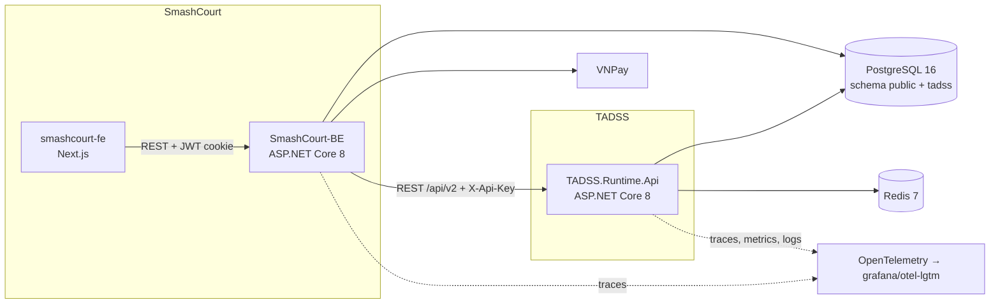
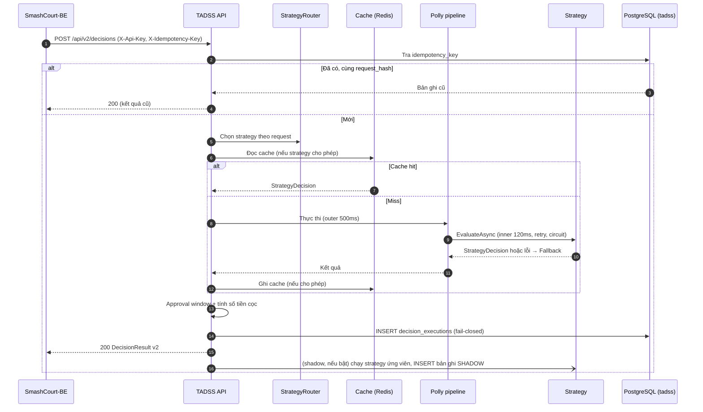
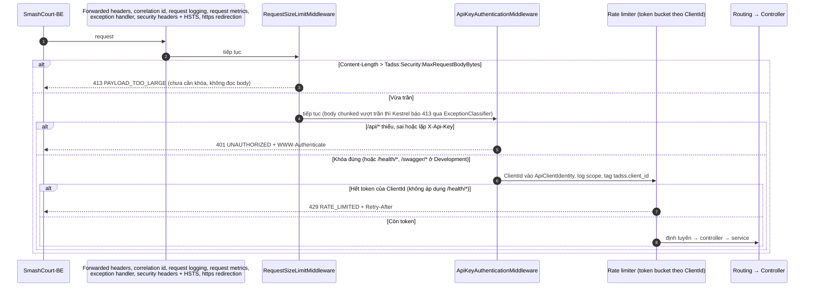

# ĐẶC TẢ KIẾN TRÚC PHẦN MỀM TADSS (SAS) — v2.0

> **Vai trò của tài liệu:** nguồn duy nhất về cấu trúc solution, thành phần runtime, strategy và luồng xử lý — gồm **hiện trạng sau gói 5.3** (v2 là phiên bản duy nhất, solution theo Clean Architecture nhiều project — ADR-013; đã có quản trị override/outcome/hàng chờ và lớp bảo mật) và **mục tiêu v2** còn lại của Phase 5. Contract HTTP: [`INTEGRATION_SPEC.md`](../contracts/INTEGRATION_SPEC.md). Schema DB: [`DECISION_PERSISTENCE_INVARIANTS.md`](DECISION_PERSISTENCE_INVARIANTS.md). Pipeline chịu lỗi: [`RESILIENCE_AND_FAULT_TAXONOMY.md`](RESILIENCE_AND_FAULT_TAXONOMY.md).

---

## 1. NGỮ CẢNH HỆ THỐNG (C4 — CONTAINER)



- FE chỉ gọi BE; BE là client duy nhất của TADSS trong SmashCourt.
- TADSS và SmashCourt dùng chung máy chủ PostgreSQL nhưng tách schema; không bên nào truy cập bảng của bên kia.

---

## 2. CẤU TRÚC SOLUTION (`TADSS.slnx`)

Clean Architecture nhiều project (ADR-013): `Shared.DecisionContractSDK` ← `TADSS.Application` ← `TADSS.Infrastructure` ← `TADSS.Runtime.Api`. Hai project strategy chỉ phụ thuộc SDK và được `TADSS.Runtime.Api` lắp vào lúc khởi động. Namespace bằng tên project cộng đường dẫn thư mục; mỗi file một kiểu public, tên file bằng tên kiểu.

```text
src/
├── Shared.DecisionContractSDK/        # Hợp đồng dùng chung v2 — chỉ BCL, 0 NuGet (README.md mô tả cây)
│   ├── Common/                        # ErrorCodes, ReasonCodes, PagedResult, TadssJson, converter JSON, ContractValidationException
│   ├── Decisions/                     # StrategyDecision, DecisionContext, StrategyCachePolicy, DecisionRecommendation
│   ├── Domain/                        # Reservation (aggregate root), ReservationItem, CustomerProfile, CustomerHistory, DemandSnapshot, BranchCalendar, PeakWindow + DomainInvariantException
│   ├── DTOs/{Decisions,Governance,Outcomes,Mappings}/
│   ├── Enums/                         # Channel, CustomerTier, DecisionStatus, ExecutionType, RecommendationType, OverrideAction, DecisionOutcome
│   └── Interfaces/                    # IReservationDecisionStrategy
├── TADSS.Application/                 # Use case + port + options nghiệp vụ; chỉ phụ thuộc SDK và abstraction Microsoft.Extensions.*
│   ├── ApplicationServiceCollectionExtensions.cs   # AddApplication(IServiceCollection, IConfiguration)
│   ├── Abstractions/
│   │   ├── Caching/                   # IStrategyDecisionCache, StrategyDecisionCacheKey
│   │   ├── Persistence/               # IDecisionEvaluationStore, IDecisionQueryStore, IDecisionGovernanceStore, DecisionExecutionRecord, DecisionDetailRecord, DecisionOverrideRecord, DecisionOutcomeRecord, ExecutionRole, InsertExecutionResult, InsertOverrideResult, InsertOutcomeResult, PendingApprovalsPage
│   │   └── Resilience/                # IStrategyPipeline, StrategyExecutionOutcome, FailureReasonPrefixes
│   ├── Common/                        # ContractLimits (giới hạn của contract), AuditTimestamps (cắt về µs), TadssMetricNames + TadssMetrics (meter `TADSS.Runtime`, nơi duy nhất khai báo tên metric), TadssActivitySource (ActivitySource `TADSS.Runtime`), CircuitStateValue — chỉ BCL `System.Diagnostics`, không phụ thuộc OpenTelemetry SDK
│   ├── Decisions/                     # IDecisionService/DecisionService, IDecisionQueryService/DecisionQueryService (chi tiết + hàng chờ), StrategyEvaluator, DecisionPayloadSerializer, DecisionResponseComposer, ApprovalWindowPolicy, DepositCalculator, ItemDurationPolicy, RequestHasher, CanonicalNumberFormatter
│   ├── Governance/                    # IOverrideService/OverrideService, OverrideRequestValidator, OverridePayloadComparer, GovernanceResponseMapper
│   ├── Outcomes/                      # IOutcomeService/OutcomeService
│   ├── Exceptions/                    # DecisionNotFoundException, DecisionStateConflictException, IdempotencyConflictException, PersistenceUnavailableException, DecisionTimeoutException
│   ├── Options/                       # ApprovalOptions, ValidationOptions, CalendarOptions, StrategyOptions + validator (mỗi kiểu một file)
│   └── Strategies/                    # IStrategyRegistry, StrategyRegistry, RegisteredStrategy, OptionsFingerprintBuilder
├── TADSS.Infrastructure/              # Adapter của port; phụ thuộc Application + SDK + EF Core/Npgsql, Redis, Polly
│   ├── InfrastructureServiceCollectionExtensions.cs   # AddInfrastructure(IServiceCollection, IConfiguration)
│   ├── Caching/                       # StrategyDecisionCache (Redis + memory), CachedStrategyDecision, CachedRecommendation, RedisConnectionFactory, RedisHealthCheck, CacheHealthChecks
│   ├── FaultInjection/                # FaultInjectionStrategyDecorator (chỉ môi trường Testing), FaultInjectionControl (đổi nóng Profile/DelayMs từ file JSON), FaultInjectionSnapshot
│   ├── Telemetry/                     # PendingApprovalsMetricRefresher (BackgroundService làm mới gauge hàng chờ duyệt, chỉ khi bật telemetry)
│   ├── HealthCheckTags.cs             # Tag `ready` của health check
│   ├── Options/                       # CacheOptions(+Validator), CacheProviders, DatabaseOptions(+Validator: chuỗi kết nối bắt buộc ở mọi môi trường), ResilienceOptions(+Validator), TelemetryOptions(+Validator), FaultInjectionOptions(+Validator)
│   ├── Persistence/                   # TadssDbContext, EfDecisionAuditStore (đọc: chi tiết, hàng chờ qua PendingApprovalsQuery; ghi audit), EfDecisionGovernanceStore (ghi override/outcome), DecisionAuditMapper, PersistenceFailureDetector + PersistenceFailureTranslator (internal), PersistenceHealthChecks, PersistenceServiceCollectionExtensions
│   │   ├── Entities/                  # DecisionExecutionEntity, DecisionOverrideEntity, DecisionOutcomeEntity
│   │   ├── Configurations/            # DecisionExecutionConfiguration, DecisionOverrideConfiguration, DecisionOutcomeConfiguration
│   │   └── Migrations/                # 4 migration + TadssDbContextModelSnapshot (mã sinh tự động, giữ nguyên ID)
│   └── Resilience/                    # StrategyPipeline (Polly v8), FallbackDecisionPolicy, FallbackCause
├── TADSS.Runtime.Api/                 # Presentation + composition root; được dùng mọi project
│   ├── Program.cs                     # Chỉ gọi AddApplication/AddInfrastructure/AddStrategies/AddPresentation, StartupTasks, UseTadssRequestPipeline, map endpoint
│   ├── Composition/                   # PresentationServiceCollectionExtensions (AddPresentation), SecurityServiceCollectionExtensions (AddTadssSecurity), StrategyServiceCollectionExtensions (AddStrategies), StrategyRegistrations, RequestPipelineExtensions (UseTadssRequestPipeline), EndpointMappingExtensions (MapTadssEndpoints), StartupTasks, TelemetryServiceCollectionExtensions (AddTadssTelemetry — chỗ duy nhất dựng OpenTelemetry SDK) + TelemetrySettings + SerilogTelemetryConfiguration, RequestLoggingConfiguration, TestingConfigurationExtensions (file profile tiêm lỗi, chỉ Testing) — chỗ duy nhất (cùng Program.cs) được dùng kiểu của Infrastructure
│   ├── Controllers/                   # DecisionsController (POST + GET /api/v2/decisions), DecisionApprovalsController (pending-approvals, override), DecisionOutcomesController (outcome), UnmatchedDecisionRoutesController (catch-all ẩn khỏi OpenAPI: định danh không phải GUID → 404 DECISION_NOT_FOUND dạng problem+json, CT-03)
│   ├── ErrorHandling/                 # ExceptionClassifier, ErrorClassification, ProblemResponse, ProblemResponseWriter (bộ ghi problem+json duy nhất), InvalidModelStateTranslator
│   ├── Middlewares/                   # CorrelationIdMiddleware, RequestMetricsMiddleware (`tadss.decision.duration`), GlobalExceptionHandler, SecurityHeadersMiddleware, RequestSizeLimitMiddleware, ApiKeyAuthenticationMiddleware
│   ├── OpenApi/                       # RequiredHeaderOperationFilter, SecurityResponsesOperationFilter, ProblemDetailsSchemaFilter, LineEndingDocumentFilter
│   ├── Options/                       # ErrorHandlingOptions(+Validator), SecurityOptions(+Validator), ApiKeyClientOptions, RateLimitingOptions
│   ├── Security/                      # ApiKeyVerifier (SHA-256 + FixedTimeEquals), ApiClientIdentity, SecurityPaths
│   └── Common/                        # HttpHeaderNames, RequestHeaders
├── TADSS.Strategies.Default/          # DefaultDecisionStrategy + DefaultStrategyOptions — chỉ phụ thuộc SDK
└── TADSS.Strategies.MockAlternative/  # MockAlternativeDecisionStrategy + MockAlternativeStrategyOptions — chỉ phụ thuộc SDK
tests/
├── TADSS.UnitTests/                   # Cây mirror src: Architecture, Sdk/{Common,Contracts,Decisions,Domain}, Strategies, Application/{Abstractions,Decisions,Options,Strategies}, Infrastructure/{Caching,Persistence,Resilience}, Api/{Composition,Controllers,ErrorHandling,Middlewares,OpenApi,Security}, TestData, TestDoubles
└── TADSS.IntegrationTests/            # API qua WebApplicationFactory trên Testcontainers (PostgreSQL 16, Redis 7, Toxiproxy): Migrations, Persistence (gồm store quản trị, hàng chờ), FaultInjection, Security (health, API key), endpoint (decisions, override, outcome, hàng chờ)/idempotency/cache, ComposeFixtureAlignment
```

Ngoài `src/` và `tests/` (hạ tầng đo lường và đánh giá của gói 5.5):

```text
docker/
├── grafana/{dashboards,provisioning}/ # Dashboard "TADSS Runtime" (uid tadss-runtime) và provisioning, mount chỉ đọc vào otel-lgtm
├── evaluator/                         # Dockerfile của container evaluator (SDK .NET 8 + Python 3.11 + k6 + Docker CLI; không chứa mã nguồn dự án)
├── evaluation/nginx.conf              # Reverse proxy hai replica TADSS (SCALE-2)
└── toxiproxy/toxiproxy.json           # Proxy postgres/redis của stack đánh giá
tools/
├── evaluation/{evaluator,tests}/      # Bộ điều phối Python: bước a…e, client Grafana/Prometheus/Toxiproxy/k6/PostgreSQL, lịch sự cố, quy tắc đạt/không đạt
├── evidence/{report,tests}/           # Dựng Evidence Pack: ẩn danh hóa, xuất D1, manifest + EV-1…EV-5, KPI SC1…SC8, bộ sinh report.html
├── expose/ observability/ ci/         # verify-expose.sh, verify-observability.sh, quét package lỗ hổng
tests/load/                            # Kịch bản k6: LT-01/02/03/05, SCALE-2, payload và hồ sơ tải (modes.json)
stryker/                               # Cấu hình Stryker.NET theo MT-01…MT-03
.config/dotnet-tools.json              # dotnet-stryker, ReportGenerator (tool cục bộ)
```

Health check: `/health/live` (không check nào) và `/health/ready` (PostgreSQL, tên check `postgresql`, lỗi → 503; Redis, tên check `redis`, lỗi → `Degraded` vẫn 200) — map trong `Composition/EndpointMappingExtensions.MapTadssEndpoints`, đăng ký trong `AddInfrastructure`. Không còn endpoint `/health` gộp (F-16); body chỉ là chữ trạng thái.

Thứ tự middleware của request pipeline khai báo tại một nơi: `Composition/RequestPipelineExtensions.UseTadssRequestPipeline` — forwarded headers (chỉ khi `Tadss:Security:TrustForwardedHeaders`) → correlation id → request logging → request metrics → exception handler → security headers + HSTS → https redirection → giới hạn kích thước body → Swagger (chỉ `Development`) → xác thực `X-Api-Key` → rate limiter → `UseRouting`. Không có `UseAuthorization` (không có policy). Thứ tự được khóa bằng test UT-14 (`SecurityPipelineOrderTests`, `RequestPipelineTests`); luồng chi tiết ở Mục 4.4.3.

---

## 3. HẠN CHẾ CÒN MỞ (sau gói 5.5)

- Các thành phần có **trạng thái theo từng instance** (rate limit SEC-1, circuit breaker của strategy, circuit breaker Redis, cache L1 `IMemoryCache`) không chia sẻ giữa nhiều instance của runtime: hạn mức thực tế nhân với số instance, breaker mở độc lập, L1 có thể lệch nhau (L2 Redis và idempotency qua PostgreSQL thì dùng chung). SCALE-1 (hai instance dùng chung PostgreSQL/Redis: idempotency, cache chéo instance, breaker theo instance) và SCALE-2 (hai replica sau nginx, 20 % request lặp khóa idempotency: 0 lỗi 5xx, mỗi khóa đúng một bản `PRIMARY` và một `decisionId`, cả hai instance báo metric) đã có test.
  **SCALE-3 (giới hạn khi scale ngang):** *theo từng instance* — rate limit (hạn mức thực tế = hạn mức × số instance), breaker của strategy, breaker Redis, cache L1, worker shadow và hàng đợi shadow; gauge hàng chờ duyệt do mỗi instance tự truy vấn nên **báo trùng** (dashboard dùng `max by (branch)`). *Dùng chung* — PostgreSQL (audit, idempotency, override/outcome), Redis L2. *Hệ quả:* breaker mở độc lập nên một instance có thể đang fallback trong khi instance kia vẫn chạy strategy; hạn mức rate limit không chính xác tuyệt đối khi nhiều instance. *Hướng khắc phục (chưa làm):* rate limit phân tán qua Redis, trạng thái breaker chia sẻ.
- Tranh chấp override ↔ outcome trên cùng quyết định không được khóa nguyên tử (INV-5, INTEGRATION_SPEC §4.3); tranh chấp override ↔ override thì do `UNIQUE(decision_id)` bảo đảm.
- Request logging và request metrics đứng ngoài exception handler nên thấy status cuối (409/503/504 không còn bị ghi "responded 500"); mức log: status ≥ 500 hoặc exception chưa xử lý → Error, còn lại Information. Dòng log hoàn tất được làm giàu `ClientId` lúc kết thúc request (đọc `ApiClientIdentity`); request bị từ chối ở bước xác thực không có `ClientId`.
- Strategy không hợp tác (bỏ qua token hoặc chặn đồng bộ) bị cắt đúng hạn nhờ `IsolatedStrategyInvoker` (request nhận fallback `APPROVED` cọc 100% trong ngân sách), nhưng TADSS **giới hạn thời gian chờ** chứ không dừng được strategy đó: task bị bỏ rơi vẫn tiêu thụ CPU/thread pool tới khi tự kết thúc và nhiều task bị bỏ rơi cùng lúc có thể làm cạn thread pool (số lần đếm bằng `tadss.strategy.abandoned`).
- Shadow dùng hàng đợi trong bộ nhớ có giới hạn (`Tadss:Shadow:QueueCapacity`): đầy thì bỏ việc (`tadss.shadow.dropped`), tắt ứng dụng thì việc còn trong hàng đợi bị bỏ; `Tadss:Shadow` không nạp lại nóng. Breaker Redis chỉ bảo vệ khỏi Redis hỏng kéo dài: các lệnh đầu tiên (tới ngưỡng `RedisBreakerMinimumThroughput`) vẫn chờ tới `RedisTimeoutMs`.

Test `NoLegacyV1Tests` (UT-09) chặn việc đưa lại kiểu, namespace hoặc package của phiên bản cũ. Ranh giới tầng và quy ước đặt tên/đặt chỗ được khóa bởi các test UT-14 (Mục 5).

---

## 4. KIẾN TRÚC MỤC TIÊU v2 (Phase 5)

### 4.1. Hợp đồng strategy v2

Strategy chỉ trả **quyết định nghiệp vụ**; runtime chịu trách nhiệm định danh, thời gian, quy đổi số tiền và telemetry.

```csharp
public interface IReservationDecisionStrategy
{
    string StrategyName { get; }
    string StrategyVersion { get; }
    StrategyCachePolicy CachePolicy { get; }          // Disabled | Enabled(Ttl)
    Task<StrategyDecision> EvaluateAsync(Reservation reservation, DecisionContext context, CancellationToken ct);
}

public sealed record StrategyDecision(
    DecisionStatus Status,
    decimal? DepositRate,                              // bắt buộc khi Approved
    string ReasonCode,
    IReadOnlyList<string> Reasons,
    IReadOnlyList<DecisionRecommendation> Recommendations);
```

`DecisionContext` cung cấp thời điểm hiện tại theo giờ chi nhánh (`IClock` + `branchTimeZone`) để strategy không tự đọc đồng hồ hệ thống — giúp test tất định.

### 4.2. Thành phần runtime v2

> **Tiến độ (sau gói 5.4):** v2 là runtime duy nhất; mỗi thành phần nằm ở project/thư mục ghi ở cột **Vị trí** (cây ở Mục 2). Mỗi tầng tự đăng ký phần của mình: `AddApplication`, `AddInfrastructure`, `AddStrategies`, `AddPresentation` (trong đó `AddTadssSecurity`) (Mục 2, `Program.cs`). Hiện thực và có test: `DecisionService`, `DecisionQueryService` (chi tiết và hàng chờ), `OverrideService`, `OutcomeService`, `StrategyEvaluator`, `EfDecisionAuditStore`, `EfDecisionGovernanceStore`, `StrategyPipeline`, `StrategyDecisionCache` (kèm breaker Redis), `StrategyRouter`, `ShadowDispatcher`/`ShadowExecutor`/`ShadowExecutionWorker`, `IsolatedStrategyInvoker`, `TadssMetrics`, `ExceptionClassifier` + `ProblemResponseWriter`, lớp bảo mật (API key, giới hạn kích thước, security headers, rate limiter), health live/ready, `DecisionsController`, `DecisionApprovalsController`, `DecisionOutcomesController` (năm endpoint, INTEGRATION_SPEC Mục 3). Chưa có: OpenTelemetry (5.5) — các hàng dưới đây đánh dấu rõ phần đã có. Runtime chỉ dùng kiểu SDK v2 và mọi thời gian lấy từ `TimeProvider` (không gọi đồng hồ hệ thống trực tiếp).

| Thành phần | Vị trí | Trách nhiệm |
| :--- | :--- | :--- |
| `ApiKeyAuthenticationMiddleware` + `ApiKeyVerifier` | `TADSS.Runtime.Api/Middlewares`, `TADSS.Runtime.Api/Security` | Xác thực `X-Api-Key` cho `/api/*`: băm SHA-256 khóa nhận được rồi `CryptographicOperations.FixedTimeEquals` với **mọi** mục cấu hình (không thoát sớm); thiếu, sai hoặc lặp header → 401 `UNAUTHORIZED` + `WWW-Authenticate` qua `ProblemResponseWriter`. Miễn `/health/live`, `/health/ready` (mọi môi trường) và `/swagger/*` (chỉ `Development`). Khóa đúng thì `ClientId` vào `ApiClientIdentity` (cho rate limiter), log scope và tag `tadss.client_id`. Không bao giờ log khóa hay mã băm. *Đã hiện thực* |
| `RequestSizeLimitMiddleware`, `SecurityHeadersMiddleware`, rate limiter | `TADSS.Runtime.Api/Middlewares`, `TADSS.Runtime.Api/Composition/SecurityServiceCollectionExtensions` | Giới hạn body `Tadss:Security:MaxRequestBodyBytes` (413 `PAYLOAD_TOO_LARGE`, kiểm tra `Content-Length` rồi đặt trần cho body chunked); header bảo mật + HSTS gắn qua `OnStarting` nên có cả trên response lỗi; token bucket theo `ClientId` (429 `RATE_LIMITED` + `Retry-After`, `QueueLimit = 0`, `/health/*` không giới hạn). Options `SecurityOptions` + `SecurityOptionsValidator` (fail-fast, ngoài `Development`/`Testing` bắt buộc có khóa và từ chối khóa local công khai `tadss-local-dev-key`). *Đã hiện thực* |
| `ProblemResponseWriter` + `ProblemResponse` | `TADSS.Runtime.Api/ErrorHandling` | Bộ ghi duy nhất dựng body `application/problem+json` (`code`, `traceId`, `retryAfterSeconds`) cho `GlobalExceptionHandler`, 401, 413, 429; các từ chối do middleware tạo không ném exception. *Đã hiện thực* |
| `IDecisionService` / `DecisionService` | `TADSS.Application/Decisions` | Điều phối: idempotency → định tuyến → cache → pipeline → approval window → ghi audit → response. *Đã hiện thực*: một mốc `nowUtc` từ `TimeProvider` (cắt về µs) cho cả lần đánh giá; lỗi cache chỉ là miss; lỗi ghi audit lan ra (fail-closed, INV-10); chọn strategy theo từng request bằng `IStrategyRouter` (`Tadss:Routing`, gói 5.4). Đăng ký scoped trong `AddApplication` |
| `StrategyEvaluator` | `TADSS.Application/Decisions` | Dựng khóa cache → đọc cache (lỗi cache chỉ là miss) → chạy `IStrategyPipeline` khi miss → ghi cache khi kết quả là `AUTOMATED`; trả `StrategyEvaluation` (kết quả + cờ cache hit). Chỉ hủy của chính caller được lan ra. Singleton |
| `DecisionPayloadSerializer` | `TADSS.Application/Decisions` | Serialize `request_payload`/`response_payload` bằng `TadssJson.Options` (chặt); **đọc** bằng bản sao nới lỏng (bỏ qua trường lạ, không bắt buộc trường) để bản ghi cũ không thành 500 khi DTO thêm trường; dùng chung cho composer, replay, `DecisionQueryService` và `OverrideService` |
| `IDecisionEvaluationStore`, `IDecisionQueryStore` | `TADSS.Application/Abstractions/Persistence` | Port lưu audit tách theo consumer (ISP). `IDecisionEvaluationStore` (cho `DecisionService`): `FindPrimaryByIdempotencyKeyAsync`, `InsertExecutionAsync` (append-only; tranh chấp `uq_decision_idempotency_key` trả bản đã thắng; lỗi tạm thời → `PersistenceUnavailableException` → 503). `IDecisionQueryStore` (cho `DecisionQueryService`): `GetDecisionDetailAsync`. `GetPendingApprovalsAsync` (hàng chờ). `IDecisionGovernanceStore` (cho `OverrideService`/`OutcomeService`, chỉ ghi): `InsertOverrideAsync`, `InsertOutcomeAsync` (`UNIQUE(decision_id)`; thua tranh chấp trả bản đã thắng với `IsExistingWinner`) |
| `EfDecisionAuditStore`, `EfDecisionGovernanceStore` | `TADSS.Infrastructure/Persistence` | `EfDecisionAuditStore` hiện thực `IDecisionEvaluationStore` và `IDecisionQueryStore` bằng EF Core (scoped, một instance mỗi scope); hàng chờ chạy bằng SQL có tham số trong `PendingApprovalsQuery` (dạng dùng được partial index `idx_de_pending`, IT-09). `EfDecisionGovernanceStore` hiện thực `IDecisionGovernanceStore` (tách file để giữ trần 250 dòng). Dịch lỗi tạm thời của PostgreSQL thành `PersistenceUnavailableException` (hoặc `OperationCanceledException` khi caller đã hủy) tại ranh giới adapter qua `PersistenceFailureDetector`/`PersistenceFailureTranslator` (`internal`) |
| `DecisionResponseComposer` | `TADSS.Application/Decisions` | Ghép `DecisionResultDto` và `DecisionExecutionRecord` từ cùng một nguồn (response ⇔ `response_payload`); áp approval window và quy đổi cọc; `CACHE_HIT` sinh `decisionId`/`created_at` mới; ghép theo `Role` (`PRIMARY` có khóa idempotency, `SHADOW` thì không) |
| `IStrategyRouter` / `StrategyRouter` (`Tadss:Routing`) | `TADSS.Application/Routing` (+ port `IRoutingRulesSource`: `TADSS.Application/Abstractions/Configuration`; adapter `ConfigurationRoutingRulesSource`: `TADSS.Infrastructure/Configuration`) | Chọn strategy theo từng request: rule đầu tiên khớp (điều kiện `PeakHour`/`BranchIds`/`Channels`/`Tiers`/`IsGuest`, AND), không khớp thì `DefaultStrategy`; kết quả `StrategyRoute(RegisteredStrategy, RuleName)` (`RuleName` chỉ vào log). *Đã hiện thực*: biên dịch cấu hình thành bảng bất biến, thay nguyên khối khi nạp lại nóng; nạp lại sai (validator, tên strategy lạ, giá trị enum/Guid sai) thì giữ bảng cũ, log Error và tăng `tadss.config.reload_failures`; cấu hình sai lúc khởi động thì không khởi động |
| `IShadowDispatcher` / `ShadowDispatcher`, `ShadowExecutor` (`Tadss:Shadow`), `ShadowExecutionWorker` | `TADSS.Application/Shadow`; worker: `TADSS.Infrastructure/Shadow` | Sau khi chính request vừa ghi bản `PRIMARY` mới, `DecisionService` gửi việc vào `Channel` có giới hạn (`TryWrite`, không chờ, không ném; đầy thì bỏ việc, `tadss.shadow.dropped`); worker nền đọc tuần tự, mỗi việc một DI scope, `ShadowExecutor` chạy strategy shadow qua pipeline của chính nó (không cache, cùng `nowUtc`) rồi ghi bản `SHADOW` (không khóa idempotency). Lỗi của shadow không ném (`tadss.shadow.executions`). *Đã hiện thực* |
| `IsolatedStrategyInvoker` | `TADSS.Infrastructure/Resilience` (`internal`) | Bước trong cùng của pipeline mọi strategy: chạy strategy bằng `Task.Run` rồi chờ bằng `WaitAsync(token)` nên timeout cắt được cả strategy bỏ qua token hoặc chặn đồng bộ; task bị bỏ rơi được quan sát exception (không `UnobservedTaskException`) và đếm bằng `tadss.strategy.abandoned`. Giới hạn: không dừng được strategy đó (Mục 3). *Đã hiện thực* |
| `IStrategyPipeline` / `StrategyPipeline` | Port: `TADSS.Application/Abstractions/Resilience`; hiện thực: `TADSS.Infrastructure/Resilience` | Pipeline Polly v8 quanh lời gọi strategy (outer timeout → fallback → retry → circuit breaker → inner timeout). *Đã hiện thực* (`ResilienceOptions`; `ResilienceOptionsValidator` kiểm tra ngân sách `OuterTimeoutMs` ≥ tổng thời gian tối đa của inner timeout + retry và chặn khởi động nếu sai). Outer timeout được dịch thành `DecisionTimeoutException` (Application) ngay tại adapter. Mỗi strategy có pipeline (và circuit breaker) riêng trong `ResiliencePipelineRegistry<string>` của Polly (khóa = `StrategyName`, tạo lười), dựng bởi `StrategyResilienceBuilder`; tham số `Tadss:Resilience` dùng chung, mọi log mang `{StrategyName}` |
| `ApprovalWindowPolicy` (`Tadss:Approval`) | `TADSS.Application/Decisions` | Tính `approvalExpiresAt`; đổi `NEED_APPROVAL` → `APPROVED` 100% khi không còn cửa sổ duyệt (`reasonCode` = `APPROVAL_WINDOW_UNAVAILABLE`, `reasons` là một câu giải thích, kết quả gốc của strategy giữ ở `strategy_status`). *Đã hiện thực* |
| `DepositCalculator` | `TADSS.Application/Decisions` | Một nơi quy đổi cọc: `Calculate` (`amount = round(totalPrice × rate)` theo đơn vị tiền tệ) và `FromAmount` (`rate = round(amount / totalPrice, 4)` cho override gửi `amount`). *Đã hiện thực* |
| `IStrategyDecisionCache` / `StrategyDecisionCache` | Port + `StrategyDecisionCacheKey`: `TADSS.Application/Abstractions/Caching`; hiện thực + `CachedStrategyDecision`: `TADSS.Infrastructure/Caching` | Chỉ cache khi strategy khai báo `Enabled`; key gồm hash request + tên/phiên bản strategy. *Đã hiện thực*: chỉ lưu `StrategyDecision` (không lưu response — mỗi lần cache hit nhận `decisionId` mới), chỉ ghi kết quả `AUTOMATED` (không ghi fallback), khóa đầy đủ `{InstanceName}v2:{tên}:{phiên bản}:{optionsFingerprint}:{request_hash}` (`InstanceName` mặc định `tadss:`) (fingerprint của mọi strategy gồm cả lịch cao điểm `Tadss:Calendar`), hai tầng Redis/memory (`Tadss:Cache:Provider`), lỗi cache chỉ là miss. Mọi lệnh Redis chạy trong pipeline riêng của `RedisDecisionCache` (breaker ngoài bọc timeout `RedisTimeoutMs`, tham số `RedisBreaker*`): breaker mở thì bỏ qua Redis ngay (dùng memory nếu `EnableFallbackToMemory`) và `tadss.cache.requests{result="bypass"}` tăng; lỗi cache không bao giờ kích hoạt fallback của strategy. Breaker theo từng instance |
| `IStrategyRegistry` / `StrategyRegistry`, `StrategyRegistrations` | Registry: `TADSS.Application/Strategies`; dựng strategy cụ thể từ cấu hình: `TADSS.Runtime.Api/Composition` | Registry giữ strategy đã đăng ký cùng `optionsFingerprint`; việc chọn và dựng `DefaultDecisionStrategy`/`MockAlternativeDecisionStrategy` là việc lắp ráp nên nằm ở composition root (Application không tham chiếu Strategies) |
| `ExceptionClassifier` + `GlobalExceptionHandler` | `TADSS.Runtime.Api/ErrorHandling`, `TADSS.Runtime.Api/Middlewares` | Bảng map exception → HTTP/`code` v2 (INTEGRATION_SPEC §3.8). *Hàm thuần, nguồn duy nhất của `GlobalExceptionHandler`*; chỉ biết exception của SDK và `TADSS.Application.Exceptions` (không biết Polly/Npgsql): `PersistenceUnavailableException` → 503, `DecisionTimeoutException` → 504, cả hai kèm `Retry-After` lấy từ `Tadss:ErrorHandling:RetryAfterSeconds` (mặc định 5; hợp lệ 1..3600). Gồm `MISSING_HEADER`, `DECISION_NOT_FOUND` (404), `DecisionStateConflictException` → 409 theo mã (`NOT_PENDING_APPROVAL`, `ALREADY_OVERRIDDEN`, `APPROVAL_EXPIRED`, `OUTCOME_ALREADY_RECORDED`), `BadHttpRequestException` 413 → `PAYLOAD_TOO_LARGE` (body chunked vượt trần); duyệt cả `AggregateException`. 415 do MVC trả mặc định, không đi qua bảng này |
| `IOverrideService` / `OverrideService`, `OverrideRequestValidator` | `TADSS.Application/Governance` | Override của Manager (INTEGRATION_SPEC §3.6): kiểm tra hình thức → tồn tại và `PRIMARY` → số tiền cọc so với đơn → replay/xung đột nếu đã có override → `NEED_APPROVAL` và chưa có outcome → chưa hết hạn → ghi qua `IDecisionGovernanceStore`; thua `UNIQUE(decision_id)` thì xử lý như đã có override. Quy đổi cọc bằng `DepositCalculator`. *Đã hiện thực* (sơ đồ ở 4.4.4) |
| `IOutcomeService` / `OutcomeService` | `TADSS.Application/Outcomes` | Ghi nhãn kết quả (§3.7): áp cho mọi quyết định `PRIMARY`; chống trùng theo nội dung (cùng → 200, khác → 409 `OUTCOME_ALREADY_RECORDED`); `X-Idempotency-Key` chỉ kiểm tra, không lưu. *Đã hiện thực* |
| Hàng chờ duyệt | `DecisionQueryService.GetPendingApprovalsAsync` (Application), `PendingApprovalsQuery` (Infrastructure) | Truy vấn theo Mục B.5 của DECISION_PERSISTENCE_INVARIANTS: bản `PRIMARY` mới nhất của mỗi `reservationId`, `NEED_APPROVAL`, chưa override/outcome, `approvalExpiresAt > now` (`now` từ `TimeProvider`), phân trang `page ≥ 1`, `pageSize` 1..100. *Đã hiện thực* |
| Health check | `TADSS.Infrastructure` (`PersistenceHealthChecks`, `CacheHealthChecks`, `RedisHealthCheck`), map ở `EndpointMappingExtensions` | `/health/live` không check; `/health/ready`: PostgreSQL bắt buộc (503), Redis `Degraded` (200). *Đã hiện thực* |
| OpenTelemetry | `TADSS.Runtime.Api/Composition` (`AddTadssTelemetry`; chỉ project này tham chiếu OpenTelemetry/Npgsql.OpenTelemetry) | Trace (ASP.NET Core, Npgsql, span Redis và pipeline tự tạo qua `TadssActivitySource`), metric (meter `TADSS.Runtime` + view biên histogram), log (Serilog → OTLP). Bật bằng `Tadss:Telemetry:Enabled`; tắt thì không đăng ký provider nào. *Đã hiện thực* |

Ghi audit là lời gọi đồng bộ qua `IDecisionEvaluationStore` (không qua message bus, D-02); `created_at` do `DecisionService` gán từ `TimeProvider`.

### 4.3. Strategy v2 (tham số mặc định, chỉnh qua cấu hình)

**`DefaultDecisionStrategy` 2.0.0 — cọc theo hạng thành viên** (`Tadss:Strategies:Default`)

| Điều kiện (kiểm tra theo thứ tự) | Kết quả | `reasonCode` |
| :--- | :--- | :--- |
| `totalPrice ≥ 2.000.000` | `NEED_APPROVAL` | `HIGH_VALUE_REVIEW` |
| `history.noShowCount ≥ 2` | `NEED_APPROVAL` | `NO_SHOW_HISTORY_REVIEW` |
| Khách vãng lai hoặc `STANDARD` | `APPROVED`, cọc 50% | `TIER_DEPOSIT` |
| `SILVER` | `APPROVED`, cọc 40% | `TIER_DEPOSIT` |
| `GOLD` | `APPROVED`, cọc 30% | `TIER_DEPOSIT` |
| `PLATINUM`, `DIAMOND` | `APPROVED`, cọc 20% | `TIER_DEPOSIT` |

**`MockAlternativeDecisionStrategy` 2.0.0 — cọc theo khung giờ** (`Tadss:Strategies:MockAlternative`)

| Điều kiện | Kết quả | `reasonCode` |
| :--- | :--- | :--- |
| Giờ cao điểm và `totalPrice ≥ 1.500.000` | `NEED_APPROVAL` | `HIGH_VALUE_REVIEW` |
| Giờ cao điểm | `APPROVED`, cọc 50% | `PEAK_HOUR_DEPOSIT` |
| Ngoài giờ cao điểm | `APPROVED`, cọc 30% | `OFF_PEAK_DEPOSIT` |

Giờ cao điểm (theo giờ chi nhánh, `Tadss:Calendar:PeakWindows`): thứ Hai–thứ Sáu 17:00–21:00; thứ Bảy–Chủ Nhật 08:00–21:00. Với booking nhiều sân, giờ cao điểm xét theo khung giờ bắt đầu sớm nhất.

**Định tuyến mặc định** (`Tadss:Routing`): request có giờ cao điểm → `MockAlternativeDecisionStrategy`; còn lại → `DefaultDecisionStrategy`. Shadow mode tắt mặc định.

**Fallback (`FallbackDecisionPolicy`)**: luôn `APPROVED` với cọc 100% (tỷ lệ 1, `deposit.amount = totalPrice`), không có khuyến nghị và không có hạn duyệt; `reasonCode` theo nguyên nhân (`FALLBACK_STRATEGY_TIMEOUT`, `FALLBACK_STRATEGY_EXCEPTION`, `FALLBACK_CIRCUIT_OPEN`). Mọi sự cố kỹ thuật dùng chung quy tắc cọc 100% (như khi SmashCourt tắt flag hoặc không gọi được TADSS); `NEED_APPROVAL` chỉ dành cho bất định nghiệp vụ do strategy quyết định, nên quyết định fallback không vào hàng chờ duyệt và không override được (D-13, 04/10/2026; trước đó fallback trả `NEED_APPROVAL`). Khi fallback thì `strategyName`/`strategyVersion` trong response và audit vẫn là của **strategy đã được chọn** (không đổi thành tên fallback); nhận biết fallback qua `executionType = FALLBACK`, `fallbackUsed = true` và `reasonCode` `FALLBACK_*`. Approval window không tác động lên fallback (chỉ áp cho `NEED_APPROVAL`), nên `strategy_status` trong audit cũng là `APPROVED`. Kết quả fallback không được ghi cache.

### 4.4. Luồng xử lý `POST /api/v2/decisions`

#### 4.4.1. Hiện thực — qua các tầng (đánh giá quyết định)

Request tới đây đã qua lớp bảo mật (Mục 4.4.3). Mỗi `participant` ghi kèm project chứa nó. Mũi tên xuyên ranh giới tầng luôn đi qua port của `TADSS.Application` (`IStrategyPipeline`, `IStrategyDecisionCache`, `IDecisionEvaluationStore`); `DecisionService` không biết Polly, Redis hay EF Core.


Quy ước của luồng:

- Lỗi trước bước ghi audit (validation, P-01, xung đột idempotency, outer timeout) không ghi bản ghi audit.
- Mọi exception đi tới `GlobalExceptionHandler` và được `ExceptionClassifier` ánh xạ sang HTTP/`code`; `Retry-After` của 503/504 lấy từ `Tadss:ErrorHandling:RetryAfterSeconds`.
- Hủy của caller thắng outer timeout khi hai việc cùng xảy ra (`StrategyPipeline` ném `OperationCanceledException` thay vì `DecisionTimeoutException`).

#### 4.4.2. Luồng v2 đầy đủ (định tuyến và shadow)

Sơ đồ dưới thêm bước `StrategyRouter` và shadow (gói 5.4) vào luồng ở Mục 4.4.1. Xác thực `X-Api-Key` ở Mục 4.4.3.



#### 4.4.3. Lớp bảo mật trước controller (mọi request `/api/*`)

Thứ tự khai báo tại `UseTadssRequestPipeline` (Mục 2). Mọi từ chối do middleware tạo đều đi qua `ProblemResponseWriter` (không ném exception); security headers, request logging và request metrics đứng trước các bước từ chối nên có cả trên 401, 413, 429.



#### 4.4.4. Luồng override của Manager (`POST /api/v2/decisions/{decisionId}/override`)

Thứ tự kiểm tra theo INTEGRATION_SPEC §3.6; dừng ở bước đầu tiên không đạt. `X-Idempotency-Key` và `X-Actor-Id` do controller kiểm tra trước khi gọi service.

```mermaid
sequenceDiagram
    autonumber
    participant BE as SmashCourt-BE
    participant CT as DecisionApprovalsController
    participant OS as OverrideService (Application)
    participant QS as IDecisionQueryStore
    participant GS as IDecisionGovernanceStore
    participant DB as PostgreSQL (tadss)

    BE->>CT: POST override (X-Api-Key, X-Idempotency-Key, X-Actor-Id)
    CT->>OS: OverrideAsync(decisionId, request, actorId, key)
    OS->>OS: Validate hình thức (400 VALIDATION_ERROR)
    OS->>QS: GetDecisionDetailAsync
    alt Không có hoặc là bản SHADOW
        OS-->>BE: 404 DECISION_NOT_FOUND
    else Có bản PRIMARY
        OS->>OS: ValidateAgainstOrder (amount ≤ totalPrice, số chữ số thập phân; 400)
        alt Đã có override
            alt Cùng key và cùng nội dung
                OS-->>BE: 200 bản đã lưu (replay)
            else Cùng key, khác nội dung
                OS-->>BE: 409 IDEMPOTENCY_KEY_REUSE
            else Khác key
                OS-->>BE: 409 ALREADY_OVERRIDDEN
            end
        else Chưa có override
            alt status ≠ NEED_APPROVAL hoặc đã có outcome
                OS-->>BE: 409 NOT_PENDING_APPROVAL
            else approvalExpiresAt ≤ now
                OS-->>BE: 409 APPROVAL_EXPIRED
            else Hợp lệ
                OS->>GS: InsertOverrideAsync (DepositCalculator quy đổi rate/amount)
                GS->>DB: INSERT decision_overrides
                alt Thua tranh chấp UNIQUE(decision_id)
                    GS-->>OS: bản đã thắng
                    OS-->>BE: xử lý như "đã có override" với bản thắng (200 hoặc 409)
                else Ghi được
                    OS-->>BE: 200 (deposit đã quy đổi, overriddenAt UTC)
                end
            end
        end
    end
```

Kiểm tra "chưa có outcome" rồi mới ghi override không khóa nguyên tử với việc ghi outcome (F-06); giới hạn này và cách BE xử lý ghi ở INTEGRATION_SPEC §4.3 và INV-5.

### 4.5. Metric, trace và log OpenTelemetry

Meter `TADSS.Runtime` (`TadssMetrics`; tên, nhãn và biên histogram khai báo ở `TadssMetricNames`, nơi **duy nhất** được viết literal `"tadss.…"`). Tên trên Prometheus: dấu chấm → gạch dưới; counter thêm `_total`; histogram đơn vị `ms` thêm `_milliseconds_{bucket,sum,count}`; gauge giữ nguyên. Nhãn resource: `job` = `service.name`, `instance` = `service.instance.id`.

| Metric | Loại | Nhãn | Ghi khi nào |
| :--- | :--- | :--- | :--- |
| `tadss.decisions` | Counter | `status`, `strategy`, `execution_type` | Một lần cho mỗi bản `PRIMARY` **mới** (không ghi khi replay idempotency, thua tranh chấp, lỗi, `SHADOW`) — đối chiếu được với số bản ghi (SC3) |
| `tadss.decision.duration` | Histogram (ms) | `endpoint` (`{METHOD} {route template}`, request bị từ chối trước routing là `{METHOD} unmatched`), `status_code` | Mọi request `/api/*` (không ghi `/health/*`, `/swagger/*`) |
| `tadss.pipeline.duration` | Histogram (ms) | `strategy`, `outcome` (`automated`, `fallback`, `timeout`) | Mỗi lần chạy pipeline; caller hủy thì không ghi |
| `tadss.fallbacks` | Counter | `reason` (`timeout`, `exception`, `circuit_open`), `strategy` | Mỗi quyết định fallback (breaker riêng cho từng strategy nên có nhãn `strategy`) |
| `tadss.circuit.state` | ObservableGauge | `strategy` | 0 đóng, 1 nửa mở, 2 mở, 3 cô lập; chỉ strategy đã có pipeline |
| `tadss.cache.circuit.state` | ObservableGauge | — | Breaker Redis, cùng mã số |
| `tadss.cache.requests` | Counter | `result` (`hit`, `miss`, `bypass`) | Mỗi lần tra cache; `bypass` khi breaker Redis mở |
| `tadss.pending_approvals` | ObservableGauge | `branch` | Làm mới mỗi `PendingApprovalsRefreshSeconds`; chi nhánh hết bản chờ báo 0 |
| `tadss.overrides` | Counter | `action` | Mỗi override mới (không ghi replay) |
| `tadss.strategy.abandoned` | Counter | `strategy` | Task strategy bị bỏ rơi sau khi hủy |
| `tadss.shadow.dropped` / `tadss.shadow.executions` | Counter | `reason` / `outcome` (`recorded`, `failed`) | Hàng đợi shadow đầy / kết quả chạy shadow |
| `tadss.config.reload_failures` | Counter | `section` | Nạp lại cấu hình nóng lỗi (định tuyến, tiêm lỗi) |

Biên histogram (ms): 5, 10, 25, 50, 75, 100, **150**, 200, 300, **500**, **700**, 1000, 2500, 5000 — 150/500/700 trùng ngưỡng KPI nên "p95 < 150", "pipeline ≤ 500", "p99 ≤ 700" là phép đếm tỉ lệ request ≤ biên, không phải nội suy.

**Trace** (`TadssActivitySource`, lấy mẫu `ParentBased(TraceIdRatioBased(TraceSampleRatio))`): span server ASP.NET Core (bỏ `/health/*`, `/swagger/*`), `tadss.decision.evaluate` (thuộc tính `tadss.strategy`, `tadss.routing_rule`, `tadss.status`, `tadss.execution_type`, `tadss.cache_hit`, `tadss.correlation_id`), `tadss.strategy.execute`, `tadss.shadow.execute` (liên kết tới span request gốc), span Npgsql (chỉ văn bản SQL có tham số), span lệnh Redis (không ghi khóa). **Log:** Serilog giữ sink console; khi bật telemetry thêm sink OTLP (Loki) cùng resource, mỗi dòng mang `TraceId`/`SpanId`.

---

## 5. NGUYÊN TẮC PHỤ THUỘC

| Project | Được phụ thuộc | Cấm |
| :--- | :--- | :--- |
| `Shared.DecisionContractSDK` | Chỉ BCL | Mọi project, mọi NuGet |
| `TADSS.Strategies.*` | Chỉ SDK | Application, Infrastructure, Runtime.Api, NuGet |
| `TADSS.Application` | SDK + gói `Microsoft.Extensions.{Logging.Abstractions, Options.ConfigurationExtensions}` (kéo theo `DependencyInjection.Abstractions`, `Options`) | Infrastructure, Runtime.Api, Strategies, ASP.NET Core, EF Core, Npgsql, StackExchange.Redis, Polly |
| `TADSS.Infrastructure` | Application + SDK + EF Core/Npgsql, StackExchange.Redis, Polly, `Microsoft.Extensions.*` | Runtime.Api, ASP.NET Core (assembly `Microsoft.AspNetCore.*`, `FrameworkReference`, Web SDK), Swashbuckle |
| `TADSS.Runtime.Api` | Tất cả project `src/` + Swashbuckle, Serilog, EF Core Design. Chỉ `Program.cs` và `Composition/` được dùng kiểu của Infrastructure | Controller, middleware, `ErrorHandling/`, `OpenApi/` dùng `TADSS.Infrastructure`, Npgsql, Polly, Redis, EF Core |
| `tests/*` | Mọi project trên | — |

Quy ước đi kèm: interface của **port** (mà Infrastructure hiện thực) nằm ở `TADSS.Application/Abstractions/**`; interface của service nội bộ Application nằm cùng thư mục với hiện thực; exception của runtime chỉ ở `TADSS.Application/Exceptions`; mỗi project tự đăng ký phần của mình qua `Add{Layer}`.

Được kiểm tra tự động (UT-09 và UT-14):

| Test | Quy tắc khóa |
| :--- | :--- |
| `SdkDependencyPurityTests`, `StrategyDependencyPurityTests` (UT-09) | SDK chỉ BCL; Strategies chỉ SDK |
| `ProjectReferenceRulesTests` | Mỗi project `src/` chỉ có `ProjectReference` trong allowlist; Application và Infrastructure chỉ dùng `PackageReference` trong allowlist, dùng `Microsoft.NET.Sdk` (không Web SDK) và không có `FrameworkReference` (đọc thẳng csproj) |
| `LayerDependencyTests` | Application/Infrastructure không tham chiếu assembly hạ tầng/presentation bị cấm (Infrastructure: không `Microsoft.AspNetCore.*`, Swashbuckle, Runtime.Api); EF Core chỉ trong `Persistence/`; port chỉ ở `Application.Abstractions.*` |
| `CompositionRootBoundaryTests` | Runtime.Api ngoài `Program.cs`/`Composition/` không dùng kiểu Infrastructure, Npgsql, Polly, Redis, EF Core (văn bản nguồn và reflection trên chữ ký/trường); không file nào, kể cả `Composition/`, có `global using` tới các namespace đó và csproj không có `<Using Include>` tới chúng |
| `NamingConventionTests` | Namespace khớp project + thư mục; không còn "V2" trong tên kiểu/namespace; `*Options`/`*OptionsValidator` ở `Options/`; exception chỉ ở `Application.Exceptions` |
| `SourceFileConventionTests` | Mỗi file một kiểu public, tên file = tên kiểu; file nguồn ≤ 250 dòng (trừ `Migrations/`); số kiểu public bộ quét văn bản tìm thấy bằng số kiểu public không lồng của assembly (bắt kiểu thụt lề/namespace dạng khối) |
| `SecurityPipelineOrderTests`, `RequestPipelineTests` | Thứ tự middleware qua hành vi quan sát được: 413 trước 401, 401 trước 429, rate limiter đứng sau xác thực, routing sau các bước bảo mật; test bảo mật không cần DB nằm trong `TADSS.UnitTests/Api/Security` (host in-process), không phải `IntegrationTests` |
| `AppSettingsValidationTests` | `appsettings.json` qua mọi validator khi host khởi động; mọi options có hằng `SectionName` (tìm bằng reflection) có đúng một `IValidateOptions<T>` và đăng ký `ValidateOnStart` (không có ngoại lệ; `DatabaseOptions` kiểm chuỗi kết nối, chuỗi giữ chỗ trong `appsettings.json` được test thay bằng chuỗi test) |

Danh mục đầy đủ các test UT-14: [`EXPERIMENTAL_DESIGN_AND_BENCHMARK_METHODOLOGY.md`](../research/EXPERIMENTAL_DESIGN_AND_BENCHMARK_METHODOLOGY.md).

---

## 6. KIẾN TRÚC KIỂM THỬ

Danh mục kiểm thử, môi trường và công cụ: xem [`EXPERIMENTAL_DESIGN_AND_BENCHMARK_METHODOLOGY.md`](../research/EXPERIMENTAL_DESIGN_AND_BENCHMARK_METHODOLOGY.md).
