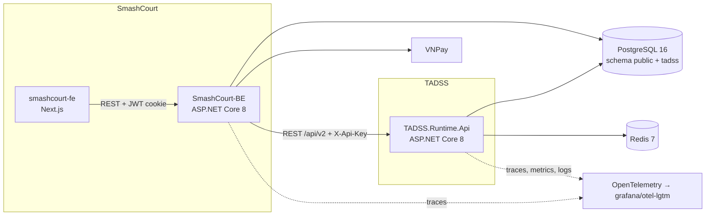
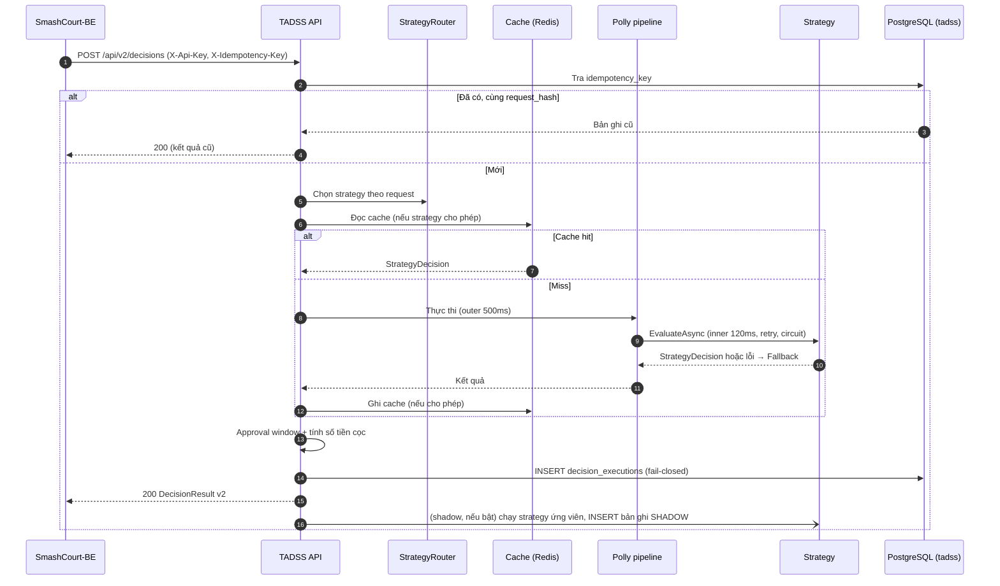

# ĐẶC TẢ KIẾN TRÚC PHẦN MỀM TADSS (SAS) — v2.0

> **Vai trò của tài liệu:** nguồn duy nhất về cấu trúc solution, thành phần runtime, strategy và luồng xử lý — gồm **hiện trạng v1** (đã chạy) và **mục tiêu v2** (Phase 5). Contract HTTP: [`INTEGRATION_SPEC.md`](../contracts/INTEGRATION_SPEC.md). Schema DB: [`DECISION_PERSISTENCE_INVARIANTS.md`](DECISION_PERSISTENCE_INVARIANTS.md). Pipeline chịu lỗi: [`RESILIENCE_AND_FAULT_TAXONOMY.md`](RESILIENCE_AND_FAULT_TAXONOMY.md).

---

## 1. NGỮ CẢNH HỆ THỐNG (C4 — CONTAINER)



- FE chỉ gọi BE; BE là client duy nhất của TADSS trong SmashCourt.
- TADSS và SmashCourt dùng chung máy chủ PostgreSQL nhưng tách schema; không bên nào truy cập bảng của bên kia.

---

## 2. CẤU TRÚC SOLUTION (`TADSS.slnx`)

```text
src/
├── Shared.DecisionContractSDK/        # Hợp đồng dùng chung — chỉ BCL, 0 NuGet
│   ├── Common/                        # ApiResponse, PagedResult, ErrorCodes, ContractValidationException
│   ├── Domain/                        # Reservation (aggregate root) + value objects + DomainInvariantException
│   ├── DTOs/{Decisions,Governance,Mappings}/
│   ├── Enums/                         # DecisionStatus, ExecutionType, PaymentStatus, BookingPriority, RecommendationType, ReasonCode
│   └── Interfaces/                    # IReservationDecisionStrategy
├── TADSS.Runtime.Api/
│   ├── Controllers/                   # DecisionsController
│   ├── Services/                      # DecisionService, StrategyResolver, RequestHasher
│   ├── Middlewares/                   # CorrelationIdMiddleware, GlobalExceptionHandler
│   ├── Configuration/                 # DependencyInjection, *Options, RequiredHeaderOperationFilter
│   └── Infrastructure/
│       ├── Data/                      # TadssDbContext, Entities, Configurations, Interceptors, Auditing (MediatR handlers), Migrations
│       ├── Resilience/                # DecisionResiliencePipeline, FallbackDecisionStrategy, ResilienceOptions
│       └── Caching/                   # Redis/Memory/ResilientDecisionCacheService, CacheKeyBuilder
├── TADSS.Strategies.Default/          # DefaultDecisionStrategy — chỉ phụ thuộc SDK
└── TADSS.Strategies.MockAlternative/  # MockAlternativeDecisionStrategy — chỉ phụ thuộc SDK
tests/
├── TADSS.UnitTests/                   # Domain, Contracts, Services, Strategies, Infrastructure, Architecture
├── TADSS.IntegrationTests/            # API qua WebApplicationFactory trên Testcontainers (PostgreSQL 16, Redis 7, Toxiproxy)
└── TADSS.BenchmarkRunner/             # Micro-benchmark lab Phase 4 (lưu trữ)
```

Health check: `/health/live`, `/health/ready` (PostgreSQL), `/health` — khai báo trong `Program.cs`.

---

## 3. HIỆN TRẠNG v1 (đang chạy)

| Thành phần | Vị trí | Trách nhiệm |
| :--- | :--- | :--- |
| `DecisionsController` | `Controllers/` | 4 endpoint `/api/v1/decisions` |
| `DecisionService` | `Services/` | Idempotency → chọn strategy → cache → map DTO sang domain → pipeline → ghi cache → ghi audit |
| `StrategyResolver` | `Services/` | Đăng ký strategy qua DI vào `Dictionary` theo tên (không phân biệt hoa thường); strategy hoạt động lấy từ `Tadss:Strategy:ActiveStrategyName` khi khởi động |
| `DecisionResiliencePipeline` | `Infrastructure/Resilience/` | Pipeline Polly v8 (singleton, nên trạng thái circuit dùng chung giữa các request) |
| `FallbackDecisionStrategy` | `Infrastructure/Resilience/` | Trả `NEED_APPROVAL` tất định |
| `ResilientDecisionCacheService` | `Infrastructure/Caching/` | Đọc Redis trước; lỗi hoặc miss → đọc `IMemoryCache`; ghi cả hai |
| `RequestHasher` | `Services/` | Object canonical thứ tự cố định → SHA-256 |
| `DecisionEvaluatedAuditNotificationHandler`, `DecisionOverriddenAuditNotificationHandler` | `Infrastructure/Data/Auditing/` | Ghi audit đồng bộ qua MediatR |
| `CorrelationIdMiddleware`, `GlobalExceptionHandler` | `Middlewares/` | Correlation id; lỗi RFC 7807 |

**Hạn chế đã ghi nhận (được khắc phục ở v2):**

- Strategy chọn một lần lúc khởi động; đổi strategy phải restart; thêm strategy phải sửa `DependencyInjection.cs` và tham chiếu project.
- Strategy tự sinh `DecisionId`, `ExecutionTimeMs`, `EvaluatedAt` — trách nhiệm của runtime bị rò sang strategy.
- `MockAlternativeDecisionStrategy.IsPeakHour` so sánh trên giờ UTC.
- `RequestHasher` gọi `ToUniversalTime()` trên `DateTime` không có Kind → phụ thuộc múi giờ máy chủ.
- Key cache chứa `reservationId` và `customerId` → chỉ hit khi đánh giá lại đúng cùng đơn; TTL 24 giờ có thể trả kết quả cũ với strategy phụ thuộc thời gian; Redis lỗi thì mọi request chờ hết `RedisTimeoutMs`.
- Inner timeout chỉ có hiệu lực khi strategy tôn trọng `CancellationToken`.
- `InvalidOperationException` và `ArgumentException` đều bị map thành 400, che lỗi phía server.
- Không có xác thực; `overriddenBy` do client tự khai.

---

## 4. KIẾN TRÚC MỤC TIÊU v2 (Phase 5)

### 4.1. Hợp đồng strategy v2

Strategy chỉ trả **quyết định nghiệp vụ**; runtime chịu trách nhiệm định danh, thời gian, quy đổi số tiền và telemetry.

```csharp
public interface IReservationDecisionStrategy
{
    string StrategyName { get; }
    string StrategyVersion { get; }
    StrategyCachePolicy CachePolicy { get; }          // Disabled | Enabled(Ttl)
    Task<StrategyDecision> EvaluateAsync(Reservation reservation, DecisionContext context, CancellationToken ct);
}

public sealed record StrategyDecision(
    DecisionStatus Status,
    decimal? DepositRate,                              // bắt buộc khi Approved
    string ReasonCode,
    IReadOnlyList<string> Reasons,
    IReadOnlyList<DecisionRecommendation> Recommendations);
```

`DecisionContext` cung cấp thời điểm hiện tại theo giờ chi nhánh (`IClock` + `branchTimeZone`) để strategy không tự đọc đồng hồ hệ thống — giúp test tất định.

### 4.2. Thành phần runtime v2

| Thành phần | Trách nhiệm |
| :--- | :--- |
| `ApiKeyAuthenticationHandler` | Xác thực `X-Api-Key`; gắn client id vào log/trace |
| `DecisionService` | Điều phối: idempotency → định tuyến → cache → pipeline → approval window → ghi audit → response |
| `StrategyRouter` (`Tadss:Routing`) | Chọn strategy theo từng request dựa trên quy tắc cấu hình (ví dụ giờ cao điểm → `MockAlternativeDecisionStrategy`; mặc định → `DefaultDecisionStrategy`); reload cấu hình không cần restart |
| `ShadowExecutor` (`Tadss:Shadow`) | Chạy strategy ứng viên song song sau khi có kết quả chính; lưu bản ghi `SHADOW`; không ảnh hưởng response và độ trễ trả về |
| `IsolatedStrategyInvoker` | Thực thi strategy sao cho timeout cắt được cả strategy không hợp tác |
| `DecisionResiliencePipeline` | Giữ nguyên cấu hình Polly v8 |
| `ApprovalWindowPolicy` (`Tadss:Approval`) | Tính `approvalExpiresAt`; đổi `NEED_APPROVAL` → `APPROVED` 100% khi không còn cửa sổ duyệt |
| `DepositCalculator` | `amount = round(totalPrice × rate)` theo đơn vị tiền tệ |
| `DecisionCacheService` | Chỉ cache khi strategy khai báo `Enabled`; key gồm hash request + tên/phiên bản strategy; circuit breaker cho Redis |
| `OverrideService`, `OutcomeService` | Ghi `decision_overrides`, `decision_outcomes`; xử lý idempotency và xung đột |
| `PendingApprovalQuery` | Truy vấn hàng chờ theo Mục B.5 của DECISION_PERSISTENCE_INVARIANTS |
| OpenTelemetry | Trace (ASP.NET Core, HttpClient, Npgsql, Redis), metric, log (Serilog → OTLP) |

### 4.3. Strategy v2 (tham số mặc định, chỉnh qua cấu hình)

**`DefaultDecisionStrategy` 2.0.0 — cọc theo hạng thành viên** (`Tadss:Strategies:Default`)

| Điều kiện (kiểm tra theo thứ tự) | Kết quả | `reasonCode` |
| :--- | :--- | :--- |
| `totalPrice ≥ 2.000.000` | `NEED_APPROVAL` | `HIGH_VALUE_REVIEW` |
| `history.noShowCount ≥ 2` | `NEED_APPROVAL` | `NO_SHOW_HISTORY_REVIEW` |
| Khách vãng lai hoặc `STANDARD` | `APPROVED`, cọc 50% | `TIER_DEPOSIT` |
| `SILVER` | `APPROVED`, cọc 40% | `TIER_DEPOSIT` |
| `GOLD` | `APPROVED`, cọc 30% | `TIER_DEPOSIT` |
| `PLATINUM`, `DIAMOND` | `APPROVED`, cọc 20% | `TIER_DEPOSIT` |

**`MockAlternativeDecisionStrategy` 2.0.0 — cọc theo khung giờ** (`Tadss:Strategies:MockAlternative`)

| Điều kiện | Kết quả | `reasonCode` |
| :--- | :--- | :--- |
| Giờ cao điểm và `totalPrice ≥ 1.500.000` | `NEED_APPROVAL` | `HIGH_VALUE_REVIEW` |
| Giờ cao điểm | `APPROVED`, cọc 50% | `PEAK_HOUR_DEPOSIT` |
| Ngoài giờ cao điểm | `APPROVED`, cọc 30% | `OFF_PEAK_DEPOSIT` |

Giờ cao điểm (theo giờ chi nhánh, `Tadss:Calendar:PeakWindows`): thứ Hai–thứ Sáu 17:00–21:00; thứ Bảy–Chủ Nhật 08:00–21:00. Với booking nhiều sân, giờ cao điểm xét theo khung giờ bắt đầu sớm nhất.

**Định tuyến mặc định** (`Tadss:Routing`): request có giờ cao điểm → `MockAlternativeDecisionStrategy`; còn lại → `DefaultDecisionStrategy`. Shadow mode tắt mặc định.

**`FallbackDecisionStrategy`**: luôn `NEED_APPROVAL`; `reasonCode` theo nguyên nhân (`FALLBACK_STRATEGY_TIMEOUT`, `FALLBACK_STRATEGY_EXCEPTION`, `FALLBACK_CIRCUIT_OPEN`).

### 4.4. Luồng xử lý `POST /api/v2/decisions`



### 4.5. Metric OpenTelemetry

| Metric | Loại | Nhãn |
| :--- | :--- | :--- |
| `tadss.decisions` | Counter | `status`, `strategy`, `execution_type` |
| `tadss.decision.duration` | Histogram (ms) | `endpoint`, `status_code` |
| `tadss.pipeline.duration` | Histogram (ms) | `strategy`, `outcome` |
| `tadss.fallbacks` | Counter | `reason` |
| `tadss.circuit.state` | Gauge | `strategy` |
| `tadss.cache.requests` | Counter | `result` (`hit`, `miss`, `bypass`) |
| `tadss.pending_approvals` | Gauge | `branch` |
| `tadss.overrides` | Counter | `action` |

---

## 5. NGUYÊN TẮC PHỤ THUỘC

| Project | Được phụ thuộc |
| :--- | :--- |
| `Shared.DecisionContractSDK` | Chỉ BCL |
| `TADSS.Strategies.*` | Chỉ SDK |
| `TADSS.Runtime.Api` | SDK + Strategies + hạ tầng (EF Core, Npgsql, Polly, Redis, OpenTelemetry) |
| `tests/*` | Mọi project trên |

Được kiểm tra tự động bởi `SdkDependencyPurityTests`, `StrategyDependencyPurityTests` (UT-09).

---

## 6. KIẾN TRÚC KIỂM THỬ

Danh mục kiểm thử, môi trường và công cụ: xem [`EXPERIMENTAL_DESIGN_AND_BENCHMARK_METHODOLOGY.md`](../research/EXPERIMENTAL_DESIGN_AND_BENCHMARK_METHODOLOGY.md).
