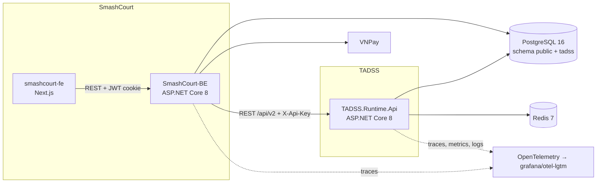
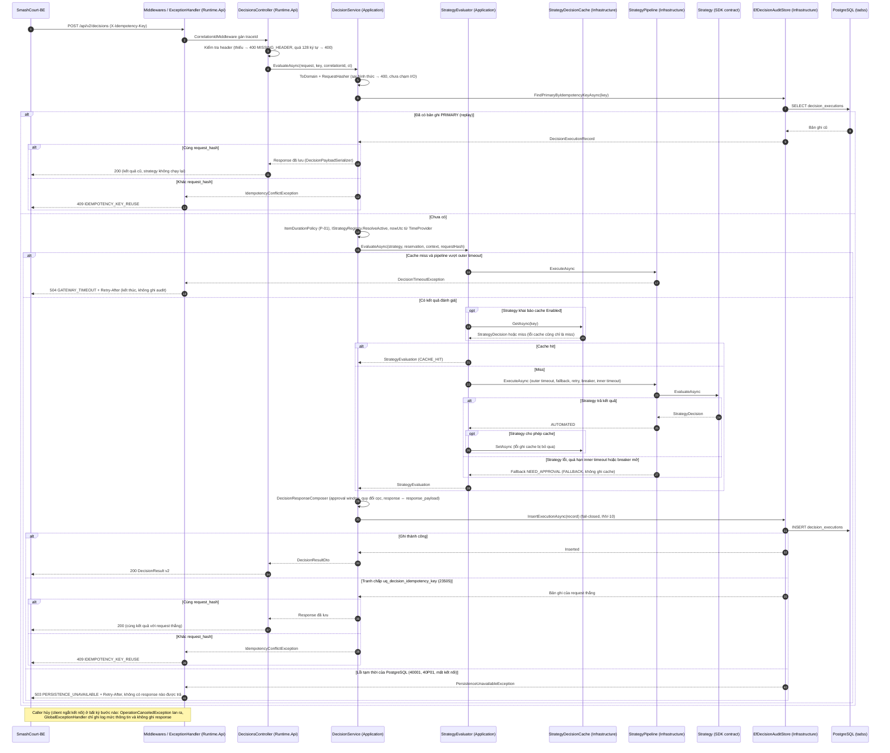
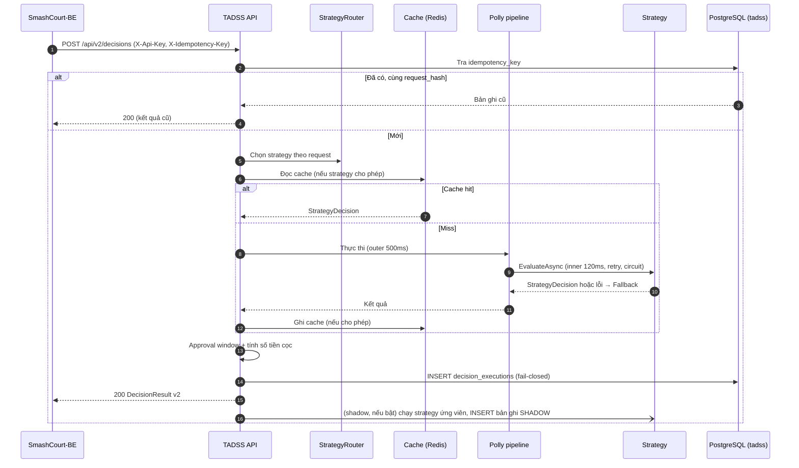

# ĐẶC TẢ KIẾN TRÚC PHẦN MỀM TADSS (SAS) — v2.0

> **Vai trò của tài liệu:** nguồn duy nhất về cấu trúc solution, thành phần runtime, strategy và luồng xử lý — gồm **hiện trạng sau gói 5.2d** (v2 là phiên bản duy nhất, solution theo Clean Architecture nhiều project — ADR-013) và **mục tiêu v2** còn lại của Phase 5. Contract HTTP: [`INTEGRATION_SPEC.md`](../contracts/INTEGRATION_SPEC.md). Schema DB: [`DECISION_PERSISTENCE_INVARIANTS.md`](DECISION_PERSISTENCE_INVARIANTS.md). Pipeline chịu lỗi: [`RESILIENCE_AND_FAULT_TAXONOMY.md`](RESILIENCE_AND_FAULT_TAXONOMY.md).

---

## 1. NGỮ CẢNH HỆ THỐNG (C4 — CONTAINER)



- FE chỉ gọi BE; BE là client duy nhất của TADSS trong SmashCourt.
- TADSS và SmashCourt dùng chung máy chủ PostgreSQL nhưng tách schema; không bên nào truy cập bảng của bên kia.

---

## 2. CẤU TRÚC SOLUTION (`TADSS.slnx`)

Clean Architecture nhiều project (ADR-013): `Shared.DecisionContractSDK` ← `TADSS.Application` ← `TADSS.Infrastructure` ← `TADSS.Runtime.Api`. Hai project strategy chỉ phụ thuộc SDK và được `TADSS.Runtime.Api` lắp vào lúc khởi động. Namespace bằng tên project cộng đường dẫn thư mục; mỗi file một kiểu public, tên file bằng tên kiểu.

```text
src/
├── Shared.DecisionContractSDK/        # Hợp đồng dùng chung v2 — chỉ BCL, 0 NuGet (README.md mô tả cây)
│   ├── Common/                        # ErrorCodes, ReasonCodes, PagedResult, TadssJson, converter JSON, ContractValidationException
│   ├── Decisions/                     # StrategyDecision, DecisionContext, StrategyCachePolicy, DecisionRecommendation
│   ├── Domain/                        # Reservation (aggregate root), ReservationItem, CustomerProfile, CustomerHistory, DemandSnapshot, BranchCalendar, PeakWindow + DomainInvariantException
│   ├── DTOs/{Decisions,Governance,Outcomes,Mappings}/
│   ├── Enums/                         # Channel, CustomerTier, DecisionStatus, ExecutionType, RecommendationType, OverrideAction, DecisionOutcome
│   └── Interfaces/                    # IReservationDecisionStrategy
├── TADSS.Application/                 # Use case + port + options nghiệp vụ; chỉ phụ thuộc SDK và abstraction Microsoft.Extensions.*
│   ├── ApplicationServiceCollectionExtensions.cs   # AddApplication(IServiceCollection, IConfiguration)
│   ├── Abstractions/
│   │   ├── Caching/                   # IStrategyDecisionCache, StrategyDecisionCacheKey
│   │   ├── Persistence/               # IDecisionEvaluationStore, IDecisionQueryStore, DecisionExecutionRecord, DecisionDetailRecord, DecisionOverrideRecord, DecisionOutcomeRecord, ExecutionRole, InsertExecutionResult
│   │   └── Resilience/                # IStrategyPipeline, StrategyExecutionOutcome, FailureReasonPrefixes
│   ├── Common/                        # ContractLimits (giới hạn 128 ký tự của contract)
│   ├── Decisions/                     # IDecisionService/DecisionService, IDecisionQueryService/DecisionQueryService, StrategyEvaluator, DecisionPayloadSerializer, DecisionResponseComposer, ApprovalWindowPolicy, DepositCalculator, ItemDurationPolicy, RequestHasher, CanonicalNumberFormatter
│   ├── Exceptions/                    # DecisionNotFoundException, IdempotencyConflictException, PersistenceUnavailableException, DecisionTimeoutException
│   ├── Options/                       # ApprovalOptions, ValidationOptions, CalendarOptions, StrategyOptions + validator (mỗi kiểu một file)
│   └── Strategies/                    # IStrategyRegistry, StrategyRegistry, RegisteredStrategy, OptionsFingerprintBuilder
├── TADSS.Infrastructure/              # Adapter của port; phụ thuộc Application + SDK + EF Core/Npgsql, Redis, Polly
│   ├── InfrastructureServiceCollectionExtensions.cs   # AddInfrastructure(IServiceCollection, IConfiguration)
│   ├── Caching/                       # StrategyDecisionCache (Redis + memory), CachedStrategyDecision, CachedRecommendation, RedisConnectionFactory
│   ├── Options/                       # CacheOptions(+Validator), CacheProviders, DatabaseOptions, ResilienceOptions(+Validator)
│   ├── Persistence/                   # TadssDbContext, EfDecisionAuditStore, DecisionAuditMapper, PersistenceFailureDetector (internal), PersistenceHealthChecks, PersistenceServiceCollectionExtensions
│   │   ├── Entities/                  # DecisionExecutionEntity, DecisionOverrideEntity, DecisionOutcomeEntity
│   │   ├── Configurations/            # DecisionExecutionConfiguration, DecisionOverrideConfiguration, DecisionOutcomeConfiguration
│   │   └── Migrations/                # 4 migration + TadssDbContextModelSnapshot (mã sinh tự động, giữ nguyên ID)
│   └── Resilience/                    # StrategyPipeline (Polly v8), FallbackDecisionPolicy, FallbackCause
├── TADSS.Runtime.Api/                 # Presentation + composition root; được dùng mọi project
│   ├── Program.cs                     # Chỉ gọi AddApplication/AddInfrastructure/AddStrategies/AddPresentation, StartupTasks, UseTadssRequestPipeline, map endpoint
│   ├── Composition/                   # PresentationServiceCollectionExtensions (AddPresentation), StrategyServiceCollectionExtensions (AddStrategies), StrategyRegistrations, RequestPipelineExtensions (UseTadssRequestPipeline), StartupTasks — chỗ duy nhất (cùng Program.cs) được dùng kiểu của Infrastructure
│   ├── Controllers/                   # DecisionsController (POST + GET /api/v2/decisions)
│   ├── ErrorHandling/                 # ExceptionClassifier, ErrorClassification, InvalidModelStateTranslator
│   ├── Middlewares/                   # CorrelationIdMiddleware, GlobalExceptionHandler
│   ├── OpenApi/                       # RequiredHeaderOperationFilter, ProblemDetailsSchemaFilter, LineEndingDocumentFilter
│   ├── Options/                       # ErrorHandlingOptions, ErrorHandlingOptionsValidator
│   └── Common/                        # HttpHeaderNames
├── TADSS.Strategies.Default/          # DefaultDecisionStrategy + DefaultStrategyOptions — chỉ phụ thuộc SDK
└── TADSS.Strategies.MockAlternative/  # MockAlternativeDecisionStrategy + MockAlternativeStrategyOptions — chỉ phụ thuộc SDK
tests/
├── TADSS.UnitTests/                   # Cây mirror src: Architecture, Sdk/{Common,Contracts,Decisions,Domain}, Strategies, Application/{Abstractions,Decisions,Options,Strategies}, Infrastructure/{Caching,Persistence,Resilience}, Api/{Composition,Controllers,ErrorHandling,Middlewares,OpenApi}, TestData, TestDoubles
└── TADSS.IntegrationTests/            # API qua WebApplicationFactory trên Testcontainers (PostgreSQL 16, Redis 7, Toxiproxy): Migrations, Persistence, FaultInjection, endpoint/idempotency/cache
```

Health check: `/health/live`, `/health/ready` (PostgreSQL, tên check `postgresql`), `/health` — map trong `Program.cs`, đăng ký trong `AddInfrastructure`.

Thứ tự middleware của request pipeline khai báo tại một nơi: `Composition/RequestPipelineExtensions.UseTadssRequestPipeline` (correlation id → exception handler → Swagger chỉ ở Development → request logging → https redirection → authorization).

---

## 3. HẠN CHẾ CÒN MỞ (sau gói 5.2d)

- Chưa có xác thực `X-Api-Key` (gói 5.3) — chưa được expose ra mạng ngoài.
- Inner timeout chỉ có hiệu lực khi strategy tôn trọng `CancellationToken` (`IsolatedStrategyInvoker`, 5.4).
- Redis lỗi thì mỗi lần gọi cache chờ tới `RedisTimeoutMs` (circuit breaker + metric `bypass`, 5.4).
- Chọn strategy theo cấu hình toàn cục `Tadss:Strategy:ActiveStrategyName`; định tuyến theo request thuộc 5.4.
- Thiếu connection string chưa làm ứng dụng dừng ngay lúc khởi động, và `detail` của lỗi 400 còn chứa thông điệp của bộ giải mã JSON (gói 5.3).

Test `NoLegacyV1Tests` (UT-09) chặn việc đưa lại kiểu, namespace hoặc package của phiên bản cũ. Ranh giới tầng và quy ước đặt tên/đặt chỗ được khóa bởi các test UT-14 (Mục 5).

---

## 4. KIẾN TRÚC MỤC TIÊU v2 (Phase 5)

### 4.1. Hợp đồng strategy v2

Strategy chỉ trả **quyết định nghiệp vụ**; runtime chịu trách nhiệm định danh, thời gian, quy đổi số tiền và telemetry.

```csharp
public interface IReservationDecisionStrategy
{
    string StrategyName { get; }
    string StrategyVersion { get; }
    StrategyCachePolicy CachePolicy { get; }          // Disabled | Enabled(Ttl)
    Task<StrategyDecision> EvaluateAsync(Reservation reservation, DecisionContext context, CancellationToken ct);
}

public sealed record StrategyDecision(
    DecisionStatus Status,
    decimal? DepositRate,                              // bắt buộc khi Approved
    string ReasonCode,
    IReadOnlyList<string> Reasons,
    IReadOnlyList<DecisionRecommendation> Recommendations);
```

`DecisionContext` cung cấp thời điểm hiện tại theo giờ chi nhánh (`IClock` + `branchTimeZone`) để strategy không tự đọc đồng hồ hệ thống — giúp test tất định.

### 4.2. Thành phần runtime v2

> **Tiến độ (sau gói 5.2d):** v2 là runtime duy nhất; mỗi thành phần nằm ở project/thư mục ghi ở cột **Vị trí** (cây ở Mục 2). Mỗi tầng tự đăng ký phần của mình: `AddApplication`, `AddInfrastructure`, `AddStrategies`, `AddPresentation` (Mục 2, `Program.cs`). Hiện thực và có test: `DecisionService`, `DecisionQueryService`, `StrategyEvaluator`, `EfDecisionAuditStore`, `StrategyPipeline`, `StrategyDecisionCache`, `ExceptionClassifier` nối vào `GlobalExceptionHandler`, `DecisionsController` (`POST /api/v2/decisions`, `GET /api/v2/decisions/{decisionId}`). Chưa có: xác thực `X-Api-Key`, override, outcome, hàng chờ (5.3), `StrategyRouter`/`ShadowExecutor`/`IsolatedStrategyInvoker`/breaker Redis (5.4) — các hàng dưới đây đánh dấu rõ phần đã có. Runtime chỉ dùng kiểu SDK v2 và mọi thời gian lấy từ `TimeProvider` (không gọi đồng hồ hệ thống trực tiếp).

| Thành phần | Vị trí | Trách nhiệm |
| :--- | :--- | :--- |
| `ApiKeyAuthenticationHandler` | `TADSS.Runtime.Api/Middlewares` (dự kiến) | Xác thực `X-Api-Key`; gắn client id vào log/trace. *Chưa hiện thực — gói 5.3* |
| `IDecisionService` / `DecisionService` | `TADSS.Application/Decisions` | Điều phối: idempotency → định tuyến → cache → pipeline → approval window → ghi audit → response. *Đã hiện thực*: một mốc `nowUtc` từ `TimeProvider` (cắt về µs) cho cả lần đánh giá; lỗi cache chỉ là miss; lỗi ghi audit lan ra (fail-closed, INV-10); chọn strategy tạm bằng `IStrategyRegistry.ResolveActive()` cho tới khi có `StrategyRouter` (5.4). Đăng ký scoped trong `AddApplication` |
| `StrategyEvaluator` | `TADSS.Application/Decisions` | Dựng khóa cache → đọc cache (lỗi cache chỉ là miss) → chạy `IStrategyPipeline` khi miss → ghi cache khi kết quả là `AUTOMATED`; trả `StrategyEvaluation` (kết quả + cờ cache hit). Chỉ hủy của chính caller được lan ra. Singleton |
| `DecisionPayloadSerializer` | `TADSS.Application/Decisions` | Serialize/deserialize `request_payload`/`response_payload` bằng `TadssJson.Options`; dùng chung cho composer, replay và `DecisionQueryService` |
| `IDecisionEvaluationStore`, `IDecisionQueryStore` | `TADSS.Application/Abstractions/Persistence` | Port lưu audit tách theo consumer (ISP). `IDecisionEvaluationStore` (cho `DecisionService`): `FindPrimaryByIdempotencyKeyAsync`, `InsertExecutionAsync` (append-only; tranh chấp `uq_decision_idempotency_key` trả bản đã thắng; lỗi tạm thời → `PersistenceUnavailableException` → 503). `IDecisionQueryStore` (cho `DecisionQueryService`): `GetDecisionDetailAsync`. Pending/override/outcome thêm ở 5.3 |
| `EfDecisionAuditStore` | `TADSS.Infrastructure/Persistence` | Hiện thực cả hai port bằng EF Core; scoped, một instance mỗi scope (hai port trỏ về cùng instance). Dịch lỗi tạm thời của PostgreSQL thành `PersistenceUnavailableException` tại ranh giới adapter (`PersistenceFailureDetector` là `internal`) |
| `DecisionResponseComposer` | `TADSS.Application/Decisions` | Ghép `DecisionResultDto` và `DecisionExecutionRecord` từ cùng một nguồn (response ⇔ `response_payload`); áp approval window và quy đổi cọc; `CACHE_HIT` sinh `decisionId`/`created_at` mới |
| `StrategyRouter` (`Tadss:Routing`) | `TADSS.Application/Strategies` (dự kiến) | Chọn strategy theo từng request dựa trên quy tắc cấu hình (ví dụ giờ cao điểm → `MockAlternativeDecisionStrategy`; mặc định → `DefaultDecisionStrategy`); reload cấu hình không cần restart. *Chưa hiện thực — gói 5.4* |
| `ShadowExecutor` (`Tadss:Shadow`) | `TADSS.Application/Decisions` (dự kiến) | Chạy strategy ứng viên song song sau khi có kết quả chính; lưu bản ghi `SHADOW`; không ảnh hưởng response và độ trễ trả về. *Chưa hiện thực — gói 5.4* |
| `IsolatedStrategyInvoker` | `TADSS.Infrastructure/Resilience` (dự kiến) | Thực thi strategy sao cho timeout cắt được cả strategy không hợp tác. *Chưa hiện thực — gói 5.4* |
| `IStrategyPipeline` / `StrategyPipeline` | Port: `TADSS.Application/Abstractions/Resilience`; hiện thực: `TADSS.Infrastructure/Resilience` | Pipeline Polly v8 quanh lời gọi strategy (outer timeout → fallback → retry → circuit breaker → inner timeout). *Đã hiện thực* (`ResilienceOptions`; `ResilienceOptionsValidator` kiểm tra ngân sách `OuterTimeoutMs` ≥ tổng thời gian tối đa của inner timeout + retry và chặn khởi động nếu sai). Outer timeout được dịch thành `DecisionTimeoutException` (Application) ngay tại adapter; pipeline theo strategy và `IsolatedStrategyInvoker` thuộc 5.4 |
| `ApprovalWindowPolicy` (`Tadss:Approval`) | `TADSS.Application/Decisions` | Tính `approvalExpiresAt`; đổi `NEED_APPROVAL` → `APPROVED` 100% khi không còn cửa sổ duyệt (`reasonCode` = `APPROVAL_WINDOW_UNAVAILABLE`, `reasons` là một câu giải thích, kết quả gốc của strategy giữ ở `strategy_status`). *Đã hiện thực* |
| `DepositCalculator` | `TADSS.Application/Decisions` | `amount = round(totalPrice × rate)` theo đơn vị tiền tệ. *Đã hiện thực*; quy đổi `amount → rate` cho override thêm ở 5.3 |
| `IStrategyDecisionCache` / `StrategyDecisionCache` | Port + `StrategyDecisionCacheKey`: `TADSS.Application/Abstractions/Caching`; hiện thực + `CachedStrategyDecision`: `TADSS.Infrastructure/Caching` | Chỉ cache khi strategy khai báo `Enabled`; key gồm hash request + tên/phiên bản strategy. *Đã hiện thực*: chỉ lưu `StrategyDecision` (không lưu response — mỗi lần cache hit nhận `decisionId` mới), chỉ ghi kết quả `AUTOMATED` (không ghi fallback), key `tadss:v2:{tên}:{phiên bản}:{optionsFingerprint}:{request_hash}` (fingerprint của mọi strategy gồm cả lịch cao điểm `Tadss:Calendar`), hai tầng Redis/memory (`Tadss:Cache:Provider`), lỗi cache chỉ là miss. Circuit breaker Redis và metric `bypass` thuộc 5.4 |
| `IStrategyRegistry` / `StrategyRegistry`, `StrategyRegistrations` | Registry: `TADSS.Application/Strategies`; dựng strategy cụ thể từ cấu hình: `TADSS.Runtime.Api/Composition` | Registry giữ strategy đã đăng ký cùng `optionsFingerprint`; việc chọn và dựng `DefaultDecisionStrategy`/`MockAlternativeDecisionStrategy` là việc lắp ráp nên nằm ở composition root (Application không tham chiếu Strategies) |
| `ExceptionClassifier` + `GlobalExceptionHandler` | `TADSS.Runtime.Api/ErrorHandling`, `TADSS.Runtime.Api/Middlewares` | Bảng map exception → HTTP/`code` v2 (INTEGRATION_SPEC §3.8). *Hàm thuần, nguồn duy nhất của `GlobalExceptionHandler`*; chỉ biết exception của SDK và `TADSS.Application.Exceptions` (không biết Polly/Npgsql): `PersistenceUnavailableException` → 503, `DecisionTimeoutException` → 504, cả hai kèm `Retry-After` lấy từ `Tadss:ErrorHandling:RetryAfterSeconds` (mặc định 5; hợp lệ 1..3600). Gồm `MISSING_HEADER`, `DECISION_NOT_FOUND` (404); duyệt cả `AggregateException`. 415 do MVC trả mặc định, không đi qua bảng này |
| `OverrideService`, `OutcomeService` | `TADSS.Application/Decisions` (dự kiến) | Ghi `decision_overrides`, `decision_outcomes`; xử lý idempotency và xung đột. *Chưa hiện thực — gói 5.3* (qua `IDecisionGovernanceStore`) |
| `PendingApprovalQuery` | `TADSS.Application/Decisions` (dự kiến) | Truy vấn hàng chờ theo Mục B.5 của DECISION_PERSISTENCE_INVARIANTS. *Chưa hiện thực — gói 5.3* |
| OpenTelemetry | `TADSS.Runtime.Api/Composition` (dự kiến) | Trace (ASP.NET Core, HttpClient, Npgsql, Redis), metric, log (Serilog → OTLP). *Chưa hiện thực* |

Ghi audit là lời gọi đồng bộ qua `IDecisionEvaluationStore` (không qua message bus, D-02); `created_at` do `DecisionService` gán từ `TimeProvider`.

### 4.3. Strategy v2 (tham số mặc định, chỉnh qua cấu hình)

**`DefaultDecisionStrategy` 2.0.0 — cọc theo hạng thành viên** (`Tadss:Strategies:Default`)

| Điều kiện (kiểm tra theo thứ tự) | Kết quả | `reasonCode` |
| :--- | :--- | :--- |
| `totalPrice ≥ 2.000.000` | `NEED_APPROVAL` | `HIGH_VALUE_REVIEW` |
| `history.noShowCount ≥ 2` | `NEED_APPROVAL` | `NO_SHOW_HISTORY_REVIEW` |
| Khách vãng lai hoặc `STANDARD` | `APPROVED`, cọc 50% | `TIER_DEPOSIT` |
| `SILVER` | `APPROVED`, cọc 40% | `TIER_DEPOSIT` |
| `GOLD` | `APPROVED`, cọc 30% | `TIER_DEPOSIT` |
| `PLATINUM`, `DIAMOND` | `APPROVED`, cọc 20% | `TIER_DEPOSIT` |

**`MockAlternativeDecisionStrategy` 2.0.0 — cọc theo khung giờ** (`Tadss:Strategies:MockAlternative`)

| Điều kiện | Kết quả | `reasonCode` |
| :--- | :--- | :--- |
| Giờ cao điểm và `totalPrice ≥ 1.500.000` | `NEED_APPROVAL` | `HIGH_VALUE_REVIEW` |
| Giờ cao điểm | `APPROVED`, cọc 50% | `PEAK_HOUR_DEPOSIT` |
| Ngoài giờ cao điểm | `APPROVED`, cọc 30% | `OFF_PEAK_DEPOSIT` |

Giờ cao điểm (theo giờ chi nhánh, `Tadss:Calendar:PeakWindows`): thứ Hai–thứ Sáu 17:00–21:00; thứ Bảy–Chủ Nhật 08:00–21:00. Với booking nhiều sân, giờ cao điểm xét theo khung giờ bắt đầu sớm nhất.

**Định tuyến mặc định** (`Tadss:Routing`): request có giờ cao điểm → `MockAlternativeDecisionStrategy`; còn lại → `DefaultDecisionStrategy`. Shadow mode tắt mặc định.

**Fallback (`FallbackDecisionPolicy`)**: luôn `NEED_APPROVAL`; `reasonCode` theo nguyên nhân (`FALLBACK_STRATEGY_TIMEOUT`, `FALLBACK_STRATEGY_EXCEPTION`, `FALLBACK_CIRCUIT_OPEN`). Khi fallback thì `strategyName`/`strategyVersion` trong response và audit vẫn là của **strategy đã được chọn** (không đổi thành tên fallback); nhận biết fallback qua `executionType = FALLBACK`, `fallbackUsed = true` và `reasonCode` `FALLBACK_*`; riêng khi approval window không khả dụng thì `reasonCode` bị thay bằng `APPROVAL_WINDOW_UNAVAILABLE` (cọc 100%), nên chỉ `executionType`/`fallbackUsed` là tín hiệu đáng tin cậy. Kết quả fallback không được ghi cache.

### 4.4. Luồng xử lý `POST /api/v2/decisions`

#### 4.4.1. Hiện thực (sau gói 5.2d) — qua các tầng

Mỗi `participant` ghi kèm project chứa nó. Mũi tên xuyên ranh giới tầng luôn đi qua port của `TADSS.Application` (`IStrategyPipeline`, `IStrategyDecisionCache`, `IDecisionEvaluationStore`); `DecisionService` không biết Polly, Redis hay EF Core.



Quy ước của luồng:

- Lỗi trước bước ghi audit (validation, P-01, xung đột idempotency, outer timeout) không ghi bản ghi audit.
- Mọi exception đi tới `GlobalExceptionHandler` và được `ExceptionClassifier` ánh xạ sang HTTP/`code`; `Retry-After` của 503/504 lấy từ `Tadss:ErrorHandling:RetryAfterSeconds`.
- Hủy của caller thắng outer timeout khi hai việc cùng xảy ra (`StrategyPipeline` ném `OperationCanceledException` thay vì `DecisionTimeoutException`).

#### 4.4.2. Luồng đích v2 (gồm phần chưa hiện thực)

Sơ đồ dưới thêm các bước chưa có mã: xác thực `X-Api-Key` (gói 5.3), `StrategyRouter` và shadow (gói 5.4).



### 4.5. Metric OpenTelemetry

| Metric | Loại | Nhãn |
| :--- | :--- | :--- |
| `tadss.decisions` | Counter | `status`, `strategy`, `execution_type` |
| `tadss.decision.duration` | Histogram (ms) | `endpoint`, `status_code` |
| `tadss.pipeline.duration` | Histogram (ms) | `strategy`, `outcome` |
| `tadss.fallbacks` | Counter | `reason` |
| `tadss.circuit.state` | Gauge | `strategy` |
| `tadss.cache.requests` | Counter | `result` (`hit`, `miss`, `bypass`) |
| `tadss.pending_approvals` | Gauge | `branch` |
| `tadss.overrides` | Counter | `action` |

---

## 5. NGUYÊN TẮC PHỤ THUỘC

| Project | Được phụ thuộc | Cấm |
| :--- | :--- | :--- |
| `Shared.DecisionContractSDK` | Chỉ BCL | Mọi project, mọi NuGet |
| `TADSS.Strategies.*` | Chỉ SDK | Application, Infrastructure, Runtime.Api, NuGet |
| `TADSS.Application` | SDK + gói `Microsoft.Extensions.{Logging.Abstractions, Options.ConfigurationExtensions}` (kéo theo `DependencyInjection.Abstractions`, `Options`) | Infrastructure, Runtime.Api, Strategies, ASP.NET Core, EF Core, Npgsql, StackExchange.Redis, Polly |
| `TADSS.Infrastructure` | Application + SDK + EF Core/Npgsql, StackExchange.Redis, Polly, `Microsoft.Extensions.*` | Runtime.Api, ASP.NET Core MVC, Swashbuckle |
| `TADSS.Runtime.Api` | Tất cả project `src/` + Swashbuckle, Serilog, EF Core Design. Chỉ `Program.cs` và `Composition/` được dùng kiểu của Infrastructure | Controller, middleware, `ErrorHandling/`, `OpenApi/` dùng `TADSS.Infrastructure`, Npgsql, Polly, Redis, EF Core |
| `tests/*` | Mọi project trên | — |

Quy ước đi kèm: interface của **port** (mà Infrastructure hiện thực) nằm ở `TADSS.Application/Abstractions/**`; interface của service nội bộ Application nằm cùng thư mục với hiện thực; exception của runtime chỉ ở `TADSS.Application/Exceptions`; mỗi project tự đăng ký phần của mình qua `Add{Layer}`.

Được kiểm tra tự động (UT-09 và UT-14):

| Test | Quy tắc khóa |
| :--- | :--- |
| `SdkDependencyPurityTests`, `StrategyDependencyPurityTests` (UT-09) | SDK chỉ BCL; Strategies chỉ SDK |
| `ProjectReferenceRulesTests` | Mỗi project `src/` chỉ có `ProjectReference` trong allowlist; Application và Infrastructure chỉ dùng `PackageReference` trong allowlist (đọc thẳng csproj) |
| `LayerDependencyTests` | Application/Infrastructure không tham chiếu assembly hạ tầng/presentation bị cấm; EF Core chỉ trong `Persistence/`; port chỉ ở `Application.Abstractions.*` |
| `CompositionRootBoundaryTests` | Runtime.Api ngoài `Program.cs`/`Composition/` không dùng kiểu Infrastructure, Npgsql, Polly, Redis, EF Core |
| `NamingConventionTests` | Namespace khớp project + thư mục; không còn "V2" trong tên kiểu/namespace; `*Options`/`*OptionsValidator` ở `Options/`; exception chỉ ở `Application.Exceptions` |
| `SourceFileConventionTests` | Mỗi file một kiểu public, tên file = tên kiểu; file nguồn ≤ 250 dòng (trừ `Migrations/`) |

Danh mục đầy đủ các test UT-14: [`EXPERIMENTAL_DESIGN_AND_BENCHMARK_METHODOLOGY.md`](../research/EXPERIMENTAL_DESIGN_AND_BENCHMARK_METHODOLOGY.md).

---

## 6. KIẾN TRÚC KIỂM THỬ

Danh mục kiểm thử, môi trường và công cụ: xem [`EXPERIMENTAL_DESIGN_AND_BENCHMARK_METHODOLOGY.md`](../research/EXPERIMENTAL_DESIGN_AND_BENCHMARK_METHODOLOGY.md).
