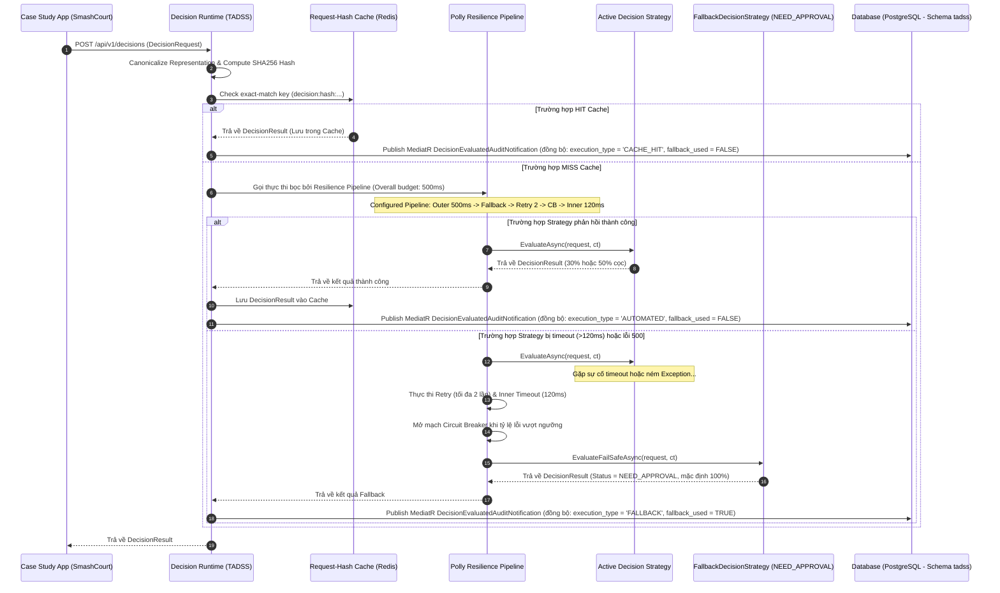
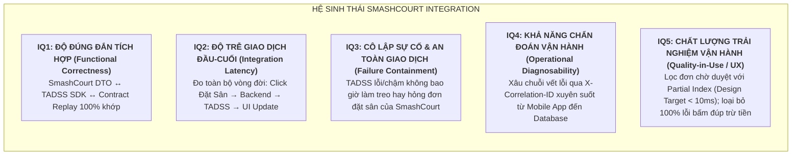

# TÀI LIỆU THIẾT KẾ KIẾN TRÚC PHẦN MỀM CHUẨN (SOFTWARE ARCHITECTURE SPECIFICATION - SAS)

Tài liệu này đặc tả chi tiết kiến trúc phần mềm, các thành phần hệ thống (C4 Model) và thiết kế thực thể miền (Domain Interfaces) của hệ thống **Decision Runtime Platform (TADSS)**.

---

## 1. PHÂN RÃ HỆ THỐNG & .NET SOLUTION STRUCTURE (`TADSS.slnx` — 7 Projects)

Mô hình phân rã dự án thành 7 project độc lập trong `TADSS.slnx` (tách biệt hoàn toàn khỏi `CaseStudy.SmashCourt` — kết nối qua HTTP REST / SDK), loại bỏ liên kết ngược và bảo đảm tính di động (Portability):

```text
TADSS.slnx (7-Project Solution)
├── src/
│   ├── Shared.DecisionContractSDK/          # Decision Contract SDK (Shared Kernel — 0 external NuGet deps)
│   │   ├── Domain/                          # Reservation (Aggregate Root), Value Objects
│   │   ├── Interfaces/                      # IReservationDecisionStrategy
│   │   ├── Enums/                           # DecisionStatus, RecommendationType, BookingType, CustomerTier, ...
│   │   ├── DTOs/                            # DecisionRequestDto, DecisionResultDto, OverrideDecisionDto, ...
│   │   └── Common/                          # ContractVersionConstants, ContractVersionValidator, RequestHasher
│   │
│   ├── TADSS.Runtime.Api/                   # Decision Runtime Platform (ASP.NET Core 8 Web API)
│   │   ├── Controllers/                     # DecisionController, HealthController
│   │   ├── Services/                        # DecisionService, StrategyResolver (expected O(1) DI Lookup)
│   │   └── Infrastructure/
│   │       ├── Data/                        # TadssDbContext, DecisionExecution, AuditTimestampInterceptor
│   │       ├── Resilience/                  # DecisionResiliencePipeline (Polly v8), FallbackDecisionStrategy
│   │       ├── Caching/                     # ResilientDecisionCacheService (L1/L2)
│   │       └── Events/                      # DecisionEvaluatedAuditHandler, DecisionOverriddenAuditHandler
│   │
│   ├── TADSS.Strategies.Default/            # DefaultDecisionStrategy (Conservative Baseline Policy - Đồ án 2)
│   │   └── DefaultDecisionStrategy.cs
│   │
│   └── TADSS.Strategies.MockAlternative/    # MockAlternativeDecisionStrategy (30% / 50% Dynamic Deposit - Đồ án 2)
│       └── MockAlternativeDecisionStrategy.cs
│
└── tests/
    ├── TADSS.UnitTests/                     # Unit, Resilience, Audit & Dataset Normalization Tests (483 tests)
    ├── TADSS.IntegrationTests/              # Full HTTP Pipeline Integration Tests (27 tests)
    └── TADSS.BenchmarkRunner/               # 5-Layer Benchmark Harness (76 runs) & Dataset Normalizer (INV-P1..P8)
```

---

## 2. THIẾT KẾ KHUNG THỰC THỂ MIỀN (DOMAIN INTERFACES & SDK STRUCTS — FROZEN CONTRACT v1.0.0)

Chuẩn hóa các thực thể miền bên trong **Shared.DecisionContractSDK** theo mẫu thiết kế DDD và hợp đồng đóng băng `1.0.0`.

### 2.1. Cấu trúc Lớp Entity & Aggregate Signatures (`Shared.DecisionContractSDK.Domain`)
*   **Reservation (Aggregate Root)**
    *   `Guid ReservationId`
    *   `CustomerInfo Customer` (Value Object gồm `Guid CustomerId`, `string Tier` chuẩn hóa uppercase, mặc định `"STANDARD"`)
    *   `ResourceInfo Resource` (Value Object gồm `Guid CourtId`, `Guid BranchId`, `Guid? CourtTypeId`)
    *   `ReservationSchedule Schedule` (Value Object gồm `DateTime StartTime`, `DateTime EndTime`, `TimeSpan Duration` kiểm chứng `StartTime < EndTime` và thời lượng `30 phút – 12 giờ`)
    *   `PaymentPolicy Payment` (Value Object gồm `decimal TotalPrice`, `decimal DepositAmount`, `PaymentStatus PaymentStatus`, `decimal DepositPercentage`, `bool IsFullyPaid` kiểm chứng `TotalPrice >= 0` và `0 <= DepositAmount <= TotalPrice`)
    *   `string BookingType` (mặc định `"SINGLE"`, tối đa 50 ký tự)
    *   `BookingPriority Priority` (`NORMAL`, `HIGH`, `VIP`, `URGENT`)
    *   `DateTime RequestedAt`, `ReservationMetadata Metadata` (`IReadOnlyDictionary<string, string> Attributes`)
    *   *Behaviors:* `Create(...)`, `EnsureValid()`, `CanBeCancelledWithoutPenalty(DateTime currentUtc, TimeSpan? customWindow = null)`, `CalculateDepositRatio()`

### 2.2. Giao diện Chiến lược Quyết định: `IReservationDecisionStrategy`
```csharp
namespace Shared.DecisionContractSDK.Interfaces;

using Shared.DecisionContractSDK.Domain;
using Shared.DecisionContractSDK.DTOs.Decisions;

public interface IReservationDecisionStrategy
{
    string StrategyName { get; }
    string StrategyVersion { get; }
    Task<DecisionResultDto> EvaluateAsync(Reservation reservation, CancellationToken cancellationToken = default);
}
```

### 2.3. Hợp đồng dữ liệu yêu cầu: `DecisionRequestDto`
```csharp
namespace Shared.DecisionContractSDK.DTOs.Decisions;

public class DecisionRequestDto
{
    public Guid ReservationId { get; set; }
    public Guid CourtId { get; set; }
    public Guid? CourtTypeId { get; set; }
    public Guid BranchId { get; set; }
    public Guid CustomerId { get; set; }
    public string CustomerTier { get; set; } = "STANDARD";
    public DateTime StartTime { get; set; }
    public DateTime EndTime { get; set; }
    public string BookingType { get; set; } = "SINGLE";
    public decimal TotalPrice { get; set; }
    public decimal DepositAmount { get; set; }
    public string PaymentStatus { get; set; } = "UNPAID";
    public string Priority { get; set; } = "NORMAL";
    public DateTime RequestedAt { get; set; }
    public Dictionary<string, string>? Metadata { get; set; }
}
```

### 2.4. Hợp đồng dữ liệu đầu ra: `DecisionResultDto` & `DecisionRecommendationDto`
*   **DecisionResultDto** (`Shared.DecisionContractSDK.DTOs.Decisions`)
    *   `Guid DecisionId`, `Guid ReservationId`
    *   `string Status` (`"APPROVED"`, `"REJECTED"`, `"NEED_APPROVAL"`)
    *   `string StrategyName`, `string StrategyVersion`
    *   `int ExecutionTimeMs`, `bool FallbackUsed`
    *   `string PrimaryReason`, `List<string> Reasons`
    *   `List<DecisionRecommendationDto> Recommendations`
    *   `DateTime EvaluatedAt`
*   **DecisionRecommendationDto** (`Shared.DecisionContractSDK.DTOs.Decisions`)
    *   `string Type` (`"ALTERNATIVE_SLOT"`, `"ALTERNATIVE_COURT"`, `"PRICE_ADJUSTMENT"`, `"REQUIRE_DEPOSIT"`, `"REQUIRE_APPROVAL"`, `"PRIORITY_ESCALATION"`)
    *   `string Description`
    *   `Guid? SuggestedCourtId`, `DateTime? SuggestedStartTime`, `DateTime? SuggestedEndTime`
    *   `decimal? SuggestedPrice`, `double? ConfidenceScore`

### 2.5. Hợp đồng Phản hồi Chuẩn & Mã Lỗi (`Shared.DecisionContractSDK.Common` & RFC 7807 `ProblemDetails`)
```csharp
namespace Shared.DecisionContractSDK.Common;

public class ApiResponse<T>
{
    public bool Success { get; set; }
    public string Code { get; set; } = string.Empty;
    public string Message { get; set; } = string.Empty;
    public T? Data { get; set; }
    public Dictionary<string, string[]>? Errors { get; set; }
}
```
*   Khi xảy ra ngoại lệ trên đường truyền HTTP, `GlobalExceptionHandler` chuẩn hóa phản hồi theo chuẩn **RFC 7807 (`application/problem+json`)** với các trường mở rộng `code` (thuộc tập hằng số `ErrorCodes`: `VALIDATION_ERROR`, `BAD_REQUEST`, `NOT_FOUND`, `CONFLICT`, `IDEMPOTENCY_KEY_REUSE`, `GATEWAY_TIMEOUT`, `INTERNAL_ERROR` hoặc mã `InvariantCode` của `DomainInvariantException`), `traceId`, `retryAfterSeconds` (khi `504`), và `errors`.

---

## 3. DECISION EXECUTION ENGINE & INFRASTRUCTURE MODULES

Hệ thống **Decision Runtime Platform (TADSS)** triển khai các module hạ tầng cốt lõi:

```
                  ┌─────────────────────────────────────────┐
                  │        DECISION EXECUTION ENGINE        │
                  └────────────────────┬────────────────────┘
                                       │
      ┌────────────────────────┬───────┼────────┬────────────────────────┐
      ▼                        ▼       ▼        ▼                        ▼
┌───────────┐            ┌──────────┐┌───┐┌──────────┐             ┌───────────┐
│ Strategy  │            │  Polly   ││ L ││ Dual-Tier│             │ URL Route │
│ Resolver  │            │ Pipeline ││ o ││  Cache   │             │Versioning │
└───────────┘            └──────────┘└───┘└──────────┘             └───────────┘
```

1.  **Strategy Registry (`StrategyResolver`):** Đăng ký các Strategy vào `IServiceCollection` và phân giải qua `FrozenDictionary<string, IReservationDecisionStrategy>` với độ phức tạp thuật toán kỳ vọng expected $O(1)$.
2.  **Safety Fallback Continuity (`FallbackDecisionStrategy`):** Khi Polly kích hoạt chế độ Fallback do strategy timeout hoặc lỗi nội bộ, hệ thống trả về quyết định an toàn xác định `Status = NEED_APPROVAL` (`FallbackUsed = true`, `ExecutionTimeMs = 0`), tách biệt hoàn toàn với chính sách nghiệp vụ thông thường (`DefaultDecisionStrategy`).
3.  **Observability (`Serilog` + `CorrelationIdMiddleware`):** Tự động gắn `X-Correlation-ID` vào `LogContext` và đo lường thời gian thực thi (`execution_time_ms`), trạng thái `cache_hit`, `fallback_used` và `failure_reason`.
4.  **Dual-Tier Request-Hash Cache (`ResilientDecisionCacheService`):** Kết hợp chuẩn hóa RFC 8785 (`RequestHasher`) với bộ nhớ đệm 2 tầng (Redis L2 + `IMemoryCache` L1 fallback khi Redis quá `150ms` hoặc đứt kết nối).
5.  **API Versioning & Host Feature Toggle:** TADSS Runtime định tuyến cố định theo URL `/api/v1/` (với JSON Schema khóa `additionalProperties: false`); phía ứng dụng chủ `SmashCourt-BE` tích hợp công tắc `EnableTadssDecision` để bật/tắt gọi TADSS linh hoạt (Phase 5).

### 3.1. Polly Resilience Pipeline Configuration (C# Spec)

```csharp
var resiliencePipeline = new ResiliencePipelineBuilder<DecisionExecutionOutcome>()
    .AddTimeout(TimeSpan.FromMilliseconds(500)) // Outer timeout (Overall Request SLA Budget)
    .AddFallback(new FallbackStrategyOptions<DecisionExecutionOutcome>
    {
        // Kích hoạt FallbackDecisionStrategy (chế độ an toàn NEED_APPROVAL) khi strategy bị timeout hoặc lỗi
        FallbackAction = args => ...
    })
    .AddRetry(new RetryStrategyOptions<DecisionExecutionOutcome>
    {
        MaxRetryAttempts = 2, // 2 retries = 3 attempts total
        BackoffType = DelayBackoffType.Constant,
        Delay = TimeSpan.FromMilliseconds(30)
    })
    .AddCircuitBreaker(new CircuitBreakerStrategyOptions<DecisionExecutionOutcome>
    {
        FailureRatio = 0.5,
        SamplingDuration = TimeSpan.FromSeconds(30),
        MinimumThroughput = 10,
        BreakDuration = TimeSpan.FromSeconds(15)
    })
    .AddTimeout(TimeSpan.FromMilliseconds(120)) // Inner per-attempt timeout (120ms limit)
    .Build();
```

---

## 4. THIẾT KẾ CƠ SỞ DỮ LIỆU (DATABASE SCHEMA: tadss.decision_executions)

### 4.1. DDL Script Bảng Duy nhất `tadss.decision_executions`

```sql
CREATE SCHEMA IF NOT EXISTS tadss;

CREATE TABLE IF NOT EXISTS tadss.decision_executions (
    id UUID PRIMARY KEY DEFAULT gen_random_uuid(),
    decision_id UUID NOT NULL,
    reservation_id UUID NOT NULL,
    strategy_name VARCHAR(100) NOT NULL,
    strategy_version VARCHAR(20) NOT NULL,
    execution_type VARCHAR(50) NOT NULL, -- 'AUTOMATED', 'CACHE_HIT', 'FALLBACK'
    execution_time_ms INTEGER NOT NULL,
    fallback_used BOOLEAN NOT NULL DEFAULT FALSE,
    failure_reason TEXT NULL,
    cache_hit BOOLEAN NOT NULL DEFAULT FALSE,
    need_approval BOOLEAN NOT NULL DEFAULT FALSE,
    request_hash VARCHAR(64) NOT NULL,
    response_payload JSONB NOT NULL,
    
    -- Các trường Override & Concurrency
    is_overridden BOOLEAN NOT NULL DEFAULT FALSE,
    overridden_by VARCHAR(100) NULL,
    override_reason TEXT NULL,
    idempotency_key VARCHAR(128) NULL,
    version INTEGER NOT NULL DEFAULT 1,
    
    created_at TIMESTAMP WITH TIME ZONE NOT NULL DEFAULT CURRENT_TIMESTAMP,
    updated_at TIMESTAMP WITH TIME ZONE NOT NULL DEFAULT CURRENT_TIMESTAMP,
    
    CONSTRAINT uq_decision_id UNIQUE (decision_id)
);

CREATE UNIQUE INDEX IF NOT EXISTS uq_decision_idempotency_key ON tadss.decision_executions (idempotency_key) WHERE idempotency_key IS NOT NULL;
CREATE INDEX IF NOT EXISTS idx_decision_executions_request_hash ON tadss.decision_executions (request_hash);
CREATE INDEX IF NOT EXISTS idx_decision_executions_reservation_id ON tadss.decision_executions (reservation_id);
CREATE INDEX IF NOT EXISTS idx_decision_executions_created_at ON tadss.decision_executions (created_at);
CREATE INDEX IF NOT EXISTS idx_decision_executions_pending_approval ON tadss.decision_executions (created_at) WHERE need_approval = TRUE AND is_overridden = FALSE;
```

---

## 5. CHI TIẾT LUỒNG ĐI CỦA REQUEST (SEQUENCE DIAGRAM)



---

## 6. QUY TẮC PHÊ DUYỆT HUMAN-IN-THE-LOOP & NO AUTO-APPROVE

```text
DecisionResult.Status:
  ├── Approved      ──► Tiếp tục luồng đặt sân ──► Tạo giao dịch VNPay
  ├── NeedApproval  ──► Booking.Status = PendingDecisionApproval (TẠM CHẶN VNPAY)
  │                      └── Chờ Manager duyệt trên Dashboard:
  │                            ├── [Approve]  ──► Duyệt mức cọc đề xuất ──► Tiếp tục sang VNPay
  │                            └── [Override] ──► Sửa mức cọc (kèm Reason) ──► Tiếp tục sang VNPay
  │                      └── Hết hạn duyệt (Timeout 15 phút):
  │                            └── Chuyển sang Expired / Cancelled (TUYỆT ĐỐI KHÔNG AUTO-APPROVE)
  └── Rejected      ──► Hủy Booking ──► Thông báo lý do từ chối
```

---

## 7. KIẾN TRÚC KIỂM THỬ, ĐẢM BẢO CHẤT LƯỢNG & KHUNG BẰNG CHỨNG THỰC NGHIỆM (TESTING & QUALITY EVIDENCE ARCHITECTURE)

Hệ thống TADSS thiết lập kiến trúc kiểm thử và đánh giá chất lượng có khả năng quan sát và truy vết độc lập (Observable, Traceable & Reproducible Evidence):

### 7.1. Khung Chiến lược Đánh giá Chất lượng 6 Tầng (6-Tier Framework)

```text
TADSS QUALITY ASSURANCE
│
├── 1. Correctness (Tính đúng đắn):
│      └── xUnit, FluentAssertions, PublicApiGenerator (32 public types tại Milestone 2 Freeze), JSON Schema Validation
│          └── Minh chứng: 25 Domain Invariant Tests (483 unit tests PASS đóng vai trò automated regression gate), baseline_public_api.txt, CONTRACT_V1_FREEZE.md
│
├── 2. Reliability & Resilience (Độ tin cậy & Chịu lỗi):
│      └── FaultInjectedStrategyDecorator, Polly v8 5-layer pipeline
│          └── Minh chứng: Ma trận tiêm lỗi F1–F7, resilience_evaluation_dataset.csv (7.600 mẫu)
│
├── 3. Performance Efficiency (Hiệu năng & Độ trễ):
│      └── WebApplicationFactory in-memory, Hardware Timer Stopwatch, Math.NET Percentiles
│          └── Minh chứng: 76 lượt chạy thực nghiệm (Full Suite 19 kịch bản x 4 VUs qua 5 tầng A–E), WEEK8_BENCHMARK_REPORT.md, latency_caching_dataset.csv (8.800 mẫu)
│
├── 4. Data & Audit Provenance (Toàn vẹn Dữ liệu Kiểm toán):
│      └── AuditLedgerHarvester, DatasetProvenanceVerifier, SHA-256 Hasher
│          └── Minh chứng: 8 bất biến toán học INV-P1..INV-P8, governance_audit_dataset.csv, dataset_provenance_manifest.json
│
├── 5. Integration Quality (Chất lượng Tích hợp SmashCourt — Kế hoạch Phase 5):
│      └── Strongly-Typed SDK Client, Feature Flag IOptionsMonitor (< 2s reload), Failure Containment
│          └── Minh chứng: Bộ kiểm thử tích hợp SmashCourt Backend ↔ TADSS, Zero Booking Corruption
│
└── 6. Quality-in-Use / UX (Trải nghiệm Vận hành Thực tế — Kế hoạch Phase 5):
       └── Playwright E2E UI Test Runner (Trace Viewer & Video), Partial Index Queries
           └── Minh chứng Dự kiến: Đo lường truy vấn pending-approvals (Design Target < 10ms trên môi trường thử nghiệm), tỷ lệ hoàn tất tác vụ 100%, 0% xung đột OCC
```

### 7.2. Kế hoạch & Thiết kế Đánh giá Chất lượng Tích hợp SmashCourt (Integration Quality — IQ1 đến IQ5 cho Phase 5)



### 7.3. Hệ thống 8 Cổng Kiểm Soát Chất lượng (Quality Gates Model)

```text
[MÃ NGUỒN C# & SQL]
   │
   ▼
[GATE 1: BUILD GATE] ────────► 0 Errors, 0 Warnings với cờ --warnaserror; 0 pending EF Core migrations
   │
   ▼
[GATE 2: UNIT & INVARIANT GATE] ──► 100% Unit Tests PASS (25 Domain Invariants)
   │
   ▼
[GATE 3: CONTRACT GATE] ─────► 32 Public Types frozen (Milestone 2 Contract V1 Freeze); JSON Schema additionalProperties: false
   │
   ▼
[GATE 4: RESILIENCE GATE] ───► Ma trận F1-F7 PASS; Fallback luôn trả NEED_APPROVAL khi quá hạn
   │
   ▼
[GATE 5: PERFORMANCE GATE] ──► P99 < 500ms xuyên suốt 76 runs (19 kịch bản x 4 VUs, 5 tầng A-E); DCR = 100%
   │
   ▼
[GATE 6: AUDIT PROVENANCE GATE] ─► 100% thỏa mãn 8 bất biến toán học INV-P1 .. INV-P8
   │
   ▼
[GATE 7: INTEGRATION GATE (Kế hoạch Phase 5)] ──► SmashCourt E2E workflow hoàn tất; Zero Transaction Corruption
   │
   ▼
[GATE 8: OPERATIONAL GATE] ──► CorrelationId phủ kín 100%; Audit Ledger bất biến 100%
   │
   ▼
[SẴN SÀNG BẢO VỆ ĐỒ ÁN / TRIỂN KHAI THỰC TẾ]
```

### 7.4. Chuỗi Truy vết Ngược Bản ghi Kiểm toán (Record-Level Drill-Down Traceability)

Khi báo cáo hoặc nghiệm thu hệ thống, mọi số liệu trên biểu đồ báo cáo khoa học đều có thể truy vết ngược 6 bước về đúng bản ghi vật lý trong cơ sở dữ liệu:

```text
[BƯỚC 1: BIỂU ĐỒ BÁO CÁO (THESIS CHART)]
   │  Biểu đồ: "Kịch bản R3 (Retry Exhaustion) tại VU = 100 đạt P99 = 482.42ms"
   ▼
[BƯỚC 2: TẬP DỮ LIỆU TỔNG HỢP (SUMMARY ROW)]
   │  Tra cứu WEEK8_BENCHMARK_REPORT.md / benchmark_summary.csv:
   │  run_id = "EXP-W8-20260929-R3-VU100" | P50 = 470.70ms | P99 = 482.42ms | DCR = 100%
   ▼
[BƯỚC 3: PHÂN VỊ TRONG TẬP CHUẨN HÓA (DATASET ROW)]
   │  Mở docs/research/datasets/resilience_evaluation_dataset.csv:
   │  Lọc theo: run_id == "EXP-W8-20260929-R3-VU100" AND sample_index == 198
   │  Dòng mẫu: ClientElapsedMs = 482.42ms | ExecutionType = "FALLBACK" | NeedApproval = true
   ▼
[BƯỚC 4: KHÓA KẾT NỐI ĐỊNH DANH (JOIN IDENTITY)]
   │  Trích xuất khóa liên kết logic từ dòng mẫu:
   │  DecisionId = "8e3c129f-5b4a-4a21-9988-112233445566"
   ▼
[BƯỚC 5: SỔ CÁI KIỂM TOÁN VẬT LÝ (DATABASE AUDIT RECORD)]
   │  Truy vấn trực tiếp cơ sở dữ liệu PostgreSQL:
   │  SELECT * FROM tadss.decision_executions WHERE decision_id = '8e3c129f-...';
   │  Kết quả:
   │  - strategy_name: "DefaultDecisionStrategy"
   │  - fallback_used: true
   │  - failure_reason: "STRATEGY_TIMEOUT"
   │  - request_hash: "a1b2c3d4... (64 hex chars)"
   │  - created_at: "2026-09-29T16:38:22.412Z"
   ▼
[BƯỚC 6: MÃ BĂM MẬT MÃ BẢO VỆ TÍNH TOÀN VẸN (SHA-256 MANIFEST)]
      Đối chiếu mã băm trong dataset_provenance_manifest.json:
      resilience_evaluation_dataset.csv SHA-256 = bit-by-bit match 100%.
```

