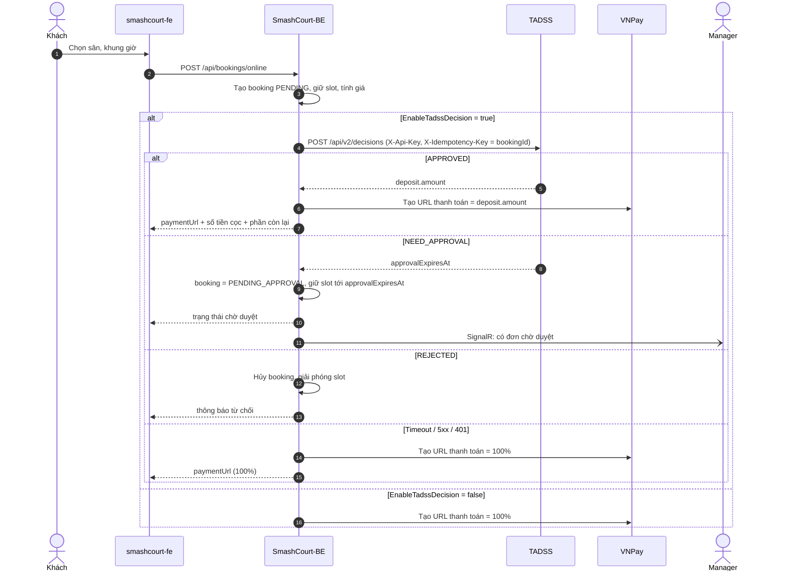
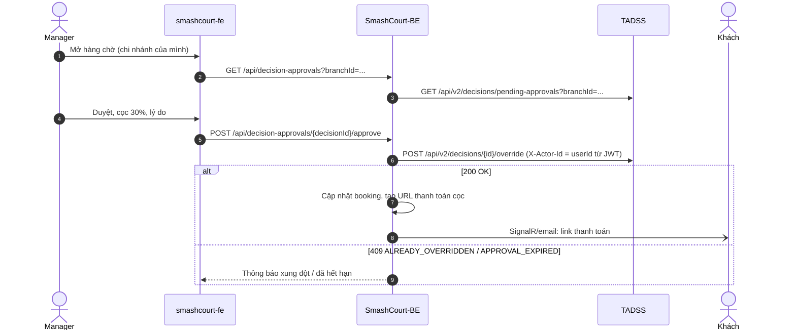

# ĐẶC TẢ TÍCH HỢP SMASHCOURT ↔ TADSS & DECISION CONTRACT v2

| | |
| :--- | :--- |
| **Trạng thái** | v2.0.0 — **bản nháp**, đóng băng tại Milestone 5 (08/11/2026) |
| **Thay thế** | Contract v1.0.0 ([`API_CONTRACT_V1.md`](API_CONTRACT_V1.md)) — v1 không có consumer thực tế nên được ngừng khi v2 đóng băng |
| **Consumer** | `SmashCourt-BE` (Phase 6); adapter Hotel Booking Demand (kiểm chứng độc lập domain) |
| **Sở hữu** | Tài liệu này là nguồn duy nhất về contract v2 và luồng tích hợp. Bất biến lưu trữ: [`DECISION_PERSISTENCE_INVARIANTS.md`](../architecture/DECISION_PERSISTENCE_INVARIANTS.md). Pipeline chịu lỗi: [`RESILIENCE_AND_FAULT_TAXONOMY.md`](../architecture/RESILIENCE_AND_FAULT_TAXONOMY.md) |

---

## 1. NGHIỆP VỤ ĐẶT CỌC (ĐÃ CHỐT)

| Tình huống | Bên quyết định | Kết quả |
| :--- | :--- | :--- |
| Strategy xác định được mức cọc | TADSS | `APPROVED` + `deposit.amount` → SmashCourt tạo thanh toán VNPay đúng số tiền cọc |
| Strategy không xác định được (giá trị lớn, rủi ro, chính sách yêu cầu duyệt) hoặc strategy lỗi (fallback) | Manager | `NEED_APPROVAL` → booking chờ duyệt; Manager **APPROVE kèm mức cọc** hoặc **REJECT** |
| Cần duyệt nhưng không còn đủ thời gian duyệt trước giờ chơi (quy tắc *approval window*, Mục 1.1) | TADSS | `APPROVED` với cọc 100%, `reasonCode = APPROVAL_WINDOW_UNAVAILABLE` |
| Strategy từ chối theo chính sách | TADSS | `REJECTED` → SmashCourt hủy booking |
| Feature flag tắt, hoặc TADSS không phản hồi / timeout / lỗi 5xx / lỗi xác thực | SmashCourt | Cọc **100%** (hành vi Đồ án 1), không chặn khách |
| Hết hạn duyệt mà Manager chưa xử lý | SmashCourt (job) | Hủy booking, giải phóng sân. **Không bao giờ tự động duyệt** |

Khách hàng **không** tự chọn mức cọc. Phần còn lại (tổng tiền − cọc) được thu khi checkout tại quầy.

### 1.1. Quy tắc approval window (runtime TADSS)

- `approvalExpiresAt = min(createdAt + Tadss:Approval:WindowMinutes, earliestStart − Tadss:Approval:MinLeadMinutes)`; mặc định `WindowMinutes = 30`, `MinLeadMinutes = 120`.
- Nếu strategy (hoặc fallback) trả `NEED_APPROVAL` nhưng `approvalExpiresAt ≤ createdAt` → runtime trả `APPROVED`, cọc 100%, `reasonCode = APPROVAL_WINDOW_UNAVAILABLE`. Kết quả gốc của strategy vẫn được lưu nguyên trong audit (`strategy_status`).

---

## 2. LUỒNG TÍCH HỢP

### 2.1. Đặt sân online



### 2.2. Manager duyệt



Endpoint phía SmashCourt-BE (`/api/decision-approvals/...`) là bản đề xuất; API contract BE ↔ FE được chốt ở task T5.22 (W10).

### 2.3. Báo kết quả thực tế (outcome)

Khi booking kết thúc, job SmashCourt gửi `POST /api/v2/decisions/{decisionId}/outcome` với một trong các giá trị: `COMPLETED`, `NO_SHOW`, `CANCELLED_BY_CUSTOMER`, `CANCELLED_BY_STAFF`, `PAYMENT_EXPIRED`, `APPROVAL_EXPIRED`, `REJECTED`. Đây là nhãn kết quả phục vụ phân tích và Khóa luận.

---

## 3. DECISION CONTRACT v2

### 3.1. Quy ước chung

- Base path `/api/v2`. JSON `camelCase`; enum dạng `SCREAMING_SNAKE_CASE`; JSON schema đặt `additionalProperties: false` (lưu tại `docs/contracts/schemas/v2/`: `decision-request`, `decision-result`, `decision-detail`). Tài liệu OpenAPI [`openapi-v2.yaml`](openapi-v2.yaml) được **sinh từ mã** và có test chống lệch (CT-01); khi hai bên khác nhau, JSON schema viết tay là nguồn chuẩn.
- **Phạm vi đã hiện thực (gói 5.2c):** chỉ `POST /api/v2/decisions` (3.3) và `GET /api/v2/decisions/{decisionId}` (3.4). `pending-approvals`, `override`, `outcome` (3.5–3.7) và xác thực `X-Api-Key` thuộc gói 5.3; các mục đó vẫn là đặc tả, chưa có endpoint.
- Thời gian dùng ISO 8601 **kèm offset** (`2026-11-20T18:00:00+07:00`). Mọi quy tắc theo khung giờ được tính theo `branchTimeZone` (IANA, ví dụ `Asia/Ho_Chi_Minh`).
- Tiền là số thập phân, đơn vị theo `currency` (SmashCourt: `VND`).
- Thời gian thiếu offset (ví dụ `2026-11-20T18:00:00`) bị từ chối với 400 `VALIDATION_ERROR` — không suy múi giờ từ máy chủ.
- Enum chỉ nhận đúng tên đã định nghĩa, phân biệt hoa thường; không nhận số hay chuỗi số. Trường lạ hoặc thiếu trường bắt buộc → 400 `VALIDATION_ERROR`.

### 3.2. Header

| Header | Bắt buộc | Mô tả |
| :--- | :---: | :--- |
| `X-Api-Key` | Mọi endpoint | Khóa service-to-service do TADSS cấp cho từng client. **Chưa kiểm tra ở 5.2c** (gói 5.3) — chưa expose ra mạng ngoài trước khi có xác thực |
| `X-Idempotency-Key` | `POST /decisions`, `POST /override`, `POST /outcome` | 1..128 ký tự; SmashCourt dùng `bookingId` (đánh giá) hoặc `{decisionId}:{action}` (override) |
| `X-Actor-Id` | `POST /override` | Định danh Manager do SmashCourt lấy từ JWT đã xác thực |
| `X-Correlation-ID` | Tùy chọn | Được echo lại trong response và gắn vào log, trace, audit. Giá trị rỗng/khoảng trắng hoặc dài hơn 128 ký tự bị bỏ qua: server cấp một GUID mới (không từ chối request) |

### 3.3. `POST /api/v2/decisions`

**Request**

```json
{
  "reservationId": "5b0a6f0e-7c0d-4a0e-9a64-0c2e7f1b9a11",
  "branchId": "1f2e3d4c-0000-4000-8000-000000000001",
  "branchTimeZone": "Asia/Ho_Chi_Minh",
  "items": [
    {
      "resourceId": "c0a8012e-0000-4000-8000-0000000000aa",
      "resourceTypeId": "c0a8012e-0000-4000-8000-0000000000bb",
      "startTime": "2026-11-20T18:00:00+07:00",
      "endTime": "2026-11-20T20:00:00+07:00",
      "price": 240000
    }
  ],
  "customer": {
    "customerId": "9d3f1c2a-0000-4000-8000-000000000123",
    "isGuest": false,
    "tier": "GOLD",
    "memberSince": "2025-03-14T08:00:00+07:00",
    "history": {
      "completedCount": 12, "noShowCount": 1, "cancelledCount": 2,
      "lateCancelledCount": 1, "paymentExpiredCount": 0,
      "lastCompletedAt": "2026-11-02T20:00:00+07:00"
    }
  },
  "totalPrice": 228000,
  "currency": "VND",
  "channel": "ONLINE",
  "demand": { "occupancyRate": 0.75, "waitlistCount": 2 },
  "requestedAt": "2026-11-18T09:15:00+07:00",
  "metadata": { "promotionCode": "WINTER" }
}
```

| Trường | Ràng buộc |
| :--- | :--- |
| `items` | 1..20 phần tử; mỗi `endTime > startTime`; `price ≥ 0`. Thời lượng mỗi item là chính sách của runtime, cấu hình bằng `Tadss:Validation:MinItemMinutes` / `MaxItemMinutes` (mặc định 30 phút – 12 giờ); vượt giới hạn → 400 `DOMAIN_INVARIANT_VIOLATION` |
| `customer.customerId` | Bắt buộc khi `isGuest = false`; `null` khi `isGuest = true` |
| `customer.tier` | Một trong `STANDARD`, `SILVER`, `GOLD`, `PLATINUM`, `DIAMOND` (client tự ánh xạ hạng nội bộ) |
| `customer.memberSince` | Tùy chọn; thời điểm tạo tài khoản (có offset); `null`/bỏ trống với khách vãng lai |
| `customer.history` | Tùy chọn (gửi được cả với khách vãng lai); số đếm ≥ 0. `completedCount`: booking hoàn tất. `noShowCount`: không đến. `cancelledCount`: khách tự hủy và được hoàn đủ theo chính sách hủy. `lateCancelledCount` (tùy chọn): khách tự hủy nhưng không được hoàn đủ (hủy muộn). `paymentExpiredCount` (tùy chọn): booking bị hệ thống hủy do hết hạn thanh toán. Hủy do nhân viên không tính |
| `demand` | Tùy chọn; ảnh chụp nhu cầu tại khung giờ khi tạo booking: `occupancyRate` ∈ [0, 1] (tỷ lệ sân hoạt động của chi nhánh đã có booking giao với khung giờ, không tính booking này), `waitlistCount` ≥ 0 (số người đăng ký chờ slot còn hạn). **Không** đưa vào `request_hash` vì thay đổi giữa các lần retry |
| `totalPrice` | Tổng sau giảm giá, ≥ 0 |
| `currency` | Mã ISO 4217, 3 chữ cái in hoa |
| `branchTimeZone` | Mã múi giờ IANA (ví dụ `Asia/Ho_Chi_Minh`); mã Windows hoặc mã lạ → 400 `VALIDATION_ERROR` |
| `channel` | `ONLINE` \| `WALK_IN` (đặt tại quầy) — trùng tên với `BookingSource` của SmashCourt-BE |
| `metadata` | Tùy chọn; object chuỗi → chuỗi, không ảnh hưởng quyết định và không đưa vào `request_hash` |

**Hai tầng lỗi request.** Vi phạm ràng buộc **hình thức** diễn đạt được bằng JSON schema request (thiếu trường, sai kiểu/định dạng, trường lạ, giá trị ngoài miền, số phần tử `items`, mã múi giờ, mã tiền tệ…) → 400 `VALIDATION_ERROR`. Chỉ quy tắc **ngoài schema** (`endTime > startTime`, thời lượng item theo `Tadss:Validation`) → 400 `DOMAIN_INVARIANT_VIOLATION`. Cùng một vi phạm hình thức không bao giờ trả hai mã khác nhau.

**Response 200**

```json
{
  "decisionId": "0f9c7e5a-0000-4000-8000-00000000d001",
  "reservationId": "5b0a6f0e-7c0d-4a0e-9a64-0c2e7f1b9a11",
  "status": "APPROVED",
  "deposit": { "rate": 0.5, "amount": 114000, "currency": "VND" },
  "strategyName": "MockAlternativeDecisionStrategy",
  "strategyVersion": "2.0.0",
  "executionType": "AUTOMATED",
  "fallbackUsed": false,
  "reasonCode": "PEAK_HOUR_DEPOSIT",
  "reasons": ["Khung giờ cao điểm (18:00 thứ Sáu, giờ chi nhánh) áp dụng cọc 50%."],
  "recommendations": [],
  "approvalExpiresAt": null,
  "evaluatedAt": "2026-11-18T02:15:00.041Z"
}
```

| Trường | Quy tắc |
| :--- | :--- |
| `status` | `APPROVED` \| `NEED_APPROVAL` \| `REJECTED` |
| `deposit` | **Bắt buộc** khi `APPROVED` (`0 ≤ rate ≤ 1`, `amount = round(totalPrice × rate)`); `null` trong các trường hợp còn lại |
| `executionType` | `AUTOMATED` \| `FALLBACK` \| `CACHE_HIT` |
| `approvalExpiresAt` | Bắt buộc khi `NEED_APPROVAL` |
| `recommendations[]` | `{ "type": ..., "description": "..." }`; `type` ∈ `REQUIRE_APPROVAL`, `ALTERNATIVE_SLOT`, `ALTERNATIVE_RESOURCE`, `PRIORITY_ESCALATION` |

### 3.4. `GET /api/v2/decisions/{decisionId}`

Trả chi tiết của một quyết định:

```json
{
  "decisionId": "...", "reservationId": "...",
  "request": { "...": "request v2 đã chuẩn hóa (cùng hình dạng Mục 3.3)" },
  "result": { "status": "APPROVED", "strategyStatus": "NEED_APPROVAL", "deposit": { "rate": 1, "amount": 228000, "currency": "VND" },
              "reasonCode": "APPROVAL_WINDOW_UNAVAILABLE",
              "reasons": ["Không còn đủ thời gian để Manager duyệt trước giờ bắt đầu, nên áp dụng mức cọc 100% thay cho bước duyệt."],
              "recommendations": [], "approvalExpiresAt": null },
  "execution": { "strategyName": "...", "strategyVersion": "2.0.0", "executionType": "AUTOMATED", "executionTimeMs": 3,
                 "fallbackUsed": false, "failureReason": null, "cacheHit": false },
  "override": null,
  "outcome": null,
  "createdAt": "2026-11-18T02:15:00.041+00:00",
  "correlationId": "..."
}
```

`override` là một object (hình dạng response Mục 3.6) hoặc `null` — mỗi quyết định có tối đa một override (INV-5). `outcome` có hình dạng response Mục 3.7 hoặc `null`.

### 3.5. `GET /api/v2/decisions/pending-approvals?branchId={id}&page=1&pageSize=20`

- Chỉ gồm **bản quyết định mới nhất** của mỗi `reservationId` thỏa: `status = NEED_APPROVAL`, chưa override, chưa có outcome, `approvalExpiresAt > now`.
- Mỗi item: `decisionId`, `reservationId`, `branchId`, `totalPrice`, `currency`, `earliestStart`, `customer.isGuest`, `customer.tier`, `reasonCode`, `fallbackUsed`, `approvalExpiresAt`, `createdAt`.
- Bao ngoài: `{ "items": [...], "page": 1, "pageSize": 20, "totalItems": 42, "totalPages": 3, "hasNext": true, "hasPrev": false }`.

### 3.6. `POST /api/v2/decisions/{decisionId}/override`

```json
{ "action": "APPROVE", "deposit": { "rate": 0.3 }, "reason": "Khách quen, chi nhánh bảo lãnh" }
```

- `action`: `APPROVE` (bắt buộc **đúng một** trong `deposit.rate` hoặc `deposit.amount`) \| `REJECT` (không gửi `deposit`). `reason` 5..500 ký tự.
- Mỗi quyết định có **tối đa một** override (ràng buộc `UNIQUE(decision_id)` trên bảng `decision_overrides`). Gửi lại cùng `X-Idempotency-Key` và cùng payload → trả lại kết quả cũ (200).
- **Response 200:** `decisionId`, `action`, `deposit` (đã quy đổi `rate` và `amount`), `actorId`, `reason`, `overriddenAt`.

### 3.7. `POST /api/v2/decisions/{decisionId}/outcome`

```json
{ "outcome": "NO_SHOW", "occurredAt": "2026-11-20T18:30:00+07:00" }
```

Mỗi quyết định có tối đa một outcome. Gửi trùng với cùng payload → 200; khác payload → 409.

**Response 200:** `{ "decisionId": "...", "outcome": "NO_SHOW", "occurredAt": "2026-11-20T18:30:00+07:00", "reportedAt": "2026-11-20T19:00:02+00:00" }`.

### 3.8. Mã lỗi (RFC 7807 `application/problem+json`, trường `code`)

| HTTP | `code` | Khi nào |
| :---: | :--- | :--- |
| 400 | `VALIDATION_ERROR`, `DOMAIN_INVARIANT_VIOLATION`, `MISSING_HEADER` | Payload/header sai (kể cả body không giải mã được; `X-Idempotency-Key` dài hơn 128 ký tự → `VALIDATION_ERROR`) |
| 415 | *(không có `code`)* | `Content-Type` không phải JSON. Do MVC trả mặc định, ngoài bộ mã của contract: body `application/problem+json` chuẩn không có trường `code`; `traceId` vẫn là correlation id |
| 401 | `UNAUTHORIZED` | Thiếu hoặc sai `X-Api-Key` (chưa hiện thực — gói 5.3) |
| 404 | `DECISION_NOT_FOUND` | Không có `decisionId`. `decisionId` không phải GUID thì route không khớp → 404 mặc định của framework (không có `code`) |
| 409 | `IDEMPOTENCY_KEY_REUSE` | Dùng lại key với payload khác |
| 409 | `NOT_PENDING_APPROVAL`, `ALREADY_OVERRIDDEN`, `APPROVAL_EXPIRED`, `OUTCOME_ALREADY_RECORDED` | Vi phạm trạng thái (chưa hiện thực — gói 5.3, cùng override/outcome) |
| 503 | `PERSISTENCE_UNAVAILABLE` | Không ghi được audit (fail-closed); response kèm header `Retry-After` (giây) |
| 504 | `GATEWAY_TIMEOUT` | Vượt deadline toàn cục |
| 500 | `INTERNAL_ERROR` | Lỗi không mong đợi (ẩn chi tiết kỹ thuật) |

### 3.9. Idempotency

| Trạng thái key | Payload | Hành vi |
| :--- | :--- | :--- |
| Chưa tồn tại | Bất kỳ | Thực thi, lưu audit, 200 |
| Đã tồn tại | Giống (`request_hash` trùng) | Trả lại kết quả đã lưu, không chạy lại strategy, 200 |
| Đã tồn tại | Khác | 409 `IDEMPOTENCY_KEY_REUSE` |

Hai request đồng thời cùng key: ràng buộc unique của PostgreSQL bảo đảm chỉ một bản ghi; request thua đọc lại và trả kết quả của request thắng. Request sai hình thức luôn trả 400 `VALIDATION_ERROR` kể cả khi key đã từng được dùng (runtime dựng domain từ request trước khi tra idempotency, nên request sai không bao giờ được replay hay báo 409).

---

## 4. TRÁCH NHIỆM PHÍA SMASHCOURT-BE

### 4.1. Cấu hình (`TadssConfig`, đọc qua `IOptionsMonitor`, reload < 2 giây)

```json
{
  "TadssConfig": {
    "EnableTadssDecision": true,
    "BaseUrl": "http://localhost:5296",
    "TimeoutMs": 800,
    "TierMapping": { "Đồng": "STANDARD", "Bạc": "SILVER", "Vàng": "GOLD", "Bạch Kim": "PLATINUM", "Kim Cương": "DIAMOND" }
  }
}
```

`ApiKey` đặt trong user-secrets/biến môi trường, không ghi vào `appsettings.json`. Tên hạng trong `TierMapping` là ví dụ; giá trị thật lấy theo bảng `loyalty_tiers`.

**Cách SmashCourt-BE dùng contract:** BE **không** reference `Shared.DecisionContractSDK` (reference chéo repo từng làm vỡ CI độc lập và đã được gỡ ở commit `0b5d041` của SmashCourt-BE). BE tự định nghĩa DTO và `ITadssClient`/`TadssClient` trong `Integrations/Tadss/` theo mẫu `Integrations/AI/` hiện có; tính tương thích được bảo đảm bằng kiểm thử CT-04 (response mẫu kiểm tra theo JSON schema v2).

### 4.2. Ánh xạ booking → request v2

- **Chỉ gọi TADSS cho booking `ONLINE`.** Booking tại quầy (`WALK_IN`) được `CONFIRMED` ngay, mặc định trả sau, khách có mặt — không cần quyết định cọc. Giá trị `WALK_IN` được giữ trong enum để mở rộng sau.
- Mỗi `booking_court` → một phần tử `items` (`resourceId = courtId`, `resourceTypeId = courtTypeId`, `price` = phí sân trước giảm giá theo bảng giá `TimeSlot`). Mọi sân của một đơn dùng chung khung giờ (ràng buộc hiện có của BE).
- `totalPrice` = `finalTotal` của hóa đơn (phí sân − giảm theo hạng − khuyến mãi); mức cọc tính trên số này.
- `branchTimeZone`: bảng `branches` không có múi giờ, BE gửi hằng số cấu hình `Asia/Ho_Chi_Minh`.
- `tier`: ánh xạ `loyalty_tiers` theo **thứ hạng `MinPoints` tăng dần** → `STANDARD`, `SILVER`, `GOLD`, `PLATINUM`, `DIAMOND` (hạng vượt quá 5 gộp vào `DIAMOND`), không phụ thuộc tên hạng do Owner đặt. Khách chưa có hạng → `STANDARD`.
- Khách vãng lai → `isGuest = true`, `customerId = null`, `tier = STANDARD`, `memberSince = null`.
- `history` tính từ các booking đã kết thúc của khách; với khách vãng lai, ghép theo số điện thoại đã chuẩn hóa (chỉ gửi số đếm, không gửi số điện thoại).
- `demand` tính tại thời điểm tạo booking (Mục 3.3).
- `X-Idempotency-Key = bookingId`, nên đánh giá lại cùng booking (khi client retry) không sinh quyết định mới.

### 4.3. Xử lý kết quả

- Lưu `decisionId`, mức cọc và nguồn áp dụng (`TADSS`, `MANAGER`, `FULL_PAYMENT_FALLBACK`) trên booking/hóa đơn để đối soát.
- Timeout `TimeoutMs`, lỗi 5xx, 401 hoặc lỗi mạng → áp dụng 100%, ghi log kèm correlation id. Không retry POST quá một lần; lần retry dùng lại cùng idempotency key.
- Không bao giờ để lỗi của TADSS làm hỏng booking hoặc trả lỗi 500 cho khách.

### 4.4. Thay đổi dữ liệu SmashCourt (chi tiết hóa ở Phase 6)

- Thêm giá trị `PENDING_APPROVAL` cho enum `booking_status`.
- Hóa đơn: số tiền cọc, tỷ lệ cọc, `tadss_decision_id`, nguồn áp dụng cọc; trạng thái `PARTIALLY_PAID` (đã có) dùng sau khi thanh toán cọc.
- Job: hết hạn duyệt (hủy + giải phóng sân), báo outcome.
- Script SQL cập nhật `TADSS-Runtime/docs/database/schema_smashcourt.sql` theo quy trình hiện có của SmashCourt-BE.

---

## 5. CƠ SỞ DỮ LIỆU TADSS

TADSS dùng schema `tadss` trên cùng máy chủ PostgreSQL với SmashCourt. Cấu trúc bảng, trigger chặn sửa và index của v2: xem [`DECISION_PERSISTENCE_INVARIANTS.md`](../architecture/DECISION_PERSISTENCE_INVARIANTS.md).

**Rollback:** tắt `EnableTadssDecision` để SmashCourt quay về luồng 100%; schema `tadss` độc lập nên có thể gỡ mà không ảnh hưởng dữ liệu SmashCourt.

---

## 6. QUẢN LÝ PHIÊN BẢN

- Contract v1.0.0 (Milestone 2) giữ nguyên trong `API_CONTRACT_V1.md`, `openapi-v1.yaml`, `schemas/` làm hồ sơ lịch sử.
- Contract v2.0.0 đóng băng tại M5 với: `openapi-v2.yaml`, `schemas/v2/`, public API baseline v2 của SDK. Sau khi đóng băng, mọi thay đổi wire phải qua quy trình tại Mục 6 của [`CONTRACT_V1_FREEZE.md`](CONTRACT_V1_FREEZE.md).
- Endpoint `/api/v1` được gỡ khi v2 đóng băng vì chưa có consumer nào tích hợp v1.
