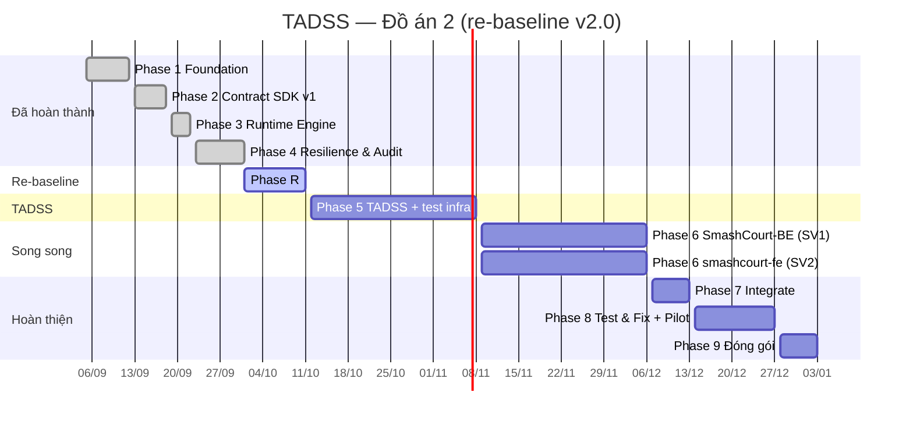

# KẾ HOẠCH THỰC THI ĐỒ ÁN 2 (MASTER EXECUTION PLAN) — v2.0

## NỀN TẢNG RUNTIME ENGINE RA QUYẾT ĐỊNH CHỊU LỖI (TADSS)

| | |
|---|---|
| **Dự án** | TADSS (Trustworthy Adaptive Decision Support System) |
| **Hệ thống đối chứng** | SmashCourt — hệ thống đặt sân cầu lông trực tuyến (Đồ án 1) |
| **Thời lượng** | 18 tuần: **W01 (31/08/2026) → W18 (03/01/2027)** |
| **Nhân sự** | **SV1** — Lead Backend: TADSS-Runtime, SmashCourt-BE, hạ tầng kiểm thử & minh chứng · **SV2** — Frontend: smashcourt-fe, Playwright, kịch bản k6 |
| **Phiên bản kế hoạch** | v2.0 — Re-baseline ngày 01/10/2026 (thay thế v1.0 16 tuần) |

> **Vai trò của tài liệu này:** đây là nguồn duy nhất (single source of truth) về **lịch trình, phase, milestone, quality gate và phân vai**. Các tài liệu khác chỉ dẫn link về đây, không chép lại:
> - Phân rã task chi tiết: [`BACKLOG_SPRINTS.md`](BACKLOG_SPRINTS.md) · WBS, phụ thuộc, rủi ro: [`PROJECT_WBS_MAPPING.md`](PROJECT_WBS_MAPPING.md)
> - Thuật ngữ, ranh giới phạm vi, bản đồ tài liệu: [`THESIS_DEVELOPMENT_PLAYBOOK.md`](THESIS_DEVELOPMENT_PLAYBOOK.md)
> - Danh mục kiểm thử & KPI đo lường: [`EXPERIMENTAL_DESIGN_AND_BENCHMARK_METHODOLOGY.md`](../research/EXPERIMENTAL_DESIGN_AND_BENCHMARK_METHODOLOGY.md)

---

## 0. LÝ DO RE-BASELINE (v1.0 → v2.0)

Sau Phase 4, nhóm rà soát lại toàn bộ mã nguồn và tài liệu (01/10/2026) và ghi nhận các vấn đề sẽ gây xung đột khi sang giai đoạn tích hợp và khi phát triển lên Khóa luận:

1. **Minh chứng chưa chạy trên hạ tầng thật:** integration test và benchmark Phase 3–4 dùng EF Core InMemory, strategy giả lập bằng `Task.Delay`. InMemory không thực thi unique index, partial index, `jsonb` hay transaction, nên nhánh xử lý tranh chấp idempotency (`23505`) chưa từng được kiểm chứng. Số liệu Tuần 8 chỉ phản ánh overhead của pipeline trong phòng lab.
2. **Contract v1 không biểu diễn được nghiệp vụ cọc:** response không có số tiền cọc yêu cầu; override không đặt được mức cọc và không lưu trạng thái đích; không lọc được theo chi nhánh; không nhận khách vãng lai và booking nhiều sân.
3. **Lỗi múi giờ:** khung giờ cao điểm được so trên giờ UTC; mã băm request phụ thuộc múi giờ của máy chủ.
4. **Audit chưa thực sự append-only:** override cập nhật trực tiếp lên bản ghi máy; không lưu input của quyết định nên không thể replay hay dùng làm dữ liệu cho Khóa luận.
5. **Thiếu bảo vệ và vận hành:** API chưa có xác thực service-to-service; hàng chờ duyệt không có cơ chế thay thế bản cũ/hết hạn; chưa có observability.
6. **Tài liệu chồng chéo và có tuyên bố không khớp mã nguồn** (RFC 8785, phiên bản package, tên file test, phạm vi outer timeout).

**Nghiệp vụ đặt cọc đã chốt (áp dụng cho toàn bộ tài liệu):**

- TADSS **xác định được** mức cọc → trả `APPROVED` kèm **số tiền cọc**; SmashCourt tạo thanh toán VNPay theo đúng số tiền đó.
- TADSS **không xác định được** (rủi ro cao, giá trị lớn, hoặc fallback do sự cố) → trả `NEED_APPROVAL`; **Manager quyết định** mức cọc hoặc từ chối.
- **Chỉ khi TADSS bị tắt (feature flag) hoặc không phản hồi** thì SmashCourt mới áp dụng cọc **100%**.
- Khách hàng **không** tự chọn mức cọc. Không bao giờ tự động duyệt (No Auto-Approve).

---

## I. NGUYÊN TẮC THỰC THI

1. **Tuần tự theo khối:** TADSS hoàn thiện trước (kể cả hạ tầng kiểm thử và kịch bản kiểm thử) → **BE và FE phát triển song song** → **Integrate** → **Test & Fix** (chỉ kiểm thử và sửa lỗi, không thêm tính năng).
2. **Chuẩn bị kiểm thử trước khi code tính năng:** toàn bộ công cụ kiểm thử (Testcontainers, Toxiproxy, k6, Playwright, Schemathesis, Stryker.NET, OpenTelemetry + Grafana, notebook báo cáo) được dựng trong Phase 5; danh mục kiểm thử của toàn hệ thống được viết xong tại Milestone 5.
3. **Không cắt giảm kiểm thử:** mọi test case trong danh mục là bắt buộc, phải chạy và đạt. Không có phân tầng Must/Should/Could cho kiểm thử.
4. **Minh chứng phải chạy trên hạ tầng thật:** PostgreSQL 16 và Redis 7 thật (container), lỗi được tiêm ở tầng mạng (Toxiproxy). EF Core InMemory và độ trễ giả lập bằng `Task.Delay` không được dùng làm minh chứng.
5. **Gate đóng mới mở phase:** phase sau chỉ bắt đầu khi gate của phase trước đạt đủ tiêu chí ở Mục IV.

---

## II. MA TRẬN TRÁCH NHIỆM

| Cấu phần | Owner | Reviewer | Deliverable |
|:---|:---:|:---:|:---|
| TADSS: SDK, Runtime, Strategies, Contract v2 | SV1 | SV2 (góc nhìn consumer) | `Shared.DecisionContractSDK` v2, `TADSS.Runtime.Api`, strategies v2 |
| Hạ tầng kiểm thử & observability | SV1 | SV2 | Testcontainers, docker-compose (Postgres, Redis, Toxiproxy, `grafana/otel-lgtm`), Stryker.NET, Schemathesis, notebook minh chứng |
| Harness replay & portability | SV1 | SV2 | Replay 215 booking SmashCourt, adapter Hotel Booking Demand |
| SmashCourt-BE (tích hợp cọc, duyệt, job) | SV1 | SV2 | API booking cọc, proxy duyệt, job hết hạn, job báo outcome |
| smashcourt-fe (khách + Manager) | SV2 | SV1 | Màn hình cọc, chờ duyệt, dashboard duyệt |
| Kịch bản k6 & Playwright | SV2 | SV1 | Script k6 (TADSS + E2E), bộ Playwright E2E |
| Pilot UAT | Cả hai | Cả hai | Môi trường staging, người dùng thật, khảo sát SUS |
| Báo cáo, slide, video | Cả hai | Cả hai | Báo cáo Đồ án 2, slide 20–25 trang, video demo |

---

## III. LỘ TRÌNH TỔNG THỂ

| Phase | Tuần | Thời gian | Nội dung | Trạng thái |
|:---|:---:|:---|:---|:---:|
| **1 — Foundation** | W01–W02 | 31/08 – 13/09 (thực tế 05/09 – 12/09) | Solution, schema `tadss`, contract nháp | ✅ M1 |
| **2 — Contract SDK v1** | W03 | 14/09 – 20/09 (thực tế 13/09 – 18/09) | SDK, Rich Domain Model, đóng băng v1 | ✅ M2 |
| **3 — Runtime Engine** | W03–W04 | thực tế 19/09 – 22/09 | Web API, chọn strategy qua DI, Default/Mock | ✅ M3 |
| **4 — Resilience & Audit** | W04–W05 | thực tế 23/09 – 01/10 | Polly v8, cache, audit đồng bộ, micro-benchmark lab | ✅ M4 |
| **R — Re-baseline** | W05–W06 | 01/10 – 11/10 | Audit, đồng bộ tài liệu, dọn repo | ✅ MR (01/10) |
| **5 — Hoàn thiện TADSS + hạ tầng kiểm thử** | W07–W10 | 12/10 – 08/11 | Contract v2, sửa lõi, toàn bộ công cụ kiểm thử, danh mục kiểm thử toàn hệ thống | ⏳ M5 |
| **6 — BE ∥ FE** | W11–W14 | 09/11 – 06/12 | SmashCourt-BE và smashcourt-fe phát triển song song theo API contract đã chốt | ⏳ M6 |
| **7 — Integrate** | W15 | 07/12 – 13/12 | Ghép FE ↔ BE ↔ TADSS, staging, **feature freeze** | ⏳ M7 |
| **8 — Test & Fix** | W16–W17 | 14/12 – 27/12 | Chạy toàn bộ danh mục, pilot UAT, Evidence Pack, chỉ sửa lỗi | ⏳ M8 |
| **9 — Đóng gói & bảo vệ** | W18 | 28/12/2026 – 03/01/2027 | Báo cáo, slide, video, diễn tập | ⏳ M9 |

---

## IV. CHI TIẾT TỪNG PHASE

### ✅ Phase 1 — Foundation & Architecture (W01–W02, thực tế 05/09 – 12/09)

- **Đã làm:** solution .NET 8 (SDK / Runtime / Strategies / Tests), schema `tadss` với bảng `tadss.decision_executions`, EF Core migration, Serilog, CI build + Docker.
- **Milestone 1:** solution build 0 warning, migration áp dụng được, contract nháp v1.

### ✅ Phase 2 — Decision Contract SDK v1 (W03, thực tế 13/09 – 18/09)

- **Đã làm:** `Reservation` (rich domain model) và value objects, DTO, enum, `IReservationDecisionStrategy`; 7 JSON schema; snapshot 32 public type (`baseline_public_api.txt`); kiểm thử kiến trúc (dependency purity, public API surface).
- **Milestone 2:** contract v1.0.0 đóng băng, độ bao phủ SDK 99,49% (hồ sơ v1 đã gỡ khỏi repo ở Phase 5, tra lại qua tag `phase4-baseline`).

### ✅ Phase 3 — Decision Runtime Engine (W03–W04, thực tế 19/09 – 22/09)

- **Đã làm:** 4 endpoint v1 (`POST /decisions`, `GET /decisions/{id}`, `GET /decisions/pending-approvals`, `POST /decisions/{id}/override`); `StrategyResolver` tra cứu theo tên trên dictionary đăng ký qua DI; `DefaultDecisionStrategy`, `MockAlternativeDecisionStrategy`; idempotency theo `X-Idempotency-Key` + `request_hash`; optimistic concurrency bằng cột `version`; correlation id; lỗi RFC 7807.
- **Milestone 3:** runtime chạy độc lập.

### ✅ Phase 4 — Resilience, Cache & Audit (W04–W05, thực tế 23/09 – 01/10)

- **Đã làm:** pipeline Polly v8 (Outer Timeout 500ms → Fallback → Retry 2 lần/30ms → Circuit Breaker → Inner Timeout 120ms); `FallbackDecisionStrategy` trả `NEED_APPROVAL`; cache theo request-hash (Redis + `IMemoryCache`); ghi audit đồng bộ qua MediatR; bộ kiểm thử tiêm lỗi F1–F7; micro-benchmark 19 kịch bản × 4 mức tải.
- **Milestone 4:** 510 test tự động pass (483 unit + 27 integration).
- **Ghi chú sau audit:** micro-benchmark Tuần 8 chạy trên EF Core InMemory với strategy giả lập, chỉ được dùng để mô tả **overhead của pipeline trong phòng lab**, không dùng làm minh chứng SLA. Module chuẩn hóa dataset Tuần 9 bị gỡ bỏ trong Phase R vì dữ liệu sinh từ DB in-memory. Báo cáo benchmark Tuần 8 đã gỡ khỏi repo ở Phase 5, tra lại qua tag `phase4-baseline`.

### ✅ Phase R — Re-baseline (W05–W06, kế hoạch 01/10 – 11/10, Gate MR đạt 01/10)

- **SV1:** audit mã nguồn và tài liệu; đồng bộ toàn bộ tài liệu theo kế hoạch v2.0; gỡ module `Normalization` cùng 6 dataset tổng hợp; build + test xanh.
- **SV2:** review tài liệu từ góc nhìn FE/UX; xác nhận luồng nghiệp vụ cọc và duyệt.
- **Gate MR:** `git status` sạch ở cả 4 repo; không còn tài liệu mâu thuẫn với mã nguồn; TADSS build `--warnaserror` và test pass; tag `phase4-baseline` được tạo trước khi dọn.
- **Kết quả Gate MR (01/10/2026):** 4 repo sạch; build 0 warning; 473 unit + 27 integration test pass, CI `develop` xanh; tag `phase4-baseline` (`243a421`) đã đẩy lên remote. Review của SV2 (TR.4) tiếp tục đến 11/10 và gộp góp ý vào T5.24.

### ⏳ Phase 5 — Hoàn thiện TADSS + hạ tầng kiểm thử (W07–W10, 12/10 – 08/11)

| Tuần | SV1 (TADSS + hạ tầng) | SV2 (chuẩn bị kiểm thử) |
|:---|:---|:---|
| **W07** (12–18/10) | Chốt bản nháp contract v2 (OpenAPI + JSON schema + SDK); thiết kế migration DB v2; chuyển toàn bộ integration test sang **Testcontainers** (PostgreSQL 16 + Redis 7), gỡ EF InMemory; dựng `docker-compose` (TADSS, Postgres, Redis, Toxiproxy, `grafana/otel-lgtm`) | Review contract v2 từ phía consumer; dựng **Playwright** trong `smashcourt-fe`; dựng dự án **k6**; bắt đầu viết kịch bản E2E/UAT |
| **W08** (19–25/10) | Hiện thực v2: số cọc trong response, strategies v2 theo ngữ nghĩa cọc, lưu snapshot request, bảng `decision_overrides` / `decision_outcomes` append-only + trigger chặn sửa, hàng chờ thay thế bản cũ và có hạn, lọc chi nhánh, xác thực API key, sửa múi giờ, sửa map exception | Viết script k6 cho TADSS (tải danh nghĩa, tăng dần, soak); tiếp tục danh mục E2E |
| **W09** (26/10–01/11) | Định tuyến strategy theo từng request + shadow mode; cách ly timeout cho strategy không hợp tác; chính sách cache theo strategy + breaker cho Redis; gắn **OpenTelemetry** và dựng dashboard **Grafana**; kịch bản lỗi **Toxiproxy**; **Schemathesis**; baseline **Stryker.NET** | Khung kịch bản Playwright (đặc tả từng bước, chờ FE); kịch bản pilot UAT và phiếu khảo sát SUS |
| **W10** (02–08/11) | Harness **replay** 215 booking (xuất ẩn danh) và adapter **Hotel Booking Demand**; pipeline **notebook** sinh báo cáo minh chứng + mẫu Evidence Pack; chạy toàn bộ danh mục kiểm thử TADSS → đạt 100%; **đóng băng contract v2**; chốt **API contract BE ↔ FE** cho Phase 6; chốt môi trường staging cho pilot | Review API contract BE ↔ FE; hoàn tất danh mục kiểm thử E2E/FE/UAT |

- **Gate M5 — TADSS Complete & Test-Ready:**
  - Toàn bộ test case TADSS trong danh mục (UT, IT, CT, FI, LT mức TADSS, MT) đạt trên hạ tầng thật; không còn EF InMemory trong solution.
  - Contract v2 đóng băng (OpenAPI v2, JSON schema v2, public API baseline v2).
  - Dashboard Grafana, kịch bản Toxiproxy, k6, Schemathesis, Stryker, notebook chạy được bằng một lệnh và đã có lượt chạy mẫu.
  - Danh mục kiểm thử **toàn hệ thống** (gồm BE, FE, E2E, UAT) viết xong; API contract BE ↔ FE đã chốt.

### ⏳ Phase 6 — SmashCourt-BE ∥ smashcourt-fe (W11–W14, 09/11 – 06/12)

| Tuần | SV1 — SmashCourt-BE | SV2 — smashcourt-fe |
|:---|:---|:---|
| **W11** (09–15/11) | Thay đổi DB SmashCourt (trạng thái `PENDING_APPROVAL`, trường cọc trên hóa đơn, liên kết `decision_id`); `TadssClient` (timeout, idempotency) + feature flag `EnableTadssDecision` qua `IOptionsMonitor` | **Thiết kế UI/UX**: hiển thị cọc cho khách, trạng thái chờ duyệt, dashboard duyệt, chi tiết quyết định |
| **W12** (16–22/11) | Luồng đặt sân online theo cọc (VNPay theo số tiền cọc), nhánh 100% khi tắt flag/TADSS lỗi; endpoint proxy cho Manager (phạm vi chi nhánh, danh tính từ JWT) | Build màn hình khách (đặt sân → cọc → thanh toán; chờ duyệt) trên mock API theo contract đã chốt |
| **W13** (23–29/11) | Job hết hạn duyệt (hủy đơn, giải phóng sân, không tự duyệt); job báo outcome về TADSS; thu phần còn lại khi checkout; sự kiện SignalR | Build dashboard Manager (hàng chờ theo chi nhánh, duyệt với mức cọc, từ chối, xung đột) + realtime |
| **W14** (30/11–06/12) | Test BE (unit + integration Testcontainers) theo danh mục; script k6 E2E cùng SV2; sửa lỗi | Playwright trên mock; hoàn thiện UI; sửa lỗi |

- **Gate M6 — BE & FE Complete:** toàn bộ test case BE trong danh mục đạt; FE build + lint + Playwright (trên mock) đạt; không còn task tính năng mở.

### ⏳ Phase 7 — Integrate (W15, 07/12 – 13/12)

- Ghép FE ↔ BE ↔ TADSS trên docker-compose và môi trường staging; chạy smoke E2E; chuẩn bị tài khoản và dữ liệu pilot.
- **Feature freeze cuối W15.**
- **Gate M7 — Integrated:** các luồng E2E chính chạy thông trên staging (APPROVED, NEED_APPROVAL → duyệt, từ chối, hết hạn, tắt flag, TADSS sập).

### ⏳ Phase 8 — Test & Fix (W16–W17, 14/12 – 27/12)

- Chạy **toàn bộ** danh mục: UT/IT/CT/MT, ma trận lỗi FI (Toxiproxy), tải LT (k6), E2E (Playwright trên staging), replay RP, portability PT.
- **Pilot UAT** trong 2 tuần với người dùng thật; thu khảo sát SUS.
- Chỉ sửa lỗi; mọi lần sửa phải chạy lại các test case liên quan.
- Sinh **Evidence Pack** và báo cáo notebook.
- **Gate M8 — Evaluation Complete:** 100% test case đạt; đo đủ KPI SC1–SC9; Evidence Pack hoàn chỉnh.

### ⏳ Phase 9 — Đóng gói & bảo vệ (W18, 28/12/2026 – 03/01/2027)

- Hoàn thiện báo cáo (Chương 3–4 lấy số liệu từ Evidence Pack), slide 20–25 trang, video demo (đặt sân → TADSS → VNPay → duyệt → tiêm lỗi trực tiếp trên Grafana), diễn tập.
- **Gate M9 — Defense Ready.**
- Báo cáo viết cuốn chiếu: Chương 1–2 hoàn thành trước cuối W15; Chương 3–4 trong W17–W18.

---

## V. QUALITY GATES & DEFINITION OF DONE

| Gate | Tiêu chí | Minh chứng |
|:---|:---|:---|
| **G1 Build** | TADSS 0 warning với `--warnaserror`; SmashCourt-BE không thêm warning so với baseline; FE `tsc` + lint đạt | Log build CI |
| **G2 Unit** | 100% unit test đạt | Báo cáo test (trx) |
| **G3 Integration (hạ tầng thật)** | 100% integration test đạt trên PostgreSQL/Redis thật qua Testcontainers; không có EF InMemory | Báo cáo test + log container |
| **G4 Contract** | Public API baseline v2 khớp; response hợp lệ theo JSON schema v2; Schemathesis 0 lỗi | Báo cáo Schemathesis |
| **G5 Test quality** | Mutation score Stryker ≥ 70% cho SDK, Strategies và service lõi | Báo cáo HTML Stryker |
| **G6 Resilience** | 100% kịch bản FI đạt kết quả kỳ vọng trên hạ tầng thật | Log chaos + Grafana |
| **G7 Performance** | Đạt ngưỡng SC1, SC2 bằng k6 | Báo cáo k6 + Grafana |
| **G8 Integration E2E** | 100% kịch bản Playwright đạt; 0 booking mâu thuẫn sau ma trận lỗi E2E | Playwright report/video, kết quả truy vấn bất biến |
| **G9 Evidence** | Evidence Pack đủ thành phần, gắn commit và cấu hình; notebook sinh lại được | `docs/research/evidence-packs/` |

**Definition of Done cho mỗi task:** mã nguồn + test case tương ứng trong danh mục đạt + tài liệu liên quan được cập nhật + build/verify xanh ở repo bị ảnh hưởng.

Định nghĩa đo lường chi tiết của KPI SC1–SC9: xem Mục 5 trong [`EXPERIMENTAL_DESIGN_AND_BENCHMARK_METHODOLOGY.md`](../research/EXPERIMENTAL_DESIGN_AND_BENCHMARK_METHODOLOGY.md).

---

## VI. QUY TẮC DÙNG THUẬT NGỮ (ACADEMIC TONE LOCK)

| Tránh dùng | Thay bằng |
|:---|:---|
| "Chịu lỗi cấp Enterprise", "an toàn mức ngân hàng" | "Các cơ chế chịu lỗi giúp duy trì khả năng ra quyết định khi strategy gặp timeout hoặc lỗi" |
| "Chuẩn hóa theo RFC 8785 (JCS)" | "Chuẩn hóa canonical theo thứ tự trường cố định trước khi băm SHA-256" |
| "In-vivo audit harvest", "8 bất biến toán học" | "Trích xuất bản ghi audit từ PostgreSQL thật kèm manifest SHA-256" |
| "Phân giải chiến lược O(1)" | "Tra cứu strategy theo tên trên dictionary đăng ký qua DI" |
| "100% không lỗi" | "100% test case trong danh mục đạt" (luôn nêu rõ 100% của cái gì) |
| "Hệ thống AI tự động hoàn toàn" | "Hệ thống hỗ trợ ra quyết định có con người phê duyệt (human-in-the-loop)" |
| "Append-only" cho bảng có `UPDATE` | Chỉ dùng "append-only" khi DB chặn `UPDATE/DELETE` bằng trigger |

---

*Kế hoạch v2.0 — re-baseline 01/10/2026. Mọi thay đổi lịch trình tiếp theo cập nhật trực tiếp tại tài liệu này.*
