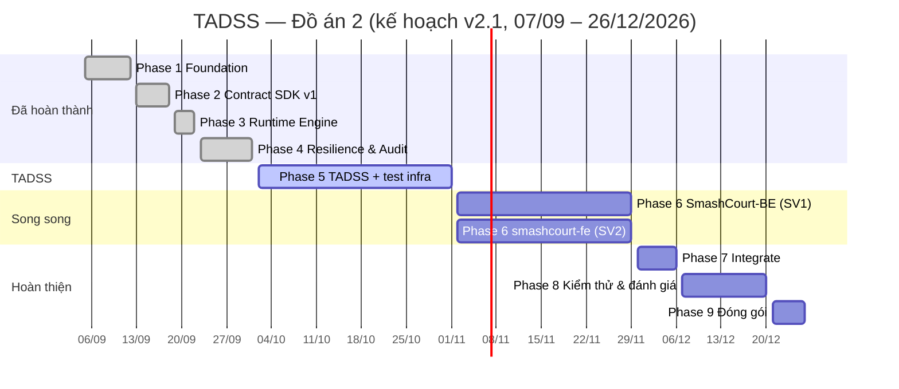

# KẾ HOẠCH THỰC THI ĐỒ ÁN 2 (MASTER EXECUTION PLAN) — v2.1

## NỀN TẢNG RUNTIME ENGINE RA QUYẾT ĐỊNH CHỊU LỖI (TADSS)

| | |
|---|---|
| **Dự án** | TADSS (Trustworthy Adaptive Decision Support System) |
| **Hệ thống đối chứng** | SmashCourt — hệ thống đặt sân cầu lông trực tuyến (Đồ án 1) |
| **Thời lượng** | 16 tuần: **W01 (07/09/2026) → W16 (26/12/2026)** |
| **Nhân sự** | **SV1** — Lead Backend: TADSS-Runtime, SmashCourt-BE, hạ tầng kiểm thử & minh chứng · **SV2** — Frontend: smashcourt-fe, Playwright, kịch bản k6 |
| **Phiên bản kế hoạch** | v2.1 — 05/10/2026: khớp khung thời gian chính thức 07/09 – 26/12/2026 (16 tuần); bỏ pilot với người dùng thật, đánh giá chất lượng quyết định bằng dữ liệu import · v2.0 — re-baseline 01/10/2026 |

> **Vai trò của tài liệu này:** đây là nguồn duy nhất (single source of truth) về **lịch trình, phase, milestone, quality gate và phân vai**. Các tài liệu khác chỉ dẫn link về đây, không chép lại:
> - Phân rã task chi tiết: [`BACKLOG_SPRINTS.md`](BACKLOG_SPRINTS.md) · WBS, phụ thuộc, rủi ro: [`PROJECT_WBS_MAPPING.md`](PROJECT_WBS_MAPPING.md)
> - Thuật ngữ, ranh giới phạm vi, bản đồ tài liệu: [`THESIS_DEVELOPMENT_PLAYBOOK.md`](THESIS_DEVELOPMENT_PLAYBOOK.md)
> - Danh mục kiểm thử & KPI đo lường: [`EXPERIMENTAL_DESIGN_AND_BENCHMARK_METHODOLOGY.md`](../research/EXPERIMENTAL_DESIGN_AND_BENCHMARK_METHODOLOGY.md)

---

## 0. LÝ DO RE-BASELINE (v1.0 → v2.0)

Sau Phase 4, nhóm rà soát lại toàn bộ mã nguồn và tài liệu (01/10/2026) và ghi nhận các vấn đề sẽ gây xung đột khi sang giai đoạn tích hợp và khi phát triển lên Khóa luận:

1. **Minh chứng chưa chạy trên hạ tầng thật:** integration test và benchmark Phase 3–4 dùng EF Core InMemory, strategy giả lập bằng `Task.Delay`. InMemory không thực thi unique index, partial index, `jsonb` hay transaction, nên nhánh xử lý tranh chấp idempotency (`23505`) chưa từng được kiểm chứng. Số liệu Tuần 8 chỉ phản ánh overhead của pipeline trong phòng lab.
2. **Contract v1 không biểu diễn được nghiệp vụ cọc:** response không có số tiền cọc yêu cầu; override không đặt được mức cọc và không lưu trạng thái đích; không lọc được theo chi nhánh; không nhận khách vãng lai và booking nhiều sân.
3. **Lỗi múi giờ:** khung giờ cao điểm được so trên giờ UTC; mã băm request phụ thuộc múi giờ của máy chủ.
4. **Audit chưa thực sự append-only:** override cập nhật trực tiếp lên bản ghi máy; không lưu input của quyết định nên không thể replay hay dùng làm dữ liệu cho Khóa luận.
5. **Thiếu bảo vệ và vận hành:** API chưa có xác thực service-to-service; hàng chờ duyệt không có cơ chế thay thế bản cũ/hết hạn; chưa có observability.
6. **Tài liệu chồng chéo và có tuyên bố không khớp mã nguồn** (RFC 8785, phiên bản package, tên file test, phạm vi outer timeout).

**Nghiệp vụ đặt cọc đã chốt (áp dụng cho toàn bộ tài liệu):**

- TADSS **xác định được** mức cọc → trả `APPROVED` kèm **số tiền cọc**; SmashCourt tạo thanh toán VNPay theo đúng số tiền đó.
- TADSS **không xác định được** vì lý do nghiệp vụ (rủi ro cao, giá trị lớn) → trả `NEED_APPROVAL`; **Manager quyết định** mức cọc hoặc từ chối.
- **Mọi sự cố đều cọc 100%:** strategy lỗi/timeout/circuit mở → fallback của TADSS trả `APPROVED` cọc 100% (`executionType = FALLBACK`; D-13, 04/10/2026 — trước đó fallback trả `NEED_APPROVAL`); TADSS bị tắt (feature flag), lỗi hoặc không phản hồi → SmashCourt áp dụng cọc **100%**; không kịp duyệt trước giờ chơi → `APPROVED` cọc 100%.
- Khách hàng **không** tự chọn mức cọc. Không bao giờ tự động duyệt (No Auto-Approve).

---

## I. NGUYÊN TẮC THỰC THI

1. **Tuần tự theo khối:** TADSS hoàn thiện trước (kể cả hạ tầng kiểm thử và kịch bản kiểm thử) → **BE và FE phát triển song song** → **Integrate** → **Kiểm thử & đánh giá** (chỉ kiểm thử và sửa lỗi, không thêm tính năng).
2. **Chuẩn bị kiểm thử trước khi code tính năng:** toàn bộ công cụ kiểm thử (Testcontainers, Toxiproxy, k6, Playwright, Schemathesis, Stryker.NET, OpenTelemetry + Grafana, notebook báo cáo) được dựng trong Phase 5; danh mục kiểm thử của toàn hệ thống được viết xong tại Milestone 5.
3. **Không cắt giảm kiểm thử:** mọi test case trong danh mục là bắt buộc, phải chạy và đạt. Không có phân tầng Must/Should/Could cho kiểm thử.
4. **Minh chứng phải chạy trên hạ tầng thật:** PostgreSQL 16 và Redis 7 thật (container), lỗi được tiêm ở tầng mạng (Toxiproxy). EF Core InMemory và độ trễ giả lập bằng `Task.Delay` không được dùng làm minh chứng.
5. **Gate đóng mới mở phase:** phase sau chỉ bắt đầu khi gate của phase trước đạt đủ tiêu chí ở Mục IV.

---

## II. MA TRẬN TRÁCH NHIỆM

| Cấu phần | Owner | Reviewer | Deliverable |
|:---|:---:|:---:|:---|
| TADSS: SDK, Runtime, Strategies, Contract v2 | SV1 | SV2 (góc nhìn consumer) | `Shared.DecisionContractSDK` v2, `TADSS.Runtime.Api`, strategies v2 |
| Hạ tầng kiểm thử & observability | SV1 | SV2 | Testcontainers; chế độ đánh giá một lệnh `docker compose up -d --build` (D-12, D-14: TADSS, Postgres, Redis, Toxiproxy, `grafana/otel-lgtm`, evaluator điều phối k6, Schemathesis, Stryker.NET và dựng báo cáo minh chứng) |
| Harness replay & portability | SV1 | SV2 | Replay 215 booking SmashCourt, adapter Hotel Booking Demand |
| SmashCourt-BE (tích hợp cọc, duyệt, job) | SV1 | SV2 | API booking cọc, proxy duyệt, job hết hạn, job báo outcome |
| smashcourt-fe (khách + Manager) | SV2 | SV1 | Màn hình cọc, chờ duyệt, dashboard duyệt |
| Kịch bản k6 & Playwright | SV2 | SV1 | Script k6 (TADSS + E2E), bộ Playwright E2E |
| Báo cáo, slide, video | Cả hai | Cả hai | Báo cáo Đồ án 2, slide 20–25 trang, video demo |

---

## III. LỘ TRÌNH TỔNG THỂ

| Phase | Tuần | Thời gian | Nội dung | Trạng thái |
|:---|:---:|:---|:---|:---:|
| **1 — Foundation** | W01 | 07/09 – 13/09 (thực tế 05/09 – 12/09) | Solution, schema `tadss`, contract nháp | ✅ M1 |
| **2 — Contract SDK v1** | W02 | 14/09 – 20/09 (thực tế 13/09 – 18/09) | SDK, Rich Domain Model, đóng băng v1 | ✅ M2 |
| **3 — Runtime Engine** | W03 | 21/09 – 27/09 (thực tế 19/09 – 22/09) | Web API, chọn strategy qua DI, Default/Mock | ✅ M3 |
| **4 — Resilience & Audit** | W04 | 28/09 – 04/10 (thực tế 23/09 – 01/10) | Polly v8, cache, audit đồng bộ, micro-benchmark lab | ✅ M4 |
| **5 — Hoàn thiện TADSS + hạ tầng kiểm thử** | W05–W08 | 05/10 – 01/11 (bắt đầu thực tế 02/10) | Rà soát và điều chỉnh kế hoạch (Gate MR đạt 01/10), contract v2, sửa lõi, toàn bộ công cụ kiểm thử, danh mục kiểm thử toàn hệ thống | ⏳ M5 |
| **6 — BE ∥ FE** | W09–W12 | 02/11 – 29/11 | SmashCourt-BE và smashcourt-fe phát triển song song theo API contract đã chốt | ⏳ M6 |
| **7 — Integrate** | W13 | 30/11 – 06/12 | Ghép FE ↔ BE ↔ TADSS bằng Docker Compose, **feature freeze** | ⏳ M7 |
| **8 — Kiểm thử & đánh giá** | W14–W15 | 07/12 – 20/12 | Chạy toàn bộ kế hoạch kiểm thử (chế độ đánh giá một lệnh), E2E qua SmashCourt, đánh giá trên dữ liệu import, báo cáo minh chứng; chỉ sửa lỗi | ⏳ M8 |
| **9 — Đóng gói & bảo vệ** | W16 | 21/12 – 26/12 | Báo cáo, slide, video, diễn tập | ⏳ M9 |

---

## IV. CHI TIẾT TỪNG PHASE

### ✅ Phase 1 — Foundation & Architecture (W01, thực tế 05/09 – 12/09)

- **Đã làm:** solution .NET 8 (SDK / Runtime / Strategies / Tests), schema `tadss` với bảng `tadss.decision_executions`, EF Core migration, Serilog, CI build + Docker.
- **Milestone 1:** solution build 0 warning, migration áp dụng được, contract nháp v1.

### ✅ Phase 2 — Decision Contract SDK v1 (W02, thực tế 13/09 – 18/09)

- **Đã làm:** `Reservation` (rich domain model) và value objects, DTO, enum, `IReservationDecisionStrategy`; 7 JSON schema; snapshot 32 public type (`baseline_public_api.txt`); kiểm thử kiến trúc (dependency purity, public API surface).
- **Milestone 2:** contract v1.0.0 đóng băng, độ bao phủ SDK 99,49% (hồ sơ v1 đã gỡ khỏi repo ở Phase 5, tra lại qua tag `phase4-baseline`).

### ✅ Phase 3 — Decision Runtime Engine (W03, thực tế 19/09 – 22/09)

- **Đã làm:** 4 endpoint v1 (`POST /decisions`, `GET /decisions/{id}`, `GET /decisions/pending-approvals`, `POST /decisions/{id}/override`); `StrategyResolver` tra cứu theo tên trên dictionary đăng ký qua DI; `DefaultDecisionStrategy`, `MockAlternativeDecisionStrategy`; idempotency theo `X-Idempotency-Key` + `request_hash`; optimistic concurrency bằng cột `version`; correlation id; lỗi RFC 7807.
- **Milestone 3:** runtime chạy độc lập.

### ✅ Phase 4 — Resilience, Cache & Audit (W04, thực tế 23/09 – 01/10)

- **Đã làm:** pipeline Polly v8 (Outer Timeout 500ms → Fallback → Retry 2 lần/30ms → Circuit Breaker → Inner Timeout 120ms); `FallbackDecisionStrategy` trả `NEED_APPROVAL` (hành vi Phase 4; từ D-13 fallback trả `APPROVED` cọc 100%); cache theo request-hash (Redis + `IMemoryCache`); ghi audit đồng bộ qua MediatR (cơ chế đã gỡ ở Phase 5, thay bằng ghi audit đồng bộ trong `DecisionService`); bộ kiểm thử tiêm lỗi F1–F7; micro-benchmark 19 kịch bản × 4 mức tải.
- **Milestone 4:** 510 test tự động pass (483 unit + 27 integration).
- **Ghi chú sau audit:** micro-benchmark Tuần 8 chạy trên EF Core InMemory với strategy giả lập, chỉ được dùng để mô tả **overhead của pipeline trong phòng lab**, không dùng làm minh chứng SLA. Module chuẩn hóa dataset Tuần 9 bị gỡ bỏ ở bước rà soát đầu Phase 5 vì dữ liệu sinh từ DB in-memory. Báo cáo benchmark Tuần 8 đã gỡ khỏi repo ở Phase 5, tra lại qua tag `phase4-baseline`.

### ⏳ Phase 5 — Hoàn thiện TADSS + hạ tầng kiểm thử (W05–W08, 05/10 – 01/11; bắt đầu thực tế 02/10)

#### ✅ Bước 0 — Rà soát và điều chỉnh kế hoạch (01/10 – 11/10, Gate MR đạt 01/10)

- **SV1:** audit mã nguồn và tài liệu; đồng bộ toàn bộ tài liệu theo kế hoạch v2.0; gỡ module `Normalization` cùng 6 dataset tổng hợp; build + test xanh.
- **SV2:** review tài liệu từ góc nhìn FE/UX; xác nhận luồng nghiệp vụ cọc và duyệt.
- **Gate MR:** `git status` sạch ở cả 4 repo; không còn tài liệu mâu thuẫn với mã nguồn; TADSS build `--warnaserror` và test pass; tag `phase4-baseline` được tạo trước khi dọn.
- **Kết quả Gate MR (01/10/2026):** 4 repo sạch; build 0 warning; 473 unit + 27 integration test pass, CI `develop` xanh; tag `phase4-baseline` (`243a421`) đã đẩy lên remote. Review của SV2 (TR.4) tiếp tục đến 11/10 và gộp góp ý vào T5.24.

#### Kế hoạch theo tuần

| Tuần | SV1 (TADSS + hạ tầng) | SV2 (chuẩn bị kiểm thử) |
|:---|:---|:---|
| **W05** (05–11/10) | ✅ Gói 5.1–5.3 xong sớm (02/10 – 05/10): contract v2 (OpenAPI + JSON schema + SDK), migration DB v2, integration test chuyển sang **Testcontainers** (PostgreSQL 16 + Redis 7, gỡ EF InMemory), hiện thực v2 (số cọc trong response, strategies v2, snapshot request, bảng `decision_overrides` / `decision_outcomes` append-only + trigger, hàng chờ theo chi nhánh có hạn, API key, sửa múi giờ, map exception), Docker Compose + ngrok. Gói **5.4**: định tuyến strategy theo từng request + shadow mode; cách ly timeout cho strategy không hợp tác; chính sách cache theo strategy + breaker cho Redis | Review contract v2 từ phía consumer; dựng **Playwright** trong `smashcourt-fe`; dựng dự án **k6** |
| **W06** (12–18/10) | ✅ (xong sớm 06–08/10) Gói **5.5** (phần 1): gắn **OpenTelemetry**, dựng dashboard **Grafana**; khung **chế độ đánh giá một lệnh** (D-12; từ D-14 chạy cùng `docker compose up -d --build`) | Viết script k6 cho TADSS (tải danh nghĩa, tăng dần, soak); bắt đầu đặc tả kịch bản E2E |
| **W07** (19–25/10) | ✅ (xong sớm 08–09/10) Gói **5.5** (phần 2): evaluator điều phối kịch bản lỗi **Toxiproxy**, k6, **Schemathesis**, **Stryker.NET** và bộ sinh báo cáo | Hoàn thiện script k6; khung kịch bản Playwright (đặc tả từng bước, chờ FE) |
| **W08** (26/10–01/11) | ✅ (xong sớm 09/10) phần mã của gói **5.6**: harness **replay** 215 booking (xuất ẩn danh) và adapter **Hotel Booking Demand**, đổ dữ liệu vào báo cáo của chế độ đánh giá (bước (e) của evaluator, Evidence Pack thành bước (f)), kèm hướng dẫn chạy từng bước `docs/guides/EVALUATION_RUN_GUIDE.md`; bản nhanh chạy bằng một lệnh `docker compose up -d --build` (D-14) đạt mọi tiêu chí áp dụng được (lượt `EV-20261011-EVAL-quick-r1`, ~28 phút, SC7 `PASS`); **còn chờ người dùng:** xuất CSV SmashCourt (U-3), xác nhận giấy phép dataset (U-2, ✅ 17/10). Gói **5.7** (lập kế hoạch 11/10): rà soát tài liệu có kiểm tự động (DOC-1…DOC-4); **đóng băng contract v2** ngay trong gói, trước lượt chạy đầy đủ; chạy **bản đầy đủ** của chế độ đánh giá (toàn bộ danh mục TADSS, ước tính ~2,8 giờ) trên đúng bản đã đóng băng → đạt 100%, chốt Evidence Pack; chốt **API contract BE ↔ FE** cho Phase 6 (route theo `bookingId`, hàng chờ đọc từ DB của BE, cọc dạng tỷ lệ); chốt môi trường tích hợp (Docker Compose + ngrok, VNPay sandbox, dữ liệu trên nhánh Neon riêng `staging`; chi tiết ở mục [Môi trường tích hợp E-STAGING](#môi-trường-tích-hợp-e-staging)). **Tiến độ 12/10:** ✅ đóng băng contract v2.0.0 (11/10), DOC-1…DOC-4 tự động, đặc tả BE ↔ FE (T5.22), E-STAGING (T5.23); ⏳ chờ người dùng: xuất CSV SmashCourt (U-3), lượt đánh giá đầy đủ và lưu Evidence Pack (U-4, T5.21), rồi báo cáo Gate M5. **Gói phụ 5.7b** (14–15/10, ✅ mã và tài liệu): shadow mode trên instance PT và mô phỏng kinh tế chính sách cọc theo chính sách hủy thật của SmashCourt (PT-03, PT-04), làm trước lượt đầy đủ; cần một lượt bản nhanh kiểm chứng cơ chế trước khi chạy đầy đủ | Review API contract BE ↔ FE; hoàn tất danh mục kiểm thử E2E/FE. *15/10: dựng Playwright (T5.25) chưa bắt đầu* |

- **Gate M5 — TADSS Complete & Test-Ready:** ✅ **đạt 18/10/2026 kèm một sai lệch đã giải thích** (lượt `EV-20261017-EVAL-full-r1`; 0,04–0,11 % response 504 ở bước tải do máy bận; báo cáo `spec/PHASE5_REPORT_5.7.md`). Lượt đầy đủ sẽ chạy lại trên strategy 2.1.0 khi máy rảnh để thay thế và lưu Evidence Pack.
  - Toàn bộ test case TADSS trong danh mục (UT, IT, CT, FI, LT mức TADSS, MT) đạt trên hạ tầng thật; không còn EF InMemory trong solution.
  - Contract v2 đóng băng (OpenAPI v2, JSON schema v2, public API baseline v2). *Đã thực hiện ngày 11/10/2026 (`2.0.0`) trong gói 5.7, trước lượt chạy đầy đủ.*
  - Dashboard Grafana, kịch bản Toxiproxy, k6, Schemathesis, Stryker và bộ sinh báo cáo chạy được bằng một lệnh (`docker compose up -d --build`, chế độ đánh giá, D-12, D-14) và đã có lượt chạy đầy đủ sinh `evidence/<run_id>/`.
  - Danh mục kiểm thử **toàn hệ thống** (gồm BE, FE, E2E) viết xong; API contract BE ↔ FE đã chốt. *Tiến độ 12/10/2026: danh mục toàn hệ thống đã viết (BE-UT-01…07, BE-IT-01…20, FE-01…10, E2E-01…14 trong Mục 4.7–4.8 của methodology; đặc tả từng bước E2E ở [`E2E_TEST_SPECIFICATION.md`](../research/E2E_TEST_SPECIFICATION.md), T5.27); hợp đồng BE ↔ FE đã viết (T5.22); review API BE ↔ FE xong 18/10/2026 (T5.29): sửa R-1…R-8, chốt Q1…Q12.*

### ⏳ Phase 6 — SmashCourt-BE ∥ smashcourt-fe (W09–W12, 02/11 – 29/11)

*Tiến độ 27/10/2026 (bắt đầu sớm 19/10):* đặc tả duy nhất của phase là [`spec/PHASE6_DESIGN_SPEC.md`](../../spec/PHASE6_DESIGN_SPEC.md) (P6-01…P6-27), plan và kết quả từng gói ở `spec/PHASE6_PLAN_6A-*.md`. BE: ✅ 6A-1 nền (DB, `TadssClient`, dựng request), ✅ 6A-2 đặt sân online hai transaction, ✅ 6A-3 duyệt cọc, ✅ 6A-4 thanh toán / hủy / check-out (nhánh `feat/phase-6-deposit`, commit `f554fad`; khoảng 1850 test xanh); ✅ 6A-5 job (hết hạn thanh toán, hết hạn duyệt, báo outcome; Job-02/Job-04 có điều kiện; kiểm hạn duyệt lúc nhận; 27/10, 2232 test xanh, chưa commit); 6A-6 hoàn thiện chưa làm (thêm hạn link VNPay P6-27, cần thử sandbox). Cờ `EnableTadssDecision` vẫn tắt. FE (Epic 6B) chưa bắt đầu. TADSS không đổi mã.

| Tuần | SV1 — SmashCourt-BE | SV2 — smashcourt-fe |
|:---|:---|:---|
| **W09** (02–08/11) | Thay đổi DB SmashCourt (trạng thái `PENDING_APPROVAL`, trường cọc trên hóa đơn, liên kết `decision_id`); `TadssClient` (timeout, idempotency) + feature flag `EnableTadssDecision` qua `IOptionsMonitor` | **Thiết kế UI/UX**: hiển thị cọc cho khách, trạng thái chờ duyệt, dashboard duyệt, chi tiết quyết định |
| **W10** (09–15/11) | Luồng đặt sân online theo cọc (VNPay theo số tiền cọc), nhánh 100% khi tắt flag/TADSS lỗi; endpoint proxy cho Manager (phạm vi chi nhánh, danh tính từ JWT) | Build màn hình khách (đặt sân → cọc → thanh toán; chờ duyệt) trên mock API theo contract đã chốt |
| **W11** (16–22/11) | Job hết hạn duyệt (hủy đơn, giải phóng sân, không tự duyệt); job báo outcome về TADSS; thu phần còn lại khi checkout; sự kiện SignalR | Build dashboard Manager (hàng chờ theo chi nhánh, duyệt với mức cọc, từ chối, xung đột) + realtime |
| **W12** (23–29/11) | Test BE (unit + integration Testcontainers) theo danh mục; script k6 E2E cùng SV2; sửa lỗi | Playwright trên mock; hoàn thiện UI; sửa lỗi |

- **Gate M6 — BE & FE Complete:** toàn bộ test case BE trong danh mục đạt; FE build + lint + Playwright (trên mock) đạt; không còn task tính năng mở.

### ⏳ Phase 7 — Integrate (W13, 30/11 – 06/12)

- Ghép FE ↔ BE ↔ TADSS bằng Docker Compose (môi trường tích hợp E-STAGING trên máy nhóm, dữ liệu trên nhánh Neon riêng `staging`, VNPay sandbox; cách dựng và dùng: mục [Môi trường tích hợp E-STAGING](#môi-trường-tích-hợp-e-staging)); chạy smoke E2E; chuẩn bị dữ liệu import cho đánh giá (215 booking ẩn danh, dataset khách sạn).
- **Feature freeze cuối W13.**
- **Gate M7 — Integrated:** các luồng E2E chính chạy thông trên môi trường tích hợp (APPROVED, NEED_APPROVAL → duyệt, từ chối, hết hạn, tắt flag, TADSS sập).

### Môi trường tích hợp E-STAGING

Chốt ở gói 5.7 (task T5.23, quyết định ngày 11/10/2026); dựng ở W13 (T7.2), dùng ở W13–W15. E-STAGING là hệ thống FE ↔ BE ↔ TADSS chạy thật trên máy nhóm, dữ liệu nằm trên **nhánh Neon riêng `staging`**. Tên gọi và vị trí trong các môi trường thực nghiệm: [`EXPERIMENTAL_DESIGN_AND_BENCHMARK_METHODOLOGY.md`](../research/EXPERIMENTAL_DESIGN_AND_BENCHMARK_METHODOLOGY.md) Mục 2.

#### Máy và cách chạy

- Ba repo `smashcourt-fe`, `SmashCourt-BE`, `TADSS-Runtime`, mỗi repo một `docker-compose.yml`, cùng gắn vào mạng external `smashcourt-network` (cả ba file khai báo `external: true`). Tạo mạng một lần: `docker network create smashcourt-network`; không dùng `docker system prune` vì lệnh đó xóa mạng không có container (xem README của TADSS, mục "Bẫy khi dọn dẹp").
- Thứ tự bật: (1) TADSS, (2) BE, (3) FE. BE không phụ thuộc cứng vào TADSS (TADSS lỗi hoặc không phản hồi thì BE áp cọc 100%, INTEGRATION_SPEC mục 4.3), nhưng bật TADSS trước và chờ `/health/live` thành công để smoke test không bị lẫn kết quả dự phòng.
- BE gọi TADSS trong cùng mạng bằng `http://tadss-runtime:8080` (tên service của TADSS; [`INTEGRATION_SPEC.md`](../contracts/INTEGRATION_SPEC.md) mục 4.5). **Không cần ngrok của TADSS** khi hai hệ cùng máy. `X-Api-Key` của BE nằm ở file bí mật hoặc biến môi trường của BE (user-secrets chỉ có khi BE chạy `dotnet run`; compose của BE hiện chỉ truyền các biến `VnPay__*`), cách đưa khóa vào container chốt ở T7.2; TADSS chỉ giữ SHA-256 của khóa trong `Tadss:Security:ApiKeys`.
- FE chạy trong container `smashcourt-fe` (cổng host 3000) và gọi BE (cổng host 8080 khi BE chạy bằng compose). Địa chỉ BE cho trình duyệt đặt qua `NEXT_PUBLIC_API_BASE_URL` (REST) và `NEXT_PUBLIC_API_URL` (SignalR; mặc định trong mã là `http://localhost:5179`, địa chỉ của `dotnet run`); hai biến này là địa chỉ mà **trình duyệt** truy cập được, không phải tên container. Giá trị cụ thể kiểm khi dựng (T7.2).
- Chỉ bật các service TADSS cần cho E-STAGING: `docker compose up -d --build tadss-runtime grafana` trong `TADSS-Runtime/`. Lệnh `docker compose up -d --build` không chỉ tên service còn khởi động ngrok và cả stack đánh giá (`eval-*`, `evaluator`; ~30 phút ở bản nhanh), gây tải RAM/CPU không cần thiết và làm nhiễu số đo. Cách tách service này tương tự `tools/expose/verify-expose.sh` (chỉ khởi động `tadss-runtime`); xác nhận lại khi dựng.
- Cổng host: BE `8080`, TADSS `127.0.0.1:8081`, FE `3000`, Grafana của TADSS `127.0.0.1:3001`. Service `ngrok` của BE (`4040:4040`) và service `ngrok` của TADSS (`127.0.0.1:4040:4040`) cùng dùng cổng host `4040` nên không bật được đồng thời; vì không dùng ngrok của TADSS ở E-STAGING nên không phát sinh xung đột nếu làm đúng lệnh trên.

#### Dữ liệu: nhánh Neon `staging`

Bảng dưới là **lý do** của quyết định; phương án C là phương án đã chọn.

| Tiêu chí | A. Neon dùng chung (DB chính) | B. PostgreSQL + Redis cục bộ trong compose | **C. Nhánh Neon `staging` (đã chọn)** |
| :--- | :--- | :--- | :--- |
| E2E ghi booking/quyết định vào đâu | Vào chính DB SmashCourt và schema `tadss` mà chế độ dev hằng ngày đang dùng (README của TADSS, mục chế độ chạy: dev dùng Neon + Redis Cloud) | DB dùng một lần trong compose; compose của BE hiện không có service PostgreSQL hay Redis, phải thêm | Nhánh riêng; một nhánh chứa cả DB SmashCourt lẫn schema `tadss` |
| Dọn dữ liệu E2E | Không dọn từng dòng được: ba bảng audit của `tadss` bị trigger chặn `UPDATE`/`DELETE`/`TRUNCATE` (INV-4 trong [`DECISION_PERSISTENCE_INVARIANTS.md`](../architecture/DECISION_PERSISTENCE_INVARIANTS.md)); xóa tay phía booking còn làm lệch kiểm tra chéo SC6 (mọi `decisionId` ở SmashCourt phải có trong `tadss.decision_executions`) | `docker compose down -v` | Xóa nhánh rồi tạo lại từ nhánh chính; cũng là cách thực tế (được khuyến nghị) để dọn ba bảng audit chỉ-thêm mà không phải vô hiệu hóa trigger hay chạy migration `Down` |
| Dữ liệu nền (user, chi nhánh, sân, giá, hạng khách) | Có sẵn | Phải nạp: `docs/database/schema_smashcourt.sql` (schema) cộng seed dữ liệu nền; không thấy script seed trong `Data/` và `Program.cs` của BE nên phải viết (kiểm lại khi dựng) | Có sẵn: nhánh sao dữ liệu của nhánh chính tại thời điểm tạo nên khóa ngoại khớp, không cần seed (spec Phase 5, R-07) |
| Khóa ngoại giữa hai schema | Không có: các `REFERENCES` trong schema `tadss` chỉ trỏ trong chính `tadss`; `tadss.reservation_id` mang giá trị `bookings.id` của SmashCourt (`bookingId`) nhưng chỉ là khóa logic | Như A, nên DB cục bộ phải nạp cả hai schema nhất quán | Như A, cả hai schema nằm cùng một nhánh nên các kiểm tra chéo (SC6) chạy được |
| Giống môi trường demo/hội đồng | Giống (cùng DB) | Khác (dữ liệu và phiên bản PostgreSQL tự dựng) | Giống về cấu trúc và dữ liệu nền |
| Ảnh hưởng tới nguồn xuất RP (215 booking của DB chính) | Có: booking E2E lẫn vào DB chính | Không | Không: DB chính không bị ghi |
| Việc phải làm ở Phase 6–7 | Ít | Thêm service PostgreSQL + Redis và script seed vào compose của BE | Tạo nhánh, đặt chuỗi kết nối vào file bí mật của BE và TADSS |

Quy trình:

1. **Tạo nhánh:** trong trang quản trị Neon (công cụ dòng lệnh của Neon nếu muốn: kiểm khi dựng), tạo nhánh mới tên `staging` từ nhánh chính của dự án. Nhánh sao cả dữ liệu thật của nhánh chính (tên, số điện thoại khách, 215 booking chưa ẩn danh), nên sản phẩm của E2E trên staging (video/trace Playwright, ảnh chụp màn hình, log) có thể chứa dữ liệu cá nhân: không commit, không chia sẻ ra ngoài nhóm. Số nhánh, giới hạn kết nối và thời hạn lưu của gói đang dùng: kiểm trong trang quản trị Neon, tài liệu này không ghi.
2. **Chuỗi kết nối:** nhánh có chuỗi kết nối riêng. Chỉ đặt ở nơi chứa bí mật của từng repo: file cấu hình bí mật (`appsettings.Development.json`, được copy vào image local nên đổi xong phải `--build` lại) hoặc biến môi trường `ConnectionStrings__DefaultConnection` (TADSS đọc `ConnectionStrings:DefaultConnection`, xem [`CONFIGURATION_REFERENCE.md`](../guides/CONFIGURATION_REFERENCE.md)). Không ghi vào tài liệu, log hay lệnh in ra màn hình. Cách tách bộ cấu hình staging khỏi bộ cấu hình dev hằng ngày (hoán file trước khi build, hay dùng biến môi trường) chốt khi dựng ở T7.2; điều bắt buộc là E2E không bao giờ trỏ vào nhánh chính.
3. **Redis:** E-STAGING cần một Redis cho cache của TADSS. Nếu dùng chung Redis với chế độ dev, đặt `Tadss:Cache:InstanceName` riêng cho staging để khóa cache không lẫn (xem `CONFIGURATION_REFERENCE.md`). Chọn Redis cụ thể chốt khi dựng.
4. **Migration schema `tadss`:** nhánh tạo **sau 10/10/2026** đã có migration `20261002101457_DecisionPersistenceV2` (migration này đã áp lên DB chính ngày 10/10/2026 với sự cho phép của người dùng; xem Mục A của `DECISION_PERSISTENCE_INVARIANTS.md`). Nhánh tạo trước ngày đó chưa có, nên tạo nhánh mới thay vì áp bổ sung. Migration **mới** nào áp lên nhánh cũng cần người dùng cho phép rõ ràng (quy tắc D-05), như với DB chính. `Tadss__Database__ApplyMigrationsOnStartup` (mặc định `false`, compose luôn đặt `false`) giữ nguyên `false`: không bao giờ tự migrate Neon hay staging.
5. **Làm mới nhánh:** xóa nhánh `staging` rồi tạo lại từ nhánh chính. Mọi dữ liệu trên nhánh mất theo, gồm tài khoản thử và dữ liệu E2E; nhánh mới nhận lại dữ liệu nền từ nhánh chính tại thời điểm tạo. Tạo lại xong phải cập nhật chuỗi kết nối nếu Neon cấp chuỗi mới cho nhánh mới (kiểm khi làm). Làm mới trước mỗi đợt chạy chính thức (smoke Gate M7, đợt E2E/LT-04) để bắt đầu từ trạng thái sạch.
6. **Ghi chú dựng lại (seed note):** tài khoản thử cho các vai trò (CUSTOMER, STAFF, BRANCH_MANAGER; Manager thứ hai cho E2E-07 và Manager chi nhánh khác cho E2E-08) tạo trên nhánh sẽ mất khi làm mới. Giữ một danh sách các bước tạo lại (vai trò, chi nhánh, cách tạo) trong ghi chú của T7.2, không ghi mật khẩu vào tài liệu. Nếu tài khoản đã có trên nhánh chính thì nhánh mới thừa hưởng ngay.

#### VNPay sandbox

BE nhận URL trả về và IPN của VNPay từ `VnPay__CallbackUrl` và `VnPay__IpnUrl` (đọc từ `.env` của BE qua `VNPAY_CALLBACK_URL`, `VNPAY_IPN_URL` trong `docker-compose.yml` của BE). Máy chủ VNPay phải gọi được các URL này nên chúng phải truy cập công khai: dùng service `ngrok` của **BE** (`http smashcourt-be:8080`, theo dõi tại `http://localhost:4040`). URL ngrok bản miễn phí đổi mỗi lần khởi động lại, nên mỗi lần bật phải cập nhật hai biến trên (và URL IPN đăng ký ở cổng quản trị sandbox của VNPay nếu cổng yêu cầu: kiểm khi dựng) rồi tạo lại container BE. Mã đơn vị (`VnPay__TmnCode`) và khóa băm (`VnPay__HashSecret`) chỉ nằm trong `.env`/biến môi trường, không ghi vào tài liệu.

#### Ai chạy gì ở Phase 7–8

| Mốc | Việc | Môi trường | Người (theo BACKLOG) |
| :--- | :--- | :--- | :--- |
| Phase 6 (W09–W12) | Playwright chạy **chỉ trên mock API**; chưa chạm E-STAGING | Mock | SV2 |
| W13, Gate M7 | Dựng E-STAGING, VNPay sandbox, tài khoản thử (T7.2); chuyển Playwright từ mock sang môi trường tích hợp (T7.3); **smoke E2E** các luồng của Gate M7 (T7.1) | E-STAGING | SV1 dựng; cả hai chạy smoke |
| W14–W15 | LT-04 (k6, 20 VU tạo booking qua BE, 10 phút; T8.3) và E2E-01…E2E-14 (Playwright, video + trace; T8.4) | E-STAGING | SV2 |
| W14–W15 | FI-11…FI-14 ở mức E2E (dừng TADSS, chậm quá `TimeoutMs`, tắt flag, đứt mạng BE ↔ TADSS), kèm bộ truy vấn bất biến booking (SC6) sau mỗi kịch bản (T8.2) | E-STAGING (Toxiproxy cho FI-12, FI-14: chỗ đặt proxy chốt khi dựng) | SV1 |

Phân vai theo cột "Owner" của [`BACKLOG_SPRINTS.md`](BACKLOG_SPRINTS.md); chỉ lượt chạy bản đầy đủ của chế độ đánh giá (T8.1) và replay RP/PT (T8.5) vẫn nằm ở E-EVAL, không chạy trên E-STAGING.

#### Thu Evidence

E2E và LT-04 **chưa thuộc evaluator** (evaluator hiện điều phối các bước a…f trong stack cô lập), nên bằng chứng của E-STAGING thu thủ công theo Mục 6 của `EXPERIMENTAL_DESIGN_AND_BENCHMARK_METHODOLOGY.md`: ghi commit ba repo, digest image, cấu hình đã dùng (không kèm bí mật), thông số máy; lưu báo cáo Playwright (video + trace), summary JSON của k6, kết quả bộ truy vấn SC6, JSON snapshot Grafana cùng khoảng thời gian; sinh manifest SHA-256 cho thư mục lưu. Mỗi lượt chạy ghi mốc bắt đầu/kết thúc: nhánh `staging` sao cả các dòng audit đã có trên nhánh chính tại thời điểm tạo, nên khi đo SC5 và SC6 phải lọc theo khoảng thời gian của lượt chạy (hoặc làm mới nhánh ngay trước lượt chạy) để không tính nhầm dữ liệu cũ. Việc đưa E2E/LT-04 vào evaluator là ngoài phạm vi gói 5.7; nếu làm thì ghi thành task riêng.

#### Thứ tự với việc xuất CSV RP

Xuất CSV SmashCourt (215 booking ẩn danh, bước U-3 của gói 5.6, hướng dẫn ở [`EVALUATION_RUN_GUIDE.md`](../guides/EVALUATION_RUN_GUIDE.md)) từ **DB chính, trước khi chạy E2E trên E-STAGING**. Không bao giờ xuất gì từ nhánh `staging` cho RP: dữ liệu E2E là dữ liệu thử, không phải đơn thật. Vì E2E không ghi vào DB chính nên thứ tự này chủ yếu là kỷ luật quy trình, nhưng vẫn giữ để nguồn RP luôn là dữ liệu thật.

#### Rủi ro

| Rủi ro | Tác động | Giảm thiểu |
| :--- | :--- | :--- |
| Một máy chạy FE + BE + TADSS + Grafana (và ngrok của BE) cùng Docker | Thiếu RAM/CPU làm số đo LT-04 sai lệch, container bị kill | Chỉ bật service cần thiết (không bật stack `eval-*`, không bật ngrok của TADSS); ghi thông số máy vào Evidence; đo LT-04 khi không chạy việc nặng khác; kiểm RAM Docker khi dựng |
| URL ngrok của BE đổi mỗi lần khởi động | VNPay không trả về/IPN được tới BE; E2E-01 gãy | Cập nhật `VNPAY_CALLBACK_URL`/`VNPAY_IPN_URL` và tạo lại container BE mỗi lần bật; muốn URL cố định thì dùng domain tĩnh của ngrok bằng cách sửa lệnh `ngrok` trong `docker-compose.yml` của **BE** (service dùng `ngrok/ngrok:latest`; cú pháp `--url=<domain>` như README của TADSS mô tả cho compose của TADSS, kiểm lại với bản ngrok của BE): việc của T7.2 |
| Làm mới nhánh làm mất tài khoản thử và dữ liệu E2E | Phải dựng lại trước mỗi đợt | Giữ ghi chú dựng lại (mục "Dữ liệu", bước 6); làm mới có chủ ý, không làm giữa một đợt đang đo |
| Trỏ nhầm E2E vào nhánh chính | Dữ liệu thử lẫn vào DB chính, ba bảng audit không dọn được | Chuỗi kết nối staging tách bạch khỏi dev; kiểm tên nhánh/host trong trang quản trị Neon trước khi chạy đợt chính thức |
| Hai ngrok cùng cổng host `4040` | `compose up` báo cổng đã dùng | Không bật ngrok của TADSS ở E-STAGING |
| Migration `tadss` mới cần áp lên nhánh | Không được tự áp | Xin người dùng cho phép (D-05) trước khi áp; ưu tiên tạo lại nhánh từ nhánh chính đã migrate |

### ⏳ Phase 8 — Kiểm thử & đánh giá (W14–W15, 07/12 – 20/12)

- Chạy **bản đầy đủ** của chế độ đánh giá một lệnh (`EVAL_MODE=full docker compose up -d --build`, D-12, D-14) trên hạ tầng cô lập; quan sát trực tiếp trên Grafana.
- Chạy E2E (Playwright) và LT-04 (k6 qua SmashCourt-BE) trên môi trường tích hợp.
- Đánh giá chất lượng quyết định bằng dữ liệu import: replay 215 booking SmashCourt (RP) và dataset Hotel Booking Demand (PT). Không có pilot với người dùng thật: toàn bộ kiểm thử do nhóm tự thực hiện ở mức phát triển.
- Chỉ sửa lỗi; mọi lần sửa phải chạy lại các test case liên quan.
- **Gate M8 — Evaluation Complete:** 100% test case đạt; đo đủ KPI SC1–SC8; báo cáo HTML và Evidence Pack hoàn chỉnh.

**Kế hoạch kiểm thử** (công cụ và test case được chuẩn bị ở Phase 5, chạy liên tục khi phát triển, chạy đầy đủ ở Phase 8; mọi kiểm thử dùng PostgreSQL/Redis thật; mã danh mục và KPI xem [`EXPERIMENTAL_DESIGN_AND_BENCHMARK_METHODOLOGY.md`](../research/EXPERIMENTAL_DESIGN_AND_BENCHMARK_METHODOLOGY.md)):

| Tên | Nội dung kiểm thử | Công cụ |
| :--- | :--- | :--- |
| Kiểm thử đơn vị (UT) | Kiểm tra từng hàm, từng lớp nhỏ khi chạy riêng lẻ: tính tiền cọc theo hạng khách và khung giờ (ví dụ khách Gold đặt sân 200.000đ → cọc 30% = 60.000đ), cửa sổ phê duyệt (đặt sát giờ chơi → cọc 100%), chọn strategy, băm request làm khóa cache, chuyển lỗi thành mã lỗi. Đạt khi 100% test case đúng (SC8). | xUnit, FluentAssertions, Moq |
| Đánh giá chất lượng bộ test (MT-01…03) | Công cụ tự cài lỗi giả vào mã nguồn (đổi mức cọc 30% thành 0%, đổi `>` thành `>=`…) rồi chạy lại bộ test; test phải báo sai thì mới tính là bắt được lỗi. Đạt khi mutation score ≥ 70% (SC8). | Stryker.NET |
| Kiểm thử tích hợp (IT) | Gọi API của TADSS với PostgreSQL và Redis thật dựng tự động trong container: gửi cùng một request hai lần → chỉ tạo một quyết định; hai Manager cùng duyệt một đơn → chỉ một người thành công (SC4); mỗi response 200 có đúng một bản ghi `PRIMARY`; lệnh sửa/xóa lưu vết bị cơ sở dữ liệu chặn (SC3). | xUnit, Testcontainers |
| Kiểm thử hợp đồng API (CT) | Kiểm tra TADSS luôn trả đúng định dạng đã thống nhất với SmashCourt: so từng response với JSON Schema; tự sinh hàng nghìn request (thiếu trường, số âm, ngày sai, chuỗi rất dài, ký tự lạ) từ OpenAPI. Đạt khi 0 lỗi 5xx, 0 response sai schema, dữ liệu sai trả 400 kèm mã lỗi (CT-03). | JsonSchema.Net, Schemathesis |
| Kiểm thử chịu lỗi (FI-01…10) | Cố ý gây sự cố và kiểm tra phản ứng: strategy chậm, treo hoặc ném lỗi → `APPROVED` cọc 100% với pipeline ≤ 500 ms, không vào hàng chờ duyệt (SC2); mất PostgreSQL → 503, không bản ghi dở dang; mất Redis → vẫn phục vụ; client hủy request giữa chừng → không hỏng dữ liệu; hết sự cố → tự hồi phục. | xUnit, Toxiproxy, decorator tiêm lỗi |
| Kiểm thử tải (LT-01…03, LT-05) | Giả lập nhiều yêu cầu cùng lúc: 50 RPS × 10 phút; tăng dần 10 → 400 RPS; 50 RPS × 60 phút; vừa tải vừa gây sự cố; theo dõi trên Grafana. Đạt khi p95 < 150 ms (SC1), p99 ≤ 700 ms khi có sự cố (SC2), không rò rỉ bộ nhớ/kết nối khi chạy dài. | k6, Grafana |
| Kiểm thử bảo mật (SEC-1…7) | Kiểm tra chỉ SmashCourt gọi được TADSS và TADSS không bị lạm dụng: thiếu/sai API key → 401; vượt giới hạn tốc độ → 429; request quá lớn → 413; log không chứa khóa, mật khẩu. | xUnit, k6 |
| Feature Flag & toàn vẹn đơn đặt sân (FI-11…14) | Tắt cờ `EnableTadssDecision` khi đang có người đặt sân: cờ hiệu lực < 2 giây không cần khởi động lại, mọi đơn cọc 100% (SC5); sau mỗi kịch bản sự cố, chạy bộ truy vấn bất biến trên DB SmashCourt: 0 booking hỏng (SC6). | xUnit, SQL |
| Kiểm thử SmashCourt-BE và FE (BE-UT, BE-IT, FE) | Kiểm tra phần SmashCourt gọi TADSS: BE ánh xạ booking thành request v2, `TadssClient` (header, timeout, chuyển lỗi), luồng cọc `APPROVED` / `NEED_APPROVAL` / `REJECTED` / cọc 100% khi có sự cố, ba endpoint duyệt theo `bookingId` (phân quyền chi nhánh, kiểm body, mã lỗi, TADSS lỗi khi duyệt → 503 không có đường lùi 100%, bấm lần hai → 409), job hết hạn duyệt (không tự duyệt) và job outcome (đúng một lần), sự kiện SignalR — chạy trên PostgreSQL thật với TADSS giả lập; FE: `tsc`/lint/build và luồng giao diện trên mock MSW theo hợp đồng BE ↔ FE. Đạt khi 100% test case đạt (SC8). | xUnit, Testcontainers, WireMock.Net, Playwright, MSW |
| Kiểm thử đầu–cuối trên giao diện (E2E, LT-04) | Tự động thao tác trên trình duyệt qua FE → BE → TADSS (E2E-01…E2E-14): khách đặt sân → thấy mức cọc → thanh toán VNPay (sandbox) → Manager duyệt / từ chối / để hết hạn; tắt cờ, TADSS dừng khi đặt sân và khi duyệt; hai Manager cùng duyệt, bấm duyệt lần hai, phạm vi chi nhánh, hàng chờ realtime, đặt tại quầy không qua TADSS. Đạt khi mọi kịch bản đạt, 0 vi phạm bất biến booking sau mỗi kịch bản (SC6) và p95 tạo booking < 1000 ms (SC1). | Playwright, k6 |
| Đánh giá trên dữ liệu đặt sân thật (RP-01…02) | Import 215 booking thật của SmashCourt (ẩn danh), gửi lần lượt vào TADSS và so sánh với chính sách cũ (cọc 100% cho mọi đơn): tỷ lệ duyệt ngay / cần Manager xem xét, mức cọc trung bình theo hạng khách và khung giờ; kết quả là bảng so sánh hai chính sách. | Script Python |
| Đánh giá độc lập nghiệp vụ (PT-01…02) | Import ≥ 10.000 đơn đặt phòng khách sạn từ dataset công khai Hotel Booking Demand; script chuyển từng đơn sang request v2 (khách sạn → chi nhánh, ngày nhận – trả phòng → khung thời gian, giá × số đêm → tổng tiền) rồi gửi vào. Đạt khi 0 lỗi contract và 0 thay đổi mã runtime/SDK (SC7). | Script Python |
| Kiểm tra tài liệu (DOC-1…4) | Mọi tài liệu có đúng một dòng kiểm kê (hiện hành / lịch sử); tài liệu hiện hành không mô tả như hiện tại những thứ đã gỡ; mọi link nội bộ và anchor trong markdown trỏ đúng; bảng cấu hình khớp mã. Đạt khi cả bốn mã đạt. | Python (`tools/docs/check_docs.py`), xUnit |

**Kết quả đầu ra:** báo cáo HTML (đạt/không đạt theo SC1–SC8, biểu đồ p50/p95/p99, biểu đồ diễn biến sự cố, số test đạt theo nhóm) cùng dữ liệu thô và `manifest.json` (SHA-256) trong `evidence/<run_id>/` — nguồn số liệu cho Chương 3–4 của báo cáo và phần trình bày trước hội đồng.

### ⏳ Phase 9 — Đóng gói & bảo vệ (W16, 21/12 – 26/12/2026)

- Hoàn thiện báo cáo (Chương 3–4 lấy số liệu từ Evidence Pack), slide 20–25 trang, video demo (đặt sân → TADSS → VNPay → duyệt → tiêm lỗi trực tiếp trên Grafana), diễn tập.
- **Gate M9 — Defense Ready.**
- Báo cáo viết cuốn chiếu: Chương 1–2 hoàn thành trước cuối W13; Chương 3–4 trong W15–W16.

---

## V. QUALITY GATES & DEFINITION OF DONE

| Gate | Tiêu chí | Minh chứng |
|:---|:---|:---|
| **G1 Build** | TADSS 0 warning với `--warnaserror`; SmashCourt-BE không thêm warning so với baseline; FE `tsc` + lint đạt | Log build CI |
| **G2 Unit** | 100% unit test đạt | Báo cáo test (trx) |
| **G3 Integration (hạ tầng thật)** | 100% integration test đạt trên PostgreSQL/Redis thật qua Testcontainers; không dùng EF InMemory (đã gỡ khỏi solution) | Báo cáo test + log container |
| **G4 Contract** | Public API baseline v2 khớp; response hợp lệ theo JSON schema v2; Schemathesis 0 lỗi | Báo cáo Schemathesis |
| **G5 Test quality** | Mutation score Stryker ≥ 70% cho SDK, Strategies và service lõi | Báo cáo HTML Stryker |
| **G6 Resilience** | 100% kịch bản FI đạt kết quả kỳ vọng trên hạ tầng thật | Log chaos + Grafana |
| **G7 Performance** | Đạt ngưỡng SC1, SC2 bằng k6 | Báo cáo k6 + Grafana |
| **G8 Integration E2E** | 100% kịch bản Playwright đạt; 0 booking mâu thuẫn sau ma trận lỗi E2E | Playwright report/video, kết quả truy vấn bất biến |
| **G9 Evidence** | Evidence Pack đủ thành phần, gắn commit và cấu hình; notebook sinh lại được | `docs/research/evidence-packs/` |

**Definition of Done cho mỗi task:** mã nguồn + test case tương ứng trong danh mục đạt + tài liệu liên quan được cập nhật + build/verify xanh ở repo bị ảnh hưởng.

Định nghĩa đo lường chi tiết của KPI SC1–SC8: xem Mục 5 trong [`EXPERIMENTAL_DESIGN_AND_BENCHMARK_METHODOLOGY.md`](../research/EXPERIMENTAL_DESIGN_AND_BENCHMARK_METHODOLOGY.md).

---

## VI. QUY TẮC DÙNG THUẬT NGỮ (ACADEMIC TONE LOCK)

| Tránh dùng | Thay bằng |
|:---|:---|
| "Chịu lỗi cấp Enterprise", "an toàn mức ngân hàng" | "Các cơ chế chịu lỗi giúp duy trì khả năng ra quyết định khi strategy gặp timeout hoặc lỗi" |
| "Chuẩn hóa theo RFC 8785 (JCS)" | "Chuẩn hóa canonical theo thứ tự trường cố định trước khi băm SHA-256" |
| "In-vivo audit harvest", "8 bất biến toán học" | "Trích xuất bản ghi audit từ PostgreSQL thật kèm manifest SHA-256" |
| "Phân giải chiến lược O(1)" | "Tra cứu strategy theo tên trên dictionary đăng ký qua DI" |
| "100% không lỗi" | "100% test case trong danh mục đạt" (luôn nêu rõ 100% của cái gì) |
| "Hệ thống AI tự động hoàn toàn" | "Hệ thống hỗ trợ ra quyết định có con người phê duyệt (human-in-the-loop)" |
| "Append-only" cho bảng có `UPDATE` | Chỉ dùng "append-only" khi DB chặn `UPDATE/DELETE` bằng trigger |

---

*Kế hoạch v2.1 — 05/10/2026 (khung 07/09 – 26/12/2026); re-baseline v2.0 ngày 01/10/2026. Mọi thay đổi lịch trình tiếp theo cập nhật trực tiếp tại tài liệu này.*
