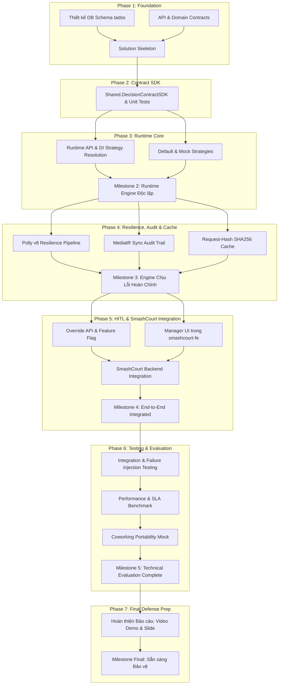

# KẾ HOẠCH THỰC THI CHI TIẾT ĐỒ ÁN 2 (MASTER EXECUTION PLAN v1.0 — FROZEN)
## NỀN TẢNG RUNTIME ENGINE RA QUYẾT ĐỊNH CHỊU LỖI (TADSS)

*   **Dự án:** TADSS (Trustworthy Adaptive Decision Support System)
*   **Hệ thống đối chứng (Case Study):** SmashCourt — Hệ thống đặt sân cầu lông trực tuyến
*   **Thời lượng:** 16 tuần (14 tuần Kỹ thuật thực thi + 2 tuần Ổn định, Báo cáo & Bảo vệ)
*   **Nhân sự:** 2 thành viên (Sinh viên 1 — Backend/Runtime Owner; Sinh viên 2 — Contract/Supporting/UI Owner)
*   **Trạng thái Kế hoạch:** **FROZEN v1.0** (Đã khóa cứng ranh giới và thông số kỹ thuật)

---

## I. MA TRẬN TRÁCH NHIỆM & CƠ CHẾ PHỐI HỢP (OWNERSHIP & REVIEWER MODEL)

Thay vì phân chia cô lập theo kiểu "code của ai người nấy làm", dự án áp dụng mô hình **Owner (Chịu trách nhiệm chính) + Reviewer (Kiểm tra chéo & Test)** để đảm bảo tính nhất quán 100% của hệ thống:

| Cấu phần (Module) | Owner (Chính) | Reviewer (Phụ/Review) | Deliverable cốt lõi |
|:---|:---:|:---:|:---|
| **Solution & DB Architecture** | SV1 | SV2 | Solution .NET 8, PostgreSQL Schema `tadss`, bảng `tadss.decision_executions` |
| **Decision Contract SDK** | SV2 | SV1 | DLL `Shared.DecisionContractSDK`, Rich Domain Model `Reservation`, Unit Tests |
| **Decision Runtime Core API** | SV1 | SV2 | Web API, DI-based Strategy Resolution $O(1)$, Routing Controller |
| **Executable Strategies** | SV2 | SV1 | `DefaultDecisionStrategy` (Baseline Business Policy), `MockAlternativeDecisionStrategy` (30%/50%) |
| **Polly v8 Resilience Pipeline** | SV1 | SV2 | Nested Pipeline (Outer 500ms, Retry 2, Inner 120ms, CB, `FallbackDecisionStrategy`) |
| **Append-only Audit Trail** | SV1 | SV2 | MediatR in-process events trong DbContext Transaction boundary |
| **Request-Hash Cache** | SV2 | SV1 | Canonicalization (Representation-only), SHA256 Key, Redis & IMemoryCache fallback |
| **Override & Concurrency API** | SV1 | SV2 | `POST /decisions/{id}/override`, `IdempotencyKey`, `ExpectedVersion` |
| **Manager Dashboard UI** | SV2 | SV1 | Tích hợp trực tiếp vào `smashcourt-fe` (Next.js) hiện có |
| **SmashCourt Integration** | SV1 | SV2 | Sửa backend SmashCourt, Feature Flag `EnableTadssDecision` (<2s reload) |
| **Testing & Evaluation** | Cả hai | Cả hai | 11 kịch bản Failure Injection, Đo lường p95 < 150ms, Portability Mock |
| **Báo cáo & Slide bảo vệ** | Cả hai | Cả hai | Báo cáo Đồ án 2, Video Demo thực tế, Slide thuyết trình |

---

## II. ĐỒ THỊ PHỤ THUỘC THỰC TẾ (REALISTIC DEPENDENCY GRAPH)



---

## III. CHI TIẾT KẾ HOẠCH 16 TUẦN (WEEK-BY-WEEK SPRINT PLAN)

### 🟢 PHASE 1: FOUNDATION & ARCHITECTURE (Tuần 1 — Tuần 2)
*Mục tiêu:* Khóa hợp đồng dữ liệu, thiết lập hạ tầng DB Schema `tadss` và tạo khung Happy-path prototype.

#### **Tuần 1: Khóa Yêu cầu & Thiết kế Hợp đồng (Contract Lock)**
*   **Sinh viên 1 (Backend Lead):**
    *   Khởi tạo Git Repository, cấu trúc Solution .NET Core 8 theo Clean Architecture.
    *   Cấu hình ASP.NET Core Web API `DecisionRuntime.TADSS`.
    *   Cấu hình Entity Framework Core 8 kết nối PostgreSQL (Neon Cloud).
    *   Cấu hình Serilog Structured Logging cơ bản.
*   **Sinh viên 2 (Contract Lead):**
    *   Đặc tả chi tiết JSON Schema cho `DecisionRequest`, `DecisionResult`, `DecisionRecommendation`.
    *   Đặc tả Domain Model `Reservation` và các Enums (`DecisionStatus`, `BookingPriority`, `ReasonCode`).
    *   Soạn thảo tài liệu API Contract v1.
*   **Hai thành viên (Gate Tuần 1):**
    *   Họp chốt cứng 5 interface/model cốt lõi: `Reservation`, `DecisionRequest`, `DecisionResult`, `DecisionRecommendation`, `IReservationDecisionStrategy`.
    *   *Điều kiện Gate:* Không được sang Tuần 2 nếu chưa thống nhất 100% Contract.

#### **Tuần 2: Database Schema + Skeleton + Happy-Path Prototype**
*   **Sinh viên 1:**
    *   Thiết kế Migration sinh Logical Schema `tadss`.
    *   Tạo bảng duy nhất `tadss.decision_executions` (chứa toàn bộ telemetry thực thi và các trường ghi vết override của Manager: `is_overridden`, `overridden_by`, `override_reason`, `idempotency_key`, `version`).
    *   Thiết lập EF Core DbContext và Data Access Repository cơ bản.
*   **Sinh viên 2:**
    *   Thiết lập cấu trúc thư viện `Shared.DecisionContractSDK`.
    *   Viết logic JSON Serialization, Data Annotations Validation.
    *   Cấu hình Swagger API Documentation với các ví dụ request mẫu.
*   **Hai thành viên (Prototype Happy-Path):**
    *   Dựng luồng chạy thử nghiệm tối giản: `SmashCourt Request ➔ TADSS Web API ➔ Mock Static Result ➔ Return Response` (chưa cần Polly/Cache).
*   🎯 **Milestone 1 (Cuối Tuần 2):** *Foundation Ready — Solution build thành công, Database Migration sẵn sàng, Contract v1 được phê duyệt.*

---

### 🟢 PHASE 2: DECISION CONTRACT SDK (Tuần 3 — Tuần 4)
*Mục tiêu:* Xây dựng thư viện dùng chung độc lập, cô lập nghiệp vụ và đóng băng Contract.

#### **Tuần 3: Lập trình Domain Model & SDK Unit Tests**
*   **Sinh viên 1:**
    *   Implement thực thể miền `Reservation` (Aggregate Root).
    *   Implement các Value Objects: `CustomerInfo`, `ResourceInfo`, `ReservationSchedule`, `PaymentPolicy`, `ReservationMetadata`.
    *   Cài đặt Invariant Validation Rules nội tại của thực thể (`EnsureValid`, `CanBeCancelledWithoutPenalty`).
*   **Sinh viên 2:**
    *   Implement Enums: `DecisionStatus` (Approved, NeedApproval, Rejected), `BookingPriority`, `ReasonCode`.
    *   Implement DTOs: `DecisionRequest`, `DecisionResult`, `DecisionRecommendation`.
    *   Định nghĩa interface `IReservationDecisionStrategy` (`EvaluateAsync`).
    *   Viết bộ Unit Tests (xUnit + FluentAssertions) kiểm tra: Valid/Invalid Reservation, Invalid Schedule, Enum Mapping, JSON round-trip serialization.

#### **Tuần 4: Ổn định hóa SDK (SDK Stabilization & Contract Freeze)**
*   **Sinh viên 1:**
    *   Refactor Domain Model, kiểm tra triệt tiêu mọi Circular Dependency.
    *   Đảm bảo `Shared.DecisionContractSDK` hoàn toàn độc lập, không phụ thuộc vào codebase của SmashCourt.
    *   Viết XML Documentation chi tiết cho toàn bộ public classes/methods.
*   **Sinh viên 2:**
    *   Viết bộ kiểm tra tương thích DTO Validation và Contract Compatibility Test.
    *   Kiểm chứng SDK được đóng gói thành DLL độc lập.
*   **Hai thành viên (Gate Tuần 4):**
    *   Thực hiện reference thử nghiệm SDK vào cả `DecisionRuntime.TADSS` và `SmashCourt-BE`.
    *   *Tiêu chí Gate:* SDK Build SUCCESS, 100% Unit Tests PASS, Code Coverage > 80%, Contract đóng băng (Frozen v1).
*   🎯 **Milestone 2 (Cuối Tuần 4):** *Decision Contract Ready — Thư viện dùng chung hoàn chỉnh và đóng gói an toàn.*

---

### 🟢 PHASE 3: DECISION RUNTIME API (Tuần 5 — Tuần 6)
*Mục tiêu:* Xây dựng lõi Web API, cơ chế phân giải chiến lược qua Dependency Injection (DI-based Strategy Resolution) và các chiến lược mẫu.

#### **Tuần 5: Runtime API Core & Strategy Resolution**
*   **Sinh viên 1:**
    *   Xây dựng `DecisionController` tiếp nhận `POST /api/v1/decisions`.
    *   Xây dựng `DecisionService` và `StrategyResolver`.
    *   Lập trình pipeline: `Validate Request ➔ Resolve Strategy (DI Lookup O(1)) ➔ Execute EvaluateAsync ➔ Return Recommendation`.
*   **Sinh viên 2:**
    *   Implement `DefaultDecisionStrategy` (**Conservative Static Fallback Policy**): Áp dụng chính sách thanh toán cọc tĩnh 100% làm cơ chế an toàn cuối cùng (last-resort safety mechanism) bảo vệ dòng tiền.
    *   Implement `MockAlternativeDecisionStrategy` (**Demonstration Policy**): Phân tích `ReservationSchedule` để áp dụng mức cọc 30% cho giờ thường (Approved) và cọc 50% cho giờ cao điểm (NeedApproval) nhằm kiểm chứng khả năng phân giải chiến lược động của hệ thống.
*   **Hai thành viên:**
    *   Viết Unit/Integration Tests cho các kịch bản: Default Selected, MockAlternative Selected, Unknown Strategy Exception, Invalid Request.

#### **Tuần 6: Hoàn thiện Runtime API Độc Lập**
*   **Sinh viên 1:**
    *   Hoàn thiện cơ chế DI Registration với Service Provider Lookup $O(1)$ (DI-based Strategy Resolution).
    *   Xử lý Strategy Version Resolution, Global Error Handling Middleware, và sinh CorrelationId cho mỗi request.
*   **Sinh viên 2:**
    *   Chuẩn hóa cấu trúc `Recommendation`, `ReasonCode`, `Priority` trả về.
    *   Cập nhật Swagger UI với đầy đủ tài liệu schema và mock payloads.
*   **Hai thành viên (End-to-End Test):**
    *   Chạy test end-to-end kiểm chứng: `Request ➔ DI-based Strategy Resolution ➔ Execution ➔ DecisionResult`.
*   🎯 **Milestone 3 (Cuối Tuần 6):** *TADSS Decision Runtime Standalone — Nền tảng ra quyết định chạy độc lập hoàn chỉnh.*

---

### 🟢 PHASE 4: RESILIENCE, CACHE & AUDIT TRAIL (Tuần 7 — Tuần 9)
*Mục tiêu:* Triển khai các cơ chế chịu lỗi cho Decision Runtime, lưu vết giao dịch đồng bộ và tối ưu hiệu năng bộ nhớ đệm.

#### **Tuần 7: Triển khai Chuỗi Chịu lỗi Polly v8 (Polly Resilience Pipeline)**
*   **Sinh viên 1 (Owner):**
    *   *Day 1-2 (Spike POC):* Thử nghiệm độc lập Polly v8 lồng nhau: Outer Timeout, Retry, Inner Timeout, Circuit Breaker, Fallback.
    *   *Day 3-5 (Ghép nối vào Runtime):*
        *   Outer Timeout: 500ms (SLA Budget toàn cục).
        *   Retry Policy: Tối đa 2 lần retry (tổng 3 attempts, base delay 30ms).
        *   Inner Timeout: 120ms per attempt (ngân sách $3 \times 120\text{ms} + 2 \times 30\text{ms} = 420\text{ms} < 500\text{ms}$ SLA).
        *   Circuit Breaker: Mở mạch khi tỷ lệ lỗi vượt ngưỡng trong sampling window 30s (min 10 requests).
        *   Fallback Policy: Tự động chuyển về `FallbackDecisionStrategy` (`Status = NEED_APPROVAL`) với mục tiêu đo lường fallback overhead < 10ms trong kịch bản benchmark.
            > **[ADR-W7-01 — Separation of Business Policy vs Safety Fallback]:** `FallbackDecisionStrategy` tách biệt hoàn toàn với `DefaultDecisionStrategy` (chính sách nghiệp vụ thông thường). TADSS fallback chỉ chịu trách nhiệm duy trì decision-path continuity và chuyển sang trạng thái `NEED_APPROVAL`. Transactional/business fallback policy, nếu có, thuộc trách nhiệm của reservation platform và nằm ngoài decision authority của TADSS.
*   **Sinh viên 2 (Supporting):**
    *   Chuẩn bị kịch bản tiêm lỗi (Failure Scenarios): Strategy Timeout (delay > 120ms), Strategy Exception (Throw 500), Mất kết nối.
    *   Xây dựng mock test harness phục vụ kiểm thử chuỗi chịu lỗi.
*   **Hai thành viên (Cuối tuần 7):**
    *   Chứng minh bằng test: Normal Success, Strategy Timeout, Strategy Exception, Circuit Open, Fallback (`NEED_APPROVAL`), kèm ma trận tiêm lỗi F1–F7.

#### **Tuần 8: Ghi vết Quyết định Đồng bộ (Append-Only Audit Trail với MediatR)**
*   **Sinh viên 1 (Owner):**
    *   Định nghĩa MediatR Events: `DecisionExecutedEvent`, `OverrideExecutedEvent`.
    *   Lập trình Notification Handler bọc trong cùng một PostgreSQL DbContext Transaction boundary.
    *   Ghi toàn bộ thông số thực thi xuống bảng `tadss.decision_executions` (`execution_time_ms`, `fallback_used`, `failure_reason`, `cache_hit`, `execution_type`).
*   **Sinh viên 2 (Supporting):**
    *   Viết test kiểm tra tính toàn vẹn của Audit Log trong các trường hợp: Normal Decision, Cache Hit, Fallback Execution, Strategy Failure.
    *   Kiểm tra tính nhất quán dữ liệu trong cơ sở dữ liệu PostgreSQL.

#### **Tuần 9: Tối ưu Bộ nhớ đệm (Request-Hash Caching với SHA-256 & Redis)**
*   **Sinh viên 2 (Owner):**
    *   Cài đặt pipeline chuẩn hóa JSON Payload (Canonicalization - Representation only):
        1. Sắp xếp keys trong JSON Payload theo thứ tự alphabet (Key Sorting).
        2. Lowercase chuỗi định danh UUID.
        3. Chuẩn hóa format biểu diễn timestamp sang ISO 8601 UTC string (giữ nguyên semantic value).
        4. Xóa khoảng trắng thừa (whitespace) và chuẩn hóa null fields.
        *⚠️ Lưu ý: Tuyệt đối giữ nguyên giá trị nghiệp vụ (startTime, endTime, depositAmount), không làm tròn timestamp nghiệp vụ.*
    *   Băm SHA-256 tạo Cache Key: `decision:{strategyName}:{strategyVersion}:{requestHash}`.
    *   Tích hợp Redis 7.x với chính sách TTL = 15 phút cho Default Strategy (áp dụng cho request cho phép cache).
    *   *Unit Test bắt buộc:* Kiểm tra 2 JSON payload có thứ tự key đảo nhau (`{a:1, b:2}` và `{b:2, a:1}`) **bắt buộc sinh cùng 1 mã hash**.
*   **Sinh viên 1 (Supporting):**
    *   Tích hợp Cache Middleware vào Decision Pipeline.
    *   Cài đặt **IMemoryCache Fallback:** Nếu Redis bị sập kết nối, tự động chuyển về bộ nhớ trong in-memory mà không làm gián đoạn API.
*   🎯 **Milestone 4 (Cuối Tuần 9):** *Resilient & Auditable Core Engine — Động cơ chịu lỗi, lưu vết và cache vận hành hoàn mỹ.*

---

### 🟢 PHASE 5: HUMAN-IN-THE-LOOP & TÍCH HỢP SMASHCOURT (Tuần 10 — Tuần 12)
*Mục tiêu:* Cung cấp quyền kiểm duyệt cho Manager, khóa nguyên tắc No Auto-Approve, tích hợp UI và kết nối đầu-cuối với luồng đặt sân SmashCourt.

#### **Tuần 10: Override API & Feature Flag Bật/Tắt Nóng**
*   **Sinh viên 1:**
    *   Lập trình API `POST /api/v1/decisions/{id}/override` có `IdempotencyKey` và `ExpectedVersion` (Optimistic Concurrency Control).
    *   Cấu hình Feature Flag `EnableTadssDecision` bên trong SmashCourt Backend sử dụng `IOptionsMonitor` để reload nóng cấu hình dưới 2 giây.
    *   **Khóa nguyên tắc No Auto-Approve:** Đơn ở trạng thái `NeedApproval` nếu quá hạn duyệt sẽ chuyển sang `Expired` hoặc `Cancelled`, tuyệt đối không bao giờ tự động chuyển thành `Approved`.
*   **Sinh viên 2:**
    *   Dựng khung trang Manager Approval UI trực tiếp bên trong thư mục `smashcourt-fe` (Next.js) hiện có: Danh sách đơn `PendingDecisionApproval`, bảng chi tiết quyết định, form duyệt/sửa cọc kèm bắt buộc nhập lý do.
*   **Hai thành viên (Khởi tạo Báo cáo sớm - Task 5.3):**
    *   SV1 + SV2 pair-writing: Hoàn thành bản thảo **Chương 1 (Tổng quan & Bối cảnh: 10-12 trang)** và **Chương 2 (Thiết kế Kiến trúc: 16-20 trang)** đạt >40% tổng dung lượng cuốn báo cáo.

#### **Tuần 11: Hoàn thiện Manager Dashboard trên `smashcourt-fe`**
*   **Sinh viên 2:**
    *   Hoàn thiện toàn bộ giao diện duyệt cọc trên `smashcourt-fe`: Hiển thị rõ Strategy Name, Version, Execution Type, Decision Status, và nút hành động Duyệt/Ghi đè.
    *   *(Nếu gặp chậm tiến độ, giảm thiểu độ phức tạp styling/animation, giữ nguyên các tính năng duyệt cốt lõi, không đổi công nghệ sang Razor).*
    *   Kết nối API từ Next.js sang endpoint `POST /api/v1/decisions/{id}/override`.
*   **Sinh viên 1:**
    *   Kiểm tra bảo mật API, Validation, xử lý xung đột đồng thời khi 2 Manager cùng thao tác trên 1 đơn đặt chỗ (1 thành công, 1 nhận mã 409 Conflict).
*   **Hai thành viên (UAT Luồng Quản lý):**
    *   Thực hiện kiểm thử chấp nhận người dùng (UAT): `Booking ➔ NeedApproval (50% cọc) ➔ Block VNPay ➔ Manager Override về 30% ➔ Audit ghi vết ➔ Tiếp tục VNPay`.

#### **Tuần 12: Tích hợp Toàn diện Đầu-Cuối với SmashCourt Backend**
*   **Sinh viên 1:**
    *   Sửa đổi Controller đặt sân tại `SmashCourt-BE`: Gửi request sang TADSS Core qua HTTP Client, nhận kết quả Recommendation để tính tiền cọc và chuyển hướng VNPay.
*   **Sinh viên 2:**
    *   Đồng bộ giao diện khách hàng trên `smashcourt-fe`: Hiển thị thông báo cọc tương ứng theo kết quả trả về từ TADSS.
*   **Hai thành viên (Tích hợp & Fallback Test):**
    *   Test kịch bản bình thường: `SmashCourt ➔ TADSS (Mock 30%/50%) ➔ VNPay`.
    *   Test kịch bản sự cố: `TADSS Sập / Tắt Feature Flag ➔ SmashCourt tự động chuyển về cọc tĩnh 100% ➔ VNPay hoạt động thông suốt`.
*   🎯 **Milestone 5 (Cuối Tuần 12):** *End-to-End Integration Ready — Hệ thống thương mại SmashCourt tích hợp mượt mà với TADSS.*

---

### 🟢 PHASE 6: KIỂM THỬ TỔNG THỂ & ĐÁNH GIÁ THIẾT KẾ (Tuần 13 — Tuần 14)
*Mục tiêu:* Thực hiện toàn bộ ma trận kiểm thử sự cố, đo lường các chỉ số SLA kỹ thuật và chứng minh tính độc lập tên miền.

#### **Tuần 13: Thực hiện Ma trận Kiểm thử Sự cố (Failure Injection Test Matrix)**
*   **Hai thành viên cùng phối hợp chạy và đối soát bảng Test Matrix:**

| Kịch bản Kiểm thử | Thao tác / Giả lập sự cố | Tiêu chí Chấp nhận (Acceptance Criteria) |
|:---|:---|:---|
| **1. Normal Decision** | Gửi request hợp lệ giờ thường | Trả về `Approved` (cọc 30%), latency p95 < 150ms trong môi trường test chuẩn, ghi log `StrategyExecution`. |
| **2. Peak Hour Decision** | Gửi request rơi vào khung giờ cao điểm | Trả về `NeedApproval` (cọc 50%), tạm dừng thanh toán VNPay. |
| **3. Strategy Timeout** | Giả lập Strategy xử lý chậm > 120ms | Inner Timeout ngắt attempt, Retry 2 lần, kích hoạt `FallbackDecisionStrategy` (`NEED_APPROVAL`). |
| **4. Strategy Exception** | Giả lập Strategy ném lỗi 500 | Retry 2 lần, kích hoạt `FallbackDecisionStrategy` (`NEED_APPROVAL`), ghi log `FALLBACK`. |
| **5. Cascading Failures** | Bắn liên tiếp 10 requests lỗi | Circuit Breaker mở mạch, chuyển thẳng sang Fallback trong < 10ms trong kịch bản benchmark. |
| **6. Cache Hit** | Gửi lại 2 request giống hệt nhau | Lần 2 trả về ngay trong < 15ms, không gọi strategy, ghi log `CacheHit`. |
| **7. Key Sorting Cache** | Đảo thứ tự các thuộc tính JSON trong request | Vẫn Hit Cache bình thường (chứng minh hàm chuẩn hóa representation hoạt động). |
| **8. Redis Unavailable** | Tắt Docker / Service Redis | Tự động chuyển sang `IMemoryCache`, hệ thống không sập. |
| **9. Duplicate Override** | Gửi liên tiếp 2 lệnh Override cùng `IdempotencyKey` | Lệnh thứ 2 bị chặn, database không bị ghi đè trùng lặp. |
| **10. Concurrency Conflict** | 2 Manager cùng gửi Override với `version = 1` | 1 lệnh thành công (version lên 2), 1 lệnh báo lỗi Conflict 409. |
| **11. Emergency Valve OFF** | Đặt `EnableTadssDecision = false` | SmashCourt bỏ qua TADSS, tự động áp dụng cọc tĩnh 100%. |

#### **Tuần 14: Đo lường Chỉ số SLA & Proof of Portability**
*   **Đo lường Performance SLA (SC1 & SC2):**
    *   *Design Target:* Normal Latency $p95 < 150	ext{ms}$ được kiểm chứng trong môi trường test chuẩn (local dev/staging).
    *   *Design Target:* Overall Failure SLA Budget $\le 500	ext{ms}$ khi xảy ra timeout/retry/fallback trong kịch bản benchmark.
*   **Chứng minh Tính Độc lập Tên miền (Portability Mock - SC6):**
    *   Xây dựng một mock client đại diện cho **Coworking Space (Đặt phòng họp)** gửi request về TADSS Core thông qua `Reservation` SDK.
    *   Chứng minh TADSS xử lý và ra quyết định chính xác mà **không cần sửa đổi bất kỳ dòng code nào trong TADSS Core**.
*   🎯 **Milestone 6 (Cuối Tuần 14):** *Technical Evaluation Complete — 100% critical test scenarios đạt pass (không còn lỗi Blocker/High severity) và đo lường đầy đủ số liệu KPI.*

---

### 🟢 PHASE 7: ỔN ĐỊNH HÓA, BÁO CÁO & CHUẨN BỊ BẢO VỆ (Tuần 15 — Tuần 16)
*Mục tiêu:* Bảo hiểm tiến độ, hoàn thiện cuốn báo cáo, quay video demo và diễn tập thuyết trình.

#### **Tuần 15: Hoàn thiện Tài liệu Báo cáo & Đóng gói Source Code**
*   **Tuyệt đối không thêm tính năng mới (Feature Freeze).**
*   Tập trung hoàn thiện cuốn Báo cáo Đồ án 2:
    *   Điền số liệu thực nghiệm, biểu đồ đo lường p95 và bảng so sánh latency vào Chương 3 & 4.
    *   Hoàn thiện các sơ đồ kiến trúc Class Diagram, Sequence Diagram, Database Schema Diagram.
    *   Soát lỗi chính tả, chuẩn hóa tài liệu tham khảo theo chuẩn IEEE.

#### **Tuần 16: Diễn tập Bảo vệ & Hoàn thiện Sản phẩm Bàn giao**
*   Quay Video Demo kịch bản hoạt động tích hợp đầu cuối (SmashCourt ↔ TADSS ↔ VNPay ↔ Override Dashboard ➔ Failure Injection).
*   Soạn Slide thuyết trình bảo vệ trước Hội đồng (20-25 slides).
*   Diễn tập thuyết trình thử và chuẩn bị các câu trả lời phản biện.
*   Đóng gói mã nguồn sạch sẽ trên GitHub Repository kèm tài liệu `README.md` hướng dẫn cài đặt từ Docker/Local.
*   🎯 **Final Milestone (Cuối Tuần 16):** *Ready for Defense — Sẵn sàng 100% bảo vệ xuất sắc Đồ án 2.*

---

## IV. TIÊU CHÍ HOÀN THÀNH TỪNG CẤU PHẦN (DEFINITION OF DONE - DOD)

Hệ thống chỉ được công nhận hoàn thành một cấu phần khi vượt qua bảng kiểm định kỹ thuật sau:

```
[ ] Polly Resilience Pipeline:
    ├── Strategy timeout được phát hiện chính xác
    ├── Retry 2 lần với đúng base delay
    ├── Circuit Breaker mở mạch khi vượt ngưỡng tỷ lệ lỗi
    ├── Fallback cọc tĩnh 100% hoạt động với overhead < 10ms trong kịch bản benchmark
    ├── Outer SLA Budget 500ms được cưỡng chế tuyệt đối
    └── 100% critical test scenarios pass không còn bug Blocker/High

[ ] Request-Hash Cache:
    ├── Key normalization sắp xếp alphabet và lowercase đúng chuẩn
    ├── Giữ nguyên 100% semantic values của business timestamps
    ├── 2 JSON khác thứ tự thuộc tính sinh ra cùng mã SHA-256
    ├── Cache Hit trả về kết quả trong < 15ms
    ├── Tự động fallback sang IMemoryCache khi Redis mất kết nối
    └── TTL 15 phút và Strategy Version isolation hoạt động chính xác

[ ] Append-only Audit Trail:
    ├── Ghi nhận đầy đủ thông số thực thi vào tadss.decision_executions
    ├── Phân biệt rõ StrategyExecution, CacheHit, FallbackExecution
    ├── MediatR event nằm trọn vẹn trong PostgreSQL Transaction
    └── Lưu vết ghi đè Override kèm lý do và định danh Manager

[ ] Human-in-the-loop & Concurrency:
    ├── Chặn 100% các request gửi trùng lặp qua IdempotencyKey
    ├── Xử lý tranh chấp dữ liệu đồng thời qua ExpectedVersion (Optimistic Concurrency)
    └── Tuyệt đối không tự động duyệt khi quá hạn (No Auto-Approve -> Expired/Cancelled)
```

---

## V. QUY TẮC TIẾT CHẾ THUẬT NGỮ HỌC THUẬT (ACADEMIC TONE LOCK)

Để bản báo cáo và slide bảo vệ mang tính học thuật vững chắc, không bị hội đồng bắt bẻ những thuật ngữ thương mại quá đà:

| Tránh dùng (Nghe thương mại/thổi phồng) | Thay bằng (Chuẩn kỹ thuật & Học thuật) |
|:---|:---|
| *"Gia cố khả năng chịu lỗi Enterprise"* | *"Triển khai các cơ chế chịu lỗi cho Decision Runtime nhằm duy trì khả năng xử lý khi strategy gặp timeout hoặc lỗi"* |
| *"Hệ thống an toàn mức ngân hàng (Banking-grade)"* | *"Cơ chế kiểm soát an toàn giao dịch với Idempotency và Optimistic Concurrency Control"* |
| *"Kiến trúc Event Sourcing siêu việt"* | *"Hệ thống lưu vết nhật ký thực thi dạng Append-only Audit Trail"* |
| *"Dynamic Hot-loading / Nạp chiến lược động"* | *"Cơ chế định tuyến và phân giải chiến lược thông qua Dependency Injection (DI-based Strategy Resolution)"* |
| *"Hệ thống AI tự động hóa hoàn toàn"* | *"Hệ thống hỗ trợ ra quyết định kết hợp sự phê duyệt của con người (Human-in-the-loop Decision Support System)"* |

---

*Bản Kế hoạch Thực thi Chi tiết này đã được đóng băng chính thức (FROZEN v1.0) — Là kim chỉ nam duy nhất điều hành toàn bộ quá trình phát triển Đồ án 2.*
