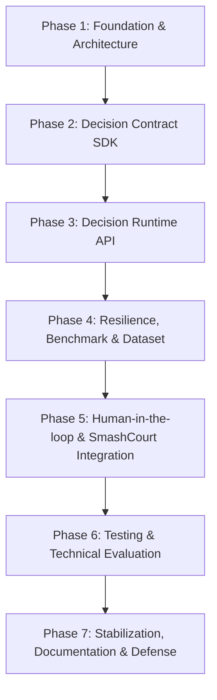

# BẢN PHÂN RÃ CÔNG VIỆC CHUẨN HOÁ (PRAGMATIC WBS & INTEGRATION ROADMAP)

Tài liệu này đặc tả chi tiết **Bản phân rã công việc (WBS)**, **Đồ thị phụ thuộc (Dependency Graph)**, **Tiêu chí thành công (Success Criteria)**, **Quản trị rủi ro (Risk Management)** và **Chiến lược kiểm thử (Testing Strategy)** cho dự án TADSS theo lộ trình 16 tuần.

---

## I. MÔ HÌNH PHÂN LỚP KIẾN TRÚC ENTERPRISE (PRAGMATIC ARCHITECTURE)

```
┌────────────────────────────────────────────────────────────────────────┐
│             LỚP 3: CHIẾN LƯỢC NGHIÊN CỨU (TADS Strategy - Khóa luận)   │
│  - Adaptive Trust Score (Time Decay)   - Decision Trace (Explain API)  │
│  - ML Dự đoán No-show (CatBoost)       - Đánh giá Cắt giảm (Ablation)  │
│  - Ranking gợi ý AI bằng Trust Score   - Coworking Portability Mock    │
└───────────────────────────────────┬────────────────────────────────────┘
                                    │ (Triển khai chiến lược & Thực nghiệm)
                                    ▼
┌────────────────────────────────────────────────────────────────────────┐
│             LỚP 2: HỆ THỐNG RUNTIME ENGINE (TADSS - Đồ án 2)           │
│  - Gọi chiến lược IReservationDecision - Fallback & Polly Gateway       │
│  - Manager Approval UI & Override API  - Synchronous Audit Trail (DB)   │
│  - Cost Guardrail & Request-Hash Cache - Tích hợp API đặt sân SmashCourt│
└───────────────────────────────────┬────────────────────────────────────┘
                                    │ (Định tuyến & Giám sát vận hành)
                                    ▼
┌────────────────────────────────────────────────────────────────────────┐
│             LỚP TRUNG GIAN: THƯ VIỆN CHUNG (Decision Contract SDK)    │
│  - Giao diện IReservationDecisionStrategy - Canonical Reservation Contract│
│  - DTOs, Enums (DecisionStatus/Reason) - DTOs, Value Objects, Events   │
└────────────────────────────────────────────────────────────────────────┘
                                    │ (Nhúng thư viện dùng chung)
                                    ▼
┌────────────────────────────────────────────────────────────────────────┐
│             LỚP 1: HỆ THỐNG THƯƠNG MẠI (Case Study - SmashCourt Product)│
│  - CRUD Booking, Sân & Người dùng     - Thanh toán VNPay (IPN/Return)  │
│  - SignalR Real-time Time Grid         - Gemini AI Chatbot & Suggestion│
└────────────────────────────────────────────────────────────────────────┘
```

---

## II. NGUYÊN TẮC VÀNG CHỐNG QUÁ TẢI (ANTI-OVERHEATING RULES)
Trước khi triển khai, nhóm thống nhất 3 nguyên tắc cô lập phạm vi sau để bảo vệ sức lao động và tối ưu thời gian:
1. **Tuyệt đối không đụng vào giải thuật thông minh (Algorithmic Lock):** Không viết thuật toán Adaptive Trust Score, không sinh tập dữ liệu 20,000 bản ghi, không cấu hình CatBoost, không làm biểu đồ giải thích cây quyết định (Decision Trace UI). Mọi quyết định động trong Đồ án 2 được mô phỏng hoàn chỉnh và sạch sẽ thông qua `MockAlternativeDecisionStrategy` (ví dụ: tự động nâng cọc lên 50% nếu request rơi vào khung giờ cao điểm, cọc 30% giờ thường). Chỉ thế là đủ để chứng minh Strategy Pattern hoạt động hoàn mỹ.
2. **Hạ tầng cơ sở dữ liệu tối giản (Database Schema Isolation):** Không thiết lập server database mới. Sử dụng cơ chế Logical Schema Separation. Chạy migration để sinh schema `tadss` nằm chung trên PostgreSQL vật lý (Neon Cloud) của SmashCourt.
3. **Tách nhóm công việc song song (Parallel Workload):** Phân rã luồng công việc thành: Cấu phần Core (Backend API, SDK, Polly, Audit) và Cấu phần Supporting (Frontend Dashboard, Redis Cache) để hai thành viên (Sinh viên 1 và Sinh viên 2) có thể code song song, không bị nghẽn phụ thuộc.

---

## III. PHÂN RÃ CHI TIẾT 16 TUẦN TRIỂN KHAI (WORK BREAKDOWN STRUCTURE)

### PHASE 1: FOUNDATION & ARCHITECTURE (Tuần 1 — Tuần 2)
*Trọng tâm: Thống nhất "ngôn ngữ chung" (SDK DTOs), vẽ thiết kế hệ thống và thiết lập Database Schema `tadss`.*
* **Task 1.1 (Phân tích Nghiệp vụ & API Spec):** Đặc tả chi tiết cấu trúc Request/Response Payload giữa SmashCourt và TADSS Core (`DecisionRequest`, `DecisionResult`, `DecisionRecommendation`, `Reservation`). Đóng gói tài liệu tích hợp API v1.
* **Task 1.2 (Thiết kế Schema):** Thiết kế sơ đồ quan hệ bảng dữ liệu cho schema `tadss` bao gồm duy nhất bảng nhật ký thực thi `decision_executions` (chứa đầy đủ telemetry thực thi và các trường phê duyệt override của Manager).
* **Task 1.3 (Thiết lập Solution):** Khởi tạo Solution .NET Core 8 trong Git Repository, thiết lập các thư mục dự án theo cấu trúc Clean Architecture chuẩn, kết nối PostgreSQL EF Core.
* **Task 1.4 (Happy-Path Prototype):** Dựng luồng prototype tối giản `SmashCourt Request ➔ TADSS Web API ➔ Mock Result` (chưa cần Polly/Cache).
* **Sản phẩm bàn giao (Deliverables):** Solution build thành công; File đặc tả API JSON Schema; Script SQL khởi tạo schema `tadss`.
* **Phân chia công việc:**
  * **Sinh viên 1:** Thiết kế DB Schema `tadss`, khởi tạo cấu trúc Solution .NET Core 8, cấu hình EF Core.
  * **Sinh viên 2:** Đặc tả API Contracts (`DecisionRequest/Result`), viết tài liệu JSON Schema v1 và dựng Swagger skeleton.

### PHASE 2: XÂY DỰNG DECISION CONTRACT SDK (Tuần 3 — Tuần 4)
*Trọng tâm: Phát triển thư viện dùng chung `Shared.DecisionContractSDK`, Rich Domain Model và đóng băng Contract.*
* **Task 2.1 (Tạo dự án Class Library):** Khởi tạo dự án `Shared.DecisionContractSDK` độc lập, loại bỏ liên kết ngược để đảm bảo tính di động sang domain khác.
* **Task 2.2 (Lập trình Rich Domain Model):** Hiện thực hóa thực thể `Reservation` (Aggregate Root) tích hợp sẵn các behavior kiểm tra tính hợp lệ (`EnsureValid`) và behavior nghiệp vụ (`CanBeCancelledWithoutPenalty`). Implement các Value Objects (`CustomerInfo`, `ResourceInfo`, `ReservationSchedule`, `PaymentPolicy`).
* **Task 2.3 (Thiết lập Enums & DTOs):** Định nghĩa các Enums trạng thái (`DecisionStatus`, `BookingPriority`, `ReasonCode`), DTOs kết quả, và interface `IReservationDecisionStrategy` (`EvaluateAsync`).
* **Task 2.4 (SDK Stabilization & Unit Tests):** Viết bộ Unit Tests (xUnit + FluentAssertions) kiểm tra tính toàn vẹn của thực thể `Reservation`, DTO validation, JSON serialization (đạt Coverage > 80%). Đóng gói DLL độc lập.
* **Sản phẩm bàn giao (Deliverables):** DLL thư viện `Shared.DecisionContractSDK` biên dịch thành công; Bộ Unit Tests với 100% test cases pass và Code Coverage > 80%; Contract đóng băng (Frozen v1).
* **Phân chia công việc:**
  * **Sinh viên 1:** Viết Rich Domain Model `Reservation`, Value Objects và Invariant Validation Rules.
  * **Sinh viên 2:** Thiết lập Enums, DTOs, interface Strategy, XML Documentation và bộ Unit Tests cho SDK.

### PHASE 3: XÂY DỰNG DECISION RUNTIME API (Tuần 5 — Tuần 6)
*Trọng tâm: Xây dựng bộ não định tuyến quyết định và các chiến lược mô phỏng.*
* **Task 3.1 (Tạo Web API & Decision Controller):** Khởi tạo Web API `DecisionRuntime.TADSS`, endpoint `POST /api/v1/decisions`, xử lý validation và correlation ID.
* **Task 3.2 (Lập trình Strategy Factory):** Viết `StrategyFactory` tự động đăng ký và phân giải Strategy qua cơ chế Dependency Injection (DI-based Strategy Resolution) với độ phức tạp $O(1)$.
* **Task 3.3 (Cài đặt Executable Strategies):**
  * Hiện thực hóa `DefaultDecisionStrategy` (chính sách nghiệp vụ cơ sở bảo thủ của nền tảng; tách biệt với cơ chế cứu cánh hạ tầng `FallbackDecisionStrategy`).
  * Hiện thực hóa `MockAlternativeDecisionStrategy` (tự động phân tích khung giờ cao điểm trong `ReservationSchedule` để nâng cọc lên 50%, giờ thường cọc 30%).
* **Task 3.4 (Hoàn thiện Runtime Độc lập):** Xử lý Strategy Version Resolution, Error Handling Middleware, Swagger Documentation với đầy đủ ví dụ request/response.
* **Sản phẩm bàn giao (Deliverables):** Dự án Web API chạy local mượt mà; Tài liệu Swagger API hiển thị luồng phân giải Strategy thành công; Test end-to-end độc lập đạt 100%.
* **Phân chia công việc:**
  * **Sinh viên 1:** Thiết lập lõi Web API, lập trình `StrategyResolver` dùng DI Lookup, routing controller, Synchronous Audit & L1/L2 Cache.
  * **Sinh viên 2:** Hiện thực hóa code cho hai chiến lược cụ thể (`Default` và `MockAlternative`), chuẩn hóa DTO response.

### PHASE 4: RESILIENCE, PERFORMANCE BENCHMARK & DATASET NORMALIZATION (Tuần 7 — Tuần 9)
*Trọng tâm: Triển khai chuỗi chịu lỗi Polly v8 cùng ma trận tiêm lỗi F1–F7, thực hiện đo đạc benchmark hiệu năng bộ nhớ đệm ($G_0..G_2$) & độ chịu lỗi ($R_0..R_3$), và chuẩn hóa tập dữ liệu nghiên cứu.*
* **Task 4.1 (Polly v8 Resilience, Resilient L1/L2 Cache, Synchronous Audit & Fault Matrix F1–F7 - Tuần 7):**
  * Lập trình đường ống chịu lỗi 5 tầng: Outer Timeout (`500ms` SLA) $\rightarrow$ Fallback sang `FallbackDecisionStrategy` (`Status = NEED_APPROVAL`, `FallbackUsed = true`, `ExecutionTimeMs = 0`) $\rightarrow$ Retry (2 lần, base delay `30ms`) $\rightarrow$ Circuit Breaker (tỷ lệ lỗi $\ge 50\%$ trong cửa sổ `30s`, `BreakDuration = 15s`) $\rightarrow$ Inner Timeout (`120ms` từng lần gọi).
  * Thiết lập hệ thống ghi vết Append-only Audit Trail đồng bộ (Fail-Closed) thông qua MediatR in-process events (`DecisionEvaluatedAuditNotification`) nằm trong transaction boundary của PostgreSQL (`tadss.decision_executions`), phân biệt rõ các loại thực thi (`AUTOMATED`, `CACHE_HIT`, `FALLBACK`) và `failure_reason` theo chuẩn `FailureReasonPrefixes`.
  * Chuẩn hóa JSON theo RFC 8785 (sắp xếp key alphabet, lowercase UUID, chuẩn hóa timestamp về giây chuẩn UTC `yyyy-MM-ddTHH:mm:ssZ` giữ nguyên giá trị nghiệp vụ, xóa whitespace và null) tạo `RequestHash = SHA256(Canonical(DecisionRequest))` và Cache Key `decision:hash:{requestHash}:{strategyName}:v{strategyVersion}` với cấu hình baseline mặc định `TtlHours = 24` và giáng cấp tự động Redis L2 $\rightarrow$ `IMemoryCache` L1 (F5).
* **Task 4.2 (Thực nghiệm Benchmark 5 Tầng $G_0..G_2, R_0..R_3, C_0..C_3, D_0..D_2, E_0..E_4$ - Tuần 8):** Thực thi đo đạc 3 pha (*Warm-up $\rightarrow$ Measurement $\rightarrow$ Statistical Aggregation*) tại các mức tải đồng thời $VUs \in \{1, 10, 50, 100\}$ cho 19 kịch bản thực nghiệm (76 lượt chạy, hỗ trợ chế độ rút gọn `--suite Core7` 28 lượt chạy và `--suite Full19` 76 lượt chạy), định lượng Cache Benefit, Cache Miss Overhead, Cache Pathologies ($C_0..C_3$), Strategy/DB Contention ($D_0..D_2$), Combined Stress/Self-Healing ($E_0..E_4$) và Decision Continuity Rate (DCR).
* **Task 4.3 (Chuẩn hóa Tập dữ liệu Thực nghiệm với DatasetNormalizer - Tuần 9):** Xây dựng `DatasetNormalizer` kết hợp bảng `tadss.decision_executions` với Metadata thực nghiệm để trích xuất 3 bộ dữ liệu chuẩn hóa (*Resilience Evaluation Dataset*, *Latency & Caching Dataset*, *Governance & Audit Provenance Dataset*) phục vụ Chương 4 Báo cáo Đồ án 2.
* **Sản phẩm bàn giao (Deliverables):** Ma trận kiểm thử tiêm lỗi F1–F7 đạt 100% pass; Báo cáo số liệu Benchmark 76 lượt chạy ($P_{50}/P_{90}/P_{95}/P_{99}$, DCR); Công cụ `DatasetNormalizer` và 3 bộ dữ liệu thực nghiệm chuẩn hóa.
* **Phân chia công việc:**
  * **Sinh viên 1:** Cấu hình Polly v8 Resilience Pipeline, Synchronous Audit Persistence, và thực thi Resilience/Strategy/Recovery Benchmark ($R_0..R_3, D_0..D_2, E_0..E_4$).
  * **Sinh viên 2:** Tích hợp Resilient L1/L2 Request-Hash Caching, thực thi Cache & Pathologies Benchmark ($G_0..G_2, C_0..C_3$), và xây dựng `DatasetNormalizer`.

### PHASE 5: HUMAN-IN-THE-LOOP & TÍCH HỢP SMASHCOURT (Tuần 10 — Tuần 12)
*Trọng tâm: Cung cấp quyền kiểm duyệt tối cao cho Manager, khởi tạo báo cáo sớm và kết nối đầu-cuối với SmashCourt (3 tuần).*
* **Task 5.1 (Lập trình Override API - Tuần 10):** Hoàn thiện endpoint `POST /api/v1/decisions/{id}/override` tích hợp kiểm tra trạng thái `IsOverridden` (chặn ghi đè trùng lặp) và `Version` (`IsConcurrencyToken` - Optimistic Concurrency) ngăn ngừa race condition.
* **Task 5.2 (Feature Flag động - Tuần 10):** Cấu hình Feature Flag `EnableTadssDecision` bọc ngoài luồng đặt sân của SmashCourt sử dụng `IOptionsMonitor` để reload cấu hình appsettings.json động dưới 2 giây.
* **Task 5.3 (Khởi tạo Báo cáo Đồ án 2 sớm - Tuần 10):** Viết phác thảo khung Báo cáo Đồ án 2 ngay từ Tuần 10: Day 1-2 (SV1+SV2 pair-writing Chương 1 Giới thiệu: 10-12 trang), Day 3-4 (SV1 viết Chương 2.1-2.2 DB & API Design: 8-10 trang), Day 5-6 (SV2 viết Chương 2.3-2.4 Polly & Cache Design: 8-10 trang) đạt 26-32 trang (>40% khối lượng).
* **Task 5.4 (Xây dựng Manager Dashboard trên `smashcourt-fe` - Tuần 11):** 
  * *Primary:* Tích hợp trực tiếp các trang quản lý duyệt cọc vào thư mục `smashcourt-fe` (Next.js) hiện có để tận dụng giao diện, Tailwind và auth component. Hiển thị danh sách đơn `PendingDecisionApproval`, form duyệt/sửa cọc kèm lý do.
  * *Fallback (Quy tắc 2 ngày):* Nếu sau Tuần 10 Day 2 SV2 chưa render được danh sách ➔ Chuyển ngay sang C# Razor Page / Single HTML Table nhúng trong Web API trong 1 ngày.
  * *UAT nội bộ:* Kiểm thử luồng: `Booking ➔ NeedApproval ➔ Dashboard ➔ Manager Override ➔ Audit Log`.
* **Task 5.5 (Tích hợp luồng Đặt sân SmashCourt Backend - Tuần 12):** Sửa đổi API tạo đặt sân ở SmashCourt để thực hiện gọi sang TADSS Core qua HTTP Client, nhận tỷ lệ cọc đề xuất để tính toán số tiền chuyển sang thanh toán VNPay. Đồng bộ hiển thị frontend.
* **Sản phẩm bàn giao (Deliverables):** Giao diện UI phê duyệt cho Manager; Tích hợp thành công luồng đặt sân SmashCourt ↔ TADSS ↔ VNPay; Khung Báo cáo Đồ án 2 đạt > 40% khối lượng trang.
* **Phân chia công việc:**
  * **Sinh viên 1:** Viết Override API, tích hợp Feature Flag động và sửa đổi API của SmashCourt Backend.
  * **Sinh viên 2:** Thiết kế màn hình Manager Dashboard UI trên `smashcourt-fe` và cùng SV1 hoàn thiện phác thảo Chương 1 & 2 của Báo cáo Đồ án 2.

### PHASE 6: KIỂM THỬ, ĐÁNH GIÁ & ĐO LƯỜNG KPI (Tuần 13 — Tuần 14)
*Trọng tâm: Thực hiện toàn bộ ma trận kiểm thử sự cố, đo lường KPI p95 < 150ms và chứng minh tính độc lập tên miền.*
* **Task 6.1 (Thực hiện Ma trận Kiểm thử Sự cố - Tuần 13):** Thực hiện 11 kịch bản kiểm thử giả lập sự cố (Failure Injection Test Matrix: Timeout, 500 Exception, Circuit Breaker, Cache Key Sort, Concurrency Conflict, Emergency Valve).
* **Task 6.2 (Đo lường KPI Kỹ thuật - Tuần 14):** Thu thập số liệu chứng minh SLA phản hồi p95 < 150ms khi chạy bình thường, và SLA tổng thể <= 500ms khi xảy ra lỗi.
* **Task 6.3 (Proof of Portability - Tuần 14):** Chạy kịch bản giả lập (Mock data) gửi request đặt phòng họp Coworking Space để chứng minh TADSS xử lý hoàn hảo mà không cần đổi một dòng code lõi nào.
* **Sản phẩm bàn giao (Deliverables):** Source code hoàn chỉnh trên Github; Bộ Integration Test chạy tự động với 100% critical test scenarios đạt pass (không còn bug Blocker/High); Bảng số liệu đo lường KPI hoàn chỉnh.
* **Phân chia công việc:**
  * **Cả 2 sinh viên:** Cùng chạy Integration Tests, Failure Injection, đo lường các chỉ số thành công (SC1-SC6) và kiểm chứng Coworking Mock.

### PHASE 7: ỔN ĐỊNH HÓA, BÁO CÁO & CHUẨN BỊ BẢO VỆ (Tuần 15 — Tuần 16)
*Trọng tâm: Đóng băng tính năng, hoàn thiện cuốn báo cáo 60 trang, quay video demo và diễn tập thuyết trình.*
* **Task 7.1 (Hoàn thiện Báo cáo Đồ án 2 - Tuần 15):** Tuyệt đối không thêm tính năng mới (Feature Freeze). Điền số liệu thực nghiệm vào Chương 3 & 4, hoàn thiện các sơ đồ Class/Sequence Diagram, soát lỗi chính tả và chuẩn hóa tài liệu tham khảo.
* **Task 7.2 (Quay Video Demo & Làm Slide - Tuần 16):** Quay video demo kịch bản hoạt động tích hợp đầu cuối (SmashCourt ↔ TADSS ↔ VNPay ↔ Override Dashboard ➔ Failure Injection), soạn 20-25 slide thuyết trình, diễn tập bảo vệ thử trước hội đồng.
* **Sản phẩm bàn giao (Deliverables):** File báo cáo đồ án bản mềm hoàn chỉnh (60 trang); Video demo thực tế hệ thống; Slide thuyết trình sẵn sàng bảo vệ.
* **Phân chia công việc:**
  * **Cả 2 sinh viên:** Cùng hoàn thiện cuốn Báo cáo đồ án, quay video demo, làm Slide thuyết trình và diễn tập bảo vệ.

---

## IV. SƠ ĐỒ THEO DÕI CÁC MỐC THỜI GIAN (6 KPI MILESTONES)

Để theo dõi sát sao tiến độ và sẵn sàng kích hoạt các phương án cắt giảm khối lượng (Scope Tiering) nhằm bảo vệ sức khỏe của nhóm, lộ trình áp dụng 6 mốc bàn giao trung gian (Milestones) sau:

* **[Mốc 1: Cuối Tuần 2]** ───► **Foundation Ready:** Solution skeleton, Database Schema `tadss` và Contract v1 được phê duyệt.
* **[Mốc 2: Cuối Tuần 4]** ───► **Decision Contract Ready:** DLL `Shared.DecisionContractSDK` biên dịch thành công, Unit Tests > 80% coverage.
* **[Mốc 3: Cuối Tuần 6]** ───► **Runtime Engine Standalone:** Web API và DI-based Strategy Resolution chạy độc lập hoàn chỉnh.
* **[Mốc 4: Cuối Tuần 9]** ───► **Resilient, Auditable & Benchmarked Core:** Polly v8 Pipeline (F1–F7), Synchronous Audit Trail, Resilient L1/L2 Request-Hash Cache, Benchmark ($G_0..G_2, R_0..R_3$) và Dataset Normalizer hoàn tất.
* **[Mốc 5: Cuối Tuần 12]** ───► **End-to-End Integration Ready:** SmashCourt ↔ TADSS ↔ VNPay và Manager Dashboard UI tích hợp thành công.
* **[Mốc 6: Cuối Tuần 14]** ───► **Technical Evaluation Complete:** Vượt qua 11 kịch bản kiểm thử sự cố, đo lường đầy đủ SLA p95 < 150ms.
* **[Final Milestone: Cuối Tuần 16]** ───► **Defense Ready:** Hoàn thành cuốn Báo cáo 60 trang, Video Demo và Slide thuyết trình.

### 🚦 Hệ thống Đánh giá Tiến độ theo Màu (Traffic Light System):
* 🟢 **GREEN (Đúng tiến độ):** Hoàn thành 100% các task theo kế hoạch tại mốc kiểm tra $\rightarrow$ Tiếp tục triển khai toàn bộ scope.
* 🟡 **YELLOW (Trễ nhẹ 1-2 ngày):** Kích hoạt cắt giảm tầng **Optional (Cắt Cost Guardrail, k6 test)** để dồn sức cho Core.
* 🔴 **RED (Trễ nghiêm trọng $\ge$ 3 ngày):** Kích hoạt cắt giảm tầng **Supporting (Chuyển Redis $\rightarrow$ `IMemoryCache`, giảm độ phức tạp giao diện Dashboard)** và tập trung 100% tài nguyên cho các tính năng Core.

### 🆘 Chế độ Thoát khẩn cấp Phase 4 (Phase 4 Emergency Escape Hatch):
Nếu đến **cuối Tuần 8 (Day 5)** mà hạ tầng Cache/Benchmark gặp tắc nghẽn môi trường:
$\rightarrow$ **KÍCH HOẠT CHẾ ĐỘ MVP TOÀN DIỆN (Minimal Viable Product Mode):**
1. **Polly:** Duy trì `Outer Timeout (500ms)` + `FallbackDecisionStrategy (NEED_APPROVAL)`.
2. **Audit Trail:** Ghi trực tiếp đồng bộ log audit vào DB trong EF Core Transaction boundary.
3. **Caching:** Sử dụng `IMemoryCache` L1 cục bộ, bỏ qua phụ thuộc Redis L2.

*Triết lý bảo vệ:* *"Tốt hơn là bàn giao một hệ thống chạy hoàn hảo 80% tính năng lõi đúng hạn thay vì bàn giao một hệ thống lỗi 100% do trễ deadline!"*

---

## V. SƠ ĐỒ PHỤ THUỘC GIỮA CÁC GIAI ĐOẠN (DEPENDENCY GRAPH)



---

## VI. TIÊU CHÍ THÀNH CÔNG (SUCCESS CRITERIA & KPIS)

*   **Lớp 1 (SmashCourt Product):**
    *   Tích hợp thành công API ra quyết định vào luồng đặt sân và thanh toán VNPay hiện tại.
    *   Tỷ lệ giao dịch đặt sân bị gián đoạn do lỗi runtime bằng **0%** nhờ cơ chế fallback an toàn (`FallbackDecisionStrategy` $\rightarrow$ `NEED_APPROVAL` tại TADSS và chính sách cọc tĩnh 100% tại SmashCourt khi bypass).
*   **Lớp 2 (Đồ án 2 - TADSS Core Engine):**
    *   **Latency SLA (SC1):** Thời gian phản hồi $p95 < 150\text{ms}$ đối với các yêu cầu thẩm định thành công thông thường.
    *   **Fault-Tolerance Budget (SC2):** SLA tổng thể giới hạn $\le 500\text{ms}$ thông qua Outer Timeout khi xảy ra lỗi/retry/fallback.
    *   **Audit Completeness (SC3):** 100% các yêu cầu ra quyết định và ghi đè đều được lưu vết đầy đủ trong schema `tadss`.
    *   **Idempotency Protection (SC4):** Chặn 100% các yêu cầu duyệt trùng lặp qua `IdempotencyKey`.
    *   **Dynamic Reload (SC5):** Tự động nạp lại cấu hình Feature Flag dưới 2 giây qua `IOptionsMonitor`.
    *   **Domain Portability (SC6):** Nhận và xử lý thành công mock request từ Coworking Space mà không sửa code Core.
*   **Lớp 3 (Khóa luận - TADS Strategy):**
    *   **ML Baseline Quality:** Mô hình CatBoost đạt chỉ số **AUC-ROC > 0.75**, **Precision > 0.70**, và **Recall > 0.60** trên dữ liệu giả lập.
    *   **Correlation:** Điểm Trust Score có độ tương quan nghịch với tần suất no-show thực tế đạt chỉ số Pearson's $r < -0.60$.
    *   **Optimization Impact:** Chiến lược TADS giúp giảm tỷ lệ No-show ít nhất 20% so với chính sách cọc cố định trong môi trường giả lập.

---

## VII. QUẢN TRỊ RỦI RO & PHƯƠNG ÁN DỰ PHÒNG (RISK MANAGEMENT)

| Rủi ro (Risk) | Khả năng / Ảnh hưởng | Phương án dự phòng (Mitigation Plan) |
| :--- | :---: | :--- |
| **R1: Cấu hình Polly v8 lồng nhau bị lỗi deadlock/timeout.** | Trung bình / Cao | • Dành 2 ngày đầu Tuần 7 làm Spike POC độc lập trước khi ghép nối.<br>• Kích hoạt Emergency Escape Hatch về MVP Mode (Timeout + Fallback only) nếu tắc nghẽn cuối Tuần 8. |
| **R2: Dựng Next.js Dashboard bị chậm do learning curve.** | Trung bình / Trung bình | • Tích hợp trực tiếp vào thư mục `smashcourt-fe` hiện có.<br>• Áp dụng quy tắc 2 ngày: Chuyển ngay sang Razor Page / HTML Table nếu nghẽn quá 2 ngày. |
| **R3: Tích hợp Decision API gây lỗi gián đoạn hệ thống đặt sân cốt lõi.** | Thấp / Rất cao | • Triển khai cấu hình **Feature Flag** (`EnableTadssDecision`) dạng bật/tắt nóng. Nếu TADSS gặp sự cố, Manager tắt flag để SmashCourt dùng cơ chế đặt chỗ truyền thống tức thời. |
| **R4: Manager bỏ qua Dashboard, không phê duyệt các yêu cầu đặt sân.** | Trung bình / Cao | • Thiết lập thời gian tự động hết hạn đặt chỗ sau 15 phút, tuyệt đối không tự động phê duyệt (No Auto-Approve). |

---

## VIII. CHI TIẾT KIỂM THỬ (TESTING STRATEGY)

*   **Unit Testing (Kiểm thử đơn vị):** Lõi Decision Contract SDK, Invariant Validation, JSON Serialization (Đạt coverage > 80%).
*   **Integration Testing (Kiểm thử tích hợp):** Trao đổi dữ liệu JSON giữa SmashCourt và TADSS Core API; Lưu vết đồng bộ Synchronous Audit Trail vào database.
*   **Performance & Resilience Testing:** Bắn tải đo lường latency p95 < 150ms; Tiêm lỗi (Fault Injection F1–F7) xác minh Circuit Breaker và `FallbackDecisionStrategy` (`NEED_APPROVAL`).
*   **User Acceptance Testing (UAT):** Kịch bản phê duyệt, ghi đè cọc và xử lý xung đột đồng thời của Manager trên Dashboard.

---

## IX. QUY TRÌNH HỌP RÀ SOÁT TIẾN ĐỘ HÀNG TUẦN (WEEKLY CHECKPOINT PROTOCOL)

Để đảm bảo các mốc Milestones và cơ chế màu tiến độ (Traffic Light) được vận hành kỷ luật, hai sinh viên tuân thủ quy trình 30 phút họp hàng tuần (mỗi Chủ Nhật từ 20:00 - 20:30):

1. **Rà soát Tiến độ so với Kế hoạch (10 phút):** Kiểm tra danh sách Task hoàn thành trong tuần, ghi nhận các điểm nghẽn (Blockers) và xác định trạng thái màu (🟢 GREEN / 🟡 YELLOW / 🔴 RED).
2. **Đánh giá Rủi ro & Kích hoạt Scope Tiering (10 phút):** Nếu rơi vào màu 🟡 YELLOW hoặc 🔴 RED, lập tức chốt việc kích hoạt phương án cắt giảm scope tương ứng (Chuyển Redis $
ightarrow$ `IMemoryCache`, chuyển Next.js $
ightarrow$ Razor Page).
3. **Lập Kế hoạch Tuần tiếp theo (10 phút):** Phân công rõ 3 công việc trọng tâm nhất của từng người và ngày hoàn thành dự kiến.
*Nhật ký họp được lưu lại ngắn gọn vào file `docs/weekly-logs/week-{N}.md` trong Git Repository.*

---

## X. APPENDIX A: GLOSSARY (THUẬT NGỮ DỰ ÁN)

*   **TADS (Adaptive Decision Strategy)**: Chiến lược quyết định thích ứng dựa trên điểm uy tín và phân tích rủi ro bùng lịch của khách hàng (Cài đặt của `IReservationDecisionStrategy`).
*   **TADSS (Decision Runtime Platform)**: Nền tảng runtime chịu trách nhiệm định tuyến, thực thi, kiểm soát an toàn và lưu vết quyết định.
*   **ATDA (Adaptive Trust Decision Architecture)**: Khung kiến trúc tổng thể kết nối giữa Decision Runtime Platform và Adaptive Decision Strategy.
