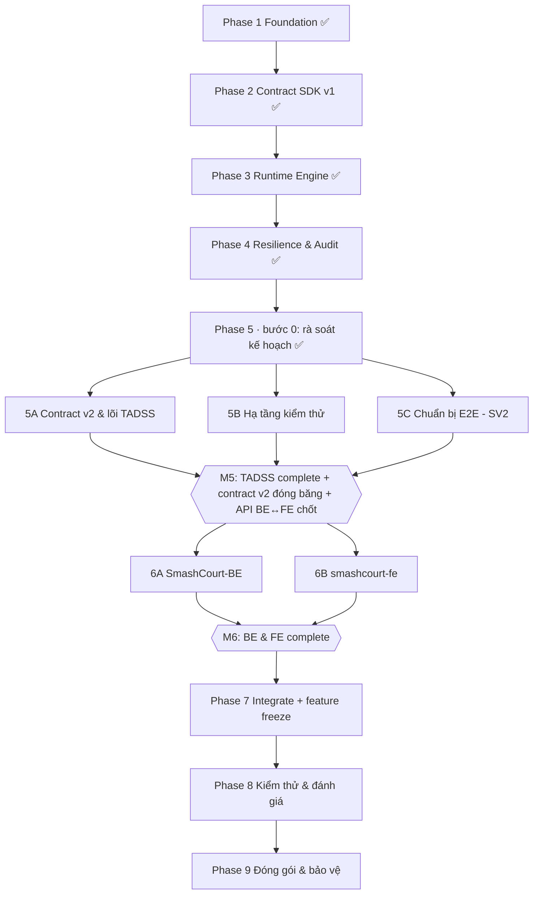

# WBS, ĐỒ THỊ PHỤ THUỘC & QUẢN TRỊ RỦI RO — v2.1

> **Vai trò của tài liệu:** cây phân rã công việc (WBS), phụ thuộc giữa các phase, sổ rủi ro và quy trình rà soát hằng tuần. Lịch trình và gate: [`MASTER_EXECUTION_PLAN.md`](MASTER_EXECUTION_PLAN.md). Task chi tiết: [`BACKLOG_SPRINTS.md`](BACKLOG_SPRINTS.md).

---

## I. MÔ HÌNH PHÂN LỚP HỆ THỐNG

```text
┌──────────────────────────────────────────────────────────────────────────┐
│ LỚP 3 — CHIẾN LƯỢC NGHIÊN CỨU TADS (Khóa luận, ngoài phạm vi Đồ án 2)    │
│   Adaptive Trust Score · mô hình dự báo no-show · đánh giá off-policy    │
└───────────────────────────────┬──────────────────────────────────────────┘
                                │ hiện thực IReservationDecisionStrategy
                                ▼
┌──────────────────────────────────────────────────────────────────────────┐
│ LỚP 2 — TADSS DECISION RUNTIME (Đồ án 2)                                 │
│   Contract SDK v2 · định tuyến strategy · Polly v8 · audit bất biến      │
│   override/outcome · cache · shadow mode · OpenTelemetry                 │
└───────────────────────────────┬──────────────────────────────────────────┘
                                │ HTTP REST contract v2 (API key)
                                ▼
┌──────────────────────────────────────────────────────────────────────────┐
│ LỚP 1 — SMASHCOURT (Đồ án 1, được mở rộng ở Đồ án 2)                     │
│   Booking + cọc · VNPay · duyệt của Manager · feature flag · SignalR     │
└──────────────────────────────────────────────────────────────────────────┘
```

---

## II. CÂY PHÂN RÃ CÔNG VIỆC (WBS)

```text
TADSS — Đồ án 2
├── 1. Foundation (✅)                 → schema tadss, solution, CI
├── 2. Contract SDK v1 (✅)            → Reservation, DTO, schema v1, đóng băng
├── 3. Runtime Engine (✅)             → API v1, StrategyResolver, Default/Mock, idempotency
├── 4. Resilience & Audit (✅)         → Polly v8, fallback, cache, audit đồng bộ, F1–F7
├── 5. TADSS Complete + Test Infra
│   ├── Bước 0 rà soát kế hoạch (✅)   → audit, đồng bộ tài liệu, dọn repo (Gate MR 01/10)
│   ├── 5A Contract v2 & lõi           → cọc trong response, domain v2, DB bất biến, override/outcome,
│   │                                     hàng chờ, API key, múi giờ, routing + shadow, cache policy
│   ├── 5B Hạ tầng kiểm thử            → Testcontainers, OTel + Grafana, chế độ đánh giá một lệnh
│   │                                     (stack đánh giá trong compose: evaluator, Toxiproxy, k6, Schemathesis,
│   │                                     Stryker.NET, báo cáo + Evidence Pack), replay, adapter khách sạn
│   └── 5C Chuẩn bị E2E (SV2)          → Playwright, k6, đặc tả E2E
├── 6. SmashCourt-BE ∥ smashcourt-fe
│   ├── 6A BE (SV1)                    → TadssClient, flag, luồng cọc, proxy duyệt, job hết hạn/outcome
│   └── 6B FE (SV2)                    → UI cọc, chờ duyệt, dashboard Manager, realtime
├── 7. Integrate                       → ghép 3 hệ thống (Docker Compose), feature freeze
├── 8. Kiểm thử & đánh giá             → toàn bộ danh mục, đánh giá bằng dữ liệu import, Evidence Pack
└── 9. Đóng gói & bảo vệ               → báo cáo, slide, video
```

---

## III. ĐỒ THỊ PHỤ THUỘC



**Ràng buộc cứng:**

- Phase 6 chỉ bắt đầu khi contract v2 đã đóng băng **và** API contract BE ↔ FE đã chốt (M5), để BE và FE làm song song mà không chặn nhau.
- Phase 8 không thêm tính năng; mọi thay đổi là sửa lỗi kèm chạy lại test case liên quan.

---

## IV. MILESTONE

| Mốc | Thời điểm | Nội dung | Trạng thái |
|:---|:---|:---|:---:|
| **M1** | 12/09/2026 | Foundation ready | ✅ |
| **M2** | 18/09/2026 | Contract v1 đóng băng | ✅ |
| **M3** | 22/09/2026 | Runtime chạy độc lập | ✅ |
| **M4** | 01/10/2026 | Resilience & audit baseline (510 test pass) | ✅ |
| **MR** | 01/10/2026 | Phase 5 bước 0: tài liệu đồng bộ, repo sạch | ✅ |
| **M5** | 01/11/2026 | TADSS complete, hạ tầng kiểm thử sẵn sàng, danh mục kiểm thử toàn hệ thống | ⏳ |
| **M6** | 29/11/2026 | SmashCourt-BE & smashcourt-fe complete | ⏳ |
| **M7** | 06/12/2026 | Tích hợp xong, feature freeze | ⏳ |
| **M8** | 20/12/2026 | 100% test case đạt, KPI đo đủ, Evidence Pack | ⏳ |
| **M9** | 26/12/2026 | Sẵn sàng bảo vệ | ⏳ |

Tiêu chí chi tiết của từng milestone: Mục IV và V trong [`MASTER_EXECUTION_PLAN.md`](MASTER_EXECUTION_PLAN.md).

---

## V. SỔ RỦI RO

| Mã | Rủi ro | Khả năng / Ảnh hưởng | Phòng ngừa | Phương án khi xảy ra |
|:---|:---|:---:|:---|:---|
| **R1** | Phase 5 kéo dài vì khối lượng lớn (contract v2 + toàn bộ hạ tầng kiểm thử) | Cao / Cao | Làm hạ tầng kiểm thử (Testcontainers) ngay đầu W05 trước khi sửa lõi; mỗi tuần có đầu ra chạy được | Dùng 2 ngày đệm đầu W09 trước khi chốt M5; không cắt test case, chỉ lùi thời điểm bắt đầu Phase 6 |
| **R2** | Docker/Testcontainers không chạy ổn định trên máy dev hoặc CI | Trung bình / Cao | Kiểm tra Docker Desktop + GitHub Actions runner ngay W05; cố định phiên bản image | Chạy integration test trên CI Linux; dev chạy app bằng `dotnet run` với Neon (D-04) |
| **R3** | Thay đổi DB SmashCourt (enum `booking_status`, trường cọc) làm vỡ luồng cũ | Trung bình / Cao | Toàn bộ thay đổi qua script SQL có review; test hồi quy BE trước khi merge | Feature flag tắt → luồng 100% như Đồ án 1 |
| **R4** | Manager không duyệt kịp, đơn chờ quá lâu | Trung bình / Trung bình | Hạn duyệt cấu hình; ngưỡng thời gian bắt đầu gần → SmashCourt áp 100% thay vì chờ | Job hết hạn hủy đơn, không tự duyệt |
| **R6** | Môi trường tích hợp (Docker Compose)/VNPay sandbox trục trặc | Thấp / Cao | Chốt môi trường tích hợp ở W08, chạy thử ở W13 | Chạy từng repo bằng `dotnet run`/`npm run dev` trên máy local, nối nhau qua localhost |
| **R7** | Dữ liệu SmashCourt hiện có là dữ liệu môi trường phát triển (nhãn NO_SHOW/CANCELLED do job tự sinh) | Đã xảy ra / Trung bình | Chỉ dùng 215 booking làm input có hình dạng thực tế cho replay; không dùng làm nhãn hành vi | Dùng dataset công khai (Hotel Booking Demand) cho phân tích có nhãn |
| **R8** | Lộ bí mật cấu hình (connection string, khóa VNPay/JWT) | Đã xảy ra / Cao | Không đọc/in file `appsettings.Development.json`, `.env`; secret chỉ ở các file đó hoặc user-secrets (gitignore, không commit); image Docker chứa `appsettings.Development.json` chỉ dùng local, không push registry | Đổi mật khẩu/khóa đã lộ ngay khi phát hiện |
| **R9** | Mutation score thấp hơn ngưỡng G5 | Trung bình / Trung bình | Chạy Stryker từ W07 để có thời gian bổ sung test | Bổ sung test cho mutant sống sót trước M5 |

---

## VI. QUY TRÌNH RÀ SOÁT HẰNG TUẦN

- **Thời gian:** tối Chủ Nhật 20:00–20:30.
- **Nội dung (10–10–10):** (1) đối chiếu task đã xong với [`BACKLOG_SPRINTS.md`](BACKLOG_SPRINTS.md) và gate sắp tới; (2) rà sổ rủi ro ở Mục V, kích hoạt phương án nếu cần; (3) chốt 3 việc ưu tiên của mỗi người cho tuần tới.
- **Đánh giá tiến độ:** 🟢 đúng kế hoạch · 🟡 trễ 1–2 ngày (dùng ngày đệm, không cắt kiểm thử) · 🔴 trễ ≥ 3 ngày (họp lại, dời mốc trong MASTER_EXECUTION_PLAN và ghi lý do).
- **Ghi nhận:** kết quả rà soát cập nhật trực tiếp vào cột trạng thái của MASTER_EXECUTION_PLAN và BACKLOG_SPRINTS.

---

## VII. THUẬT NGỮ

Định nghĩa TADSS / TADS / ATDA và các thuật ngữ kỹ thuật chuẩn: xem Mục 0 trong [`THESIS_DEVELOPMENT_PLAYBOOK.md`](THESIS_DEVELOPMENT_PLAYBOOK.md).
