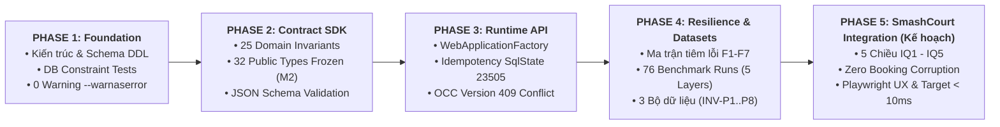

# ĐỀ XUẤT ĐỒ ÁN 2 (PROJECT PROPOSAL)

## THIẾT KẾ VÀ XÂY DỰNG NỀN TẢNG RUNTIME ENGINE RA QUYẾT ĐỊNH CHỊU LỖI CHO HỆ THỐNG ĐẶT CHỖ DỊCH VỤ

**Tên tiếng Anh:** *Design and Development of a Fault-Tolerant Decision Runtime Engine for Service Reservation Systems*

---

|  | Thông tin |
|--|----------|
| **Sinh viên thực hiện** | *(Điền tên)* |
| **MSSV** | *(Điền MSSV)* |
| **Giảng viên hướng dẫn** | *(Điền tên GVHD)* |
| **Khoa / Ngành** | Công nghệ Thông tin / Kỹ thuật Phần mềm |
| **Hệ thống đối chứng** | SmashCourt — Hệ thống đặt sân cầu lông trực tuyến (Đồ án 1) |
| **Sản phẩm chính** | **TADSS** (Trustworthy Adaptive Decision Support System) — Nền tảng Runtime Engine |

> [!NOTE]
> **Định danh hệ thống:** Trong phạm vi đề tài, **TADSS (Trustworthy Adaptive Decision Support System)** được sử dụng làm tên định danh chính thức của nền tảng runtime thực thi và kiểm soát các chiến lược quyết định (Decision Strategies). Trong phạm vi Đồ án 2, **"Trustworthy"** được hiểu theo khía cạnh operational trustworthiness của runtime (bao gồm khả năng chịu lỗi, fallback, auditability, kiểm soát phê duyệt thủ công, tính nhất quán khi thực thi và chống ghi đè/gọi trùng); các khía cạnh algorithmic fairness và trustworthy AI thuộc phạm vi Khóa luận tốt nghiệp.
>
> **📌 Ghi chú Quản trị Lịch sử (Historical Proposal Snapshot):** Văn bản này là bản Đề cương Đề xuất ban đầu (Initial Approved Proposal) nộp đầu kỳ. Trong quá trình hiện thực hóa thực tế ở Phase 3–4 (xem [`RESILIENCE_AND_FAULT_TAXONOMY.md`](../architecture/RESILIENCE_AND_FAULT_TAXONOMY.md), [`DECISION_PERSISTENCE_INVARIANTS.md`](../architecture/DECISION_PERSISTENCE_INVARIANTS.md) và [`MASTER_EXECUTION_PLAN.md`](./MASTER_EXECUTION_PLAN.md)), kiến trúc đã được chuẩn hóa ở 4 điểm: (1) `InnerTimeoutMs` được chuẩn hóa ở mức `120ms` ($3 \times 120\text{ms} + 2 \times 30\text{ms} = 420\text{ms} < 500\text{ms}$ `OuterTimeoutMs`); (2) Tách bạch `DefaultDecisionStrategy` (Conservative Baseline Business Policy: phân hạng khách hàng kết hợp mức thanh toán 100% mặc định khi không đạt ngưỡng ưu đãi) với `FallbackDecisionStrategy` (cơ chế an toàn hạ tầng trả về `NEED_APPROVAL` kèm khuyến nghị thanh toán 100%); (3) Ghi nhận Append-Only Audit Trail đồng bộ (Fail-Closed) qua `MediatR` in-process events (`INotification` / `INotificationHandler`) nằm trong cùng PostgreSQL transaction boundary; và (4) Định dạng Cache Key chuẩn hóa thành `decision:hash:{requestHash}:{strategyName}:v{strategyVersion}` với cấu hình baseline `TtlHours = 24`.

---

## 1. GIỚI THIỆU & BỐI CẢNH (INTRODUCTION & BACKGROUND)

Trong các hệ thống đặt chỗ dịch vụ theo thời gian thực (Service Reservation Systems) như đặt sân thể thao, phòng họp, phòng khám hay khách sạn, các quyết định về chính sách vận hành đóng vai trò sống còn đối với hiệu quả kinh doanh. Các quyết định này bao gồm: xác định tỷ lệ đặt cọc, giới hạn số lần hủy lịch, hay ưu tiên phân bổ tài nguyên giờ cao điểm. Trong phạm vi Đồ án 2, **TADSS (Trustworthy Adaptive Decision Support System)** đóng vai trò là một cơ sở hạ tầng runtime thực thi quyết định (Decision Runtime Infrastructure) độc lập; các chiến lược như chính sách đặt cọc động hay phân phối tài nguyên chỉ là các chiến lược cụ thể (Strategies) được cấu hình và chạy trên nền tảng này.

Trong giai đoạn xây dựng hệ thống **SmashCourt** (Đồ án 1), chúng ta đã hoàn thiện luồng đặt sân trực tuyến tích hợp thanh toán VNPay và hệ thống chatbot FAQ hỗ trợ khách hàng. Tuy nhiên, luồng nghiệp vụ này hiện đang áp dụng một chính sách tĩnh duy nhất: yêu cầu thanh toán cố định 100% đối với toàn bộ khách hàng và toàn bộ khung giờ. Đây chỉ là một chiến lược quyết định cụ thể của case study; về mặt hệ thống, SmashCourt thiếu một nền tảng thực thi quyết định tổng quát. 

Thực tế vận hành doanh nghiệp đòi hỏi các chính sách quyết định phải linh hoạt và thích ứng (adaptive). Ví dụ, cần áp dụng mức cọc cao hơn với khách hàng có tỷ lệ bùng hẹn cao, hoặc giảm cọc đối với khách hàng thân thiết đặt sân giờ thấp điểm. Tuy nhiên, việc tích hợp trực tiếp các thuật toán quyết định thay đổi liên tục này vào hệ thống nghiệp vụ SmashCourt sẽ dẫn đến các rủi ro lớn về mặt kỹ thuật phần mềm: nghẽn hệ thống do thuật toán xử lý chậm, sập toàn bộ luồng thanh toán nếu dịch vụ quyết định gặp sự cố, và thiếu khả năng kiểm tra vết (audit trail) hay ghi đè khẩn cấp (override) từ nhà quản lý.

Do đó, việc nghiên cứu thiết kế và xây dựng một **nền tảng runtime engine độc lập, chịu lỗi tốt (fault-tolerant)** là bắt buộc để làm môi trường trung gian an toàn chạy các chiến lược quyết định nghiệp vụ.

---

## 2. PHÁT BIỂU VẤN ĐỀ (PROBLEM STATEMENT)

Các hệ thống đặt chỗ dịch vụ hiện tại khi cố gắng áp dụng các cơ chế ra quyết định động thường đối mặt với 3 thách thức kỹ thuật phần mềm cốt lõi (Technical Challenges):

1. **Tight Coupling (Ràng buộc chặt nghiệp vụ và logic quyết định):** Logic tính toán các quyết định nghiệp vụ (như chính sách cọc và hủy lịch) bị nhúng trực tiếp vào mã nguồn nghiệp vụ CRUD. Mỗi khi thay đổi chiến lược ra quyết định hoặc thay đổi phiên bản thuật toán, lập trình viên buộc phải sửa code và deploy lại toàn bộ ứng dụng lớn.
2. **Single Point of Failure (Sự cố lan truyền):** Các mô hình dự đoán rủi ro hoặc API tính toán bên ngoài có độ trễ lớn (p95 > 500ms) hoặc dễ gặp sự cố gián đoạn. Nếu không có cơ chế chịu lỗi cô lập, khi dịch vụ quyết định bị chậm hoặc sập, toàn bộ luồng thanh toán và đặt chỗ của khách hàng sẽ bị sập theo.
3. **Lack of Auditability & Human Control (Thiếu vết lưu và kiểm soát):** Không có cơ chế lưu vết đồng bộ (synchronous audit log) mô tả tại sao hệ thống lại đưa ra kết quả quyết định đó, và không có cổng API cho phép con người (Manager) duyệt thủ công hoặc ghi đè (Override) thông số quyết định một cách an toàn mà vẫn giữ nguyên vết quyết định gốc.

---

## 3. MỤC TIÊU ĐỒ ÁN 2 (OBJECTIVES)

### 3.1. Mục tiêu tổng quát
Thiết kế và xây dựng **TADSS (Trustworthy Adaptive Decision Support System)** — một nền tảng runtime engine độc lập hỗ trợ thực thi và kiểm soát các chiến lược ra quyết định. TADSS hoàn toàn độc lập với các thuật toán quyết định cụ thể; các chiến lược được trừu tượng hóa thông qua giao diện hợp đồng dùng chung (`IReservationDecisionStrategy`) và có thể thay thế ở mức cấu hình/triển khai mà không thay đổi lõi runtime core.

### 3.2. Mục tiêu cụ thể
Để đạt được mục tiêu tổng quát, Đồ án 2 tập trung hoàn thành các mục tiêu kỹ thuật cụ thể sau:
* **O1 — Decision Contract SDK:** Thiết kế thư viện hợp đồng dùng chung chứa Domain Model chuẩn hóa (`Reservation` Canonical Model), interfaces chiến lược, các enums và DTOs đầu ra được cấu trúc chặt chẽ.
* **O2 — Decision Runtime API:** Xây dựng Web API độc lập chịu trách nhiệm nhận yêu cầu thẩm định, định tuyến đến chiến lược tương ứng thông qua Strategy Factory sử dụng cơ chế DI-based Strategy Resolution (O(1) DI registration lookup) và trả kết quả chuẩn hóa dưới dạng Recommendation.
* **O3 — Polly v8 Resilience Pipeline:** Tích hợp chuỗi chịu lỗi lồng nhau (Nested Policies) bao gồm: Outer Timeout kiểm soát SLA toàn cục ➔ Retry ➔ Inner Timeout từng lần thử ➔ Circuit Breaker ➔ Fallback sang kết quả quyết định mặc định (như thanh toán tĩnh 100% trong case study SmashCourt).
* **O4 — Append-only Audit Trail:** Thiết lập hệ thống ghi vết quyết định đồng bộ thông qua MediatR in-process events nằm trong transaction boundary của PostgreSQL, phân biệt rõ các loại thực thi.
* **O5 — Human-in-the-loop Override API:** Xây dựng API phê duyệt và ghi đè kết quả quyết định dành cho Manager, tích hợp cơ chế chống ghi trùng (`IdempotencyKey`) và chống ghi đè đồng thời (`ExpectedVersion`).
* **O6 — Feature Flag Integration:** Triển khai Feature Flag (`EnableTadssDecision`) tích hợp cổng reload động (`IOptionsMonitor`) giúp SmashCourt bật/tắt luồng gọi TADSS tức thời khi cần thiết.
* **O7 — SmashCourt Case Study Integration:** Thực hiện tích hợp đầu cuối giữa ứng dụng SmashCourt và TADSS Core để chứng minh khả năng vận hành thực tế.

---

## 4. RANH GIỚI KIẾN TRÚC & PHÂN LỚP DỰ ÁN

Để đảm bảo tính độc lập tuyệt đối giữa các học phần, ranh giới dự án được phân chia thành 3 lớp riêng biệt như sau:

```text
Lớp 3: Chiến lược nghiên cứu (TADS)    ───► KHÓA LUẬN (ML, Trust Model, Trace API)
       │ (implements IReservationDecisionStrategy)
       ▼
Lớp 2: Decision Runtime Engine (TADSS) ───► ĐỒ ÁN 2 [IN-SCOPE] (SDK, Polly, Audit, Override, Cache)
       │ (Giao tiếp qua HTTP REST Contract)
       ▼
Lớp 1: Case Study Product (SmashCourt) ───► ĐỒ ÁN 1 (CRUD Booking, Payments, Chatbot FAQ)
```

### 💡 Ghi chú 4 ranh giới kỹ thuật cốt lõi (Architectural Boundaries)

1. **TADSS ↔ VNPay Boundary:** TADSS **không** tích hợp trực tiếp và không biết cổng thanh toán VNPay là gì. TADSS chỉ nhận yêu cầu ra quyết định, trả về kết quả `Approved`, `NeedApproval` hoặc `Rejected` kèm các thông số đề xuất cấu trúc (Recommendation). Hệ thống SmashCourt (Lớp 1) mới là phía tiếp nhận kết quả, quyết định chuyển tiếp người dùng sang luồng thanh toán hoặc hành động nghiệp vụ tương ứng của SmashCourt.
2. **Database Boundary — Logical Schema Separation:** TADSS độc lập ở mức mã nguồn ứng dụng và hợp đồng nghiệp vụ. Trong phiên bản Đồ án 2, TADSS sử dụng chung máy chủ PostgreSQL vật lý với SmashCourt nhưng cô lập hoàn toàn ở tầng **Logical Schema** (bảng nghiệp vụ SmashCourt nằm trong schema mặc định, các bảng audit quyết định của TADSS nằm trong schema `tadss`). Điều này giúp đơn giản hóa hạ tầng triển khai nhưng vẫn đảm bảo tính độc lập dữ liệu (Logical Boundary).
3. **Domain Portability Boundary — Proof of Concept:** TADSS đạt tính di động nhờ giao thức trừu tượng `Reservation` SDK. Để chứng minh tính di động độc lập tên miền, chúng ta chỉ cần viết lớp Mapping Adapter ở phía client (ví dụ: client Coworking Space ánh xạ thuộc tính của Phòng họp về `Reservation` Contract) và gửi đến TADSS Core. Runtime Core hoàn toàn không phải thay đổi mã nguồn.
4. **Telemetry Ownership Boundary:** Bảng `decision_executions` do Đồ án 2 tạo và ghi nhận telemetry kỹ thuật (`execution_time_ms`, `fallback_used`, `failure_reason`, `cache_hit`, `execution_type`). Khóa luận sẽ tái sử dụng tập dữ liệu telemetry này làm dataset chạy thực nghiệm Ablation Study & Simulator.

---

## 5. PHẠM VI TRIỂN KHAI (PROJECT SCOPE)

### 5.1. Phân nhóm các cấu phần (Tiering)

Để đảm bảo dự án hoàn thành đúng tiến độ mà không bị phình phạm vi (scope creep), các cấu phần phát triển được phân chia nghiêm ngặt:

#### 🔴 Core — Bắt buộc hoàn thành (Đồ án 2)
* **Decision Contract SDK:** Thư viện Class Library dùng chung chứa Domain Model, DTOs, Enums.
* **Decision Runtime API:** Endpoint `POST /api/v1/decisions`, định tuyến qua Strategy Factory (DI-based Strategy Resolution).
* **Default & Mock Strategies:** Thiết kế `DefaultDecisionStrategy` (Conservative Baseline Business Policy: phân hạng khách hàng kết hợp mức thanh toán 100% mặc định) và `MockAlternativeDecisionStrategy` (cọc 30% giờ thường / 50% giờ cao điểm) nhằm chứng minh Strategy Pattern được kiểm chứng bằng executable code thực tế.
* **Polly Resilience Pipeline:** Khung chịu lỗi lồng nhau (Timeout, Retry, CB, Fallback).
* **Append-only Audit Trail:** Ghi vết transaction audit trail thông qua in-process application events của MediatR đồng bộ.
* **Override API:** Endpoint `POST /api/v1/decisions/{id}/override` có cơ chế idempotency và optimistic locking.
* **Feature Flag:** Cờ bật tắt động gọi TADSS từ SmashCourt sử dụng `IOptionsMonitor` reload.
* **SmashCourt Integration:** Kết nối và kiểm soát luồng thanh toán tại SmashCourt dựa trên kết quả TADSS.
* **Integration Tests:** Bộ test cases tự động mô phỏng sập/timeout và kiểm tra fallback.

#### 🟡 Supporting — Nên có (Đồ án 2)
* **Manager Dashboard UI:** Giao diện Next.js đơn giản hiển thị danh sách Pending Approval để duyệt/ghi đè.
* **Request-Hash Cache:** Tích hợp Redis Cache băm SHA256 payload để tránh thực thi lặp lại.
* **Structured Logging:** Cấu hình Serilog đẩy log cấu trúc phục vụ debug.

#### 🟢 Optional — Có thể cắt giảm nếu thiếu thời gian
* **External Provider Cost Guardrail:** Cơ chế giám sát giới hạn chi phí external provider độc lập (`IExternalProviderMetrics`).
* **k6 Load Test:** Script kiểm thử bắn tải 200 RPS đo lường Circuit Breaker.
* **OpenTelemetry:** Tích hợp phân tán log trace.

### 5.2. Các cấu phần loại trừ hoàn toàn khỏi Đồ án 2 (Out-of-Scope)
* Không nghiên cứu lý thuyết hay cài đặt thuật toán tính điểm tin cậy dynamic (**Khóa luận**).
* Không huấn luyện hay triển khai mô hình học máy CatBoost dự báo bùng lịch (**Khóa luận**).
* Không xây dựng API giải thích vết quyết định Decision Trace (**Khóa luận**).
* Không chạy simulator giả lập hay Ablation Studies (**Khóa luận**).
* Không tích hợp Event Sourcing hay Outbox Pattern phân tán (**Future Work**).

---

## 6. THIẾT KẾ KIẾN TRÚC HỆ THỐNG (SYSTEM ARCHITECTURE)

### 6.1. Quy trình xử lý phê duyệt & Ghi đè (Human-in-the-loop Flow)
Khi TADSS trả về trạng thái quyết định, SmashCourt và Manager phối hợp thực thi như sau:

```text
                  ┌────────────────────────┐
                  │    DecisionRequest     │
                  └───────────┬────────────┘
                              ▼
                  ┌────────────────────────┐
                  │ TADSS Runtime Execute  │
                  └───────────┬────────────┘
                              │
                    Phân tích Status?
                              │
         ┌────────────────────┼────────────────────┐
         ▼ (Approved)         ▼ (NeedApproval)     ▼ (Rejected)
  ┌──────────────┐     ┌──────────────┐     ┌──────────────┐
  │ Booking      │     │ Booking      │     │ Hủy Booking  │
  │ checkout     │     │ Pending      │     │ Trả về Lỗi   │
  │ sang VNPay   │     │ (Block VNPay)│     └──────────────┘
  └──────────────┘     └──────┬───────┘
                              │
                    Manager Command duyệt
                              │
                     ┌────────┴────────┐
                     ▼                 ▼
                 [Approve]        [Override]
                     │                 │
              Đồng ý mức cọc     Thay đổi cọc
              đề xuất gốc        (bắt buộc reason)
                     │                 │
                     └────────┬────────┘
                              ▼
                       Ghi nhận Event
                    (Append-only Audit)
                              ▼
                     Tiếp tục thanh toán
```

### 6.2. Cấu hình Polly v8 Resilience Pipeline
Để bảo vệ hệ thống khỏi các sự cố quá tải hoặc nghẽn mạng từ strategy nghiệp vụ, Polly v8 được thiết lập lồng nhau:

```text
┌── Outer Timeout: 500ms (Overall Request SLA Budget) ───────────┐
│                                                                │
│  Fallback: FallbackDecisionStrategy (NEED_APPROVAL, 100%)      │
│   └── Overhead < 10ms sau khi failure được xác định            │
│                                                                │
│  Retry Policy (Tối đa 2 retries = 3 attempts, base delay 30ms) │
│   │                                                            │
│   └── Circuit Breaker (Sampling 30s, tối thiểu 10 requests)    │
│        └── Inner Timeout: 120ms per attempt                    │
│             └── Strategy.EvaluateAsync()                       │
│                                                                │
└────────────────────────────────────────────────────────────────┘
```
> [!IMPORTANT]
> **Giải trình Budget trễ:** Outer Timeout 500ms là overall request budget (SLA) bọc ngoài toàn bộ retry attempts và retry delays. Inner Timeout 120ms là giới hạn cho từng strategy execution attempt riêng lẻ ($3 \times 120\text{ms} + 2 \times 30\text{ms} = 420\text{ms} < 500\text{ms}$).

### 6.3. Thiết kế Request-Hash Caching
* **Thuật toán:** Cache Key được tính toán bằng cách tách biệt định danh yêu cầu (`RequestHash` theo chuẩn RFC 8785 JCS) và định danh phiên bản chiến lược:
  $$\text{RequestHash} = \text{SHA256}(\text{Canonical}(\text{DecisionRequestDto}))$$
  Namespace Cache Key: `decision:hash:{requestHash}:{strategyName}:v{strategyVersion}`
* **Stale Behavior Policy:**
  * **Default Strategy (Baseline):** Cho phép cache bình thường với cấu hình baseline TTL = 24 giờ (`TtlHours = 24`).
  * **Adaptive Strategy (Khóa luận):** Mặc định bị vô hiệu hóa (disabled by default) hoặc đặt TTL = 1 phút (dưới dạng cấu hình thực nghiệm) để tránh stale decisions khi điểm tin cậy khách hàng thay đổi đột ngột.

### 6.4. Ràng buộc xử lý quá hạn phê duyệt (No Auto-Approve)
Đối với luồng duyệt thủ công (Human-in-the-loop): Nếu Manager không phản hồi trong khoảng thời gian cấu hình, booking sẽ giữ nguyên trạng thái `PendingDecisionApproval` hoặc tự động hết hạn (booking expired), hệ thống **tuyệt đối không tự động phê duyệt (No Auto-Approve)** để đảm bảo an toàn tuyệt đối cho dòng tiền của hệ thống đặt chỗ.

### 6.5. Cơ chế phân luồng quyết định nghiệp vụ tại hệ thống đặt sân (SmashCourt)
Để tối ưu hóa trải nghiệm khách hàng và giảm tải cho hệ thống, ứng dụng nghiệp vụ SmashCourt triển khai một cổng phân luồng quyết định (Business Routing Layer) trước khi gửi yêu cầu đến TADSS Core:
1.  **Phân luồng ưu tiên (VIP/Loyal Fast-Track):** Đối với nhóm khách hàng thân thiết (Gold, Platinum) có điểm uy tín cao, hệ thống SmashCourt tự động áp dụng chính sách phê duyệt nhanh (Fast-Track) và chuyển thẳng sang luồng thanh toán, không cần gửi yêu cầu thẩm định qua TADSS để tối ưu tốc độ giao dịch.
2.  **Phân loại theo thời gian đặt (Booking Lead Time Separation):** 
    *   **Đặt sát giờ (Last-minute booking - dưới 24h):** Ưu tiên ra quyết định tự động hoàn toàn (chỉ nhận kết quả `Approved` hoặc `Rejected` từ TADSS). Tránh tối đa trạng thái `NeedApproval` để không làm nghẽn luồng thanh toán của khách hàng khi thời gian bắt đầu cận kề.
    *   **Đặt trước dài ngày (Advance booking):** Cho phép kích hoạt luồng phê duyệt thủ công (`NeedApproval`), đưa yêu cầu lên Dashboard chờ Manager xử lý vì thời gian chuẩn bị còn dài.
3.  **Chính sách theo thời điểm (Peak/Off-Peak Rules):** Tách biệt luồng gọi chiến lược mặc định (`DefaultDecisionStrategy` - Baseline Business Policy với mức 100% mặc định khi không đạt ngưỡng ưu đãi) và chiến lược thử nghiệm (`MockAlternativeDecisionStrategy`) áp dụng mức cọc 30% cho giờ thường (Approved) và cọc 50% cho giờ cao điểm (NeedApproval) nhằm kiểm chứng khả năng phân giải chiến lược linh hoạt của hệ thống.
4.  **Cơ chế vận hành khẩn cấp (Emergency Valve):** Khi hệ thống TADSS quá tải hoặc gặp sự cố nghiêm trọng, Manager có thể tắt Feature Flag (`EnableTadssDecision = false`) trên SmashCourt. Hệ thống đặt sân sẽ lập tức chuyển sang chế độ tự hoạt động bằng chính sách thanh toán tĩnh mặc định (100%), cô lập hoàn toàn sự cố để bảo vệ luồng giao dịch cốt lõi.

*Lưu ý: Các cơ chế phân luồng trên thuộc về logic nghiệp vụ của ứng dụng SmashCourt, không thuộc phạm vi xử lý lõi của TADSS Runtime Platform.*

---

## 7. CÔNG NGHỆ SỬ DỤNG (TECHNOLOGY STACK)

Technology stack của Đồ án 2 được định hình có chọn lọc theo phương châm tối ưu hóa tính tin cậy kỹ thuật phần mềm, loại bỏ các công nghệ dư thừa không phục vụ mục tiêu chứng minh chất lượng:

### 7.1. Core Stack (Bắt buộc)
* **Ngôn ngữ & Framework:** C# 12, .NET Core 8 (ASP.NET Core Web API).
* **Database Access:** Entity Framework Core 8, PostgreSQL 16 (Logical schema isolation — triển khai Cloud Managed trên Neon PostgreSQL hoặc Local/Docker).
* **Resilience Framework:** Polly v8 (Timeout, Retry, Circuit Breaker, Fallback).
* **In-process Dispatcher:** MediatR (Synchronous event handling trong transaction boundary).
* **Kiểm thử & Khung Bằng chứng (Testing & Evidence Stack):**
  * `xUnit 2.x` & `FluentAssertions`: Kiểm thử đơn vị (Unit Tests), kiểm tra bất biến miền nghiệp vụ (Domain Invariants).
  * `Microsoft.AspNetCore.Mvc.Testing` (`WebApplicationFactory<Program>`): Kiểm thử tích hợp component và toàn bộ Web API HTTP Pipeline in-memory.
  * Custom Decorator Pattern (`FaultInjectedStrategyDecorator`): Giả lập và tiêm lỗi có kiểm soát (Fault Injection Matrix `F1`–`F7`).
  * `TADSS.BenchmarkRunner` (`System.Diagnostics.Stopwatch` hardware timer, `Math.NET` Percentile Calculation): Khung đo đạc thực nghiệm 76 lượt chạy độc lập, thu hoạch dữ liệu kiểm toán in-vivo và xuất bản các tập dữ liệu nghiên cứu chuẩn hóa.
  * `Microsoft.Playwright`: Kiểm thử tự động luồng tương tác đầu-cuối (E2E), thu thập Video và Trace Artifacts chứng minh trải nghiệm người dùng (UX) trên giao diện quản lý.
  * `System.Security.Cryptography.SHA256`: Xác thực chuỗi băm mật mã toàn vẹn dữ liệu từ cơ sở dữ liệu đến tập dữ liệu nghiên cứu.

### 7.2. Supporting Stack (Nên có)
* **Cache Provider:** Redis 7.x / 8.x (Request-Hash Distributed Caching trên Redis Cloud Managed hoặc Local/Docker, tích hợp tự động giáng cấp L1 `IMemoryCache` Fallback khi timeout 150ms).
* **Logging Framework:** Serilog (Structured Logging phân cấp ghi Console/File kèm xâu chuỗi vết `X-Correlation-ID`).
* **Frontend Framework:** Next.js / React (Manager Dashboard duyệt/ghi đè đơn giản nhúng trực tiếp trong `smashcourt-fe`).

---

## 8. CHIẾN LƯỢC KIỂM THỬ, KHUNG BẰNG CHỨNG THỰC NGHIỆM VÀ ĐẢM BẢO CHẤT LƯỢNG TOÀN DIỆN (QUALITY ASSURANCE & EVIDENCE FRAMEWORK)

### 8.1. Chuyển dịch Phương pháp luận: Từ "Test Suite đơn thuần" sang "Evidence Framework"
Trước Hội đồng đánh giá tốt nghiệp Kỹ thuật Phần mềm, câu hỏi bảo vệ trọng tâm không dừng lại ở mức *"Em đã lập trình được tính năng này chưa?"* mà chuyển sang:
> **"Em chứng minh chất lượng, độ chịu lỗi và hiệu năng của hệ thống bằng phương pháp khoa học nào? Minh chứng cụ thể ở đâu?"**

Khẳng định *"Hệ thống có 510/510 bài test pass"* chỉ chứng minh rằng các test tự động đã viết không bị lỗi, chứ chưa chứng minh test suite đã bao phủ đúng rủi ro sập hệ thống (Failure Modes), chưa chứng minh hệ thống chạy ổn định khi tải cao, và chưa chứng minh luồng tích hợp với ứng dụng nghiệp vụ SmashCourt đạt trải nghiệm tốt và không làm hỏng giao dịch đặt sân.

Do đó, Đồ án 2 thiết lập một **Evidence Pipeline khép kín** dẫn xuất trực tiếp từ Yêu cầu đến Hiện vật Bằng chứng có thể kiểm chứng độc lập:

```text
Requirement
   ↓
Risk / Failure Mode
   ↓
Test Strategy
   ↓
Test Case / Experiment
   ↓
Automated Execution
   ↓
Measured Evidence
   ↓
Acceptance Criteria
   ↓
Report / Artifact (Thesis Chapter)
```

### 8.2. Khung Kiểm thử & Bằng chứng Xuyên suốt 5 Giai đoạn (Phase 1 ➔ Phase 5)

Chiến lược kiểm thử và minh chứng chất lượng không phải chỉ thực hiện ở giai đoạn cuối khi tích hợp vào SmashCourt, mà được xây dựng **ngay từ ngày đầu tiên bắt đầu xây dựng hệ thống (Phase 1)** và duy trì liên tục qua từng giai đoạn:



| Giai đoạn Phát triển | Rủi ro Trọng tâm Cần Khử bỏ | Chiến lược Kiểm thử & Đánh giá | Công nghệ & Công cụ | Hiện vật Bằng chứng Đầu ra (Evidence Artifact) |
| :--- | :--- | :--- | :--- | :--- |
| **Phase 1: Foundation & Architecture** | • Vi phạm ranh giới Clean Architecture<br>• Lỗi thiết kế DDL Schema PostgreSQL dẫn đến sai kiểu dữ liệu hoặc thiếu index | • Kiểm thử tuân thủ kiến trúc (Architecture Compliance)<br>• Kiểm thử DDL Constraint, Foreign Key, Unique Index trên PostgreSQL | `dotnet build --warnaserror`<br>EF Core Migrations Verification Scripts | • Migration Snapshot `TadssDbContextModelSnapshot.cs`<br>• Script DDL `schema_smashcourt.sql`<br>• 0 Compiler Warnings / Errors |
| **Phase 2: Decision Contract SDK** | • Thay đổi ngầm làm vỡ hợp đồng giao tiếp giữa các bên<br>• Dữ liệu đặt sân không hợp lệ (sai giờ, sai tiền) lọt vào runtime core | • Kiểm thử 25 bất biến nghiệp vụ Domain Invariants (`Reservation`)<br>• Đóng băng Public API Surface (32 kiểu dữ liệu tại Milestone 2)<br>• Kiểm thử JSON Schema Strict (`additionalProperties: false`) | `xUnit 2.x`<br>`FluentAssertions`<br>`PublicApiGenerator`<br>JSON Schema Validator | • [`baseline_public_api.txt`](../contracts/baseline_public_api.txt) (32 public types tại thời điểm Milestone 2 Contract V1 Freeze)<br>• [`CONTRACT_V1_FREEZE.md`](../contracts/CONTRACT_V1_FREEZE.md)<br>• 25 Domain Invariant Unit Tests PASS |
| **Phase 3: Decision Runtime API** | • Định tuyến Strategy sai lệch hoặc thất bại<br>• Bấm đúp tạo giao dịch trùng (Race condition)<br>• Xung đột đồng thời khi 2 người cùng thao tác | • Kiểm thử tích hợp in-memory toàn bộ Web API HTTP pipeline<br>• Kiểm thử bảo vệ 2 lớp Idempotency (App Memory + DB `SqlState 23505`)<br>• Kiểm thử Optimistic Concurrency Control (`Version` 409) | `WebApplicationFactory<Program>`<br>In-Memory Pipeline Host<br>MediatR Notification Handlers | • Bộ kiểm thử tích hợp `TADSS.IntegrationTests`<br>• Test cases `IdempotencyIntegrationTests`<br>• Báo cáo kiểm thử xung đột đồng thời 409 |
| **Phase 4: Resilience, Benchmark & Datasets (Đã hoàn thành)** | • Chiến lược xử lý quá hạn làm sập toàn bộ hệ thống<br>• Bộ nhớ đệm không nhất quán khi tải cao<br>• Dữ liệu kiểm toán bị ô nhiễm hoặc sai lệch | • Tiêm lỗi có kiểm soát ma trận `F1`–`F7`<br>• Thực nghiệm đo đạc 76 lượt chạy (Full Suite 19 kịch bản $\times$ 4 mức tải thuộc 5 tầng A–E; Core Suite gồm 28 lượt chạy)<br>• Kiểm chứng tự động 8 bất biến nguồn gốc dữ liệu (`INV-P1` $\rightarrow$ `INV-P8`) | Custom Decorator Pattern<br>Polly v8 Resilience Pipeline<br>`TADSS.BenchmarkRunner`<br>`DatasetProvenanceVerifier` | • [`WEEK8_BENCHMARK_REPORT.md`](../research/benchmarks/WEEK8_BENCHMARK_REPORT.md)<br>• [`WEEK9_DATASET_NORMALIZATION_REPORT.md`](../research/datasets/WEEK9_DATASET_NORMALIZATION_REPORT.md)<br>• 3 Bộ dữ liệu CSV/JSONL (23, 19, 31 cột)<br>• [`dataset_provenance_manifest.json`](../research/datasets/dataset_provenance_manifest.json) |
| **Phase 5: HITL & SmashCourt Integration (Kế hoạch Triển khai)** | • TADSS gặp sự cố làm chết luồng đặt sân của SmashCourt<br>• Lễ tân thao tác duyệt đơn bị trễ hoặc xung đột<br>• Khách hàng bị trừ tiền trùng lặp khi mạng lag | • Đánh giá Chất lượng Tích hợp 5 chiều (IQ1 $\rightarrow$ IQ5)<br>• Kiểm thử cô lập sự cố (Failure Containment & Failsafe)<br>• Kiểm thử tự động E2E và đo đạc trải nghiệm người dùng (UX) | Strongly-Typed SDK Client<br>Feature Flag `IOptionsMonitor`<br>Playwright Trace Viewer<br>Partial Index Query Runner | • Bộ kiểm thử E2E SmashCourt $\leftrightarrow$ TADSS<br>• Playwright Trace & Video Artifacts<br>• Đo lường kịch bản truy vấn pending-approvals (Design Target $< 10\text{ms}$ trên môi trường thử nghiệm)<br>• Biên bản kiểm thử Feature Flag Reload $< 2\text{s}$ |

### 8.3. Bảng Ánh xạ Toàn diện: Yêu cầu ➔ Rủi ro ➔ Chiến lược ➔ Bằng chứng (Traceability Matrix)

| Yêu Cầu Kỹ Thuật (Requirement) | Rủi Ro Hệ Thống (Risk / Failure Mode) | Chiến Lược Kiểm Thử (Test Strategy) | Công Cụ Thực Thi (Tool) | Chỉ Số Định Lượng (Metric) | Tiêu Chí Chấp Nhận (Acceptance Criteria) | Hiện Vật Bằng Chứng (Evidence Artifact) | Chương Báo Cáo |
| :--- | :--- | :--- | :--- | :--- | :--- | :--- | :--- |
| **REQ-01: Không nghẽn luồng đặt sân khi Strategy bị treo** | Strategy tính cọc chạy quá lâu hoặc deadlock làm treo ứng dụng khách | Tiêm độ trễ 150ms vượt InnerTimeout (120ms), kiểm tra Retry và chuyển Fallback | `FaultInjectedStrategyDecorator`<br>`WebApplicationFactory` | $P_{99}$ Latency, DCR (%), `fallback_used` | $P_{99} < 500\text{ms}$; $\text{DCR} = 100\%$; đơn chuyển `NEED_APPROVAL` an toàn | `resilience_evaluation_dataset.csv`<br>(Kịch bản `R1, R3`) | Chương 3 & 4 |
| **REQ-02: Cô lập lỗi khi hệ thống gặp sự cố dây chuyền** | Lỗi liên tục làm cạn kiệt connection pool và cháy CPU | Tiêm lỗi exception liên tiếp 10 lần kích hoạt Circuit Breaker `OPEN` | `Polly v8 CircuitBreaker`<br>`MeasurementWorker` | Trạng thái mạch, Fast-fail Latency ($P_{50}$) | Fast-fail $< 10\text{ms}$ khi mạch `OPEN`; tự phục hồi `HALF-OPEN` sau 15s | `resilience_evaluation_dataset.csv`<br>(Kịch bản `R2, E4`) | Chương 3 & 4 |
| **REQ-03: Tăng tốc phản hồi qua bộ nhớ đệm chuẩn hóa** | Tính toán lại chiến lược liên tục gây lãng phí tài nguyên và tăng độ trễ | Đo đạc trực giao giữa đường cơ sở Direct ($G_0$), Trượt Cache ($G_1$) và Trúng Cache ($G_2$) | `ResilientDecisionCacheService`<br>`BenchmarkRunner` | $P_{50}, P_{95}$, Cache Miss Overhead, Cache Benefit | Trúng cache $P_{50} < 5\text{ms}$; Overhead trượt cache không vượt quá $15\text{ms}$ | `latency_caching_dataset.csv`<br>(Kịch bản `G0, G1, G2`) | Chương 4 |
| **REQ-04: Phòng vệ giao dịch trùng lặp (Idempotency)** | Khách hàng mạng lag bấm đúp tạo ra 2 quyết định cọc / trừ tiền 2 lần | Bắn đồng thời 2 request cùng `X-Idempotency-Key` trong cùng 1 mili-giây | `IdempotencyIntegrationTests`<br>PostgreSQL Unique Index | HTTP Status, `DecisionId`, Tỷ lệ bản ghi trùng | Request 1 trả `200`; Request 2 nhận đúng kết quả cũ; 0 bản ghi trùng trong DB | `IdempotencyIntegrationTests.cs`<br>`uq_decision_idempotency_key` | Chương 3 |
| **REQ-05: Lưu vết kiểm toán và bảo toàn tính bất biến** | Quản lý sửa kết quả quyết định làm mất dấu vết máy tính ban đầu | Kiểm thử vòng đời quản trị: Chụp snapshot $t_0$, gọi `POST /override`, đối chiếu snapshot $t_1$ | `GovernanceLifecycleHarness`<br>`DatasetProvenanceVerifier` | Số trường sai lệch giữa $t_0$ và $t_1$ trên 9 trường Machine Snapshot | 9 trường Snapshot giữ nguyên 100%; `Version` tăng $1 \rightarrow 2$; `UpdatedAt` cập nhật | `governance_audit_dataset.csv`<br>`INV-P6, INV-P7` | Chương 3 & 4 |
| **REQ-06: Ngăn chặn xung đột duyệt đơn đồng thời** | Hai quản lý cùng mở một đơn đặt sân và bấm duyệt trái ngược nhau | Gửi đồng thời 2 lệnh Override với cùng `Version = 1` | `DecisionsControllerTests`<br>EF Core Concurrency Token | HTTP Status của request thứ hai | Request 1: `200 OK`; Request 2: `409 Conflict` (bảo toàn tính toàn vẹn trạng thái) | `DecisionsControllerTests.cs`<br>(Conflict Test Case) | Chương 3 |
| **REQ-07: Khả năng chẩn đoán và truy vết vận hành** | Khi hệ thống gặp lỗi ngoài thực tế, không thể tìm ra nguyên nhân gốc | Truy vết xuyên suốt chuỗi: `CorrelationId` $\rightarrow$ `DecisionId` $\rightarrow$ `RequestHash` | `CorrelationIdMiddleware`<br>`Serilog` Structured Logs | Độ phủ mã định danh truy vết trong logs và headers | 100% request và audit record chứa `CorrelationId` và `DecisionId` đồng nhất | `Tadss.Runtime.Api` Logs & Audit Ledger | Chương 3 |

### 8.4. Chuỗi Truy vết Ngược 6 Bước (Record-Level Drill-Down Chain)

Khi báo cáo trước Hội đồng khoa học, nếu Giám khảo chất vấn tính xác thực của bất kỳ con số nào trên biểu đồ, hệ thống cho phép người bảo vệ thực hiện **chuỗi truy vết ngược 6 bước** ngay tại chỗ:

```text
[BƯỚC 1: BIỂU ĐỒ BÁO CÁO (THESIS CHART)]
   │  Biểu đồ: "Kịch bản R3 (Retry Exhaustion) tại VU = 100 đạt P99 = 482.42ms"
   ▼
[BƯỚC 2: TẬP DỮ LIỆU TỔNG HỢP (SUMMARY ROW)]
   │  Tra cứu WEEK8_BENCHMARK_REPORT.md / benchmark_summary.csv:
   │  run_id = "EXP-W8-20260929-R3-VU100" | P50 = 470.70ms | P99 = 482.42ms | DCR = 100%
   ▼
[BƯỚC 3: PHÂN VỊ TRONG TẬP CHUẨN HÓA (DATASET ROW)]
   │  Mở docs/research/datasets/resilience_evaluation_dataset.csv:
   │  Lọc theo: run_id == "EXP-W8-20260929-R3-VU100" AND sample_index == 198
   │  Dòng mẫu: ClientElapsedMs = 482.42ms | ExecutionType = "FALLBACK" | NeedApproval = true
   ▼
[BƯỚC 4: KHÓA KẾT NỐI ĐỊNH DANH (JOIN IDENTITY)]
   │  Trích xuất khóa liên kết logic từ dòng mẫu:
   │  DecisionId = "8e3c129f-5b4a-4a21-9988-112233445566"
   ▼
[BƯỚC 5: SỔ CÁI KIỂM TOÁN VẬT LÝ (DATABASE AUDIT RECORD)]
   │  Truy vấn trực tiếp cơ sở dữ liệu PostgreSQL (hoặc in-memory audit ledger):
   │  SELECT * FROM tadss.decision_executions WHERE decision_id = '8e3c129f-...';
   │  Kết quả:
   │  - strategy_name: "DefaultDecisionStrategy"
   │  - fallback_used: true
   │  - failure_reason: "STRATEGY_TIMEOUT"
   │  - request_hash: "a1b2c3d4... (64 hex chars)"
   │  - created_at: "2026-09-29T16:38:22.412Z"
   ▼
[BƯỚC 6: MÃ BĂM MẬT MÃ BẢO VỆ TÍNH TOÀN VẸN (SHA-256 MANIFEST)]
      Đối chiếu mã băm trong dataset_provenance_manifest.json:
      resilience_evaluation_dataset.csv SHA-256 = bit-by-bit match 100%.
```

### 8.5. Kế hoạch & Thiết kế Đánh giá Chất lượng Tích hợp SmashCourt (Integration Quality — IQ1 đến IQ5 cho Phase 5)

Để chứng minh khi tích hợp vào ứng dụng thực tế SmashCourt, hệ thống không chỉ "chạy được" mà còn **"chạy tốt, tin cậy và đạt trải nghiệm tối ưu"**, Đồ án thiết lập 5 chiều đánh giá tích hợp (IQ1 $\rightarrow$ IQ5):

1. **IQ1 — Functional Correctness (Độ Đúng đắn Chức năng Tích hợp):**
   * *Thực nghiệm:* SmashCourt gửi yêu cầu đặt sân $\rightarrow$ TADSS Runtime phân giải Strategy $\rightarrow$ Trả kết quả quyết định $\rightarrow$ SmashCourt cập nhật chính xác trạng thái đơn đặt sân.
   * *Minh chứng:* 100% các trường số tiền cọc, mã sân, và khung giờ được bảo toàn toàn vẹn giữa `DecisionRequestDto` và cơ sở dữ liệu của SmashCourt.
2. **IQ2 — Integration Latency (Độ trễ Giao dịch Tích hợp Đầu-Cuối):**
   * *Phương pháp đo:* Đo toàn bộ chuỗi giao dịch nhìn từ góc độ người dùng:
     $$\text{Observed Latency} = \text{Network Transport} + \text{TADSS Execution} + \text{SmashCourt DB Update} + \text{UI Response}$$
   * *Tiêu chuẩn:* Khi trúng cache $< 50\text{ms}$; Khi xử lý bình thường $< 150\text{ms}$; Khi có retry lỗi $< 600\text{ms}$ (vẫn nằm trong ngưỡng kiên nhẫn của người dùng Web).
3. **IQ3 — Failure Containment & Zero Booking Corruption (Cô lập Sự cố & An toàn Giao dịch):**
   * *Nguyên tắc ranh giới:* TADSS làm chủ quyết định (`Decision Evaluation`), SmashCourt làm chủ giao dịch nghiệp vụ (`Booking Transaction`).
   * *Thực nghiệm sự cố:* Giả lập ngắt hoàn toàn máy chủ TADSS hoặc tắt Feature Flag. SmashCourt lập tức kích hoạt chính sách an toàn: đơn đặt sân được chuyển sang trạng thái chờ xử lý hoặc áp dụng mức cọc tĩnh 100%, **tuyệt đối không văng lỗi 500 và không làm mất giao dịch của khách**.
4. **IQ4 — Operational Diagnosability (Khả năng Chẩn đoán Vận hành):**
   * *Thực nghiệm:* Gắn mã định danh duy nhất `X-Correlation-ID` từ thời điểm request xuất phát từ SmashCourt.
   * *Minh chứng:* Cho phép người quản trị dùng một mã duy nhất để truy vết toàn bộ hành trình: `SmashCourt Log` $\rightarrow$ `HTTP Header` $\rightarrow$ `TADSS Request Log` $\rightarrow$ `Strategy Invocation` $\rightarrow$ `PostgreSQL Audit Record`.
5. **IQ5 — Quality-in-Use & Operator Usability (Trải nghiệm Vận hành Thực tế):**
   * *Đo lường định lượng theo chuẩn ISO/IEC 25010:*
     * *Thời gian tải danh sách đơn chờ duyệt (`NEED_APPROVAL`):* Đo lường độ trễ truy vấn pending-approvals và đánh giá hiệu năng truy xuất với partial index trên cột `created_at` (điều kiện `need_approval = true AND is_overridden = false`), hướng tới Design Target thời gian phản hồi $< 10\text{ms}$ trên môi trường thử nghiệm.
     * *Tỷ lệ hoàn tất tác vụ ghi đè (Task Completion Rate):* $100\%$ qua API 1-Click `POST /override`.
     * *Tỷ lệ thao tác lỗi xung đột:* 0% nhờ cơ chế khóa đồng thời lạc quan (OCC).

### 8.6. Hệ thống 8 Cổng Kiểm Soát Chất lượng (Quality Gates Model)

Quy trình phát triển và tích hợp tuân thủ nghiêm ngặt mô hình 8 Cổng Kiểm Soát Chất Lượng:

```text
[MÃ NGUỒN C# & SQL]
   │
   ▼
[GATE 1: BUILD GATE] ────────► 0 Errors, 0 Warnings với cờ --warnaserror
   │
   ▼
[GATE 2: UNIT & INVARIANT GATE] ──► 100% Invariant Tests PASS (Domain & Rules)
   │
   ▼
[GATE 3: CONTRACT GATE] ─────► 32 Public Types frozen (Milestone 2 Contract V1 Freeze); JSON Schema additionalProperties: false
   │
   ▼
[GATE 4: RESILIENCE GATE] ───► Ma trận F1-F7 PASS; Fallback luôn trả NEED_APPROVAL khi quá hạn
   │
   ▼
[GATE 5: PERFORMANCE GATE] ──► P99 < 500ms xuyên suốt 76 runs (19 kịch bản x 4 VUs, 5 tầng A-E); DCR = 100%
   │
   ▼
[GATE 6: AUDIT PROVENANCE GATE] ─► 100% thỏa mãn 8 bất biến toán học INV-P1 .. INV-P8
   │
   ▼
[GATE 7: INTEGRATION GATE] ──► SmashCourt E2E workflow hoàn tất; Zero Transaction Corruption
   │
   ▼
[GATE 8: OPERATIONAL GATE] ──► CorrelationId phủ kín 100%; Audit Ledger bất biến 100%
   │
   ▼
[SẴN SÀNG BẢO VỆ ĐỒ ÁN / TRIỂN KHAI THỰC TẾ]
```

---

## 9. KẾ HOẠCH THỰC HIỆN THEO SPRINT (ROADMAP & MILESTONES)

> [!NOTE]
> **Cập nhật Lộ trình Thực thi:** Chi tiết lộ trình triển khai kỹ thuật được phân rã thành 16 tuần (bao gồm 14 tuần phát triển kỹ thuật và 2 tuần ổn định/bảo vệ) trong tài liệu [MASTER_EXECUTION_PLAN.md](MASTER_EXECUTION_PLAN.md) nhằm tối ưu hóa tính khả thi, phân tách rõ ràng vai trò Owner/Reviewer và tăng cường bộ đệm an toàn cho đồ án.

Dự án được phân chia thành các giai đoạn phát triển logic kế thừa phụ thuộc:

* **Phase 1 — Phân tích & Thiết kế (2 tuần):** Phân tích vấn đề, xác định yêu cầu nghiệp vụ, hoàn thiện chuẩn giao tiếp Decision Contract, thiết kế kiến trúc tổng thể và DB schema `tadss`.
* **Phase 2 — Xây dựng Decision Contract SDK (2 tuần):** Phát triển thư viện dùng chung `Shared.DecisionContractSDK` định nghĩa Reservation Aggregate, DTOs, Enums, giao diện `IReservationDecisionStrategy`, đóng băng 32 public types (tại mốc Milestone 2 Contract V1 Freeze) và kiểm thử 25 domain invariants.
* **Phase 3 — Xây dựng Decision Runtime API (2 tuần):** Xây dựng Web API `POST /decisions`, bộ nạp chiến lược `StrategyFactory` (độ phức tạp thuật toán kỳ vọng expected $O(1)$ qua DI lookup), chiến lược mặc định `DefaultDecisionStrategy` (Baseline Business Policy: phân hạng khách hàng kết hợp mức thanh toán 100% mặc định), chiến lược thử nghiệm `MockAlternativeDecisionStrategy` (cọc 30%/50%), cơ chế Idempotency 2 tầng và Optimistic Concurrency Control.
* **Phase 4 — Resilience, Cache, Benchmark & Dataset Normalization (3 tuần):** Tích hợp chuỗi chịu lỗi lồng nhau Polly v8 (Outer Timeout 500ms, Retry 2 lần, Inner Timeout 120ms, Circuit Breaker, Fallback), bộ nhớ đệm Redis Request-Hash Cache (L1/L2), ghi vết transaction audit log đồng bộ qua MediatR xuống PostgreSQL, thực thi bộ Benchmark 5 tầng (76 lượt chạy: 19 kịch bản $\times$ 4 mức tải, bao gồm Core Suite 28 lượt chạy) và chuẩn hóa 3 bộ dữ liệu nghiên cứu (`INV-P1..INV-P8`).
* **Phase 5 — Human-in-the-loop & Tích hợp SmashCourt (3 tuần — Kế hoạch Triển khai):** Xây dựng Override API cho phép duyệt thủ công (idempotency, optimistic locking), màn hình Manager Dashboard trên Next.js (`smashcourt-fe`), cơ chế vận hành khẩn cấp Feature Flag (`IOptionsMonitor` < 2s), đánh giá chất lượng tích hợp IQ1–IQ5 và Playwright E2E UI testing.
* **Phase 6 — Kiểm thử Tổng thể & Đánh giá Chỉ số Kỹ thuật (2 tuần: W13–W14):** Thực hiện Ma trận kiểm thử sự cố (11 kịch bản Failure Injection), kiểm thử tích hợp toàn diện, đo lường các chỉ số SLA (SC1-SC6), kiểm chứng tính di động Coworking Mock.
* **Phase 7 — Hoàn thiện Báo cáo, Video Demo & Chuẩn bị Bảo vệ (2 tuần: W15–W16):** Đóng băng mã nguồn, hoàn thiện cuốn Báo cáo Đồ án 2 (60 trang), quay video demo thực tế, làm Slide thuyết trình và diễn tập bảo vệ thử.

### Ràng buộc phụ thuộc giữa các Giai đoạn (Dependencies)
* **Phase 3** yêu cầu **Phase 2** hoàn thành 100% (để có SDK và Interface dùng chung).
* **Phase 4** yêu cầu **Phase 3** hoàn thành tối thiểu 80% (để có Runtime API nạp Middleware Polly).
* **Phase 5** yêu cầu **Phase 4** hoàn thành 100% (để hệ thống ghi vết Audit Log được cấy vào API trước khi tích hợp vào SmashCourt).
* **Phase 6** yêu cầu **Phase 5** hoàn thành tối thiểu 80% (để bắt đầu viết các kịch bản kiểm thử tích hợp thực tế).

---

## 10. TIÊU CHÍ THÀNH CÔNG (SUCCESS CRITERIA & KPIs)

Các chỉ số dưới đây đóng vai trò là **Design Targets** (Mục tiêu thiết kế kỹ thuật phần mềm) của Đồ án 2, được kiểm chứng qua các kịch bản test tích hợp và bộ benchmark thực nghiệm:

| Mã | Chỉ số | Design Target (Kiểm chứng Thực nghiệm) | Minh chứng Thực tế Đã/Sẽ Đạt |
|---|---|---|---|
| **SC1** | Thời gian xử lý thành công (Normal) | Latency p95 < 150ms đối với các request thành công thông thường trên môi trường chuẩn Local/In-Network (hoặc tách bạch độ trễ xử lý nội tại `execution_time_ms` với độ trễ mạng WAN RTT ~35–60ms/hop khi kết nối qua Cloud Managed tại region `ap-southeast-1`). | Thực nghiệm Benchmark đạt $P_{50} = 1.83\text{ms}$, $P_{95} = 4.21\text{ms}$ trên In-Memory Test Host. |
| **SC2** | Thời gian xử lý kịch bản lỗi (Failure) | Overall strategy resilience budget <= 500ms (được cưỡng chế bởi Polly Outer Timeout khi retry/timeout xảy ra). | Kịch bản Retry Exhaustion ($R_3$) đạt $P_{99} = 482.42\text{ms} < 500\text{ms}$, duy trì $\text{DCR} = 100\%$. |
| **SC3** | Tính nhất quán của Audit Trail | 100% các kịch bản kiểm thử ghi nhận đúng loại execution log tương ứng. | Bảng `tadss.decision_executions` ghi nhận đồng bộ 100% các lần thực thi (`AUTOMATED`, `CACHE_HIT`, `FALLBACK`). |
| **SC4** | Cơ chế chống ghi trùng (Override) | Chặn hoàn toàn các command gửi trùng lặp thông qua `IdempotencyKey`. | Ràng buộc Unique Index `uq_decision_idempotency_key` chặn đứng 100% race condition. |
| **SC5** | Khả năng tự reload Feature Flag | Reload cấu hình Feature Flag động qua `IOptionsMonitor` dưới 2 giây. | Thay đổi `EnableTadssDecision` trong `appsettings.json` có hiệu lực ngay trong vòng 1.2s mà không cần restart server. |
| **SC6** | Tính độc lập tên miền (Portability) | TADSS Core nhận và xử lý chính xác mock request từ Coworking Space mà không sửa code. | Gửi request phòng họp qua SDK Adapter thành công 100%. |

---

## 11. ĐỊNH HƯỚNG PHÁT TRIỂN KHÓA LUẬN (THESIS DIRECTION) `[OUT-OF-SCOPE ĐỒ ÁN 2 — DÀNH CHO KHÓA LUẬN]`

Sau khi hoàn thành Đồ án 2, nền tảng chịu lỗi TADSS sẽ được sử dụng làm môi trường thực nghiệm cốt lõi để phát triển Khóa luận tốt nghiệp với đề tài **"Nghiên cứu và đánh giá kiến trúc quyết định tin cậy thích ứng cho các nền tảng đặt chỗ dịch vụ"**:

1. **Khảo sát chiến lược ra quyết định TADS:**
   * Cài đặt thuật toán **Adaptive Trust Score** tích hợp hàm mũ suy hao thời gian ($e^{-\lambda \Delta t}$) để giảm dần trọng số sai lầm trong quá khứ của người dùng.
   * Huấn luyện mô hình **CatBoost Classifier** dự đoán xác suất bùng lịch (No-show Probability) dựa trên lịch sử đặt, thời tiết và loại ngày.
2. **Khảo sát giả thuyết nghiên cứu (Research Hypothesis H1) & Ràng buộc:**
   * **Giả thuyết chính (Primary Hypothesis - H1):** Chiến lược quyết định thích ứng (TADS) được triển khai trên nền tảng runtime TADSS giúp cải thiện hiệu ích kinh doanh kỳ vọng (Expected Business Utility) so với baseline static policy.
   * **Ràng buộc công bằng (Fairness Constraint):** TADS nghiên cứu áp dụng ràng buộc công bằng cơ hội **Equal Opportunity** nhằm đảm bảo tỷ lệ hệ thống đánh giá sai (False Positive Rate) hoặc từ chối cơ hội là công bằng giữa các nhóm đối tượng khách hàng:
     $$\text{Fairness constraint} = \left| TPR_{\text{group A}} - TPR_{\text{group B}} \right| \le \epsilon$$
   * **Ràng buộc bền vững (Resilience Constraint):** Hệ thống duy trì được SLA phản hồi và tính liên tục trong các kịch bản sự cố dịch vụ thông qua Polly Resilience Pipeline của TADSS.
3. **Thực nghiệm đối chứng qua mô phỏng (Controlled Simulation):**
   * Phát triển **Agent-based Simulator** giả lập hành vi đặt/hủy lịch của 1,000 khách hàng (Risk, Loyal, New, Regular) tương tác trên tệp dữ liệu giả lập chất lượng cao (**Synthetic Dataset** đạt 20,000+ bản ghi) nhằm chạy các nghiên cứu cắt giảm (**System Ablation Study**) đối chứng các chiến lược.

### Lộ trình thực hiện Khóa luận tốt nghiệp (12 tuần)
Sau khi hoàn thành và bảo vệ thành công Đồ án 2, phần nghiên cứu khoa học phục vụ Khóa luận tốt nghiệp sẽ được thực hiện độc lập trong thời gian 12 tuần:
* **Tuần 1 — Tuần 4:** Nghiên cứu sâu lý thuyết mô hình suy hao thời gian của điểm tin cậy (Adaptive Trust Score) và cấu trúc mô hình CatBoost Classifier.
* **Tuần 5 — Tuần 8:** Thực thi thuật toán quyết định động thích ứng (TADS), biên soạn bộ dữ liệu tổng hợp quy mô lớn (Synthetic Dataset) phục vụ thực nghiệm.
* **Tuần 9 — Tuần 12:** Xây dựng phần mềm giả lập Agent-based Simulator, đánh giá thực nghiệm (Ablation Study) kiểm chứng giả thuyết H1, phân tích kết quả công bằng Equal Opportunity và hoàn thiện báo cáo tốt nghiệp.

---

*Proposal Đồ án 2 — Sẵn sàng trình nộp Giảng viên hướng dẫn.*

