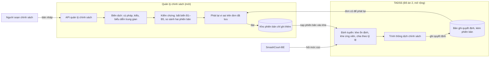
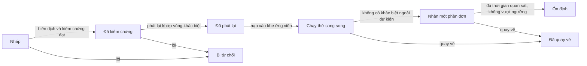

| ĐẠI HỌC QUỐC GIA TP. HỒ CHÍ MINH<br>TRƯỜNG ĐẠI HỌC<br>CÔNG NGHỆ THÔNG TIN | CỘNG HÒA XÃ HỘI CHỦ NGHĨA VIỆT NAM<br>Độc lập - Tự do - Hạnh phúc |
| :---: | :---: |


# ĐỀ CƯƠNG KHÓA LUẬN TỐT NGHIỆP

> Bản thảo ngày 23/11/2026, chưa nộp. Đề cương này thay hướng "đặt cọc thích ứng theo rủi ro" của các bản trước (lý do ở Mục 1.4; bản cũ lưu ở [PROPOSAL_KHOA_LUAN_COC_THICH_UNG.md](PROPOSAL_KHOA_LUAN_COC_THICH_UNG.md)). Các ngưỡng có ghi "chốt ở Mốc 1" được chốt trên bộ lỗi dò trước khi chạy bộ lỗi niêm phong, và không đổi sau đó (Mục 8). Mục 12 liệt kê các việc nhóm còn phải quyết; mục này sẽ bỏ khỏi bản nộp. Đề cương tiếp nối [đề cương Đồ án 2](PROPOSAL_DO_AN_2.md).

**TÊN TIẾNG VIỆT:** Thiết kế và đánh giá cơ chế quản lý thay đổi an toàn cho chính sách quyết định nghiệp vụ trong hệ thống ra quyết định.

**TÊN TIẾNG ANH:** Design and Evaluation of a Safe Change Management Mechanism for Business Decision Policies in Decision Systems.

**Thời gian thực hiện:** 14 tuần, trong khung 3–4 tháng của học kỳ kế tiếp sau Đồ án 2

**Sinh viên thực hiện:**

- Nguyễn Thành Trung – 23521683
- Đoàn Quốc Tuấn – 23521709

**Nội dung đề tài:**

## Tóm tắt đề tài

**Bài toán.** Hệ thống ra quyết định của Đồ án 2 (TADSS) trả lời cho phần mềm đặt sân SmashCourt câu hỏi "đơn này cọc bao nhiêu, có cần người duyệt không". Câu trả lời do một bộ luật nghiệp vụ quyết định, và bộ luật đó đổi liên tục: thêm bước giảm cọc giờ thấp điểm, đổi ngưỡng duyệt đơn lớn, thêm hạng khách. Hiện nay mỗi lần đổi luật là một lần sửa mã C#, chạy test, build image, triển khai lại. Một thay đổi sai đi qua được các bước đó sẽ áp lên **mọi** đơn ngay khi bản mới chạy, và chỉ quay về được bằng cách triển khai lại image cũ.

**Vì sao đây là vấn đề thật.** Thay đổi cấu hình và luật là một nguồn sự cố lớn của hệ thống phần mềm. Ở Facebook, 16 % sự cố tác động cao trong ba tháng liên quan tới cấu hình (Tang và cộng sự, 2015) [15]. Trong 546 lỗi cấu hình thật được nghiên cứu, 70 tới 85 % là do đặt sai tham số (Yin và cộng sự, 2011) [20]. Hai sự cố lớn gần đây đều bắt đầu từ một thay đổi nội dung hay luật được đẩy ra toàn bộ cùng lúc: CrowdStrike tháng 7/2024 (bộ kiểm chờ 21 trường dữ liệu trong khi trình thông dịch chỉ nhận 20) [22], Cloudflare tháng 7/2019 (một luật lọc dùng biểu thức chính quy không giới hạn thời gian chạy, làm cạn CPU toàn cầu khoảng 27 phút) [23]. Ngay trong TADSS, lần thử cấu hình sai ngày 20/11/2026 cho thấy bộ triển khai chỉ quay về được image, không quay về được cấu hình (Mục 1.2).

**Đề tài làm gì.** Đề tài thiết kế, xây dựng trên TADSS và đánh giá một cơ chế cho phép đổi luật quyết định khi hệ thống đang chạy mà vẫn kiểm soát được tính đúng và phạm vi ảnh hưởng. Cơ chế có ba phần:

1. **Một ngôn ngữ chính sách nhỏ, có ngữ nghĩa xác định.** Luật được viết, lưu và quản lý như dữ liệu có phiên bản, không còn là mã C#. Cùng một bản mô tả ngữ nghĩa được dùng cho cả bộ kiểm lẫn bộ thực thi, để không lặp lại lỗi kiểu CrowdStrike.
2. **Kiểm chứng tĩnh trước khi kích hoạt.** Kiểm kiểu và miền giá trị; chứng minh các bất biến nghiệp vụ trên toàn bộ miền đầu vào (mức cọc trong 0 tới 100 %, hạng tốt hơn không bao giờ cọc cao hơn, mọi đầu vào hợp lệ đều có quyết định); và **so sánh ngữ nghĩa hai phiên bản**: bản mới đổi quyết định ở vùng đầu vào nào, đổi mức cọc nhiều nhất bao nhiêu.
3. **Vòng đời phiên bản có giới hạn ảnh hưởng.** Bản mới đi qua: kiểm chứng, phát lại trên các đơn cũ đã lưu, chạy thử song song, nhận một phần đơn (ưu tiên đúng vùng khác biệt), rồi mới nhận toàn bộ. Bản ổn định luôn được giữ để quay về bằng một lệnh. Mỗi đơn chỉ được đánh giá bằng đúng một phiên bản, và phiên bản đó được ghi lại.

**Giả thuyết duy nhất đề tài kiểm.** Cơ chế trên phát hiện được thay đổi sai **trước khi** nó phục vụ toàn bộ đơn, và giới hạn được số quyết định bị ảnh hưởng khi lỗi vẫn lọt qua, tốt hơn quy trình hiện nay (sửa mã, test, triển khai) và tốt hơn quy trình hiện nay cộng chia đơn tiến dần. Mỗi lớp của cơ chế phải chứng minh được phần đóng góp riêng của nó, đo bằng thí nghiệm bỏ dần từng lớp. Kỹ thuật nào không đóng góp vào giả thuyết thì bị loại.

**Phần là của đề tài.** Từng mảnh riêng lẻ đã có: ngôn ngữ chính sách phân tích được (Cedar của AWS [1]), so sánh hai phiên bản chính sách phân quyền (Margrave [5], Zelkova [3]), kiểm chứng bảng quyết định (Calvanese và cộng sự [7]), triển khai cấu hình theo pha (Facebook [15], Google [16]). Nhóm chưa thấy công trình nào ghép chúng cho **quyết định nghiệp vụ có đầu ra là số tiền**. Phần của đề tài vì vậy là: so sánh ngữ nghĩa hai phiên bản khi đầu ra là mức cọc, không chỉ "cho hay không cho"; dùng vùng khác biệt tính tĩnh để giới hạn và nhắm phạm vi triển khai; và một đánh giá có đối chứng bằng bộ lỗi chốt trước, so với quy trình hiện tại ở dạng tốt nhất của nó (Mục 2.5).

**Đã thử trước.** Một bản thăm dò viết bằng C# đã dịch bộ luật 2.2.0 đang chạy sang ngôn ngữ chính sách: 23 dòng, khớp tuyệt đối với bản DLL thật trên 1.000.000 đơn ngẫu nhiên, mỗi quyết định khoảng 1 µs. Trên 283 thay đổi sai sinh bằng đột biến, bất biến chung chỉ bắt 53; cộng tính chất nghiệp vụ và phát lại 10.000 đơn thì còn lọt 3; so sánh hai phiên bản bằng Z3 không bỏ sót thay đổi nào nhưng gắn cờ cả những thay đổi có chủ ý (Mục 1.5). Chỗ khó còn lại, phân biệt hồi quy ngoài ý định với thay đổi có chủ ý, là phần việc chính của khóa luận.

**Giới hạn nói trước.** Đề tài không cần dữ liệu khách thật: mọi bằng chứng tạo được trong phòng thí nghiệm, trên hệ thống thật, với bộ lỗi và luồng đơn được mô tả công khai. Đổi lại, kết luận chỉ đúng cho các lớp lỗi đã mô hình hóa (Mục 8, Mục 10). Đề tài không khẳng định cơ chế này ngăn được những sự cố như CrowdStrike hay Cloudflare; các sự cố đó chỉ minh họa rằng rủi ro là có thật.

## Thuật ngữ dùng trong đề cương

| Thuật ngữ | Nghĩa |
| :--- | :--- |
| Chính sách quyết định | Bộ luật cho mỗi đơn một quyết định: chấp nhận kèm mức cọc, chờ duyệt, hoặc từ chối |
| Phiên bản chính sách | Một bản cụ thể của chính sách, có mã băm nội dung, không sửa được sau khi lưu |
| Ngôn ngữ chính sách (DSL) | Ngôn ngữ nhỏ, chuyên cho chính sách quyết định: danh sách luật có thứ tự "khi điều kiện thì kết quả", số học nguyên tuyến tính, không có vòng lặp |
| Ngữ nghĩa xác định | Với cùng đầu vào và cùng phiên bản, kết quả luôn như nhau, và được định nghĩa chính xác bằng văn bản |
| Bất biến | Tính chất phải đúng với **mọi** đầu vào hợp lệ, ví dụ "mức cọc luôn trong 0 tới 100 %" |
| Kiểm chứng tĩnh | Kiểm chính sách trước khi chạy, trên toàn bộ miền đầu vào, không cần dữ liệu đơn thật |
| Miền đầu vào | Tập mọi đầu vào hợp lệ: hạng khách, giá đơn, số phút đặt trước, giờ bắt đầu, số lần không đến, số lần hết hạn thanh toán |
| Vùng khác biệt | Tập đầu vào mà hai phiên bản cho quyết định khác nhau |
| Phạm vi khai báo | Vùng đầu vào mà một yêu cầu thay đổi được phép đổi quyết định, do người yêu cầu khai báo cùng thay đổi |
| Phát lại | Chạy lại các đơn đã lưu qua một phiên bản, không ảnh hưởng đơn thật, để xem quyết định đổi ở đâu |
| Chạy thử song song (shadow) | Bản mới tính trên đơn thật nhưng không dùng kết quả của nó; có sẵn từ Đồ án 2 |
| Chia đơn tiến dần (canary) | Bản mới nhận một phần nhỏ đơn thật trước khi nhận toàn bộ |
| Quay về | Chuyển lại phiên bản ổn định gần nhất |
| Quyết định bị ảnh hưởng | Quyết định đã trả cho phần mềm đặt sân bởi một phiên bản sai, và khác quyết định đúng ở trạng thái hoặc mức cọc (định nghĩa chính xác ở Mục 2.4) |
| Bộ lỗi | Tập các thay đổi sai có phân loại và có đáp án đúng, dùng để đánh giá (Mục 8) |
| Đột biến | Cách sinh thay đổi sai bằng cách sửa nhỏ một chính sách đúng: đổi toán tử, đổi hằng số, đổi thứ tự luật, xóa luật |
| Đáp án chuẩn (oracle) | Quyết định đúng cho mỗi đầu vào, lấy từ một bản tham chiếu viết độc lập, không lấy từ bộ kiểm của chính cơ chế |
| SMT | Bộ giải logic tự động (ở đây là Z3 [25]) trả lời câu hỏi "có tồn tại đầu vào nào thỏa điều kiện này không" |
| Khe phiên bản | Hai vị trí cố định trong bảng định tuyến: "ổn định" và "ứng viên"; phiên bản được nạp vào khe |
| TADSS, nền tảng quyết định | Hệ thống của Đồ án 2. SmashCourt hỏi nó "đơn này cọc bao nhiêu" và nhận câu trả lời |
| Chiến lược | Bộ luật bên trong TADSS. Hiện nay là `DefaultDecisionStrategy` 2.2.0, viết bằng C# |
| Bản giao tiếp v2 | Hợp đồng giữa SmashCourt và TADSS, đã đóng băng; đề tài không đổi nó |
| RQ, M, KL | RQ1–RQ4 là câu hỏi nghiên cứu (Mục 2.3), M1–M6 là mục tiêu (Mục 3), KL1–KL7 là cam kết có ngưỡng đo (Mục 7) |
| Số trong ngoặc vuông | Ví dụ [15]: trỏ tới nguồn số 15 ở Mục 13. Nội dung chính của nguồn được nêu ngay tại chỗ dẫn |

## 1. Lý do chọn đề tài

### 1.1. Thay đổi luật và cấu hình là một nguồn sự cố lớn

- **Ở quy mô công nghiệp.** Tang và cộng sự (SOSP 2015) mô tả cách Facebook quản lý cấu hình như mã nguồn, với năm lớp phòng: bộ kiểm bất biến lúc biên dịch, duyệt mã, thử tay, chạy thử trong môi trường cách ly, và triển khai theo pha có tiêu chí đạt hay trượt. Dù vậy, trong ba tháng, 16 % sự cố tác động cao vẫn liên quan tới cấu hình; 42 % trong số đó là lỗi thông thường (gõ sai, ngoài miền), 36 % là lỗi tinh vi (tải, hiệu ứng dây chuyền), 22 % là thay đổi hợp lệ làm lộ lỗi trong mã. Bài cũng ghi có trường hợp kỹ sư bỏ qua kết luận của bước triển khai thử và gây sự cố [15].
- **Ở mức nghiên cứu thực nghiệm.** Yin và cộng sự (SOSP 2011) phân tích 546 lỗi cấu hình thật: 70 tới 85,5 % do đặt sai tham số; trong số đó, 38,1 tới 53,7 % là giá trị bất hợp lệ rõ ràng, tức là bắt được bằng kiểm tĩnh; 12,2 tới 29,7 % do mâu thuẫn giữa các tham số [20].
- **Hai sự cố lớn, chỉ để minh họa rủi ro.** Báo cáo nguyên nhân của CrowdStrike (06/08/2024): định nghĩa dữ liệu khai báo 21 trường nhưng trình thông dịch chỉ nhận 20; bộ kiểm nội dung có lỗi logic; 12 ca thử đều dùng ký tự đại diện ở trường thứ 21; nội dung được đẩy ra một lần, không theo vòng. Biện pháp khắc phục gồm thêm kiểm trong bộ kiểm, kiểm biên lúc chạy, và triển khai theo vòng có thời gian quan sát và quay về [22]. Báo cáo của Cloudflare (02/07/2019): một biểu thức chính quy trong luật lọc gây quay lui không giới hạn, làm cạn CPU toàn cầu khoảng 27 phút; luật lọc được đẩy toàn cầu một lần, bỏ qua bước thử; test chỉ kiểm chặn hay cho qua, không đo CPU [23]. Hai sự cố có nguyên nhân và bối cảnh khác nhau, và khác bài toán của đề tài; chúng không phải bằng chứng rằng cơ chế của đề tài ngăn được chúng.

### 1.2. Ngay trong TADSS: đổi luật là một lần triển khai

Chiến lược mặc định của TADSS đã đổi ba lần sau Đồ án 2 giai đoạn đầu: 2.0.0, rồi 2.1.0 (thêm luật từ chối khách nhiều lần giữ chỗ không thanh toán), rồi 2.2.0 ngày 16/11/2026 (thêm bước giảm cọc giờ thấp điểm, quyết định P6-59). Mỗi lần là một lần:

| Bước | Hiện nay | Ai làm |
| :--- | :--- | :--- |
| 1. Viết luật | Sửa `DefaultDecisionStrategy.cs` (147 dòng) và `DefaultStrategyOptions.cs` (169 dòng) | Lập trình viên |
| 2. Kiểm | Viết thêm unit test; build với cảnh báo là lỗi; chạy bộ kiểm thử | Lập trình viên, CI |
| 3. Đóng gói | Build image mới, đẩy lên kho image | CI |
| 4. Triển khai | `deploy/cd.sh` thay container trên máy chủ | Người vận hành |
| 5. Nếu sai | Triển khai lại image cũ | Người vận hành |

Bốn điểm yếu của quy trình này, đều đo được trên chính hệ thống:

1. **Người hiểu luật không tự đổi được luật.** Chủ sân muốn đổi một ngưỡng thì phải nhờ lập trình viên sửa mã.
2. **Không có gì chứng minh luật mới đúng trên mọi đầu vào.** Test chỉ thử một số ca. Phương thức `Validate()` của tham số chỉ kiểm hình thức, ví dụ thứ tự mức cọc giữa các hạng.
3. **Bản mới áp lên toàn bộ đơn ngay khi chạy.** Định tuyến của TADSS chỉ chia theo năm điều kiện cố định (giờ cao điểm, chi nhánh, kênh, hạng, khách vãng lai), không chia theo tỷ lệ; chạy thử song song chỉ có một ứng viên cố định lúc khởi động và lấy mẫu ngẫu nhiên.
4. **Quay về chỉ quay về image, không quay về cấu hình.** Trong lần thử cấu hình sai ngày 20/11/2026, quay về từ bản 2.1.0 được, nhưng từ bản 2.2.x thì bộ triển khai báo trạng thái không an toàn; trong lúc TADSS không chạy, SmashCourt thu cọc 100 % mọi đơn ([đặc tả Phase 6](../../spec/PHASE6_DESIGN_SPEC.md), quyết định P6-59).

Điểm yếu thứ 4 là một sự cố thật, dù nhỏ, trên chính hệ thống của nhóm. Thời gian của từng bước trong bảng trên sẽ được đo lại ở tuần 1 để làm mốc so sánh.

### 1.3. Đã có gì trong ngành và trong nghiên cứu, và khoảng trống

| Hướng | Đã có | Còn thiếu so với bài toán |
| :--- | :--- | :--- |
| Ngôn ngữ chính sách phân tích được | Cedar (AWS): ngôn ngữ phân quyền có bộ kiểm kiểu, dịch được sang SMT, ngữ nghĩa lõi được chứng minh bằng Lean; công cụ phân tích của AWS kiểm một bản sửa "không thêm quyền" so với bản cũ ngay lúc soạn [1], [2], [4] | Đầu ra chỉ là cho hay không cho; không có vòng đời triển khai |
| So sánh hai phiên bản chính sách | Margrave (2005) phân tích ảnh hưởng của thay đổi giữa hai phiên bản chính sách XACML và sinh yêu cầu làm phản ví dụ [5]; Zelkova (2018) so hành vi hai chính sách AWS bằng SMT [3]; Turkmen và cộng sự (2015) phân tích chính sách XACML bằng SMT [6] | Cũng chỉ cho hay không cho; không có đầu ra số; không có bước chạy thật |
| Bảng quyết định nghiệp vụ | Chuẩn DMN của OMG [9]; Calvanese và cộng sự (2016) phát hiện luật chồng lấn và luật thiếu trong một bảng DMN bằng hình học [7]; Batoulis và Weske (2018) đổi bảng có luật chồng lấn thành bảng tương đương [8] | Chỉ một phiên bản; nhóm không tìm thấy công trình học thuật nào so tương đương hai phiên bản bảng DMN |
| Kiểm thử chính sách | Martin và Xie (2007): toán tử đột biến cho chính sách và cách đo tỷ lệ bị bắt [10], sinh test từ khác biệt giữa hai phiên bản [11] | Chưa có lớp triển khai |
| Triển khai thay đổi an toàn | Facebook triển khai cấu hình theo pha [15], bật tắt tính năng không cần triển khai lại [19]; Google phân tích triển khai thử so với nhóm đối chứng [16]; Netflix kiểm định tuần tự khi theo dõi triển khai thử [17]; Azure tương quan tín hiệu lỗi với từng đợt triển khai [18] | Bộ kiểm viết tay; không có so sánh ngữ nghĩa hai phiên bản |
| Phần mềm quản lý luật nghiệp vụ thương mại | Có phiên bản, chạy lại giao dịch cũ, chạy song song hai phiên bản [24] | Không công bố bảo đảm hay đánh giá |

**Khoảng trống.** Chưa thấy công trình nào ghép ba thứ cho quyết định nghiệp vụ có đầu ra là số tiền: một ngôn ngữ có ngữ nghĩa dùng chung cho kiểm và chạy; so sánh ngữ nghĩa hai phiên bản trả về vùng khác biệt và độ lệch số tiền; và dùng chính vùng khác biệt đó để giới hạn phạm vi triển khai, có đánh giá đối chứng. Nhận định này lấy từ một lượt tra cứu có ghi lại nguồn (Mục 13); tuần 1 nhóm làm lại có phương pháp.

### 1.4. Các hướng đã cân nhắc, và vì sao chọn hướng này

Nhóm đã viết và rà soát kỹ một hướng khác trước khi chọn hướng này.

| Hướng | Điểm mạnh | Vì sao không chọn |
| :--- | :--- | :--- |
| A. Đặt cọc thích ứng theo rủi ro: một lớp tự điều chỉnh mức cọc giữ phần tiền có thể mất trong một hạn mức, có chứng minh | Có bổ đề chứng minh đầy đủ, có phép thử chạy lại được trên dữ liệu khách sạn và phòng khám | Không có dữ liệu sân thật nên lợi ích kinh doanh chỉ là giả thuyết; phần lý thuyết là mở rộng nhỏ của công trình đã có [26]; ở lượng đơn của một sân, bảo đảm chỉ có nghĩa theo năm. Sau ba vòng phản biện, ước tính trần khoảng 7 trên 10 |
| B. Quản lý thay đổi an toàn cho chính sách quyết định (đề tài này) | Bằng chứng tạo được hoàn toàn trong phòng thí nghiệm; vấn đề có thật trong ngành và ngay trong TADSS; dùng đúng các thế mạnh của Đồ án 2 | Phạm vi lớn; tính mới nằm ở cách ghép và cách đánh giá (Mục 10) |
| C. Hạ tầng thuần: hàng đợi thông điệp, kho dữ liệu nhanh, nhiều vùng | Nhiều công nghệ | Ở lượng đơn của SmashCourt (khoảng 58 đơn mỗi ngày), hệ thống hiện có đã thấp hơn năng lực đo được hàng nghìn lần; hội đồng sẽ hỏi "vì sao cần", và không có câu trả lời tốt |

**Giá trị cho người làm phần mềm.** Hướng B buộc nhóm đụng vào những vấn đề có thật ở mức hệ thống: thiết kế và cài đặt một ngôn ngữ (bộ phân tích cú pháp, kiểm kiểu, biểu diễn trung gian, trình thông dịch có giới hạn bước); phân tích tĩnh và kiểm chứng hình thức; đổi logic khi hệ thống đang chạy trên nhiều bản chạy cùng lúc mà vẫn nhất quán; phát lại tất định hàng trăm nghìn quyết định; chia lưu lượng bằng hàm băm ổn định; quay về khi đang chịu tải và khi một thành phần hỏng; đo chi phí hiệu năng của từng lớp. Đây là loại việc của kỹ sư nền tảng (platform) và kỹ sư backend ở các hệ thống lớn, và mỗi phần có số đo để chứng minh.

### 1.5. Đã thử trước: một bản thăm dò

Trước khi cam kết, nhóm viết một bản thăm dò bằng C# .NET 8, ngoài repo, để trả lời bốn câu hỏi khả thi. Chi tiết ở Phụ lục A.

| Câu hỏi | Kết quả | Đọc thế nào |
| :--- | :--- | :--- |
| Ngôn ngữ chính sách có biểu diễn được luật thật không? | Luật 2.2.0 (cùng cấu hình của bản deploy) viết lại thành 23 dòng, so với 147 + 169 dòng C#. Chạy 1.000.000 đầu vào ngẫu nhiên, 20 % dồn sát các ngưỡng, qua cả trình thông dịch lẫn chính bản DLL đang chạy của TADSS: lệch 0. Mỗi quyết định mất 0,2 µs ở trung vị, 1,1 µs ở p99 | Được, nhưng phải thêm ba thuộc tính so với dự kiến (khách vãng lai, thứ trong tuần, số lần hoàn tất), và luật thật có **so sánh giữa hai thuộc tính** ("số lần hết hạn thanh toán > số lần hoàn tất") |
| Kiểm bất biến bằng cách nào? | Trên 9 lỗi cài tay: Z3 bắt cả 9, mỗi bản mất 0,5 tới 1,0 giây, phản ví dụ nằm đúng ngưỡng, và **chứng minh** khi không có lỗi. Liệt kê một lưới 9 triệu điểm mất 7 tới 10 giây và bỏ sót 1 lỗi ở biên. Thử ngẫu nhiên 1.000 đầu vào bỏ sót 2 lỗi ở biên; 10.000 đầu vào bắt đủ nhưng không chứng minh được gì | Z3 là bộ kiểm chính; thử ngẫu nhiên và phát lại là lớp kiểm chéo |
| So sánh hai phiên bản có làm được không? | Z3 tìm ra mọi khác biệt trong 23 tới 44 ms và chứng minh được một lần tái cấu trúc là tương đương. Phát lại 215 đơn bỏ sót khác biệt ở vùng hẹp (một thay đổi chỉ thấy ở 2 trên 20 tập đơn, một thay đổi không bao giờ thấy), nhưng cho cỡ ảnh hưởng (4,6 % đơn đổi quyết định khi đi từ 2.1.0 lên 2.2.0) | Hai cách bổ sung nhau: Z3 trả lời "có khác không, ở đâu", phát lại trả lời "bao nhiêu đơn" |
| Mỗi lớp bắt được bao nhiêu lỗi? | 316 đột biến của luật 2.2.0, trong đó 33 tương đương. Trên 283 đột biến còn lại: bất biến chung chỉ bắt 53; thêm 8 tính chất nghiệp vụ thì còn lọt 46; thêm phát lại 10.000 đơn thì còn lọt 3, cả ba là lệch biên một đơn vị. So sánh bằng Z3 không bỏ sót đột biến nào, nhưng cũng gắn cờ mọi thay đổi có chủ ý | Phần khó nhất là phân biệt hồi quy ngoài ý định với thay đổi có chủ ý (43 đột biến); đây đúng là chỗ "phạm vi khai báo" của đề tài phải chứng minh giá trị |

**Điều rút ra.** Năm điều. (1) Ngôn ngữ chính sách và trình thông dịch làm được, khớp tuyệt đối với mã thật, và chi phí độ trễ không đáng kể. (2) Vì luật thật có so sánh giữa các thuộc tính, cách liệt kê theo lưới không đủ; Z3 phải là bộ kiểm chính. Bộ dịch sang Z3 phải được giữ cho khớp trình thông dịch: bản thăm dò đã gặp một chỗ lệch ngữ nghĩa (Z3 dùng số nguyên không giới hạn, trình thông dịch dùng số nguyên 64 bit), nên kiểm tràn số và giới hạn bước phải là lớp riêng. (3) Bất biến chung bắt được ít; phần lớn sức bắt đến từ tính chất nghiệp vụ do doanh nghiệp khai báo. Ở bản thăm dò, bộ tính chất đó gần như viết lại chính sách; ngoài đời nó sẽ thiếu, nên đề tài phải đo cả trường hợp tính chất thiếu. (4) Vòng đời phiên bản làm được: đổi phiên bản 2.000 lần dưới tải không làm quyết định nào lẫn giữa hai bản, nhưng ngay ở bản nhỏ đã lộ hai lỗi đồng thời thật (Phụ lục A.5), nên phần vòng đời trên nhiều bản chạy là một bài toán hệ thống thật, không phải phần phụ. (5) Không cổng tự động nào trong bản thăm dò phân biệt được hồi quy ngoài ý định với thay đổi có chủ ý. Cơ chế "phạm vi khai báo" ở Mục 2.4 là lời giải đề tài đề xuất cho chỗ này, và chưa được thử: đó là phần việc chính của khóa luận, không phải điều đã chứng minh.

## 2. Bài toán

### 2.1. Phát biểu bằng lời

> Cho một hệ thống ra quyết định đang phục vụ đơn thật, với một chính sách quyết định đổi theo yêu cầu nghiệp vụ. Hãy thiết kế một cơ chế cho phép đổi chính sách khi hệ thống đang chạy, sao cho phần lớn thay đổi sai bị chặn trước khi phục vụ đơn thật; thay đổi sai còn lọt qua chỉ ảnh hưởng một số quyết định có giới hạn tính trước được; và luôn quay về được phiên bản ổn định. Đánh giá cơ chế bằng một bộ lỗi chốt trước, so với quy trình hiện có ở dạng tốt nhất của nó.

### 2.2. Thay đổi sai có những loại nào, và lớp nào nên bắt

Phân loại dựa trên các nhóm lỗi cấu hình của Yin và cộng sự [20] và Tang và cộng sự [15], cụ thể hóa cho chính sách cọc:

| Nhóm | Ví dụ trên luật cọc | Lớp nên bắt |
| :--- | :--- | :--- |
| F1. Cú pháp, kiểu | Gõ sai tên trường; so sánh tiền với hạng; giá trị hạng không tồn tại | Bộ phân tích cú pháp, kiểm kiểu |
| F2. Vi phạm bất biến | Mức cọc 120 %; hạng vàng cọc cao hơn hạng bạc trong cùng điều kiện; có đầu vào không nhận quyết định nào; có luật không bao giờ được chọn | Kiểm chứng tĩnh |
| F3. Sai nghiệp vụ | Giảm cọc cho hạng vàng thay vì hạng bạc; "≥" viết thành ">"; 7 giờ thay cho 17 giờ | So với ví dụ chấp nhận do người yêu cầu thay đổi viết trước |
| F4. Hồi quy ngoài ý định | Luật mới đặt trước luật "duyệt đơn lớn" nên đơn từ 2 triệu đồng không còn phải duyệt | So sánh ngữ nghĩa hai phiên bản: phần khác biệt nằm ngoài phạm vi thay đổi đã khai báo |
| F5. Lỗi khi chạy | Một hạng không có nhánh nào; lịch sử khách rỗng; đánh giá quá lâu | Kiểm tĩnh tính đầy đủ; giới hạn số bước lúc chạy |
| F6. Chỉ lộ khi nhận đơn thật | Đúng ngày lễ; giá bằng đúng ngưỡng; chi nhánh mới mở | Phát lại trên đơn cũ, chạy thử song song, chia đơn tiến dần |

Bảng này đồng thời là lý do mỗi lớp của cơ chế phải tồn tại: bỏ một lớp thì có một nhóm lỗi không còn ai bắt. Thí nghiệm ở Mục 8 đo đúng điều đó.

### 2.3. Câu hỏi nghiên cứu

| Mã | Câu hỏi | Trả lời bằng | Cam kết |
| :--- | :--- | :--- | :--- |
| RQ1 (trung tâm) | Cơ chế chặn được bao nhiêu phần trăm thay đổi sai của từng nhóm trước khi phục vụ toàn bộ đơn, và mỗi lớp đóng góp bao nhiêu, so với quy trình hiện có? | Thí nghiệm bỏ dần từng lớp trên bộ lỗi niêm phong | KL1, KL3 |
| RQ2 | So sánh ngữ nghĩa hai phiên bản có tính đúng vùng khác biệt và độ lệch mức cọc không, và có báo động nhầm khi thay đổi là đúng không? | So với đáp án vét cạn; bộ thay đổi đúng | KL2, KL4 |
| RQ3 | Khi một thay đổi sai lọt tới bước nhận đơn thật, bao nhiêu quyết định bị ảnh hưởng, ở lưu lượng như sân và như tải kiểm thử, và quay về mất bao lâu? | Luồng đơn tổng hợp, phát lại, đo dưới tải | KL5 |
| RQ4 | Cơ chế tốn bao nhiêu (độ trễ mỗi quyết định, thời gian kiểm chứng) và có giữ được các bảo đảm của Đồ án 2 không? | Đo sức chịu, cố ý gây lỗi, dựng lại quyết định | KL6, KL7 |

### 2.4. Phát biểu chính xác (dành cho người đọc kỹ thuật)

**Mô hình chính sách.** Miền đầu vào X là tích của các thuộc tính rời rạc (hạng, cờ khách vãng lai, giờ cao điểm hay thấp điểm, chi nhánh) và các số nguyên bị chặn (giá đơn theo đồng, số phút đặt trước, số lần không đến, số lần hết hạn thanh toán, số lần hoàn tất). Đầu ra là một cặp (trạng thái, mức cọc), với trạng thái thuộc {chấp nhận, chờ duyệt, từ chối}: đúng ba kết quả mà bản giao tiếp v2 cho phép. Một chính sách P là danh sách luật có thứ tự (cᵢ, oᵢ): điều kiện cᵢ là tổ hợp and, or, not của các so sánh giữa hai biểu thức nguyên tuyến tính (cộng, trừ, nhân với hằng số) trên các thuộc tính, kết quả oᵢ là một trạng thái kèm một mức cọc tính bằng biểu thức cùng loại. Ngữ nghĩa là "luật khớp đầu tiên thắng"; chính sách phải có luật mặc định cuối cùng.

**Vì sao dùng bộ giải SMT.** Luật thật của TADSS có so sánh giữa hai thuộc tính ("số lần hết hạn thanh toán lớn hơn số lần hoàn tất"), nên không thể chia miền theo hằng số của từng thuộc tính rồi liệt kê. Nhưng mọi điều kiện và mọi mức cọc vẫn là biểu thức nguyên tuyến tính trên miền bị chặn, nên mọi câu hỏi dưới đây là bài toán số học nguyên tuyến tính, giải được hoàn toàn bằng bộ giải SMT [6], [25]. Bộ giải trả lời "có tồn tại đầu vào vi phạm không": nếu có thì cho phản ví dụ, nếu không thì đó là một chứng minh trên toàn miền. Bản thăm dò cho thấy liệt kê theo lưới bỏ sót lỗi ở biên và thử ngẫu nhiên không chứng minh được gì (Mục 1.5). Bộ dịch sang SMT phải khớp trình thông dịch; chỗ có thể lệch (tràn số nguyên 64 bit, số bước) được kiểm bằng lớp riêng, và mọi phản ví dụ được chạy lại trên trình thông dịch để xác nhận.

**Bất biến.** Với mọi x ∈ X:

```text
B1  0 ≤ cọc(P, x) ≤ 100 %
B2  nếu x và x′ chỉ khác ở hạng, và hạng(x) tốt hơn hạng(x′), thì cọc(P, x) ≤ cọc(P, x′)
B3  có ít nhất một luật khớp x                       (đầy đủ)
B4  với mỗi luật i có tồn tại x mà luật i là luật khớp đầu tiên     (không có luật chết)
B5  các bất biến nghiệp vụ do doanh nghiệp khai báo, ví dụ "đơn từ 2.000.000 đ luôn cần duyệt"
```

**So sánh ngữ nghĩa hai phiên bản.** Với hai phiên bản P và P′, vùng khác biệt và độ lệch lớn nhất là (Δ tìm bằng một truy vấn SMT trên hai bản dịch dùng chung biến; δ_max bằng bộ tối ưu của Z3, chưa thử ở bản thăm dò):

```text
Δ(P, P′)  = { x ∈ X : quyết định(P, x) ≠ quyết định(P′, x) }
δ_max     = max_{x ∈ Δ} | cọc(P′, x) − cọc(P, x) |
```

Mỗi yêu cầu thay đổi khai báo **phạm vi được phép** S, viết bằng chính ngôn ngữ điều kiện (ví dụ "chỉ đơn của hạng bạc vào giờ thấp điểm"), và tùy chọn một trần độ lệch. Đây là cách đề tài đề xuất để phân biệt hồi quy ngoài ý định với thay đổi có chủ ý, chỗ mà bản thăm dò cho thấy không cổng tự động nào làm được (Mục 1.5). Thay đổi bị chặn nếu Δ ⊄ S (hồi quy ngoài ý định, nhóm F4) hoặc δ_max vượt trần. Khi bị chặn, hệ thống trả về một phản ví dụ cụ thể: một đơn x và hai quyết định khác nhau.

**Số quyết định bị ảnh hưởng.** Gọi P\* là phiên bản đúng của yêu cầu thay đổi, viết độc lập để làm đáp án. Quyết định thứ i bị ảnh hưởng khi nó được trả cho phần mềm đặt sân bởi một phiên bản sai P′ (hoặc bởi đường lùi do P′ gây ra), và khác quyết định của P\* ở trạng thái hoặc ở mức cọc. Quyết định của bản chạy thử song song không tính. Đếm từ lúc P′ nhận đơn đầu tiên tới khi lệnh quay về có hiệu lực ở mọi bản chạy.

**Một cận đơn giản, và hai hệ quả.** Gọi f là tỷ lệ đơn chia cho bản mới, λ là số đơn mỗi giây, p là phần đơn rơi vào vùng lỗi, T_d là thời gian phát hiện, T_r là thời gian quay về. Số quyết định bị ảnh hưởng khoảng f·λ·p·(T_d + T_r). Nếu bộ giám sát cần thấy k quyết định sai mới báo, thì T_d ≈ k / (f·λ·p), nên số bị ảnh hưởng khoảng k + f·λ·p·T_r. Hai hệ quả:

1. **Giảm tỷ lệ chia không giảm số quyết định sai**, chỉ làm phát hiện chậm hơn. Chia đơn tiến dần chỉ có lợi khi kèm thời gian quan sát cố định hoặc so với nhóm đối chứng.
2. **Ở lượng đơn của một sân, chia đơn tiến dần gần như không bắt được lỗi vùng hiếm.** Với 20 đơn mỗi ngày, f = 10 % và p = 5 %, mỗi ngày chỉ có khoảng 0,1 quyết định sai; lỗi phải nhiều tuần mới lộ. Ở tải kiểm thử 20 yêu cầu mỗi giây, cùng lỗi lộ trong vài chục giây. Vì vậy ở quy mô sân, phần chặn chính phải là **kiểm chứng tĩnh và phát lại trước khi bật**; một lỗi bị chặn ở hai lớp này gây 0 quyết định bị ảnh hưởng. Chia đơn tiến dần là lưới an toàn cuối cho lỗi nhóm F6 và cho lưu lượng lớn. Đề tài báo cáo cả hai quy mô, không suy từ tải kiểm thử ra sân.

**Vì sao chính sách tất định làm việc so sánh đơn giản hơn.** Cùng đầu vào thì cùng quyết định, và bản ghi của TADSS lưu đủ câu hỏi gốc. Phát lại một đơn qua hai phiên bản vì vậy cho khác biệt **chính xác**, không cần thống kê. Thống kê chỉ cần khi so theo kết cục thật của khách (khách có đến không), là thứ không có ở đây; đó là lý do kiểm định tuần tự [17] nằm ở phần mở rộng.

### 2.5. Cái đã có và phần của đề tài

| Thành phần | Đã có | Phần của đề tài |
| :--- | :--- | :--- |
| Ngôn ngữ chính sách phân tích được | Cedar cho phân quyền [1]; chuẩn DMN cho bảng quyết định [9] | Một ngôn ngữ nhỏ cho quyết định có đầu ra số tiền, khớp đúng ba kết quả của bản giao tiếp v2; một ngữ nghĩa dùng chung cho kiểm và chạy, có kiểm vi sai giữa bộ thực thi và mô hình như cách làm Cedar [2] |
| Kiểm chứng một chính sách | Kiểm luật chồng lấn, luật thiếu của bảng DMN [7]; bộ kiểm kiểu của Cedar [1] | Bộ bất biến B1–B5 cho quyết định cọc, có phản ví dụ |
| So sánh hai phiên bản | Margrave [5], Zelkova [3], công cụ phân tích của AWS [4]: đầu ra cho hay không cho | So sánh có đầu ra số: vùng khác biệt Δ, độ lệch δ_max, kiểm theo phạm vi khai báo S |
| Triển khai tiến dần | Facebook [15], Google [16], Azure [18], Netflix [17] | Dùng vùng khác biệt tính tĩnh để chọn đơn nào đi qua bản mới, và tính trước số quyết định có thể bị ảnh hưởng |
| Đánh giá | Kiểm thử đột biến cho chính sách [10] | Bộ lỗi sáu nhóm chốt trước, có đáp án độc lập; thí nghiệm bỏ dần từng lớp; so với quy trình hiện có ở dạng tốt nhất |

Tính mới nằm ở cách ghép và cách đánh giá, không ở một thuật toán mới. Đề cương nói thẳng điều này để hội đồng không phải hỏi.

## 3. Mục tiêu

**Mục tiêu tổng quát:** thiết kế, xây dựng trên TADSS và đánh giá một cơ chế quản lý thay đổi cho chính sách quyết định, chặn được thay đổi sai trước khi phục vụ đơn thật và giới hạn ảnh hưởng của thay đổi sai còn lọt qua, mà không làm mất các bảo đảm sẵn có của Đồ án 2.

**Mục tiêu cụ thể:**

- **M1. Ngôn ngữ chính sách.** Đặc tả cú pháp và ngữ nghĩa; bộ phân tích cú pháp, kiểm kiểu, biểu diễn trung gian; trình thông dịch có giới hạn bước; dịch được toàn bộ luật 2.2.0 và cho kết quả giống hệt bản C# trên mọi ô của miền đầu vào.
- **M2. Kiểm chứng tĩnh.** Kiểm B1–B5 và các tính chất nghiệp vụ bằng Z3; lớp riêng cho tràn số và cận bước; xác nhận mọi phản ví dụ trên trình thông dịch.
- **M3. So sánh phiên bản.** Tính Δ và δ_max bằng Z3; kiểm theo phạm vi khai báo S; phát lại vi sai trên đơn đã lưu để đo cỡ ảnh hưởng.
- **M4. Vòng đời phiên bản trong TADSS.** Kho phiên bản chỉ ghi thêm; khe ổn định và ứng viên; chia đơn theo tỷ lệ bằng hàm băm ổn định, ưu tiên vùng khác biệt; quay về một lệnh; ghi phiên bản vào mọi quyết định; API quản lý tách khỏi bản giao tiếp v2.
- **M5. Bộ đánh giá.** Bộ lỗi sáu nhóm có đáp án; bộ thay đổi đúng; luồng đơn tổng hợp ở hai quy mô; thí nghiệm bỏ dần từng lớp.
- **M6. Giữ các bảo đảm của Đồ án 2.** Thời gian trả lời, đường lùi về cọc 100 %, truy vết; toàn bộ bộ kiểm thử của Đồ án 2 vẫn đạt.

## 4. Phạm vi

### 4.1. Trong và ngoài phạm vi

| Chiều | Trong phạm vi | Ngoài phạm vi |
| :--- | :--- | :--- |
| Miền quyết định | Mức cọc và trạng thái duyệt của TADSS | Phân quyền tổng quát; định giá; nhiều miền nghiệp vụ |
| Ngôn ngữ | Luật có thứ tự, số học nguyên tuyến tính, biểu thức đặt tên; không vòng lặp, không gọi ra ngoài | Ngôn ngữ lập trình tổng quát; nhân hai thuộc tính với nhau, chia, chuỗi, biểu thức chính quy |
| Kiểm chứng | Z3 trên số học nguyên tuyến tính; phát lại và thử ngẫu nhiên làm lớp kiểm chéo | Chứng minh tính đúng của chính bộ dịch bằng trợ lý chứng minh (Lean, Coq) |
| Triển khai | Phát lại, chạy thử song song, chia đơn theo tỷ lệ, quay về một lệnh | Quay về tự động theo kết cục của khách; kiểm định tuần tự (để mở rộng) |
| Cách ly | Trình thông dịch do TADSS kiểm soát, giới hạn bước, không có truy cập ra ngoài | Chạy mã do bên ngoài cung cấp trong hộp cát WebAssembly (để mở rộng, Mục 5.6) |
| Hợp đồng | Bản giao tiếp v2 giữ nguyên; API quản lý riêng | Bản giao tiếp v3 |
| Dữ liệu | Luồng đơn tổng hợp; đơn phát lại từ bản ghi của Đồ án 2 và từ bộ dữ liệu khách sạn qua bộ chuyển đổi có sẵn | Khách thật |

### 4.2. Quy mô

Hai quy mô được đo riêng và báo riêng:

| Quy mô | Lưu lượng | Dùng để |
| :--- | :--- | :--- |
| Sân | 20 và 60 đơn mỗi ngày, phân bố theo giờ mở cửa 6 tới 22 giờ, đồng hồ ảo để chạy nhiều tuần | Cho thấy phần chặn chính phải nằm ở trước khi bật |
| Tải kiểm thử | Vài chục yêu cầu mỗi giây bằng bộ tải k6 có sẵn của Đồ án 2 | Đo chia đơn tiến dần, quay về dưới tải, chi phí độ trễ |

Năng lực đã đo của Đồ án 2 (đạt mọi chỉ tiêu ở khoảng 51 yêu cầu mỗi giây; [báo cáo hiệu năng](../report/PERFORMANCE_REPORT.md) Mục 6.2 và 12) đủ cho cả hai quy mô.

## 5. Giải pháp đề xuất

### 5.1. Tổng quan



**Một thay đổi đi qua hệ thống.** Ví dụ: chủ sân muốn giảm cọc giờ thấp điểm cho cả hạng vàng.

1. Người soạn sửa một dòng trong chính sách và khai báo phạm vi được phép: "chỉ đơn hạng vàng, giờ thấp điểm, khách sạch lịch sử".
2. Biên dịch: kiểm cú pháp và kiểu. Sai tên trường thì bị chặn ngay, kèm vị trí lỗi.
3. Kiểm chứng: B1–B5 trên toàn miền. Nếu thay đổi làm hạng vàng cọc thấp hơn hạng bạch kim trong cùng điều kiện, B2 bị vi phạm và hệ thống trả một đơn cụ thể làm phản ví dụ.
4. So sánh với bản đang chạy: vùng khác biệt Δ phải nằm trong phạm vi khai báo. Nếu thay đổi vô tình làm đơn hạng vàng giá từ 2 triệu đồng thôi cần duyệt, Δ tràn ra ngoài phạm vi và bị chặn (lỗi nhóm F4).
5. Phát lại các đơn đã lưu trong 90 ngày qua: báo bao nhiêu đơn đổi quyết định, đổi ra sao. Số này phải khớp với Δ.
6. Nạp vào khe ứng viên: chạy thử song song, rồi nhận một phần đơn, ưu tiên đơn rơi vào Δ, rồi nhận toàn bộ. Mỗi đơn chỉ đi qua đúng một phiên bản, và phiên bản đó được ghi vào bản ghi quyết định.
7. Có vấn đề thì một lệnh quay về đưa khe ứng viên về bản ổn định trên mọi bản chạy.

### 5.2. Ngôn ngữ chính sách

**Hình dạng.** Minh họa (bản dịch thật của luật 2.2.0 ở Phụ lục A):

```text
policy deposit
input  tier: {STANDARD, SILVER, GOLD, PLATINUM, DIAMOND}; guest: bool; off_peak: bool
       total_vnd: 0 .. 100_000_000; no_show: 0 .. 1000; payment_expired: 0 .. 1000; completed: 0 .. 1000
table  tier_rate: STANDARD 50%, SILVER 40%, GOLD 30%, PLATINUM 20%, DIAMOND 20%

rule "từ chối khách nhiều lần giữ chỗ không trả"  when payment_expired >= 5 and payment_expired > completed  then REJECT
rule "duyệt đơn lớn"                              when total_vnd >= 2_000_000                 then NEED_APPROVAL deposit tier_rate
rule "duyệt khách hay không đến"                  when no_show >= 2                           then NEED_APPROVAL deposit tier_rate
rule "giảm cọc giờ thấp điểm"                     when off_peak and not guest and tier in {STANDARD, SILVER}
                                                       and no_show == 0 and payment_expired == 0 then APPROVE deposit min(tier_rate, 30%)
default                                                                                         APPROVE deposit tier_rate
```

**Quy tắc thiết kế.** Không có vòng lặp, không gọi ra ngoài; biểu thức đặt tên là macro không đệ quy, chỉ được dùng macro đặt trước nó. Một phiên bản chính sách gồm cả luật lẫn cấu hình mà luật dùng (ví dụ hạng nào được giảm cọc, lịch giờ cao điểm), vì đổi cấu hình cũng là đổi quyết định. Số học chỉ là cộng, trừ và nhân với hằng số, để mọi câu hỏi kiểm chứng là bài toán số học nguyên tuyến tính. Kết quả chỉ là một trong ba trạng thái của bản giao tiếp v2, kèm mức cọc. Mỗi thuộc tính số có miền khai báo. Chính sách được biên dịch thành một biểu diễn trung gian bất biến; cả trình thông dịch lẫn bộ kiểm chứng đều chỉ đọc biểu diễn này. Trình thông dịch đếm số bước và dừng khi vượt giới hạn, để lỗi kiểu Cloudflare không có chỗ xảy ra.

**"Khác gì lưu điều kiện trong JSON rồi để C# chạy?"** Bề ngoài có thể chính là JSON; cú pháp không phải đóng góp. Khác biệt nằm ở ba chỗ. (1) Ngữ nghĩa được định nghĩa bằng văn bản và đủ hẹp để bộ giải SMT kiểm được trên toàn miền; một đoạn C# tùy ý thì không. (2) Bộ kiểm và bộ thực thi đọc cùng một biểu diễn, nên không thể một bên hiểu 21 trường còn bên kia hiểu 20 như sự cố CrowdStrike [22]. (3) Có kiểm vi sai: một bộ sinh đầu vào ngẫu nhiên so trình thông dịch với mô hình tham chiếu viết riêng, như cách nhóm làm Cedar tìm được 21 lỗi mà chứng minh không bắt [2].

**Ngôn ngữ này không thay được mọi thứ.** Đổi một con số (ví dụ mức cọc 30 % thành 25 %) thì tham số trong cấu hình đã làm được, và Đồ án 2 đã có. Ngôn ngữ chính sách cần khi đổi **cấu trúc** của luật: thêm điều kiện, thêm luật, đổi thứ tự xét. Bộ thay đổi đúng ở Mục 8 có cả hai loại, và đề tài báo cáo riêng loại nào thật sự cần ngôn ngữ.

### 5.3. Kiểm chứng tĩnh và so sánh phiên bản

- **Kiểm kiểu và miền:** thuộc tính tồn tại, so sánh đúng kiểu, hằng số nằm trong miền khai báo, mức cọc là phần trăm hợp lệ.
- **Bất biến B1–B5 và tính chất nghiệp vụ:** dịch chính sách sang công thức số học nguyên tuyến tính và hỏi Z3 "có tồn tại đầu vào vi phạm không". Mỗi vi phạm trả một phản ví dụ, được chạy lại trên trình thông dịch để xác nhận. Bản thăm dò kiểm cả bộ cho luật 2.2.0 trong 0,5 tới 1,0 giây.
- **Lớp riêng cho chỗ SMT không thấy:** tràn số nguyên 64 bit của trình thông dịch và cận số bước tính tĩnh, vì về toán học Z3 coi các biểu thức đó là đúng.
- **So sánh hai phiên bản:** một truy vấn trên hai bản dịch dùng chung biến cho biết có khác biệt hay không và cho một đơn ví dụ; một ma trận theo cặp luật cho biết khác biệt đến từ luật nào sang luật nào, để người duyệt đọc. Kết quả được so với phạm vi khai báo S.
- **Phát lại và thử ngẫu nhiên làm lớp kiểm chéo:** phát lại cho cỡ ảnh hưởng (bao nhiêu đơn đổi quyết định); thử ngẫu nhiên kiểm trình thông dịch khớp bản dịch SMT.

**"SMT chứng minh được gì mà thử ngẫu nhiên không làm được?"** Thử ngẫu nhiên theo tính chất (property-based testing [13]) chỉ thử các đầu vào nó sinh ra; một vùng lỗi nhỏ, ví dụ đúng giá 2.000.000 đ, rất dễ bị bỏ sót. SMT cho câu trả lời trên **mọi** đầu vào: hoặc một phản ví dụ, hoặc một chứng minh. Với ngôn ngữ chỉ so thuộc tính với hằng số thì liệt kê theo khoảng là đủ và rẻ hơn, như Martin và Xie [10] và Calvanese và cộng sự [7] chỉ ra; nhưng luật thật của TADSS có so sánh giữa hai thuộc tính, nên rơi vào trường hợp cần SMT [6], [3]. Bản thăm dò đo cả ba cách trên cùng chín lỗi: Z3 bắt cả chín và chứng minh khi không có lỗi; liệt kê theo lưới bỏ sót một lỗi ở biên; thử ngẫu nhiên 1.000 lần bỏ sót hai lỗi ở biên, 10.000 lần bắt đủ nhưng không chứng minh được (Phụ lục A.2). Lợi thế thật của SMT là bằng chứng vắng lỗi và phản ví dụ nằm đúng ngưỡng, không chỉ là bắt được nhiều hơn.

### 5.4. Vòng đời phiên bản



- **Kho phiên bản chỉ ghi thêm.** Bảng phiên bản lưu nội dung, mã băm và biểu diễn trung gian đã biên dịch; bảng chuyển trạng thái lưu từng bước chuyển, người làm, lý do và bằng chứng kiểm chứng. Cả hai có trigger chặn sửa và xóa, như các bảng bản ghi của Đồ án 2. Khe ổn định và khe ứng viên suy ra từ sự kiện cuối cùng; mỗi chính sách chỉ có một ứng viên đang mở.
- **Phát lại vi sai.** Một bộ chạy ngoài luồng đọc câu hỏi gốc từ bản ghi quyết định của TADSS, chạy qua hai phiên bản với đúng thời điểm gốc, không ghi vào bản ghi, và báo khác biệt. Vì chiến lược không đọc đồng hồ và câu hỏi gốc được lưu đủ, kết quả là tất định.
- **Chia đơn theo tỷ lệ.** Đơn đi vào khe ứng viên nếu mã băm SHA-256 của (muối, mã đơn) rơi vào khoảng đã chọn; không dùng hàm băm chuỗi mặc định của .NET, vì nó đổi theo từng tiến trình nên hai bản chạy sẽ chia khác nhau. Ở bước "nhận một phần", chỉ đơn thuộc vùng Δ mới có lý do đi qua bản mới; đơn ngoài Δ cho cùng kết quả ở cả hai bản.
- **Quay về một lệnh.** Ghi một sự kiện chuyển trạng thái; mọi bản chạy nạp lại trong một chu kỳ đọc. Chỉ một tiến trình được ghi sự kiện quay về (khóa tư vấn của PostgreSQL). Quay về tự động theo ngưỡng là phần mở rộng.
- **Một đơn, một phiên bản.** Gọi lại cùng khóa chống trùng thì nhận lại quyết định đã lưu, trước bước định tuyến; duyệt và sửa mức cọc không chạy lại chiến lược. Bảo đảm này đã có trong Đồ án 2; đề tài thêm test cho trường hợp phiên bản đổi giữa hai lần gọi.

### 5.5. Tích hợp vào TADSS

| Việc | Thiết kế | Ràng buộc của Đồ án 2 được giữ thế nào |
| :--- | :--- | :--- |
| Trình thông dịch chạy như một chiến lược | Mỗi phiên bản đã biên dịch là một đối tượng chiến lược bất biến, gắn với khe "ổn định" hoặc "ứng viên"; phiên bản chính sách ghi vào cột phiên bản chiến lược của bản ghi (vừa 20 ký tự, ví dụ `p17-3f9a2c1b`) | Chiến lược vẫn không trạng thái, không vào ra; bản ghi quyết định giữ nguyên lược đồ |
| Bảng định tuyến phân giải khe | Bộ nạp đọc kho, biên dịch, thay nguyên bảng định tuyến một lần như bộ định tuyến hiện có đang làm; dịch vụ quyết định phân giải tuyến một lần cho mỗi đơn | Kho rỗng hay đọc lỗi lúc khởi động thì khe ổn định trỏ về chiến lược 2.2.0 hiện có; không bao giờ làm TADSS không khởi động được |
| Đặt ngôn ngữ chính sách ở đâu | Một project mới chỉ dùng thư viện chuẩn .NET, được project chiến lược và tầng API tham chiếu; kèm một quyết định kiến trúc ghi lý do nới luật phụ thuộc | Không đụng SDK đã đóng băng |
| API quản lý | Đường dẫn `/api/admin/policies`, tài liệu OpenAPI riêng, chỉ một số khóa API được gọi | Không đổi `openapi-v2.yaml` hay bản giao tiếp v2 |
| Chia theo tỷ lệ | Thêm một điều kiện định tuyến, khai báo khóa mới để qua bộ kiểm từ chối khóa lạ (P6-59) | Cập nhật tài liệu cấu hình cùng đợt (test DOC-4) |
| Mạch ngắt | Tách theo khe; đặt lại mạch ngắt của khe ứng viên mỗi lần đổi phiên bản | Bản ứng viên hỏng không làm bản ổn định rơi vào đường lùi |
| Theo dõi | Chỉ số theo phiên bản: số quyết định, khác biệt so với bản chạy thử, tỷ lệ lùi, độ trễ đánh giá; vết theo phiên bản | Khai báo tên chỉ số ở một nơi như quy ước hiện có |
| Đường lùi | Lỗi của trình thông dịch đi lên cơ chế chịu lỗi của nền tảng như mọi chiến lược | Đường lùi vẫn là cọc 100 % |

**Rủi ro kiến trúc đã thấy.** Hai bản chạy có thể lệch nhau tối đa một chu kỳ đọc kho; trong khoảng đó một số đơn đi theo bản cũ, và khoảng này được đo. Bộ chạy thử song song hiện bỏ việc khi hàng đợi đầy; số đơn bị bỏ được đếm và báo cáo.

### 5.6. Những kỹ thuật đề tài cố ý không đưa vào phần lõi

- **Hộp cát WebAssembly.** Wasmtime có gói NuGet cho .NET 8 [28], nên làm được về mặt tích hợp. Nhưng khi chính TADSS kiểm soát ngôn ngữ và trình thông dịch, không có mã lạ nào cần cách ly: một trình thông dịch không cho gọi ra ngoài, có giới hạn bước, đơn giản hơn, dễ kiểm chứng hơn và có ít bề mặt tấn công hơn. WebAssembly chỉ hợp lý nếu sau này cho bên ngoài nạp mô-đun tùy ý; đó là phần mở rộng.
- **Kiểm định tuần tự cho bước chia đơn.** Cần khi so theo kết cục của khách [17]. Ở đây so theo quyết định, tất định, nên không cần (Mục 2.4).
- **Quay về tự động theo ngưỡng.** Có ích ở lưu lượng lớn; ở quy mô sân không đủ tín hiệu. Phần lõi chỉ có quay về một lệnh, đo thời gian.

### 5.7. Đồ án 2 đã có, khóa luận làm mới

| Năng lực | Đồ án 2 đã có | Khóa luận làm mới |
| :--- | :--- | :--- |
| Nạp logic khi đang chạy | Chỉ bảng định tuyến nạp lại được; tham số chiến lược chỉ nạp lúc khởi động | Ngôn ngữ chính sách, bộ biên dịch, trình thông dịch, nạp từ kho |
| Phiên bản | Phiên bản chiến lược là hằng số trong mã | Kho phiên bản và vòng đời có trạng thái |
| Kiểm chứng trước khi chạy | Kiểm hình thức tham số; từ chối khóa cấu hình lạ | Bất biến trên toàn miền; so sánh ngữ nghĩa hai phiên bản |
| So sánh phiên bản | Chạy thử song song một ứng viên cố định; công cụ ghép cặp kết quả | Phát lại vi sai; vùng khác biệt tính tĩnh |
| Chia đơn | Năm điều kiện cố định | Chia theo tỷ lệ bằng hàm băm ổn định, ưu tiên vùng khác biệt |
| Quay về | Quay về image bằng bộ triển khai | Quay về phiên bản chính sách bằng một lệnh, không khởi động lại |
| Truy vết | Mỗi quyết định có một bản ghi không sửa được | Bản ghi chứa phiên bản chính sách; nhật ký chuyển trạng thái |
| Chịu lỗi, đo tải, tiêm lỗi | Có đầy đủ | Dùng lại; thêm tình huống lỗi của vòng đời (kho hỏng lúc kích hoạt, quay về dưới tải) |

### 5.8. Các bài toán kỹ thuật cụ thể

Mục này đặt từng bài toán kỹ thuật vào một tình huống cụ thể trên TADSS: chuyện gì có thể xảy ra, vì sao khó, đề tài giải thế nào, và đo bằng gì. Các bài toán xếp theo đường đi của một thay đổi: viết luật, kiểm luật, đưa luật vào hệ thống đang chạy, quay về.

**Bài toán 1. Viết lại luật bằng ngôn ngữ mới mà không đổi hành vi.**

- *Tình huống.* Luật 2.2.0 hiện viết bằng C#. Chuyển sang ngôn ngữ chính sách, chỉ cần một chỗ hiểu khác là mọi đơn của một nhóm khách bị tính sai. Ví dụ: đơn đặt nhiều khung giờ thì "giờ bắt đầu" là khung nào; giờ tính theo múi giờ của chi nhánh hay của máy chủ; khách chưa có lịch sử thì số lần không đến là 0 hay "không có".
- *Vì sao khó.* Những chỗ này nằm rải trong mã C#, trong cấu hình (hạng nào được giảm cọc, lịch giờ cao điểm) và trong cách SmashCourt dựng câu hỏi. Bản thăm dò phải thêm ba thuộc tính không có trong danh sách ban đầu mới diễn tả được luật thật (Phụ lục A.1).
- *Cách giải.* Một bản đặc tả ngữ nghĩa bằng văn bản; kiểm vi sai: chạy cùng một triệu đầu vào ngẫu nhiên, dồn sát các ngưỡng, qua cả trình thông dịch lẫn bản DLL thật, phải khớp từng quyết định.
- *Đo bằng.* Số quyết định lệch trên một triệu đầu vào (bản thăm dò: 0); KL7.

**Bài toán 2. Bộ kiểm và bộ chạy hiểu khác nhau.**

- *Tình huống.* Đây chính là kiểu lỗi của CrowdStrike: bộ kiểm chờ 21 trường, trình thông dịch chỉ nhận 20 [22]. Ở đề tài, Z3 làm toán trên số nguyên không giới hạn, còn trình thông dịch dùng số nguyên 64 bit. Một luật có `price * 100000000000` được Z3 coi là đúng, nhưng khi chạy với đơn 100 triệu đồng thì tràn số.
- *Vì sao khó.* Có hai bản ngữ nghĩa (bản dịch sang Z3 và trình thông dịch) và chúng có thể trôi xa nhau khi ngôn ngữ thêm tính năng. Bản thăm dò đã gặp đúng chỗ lệch này: so sánh bằng Z3 không thấy lỗi tràn số nào (Phụ lục A.4).
- *Cách giải.* Cả hai cùng đọc một biểu diễn trung gian; mọi phản ví dụ của Z3 được chạy lại trên trình thông dịch; một lớp riêng kiểm tràn số và cận số bước; kiểm vi sai giữa bản dịch Z3 và trình thông dịch trên đầu vào ngẫu nhiên.
- *Đo bằng.* Tỷ lệ phản ví dụ được xác nhận (phải là 100 %); số đột biến tràn số bị bắt.

**Bài toán 3. Chứng minh đúng trên mọi đầu vào, không chỉ trên các ca thử.**

- *Tình huống.* Lập trình viên sửa ngưỡng duyệt đơn lớn và gõ `price > 2000000` thay cho `price >= 2000000`. Mọi test đều đạt, vì không test nào dùng đúng đơn 2.000.000 đ. Đơn đúng 2 triệu đồng không còn phải duyệt.
- *Vì sao khó.* Lỗi ở biên chỉ đúng với một giá trị trong hàng trăm triệu. Ở bản thăm dò, thử ngẫu nhiên 1.000 đầu vào chỉ bắt được lỗi này ở 13 trên 20 lần thử (Phụ lục A.2).
- *Cách giải.* Hỏi Z3: "có tồn tại một đơn hợp lệ nào vi phạm tính chất 'đơn từ 2.000.000 đ luôn cần duyệt' không". Z3 trả về đúng đơn 2.000.000 đ làm phản ví dụ, hoặc chứng minh rằng không có đơn nào như vậy.
- *Đo bằng.* Tỷ lệ lỗi nhóm F1, F2 bị chặn (KL1); thời gian kiểm mỗi bản (bản thăm dò: 0,5 tới 1,0 giây).

**Bài toán 4. Phân biệt thay đổi sai với thay đổi có chủ ý.**

- *Tình huống.* Chủ sân muốn giảm cọc giờ thấp điểm cho cả hạng vàng. Người soạn thêm luật mới nhưng đặt nó **lên trên** luật "duyệt đơn lớn". Kết quả: hạng vàng được giảm cọc đúng ý, nhưng đơn hạng vàng giá 2,5 triệu đồng không còn phải duyệt, điều không ai muốn.
- *Vì sao khó.* So hai phiên bản thì thấy cả hai khác biệt. Một khác biệt là có chủ ý, một là lỗi, và máy không tự biết cái nào là cái nào. Bản thăm dò có 43 đột biến loại này, và không cổng tự động nào phân biệt được (Phụ lục A.4).
- *Cách giải.* Người yêu cầu khai báo phạm vi cùng với thay đổi, viết bằng chính ngôn ngữ điều kiện: "chỉ đơn hạng vàng, giờ thấp điểm, khách sạch lịch sử". Hệ thống tính vùng khác biệt bằng Z3 và chặn nếu nó tràn ra ngoài phạm vi, kèm một đơn ví dụ nằm ngoài (đơn hạng vàng 2,5 triệu đồng). Đây là phần chưa có ở bản thăm dò, và là phần việc chính của khóa luận.
- *Đo bằng.* Tỷ lệ hồi quy ngoài ý định bị chặn mà không chặn nhầm thay đổi đúng (KL2, KL4).

**Bài toán 5. Đổi luật khi hệ thống đang chạy trên nhiều bản chạy.**

- *Tình huống.* Hai bản TADSS chạy sau nginx. Bản A nạp phiên bản 18 lúc 10:00:05, bản B tới 10:00:50 mới nạp. Trong 45 giây đó, hai đơn giống hệt nhau có thể nhận hai mức cọc khác nhau tùy nginx đẩy vào bản nào. Thêm vào đó, SmashCourt gọi lại cùng một đơn (vì mạng chập chờn) hoặc quản lý duyệt một đơn đã tạo từ trước khi đổi phiên bản.
- *Vì sao khó.* Đây là bài toán nhất quán phân tán thu nhỏ. Bản thăm dò đổi phiên bản 2.000 lần dưới tải mà không quyết định nào bị lẫn, nhưng ngay ở bản nhỏ đó đã lộ hai lỗi đồng thời thật (Phụ lục A.5).
- *Cách giải.*
  - Thay nguyên bảng định tuyến trong một bước, như bộ định tuyến hiện có đang làm.
  - Mỗi đơn được phân giải tuyến đúng một lần, và phiên bản được ghi vào bản ghi quyết định.
  - Gọi lại cùng khóa chống trùng thì trả quyết định đã lưu; duyệt không chạy lại luật. Cả hai đã có sẵn trong Đồ án 2.
  - Khoảng lệch giữa các bản chạy được đo và báo cáo, không giấu đi.
- *Đo bằng.* Số quyết định lẫn phiên bản dưới tải; khoảng lệch giữa hai bản chạy; test đổi phiên bản giữa hai lần gọi lại.

**Bài toán 6. Chia đơn cho bản mới một cách ổn định.**

- *Tình huống.* Bản mới nhận 10 % số đơn. Nếu dùng hàm băm chuỗi mặc định của .NET thì mỗi tiến trình băm ra một giá trị khác nhau, nên cùng một đơn có thể vào bản mới ở bản chạy A nhưng vào bản cũ ở bản chạy B. Đồ án 2 hiện còn lấy mẫu chạy thử song song bằng số ngẫu nhiên.
- *Vì sao khó.* Việc chia phải giống nhau ở mọi bản chạy, giống nhau qua các lần khởi động lại, và đổi được tỷ lệ mà không xáo trộn các đơn đã chia.
- *Cách giải.* Băm SHA-256 của (muối, mã đơn) rồi lấy theo khoảng; tỷ lệ lưu trong kho phiên bản, không trong tệp cấu hình; ưu tiên đơn nằm trong vùng khác biệt, vì đơn ngoài vùng cho cùng kết quả ở cả hai bản.
- *Đo bằng.* Cùng một đơn luôn vào cùng một khe trên mọi bản chạy; tỷ lệ chia thực tế so với tỷ lệ đặt.

**Bài toán 7. Quay về an toàn, kể cả khi chính cơ chế đang có sự cố.**

- *Tình huống.* Bản 18 có lỗi. Hai người vận hành, hoặc một người và một tiến trình tự động, cùng bấm quay về. Nếu cả hai cùng chạy, hệ thống có thể lùi qua bản 17 về tận bản 16; bản thăm dò đã gặp đúng lỗi này. Hoặc TADSS khởi động lại đúng lúc cơ sở dữ liệu chứa kho phiên bản đang không trả lời.
- *Vì sao khó.* Quay về là thao tác hiếm, chạy đúng lúc hệ thống đang có vấn đề, nên phải đúng ngay lần đầu. Đồ án 2 lại có cơ chế từ chối khóa cấu hình lạ: một bảng định tuyến trỏ tới khe chưa nạp sẽ làm TADSS không khởi động được.
- *Cách giải.*
  - Kho chuyển trạng thái chỉ ghi thêm.
  - Một tiến trình duy nhất được ghi sự kiện quay về, dùng khóa tư vấn của PostgreSQL.
  - Chỉ quay về khi bản đang chạy vẫn là bản lỗi.
  - Khe "ổn định" luôn tồn tại; kho rỗng hay đọc lỗi thì khe này trỏ về chiến lược 2.2.0 có sẵn, và dùng bản đã biên dịch gần nhất.
  - Thiếu kho không bao giờ làm TADSS không khởi động được.
- *Đo bằng.* Thời gian quay về qua ít nhất 30 lần diễn tập, dưới tải và với hai bản chạy; số yêu cầu lỗi trong lúc chuyển (phải là 0) (KL5).

**Bài toán 8. Phát lại tất định hàng trăm nghìn quyết định.**

- *Tình huống.* Trước khi bật bản mới, chạy lại một năm đơn cũ qua cả hai phiên bản để xem bao nhiêu đơn đổi quyết định. Nếu luật đọc giờ hiện tại thì phát lại hôm nay sẽ cho kết quả khác hôm qua. Nếu bộ phát lại ghi vào bản ghi quyết định thì làm hỏng bất biến "mỗi quyết định có đúng một bản ghi" của Đồ án 2.
- *Vì sao khó.* Kết quả phải giống hệt mỗi lần chạy. Bộ phát lại không được chạm vào dữ liệu thật. Và nó phải đủ nhanh để chạy cho mỗi thay đổi: lượt đánh giá của Đồ án 2 có khoảng 467.731 quyết định.
- *Cách giải.*
  - Bản ghi của TADSS đã lưu đủ câu hỏi gốc, kể cả lịch sử khách lúc đặt; chiến lược không đọc đồng hồ mà nhận thời điểm từ bên ngoài.
  - Bộ phát lại chạy ngoài luồng, dùng thời điểm gốc, không ghi bản ghi, và tự áp quy tắc thời hạn duyệt theo thời điểm gốc.
  - Chạy song song nhiều luồng; trình thông dịch mất khoảng 1 µs mỗi quyết định.
- *Đo bằng.* Phát lại hai lần cho kết quả giống hệt; thời gian phát lại một năm đơn (KL6: không quá 60 giây kể cả kiểm tĩnh).

**Bài toán 9. Đo được "bao nhiêu đơn bị ảnh hưởng", và biết khi nào chia đơn tiến dần vô ích.**

- *Tình huống.* Một lỗi chỉ ảnh hưởng 5 % số đơn. Ở một chuỗi sân 20 đơn mỗi ngày, cho bản mới nhận 10 %, mỗi ngày chỉ có khoảng 0,1 quyết định sai. Phải nhiều tuần mới thấy lỗi.
- *Vì sao khó.* Chia đơn tiến dần là cách quen thuộc ở các hệ thống lớn [15], [16]. Áp nguyên vào một hệ thống ít đơn thì nó cho cảm giác an toàn giả.
- *Cách giải.* Đặt phần chặn chính ở trước khi bật (kiểm chứng và phát lại); lỗi bị chặn ở đó gây 0 quyết định bị ảnh hưởng. Đo riêng hai quy mô (sân và tải kiểm thử), và đặt cận lý thuyết cạnh số đo (Mục 2.4).
- *Đo bằng.* Số quyết định bị ảnh hưởng theo từng lớp phát hiện (KL5).

**Bài toán 10. Giữ mọi bảo đảm cũ của Đồ án 2.**

- *Tình huống.* Thêm một chiến lược chạy luật động có thể làm hỏng những thứ Đồ án 2 đã chứng minh:
  - trả lời nhanh;
  - lỗi thì lùi về cọc 100 %;
  - mạch ngắt chặn chiến lược hỏng;
  - bộ nhớ đệm không trả kết quả cũ;
  - các luật kiểm kiến trúc tầng.
- *Vì sao khó.* Mỗi thứ đều có một chỗ dễ vỡ:
  - mạch ngắt được giữ theo tên chiến lược, nên trạng thái "mở" của bản cũ có thể chặn nhầm bản mới;
  - khóa bộ nhớ đệm phải chứa phiên bản;
  - ngôn ngữ chính sách không được đặt vào SDK đã đóng băng.
- *Cách giải.*
  - Gắn tên chiến lược theo khe, đặt lại mạch ngắt mỗi khi đổi phiên bản.
  - Ghi phiên bản chính sách vào khóa bộ nhớ đệm.
  - Đặt ngôn ngữ ở một project mới chỉ dùng thư viện chuẩn, kèm quyết định kiến trúc.
  - Toàn bộ bộ kiểm thử của Đồ án 2 phải tiếp tục đạt.
- *Đo bằng.* Bộ kiểm thử của Đồ án 2; p95 độ trễ (KL6); các tình huống cố ý gây lỗi có sẵn.

## 6. Cơ sở lý thuyết và công trình liên quan

| # | Câu hỏi thiết kế | Ai đã nghiên cứu, kết luận gì | Đề tài dùng thế nào |
| ---: | :--- | :--- | :--- |
| 1 | Vì sao thay đổi cấu hình và luật cần được quản lý riêng? | Tang và cộng sự (2015): quản lý cấu hình như mã nguồn ở Facebook, năm lớp phòng, số liệu sự cố [15]. Yin và cộng sự (2011): 546 lỗi cấu hình thật, phần lớn do đặt sai tham số [20]. Xu và Zhou (2015): tổng quan [21] | Động cơ; phân loại lỗi ở Mục 2.2 |
| 2 | Thiết kế ngôn ngữ chính sách sao cho phân tích được? | Cutler và cộng sự (2024): Cedar, ngôn ngữ phân quyền có bộ kiểm kiểu, dịch sang SMT, ngữ nghĩa chứng minh bằng Lean [1]. Disselkoen và cộng sự (2024): phát triển dẫn dắt bởi kiểm chứng, kiểm vi sai giữa mã thật và mô hình [2]. Chuẩn DMN [9]. Open Policy Agent: kiểm thử chính sách bằng bộ test và độ phủ [29] | Ngôn ngữ nhỏ có ngữ nghĩa hẹp; kiểm vi sai trình thông dịch |
| 3 | Kiểm một chính sách và so hai phiên bản thế nào? | Fisler và cộng sự (2005), Margrave: phân tích ảnh hưởng của thay đổi giữa hai phiên bản [5]. Backes và cộng sự (2018), Zelkova: so hai chính sách bằng SMT [3]. Turkmen và cộng sự (2015): khi nào cần SMT [6]. Calvanese và cộng sự (2016): luật chồng lấn và luật thiếu bằng hình học [7]. Batoulis và Weske (2018) [8] | Bất biến B1–B5; vùng khác biệt Δ; chọn liệt kê làm lớp chính |
| 4 | Kiểm một tính chất trên toàn miền bằng cách nào? | De Moura và Bjørner (2008): Z3 [25]. Andoni và cộng sự: giả thuyết "phạm vi nhỏ", kiểm vét cạn trong phạm vi nhỏ giết hầu hết đột biến [14]. Claessen và Hughes (2000): QuickCheck [13] | Liệt kê, Z3 và thử ngẫu nhiên được so trên cùng bộ lỗi |
| 5 | Đánh giá bằng lỗi tiêm vào có hợp lệ không? | Martin và Xie (2007): toán tử đột biến cho chính sách [10], sinh test từ khác biệt hai phiên bản [11]. Just và cộng sự (2014): đột biến tương quan với lỗi thật, trên mã Java [27] | Bộ lỗi; báo riêng lỗi đột biến và lỗi viết tay |
| 6 | Triển khai thay đổi an toàn thế nào? | Davidovič và Beyer (2018): phân tích triển khai thử so với nhóm đối chứng ở Google [16]. Li và cộng sự (2020), Gandalf ở Azure [18]. Feitelson và cộng sự (2013): bật tắt tính năng và chạy thử ngầm ở Facebook [19]. Lindon và cộng sự (2022): kiểm định tuần tự [17] | Vòng đời phiên bản; lý do kiểm định tuần tự nằm ở phần mở rộng |
| 7 | Phát lại để so sánh thay đổi có làm được không? | Xiang và cộng sự (2025, bản thảo): chạy mã và dữ liệu thật trong môi trường thu nhỏ để thấy yêu cầu nào đổi kết quả sau một thay đổi cấu hình phân quyền [12] | Phát lại vi sai trên bản ghi quyết định |
| 8 | Hệ thống hỏng mà vẫn an toàn? | Avizienis và cộng sự (2004) [31]; Nygard (2018) [32] | Kế thừa từ Đồ án 2 |
| 9 | Viết cam kết sao cho đo được? | Bass, Clements, Kazman (2021) [30] | Cách viết Mục 7 |

## 7. Kết quả cam kết

Mỗi cam kết là một tình huống có ngưỡng đo [30]. Đơn vị phân tích là một lỗi (không phải một quyết định), nên không coi hàng nghìn quyết định của cùng một lỗi là mẫu độc lập. "C3" là cơ chế đầy đủ; "C0" và "C0+" là hai mốc so sánh ở Mục 8.

| Mã | Về việc gì | Ngưỡng |
| :--- | :--- | :--- |
| KL1 (trọng tâm) | Chặn trước khi phục vụ toàn bộ đơn | Trên bộ lỗi niêm phong, C3 chặn ít nhất 95 % lỗi nhóm F1 và F2 (cận dưới Wilson ít nhất 90 %), và ít nhất 80 % lỗi nhóm F4 (cận dưới ít nhất 70 %). Nhóm F3, F5, F6 báo theo lớp phát hiện, không đặt ngưỡng |
| KL2 | So sánh phiên bản chính xác và phân biệt được thay đổi có chủ ý | Với mọi cặp phiên bản trong bộ đánh giá: mọi khác biệt mà phát lại hay thử ngẫu nhiên thấy đều nằm trong vùng Δ do Z3 báo, và mọi phản ví dụ của Z3 được trình thông dịch xác nhận (100 %). Với phạm vi khai báo, ít nhất 80 % đột biến thuộc nhóm hồi quy ngoài ý định bị chặn mà không chặn thay đổi đúng nào (ngưỡng chốt ở Mốc 1) |
| KL3 | Mỗi lớp đóng góp bao nhiêu | C3 phát hiện nhiều lỗi hơn C0 và hơn C0+ ở ít nhất một nhóm lỗi (McNemar một phía, p < 0,05 sau hiệu chỉnh Holm); báo phần đóng góp thêm của từng lớp theo từng nhóm |
| KL4 | Không báo động nhầm | Trên ít nhất 60 thay đổi đúng: lớp kiểm tĩnh từ chối nhầm 0 lần; tổng báo động nhầm của C3 có cận trên Clopper–Pearson 95 % không quá 10 % |
| KL5 | Giới hạn ảnh hưởng và quay về | Lỗi bị chặn ở kiểm tĩnh hoặc phát lại gây 0 quyết định bị ảnh hưởng. Với lỗi lọt tới bước nhận đơn, ở tải kiểm thử, số quyết định bị ảnh hưởng không vượt cận ở Mục 2.4 (tính bằng thời gian phát hiện và quay về đo được) ở ít nhất 95 % số cặp (lỗi, lần chạy). Quay về có p95 không quá 30 giây qua ít nhất 30 lần diễn tập, kể cả dưới tải và với hai bản chạy; 100 % yêu cầu trong lúc chuyển nhận quyết định hợp lệ |
| KL6 | Chi phí | p95 độ trễ của trình thông dịch tăng không quá 10 ms so với chiến lược C#, và tổng vẫn dưới 150 ms như chỉ tiêu của Đồ án 2; kiểm tĩnh cộng phát lại một năm đơn cho một thay đổi không quá 60 giây |
| KL7 | Tái lập và giữ bảo đảm cũ | Chạy lại ít nhất 1.000 quyết định chọn ngẫu nhiên với phiên bản đã ghi cho kết quả giống hệt ở 100 % số lần; toàn bộ bộ kiểm thử của Đồ án 2 vẫn đạt |

Các ngưỡng 95 %, 80 %, 30 giây, 10 ms, 60 giây lấy từ yêu cầu, không từ số đo; chúng được chốt ở Mốc 1 cùng giảng viên hướng dẫn và chỉ được hạ trước khi niêm phong, có ghi lý do.

**Trình diễn trước hội đồng.** Bốn cảnh trên hệ thống thật:

| Cảnh | Người xem thấy gì |
| :--- | :--- |
| 1 | Sửa chính sách để giảm cọc cho hạng vàng nhưng vô tình đặt luật mới lên trước luật "duyệt đơn lớn". Hệ thống chặn và chỉ ra một đơn 2,5 triệu đồng không còn cần duyệt |
| 2 | Một thay đổi đúng đi hết vòng đời: phát lại báo đúng số đơn đổi quyết định, chạy thử song song, nhận một phần đơn, rồi ổn định, trong lúc k6 đang đẩy tải |
| 3 | Một thay đổi sai cố ý lọt tới bước nhận đơn; một lệnh quay về; biểu đồ số quyết định bị ảnh hưởng dừng tăng sau vài giây |
| 4 | Chọn một quyết định bất kỳ của tháng trước: dựng lại đúng phiên bản chính sách đã dùng và chạy lại ra cùng kết quả |

## 8. Phương pháp đánh giá

**Bộ lỗi.** Sáu nhóm F1–F6 (Mục 2.2). Mỗi lỗi được định nghĩa ở mức "yêu cầu thay đổi cộng một cách hiện thực sai", và người viết bộ lỗi viết cả bản C# (cho mốc C0) lẫn bản ngôn ngữ chính sách (cho cơ chế); một cặp chỉ được nhận khi hai bản cho quyết định giống hệt nhau trên toàn miền. Cách này chặn lời chê "lỗi được viết sao cho cơ chế dễ thấy". Nguồn lỗi:

- đột biến có quy tắc theo kiểu Martin và Xie [10]: đổi toán tử so sánh, đổi hằng số, đổi thứ tự luật, xóa luật, đổi kết quả, xóa nhánh;
- lỗi viết tay theo kịch bản thay đổi thật, lấy từ lịch sử của chính TADSS: lần thêm luật ở bản 2.1.0, lần thêm bước giảm cọc ở bản 2.2.0, lần thử cấu hình sai ngày 20/11, lỗi nhận mốc giờ lẻ P6-61.

**Nhóm lỗi được định nghĩa độc lập với lớp kiểm.** Ở bản thăm dò, hai nhóm được định nghĩa bằng chính lớp kiểm bắt chúng, nên phép đo có phần vòng quanh (Phụ lục A.6). Trong khóa luận, nhóm của mỗi lỗi được gán theo bản chất của yêu cầu thay đổi và cách hiện thực sai, ghi vào bộ lỗi trước khi chạy bất kỳ lớp kiểm nào.

**Đáp án.** Một bản tham chiếu đúng cho mỗi yêu cầu thay đổi, viết bằng C# bởi người không viết cơ chế. Đáp án cho từng lỗi lấy bằng ba cách độc lập với bộ kiểm của cơ chế: chạy bản tham chiếu và bản lỗi trên một tập lớn đầu vào dồn sát mọi ngưỡng; xác nhận phản ví dụ trên bản tham chiếu; và với những cặp không thấy khác biệt, một truy vấn tương đương trên bản dịch của bản tham chiếu. Đột biến tương đương bị loại khỏi mẫu số và báo số lượng theo từng toán tử. Bản thăm dò có 33 đột biến tương đương trên 316 (Phụ lục A.4). Thay đổi không viết được bằng ngôn ngữ chính sách được đếm là "không hỗ trợ", không bị bỏ khỏi mẫu.

**Chống bị nói là tự tạo bộ lỗi cho đẹp.** (1) Phân loại lỗi, toán tử đột biến, số lượng mỗi nhóm, hạt giống ngẫu nhiên và kịch bản được chốt bằng tag git kèm mã SHA-256 trước khi bộ kiểm chứng của cơ chế xong. (2) Người viết bộ lỗi khác người viết cơ chế; phần lỗi viết tay có ít nhất một người ngoài nhóm (Mục 12). (3) Bộ lỗi chia hai phần: khoảng 30 % để dò và chốt ngưỡng, khoảng 70 % niêm phong, chỉ chạy một lần. (4) Mọi lỗi lọt được công bố kèm nguyên nhân; kết quả chỉ báo theo từng nhóm, không gộp thành một con số. (5) Mỗi nhóm F1, F2 có ít nhất 60 lỗi niêm phong (cận dưới Wilson 95 % của 59/60 là khoảng 91 %), các nhóm khác ít nhất 40; F3, F4, F6 có thêm ít nhất 10 lỗi viết tay mỗi nhóm.

**Các cấu hình so sánh.**

| Cấu hình | Gồm |
| :--- | :--- |
| C0 | Quy trình hiện nay ở dạng tốt nhất: luật bằng C#, build với cảnh báo là lỗi, kiểm tham số, từ chối khóa lạ, toàn bộ test hiện có, cộng test do một người độc lập viết từ ví dụ chấp nhận; triển khai 100 % một lần |
| C0+ | C0 cộng chia đơn tiến dần bằng định tuyến có sẵn. Không có mốc này thì công của bước chia đơn bị tính nhầm cho ngôn ngữ chính sách |
| C1 | Ngôn ngữ chính sách, kiểm kiểu, bất biến B1–B5 |
| C2 | C1 cộng so sánh ngữ nghĩa và phát lại |
| C3 | C2 cộng chạy thử song song, chia đơn tiến dần ưu tiên vùng khác biệt, quay về một lệnh |

Các lớp cộng dồn và tất định, nên C1 ≤ C2 ≤ C3 về số lỗi bắt được là đúng theo cách dựng; đó không phải một phát hiện. Thứ được báo là phần đóng góp thêm của từng lớp theo từng nhóm lỗi, và cái giá tăng theo lớp (báo động nhầm, độ trễ, thời gian kiểm).

**Chỉ số.** Tỷ lệ phát hiện trước khi phục vụ toàn bộ đơn, kèm lớp phát hiện (kiểm tĩnh, phát lại, chạy thử, chia đơn, sau triển khai, không phát hiện); tỷ lệ từ chối nhầm thay đổi đúng; số lỗi nghiêm trọng lọt (bỏ qua bước duyệt, từ chối sai, cọc thấp hơn ý định từ 10 điểm trở lên, hoặc lùi về cọc 100 % ở từ 1 % đơn trở lên); số quyết định bị ảnh hưởng; thời gian phát hiện và thời gian quay về; chi phí (p50, p95, p99 độ trễ mỗi quyết định; thời gian kiểm chứng mỗi thay đổi).

**Kiểm định.** Khoảng Wilson cho tỷ lệ phát hiện từng nhóm. So các cấu hình trên cùng tập lỗi: kiểm định Cochran Q cho cả nhóm, rồi McNemar chính xác từng cặp, hiệu chỉnh Holm. Số quyết định bị ảnh hưởng và thời gian phát hiện: kiểm định Wilcoxon có dấu, khoảng tin cậy lấy mẫu lại theo lỗi. Báo động nhầm: khoảng Clopper–Pearson; nếu 0 trên n thì cận trên khoảng 3/n.

**Bộ thay đổi đúng.** Ít nhất 60 thay đổi từ chín kịch bản (bật hay đổi mức giảm cọc giờ thấp điểm; thêm hạng được giảm; thêm một hạng mới; đổi ngưỡng duyệt đơn lớn; đổi ngưỡng số lần không đến; đổi hay tắt ngưỡng từ chối; đổi khung giờ cao điểm, thêm ngoại lệ ngày lễ; mức riêng theo chi nhánh; đổi bậc làm tròn), mỗi kịch bản ba tới năm biến thể. Mỗi thay đổi kèm phạm vi khai báo và hiệu ứng dự kiến. Ở bước chia đơn, ngưỡng giám sát so với hiệu ứng dự kiến từ phát lại, không so với bản cũ, vì một thay đổi đúng cũng cố ý làm lệch quyết định.

**Luồng đơn.** Quy mô sân: đơn đến theo phân phối Poisson theo giờ, đông vào buổi tối, 20 và 60 đơn mỗi ngày, đồng hồ ảo để chạy nhiều tuần, ít nhất 10 lần chạy mỗi lỗi. Quy mô tải: bộ tải k6 của Đồ án 2. Đơn phát lại lấy từ bản ghi của lượt đánh giá Đồ án 2 và từ bộ dữ liệu khách sạn qua bộ chuyển đổi có sẵn; một nửa số lỗi nhóm F6 được dựng để vùng lỗi không có trong tập phát lại, nhằm đo đúng phần chỉ bước chia đơn mới bắt được.

**Mối đe dọa đến tính hợp lệ.**

- *Nội tại:* hai sinh viên vừa xây cơ chế vừa xây bộ lỗi. Tách người viết, niêm phong và gắn tag làm giảm nhưng không loại bỏ được điều này; luận văn nói thẳng.
- *Sức mạnh của mốc:* kết quả phụ thuộc vào chất lượng test của C0, nên C0 được báo ở hai mức (chỉ test hiện có; thêm test do người độc lập viết), cộng C0+.
- *Lợi thế có sẵn theo cách dựng:* ngữ nghĩa hẹp làm nhóm F1 và F2 gần như kiểm được trọn vẹn. Đó chính là luận điểm, nhưng không được suy ra cho logic có phép tính tự do hay cho mô hình học máy.
- *Bên ngoài:* đột biến chưa chắc giống lỗi thật; bằng chứng đột biến tương quan với lỗi thật là trên mã Java, không phải chính sách [27]. Vì vậy báo riêng phần đột biến và phần lỗi viết tay. Luồng đơn ở quy mô sân là giả định; tải kiểm thử chạy trên một máy.

## 9. Kế hoạch thực hiện

Quỹ thời gian: 2 sinh viên × 14 tuần = 28 tuần-người.

| Giai đoạn | Tuần | Công việc | Kết quả | Tuần-người |
| :--- | :--- | :--- | :--- | ---: |
| 1. Khởi động | 1–2 | Tra cứu có phương pháp; đặc tả ngôn ngữ; đo mốc C0 trên hệ thống thật; chốt phân loại lỗi và toán tử đột biến; người ngoài nhóm bắt đầu viết bản tham chiếu và lỗi viết tay | Đặc tả ngôn ngữ; giao thức đánh giá bản nháp | 4 |
| 2. Ngôn ngữ và kiểm chứng | 3–6 | Bộ phân tích cú pháp, kiểm kiểu, biểu diễn trung gian, trình thông dịch có giới hạn bước; dịch luật 2.2.0; kiểm vi sai; bộ dịch sang Z3; bất biến B1–B5; so sánh phiên bản; phạm vi khai báo | C1, C2 chạy được ngoài nền tảng | 8 |
| **Mốc 1** | Cuối tuần 6 | Chạy bộ lỗi dò; chốt ngưỡng; gắn tag giao thức | Nếu C2 không hơn C0 trên bộ lỗi dò: thu hẹp thành công cụ kiểm chứng chính sách, bỏ vòng đời | |
| 3. Vòng đời trong TADSS | 7–10 | Kho phiên bản, bộ nạp, khe, chia theo tỷ lệ, API quản lý, phát lại vi sai, quay về một lệnh, chỉ số | C3 chạy trong môi trường thử | 8 |
| **Mốc 2** | Cuối tuần 10 | Ngừng thêm tính năng | Chỉ còn sửa lỗi | |
| 4. Đánh giá | 11–12 | Chạy bộ lỗi niêm phong một lần; bộ thay đổi đúng; luồng hai quy mô; đo tải, gây lỗi, diễn tập quay về | Số đo của bảy cam kết | 4 |
| 5. Hoàn tất | 13–14 | Hoàn thiện luận văn (viết dần từ tuần 1), video trình diễn, tập bảo vệ | Luận văn, mã nguồn, bộ kết quả | 4 |

**Phân công.** Một sinh viên phụ trách ngôn ngữ, kiểm chứng và so sánh phiên bản; một sinh viên phụ trách vòng đời trong TADSS, phát lại, chia đơn, quay về và đo tải. Bộ lỗi do sinh viên không viết phần được kiểm viết, cộng người ngoài nhóm. Hai người cùng làm đánh giá và luận văn.

**Nếu chậm, cắt theo thứ tự:** δ_max bằng bộ tối ưu (giữ Δ); ưu tiên vùng khác biệt ở bước chia đơn (giữ chia theo tỷ lệ); chạy thử song song theo khe (giữ phát lại); mức 60 đơn mỗi ngày (giữ 20). Không cắt: ngôn ngữ, bộ dịch sang Z3, bất biến, so sánh phiên bản, phạm vi khai báo, quay về, bộ lỗi niêm phong.

**Cách làm việc.** Theo vòng hai tuần. Mỗi quyết định thiết kế có mã, lý do và bộ kiểm thử đi kèm, như đã làm ở Đồ án 2. Nhóm dùng trợ lý AI để viết mã và tài liệu nhanh hơn; mọi kết quả vẫn phải qua build với cảnh báo là lỗi, test, đo và duyệt mã. Trợ lý AI không được dùng làm "người thứ ba" của bộ lỗi.

## 10. Rủi ro và giới hạn

| Rủi ro | Mức | Cách xử lý |
| :--- | :--- | :--- |
| Phạm vi lớn | Cao | Lõi và phần mở rộng tách rõ (Mục 4, 5.6); thứ tự cắt ở Mục 9; Mốc 1 cho phép thu hẹp |
| Chứng minh không đủ chặt | Cao | Ngữ nghĩa và miền được viết thành văn bản; "đúng trên toàn miền" chỉ nói cho miền đã khai báo; kiểm chéo liệt kê với Z3; KL2 so với vét cạn trên miền thật |
| Đột biến không đại diện lỗi thật | Cao | Phân loại và đáp án rõ; báo riêng lỗi viết tay lấy từ lịch sử thật của TADSS |
| Bước chia đơn thiếu dữ liệu thật | Trung bình | Đo ở hai quy mô; nói rõ ở quy mô sân phần chặn chính là trước khi bật (Mục 2.4) |
| Quay về nhầm | Trung bình | Phần lõi chỉ quay về bằng lệnh; đo báo động nhầm của bước giám sát |
| Tính mới bị nghi ngờ | Trung bình | Mục 2.5 nói thẳng phần đã có và phần của đề tài |
| Không có người ngoài nhóm viết bộ lỗi | Trung bình | Ghi là mối đe dọa chưa giải được nếu không tìm được người (Mục 12) |

**Giới hạn của kết luận.** Kết quả chỉ đúng cho các lớp lỗi đã mô hình hóa và cho ngôn ngữ có ngữ nghĩa hẹp như đã mô tả. Đề tài không đo lợi ích kinh doanh, không đo trải nghiệm của khách, và không khẳng định ngăn được các sự cố lớn đã dẫn ở Mục 1.1. Luồng đơn ở quy mô sân là giả định, và tải kiểm thử chạy trên một máy.

## 11. Đóng góp và kết quả bàn giao

1. **Một ngôn ngữ chính sách quyết định có ngữ nghĩa xác định**, cùng bộ biên dịch, trình thông dịch có giới hạn bước, và kiểm vi sai giữa trình thông dịch và mô hình.
2. **Kiểm chứng tĩnh và so sánh ngữ nghĩa hai phiên bản cho quyết định có đầu ra số tiền**: bất biến trên toàn miền, vùng khác biệt, độ lệch lớn nhất, kiểm theo phạm vi khai báo, phản ví dụ.
3. **Vòng đời phiên bản chính sách trong một nền tảng quyết định chịu lỗi đang chạy**: kho chỉ ghi thêm, khe, chia đơn bằng hàm băm ổn định, phát lại vi sai, quay về một lệnh, truy vết phiên bản; không đổi bản giao tiếp và không làm mất bảo đảm cũ.
4. **Một bộ đánh giá công khai**: bộ lỗi sáu nhóm có đáp án, bộ thay đổi đúng, luồng đơn hai quy mô, thí nghiệm bỏ dần từng lớp, chạy lại được.

**Kết quả bàn giao:** luận văn; mã nguồn của ngôn ngữ, bộ kiểm chứng, vòng đời phiên bản và phần mở rộng của TADSS; bộ đánh giá kèm dữ liệu và kết quả; video trình diễn.

**Mô tả ngắn cho hồ sơ nghề nghiệp**, nếu các cam kết đạt: "Thiết kế và cài đặt một ngôn ngữ chính sách có kiểm chứng tĩnh và một cơ chế triển khai chính sách an toàn (phát lại vi sai, chia lưu lượng bằng hàm băm ổn định, quay về một lệnh) cho một nền tảng quyết định chịu lỗi viết bằng .NET 8 và PostgreSQL; đánh giá bằng bộ lỗi sáu nhóm chốt trước: chặn X % thay đổi sai trước khi phục vụ, quay về trong Y giây dưới tải." Các con số X, Y chỉ được điền bằng kết quả thật.

## 12. Các quyết định nhóm cần chốt

Mục này sẽ bỏ khỏi bản nộp.

| # | Câu hỏi | Khuyến nghị | Vì sao |
| ---: | :--- | :--- | :--- |
| Q1 | Chuyển sang đề tài này? | Có | Bằng chứng tạo được trong phòng thí nghiệm; vấn đề có thật ngay trong TADSS; chiều sâu hệ thống thật (Mục 1.4) |
| Q2 | Tên đề tài | Tên ở đầu đề cương | Không khóa vào một công nghệ cụ thể; bỏ hay thay một kỹ thuật thì tên vẫn đúng |
| Q3 | Ai là người ngoài nhóm viết bản tham chiếu và lỗi viết tay | Một bạn cùng khóa hoặc người do giảng viên hướng dẫn chỉ định | Giảm mối đe dọa nội tại lớn nhất của đánh giá |
| Q4 | Ngôn ngữ cho phép tính toán tới đâu | Số học nguyên tuyến tính (cộng, trừ, nhân với hằng số); không nhân hai thuộc tính, không chia | Luật thật đã cần so sánh giữa hai thuộc tính; giữ trong số học tuyến tính thì Z3 vẫn kiểm được hoàn toàn |
| Q5 | Đặt ngôn ngữ ở project nào | Project mới chỉ dùng thư viện chuẩn, kèm quyết định kiến trúc | Không đụng SDK đã đóng băng; luật phụ thuộc được nới có ghi lý do |
| Q6 | Quay về tự động hay một lệnh | Một lệnh trong lõi | Ở quy mô sân không đủ tín hiệu để quay về tự động đáng tin |
| Q7 | Ngưỡng của KL1, KL5, KL6 | Chốt ở Mốc 1 cùng giảng viên | Lấy từ yêu cầu, không từ số đo |
| Q9 | Tính chất nghiệp vụ do ai viết | Người yêu cầu thay đổi viết cùng yêu cầu, theo mẫu; đề tài đo cả trường hợp bộ tính chất thiếu | Bản thăm dò cho thấy phần lớn sức bắt lỗi đến từ tính chất nghiệp vụ, mà ngoài đời bộ này sẽ thiếu |
| Q8 | Giữ gì từ hướng đặt cọc cũ | Lưu đề cương cũ và phép thử ở `tools/research/` làm tài liệu lịch sử | Không dùng trong đề tài này, nhưng không xóa công sức đã làm |

## 13. Tài liệu tham khảo

Các nguồn được kiểm ngày 23/11/2026. [M] là đã mở trang hoặc toàn văn; [S] là chỉ thấy rõ trong kết quả tìm kiếm, phải mở lại trước khi trích vào luận văn. Nội dung nêu theo tóm tắt hoặc phần đã đọc.

1. Cutler, J. W. và cộng sự (2024). [Cedar: A New Language for Expressive, Fast, Safe, and Analyzable Authorization](https://arxiv.org/abs/2403.04651). Proceedings of the ACM on Programming Languages 8 (OOPSLA1). [M]
2. Disselkoen, C. và cộng sự (2024). [How We Built Cedar: A Verification-Guided Approach](https://arxiv.org/abs/2407.01688). FSE 2024 Companion, tr. 351–357. Kiểm vi sai và thử ngẫu nhiên tìm 21 lỗi, chứng minh tìm 4 lỗi. [M]
3. Backes, J. và cộng sự (2018). [Semantic-based Automated Reasoning for AWS Access Policies using SMT](https://www.cs.utexas.edu/~hunt/FMCAD/FMCAD18/papers/paper3.pdf). FMCAD, tr. 206–214 (Zelkova). [S]
4. Amazon Web Services. [IAM Access Analyzer: custom policy checks](https://docs.aws.amazon.com/IAM/latest/UserGuide/access-analyzer-custom-policy-checks.html). Kiểm một bản sửa "không thêm quyền" so với bản cũ. [M]
5. Fisler, K., Krishnamurthi, S., Meyerovich, L. A., Tschantz, M. C. (2005). [Verification and Change-Impact Analysis of Access-Control Policies](https://cs.brown.edu/research/plt/software/margrave/research/index.html). ICSE, tr. 196–205 (Margrave). [M, trang dự án]
6. Turkmen, F., den Hartog, J., Ranise, S., Zannone, N. (2015). [Analysis of XACML Policies with SMT](https://zannone.win.tue.nl/publication/TURK-denH-RANI-ZANN-15-POST.pdf). POST, tr. 115–134. [M]
7. Calvanese, D. và cộng sự (2016). [Semantics and Analysis of DMN Decision Tables](https://arxiv.org/abs/1603.07466). BPM, LNCS 9850, tr. 217–233. [M]
8. Batoulis, K., Weske, M. (2018). [Disambiguation of DMN Decision Tables](https://www.researchgate.net/publication/324030202_Disambiguation_of_DMN_Decision_Tables). BIS. [S]
9. Object Management Group. [Decision Model and Notation (DMN)](https://www.omg.org/spec/DMN/). [M]
10. Martin, E., Xie, T. (2007). [A Fault Model and Mutation Testing of Access Control Policies](https://archives.iw3c2.org/www2007/papers/paper447.pdf). WWW, tr. 667–676. [M]
11. Martin, E., Xie, T. (2007). [Automated Test Generation for Access Control Policies via Change-Impact Analysis](https://dl.acm.org/doi/10.1109/SESS.2007.5). SESS. [S]
12. Xiang, C. và cộng sự (2025). [Testing Access-Control Configuration Changes for Web Applications](https://arxiv.org/abs/2505.12770). Bản thảo arXiv. [M]
13. Claessen, K., Hughes, J. (2000). [QuickCheck: A Lightweight Tool for Random Testing of Haskell Programs](https://dl.acm.org/doi/10.1145/351240.351266). ICFP, tr. 268–279. [S]
14. Andoni, A., Daniliuc, D., Khurshid, S., Marinov, D. Evaluating the "Small Scope Hypothesis". Báo cáo kỹ thuật, MIT (2002/2003). [S, chưa mở được bản gốc]
15. Tang, C. và cộng sự (2015). [Holistic Configuration Management at Facebook](https://sigops.org/s/conferences/sosp/2015/current/2015-Monterey/printable/008-tang.pdf). SOSP, tr. 328–343. [M]
16. Davidovič, Š., Beyer, B. (2018). [Canary Analysis Service](https://queue.acm.org/doi/10.1145/3194653.3194655). ACM Queue 16(1). [S]
17. Lindon, M., Sanden, C., Shirikian, V. (2022). [Rapid Regression Detection in Software Deployments through Sequential Testing](https://arxiv.org/abs/2205.14762). KDD, tr. 3336–3346. [M]
18. Li, Z. và cộng sự (2020). [Gandalf: An Intelligent, End-To-End Analytics Service for Safe Deployment in Cloud-Scale Infrastructure](https://www.usenix.org/conference/nsdi20/presentation/li). NSDI, tr. 389–402. [M]
19. Feitelson, D. G., Frachtenberg, E., Beck, K. L. (2013). [Development and Deployment at Facebook](https://people.engr.tamu.edu/pcr/courses/csce431/fall19/reading/FacebookDevelopment.pdf). IEEE Internet Computing 17(4), 8–17. [M]
20. Yin, Z. và cộng sự (2011). [An Empirical Study on Configuration Errors in Commercial and Open Source Systems](https://dl.acm.org/doi/10.1145/2043556.2043572). SOSP, tr. 159–172. [S]
21. Xu, T., Zhou, Y. (2015). [Systems Approaches to Tackling Configuration Errors: A Survey](https://dl.acm.org/doi/10.1145/2791577). ACM Computing Surveys 47(4). [S]
22. CrowdStrike (06/08/2024). [Channel File 291 Incident Root Cause Analysis](https://www.crowdstrike.com/wp-content/uploads/2024/08/Channel-File-291-Incident-Root-Cause-Analysis-08.06.2024.pdf). [M]
23. Cloudflare (2019). [Details of the Cloudflare outage on July 2, 2019](https://blog.cloudflare.com/details-of-the-cloudflare-outage-on-july-2-2019/). [M]
24. Sparkling Logic. [What are Champion/Challenger experiments in decision management](https://www.sparklinglogic.com/what-are-champion-challenger-experiments-in-decision-management/). Trang của nhà cung cấp phần mềm. [S]
25. de Moura, L., Bjørner, N. (2008). [Z3: An Efficient SMT Solver](https://doi.org/10.1007/978-3-540-78800-3_24). TACAS, LNCS 4963, tr. 337–340. [S]
26. Lekeufack, J. và cộng sự (2024). [Conformal Decision Theory](https://arxiv.org/abs/2310.05921). ICRA. Chỉ dẫn ở Mục 1.4 về hướng đã bỏ. [M]
27. Just, R. và cộng sự (2014). [Are Mutants a Valid Substitute for Real Faults in Software Testing?](https://doi.org/10.1145/2635868.2635929). FSE, tr. 654–665. [S]
28. Bytecode Alliance. [Wasmtime cho .NET (gói NuGet)](https://www.nuget.org/packages/Wasmtime). [M]
29. Open Policy Agent. [Policy Testing](https://www.openpolicyagent.org/docs/policy-testing). [M]
30. Bass, L., Clements, P., Kazman, R. (2021). [Software Architecture in Practice, 4th Edition](https://www.oreilly.com/library/view/software-architecture-in/9780136885979/part02.xhtml), chương 3. Addison-Wesley.
31. Avizienis, A., Laprie, J.-C., Randell, B., Landwehr, C. (2004). [Basic Concepts and Taxonomy of Dependable and Secure Computing](https://dl.acm.org/doi/10.1109/TDSC.2004.2). IEEE TDSC 1(1), 11–33.
32. Nygard, M. T. (2018). [Release It! Second Edition](https://pragprog.com/titles/mnee2/release-it-second-edition/). Pragmatic Bookshelf.

## Phụ lục A. Bản thăm dò

Bản thăm dò viết bằng C# .NET 8, ngoài repo, dùng Z3 4.12.2 qua gói NuGet `Microsoft.Z3`; đáp án lấy bằng cách gọi trực tiếp bản DLL `DefaultDecisionStrategy` đang chạy của TADSS, không chép lại logic. Bản thăm dò sẽ bị bỏ; số đo dưới đây chỉ để thẩm định khả thi, không phải kết quả của khóa luận. Máy đo: Windows 11, 4 nhân × 2 luồng.

**A.1. Ngôn ngữ và trình thông dịch.**

| Số đo | Giá trị |
| :--- | :--- |
| Luật 2.2.0 trong ngôn ngữ chính sách | 23 dòng: 9 thuộc tính đầu vào, 3 biểu thức đặt tên, 10 luật |
| Tính chất nghiệp vụ viết độc lập với luật | 8 tính chất, 8 dòng |
| Phân tích cú pháp, kiểm kiểu luật 2.2.0 | 62 µs, 17 µs |
| Kiểm vi sai với DLL thật, cấu hình bản deploy | 1.000.000 đầu vào (seed 42, 20 % dồn sát các ngưỡng 2.000.000 đ, 2 lần, 5 lần, 08:00, 17:00, 21:00): lệch 0; mọi luật được chọn ít nhất 20.034 lần |
| Kiểm vi sai với DLL thật, cấu hình mặc định (bằng 2.1.0) | 300.000 đầu vào: lệch 0 |
| Độ trễ mỗi quyết định (100.000 lần đo) | Trình thông dịch: p50 0,2 µs, p99 1,1 µs; DLL thật: p50 1,1 µs, p99 4,0 µs |
| Lỗi cú pháp và kiểu cài sẵn | 8 trên 8 bị chặn đúng lớp |
| Giới hạn bước | Cận tĩnh của luật 2.2.0: 131 bước; một chính sách lồng 30 tầng bị chặn bằng cận tĩnh trước khi chạy |

**A.2. Ba cách kiểm bất biến trên 9 lỗi cài tay.**

| Lỗi | Z3 | Liệt kê lưới 9 triệu điểm | Thử ngẫu nhiên 1.000 / 10.000 đầu vào (số seed bắt được trên 20) |
| :--- | :--- | :--- | :--- |
| Cọc 105 % cho một khoảng giá | bắt (0,84 s) | bắt (6,8 s) | 20 / 20 |
| Hạng vàng 45 % cao hơn hạng bạc 40 % | bắt | bắt | 20 / 20 |
| Bỏ một hạng khỏi luật cuối | bắt | bắt | 20 / 20 |
| Luật giảm cọc chuyển xuống dưới, thành luật chết | bắt | bắt | 20 / 20 |
| Cọc giảm theo số lần không đến, xuống dưới 0 | bắt | bắt | 20 / 20 |
| Chỉ hạng thường được giảm xuống 25 % | bắt | bắt | 20 / 20 |
| Hạng cao chỉ khớp khi bắt đầu trước 23:50 | bắt | **bỏ sót** | **7** / 20 |
| `>` thay cho `>=` ở ngưỡng 2.000.000 đ | bắt | bắt, nhờ lưới tình cờ chứa đúng mốc | **13** / 20 |
| Luật giảm cọc thêm điều kiện đơn từ 2 triệu | bắt | bắt | 20 / 20 |

Mọi phản ví dụ của Z3 được chạy lại trên trình thông dịch: 100 % xác nhận.

**A.3. So sánh hai phiên bản.**

| Thay đổi | Z3: có khác? | Phát lại 215 đơn: số đơn khác | Phát lại 10.000 đơn | 20 tập 215 đơn: số tập thấy khác |
| :--- | :--- | :--- | :--- | :--- |
| 2.1.0 lên 2.2.0 (thật) | có (41 ms) | 9 | 460 (4,6 %) | 20 / 20 |
| Ngưỡng đơn lớn 3 triệu, hạng vàng 25 % (có chủ ý) | có (23 ms) | 43 | 1.897 (19 %) | 20 / 20 |
| Tái cấu trúc tương đương | **không, chứng minh tương đương** (41 ms) | 0 | 0 | 0 / 20 (không chứng minh được gì) |
| "Sạch lịch sử" cho phép 1 lần hết hạn thanh toán (lỗi) | có (35 ms) | 5 | 238 (2,4 %) | 20 / 20 |
| Cao điểm cuối tuần từ 08:30 (lỗi) | có (44 ms), phản ví dụ đúng 08:00 Chủ nhật | 0 | 4 (0,04 %) | **2** / 20 |
| Không đến từ 1.000 lần không còn cần duyệt (lỗi) | có (34 ms) | 0 | **0** | **0** / 20 |

**A.4. Bộ đột biến.** 316 đột biến bằng chín toán tử (đổi toán tử so sánh, đổi and và or, đổi hằng số, đổi chỗ hai luật, xóa luật, đổi kết quả, nhân hai vế với một số rất lớn để gây tràn số, chèn biểu thức lồng sâu, sửa văn bản). 33 đột biến tương đương. Trên 283 đột biến còn lại:

| Cổng kiểm | Số lọt | Lọt thuộc nhóm |
| :--- | ---: | :--- |
| Tự động, chỉ bất biến chung (cú pháp, kiểu, bất biến, tràn số, cận bước) | 142 | sai nghiệp vụ 96, hồi quy ngoài ý định 43, chỉ lộ khi nhận đơn 3 |
| Thêm 8 tính chất nghiệp vụ | 46 | hồi quy ngoài ý định 43, chỉ lộ khi nhận đơn 3 |
| Thêm phát lại 215 đơn | 8 | hồi quy ngoài ý định 5, chỉ lộ khi nhận đơn 3 |
| Thêm phát lại 10.000 đơn | 3 | chỉ lộ khi nhận đơn 3 (lệch biên một đơn vị: 2.000.000 thành 1.999.999; 08:00 thành 07:59; 17:00 thành 16:59) |
| Thêm so sánh bằng Z3, người duyệt xem mọi khác biệt | 0 | |
| Chỉ phát lại 215 đơn, không có bộ kiểm | 29 | sai nghiệp vụ 20, hồi quy ngoài ý định 5, lỗi khi chạy 1, chỉ lộ khi nhận đơn 3 |

So sánh bằng Z3 không thấy lỗi tràn số, vì về toán học hai biểu thức là tương đương; đó là lý do kiểm tràn số và cận bước phải là lớp riêng. Chạy cả 316 đột biến qua bộ kiểm đầy đủ, so sánh và hai lần phát lại mất 46 giây trên 6 luồng.

**A.5. Luồng kích hoạt và quay về.** Một kho phiên bản trong bộ nhớ (193 dòng C#): 6 trạng thái, 8 chuyển trạng thái hợp lệ, 15 trên 15 ca tự kiểm đạt ở ba lần chạy liền. Cổng tự động cho một bản (kiểm kiểu, bất biến, so sánh, phát lại) mất 2,7 tới 3,0 giây. Đổi phiên bản 2.000 lần trong lúc 4 luồng ra khoảng 2 triệu quyết định: không quyết định nào "lẫn" giữa hai phiên bản.

Ngay ở bản nhỏ này đã lộ hai lỗi đồng thời thật: lệnh tự quay về chạy song song có thể lùi quá một phiên bản (sửa bằng cách chỉ quay về khi bản đang chạy vẫn là bản lỗi); và cửa sổ đếm lỗi bị xóa dưới một khóa khác với khóa lúc đọc, mà phép thử đồng thời đầu tiên quá yếu nên không lộ, giãn thời gian chồng lấn ra một giây thì lộ ngay. Còn hai chỗ chưa sửa: bản đang chạy và bản chạy thử chưa được chụp thành một cặp nguyên tử; kho chỉ nằm trong bộ nhớ. Đây là loại vấn đề mà phần vòng đời trong TADSS (Mục 5.4, 5.5) phải giải trên PostgreSQL và nhiều bản chạy, và là lý do bộ kiểm thử đồng thời là một phần của KL5.

**A.6. Bài học cho thiết kế.** (1) Một "phiên bản chính sách" thực chất là luật cộng cấu hình: luật 2.2.0 phụ thuộc cấu hình nằm ngoài mã (bật giảm cọc, hạng nào được giảm, lịch cao điểm), nên cả hai phải nằm chung trong một phiên bản. (2) Biểu thức đặt tên tổng quát sinh ra cả một lớp lỗi nổ số bước; nên thay bằng macro không đệ quy. Hàm min trên mức cọc phải trải thành từng luật theo hạng. (3) Liệt kê theo lưới kém thử ngẫu nhiên ở mọi mặt (chậm hơn khoảng 100 lần, vẫn bỏ sót lỗi ở biên), nên bị loại. (4) Đột biến mức văn bản hầu như đều bị bộ phân tích cú pháp bắt (77 trên 80), gần như không cho thông tin. (5) Ở bản thăm dò, hai nhóm "hồi quy ngoài ý định" và "chỉ lộ khi nhận đơn" được định nghĩa bằng chính các lớp kiểm, nên phép đo có phần vòng quanh; bộ lỗi của khóa luận phải định nghĩa nhóm độc lập với lớp kiểm (Mục 8). Toàn bộ bản thăm dò là 1.912 dòng C#; một lượt chạy lại toàn bộ trên bản mã cuối tái lập đúng mọi số ở phụ lục này.

## Phụ lục B. Hướng "đặt cọc thích ứng theo rủi ro" đã cân nhắc

Hướng này được viết và rà soát qua ba vòng (bản cuối: [PROPOSAL_KHOA_LUAN_COC_THICH_UNG.md](PROPOSAL_KHOA_LUAN_COC_THICH_UNG.md)). Nó có một bổ đề chứng minh đầy đủ và các phép thử chạy lại được ở [`tools/research/`](../../tools/research/README.md). Nhóm không chọn nó vì ba giới hạn không gỡ được bằng cách làm thêm: không có dữ liệu sân thật nên lợi ích kinh doanh chỉ là giả thuyết; lõi lý thuyết đã được công bố [26], phần của đề tài là một mở rộng nhỏ; và ở lượng đơn của một sân, bảo đảm chỉ có ý nghĩa khi tính theo năm. Phần công việc đó được giữ làm tài liệu lịch sử.
