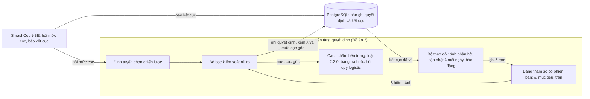

| ĐẠI HỌC QUỐC GIA TP. HỒ CHÍ MINH<br>TRƯỜNG ĐẠI HỌC<br>CÔNG NGHỆ THÔNG TIN | CỘNG HÒA XÃ HỘI CHỦ NGHĨA VIỆT NAM<br>Độc Lập - Tự Do - Hạnh Phúc |
| :---: | :---: |


# ĐỀ CƯƠNG KHÓA LUẬN TỐT NGHIỆP

> Bản thảo ngày 17/11/2026, chưa nộp. Bản này viết lại toàn bộ bản 15/11/2026 sau một đợt rà soát gồm bảy vai: hội đồng phản biện, lý thuyết, tra cứu tài liệu, kiến trúc hệ thống, phương pháp thực nghiệm, thí nghiệm, thực tiễn và pháp lý. Những việc nhóm còn phải chốt nằm ở Mục 12, mỗi việc có một khuyến nghị. Các ngưỡng cam kết ở Mục 7 là dự kiến: nhóm chốt ở tuần thứ 2, trên phần dữ liệu dò, trước khi chạy phần dữ liệu xác nhận, và không đổi sau khi có kết quả (Mục 8). Đề cương này tiếp nối [đề cương Đồ án 2](PROPOSAL_DO_AN_2.md).

**TÊN TIẾNG VIỆT:** Lớp kiểm soát rủi ro có bảo đảm cho quyết định đặt cọc khi hành vi khách hàng thay đổi: thiết kế, chứng minh và đánh giá trên nền tảng quyết định của hệ thống đặt sân.

**TÊN TIẾNG ANH:** A Risk-Control Layer with Loss Guarantees for Deposit Decisions under Customer Behaviour Drift: Design, Proof and Evaluation on a Court-Booking Decision Platform.

**Thời gian thực hiện:** 14 tuần, trong khung 3–4 tháng của học kỳ kế tiếp sau Đồ án 2

**Sinh viên thực hiện:**

- Nguyễn Thành Trung – 23521683
- Đoàn Quốc Tuấn – 23521709

**Nội dung đề tài:**

## Tóm tắt đề tài

**Câu hỏi của doanh nghiệp.** Một doanh nghiệp có vài chi nhánh sân cầu lông, nhận đặt sân qua web. Mỗi lần khách đặt sân, họ phải trả lời: **khách này phải trả trước bao nhiêu?** Thu ít thì người giữ sân rồi không đến làm mất tiền khung giờ. Thu nhiều thì khách quen bị đối xử như người lạ, và mỗi lần hủy là một lần hoàn tiền.

**Hiện nay người ta trả lời bằng luật viết tay.** Sân Kỳ Hòa thu mọi khách 50 %. Theo một bài giới thiệu của bên thứ ba, sân 291 cho thành viên thường xuyên khỏi cọc và thu khách vãng lai 50 %. Đồ án 2 có một bảng luật theo hạng thành viên (bản 2.2.0 có thêm bước giảm cọc giờ thấp điểm). Các nền tảng đặt sân để chủ sân tự đặt con số (Mục 1.2). Luật viết tay có hai điểm yếu đã đo được: không ai biết nó hở bao nhiêu tiền, và khi hành vi khách đổi thì nó đứng yên. Trên dữ liệu thật, mọi chính sách đứng yên đều để hở vượt mục tiêu 1,3 tới 1,7 lần khi tỷ lệ bỏ đơn tăng theo mùa (Mục 1.5).

**Đề tài làm gì.** Đề tài xây một **lớp kiểm soát rủi ro** đặt chồng lên bất kỳ cách chấm rủi ro nào: bảng luật viết tay đang chạy, một bảng tra lập từ dữ liệu, hoặc một mô hình. Doanh nghiệp chọn một con số dễ hiểu: trung bình chịu để hở tối đa bao nhiêu phần trăm giá trị đơn. Mỗi ngày, lớp này đọc các kết cục đã về (khách đến, không đến, hủy), so phần tiền bị hở với mục tiêu, rồi siết hoặc nới mức cọc của các đơn mới, giống một bộ điều nhiệt.

**Luận điểm đề tài bảo vệ.** Tính trên một giai đoạn đủ dài, phần tiền bị hở mà tiền cọc kiểm soát được không vượt mức doanh nghiệp chọn quá một sai số tính được từ số đơn đang chờ kết cục. Điều này đúng với **bất kỳ** cách chấm rủi ro nào, kể cả một luật viết tay sai hướng, và không cần giả định gì về khách. Cách chấm rủi ro chỉ quyết định phải thu bao nhiêu cọc để đạt mức đó. Phần tổn thất mà tiền cọc không chạm tới được (do chính sách hoàn tiền, hoặc do trần cọc doanh nghiệp tự đặt) được đo và báo cáo riêng.

**Điều này đã có ai làm chưa.** Dạng bảo đảm này đã có cho bài toán quyết định không có độ trễ (Lekeufack và cộng sự, 2024 [6]; Feldman và cộng sự, 2023 [5]). Đề tài không nhận là phát minh ra phương pháp. Phần của đề tài là một mở rộng nhỏ có chứng minh, cho đúng những gì bài toán cọc cần: tổn thất tính theo giá đơn và theo chính sách hoàn tiền, độ trễ khác nhau theo từng đơn, trần cọc theo từng đơn, cập nhật theo ngày. Cộng với đó là một đánh giá trung thực ở quy mô sân, và việc đưa lớp này vào một nền tảng chịu lỗi đang chạy (Mục 2.5).

**Đã thử trước trên dữ liệu thật** (Mục 1.5; 102.681 đơn đặt phòng khách sạn không cọc, 110.521 lịch hẹn khám bệnh):

- Gắn lên năm cách chấm rủi ro khác nhau, từ mô hình tới một luật viết tay sai hướng, lớp tự điều chỉnh đều giữ phần hở ở 0,98 tới 1,00 lần mục tiêu khi tỷ lệ bỏ đơn tăng. Cách chấm tốt hơn chỉ làm mức cọc trung bình thấp hơn.
- Nó hơn cả cách học lại mô hình và chọn lại mức cọc hằng tháng (học lại vẫn vượt 1,07 tới 1,52 lần).
- Ở lượng đơn như một chuỗi sân nhỏ (60 đơn mỗi ngày), mọi lần lấy mẫu đều giữ dưới 1,09 lần mục tiêu; ở 20 đơn mỗi ngày thì còn 3 tới 13 % số lần vượt 1,1 lần.
- Điểm yếu nói trước: một hai tháng đầu vẫn vượt 1,4 tới 1,7 lần khi kết cục về trễ vài tuần như ở khách sạn. Khi độ trễ chỉ 0 tới 2 ngày như ở sân, phần vượt này gần như biến mất.

**Giới hạn nói trước.** Không có dữ liệu đặt sân thật nào lấy được, nên phương pháp được kiểm trên dữ liệu công khai của khách sạn và phòng khám, cộng dữ liệu biến đổi về quy mô sân theo một giao thức chốt trước (Mục 8). Đề tài khẳng định một tính chất an toàn và đo cái giá của nó. Đề tài **không** khẳng định doanh nghiệp lãi thêm bao nhiêu hay khách đặt nhiều hơn, vì điều đó cần chạy trên khách thật.

## Thuật ngữ dùng trong đề cương

| Thuật ngữ | Nghĩa |
| :--- | :--- |
| Đơn | Một lần khách đặt sân |
| Bỏ đơn | Khách không đến, hoặc hủy sát giờ tới mức khung giờ khó bán lại. Định nghĩa chính xác theo chính sách hoàn tiền ở Mục 2.4 |
| Mức cọc | Phần giá đơn khách trả trước, từ 0 % tới 100 % |
| Phần tiền bị hở | Phần giá đơn chưa thu trước của những đơn bị bỏ, tính trên tổng giá trị đơn. Là tiền có nguy cơ mất, chưa phải thiệt hại chắc chắn |
| Phần kiểm soát được | Phần của tổn thất mà thu thêm cọc thì giảm được. Lời hứa của đề tài chỉ áp cho phần này |
| Phần sàn | Phần của tổn thất mà tiền cọc không giảm được: do chính sách hoàn tiền (sàn 1), hoặc do trần cọc doanh nghiệp tự đặt (sàn 2). Đo và báo cáo riêng |
| Mục tiêu α | Phần kiểm soát được trung bình mà doanh nghiệp chịu được, theo phần trăm giá trị đơn. Do doanh nghiệp chọn |
| Cách chấm rủi ro | Bất kỳ quy tắc nào cho mỗi đơn một mức "rủi ro" hoặc một mức cọc gốc: bảng luật viết tay, bảng tra, mô hình |
| Bảng tra | Chia đơn thành vài nhóm theo một hai đặc điểm (ví dụ đặt trước bao lâu), lấy tỷ lệ bỏ của từng nhóm trong dữ liệu cũ |
| Mô hình | Ở đây là hồi quy logistic: mỗi đặc điểm có một trọng số, cộng lại rồi đổi thành phần trăm. Không phải mô hình ngôn ngữ |
| Lớp kiểm soát rủi ro | Phần đề tài xây: nhận mức cọc gốc của cách chấm rủi ro, chỉnh nó theo một tham số chung, và tự cập nhật tham số đó từ kết cục |
| Tham số siết–nới λ | Con số duy nhất lớp kiểm soát rủi ro tự chỉnh. λ nhỏ thì cọc cao, λ lớn thì cọc thấp |
| Kết cục đến trễ | Lúc quyết định mức cọc chưa ai biết khách có đến không; điều đó chỉ biết vào giờ chơi hoặc lúc khách hủy |
| Dữ liệu trôi | Hành vi khách thay đổi theo thời gian (mùa, thị trường, hay chính mức cọc), nên điều học từ dữ liệu cũ không còn đúng hẳn |
| Nền tảng quyết định, TADSS | Hệ thống của Đồ án 2. Phần mềm đặt sân SmashCourt hỏi nó "đơn này cọc bao nhiêu" và nhận câu trả lời |
| Chiến lược | Bộ luật quyết định mức cọc bên trong nền tảng. Chiến lược mặc định hiện nay là `DefaultDecisionStrategy` 2.2.0 |
| Mặc định an toàn | Khi có sự cố, mọi đơn cọc 100 %. An toàn cho tiền của doanh nghiệp; đổi lại khách trả trước toàn bộ |
| Cửa sổ trượt | Cách đánh giá: chạy lại cùng một quy trình trên nhiều giai đoạn thời gian nối tiếp nhau, theo một quy tắc cố định, thay vì chọn tay vài giai đoạn |
| RQ, M, KL | RQ1–RQ4 là câu hỏi nghiên cứu (Mục 2.3), M1–M5 là mục tiêu (Mục 3), KL1–KL7 là cam kết có ngưỡng đo (Mục 7) |
| Số trong ngoặc vuông | Ví dụ [6]: trỏ tới nguồn số 6 ở Mục 13. Nội dung chính của nguồn được nêu ngay tại chỗ dẫn |

## 1. Lý do chọn đề tài

### 1.1. Câu hỏi "trả trước bao nhiêu" có tiền thật đi kèm

Doanh nghiệp sân bán khung giờ, và khung giờ trống qua đi là mất: sân trống lúc 18 giờ hôm nay không bán lại được vào ngày mai. Khách bỏ chỗ là chuyện phổ biến ở mọi ngành đặt chỗ. Một bài tổng hợp 105 nghiên cứu về lịch hẹn khám bệnh cho thấy trung bình khoảng 23 % lịch hẹn bệnh nhân không đến; bài này cũng nêu hai yếu tố dự báo mạnh nhất là đặt trước lâu và tiền sử bỏ hẹn (Dantas và cộng sự, 2018) [41]. Trong 102.681 đơn đặt phòng không cọc của bộ dữ liệu khách sạn công khai, 5,7 % đơn khách không đến hoặc hủy trong 7 ngày trước ngày đến [42]. Theo chỉ số Resos (khoảng 3,77 triệu lượt đặt bàn ở 2.417 nhà hàng, 08/2025 tới 07/2026), tỷ lệ không đến là 2,33 %, và một nửa số lượt hủy rơi vào 24 giờ cuối [44].

**Một điểm phần trăm đáng bao nhiêu.** Số giả định, chỉ để thấy độ lớn: chuỗi 3 chi nhánh × 6 sân, giờ cao điểm 17 tới 21 giờ, 100.000 đ một giờ, tức doanh thu giờ cao điểm tối đa khoảng 216 triệu đồng một tháng. Cứ 1 % khung giờ cao điểm bị bỏ mà không bán lại được là mất khoảng 2,2 triệu đồng một tháng. Cứ 1 % khung giờ bỏ trống vì khách chọn sân khác do ngại trả trước cũng mất đúng chừng đó. Phép tính không cho biết phía nào lớn hơn, và hiện doanh nghiệp không có con số của phía nào.

### 1.2. Hiện trạng: các sân đang chọn mức cọc bằng tay

**Chính sách cọc và hủy công khai của một số sân và nền tảng** (trang chính sách của từng nơi, kiểm ngày 17/11/2026 [46]):

| Nơi | Mức cọc | Hủy và hoàn tiền | Khác nhau theo khách? |
| :--- | :--- | :--- | :--- |
| Sân Kỳ Hòa, Q.10 | 50 % | Hoàn khi hủy trước 24 giờ | Không |
| Sân 291, Q.10 (trang của sân) | 50 % đặt online giờ cao điểm | Hoàn 100 % nếu hủy trước 2 giờ, 50 % nếu trước 1 giờ; không đến thì không hoàn | Trang của sân không nói |
| Sân 291, theo bài của CabaSports (22/04/2025) | Khách vãng lai 50 % | Mốc giờ lệch với trang của sân | **Có**: "thành viên thường xuyên không cần đặt cọc" |
| Pickleball Cộng Hòa Garden, Tân Bình (chỉ đọc được đoạn trích trong kết quả tìm kiếm) | Khách vãng lai 100 %; 50 % nếu đặt trên 3 sân | Hủy trước 24 giờ hoàn 100 % | **Có** |
| Saigon Padel | Trang không nói | Hủy trong 24 giờ không hoàn, được chuyển cho người khác | Không |
| Nền tảng Đặt Sân Nhanh | "Do chủ sân qui định" | Không đến coi như tự hủy, mất cọc | Không |
| Nền tảng Ball Ball | "Chính sách tiền cọc do chủ sân tự thiết lập" | Chủ sân duyệt yêu cầu hủy | Không |
| Phần mềm Alobo | Không nêu | Ví dụ: trước 24 giờ hoàn 100 %, 6 tới 24 giờ hoàn 50 %, dưới 6 giờ không hoàn | Chỉ áp chung cho mọi khách |

Ba điều rút ra. Mức cọc dao động từ 0 % (thành viên) tới 100 % (khách vãng lai). Một số sân đã chia khách thành hai mức, tức là đã có một luật viết tay hai bậc. Và không nền tảng hay phần mềm nào nhóm tìm được tính hay gợi ý mức cọc từ dữ liệu: các nền tảng để hết quyết định đó cho chủ sân.

**Hai rủi ro kéo ngược nhau.**

- *Thu ít thì bị bỏ.* Bài của hai bên bán phần mềm đặt sân mô tả tình huống khách nhắn giữ sân rồi không đến, chủ sân ngại nhắc [49]. Nhóm không tìm được bài báo chính thống hay số liệu thống kê nào về tỷ lệ bỏ sân ở Việt Nam. Đây là chỗ yếu của phần hiện trạng; Mục 1.6 nói đề tài xử lý nó thế nào.
- *Thu nhiều, cứng nhắc thì mất lòng khách.* Báo Thể thao & Văn hóa (07/10/2025) và CafeF (08/10/2025) tường thuật khách bức xúc khi sân pickleball ở Hà Nội không cho hủy, không hoàn tiền trong ngày ngập; sau khi bài lan truyền, một sân xin lỗi và hoàn tiền [54]. Ở sáu nhà hàng cao cấp tại Hoa Kỳ, bắt khách bảo đảm bằng thẻ làm số lượt không đến giảm, và số lượt đặt cũng giảm (so sánh trước và sau, không có nhóm đối chứng; Hernandez, 2015) [35].

**Bằng chứng về tác dụng của tiền cọc còn mỏng và không cùng chiều.** Một thử nghiệm ngẫu nhiên có đối chứng ở Đan Mạch trên 6.746 lịch hẹn cho thấy phạt khoảng 34 euro khi không đến **không** làm giảm thêm tỷ lệ không đến, ở mức nền khoảng 5 % (Blæhr và cộng sự, 2018, theo tổng quan [37]). Một thí nghiệm thực địa về giá trả trước cho thấy tác dụng chính của giá là **lọc ai mua**, không phải làm người mua giữ lời hơn (Ashraf, Berry, Shapiro, 2010) [38]. Số liệu quan sát của ngành nhà hàng thì cho thấy nơi có cọc có tỷ lệ không đến 0,80 % so với 2,47 % (không phải thử nghiệm có đối chứng) [44]. Hệ quả cho đề tài: không thể giả định trước tiền cọc làm khách đổi hành vi bao nhiêu, nên lời giải phải giữ được mức rủi ro **mà không cần biết điều đó**.

**Pháp lý.** Đọc hiểu của nhóm, không phải tư vấn pháp lý (chi tiết ở Mục 5.6):

- Bộ luật Dân sự 2015, Điều 328 khoản 2: bên đặt cọc từ chối thực hiện hợp đồng thì tài sản đặt cọc thuộc về bên nhận đặt cọc [55]. Khoản tiền không ghi rõ là đặt cọc thì được coi là tiền trả trước (Nghị định 21/2021/NĐ-CP, Điều 37, theo các bài báo dẫn lại [58]), nên chính sách của sân phải ghi rõ khoản này là đặt cọc.
- Luật Bảo vệ quyền lợi người tiêu dùng 2023 không cấm áp điều kiện khác nhau cho các khách khác nhau. Luật chỉ cấm phân biệt về giới (Điều 6 khoản 5) và kỳ thị người tiêu dùng dễ bị tổn thương (Điều 8 khoản 3 điểm d). Điều kiện giao dịch chung phải niêm yết và chỉ có hiệu lực khi đã công khai trước (Điều 27 khoản 2, 3) [56].

### 1.3. Các cách đặt mức cọc đang có, và khoảng trống

| Cách | Ví dụ | Còn thiếu gì |
| :--- | :--- | :--- |
| Một mức chung | Sân Kỳ Hòa 50 %; SmashCourt ở Đồ án 1 thu đủ 100 % | Quá tay với người đáng tin, chưa đủ với người rủi ro |
| Chủ sân nhớ mặt khách | Thành viên thường xuyên khỏi cọc | Dựa vào trí nhớ một người; không theo được khi có nhiều chi nhánh, đặt qua web lúc nửa đêm |
| Luật viết tay theo nhóm | Đồ án 2: cọc 50/40/30/20 % theo hạng, giảm còn tối đa 30 % giờ thấp điểm (bản 2.2.0) | Không ai biết nó hở bao nhiêu; đứng yên khi hành vi đổi |
| Bật hoặc tắt theo lịch sử, ở nền tảng lớn | Shopee tạm tắt quyền trả tiền khi nhận hàng với tài khoản nhiều đơn giao không thành công [50]; OpenTable đình chỉ khách bốn lần không đến trong mười hai tháng [51]; Grab Việt Nam năm 2018 buộc khách hủy nhiều phải liên kết thẻ [52] | Chỉ hai mức; hệ thống riêng của một nền tảng lớn |
| Cọc tự động cho đơn rủi ro cao | Phần mềm đặt bàn Eat App quảng cáo "đơn rủi ro cao tự động bị đòi cọc" [45] | Bật hoặc tắt; không nói phần hở là bao nhiêu, không có bảo đảm nào |
| Ngân hàng và bảo hiểm | Chấm điểm người vay [48]; chỉnh hạn mức tín dụng theo từng chủ thẻ (Bank One, Trench và cộng sự, 2003) [53] | Cần lượng dữ liệu lớn và đội ngũ chuyên trách |

**Khoảng trống.** Doanh nghiệp đặt chỗ nhỏ và vừa đang chọn mức cọc bằng luật viết tay, và không có công cụ nào cho họ biết luật đó đang để hở bao nhiêu tiền, hay giữ nó ở mức họ chọn khi khách đổi hành vi. Đề tài xây đúng công cụ đó, và xây nó sao cho **dùng được ngay với chính luật viết tay đang chạy**, trước khi có đủ dữ liệu để lập bảng tra hay mô hình.

### 1.4. Đồ án 2 đã có gì, còn thiếu gì

Đồ án 2 xây nền tảng quyết định TADSS và nối nó vào SmashCourt. Khi khách đặt sân qua web, SmashCourt hỏi nền tảng "đơn này cọc bao nhiêu"; nền tảng chạy một chiến lược và trả lời.

**Đã có, và khóa luận giữ nguyên:**

- **Chạy an toàn.** Chiến lược lỗi hoặc chậm thì nền tảng trả cọc 100 %. Trong lượt đánh giá đầy đủ `EV-20261017-EVAL-full-r1`, việc này xảy ra 11.328 lần trên 467.731 quyết định (mọi lỗi đều do bộ kiểm thử cố ý gây ra); 10.568 lần có câu trả lời gần như tức thì nhờ cơ chế ngắt mạch ([`runtime_facts.py`](../../tools/research/runtime_facts.py)). Cả nền tảng không trả lời thì SmashCourt tự thu 100 %, và 95 trên 100 lượt đặt sân trong lúc sự cố xong trong 0,075 giây ([báo cáo hiệu năng](../report/PERFORMANCE_REPORT.md) Mục 6.8).
- **Truy vết.** Mỗi quyết định có đúng một bản ghi không sửa được; kết cục của đơn được gắn vào bản ghi khi SmashCourt báo về.
- **Kết cục được báo về** theo lô, 5 phút một lần, tối đa 20 đơn; mỗi kết cục có loại (đến, không đến, khách hủy, nhân viên hủy, hết hạn thanh toán, hết hạn duyệt, bị từ chối) và thời điểm xảy ra.

**Chưa có:**

1. **Bảng luật chưa kiểm bằng dữ liệu, và đứng yên.** Chiến lược mặc định 2.2.0 ([`DefaultStrategyOptions.cs`](../../src/TADSS.Strategies.Default/DefaultStrategyOptions.cs)) có mức cọc theo năm hạng, ngưỡng duyệt đơn lớn 2.000.000 đ, ngưỡng duyệt theo số lần không đến, ngưỡng từ chối theo số lần hết hạn thanh toán, và năm tham số của bước giảm cọc giờ thấp điểm (bản deploy bật cho hạng STANDARD và SILVER chưa có lịch sử rủi ro, tối đa 30 %). Không con số nào được chọn từ dữ liệu. Không có gì báo khi chúng cần đổi.
2. **Không ai tính phần tiền bị hở.** Kết cục được lưu, nhưng không có gì so phần hở thực tế với một mục tiêu.
3. **Không có chỗ cho một tham số chỉnh được khi đang chạy.** Tham số chiến lược chỉ nạp lúc khởi động, và từ P6-59 nền tảng từ chối khóa cấu hình lạ. Bản ghi quyết định không có chỗ lưu "tham số lúc đó" (Mục 5.4).
4. **Kết cục "không đến" về muộn hơn cần.** SmashCourt đánh dấu không đến 15 phút sau giờ bắt đầu, nhưng tới sau giờ kết thúc mới báo về nền tảng.

### 1.5. Đã thử trước trên dữ liệu thật

Trước khi cam kết, nhóm thử trên hai bộ dữ liệu công khai: **Hotel Booking Demand** [42] (102.681 đơn loại không cọc của hai khách sạn ở Bồ Đào Nha, 07/2015 tới 08/2017; có giá và ngày hủy) và **Medical Appointment No Shows** [43] (110.521 lịch hẹn của khoảng 62.000 người ở Brazil, sáu tuần năm 2016; có lịch sử từng người, không có giá). Nhãn chính ở bộ khách sạn là "khách không đến, hoặc hủy trong 7 ngày trước ngày đến". "Phần hở so với mục tiêu" là phần tiền bị hở chia cho mục tiêu; 1,00 là đúng mục tiêu. Nguồn của từng con số ở Phụ lục A.

| # | Câu hỏi | Kết quả | Sức nặng |
| ---: | :--- | :--- | :--- |
| 1 | Chia cọc theo rủi ro có hơn một mức chung? | Ở cùng mức cọc trung bình 50 %, phần hở giảm 18 % (nhãn "mọi đơn hủy") tới 36 % (nhãn chính); 1 và 3 ngày cho khoảng 28 % | Mạnh trong phạm vi đã thử: đứng với ba cách chia thời gian và với mọi cách lấy mẫu lại (theo đơn, theo ngày, theo cụm) |
| 2 | Luật viết tay có đúng hướng không? | Luật "đặt càng xa thì cọc càng cao" tệ hơn mức chung 43 % với nhãn chính, nhưng tốt hơn 11 % với nhãn "mọi đơn hủy"; luật ngược lại thì ngược chiều | Hướng đúng của một luật phụ thuộc vào định nghĩa "bỏ đơn". Không kiểm bằng dữ liệu thì không biết |
| 3 | Bảng tra có đủ, hay cần mô hình? | Bảng tra hai đặc điểm giảm 31 %, mô hình 36 % (khoảng cách 3 tới 7 điểm); ở lịch khám 42,8 % so với 43,1 % | Mạnh cho "bảng tra gần bằng mô hình". Yếu cho "ngưỡng dữ liệu để mô hình đáng hơn": dưới vài nghìn đơn thì không phân biệt được |
| 4 | Lịch sử khách đáng bao nhiêu? | Thêm 1 tới 2 điểm | Vừa; dữ liệu chỉ sáu tuần |
| 5 | Khi tỷ lệ bỏ tăng theo mùa, các cách giữ được mục tiêu không? | Giữ cố định vượt 1,30 tới 1,68 lần; học lại mô hình và chọn lại mức cọc hằng tháng vượt 1,07 tới 1,52 lần; tự điều chỉnh 0,99 tới 1,02 lần (cả giai đoạn), nhưng hai tháng đầu vẫn 1,4 tới 1,7 lần | Vừa: một bộ dữ liệu, hai mùa đông, giai đoạn được chọn sau khi đã nhìn tỷ lệ bỏ theo mùa. Mục 8 sửa bằng cửa sổ trượt |
| 6 | Gắn tự điều chỉnh lên luật viết tay thì sao? | Năm cách chấm (mô hình, bảng tra, bảng hạng, một mức như nhau, luật sai hướng) đều giữ 0,98 tới 1,00 lần. So với mô hình, cọc trung bình cao hơn 2 tới 3 điểm (bảng tra), 3 tới 6 điểm (luật đúng hướng), 15 tới 39 điểm (luật sai hướng) | Mạnh cho luận điểm "an toàn đến từ lớp kiểm soát, không từ mô hình" |
| 7 | Ở lượng đơn như sân? | 60 đơn mỗi ngày: mọi lần lấy mẫu dưới 1,09 lần. 20 đơn mỗi ngày: trung vị 0,99 tới 1,01 lần, 3 tới 13 % số lần vượt 1,1 lần; tốc độ điều chỉnh chậm nhất (0,02) thì hỏng | Vừa: tốc độ điều chỉnh phải chọn theo số kết cục mỗi ngày |
| 8 | Độ trễ như sân? | Chỉ giữ các đơn đặt trước tối đa 2 ngày: hai tháng đầu còn 0,89 tới 1,06 lần | Vừa: tập con này có phân bố khác |
| 9 | Dùng ngay tin khách hủy (tín hiệu sớm)? | Cho mọi đơn hủy báo kết cục ngay lúc hủy thì hai tháng đầu vượt 1,6 tới 2,1 lần, vì tin tốt (hủy sớm, không gây thiệt) về trước tin xấu. Chỉ cho tin xấu về sớm thì an toàn nhưng lợi rất nhỏ | Bác ý tưởng ban đầu của nhóm |
| 10 | Tổn thất theo chính sách hoàn tiền thì sao? | Với tổn thất tính theo chính sách hủy của SmashCourt, tự điều chỉnh giữ 0,99 tới 1,03 lần. Phần sàn (tiền cọc không chạm tới) là 0,1 tới 2,6 % giá trị đơn nếu mọi ca hủy sớm bán lại được, và lên 3,3 tới 5,1 % nếu 10 % không bán lại được | Cho thấy phần sàn cỡ bằng mục tiêu, nên phải báo riêng |

**Về cái giá bằng tiền cọc.** Để giữ mục tiêu khi khách bỏ nhiều hơn, tự điều chỉnh phải thu nhiều hơn: cọc trung bình 57 tới 61 % ở giai đoạn xấu đi mạnh, so với 35 % của cách giữ cố định đang vượt. Mốc công bằng để so là một mức tham số cố định chọn khi đã biết hết kết cục, vừa đủ để **mọi tháng** không vượt 1,1 lần mục tiêu: mốc này cần 61,0 %, 60,5 % và 21,3 % ở ba giai đoạn, trong khi tự điều chỉnh dùng 57 tới 61 %, 53 tới 54 % và 14,6 tới 16 %. Tức là tự điều chỉnh không tốn hơn, mà còn rẻ hơn, cái tốt nhất một tham số cố định làm được (mốc đó không dùng được thật, vì nó cần biết trước tương lai).

**Điều rút ra.**

1. Một chính sách đứng yên, dù tốt tới đâu, đều vượt khi hành vi khách xấu đi. Đây là lý do chính để cần lớp tự điều chỉnh.
2. An toàn đến từ lớp tự điều chỉnh, không đến từ mô hình. Mô hình hay bảng tra chỉ làm cái giá rẻ đi.
3. Vì vậy doanh nghiệp không phải chờ có dữ liệu mới dùng được: gắn lớp này lên chính luật viết tay đang chạy là có ngay bảo đảm.
4. Điểm yếu thật là giai đoạn đầu khi kết cục về trễ, và khi lượng đơn ít. Cả hai phải đo ở quy mô sân, không suy từ khách sạn.

**Giới hạn của các phép thử.** Khách được giả định cư xử như cũ khi mức cọc đổi, vì dữ liệu chỉ có hành vi khi chưa cọc; các con số ở hàng 1 và 3 vì vậy có thể phóng đại lợi ích của việc chia theo rủi ro. Hàng 5 tới 10 là của một bộ dữ liệu. Nhãn tính theo ngày, còn bỏ sân tính theo giờ. Không có dữ liệu sân thật: 215 đơn SmashCourt hiện có là dữ liệu tạo ra khi phát triển phần mềm. Lưu chương trình giúp người khác tính lại được các con số; nó không làm dữ liệu khách sạn hay phòng khám đại diện hơn cho sân cầu lông.

### 1.6. Khi nào đề tài có ích, khi nào không

Đề tài có ích khi: việc trả trước có giá (khách ngại, hoặc hoàn tiền tốn công); doanh nghiệp muốn biết và giữ mức tiền có thể mất; và hành vi khách có thay đổi theo thời gian. Nếu hành vi đứng yên, một luật lập một lần là đủ.

**Đề tài chấp nhận kết luận âm** trong ba trường hợp, và luận văn sẽ báo cáo đúng như vậy:

1. Trên các cửa sổ trượt ở quy mô sân, lớp tự điều chỉnh không giữ mục tiêu tốt hơn cách hiệu chỉnh lại hằng tuần (Mục 8). Khi đó phần trọng tâm bị bác.
2. Cái giá bằng tiền cọc lớn tới mức doanh nghiệp thà giữ một mức chung.
3. Phần sàn lớn hơn mục tiêu: khi đó thứ phải sửa là chính sách hủy, không phải tiền cọc, và hệ thống phải báo điều đó thay vì cố siết.

**Bằng chứng từ chính các sân.** Nhóm không có dữ liệu đặt sân thật và không khảo sát chủ sân. Đề tài vì vậy chọn một luận điểm **không cần dữ liệu sân để đúng**: bảo đảm an toàn là một tính chất toán học đúng với mọi chuỗi kết cục. Dữ liệu công khai chỉ dùng để đo cái giá, và dữ liệu biến đổi về quy mô sân dùng để đo giai đoạn đầu và ảnh hưởng của lượng đơn ít.

### 1.7. Những câu hỏi phản biện và câu trả lời

**"Thu đủ 100 % là xong, cần gì phức tạp?"** Thu đủ là một trường hợp riêng của đề tài: đặt mục tiêu bằng 0. Đề tài không phủ nhận nó; Oh và Su (2018) còn chứng minh khi chỗ bị bỏ không thể giao cho người khác thì nên dồn toàn bộ khoản thu vào tiền cọc [31]. Nhưng thu đủ có giá: khách đáng tin phải trả trước toàn bộ, mỗi lần hủy hợp lệ là một lần hoàn tiền mặt tại chi nhánh, và một số sân đang chọn cách khác (Mục 1.2). Đề tài cho doanh nghiệp thấy con số trước khi chọn, và không khẳng định "doanh thu tăng".

**"Phương pháp này có sẵn rồi, các em làm gì?"** Đúng: quy tắc cập nhật là của Gibbs và Candès (2021) [4], dạng bảo đảm cho quyết định là của Lekeufack và cộng sự (2024) [6] và Feldman và cộng sự (2023) [5]. Phần của đề tài là: (1) mở rộng bảo đảm cho độ trễ khác nhau theo từng đơn, tổn thất có trọng số theo giá và theo chính sách hoàn tiền, trần cọc theo từng đơn, cập nhật theo ngày, kèm chứng minh; (2) cho thấy bằng thực nghiệm rằng gắn lên luật viết tay vẫn đúng, và đo cái giá ở quy mô sân; (3) đưa nó vào một nền tảng chịu lỗi đang chạy mà không làm mất bảo đảm cũ.

**"Cọc khác nhau cho từng khách có phạm luật không?"** Luật Bảo vệ quyền lợi người tiêu dùng 2023 không cấm áp điều kiện khác nhau cho các khách khác nhau. Luật chỉ cấm phân biệt về giới và kỳ thị người tiêu dùng dễ bị tổn thương; quy định về điều kiện thương mại khác nhau của Luật Cạnh tranh chỉ áp cho doanh nghiệp có vị trí thống lĩnh [56]. Chính các sân đang thu khách vãng lai và thành viên khác nhau. Đề tài không dùng giới tính, tuổi hay địa bàn.

**"Khách bỏ sân thì nhắn nhắc lịch là xong?"** Nhắc lịch làm tỷ lệ không đến ở phòng khám giảm khoảng một phần tư (Robotham và cộng sự, 2016) [40], và chỉ cần nêu chi phí trong tin nhắc cũng đã có tác dụng (Hallsworth và cộng sự, 2015) [39]. Nhắc lịch và tiền cọc bổ sung cho nhau; đề tài không so hai cách này. Lớp kiểm soát rủi ro vẫn đúng khi doanh nghiệp có nhắc lịch: nó chỉ đo kết cục.

**"Số liệu là của khách sạn và phòng khám, không phải của sân."** Đúng. Vì vậy luận điểm chính là một tính chất đúng với mọi dữ liệu, còn số liệu chỉ dùng để đo cái giá (Mục 1.6).

## 2. Bài toán

### 2.1. Phát biểu bằng lời

> Cho một doanh nghiệp đặt chỗ đang quyết định mức cọc bằng một cách chấm rủi ro nào đó (thường là luật viết tay). Hãy thiết kế một lớp đặt chồng lên cách chấm đó, sao cho phần tiền bị hở mà tiền cọc kiểm soát được, tính trung bình dài hạn, không vượt mức doanh nghiệp chọn, kể cả khi hành vi khách thay đổi và kết cục mỗi đơn chỉ biết sau giờ chơi; đo cái giá bằng tiền cọc; và đưa lớp đó vào vận hành mà không làm mất các bảo đảm an toàn của Đồ án 2.

### 2.2. Bốn vấn đề phải giải

| Vấn đề | Hình dung | Hiện nay ở SmashCourt | Lời giải phải đạt |
| :--- | :--- | :--- | :--- |
| 1. Không biết luật đang để hở bao nhiêu | Chủ sân đặt "hạng vàng cọc 30 %" nhưng không biết mỗi tháng mất bao nhiêu vì khách bỏ | Kết cục được lưu nhưng không ai tính | Đo phần hở thực tế, tách phần kiểm soát được khỏi phần sàn; doanh nghiệp chọn một mục tiêu bằng lời dễ hiểu |
| 2. Hành vi khách thay đổi | Mùa giải, kỳ nghỉ, mưa kéo dài, một sân mới mở bên cạnh làm khách bỏ nhiều hơn | Luật đứng yên tới khi có người sửa | Tự siết khi khách bỏ nhiều hơn, tự nới khi khách giữ lời hơn; giữ mục tiêu với bất kỳ cách chấm rủi ro nào |
| 3. Kết cục đến trễ, tín hiệu thưa | Một chuỗi nhỏ chỉ có khoảng 2 đơn bị bỏ mỗi ngày, và chỉ biết vào giờ chơi | Kết cục "không đến" về sau giờ kết thúc | Không coi đơn chưa có kết cục là đơn tốt; dùng tín hiệu sớm mà không làm lệch; đo cái giá của độ trễ và của lượng đơn ít |
| 4. Chạy an toàn, giải thích được, đúng luật | Tối thứ sáu nền tảng lỗi; một khách hỏi "sao tôi cọc cao hơn bạn tôi" | Đồ án 2 có đường lùi 100 % và bản ghi bất biến | Không làm mất bảo đảm của Đồ án 2; mỗi quyết định dựng lại được kèm tham số lúc đó; mức cọc chỉ đổi cho đơn mới |

### 2.3. Câu hỏi nghiên cứu

| Mã | Câu hỏi | Trả lời bằng | Vấn đề |
| :--- | :--- | :--- | :--- |
| RQ1 (trung tâm) | Lớp kiểm soát rủi ro gắn lên một cách chấm bất kỳ có giữ phần kiểm soát được không vượt mục tiêu không, khi có độ trễ theo từng đơn, trần cọc và cập nhật theo ngày? Bảo đảm chặt tới đâu ở quy mô sân? | Chứng minh (Mục 2.4); đo trên cửa sổ trượt ở quy mô sân | 1, 2, 3 |
| RQ2 | Cái giá bằng tiền cọc là bao nhiêu, so với mốc an toàn từng tháng, với học lại định kỳ và với hiệu chỉnh lại hằng tuần; và nó phụ thuộc chất lượng của cách chấm (luật 2.2.0, bảng tra, hồi quy logistic) tới đâu? | Đo trên cùng các cửa sổ trượt | 1, 2 |
| RQ3 | Độ trễ, lượng đơn mỗi ngày và cách dùng tín hiệu sớm làm phần vượt ở giai đoạn đầu lớn tới đâu, kéo dài bao lâu? Khi khách phản ứng với chính mức cọc thì sao? | Quét độ trễ và lượng đơn trên dữ liệu biến đổi về quy mô sân; dữ liệu tổng hợp có phản ứng của khách | 3 |
| RQ4 | Gắn vào nền tảng có giữ bảo đảm của Đồ án 2 về thời gian trả lời, đường lùi và truy vết không? | Đo sức chịu, cố ý gây lỗi, dựng lại quyết định | 4 |

### 2.4. Phát biểu chính xác (dành cho người đọc kỹ thuật)

Mục này có bốn phần: tổn thất và ba thành phần của nó; họ chính sách một tham số; quy tắc cập nhật; hai bổ đề. Chứng minh đầy đủ của Bổ đề 1 là một phần của luận văn; ở đây nêu phát biểu và các bước.

#### Tổn thất theo chính sách hoàn tiền

Chính sách hủy của SmashCourt ([ảnh chụp ngày 14/10/2026](../../tools/evidence/config/smashcourt_cancel_policies.json)) chia kết cục của một đơn thành năm loại. Gọi κ là phần tiền cọc doanh nghiệp được giữ, và R là việc khung giờ có bán lại được hay không:

| Loại kết cục | Hoàn cho khách | κ | Bán lại được (giả định mặc định khi chưa đo) |
| :--- | :--- | ---: | :--- |
| Khách đến | Không áp dụng | Không áp dụng | Không áp dụng; tổn thất bằng 0 |
| Không đến | 0 % | 1 | Không |
| Hủy trong 2 giờ cuối | 0 % | 1 | Không |
| Hủy trước 2 tới 24 giờ | 50 % số đã trả | 0,5 | Không (thử thêm: một nửa) |
| Hủy trước ít nhất 24 giờ | 100 % số đã trả | 0 | Có (thử thêm: 90 %) |

Doanh nghiệp còn có thể đặt một **trần cọc** d̄ᵢ ≤ 100 % cho từng đơn: ví dụ chế độ "chỉ giảm" (không đơn nào cọc cao hơn luật hiện nay), quản lý hạ mức cọc khi duyệt, hay quy tắc của SmashCourt rằng tiền cọc dưới 5.000 đ thì thu tại quầy. Với đơn i có giá vᵢ, mức cọc dᵢ ≤ d̄ᵢ, tổn thất tính theo phần của giá đơn tách được thành ba phần:

```text
(1 − Rᵢ)·(1 − κᵢ·dᵢ) = (1 − Rᵢ)·(1 − κᵢ)        sàn 1: do chính sách hoàn tiền
                     + (1 − Rᵢ)·κᵢ·(1 − d̄ᵢ)      sàn 2: do trần cọc doanh nghiệp tự đặt
                     + (1 − Rᵢ)·κᵢ·(d̄ᵢ − dᵢ)     ℓᵢ: phần kiểm soát được
```

Đọc bằng lời: nếu khung giờ không bán lại được, doanh nghiệp mất giá đơn trừ phần cọc được giữ. Cách tính này giống cách ngân hàng tính tổn thất dự kiến của một khoản vay (khả năng không trả × phần không đòi lại được × số tiền cho vay; Ủy ban Basel, 2005) [3]. **Lời hứa của đề tài chỉ áp cho ℓ.** Hai phần sàn được đo và báo cáo riêng, vì tiền cọc không làm chúng nhỏ đi. Nếu tổng hai phần sàn đã lớn hơn mục tiêu, không mức cọc nào đạt được mục tiêu tổng, và hệ thống phải báo "không khả thi với chính sách hiện tại" thay vì siết vô ích. Ví dụ: ở chế độ "chỉ giảm" tại nơi đang thu 50 %, với tỷ lệ bỏ 5 %, sàn 2 đã khoảng 2,5 %.

Khi vận hành thật, R đo được bằng cách xem khung giờ bị hủy có được đặt lại không. Trong khóa luận, R là giả định, nên bảo đảm nói về tổn thất **theo giả định bán lại**. Đây là giả định nặng nhất của bài toán: trên dữ liệu khách sạn, hủy sớm chiếm 25 tới 31 % giá trị đơn, và chỉ cần 10 % số ca này không bán lại được là sàn 1 tăng từ 0,1–2,6 % lên 3,3–5,1 % (Phụ lục A).

#### Họ chính sách một tham số

Cách chấm rủi ro bên trong cho mỗi đơn một con số hᵢ ∈ [0, h_max], càng lớn thì càng ít cần cọc. Lớp kiểm soát rủi ro đổi nó thành mức cọc bằng một tham số chung λ:

```text
dᵢ = min( d̄ᵢ ,  1 − min(1, e^λ · hᵢ) ),   sau đó làm tròn lên bậc 20 % (vẫn không vượt d̄ᵢ)
```

Ba cách dùng:

| Cách chấm bên trong | hᵢ | Ý nghĩa |
| :--- | :--- | :--- |
| Luật viết tay cho mức cọc gốc d₀ (ví dụ bảng hạng 2.2.0) | 1 − d₀ | λ = 0 cho lại đúng luật; λ < 0 siết, λ > 0 nới. Thứ tự rủi ro của luật được giữ |
| Bảng tra hoặc mô hình cho khả năng bỏ q̂ᵢ (kẹp dưới bởi q_min) | 1 / q̂ᵢ | dᵢ = 1 − e^λ / q̂ᵢ: phần kiểm soát được kỳ vọng của mỗi đơn xấp xỉ e^λ |
| Một mức như nhau cho mọi đơn | hằng số | Trở thành một mức chung tự điều chỉnh |

Hai lưu ý. Thứ nhất, sau khi tự điều chỉnh, đây là một họ chính sách một tham số, không phải lời giải tối ưu của bài toán "tối thiểu tiền cọc với ràng buộc trung bình". Lời giải tối ưu của bài toán đó là một ngưỡng: đơn rủi ro nhất cọc 100 %, còn lại 0 % (bài toán cái túi dạng phân số). Trên dữ liệu khách sạn, ở cùng phần hở, ngưỡng cần cọc trung bình 20,8 % so với 29,4 % của họ nhiều bậc, nhưng 70 % đơn cọc 0 %. Đề tài báo cáo cả hai; lựa chọn giữa chúng là lựa chọn kinh doanh (Mục 12). Thứ hai, khi hᵢ không phải xác suất (luật viết tay), bảo đảm ở Bổ đề 1 vẫn đúng, nhưng không còn nói được gì về phần hở của **từng** đơn.

#### Quy tắc cập nhật

Ngân sách đổi một lần mỗi ngày, áp cho các đơn đặt từ hôm sau. Gọi wᵢ = vᵢ / v₀ với v₀ là một giá trị đơn chuẩn chọn trước, η là tốc độ điều chỉnh, α là mục tiêu, b là chặn trên của λ:

```text
λ(ngày t+1) = min( b ,  λ(ngày t) + η · Σ_{đơn i có kết cục được ghi trong ngày t} wᵢ · (α − ℓᵢ) )
```

Đơn nào để hở nhiều hơn mục tiêu thì kéo λ xuống (siết), ít hơn thì đẩy lên (nới). Đây là quy tắc của Gibbs và Candès (2021) [4], áp cho một tham số của quyết định như Lekeufack và cộng sự (2024) [6]. Bốn quy ước, mỗi quy ước có lý do:

- **Chỉ ghi kết cục khi nó thật sự về.** Đơn chưa tới giờ chơi không được coi là "đã đến".
- **Ghi nợ sớm, ghi có đúng hạn.** Tin xấu (khách hủy sát giờ) được ghi ngay lúc hủy; tin tốt (khách đến, khách hủy sớm) chỉ ghi vào giờ chơi. Phép thử cho thấy nếu cho mọi ca hủy về sớm, tin tốt về trước tin xấu và giai đoạn đầu vượt 1,6 tới 2,1 lần (Mục 1.5, hàng 9).
- **Khởi đầu từ thu đủ.** λ ban đầu đặt ở mức mọi đơn cọc như hiện nay (ở SmashCourt là 100 %), rồi nới dần theo kết cục. Cách này làm số hạng khởi đầu của Bổ đề 1 bằng 0, và đi đúng nguyên tắc "chỉ làm khác cách cũ khi đã có đủ bằng chứng" (Laroche và cộng sự, 2019) [23].
- **Không đổi mức cọc của đơn đã đặt.** λ mới chỉ áp cho đơn mới, vừa để bổ đề đúng, vừa vì Luật Bảo vệ quyền lợi người tiêu dùng cấm đơn phương đổi điều kiện giao dịch (Mục 5.6).

#### Bổ đề 1: bảo đảm tất định

**Giả định.** (H1) Có một mức λ* sao cho mọi đơn quyết định khi λ ≤ λ* có ℓ ≤ α với mọi kết cục. Với họ chính sách ở trên, λ* = log(α / h_max); với luật viết tay, λ* = log α. (H2) Tổng phần vượt (ℓ − α)₊ có trọng số của các đơn đang cùng chờ kết cục, đã quyết định khi λ > λ*, bị chặn bởi một số P. Cho phép đặt trước tối đa D ngày thì P không vượt số đơn trong D ngày, tính theo đơn chuẩn. (H3) Mọi kết cục về trong hạn; quá hạn thì coi là bị bỏ. Không có giả định nào về khách, về việc dữ liệu đứng yên, hay về độ đúng của cách chấm rủi ro.

**Phát biểu.** Với W_T là tổng trọng số của các đơn đã có kết cục tới ngày T:

```text
Σ vᵢ·ℓᵢ / Σ vᵢ   (trên các đơn đã có kết cục)   ≤   α  +  [ (λ_đầu − λ*)₊ / η  +  P ] / W_T
```

Bản theo cửa sổ: với mọi đoạn thời gian, tổng phần vượt có trọng số trong đoạn không quá (b − λ*)/η + P.

**Các bước chứng minh.** (1) Khi λ ở dưới λ*, theo (H1) mọi đơn mới có ℓ ≤ α, nên chỉ các đơn đã quyết định từ trước, còn đang chờ, mới kéo λ xuống thêm, và tổng của chúng không quá P. Vì vậy λ không bao giờ xuống dưới min(λ_đầu, λ* − ηP). (2) Cộng dồn quy tắc cập nhật: tổng phần vượt có trọng số bằng đúng (λ_đầu − λ_cuối − lượng bị chặn trên)/η. (3) Ghép hai bước và chia cho W_T. Bước (2) cho thêm một chứng chỉ chạy thật: chỉ cần đọc λ là biết chính xác phần vượt đã cộng dồn. Bộ báo động ở Mục 5.3 dựa trên điều này.

**Chặt tới đâu ở quy mô sân.** Chuỗi nhỏ ở Mục 4.2 có khoảng 58 đơn mỗi ngày. Nếu cho đặt trước tối đa 7 ngày và khởi đầu từ thu đủ, P khoảng 400 đơn chuẩn. Khi đó số hạng thêm là khoảng 24 điểm phần trăm nếu tính trên một tháng (khoảng 1.700 đơn), và khoảng 2 điểm nếu tính trên một năm. Tức là **bảo đảm tất định có nghĩa theo năm, không có nghĩa theo tháng**. Nếu chỉ cho đặt trước tối đa 2 ngày, con số theo năm còn khoảng 0,6 điểm. Đề tài nói rõ điều này thay vì hứa theo tháng.

#### Bổ đề 2: bảo đảm theo xác suất, và giới hạn của nó

Thêm giả định: theo thứ tự kết cục được biết, kỳ vọng của ℓᵢ chỉ phụ thuộc thông tin lúc quyết định, và không vượt μ̄ (chuỗi hiệu martingale; không cần độc lập, không cần dữ liệu đứng yên). Khi đó, dùng bất đẳng thức Freedman cho martingale [17], với xác suất ít nhất 95 %, số hạng P được thay bằng khoảng μ̄·P cộng một sai số cỡ căn bậc hai. Với μ̄ = 5 % và các số ở trên, khởi đầu từ thu đủ: khoảng 2,4 điểm trên một tháng, 0,2 điểm trên một năm.

Giới hạn, nói thẳng: (1) Các đơn cùng ngày có thể cùng bị bỏ vì một lý do chung (mưa, ngày lễ). Khi đó giả định trên sai, và nếu gộp theo ngày thì bảo đảm này gần như không hơn Bổ đề 1. (2) μ̄ là kỳ vọng thật, nên tầng này phụ thuộc độ đúng của cách chấm rủi ro: cách chấm đánh giá thấp rủi ro c lần thì μ̄ tăng chừng ấy. Đề tài trình bày Bổ đề 2 như một phác thảo kèm hai giới hạn này. Lời hứa chính dựa trên Bổ đề 1.

**Hệ quả khi cách chấm rủi ro sai.** Bổ đề 1 còn nguyên. Cái giá là: mức cọc cao hơn để đạt cùng mục tiêu, và phần vượt dồn vào nhóm đơn bị chấm sai trong khi nhóm khác bù lại. Đề tài đo cả hai.

### 2.5. Cái đã có và phần của đề tài

| Thành phần | Đã có | Phần của đề tài |
| :--- | :--- | :--- |
| Quy tắc cập nhật một tham số theo kết quả | Gibbs và Candès 2021 [4]: tỷ lệ lỗi, không trễ, không trọng số | Không có gì mới ở quy tắc |
| Bảo đảm tất định cho tham số của quyết định, khi có mức an toàn | Lekeufack và cộng sự 2024 [6]; Feldman và cộng sự 2023 [5] cho tổn thất bị chặn bất kỳ | Mở rộng cho: độ trễ khác nhau theo từng đơn, cập nhật theo ngày, trọng số theo giá, trần cọc theo từng đơn; bản theo cửa sổ |
| Phản hồi trễ | Trễ cố định: Hallberg Szabadváry 2024 [9]; bản thảo 2026 [10], [11] | Trễ thay đổi theo từng đơn, và thời điểm về phụ thuộc chính kết cục (hủy về sớm, đến về muộn), kèm quy ước "ghi nợ sớm, ghi có đúng hạn" |
| Ràng buộc trung bình dài hạn | Tối ưu trực tuyến có ràng buộc dài hạn [12]; hàng đợi ảo [14]; giữ chi tiêu quảng cáo theo ngân sách bằng một nhân tử [15] | Đặt bài toán cọc vào khung này; so bản đề tài với bản hàng đợi ảo |
| Tổn thất theo chính sách hoàn tiền | Công thức tổn thất dự kiến của ngân hàng [3] | Tách sàn 1, sàn 2 và phần kiểm soát được; báo "không khả thi" |
| Cọc theo rủi ro | Mô hình toán với phân phối biết trước theo nhóm [31], [32]; cọc tự động bật hoặc tắt trong phần mềm nhà hàng [45] | Một lớp gắn lên luật đang có, không cần biết trước phân phối, có bảo đảm |

Đề tài trình bày phần lý thuyết là **một mở rộng nhỏ có chứng minh**, không phải một phương pháp mới. Giá trị chính nằm ở chỗ ghép đúng những mảnh này cho một quyết định thật, đo trung thực ở quy mô sân, và đưa vào một hệ thống đang chạy.

## 3. Mục tiêu

**Mục tiêu tổng quát:** thiết kế, chứng minh và đánh giá một lớp kiểm soát rủi ro đặt chồng lên bất kỳ cách chấm rủi ro nào, giữ phần tiền bị hở mà tiền cọc kiểm soát được trong mức doanh nghiệp chọn khi hành vi khách thay đổi và kết cục đến trễ, và đưa nó vào nền tảng của Đồ án 2 mà không làm mất các bảo đảm sẵn có.

**Mục tiêu cụ thể:**

- **M1. Lý thuyết.** Phát biểu và chứng minh đầy đủ Bổ đề 1 (cả bản theo cửa sổ) với độ trễ theo từng đơn, cập nhật theo ngày, trọng số theo giá và trần cọc; phác thảo Bổ đề 2 kèm giới hạn.
- **M2. Lớp kiểm soát rủi ro.** Họ chính sách một tham số; cập nhật theo ngày với "ghi nợ sớm, ghi có đúng hạn"; khởi đầu từ thu đủ; báo động khi phần vượt cộng dồn tăng bất thường; báo "không khả thi" khi phần sàn vượt mục tiêu.
- **M3. Cách chấm rủi ro.** Bảng tra và hồi quy logistic lập từ dữ liệu, so với bảng luật 2.2.0; xuất tham số để một chiến lược C# thuần đọc.
- **M4. Tích hợp.** Đưa lớp này vào TADSS dưới dạng một bộ bọc chiến lược, một bảng tham số có phiên bản và một bộ theo dõi; không đổi bản giao tiếp v2; SmashCourt-BE sửa nhỏ (Mục 5.4).
- **M5. Đánh giá.** Đo các cam kết ở Mục 7 theo giao thức chốt trước ở Mục 8; mọi con số chạy lại được.

## 4. Phạm vi

### 4.1. Trong và ngoài phạm vi

| Chiều | Trong phạm vi | Ngoài phạm vi |
| :--- | :--- | :--- |
| Quyết định | Mức cọc của đơn đặt qua web | Đơn tại quầy; nhận quá số chỗ; phí phạt; đổi giá theo nhu cầu |
| Trọng tâm | Lớp kiểm soát rủi ro và bảo đảm của nó | Tìm mô hình dự đoán tốt nhất |
| Cách chấm rủi ro | Luật 2.2.0, bảng tra, hồi quy logistic | Cây tăng cường, mạng nơ-ron, mô hình ngôn ngữ |
| Dữ liệu | Hai bộ công khai; dữ liệu biến đổi về quy mô sân; dữ liệu tổng hợp có phản ứng của khách | Thử nghiệm trên khách thật; dữ liệu sân thật |
| Hệ thống | Bộ bọc chiến lược, bảng tham số, bộ theo dõi trong TADSS; sửa nhỏ ở BE | Bản giao tiếp v3; phát hành phiên bản theo tỷ lệ phần trăm đơn; hàng đợi thông điệp; sổ tin cậy khách |
| Điều đề tài khẳng định | Bảo đảm an toàn đã chứng minh; cái giá đo được; hệ thống chạy an toàn | Doanh thu tăng; khách đặt nhiều hơn; công bằng với khách của một sân cụ thể |

**Vì sao bỏ phát hành phiên bản theo tỷ lệ phần trăm đơn.** Ở 1.700 đơn mỗi tháng và khoảng 2 đơn bị bỏ mỗi ngày, một phiên bản mới nhận 10 % số đơn chỉ thấy vài đơn bị bỏ mỗi tháng. Không phép kiểm nào phân biệt được bản tốt với bản xấu ở cỡ mẫu đó. Chức năng chạy thử song song của Đồ án 2 vẫn được dùng để so mức cọc của hai bản trên cùng đơn.

### 4.2. Quy mô

SmashCourt chưa có khách thật, nên các số sau là **giả định**:

| Thông số (giả định) | Chuỗi nhỏ | Một sân đơn lẻ |
| :--- | ---: | ---: |
| Số sân | 18 (3 chi nhánh × 6 sân) | 6 |
| Đơn qua web mỗi ngày (16 giờ mở cửa × 50 % kín lịch ÷ 1,5 giờ một đơn × 60 % đặt qua web) | khoảng 58 | khoảng 19 |
| Đơn qua web mỗi tháng | khoảng 1.700 | khoảng 580 |
| Đơn bị bỏ mỗi ngày nếu tỷ lệ bỏ 4 % | khoảng 2 | dưới 1 |

Hai hệ quả. Về kỹ thuật, lượng câu hỏi thấp hơn năng lực đã đo của Đồ án 2 (đạt mọi chỉ tiêu ở khoảng 51 yêu cầu mỗi giây; [báo cáo hiệu năng](../report/PERFORMANCE_REPORT.md) Mục 6.5) hàng nghìn lần, nên không cần thêm hàng đợi thông điệp hay kho trong bộ nhớ. Về thống kê, tín hiệu rất thưa: thứ giới hạn giải pháp là số đơn bị bỏ để học, không phải sức chịu của hệ thống. Vì vậy thí nghiệm chính của đề tài chạy ở 20 và 60 đơn mỗi ngày (Mục 8).

## 5. Giải pháp đề xuất

### 5.1. Tổng quan



**Một đơn đi qua hệ thống.** Các con số là minh họa.

1. 20 giờ thứ năm, khách đặt sân 18 giờ thứ sáu, giá 200.000 đ, hạng STANDARD.
2. SmashCourt-BE hỏi nền tảng như hiện nay, kèm năm số đếm lịch sử của khách.
3. Định tuyến chọn chiến lược "kiểm soát rủi ro bọc quanh luật 2.2.0". Luật 2.2.0 cho mức cọc gốc 50 % (khung giờ cao điểm, không được giảm).
4. Bộ bọc đọc λ hiện hành. Giả sử hôm qua khách giữ lời hơn mục tiêu, λ đã nới tới mức e^λ = 1,2: mức cọc = 1 − 1,2 × (1 − 50 %) = 40 %, làm tròn lên bậc 20 % vẫn là 40 %, tức 80.000 đ.
5. Nền tảng ghi quyết định cùng lý do "cọc gốc 50 % theo hạng; điều chỉnh theo rủi ro tuần này: 40 %; phiên bản tham số 2026-11-20". Từ bước 2 tới đây vẫn trong nửa giây như Đồ án 2.
6. Tối thứ sáu khách đến. SmashCourt báo kết cục. Nửa đêm, bộ theo dõi cộng đơn này vào phép tính của ngày: phần hở bằng 0, thấp hơn mục tiêu, λ của ngày mai được nới thêm một chút.

Nếu khách không đến, phần kiểm soát được của đơn là 60 % giá đơn (120.000 đ), cao hơn mục tiêu nhiều, nên λ của ngày mai bị siết lại. Nếu bộ theo dõi ngừng, bộ bọc giữ λ gần nhất; quá hạn thì λ tự về mức trung tính (bằng đúng luật 2.2.0) và người quản lý được báo. Nếu cả nền tảng không trả lời, SmashCourt thu 100 % như Đồ án 2.

### 5.2. Cách chấm rủi ro bên trong

Lớp kiểm soát rủi ro không phụ thuộc cách chấm nào, nên đề tài đi theo ba bậc:

1. **Bảng luật 2.2.0 của Đồ án 2** là điểm xuất phát và là mốc so sánh chính. Doanh nghiệp dùng được ngay, chưa cần dữ liệu.
2. **Bảng tra lập từ dữ liệu**: chia đơn theo một hai đặc điểm (thời gian đặt trước × khung giờ), lấy tỷ lệ bỏ của từng nhóm, nhóm ít đơn được kéo về tỷ lệ chung.
3. **Hồi quy logistic** trên các đặc điểm có trong câu hỏi của bản giao tiếp v2: thời gian đặt trước, khung giờ và ngày trong tuần, giá đơn, số sân, năm số đếm lịch sử. Không dùng kênh đặt (luôn là đặt qua web), và không dùng tuổi, giới tính hay địa bàn.

Bảng tra và hồi quy được tính bằng Python, rồi xuất tham số thành một tệp có số phiên bản và mã băm để một chiến lược C# thuần đọc lúc khởi động, đúng quy định của Đồ án 2 rằng chiến lược không dùng thư viện ngoài. Doanh nghiệp chuyển bậc khi số đo trên dữ liệu của chính họ cho thấy cái giá giảm đáng kể; Mục 1.5 cho thấy bảng tra đã gần bằng hồi quy, nên bậc 2 là đích thực tế của phần lớn doanh nghiệp nhỏ. Mỗi quyết định có lý do bằng lời: nhóm của đơn và tỷ lệ bỏ của nhóm (bảng tra), hoặc hai đặc điểm đẩy con số lên nhiều nhất (hồi quy, đọc thẳng từ trọng số).

### 5.3. Lớp kiểm soát rủi ro (trọng tâm)

**Bộ bọc chiến lược.** Một chiến lược mới bọc quanh một chiến lược bất kỳ. Kết quả "chờ duyệt" và "từ chối" của chiến lược bên trong đi qua nguyên vẹn. Kết quả "chấp nhận với mức cọc d₀" được đổi theo họ chính sách ở Mục 2.4. Lỗi của chiến lược bên trong vẫn đi lên cơ chế chịu lỗi của nền tảng, nên đường lùi về cọc 100 % giữ nguyên.

**Tham số và mục tiêu.** Doanh nghiệp chọn mục tiêu α bằng lời. Hệ thống trình sẵn vài phương án đo trên dữ liệu đã có, ví dụ "giữ rủi ro như luật hiện nay", "giảm rủi ro một nửa", "thu đủ 100 %". Chọn 2 % nghĩa là trung bình chấp nhận mất không quá 2 % giá trị đơn vì khách bỏ, trong phần tiền cọc kiểm soát được; với một đơn 200.000 đ là khoảng 4.000 đ.

**Bộ theo dõi.** Chạy mỗi ngày: đọc kết cục đã về, tính ℓ của từng đơn theo bảng κ, cập nhật λ theo quy tắc ở Mục 2.4, ghi một phiên bản tham số mới. Nó cũng tính và báo cáo hai phần sàn.

**Báo động và dừng.**

- *Phần vượt cộng dồn tăng bất thường.* Bổ đề 1 cho biết phần vượt cộng dồn đọc thẳng được từ λ. Bộ báo động theo phương pháp tổng tích lũy (CUSUM) của Page (1954) [18] cộng dồn phần vượt theo ngày và báo khi tổng vượt ngưỡng; phương pháp này nhạy với thay đổi nhỏ mà kéo dài.
- *Không khả thi.* Khi tổng hai phần sàn đo được lớn hơn mục tiêu, hệ thống báo cho chủ doanh nghiệp rằng phải sửa chính sách hủy hoặc trần cọc, thay vì để λ siết mãi.
- *Bộ theo dõi ngừng, hoặc không có kết cục mới quá lâu.* λ về mức trung tính (đúng bằng luật bên trong) và người quản lý được báo.

**Giới hạn để khách không bị sốc.** λ chỉ đổi một lần mỗi ngày. Mức cọc làm tròn theo bậc 20 %. Mức nới mỗi ngày có giới hạn; bước siết thì không bị cắt (cắt bước siết sẽ phá bảo đảm, Mục 2.4). Tốc độ η chọn trước theo số kết cục mỗi ngày, vì phép thử cho thấy tốc độ chậm thì hỏng ở 20 đơn mỗi ngày (Mục 1.5, hàng 7).

### 5.4. Tích hợp với Đồ án 2

| Thay đổi | Ở đâu | Đổi bản giao tiếp v2? | Lý do |
| :--- | :--- | :--- | :--- |
| Chiến lược bọc kiểm soát rủi ro | Project chiến lược mới, chỉ phụ thuộc SDK, theo mẫu bộ bọc tiêm lỗi đã có | Không | Gắn được lên mọi chiến lược, kể cả 2.2.0 |
| Bảng tham số có phiên bản (chỉ thêm, không sửa) | Schema `tadss`, một migration mới; mỗi bản chạy đọc lại 30 tới 60 giây một lần | Không | Tham số chiến lược hiện chỉ nạp lúc khởi động và từ P6-59 nền tảng từ chối khóa cấu hình lạ, nên λ không đi qua cấu hình; mọi bản chạy sau nginx thấy cùng một giá trị |
| Bộ theo dõi | Hàm thuần ở tầng Application, công việc chạy nền ở Infrastructure | Không | Theo đúng ranh giới tầng của Đồ án 2 |
| Ghi vết | Bộ bọc thêm vào trường lý do một dòng gồm phiên bản tham số, λ và mức cọc gốc | Không | Bản giao tiếp v2 cho thêm mã lý do và có trường lý do bằng lời; bản ghi hiện chưa có cột cho tham số |
| Báo "không đến" ngay khi đánh dấu | SmashCourt-BE, bộ ánh xạ kết cục | Không | Hiện kết cục này về sau giờ kết thúc chơi; báo sớm rút ngắn độ trễ bằng đúng thời lượng chơi |
| Lưu và hiện lý do của mọi đơn cho nhân viên | SmashCourt-BE (hai cột mới) và FE | Không | Hiện lý do chỉ có với đơn từng chờ duyệt |

**Điều không đổi.** Đường lùi của nền tảng vẫn chỉ là cọc 100 % (quyết định D-13 của Đồ án 2). Đề tài không thêm bậc lùi "mô hình hỏng thì về bảng luật" vào cơ chế chịu lỗi, vì như vậy là đổi D-13 và đổi nghĩa của kết quả "lùi về mặc định". Thay vào đó là lùi theo chính sách: λ về trung tính, hoặc định tuyến chuyển về chiến lược bên trong. Toàn bộ bộ kiểm thử của Đồ án 2 phải tiếp tục đạt.

**Phát lại dữ liệu qua nền tảng thật.** Dữ liệu 2015–2017 được dời thời gian bằng công cụ có sẵn của Đồ án 2 (`tools/evidence/time_shift.py`), bộ theo dõi chạy theo đồng hồ mô phỏng, và kết cục được gửi theo đúng thứ tự thời gian mô phỏng.

### 5.5. Khi đưa vào một doanh nghiệp thật

**Các bước đặt sân của khách và nhân viên giữ nguyên.** Thứ thay đổi là con số mức cọc và những gì chảy theo nó:

| Bên | Thấy gì khác | Phải chịu hoặc làm thêm |
| :--- | :--- | :--- |
| Khách | Mức cọc có thể đổi theo tuần, trong khung doanh nghiệp công bố | Khách quen ở mùa xấu cũng bị siết; mức cọc của đơn đã đặt không đổi |
| Nhân viên quầy | Thấy lý do của mọi đơn; ít lần hoàn tiền mặt khi cọc thấp | Thu phần còn lại tại quầy nhiều hơn; đơn cọc dưới 5.000 đ thu toàn bộ tại quầy |
| Quản lý | Được báo khi phần vượt tăng bất thường hoặc khi không khả thi | Xử lý báo động; vẫn duyệt và sửa mức cọc như Đồ án 2 (phần đó tính vào sàn 2) |
| Chủ doanh nghiệp | Một con số điều khiển, có nghĩa bằng tiền, thay cho khoảng mười hai tham số rời | Chấp nhận một mức mất trung bình; công bố khung mức cọc và cách tính |

**Hậu quả không mong muốn và cách chặn.**

| Hậu quả | Cách chặn | Phần còn lại |
| :--- | :--- | :--- |
| Mức cọc nhảy làm khách khó hiểu | Đổi một lần mỗi ngày, làm tròn bậc, nới có giới hạn, công bố khung | Vẫn đổi giữa các tuần; đo số lần một khách thấy hai mức khác nhau cho cùng loại đơn |
| Khách sau trả cho phần vượt của khách trước (sau một mùa xấu, λ siết mạnh) | Báo cáo rõ; bản theo cửa sổ của Bổ đề 1 chặn độ lớn | Là bản chất của việc giữ mục tiêu trung bình |
| Nhiều đơn không cọc hơn khi nới mạnh | Doanh nghiệp đặt mức cọc tối thiểu cho giờ cao điểm (một trần dưới) | Đơn không cọc mà bị bỏ thì mất trọn giá; đã nằm trong phần hở |
| Không thấy những khách bỏ đi vì bị đòi cọc cao | Theo dõi tỷ lệ hết hạn thanh toán theo mức cọc, làm chỉ báo gián tiếp | Muốn đo thật phải thử trên khách thật |
| Sự cố làm mọi đơn về 100 % | Cơ chế ngắt mạch phía SmashCourt; báo động khi tỷ lệ lùi tăng | Trong lúc sự cố, khách trả trước toàn bộ như Đồ án 1 |

**Bật dần và tắt được.** Chạy thử song song vài tuần trên đơn thật mà không ảnh hưởng ai, khởi đầu từ λ ứng với cách thu hiện nay, rồi để λ tự nới. Đồ án 2 đã có công tắc tắt nền tảng khi đang chạy (`bash deploy/tadss-flag.sh off` trong SmashCourt-BE, theo [hướng dẫn vận hành](../guides/RUNBOOK.md) mục 2.4); tắt thì mọi đơn web về cọc 100 %.

### 5.6. Pháp lý và minh bạch

Đọc hiểu của nhóm từ văn bản luật, không phải tư vấn pháp lý; trước khi áp dụng thật cần đối chiếu bản chính thức và hỏi luật sư.

- **Tiền cọc phải được gọi là tiền cọc.** Bộ luật Dân sự 2015, Điều 328 khoản 2: bên đặt cọc từ chối thực hiện hợp đồng thì mất cọc, trừ khi có thỏa thuận khác [55]. Khoản tiền không ghi rõ là đặt cọc thì bị coi là tiền trả trước [58]. Điều khoản đặt sân vì vậy phải ghi rõ khoản trả trước là đặt cọc, kèm chính sách hoàn.
- **Công khai trước, niêm yết tại sân.** Luật Bảo vệ quyền lợi người tiêu dùng 2023, Điều 21 khoản 7 và Điều 27 khoản 2, 3: điều kiện giao dịch chung phải thông báo trước, niêm yết tại địa điểm kinh doanh và trên web hoặc ứng dụng, và chỉ có hiệu lực khi đã công khai trước giao dịch. Sân cầu lông không thuộc danh mục phải đăng ký mẫu (Quyết định 07/2024/QĐ-TTg chỉ gồm 8 loại như điện, nước, viễn thông, hàng không) [56]. Hệ quả: doanh nghiệp công bố khung mức cọc và các yếu tố được dùng.
- **Không đơn phương đổi điều kiện.** Điều 25 của cùng luật cấm các điều khoản cho doanh nghiệp đơn phương đổi điều kiện giao dịch mà không cho khách quyền chấm dứt, và các chế tài bất lợi hơn cho khách [56]. Hệ quả: λ mới chỉ áp cho đơn mới; khách có đường khiếu nại qua quản lý.
- **Không phân biệt theo giới và nhóm dễ bị tổn thương.** Điều 6 khoản 5 và Điều 8 khoản 3 điểm d [56]. Đề tài không dùng giới tính, tuổi hay địa bàn.
- **Dữ liệu cá nhân.** Luật Bảo vệ dữ liệu cá nhân 2025 (hiệu lực 01/01/2026, hướng dẫn bởi Nghị định 356/2025/NĐ-CP) [57]. Điều 19 khoản 1 điểm d cho phép xử lý không cần sự đồng ý riêng khi để thực hiện thỏa thuận với chủ thể dữ liệu, nên dùng lịch sử đặt sân để tính tiền cọc có thể dựa vào đây; nếu dựa vào sự đồng ý thì Điều 9 đòi đồng ý tự nguyện, biết rõ mục đích, và im lặng không phải là đồng ý. Điều 30 đòi xử lý bằng trí tuệ nhân tạo đúng mục đích, trong phạm vi cần thiết và phân loại theo rủi ro. Điều 4 khoản 1 điểm d cho khách quyền phản đối và yêu cầu hạn chế xử lý; luật không có "quyền được giải thích" như GDPR, nhưng hệ thống vẫn cần đường cho khách yêu cầu người xem lại.

## 6. Cơ sở lý thuyết

Mỗi quyết định thiết kế dựa trên một kết quả đã có. Kết luận của từng nguồn nêu theo phần tóm tắt hoặc phần đã đọc; số trong ngoặc vuông trỏ tới Mục 13.

| # | Câu hỏi thiết kế | Ai đã nghiên cứu, kết luận gì | Đề tài dùng thế nào |
| ---: | :--- | :--- | :--- |
| 1 | Vì sao doanh nghiệp phải chọn một mục tiêu rủi ro? | Elkan (2001): ngưỡng quyết định tốt nhất tính từ chi phí của hai loại sai, mà chi phí đó dữ liệu không tự cho ra [1]. Hàng không bán vượt chỗ theo một mức dịch vụ do hãng đặt (Talluri và van Ryzin, 2004, mục 4.2.1.1) [2] | Doanh nghiệp chọn α; hệ thống trình sẵn phương án đo được (Mục 5.3) |
| 2 | Tính tổn thất thế nào? | Tổn thất dự kiến của ngân hàng = khả năng không trả × phần không đòi lại được × số tiền cho vay (Basel, 2005) [3] | Tổn thất theo chính sách hoàn tiền và ba thành phần (Mục 2.4) |
| 3 | Giữ một tỷ lệ trung bình dài hạn khi dữ liệu trôi? | Gibbs và Candès (2021): cập nhật một tham số theo từng kết quả giữ tỷ lệ lỗi trung bình về mục tiêu mà không cần dữ liệu đứng yên [4]. Feldman và cộng sự (2023): mở rộng cho tổn thất bị chặn bất kỳ, bọc quanh bộ học bất kỳ [5]. Lekeufack và cộng sự (2024): áp cho tham số của một chính sách quyết định, với điều kiện có mức tham số an toàn [6]. Angelopoulos, Candès, Tibshirani (2023): bản kiểu PID [7]; Angelopoulos, Barber, Bates (2024): bước điều chỉnh thay đổi được [8] | Quy tắc cập nhật và dạng của Bổ đề 1 (Mục 2.4) |
| 4 | Kết quả về trễ thì sao? | Trễ cố định: Hallberg Szabadváry (2024) [9]; bản thảo 2026 cho trễ cố định [10] và trễ bất kỳ khi không theo dõi hết được [11]. Joulani, György, Szepesvári (2013): trễ làm học trực tuyến kém đi theo cách tính được [16]. Grzenda, Gomes, Bifet (2020): khi nhãn về trễ, việc đánh giá phải tính tới độ trễ [20] | Phần mở rộng cho trễ theo từng đơn; cách đánh giá ở Mục 8 |
| 5 | Ràng buộc trung bình dài hạn là bài toán gì? | Tối ưu trực tuyến với ràng buộc dài hạn (Mahdavi, Jin, Yang, 2012) [12]; mốc "tốt nhất nhìn lại" dưới ràng buộc nói chung không đạt được (Mannor, Tsitsiklis, Yu, 2009) [13]; hàng đợi ảo và drift-plus-penalty (Neely, 2010) [14]; giữ chi tiêu quảng cáo theo ngân sách bằng một nhân tử (Balseiro, Lu, Mirrokni, 2020) [15] | Định vị lớp kiểm soát rủi ro; so với bản hàng đợi ảo; giải thích vì sao không hứa đạt mốc nhìn lại |
| 6 | Chặn sai số ngẫu nhiên thế nào? | Bất đẳng thức Freedman cho martingale (1975) [17] | Bổ đề 2 |
| 7 | Phát hiện thay đổi lớn? | Gama và cộng sự (2014): tổng quan về dữ liệu trôi [19]. Page (1954): tổng tích lũy (CUSUM) [18] | Bộ báo động (Mục 5.3) |
| 8 | Chính mức cọc làm khách đổi hành vi? | Perdomo và cộng sự (2020): khi dự đoán dùng để quyết định, quyết định làm thay đổi điều được dự đoán, và nếu bỏ qua thì nó hiện ra như dữ liệu trôi [21]. Lakkaraju và cộng sự (2017): chỉ thấy kết cục của những quyết định đã chọn [22] | Lý do lớp kiểm soát đo kết cục thật; dữ liệu tổng hợp có phản ứng của khách (Mục 8) |
| 9 | Khi chưa đủ dữ liệu? | Laroche và cộng sự (2019): chỉ làm khác cách cũ ở chỗ đã đủ dữ liệu [23] | Khởi đầu từ thu đủ; luật viết tay là điểm xuất phát |
| 10 | Đơn giản hay phức tạp? | Hand (2006): phương pháp đơn giản thường gần bằng phương pháp phức tạp [24]. Perlich, Provost, Simonoff (2003): thứ hạng giữa hồi quy logistic và cây đổi theo cỡ dữ liệu, nên phải so bằng đường học [25]. Niculescu-Mizil và Caruana (2005): con số phần trăm của mô hình thường lệch thực tế, và có cách chỉnh [26] | Ba bậc cách chấm; so bằng đường học; kiểm độ khớp |
| 11 | Mô hình toán về tiền cọc đã có gì? | Oh và Su (2018) [31], Georgiadis và Tang (2014) [32]: mức cọc tối ưu khi phân phối khả năng đến theo nhóm biết trước. Roy và cộng sự (2022): chấm khả năng không đến của từng lượt đặt là hướng còn mở [33]. Gallego và Şahin (2010): hoàn tiền một phần có thể cho doanh thu cao hơn cả hai thái cực [34] | Đề tài không giả định biết trước phân phối |
| 12 | Hệ thống hỏng mà vẫn an toàn? | Avizienis và cộng sự (2004) [28]; Nygard (2018) [29]; Sculley và cộng sự (2015): phần mô hình chỉ là phần nhỏ của hệ thống [27] | Kế thừa từ Đồ án 2; đường lùi giữ nguyên |
| 13 | Viết cam kết sao cho đo được? | Bass, Clements, Kazman (2021): mỗi yêu cầu chất lượng là một tình huống có ngưỡng [30] | Cách viết Mục 7 |

**Bằng chứng còn thiếu về tác dụng của tiền cọc**, nói thẳng: bằng chứng nhân quả duy nhất tìm được (thử nghiệm ngẫu nhiên ở Đan Mạch [37]) cho thấy phạt không làm giảm thêm tỷ lệ không đến khi mức nền đã thấp; bằng chứng kinh tế học cho thấy giá trả trước chủ yếu lọc ai mua [38]; nghiên cứu ý định cho thấy chính sách hủy nghiêm làm người ta nói sẽ ít bỏ hơn nhưng cũng ít muốn đặt hơn (Kim và cộng sự, 2025) [36]. Đề tài không khẳng định gì về tác dụng này. Nó coi đây là điều chưa biết mà lớp kiểm soát rủi ro phải chịu được.

## 7. Kết quả cam kết

Mỗi cam kết là một tình huống có ngưỡng đo, theo cách viết của Bass, Clements và Kazman [30]. "R" là phần kiểm soát được chia cho mục tiêu. Mọi cam kết về an toàn là **một phía**: thấp hơn mục tiêu không bị tính là trượt, mà được báo cáo như cái giá. Ngưỡng có chữ "chốt tuần 2" được chốt trên dữ liệu dò, trước lượt xác nhận (Mục 8).

| Mã | Về việc gì | Tình huống | Ngưỡng |
| :--- | :--- | :--- | :--- |
| KL1 | Lý thuyết | Bổ đề 1 với trễ theo từng đơn, cập nhật theo ngày, trọng số theo giá, trần cọc | Chứng minh đầy đủ, kèm bản theo cửa sổ. Trên mọi lượt chạy ở KL2 tới KL5, bất đẳng thức không bị vi phạm lần nào, và phần vượt cộng dồn đọc từ λ khớp phần vượt tính trực tiếp |
| KL2 (trọng tâm) | An toàn ở quy mô sân | Mọi cửa sổ trượt của dữ liệu xác nhận, biến đổi về 20 và 60 đơn mỗi ngày, 30 lần lấy mẫu mỗi cửa sổ; lớp kiểm soát gắn lên luật 2.2.0, bảng tra và hồi quy logistic | R ≤ 1,10 ở ít nhất 90 % số cặp (cửa sổ, lần lấy mẫu), và R ≤ 1,25 ở mọi cặp. Báo kèm tỷ lệ cặp mà cách giữ cố định vượt 1,10 |
| KL3 | Cái giá | Cùng các lượt chạy ở KL2 | Trung vị của (cọc trung bình − cọc của mốc an toàn từng tháng) không quá X điểm (X chốt tuần 2). Báo kèm so với học lại hằng tháng và hiệu chỉnh lại hằng tuần, và xếp theo cách chấm |
| KL4 | Độ trễ và tín hiệu sớm | Ba cách đổi thời gian đặt trước sang giờ; có và không có "ghi nợ sớm" | Báo phần vượt trong 60 ngày đầu và số ngày R của 30 ngày gần nhất vượt 1,25, theo độ trễ và lượng đơn. "Ghi nợ sớm" không làm R tăng quá 0,02, và giảm số ngày vượt ở ít nhất hai phần ba số cửa sổ |
| KL5 | Khách phản ứng và thay đổi đột ngột | Dữ liệu tổng hợp: tỷ lệ bỏ tăng khi cọc giảm, ở bốn mức phản ứng; tỷ lệ bỏ tăng đột ngột gấp đôi | R ≤ 1,10 ở ít nhất 90 % số lần lấy mẫu sau thời gian ổn định T_s; báo T_s và mức phản ứng nhỏ nhất làm cam kết hỏng. Bộ báo động báo trong không quá D ngày ở ít nhất 90 % số lần (D chốt tuần 2), và khi không có thay đổi thì trung bình ít nhất 90 ngày mới có một báo động nhầm |
| KL6 | Không làm mất bảo đảm của Đồ án 2 | Gửi nhiều câu hỏi cùng lúc qua chiến lược mới; làm chiến lược bên trong treo, chậm, lỗi; dừng bộ theo dõi; ghi một bản tham số hỏng | 95 trên 100 câu trả lời nhanh hơn 150 ms (chỉ tiêu SC1 của Đồ án 2); 100 % câu hỏi nhận mức cọc hợp lệ và 99 trên 100 câu trả lời không quá 700 ms khi có lỗi (SC2); bộ theo dõi ngừng hoặc tham số hỏng thì λ về trung tính, không câu hỏi nào lỗi; bộ kiểm thử của Đồ án 2 vẫn đạt |
| KL7 | Truy vết và chạy lại | Chọn ngẫu nhiên một quyết định; chạy lại toàn bộ thí nghiệm | Dựng lại được chiến lược, phiên bản tham số, λ, mức cọc gốc và lý do. Toàn bộ thí nghiệm chạy lại bằng chương trình có chế độ so với kết quả đã lưu |

**Trình diễn trước hội đồng.** Bốn cảnh, chạy trên hệ thống thật:

| Cảnh | Người xem thấy gì |
| :--- | :--- |
| 1 | Phát lại một mùa khách bỏ nhiều hơn qua nền tảng. Biểu đồ: luật 2.2.0 đứng yên vượt mục tiêu; cùng luật đó bọc trong lớp kiểm soát thì λ tự siết và phần hở quay về mục tiêu |
| 2 | Cùng mùa đó, đổi cách chấm bên trong từ luật 2.2.0 sang bảng tra: phần hở vẫn ở mục tiêu, mức cọc trung bình thấp hơn |
| 3 | Tắt bộ theo dõi, rồi tắt chiến lược bên trong, trong lúc đang có người đặt sân. Mọi đơn vẫn đặt được; mức cọc về đúng luật, rồi về 100 % |
| 4 | Chọn một quyết định bất kỳ. Dựng lại được nó dùng phiên bản tham số nào, λ lúc đó bao nhiêu, mức cọc gốc và lý do |

## 8. Phương pháp đánh giá

**Đăng ký trước.** Trước lượt xác nhận, nhóm chốt bằng một tag git và mã SHA-256 của tệp giao thức và mã: các ngưỡng ở Mục 7, tốc độ η theo số kết cục mỗi ngày, các ánh xạ giờ, lưới của dữ liệu tổng hợp, và mốc hiệu quả. Sau khi chạy không đổi.

**Dữ liệu, và vì sao chia như vậy.** Bộ khách sạn đã được nhìn toàn bộ ở phép thử trước, nên không có phần nào thật sự "chưa chạm". Cách chia trung thực nhất là:

| Phần | Nội dung | Dùng để |
| :--- | :--- | :--- |
| Dò | Đơn khách sạn có ngày đến tới hết 08/2016 | Chọn η, cách khởi đầu, ngưỡng báo động, ánh xạ giờ; chốt các ngưỡng "tuần 2" |
| Xác nhận | Đơn khách sạn từ 09/2016 tới 08/2017, chạy một lần với cấu hình đã chốt | KL2 tới KL4. Ghi rõ: đã từng nhìn tỷ lệ bỏ theo tháng của phần này, nhưng chưa chạy cấu hình cuối |
| Chưa từng dùng cho phần trôi | Hai khách sạn tách riêng (trước giờ chỉ chạy gộp); bộ lịch khám | Kiểm KL2 ở bối cảnh khác |

**Cửa sổ trượt.** Mỗi cửa sổ gồm 6 tháng học, 2 tháng hiệu chỉnh và 6 tháng thử, trượt mỗi lần 1 tháng, lấy mọi cửa sổ có đủ dữ liệu; thêm cửa sổ thử 3 và 12 tháng để xem độ nhạy. Học và hiệu chỉnh chỉ dùng kết cục đã về trước ngày đặt của đơn thử đầu tiên, và lớp kiểm soát chạy liên tục từ giai đoạn hiệu chỉnh, để không có rò rỉ thông tin từ tương lai. Các cửa sổ chồng lên nhau nên không được coi là độc lập.

**Dữ liệu biến đổi về quy mô sân (G1).** Lấy mẫu con dòng đơn còn 20 và 60 đơn mỗi ngày. Đổi thời gian đặt trước và thời điểm hủy từ ngày sang giờ bằng một ánh xạ đơn điệu chốt trước, thử ba ánh xạ: đều trên thang log từ 1 tới 168 giờ; khớp phân bố thời điểm hủy theo giờ mà chỉ số Resos công bố (0–2 giờ, 2–6 giờ, 6–24 giờ, 24–48 giờ) [44]; trung vị 24 giờ. Gắn nhãn lại theo chính sách hủy của SmashCourt và tính tổn thất như Mục 2.4. Ánh xạ đơn điệu giữ nguyên thứ hạng rủi ro và dữ liệu trôi thật; chỉ độ trễ thay đổi. Kết luận chính phải đứng trên G1.

**Dữ liệu tổng hợp biết trước sự thật (G2).** Khả năng bỏ của mỗi đơn sinh từ một hồi quy logistic có hệ số lấy từ phần dò, cộng một thành phần theo thời gian: tăng đột ngột ×1,5, ×2, ×3; dốc trong 90 ngày; theo mùa từ 5 % lên 16 %; đảo chiều. Phản ứng của khách với tiền cọc: khả năng bỏ nhân (1 + γ·(1 − mức cọc)), γ ∈ {0; 0,5; 1; 2}. Lượng đơn 5, 20 và 60 mỗi ngày; 100 lần lấy mẫu mỗi ô. Để không bị nói là tự tạo kết quả: tham số lấy từ phần dò hoặc nguồn ngoài; lưới có cả những ô dự kiến hỏng và báo cáo cả ô hỏng; bộ sinh dữ liệu được chốt bằng tag trước khi chạy lớp kiểm soát; cận của Bổ đề 1 được vẽ cạnh số đo.

**Mốc so sánh.**

| Mốc | Là gì |
| :--- | :--- |
| Thu đủ 100 % | Cách của SmashCourt ở Đồ án 1, và là mặc định khi có sự cố |
| Luật 2.2.0 đứng yên | Tắt bước giảm cọc giờ thấp điểm (tức hành vi của 2.1.0) là mốc chính; bật bước này là mốc phụ |
| Giữ cố định λ | Cùng cách chấm, λ chọn trên giai đoạn hiệu chỉnh rồi không đổi |
| Học lại hằng tháng | Đầu mỗi tháng học lại cách chấm và chọn lại λ từ các kết cục đã về |
| Hiệu chỉnh lại hằng tuần | Mỗi tuần chọn lại λ trên 4 hoặc 8 tuần kết cục gần nhất. Đây là đối thủ tự nhiên nhất |
| Mốc an toàn từng tháng | Một λ cố định chọn khi đã biết hết kết cục, vừa đủ để mọi tháng R ≤ 1,1. Không dùng được thật; là mốc để đo cái giá |
| Bản hàng đợi ảo | Cùng lớp kiểm soát nhưng viết theo drift-plus-penalty [14] |

**Chỉ số.** An toàn chính: R trên cả cửa sổ. An toàn phụ: R lớn nhất theo tháng; số ngày R của 30 ngày gần nhất vượt 1,25; thời gian hồi phục sau một thay đổi; phần vượt trong 60 ngày đầu. Hiệu quả: cọc trung bình theo giá trị, so với mốc an toàn từng tháng. Ổn định cho khách: số lần mức cọc của cùng loại đơn đổi giữa hai tuần. Hai phần sàn báo riêng.

**Kiểm định.** Trong một cửa sổ: lấy mẫu lại theo khối ngày đến. Giữa các cửa sổ chồng lấn: lấy mẫu lại theo khối tháng, và so cặp hai phương pháp bằng kiểm định Diebold–Mariano với sai số chịu được tự tương quan trên chuỗi tổn thất theo ngày. Giữa các lần lấy mẫu: khoảng Wilson cho tỷ lệ đạt và kiểm nhị thức một phía. Ba giả thuyết chính (KL2, KL3, KL4) hiệu chỉnh đa kiểm định theo Holm. Bộ lịch khám: lấy mẫu lại theo người, vì một người có nhiều lịch.

**Hệ thống (KL6, KL7).** Kế thừa cách làm của Đồ án 2: kiểm thử trên hạ tầng thật, bộ tiêm lỗi cho chiến lược, đo sức chịu bằng k6. Các tình huống mới: dừng bộ theo dõi, ngừng báo kết cục, ghi bản tham số hỏng, phát lại dữ liệu có dời thời gian.

**Chạy lại được.** Mọi phép đo là một chương trình trong `tools/research/`, đọc dữ liệu đã kiểm SHA-256, có chế độ `--check` so với kết quả đã lưu ([hướng dẫn](../../tools/research/README.md)).

## 9. Kế hoạch thực hiện

| Giai đoạn | Tuần | Công việc | Kết quả | Tuần-người |
| :--- | :--- | :--- | :--- | ---: |
| 1. Khởi động | 1–2 | Chứng minh Bổ đề 1; viết giao thức đánh giá; dựng G1 và G2; chạy phần dò; chốt ngưỡng và tag | Chương lý thuyết; giao thức đã chốt | 4 |
| 2. Lớp kiểm soát ngoài nền tảng | 3–5 | Bộ mô phỏng có trễ theo đơn, "ghi nợ sớm", báo động; các mốc; bảng tra và hồi quy | Số đo trên phần dò | 6 |
| **Mốc 1** | Cuối tuần 5 | Trên phần dò, lớp kiểm soát có hơn hiệu chỉnh lại hằng tuần không? | Nếu không: chuyển trọng tâm sang đo trung thực cái giá của từng cách, và báo cáo kết luận âm (Mục 1.6) | |
| 3. Tích hợp | 6–9 | Bộ bọc chiến lược, bảng tham số, bộ theo dõi; sửa nhỏ ở BE; phát lại qua nền tảng | Chiến lược mới chạy trong môi trường thử | 8 |
| **Mốc 2** | Cuối tuần 9 | Ngừng thêm tính năng | Chỉ còn sửa lỗi | |
| 4. Xác nhận | 10–12 | Chạy lượt xác nhận một lần; KL2 tới KL7; đo sức chịu, gây lỗi | Số đo của bảy cam kết | 6 |
| 5. Hoàn tất | 13–14 | Hoàn thiện luận văn (viết dần từ tuần 1), video trình diễn, tập bảo vệ | Luận văn, mã nguồn, bộ kết quả | 4 |

**Phân công:** một sinh viên phụ trách lý thuyết, bộ mô phỏng và đánh giá; một sinh viên phụ trách tích hợp vào nền tảng, sửa BE, đo sức chịu và gây lỗi. Hai người cùng làm lượt xác nhận và luận văn.

## 10. Rủi ro và giới hạn

| Rủi ro | Cách xử lý |
| :--- | :--- |
| Chứng minh có trọng số và trễ theo đơn không gọn | Phác thảo các bước đã có (Mục 2.4); nếu vướng, chứng minh bản không trọng số và kiểm phần trọng số bằng thực nghiệm (chứng chỉ ở KL1) |
| Lớp kiểm soát không hơn hiệu chỉnh lại hằng tuần | Kết quả âm được chấp nhận và báo cáo (Mục 1.6, Mốc 1) |
| Ở 20 đơn mỗi ngày, giai đoạn đầu vượt nhiều | Báo cáo đúng như vậy; khởi đầu từ thu đủ; đề xuất ngưỡng lượng đơn tối thiểu |
| Tích hợp chậm | Phần dữ liệu không phụ thuộc mã nền tảng, làm trước được |

**Giới hạn của kết luận.**

- **Không có dữ liệu sân thật.** Phương pháp được kiểm trên dữ liệu khách sạn, phòng khám, và dữ liệu biến đổi từ chúng. Đề tài không suy ra một sân sẽ bớt mất bao nhiêu tiền.
- **Không đo lợi ích kinh doanh.** Doanh thu, số khách đặt thêm và mức hài lòng cần chạy trên khách thật.
- **Khả năng bán lại là giả định**, nên bảo đảm nói về tổn thất theo giả định đó. Khi vận hành, nó đo được.
- **Khách phản ứng với mức cọc chỉ được kiểm bằng dữ liệu tổng hợp.** Kết luận ở phần đó phụ thuộc các giả định của bộ sinh dữ liệu, được liệt kê và thay đổi.
- **Bảo đảm tất định chỉ có nghĩa theo năm ở quy mô sân.** Theo tháng, đề tài chỉ có số đo, không có bảo đảm.
- **Dữ liệu trôi thật chỉ có ở một bộ dữ liệu, chủ yếu theo mùa.**

## 11. Đóng góp và kết quả bàn giao

1. **Một lớp kiểm soát rủi ro có bảo đảm cho quyết định đặt cọc**, gắn được lên bất kỳ cách chấm rủi ro nào, kể cả luật viết tay đang chạy, kèm chứng minh cho trễ theo từng đơn, cập nhật theo ngày, trọng số theo giá và trần cọc, và cách tách hai phần sàn.
2. **Một đánh giá trung thực ở quy mô sân**: cửa sổ trượt, đăng ký trước, so với các mốc mạnh, báo cả kết quả xấu; cho biết khi nào lớp này đáng dùng và cái giá của nó với từng cách chấm.
3. **Hiện thực trong nền tảng của Đồ án 2 mà không đổi bản giao tiếp và không làm mất bảo đảm cũ**: bộ bọc chiến lược, bảng tham số có phiên bản, bộ theo dõi, truy vết.
4. **Một bộ phép đo chạy lại được**: chương trình, dữ liệu đã ghim, kết quả.

**Kết quả bàn giao:** luận văn; mã nguồn của chiến lược mới, bảng tham số và bộ theo dõi; phần sửa ở SmashCourt-BE; chương trình lập bảng tra, hồi quy, mô phỏng và đánh giá; bộ kết quả kèm dữ liệu gốc; video trình diễn.

## 12. Các quyết định nhóm cần chốt

Đây là những câu hỏi đợt rà soát để lại. Mỗi câu có khuyến nghị; nhóm chốt trước tuần 2.

| # | Câu hỏi | Các phương án | Khuyến nghị | Vì sao |
| ---: | :--- | :--- | :--- | :--- |
| Q1 | Giữ hướng của bản này (lớp kiểm soát rủi ro gắn lên mọi cách chấm)? | (a) Giữ. (b) Quay về bản 15/11, trọng tâm là chiến lược dựa trên dữ liệu. (c) Đổi sang "phát hành an toàn chính sách học từ dữ liệu". (d) Đổi sang "hiệu chỉnh luật viết tay bằng dữ liệu" | (a) | Là hướng duy nhất mà điều được chứng minh vẫn đúng ở sân dù không có dữ liệu sân. (c) không đủ cỡ mẫu ở quy mô sân. (d) có tính mới thấp |
| Q2 | Tên đề tài | Tên ở đầu đề cương, hoặc bản ngắn hơn: "Kiểm soát rủi ro có bảo đảm cho quyết định đặt cọc trong hệ thống đặt sân" | Tên ở đầu đề cương | Nói rõ trọng tâm (kiểm soát rủi ro có bảo đảm) và bối cảnh (thay đổi hành vi, nền tảng quyết định) |
| Q3 | Mốc so sánh chính là bản luật nào? | 2.1.0; 2.2.0 tắt bước giảm cọc giờ thấp điểm; 2.2.0 đang bật như bản deploy | 2.2.0 tắt làm mốc chính, 2.2.0 bật làm mốc phụ | Tắt thì hành vi đúng bằng 2.1.0 mà vẫn là mã đang chạy; bật là thứ chủ sân thật sự dùng |
| Q4 | Nhịp cập nhật λ | Sau từng kết cục; mỗi ngày một lần | Mỗi ngày một lần | Khách thấy mức ổn định trong ngày; Bổ đề 1 phủ trường hợp này; khớp yêu cầu chỉ đổi điều kiện cho đơn mới |
| Q5 | Dạng chính sách | Nhiều bậc (họ một tham số ở Mục 2.4); ngưỡng (cọc 100 % hoặc 0 %) | Nhiều bậc làm chính, ngưỡng báo cáo kèm | Ngưỡng rẻ hơn khoảng 30 % nhưng 70 % đơn cọc 0 %, khó giải thích và nhiều đơn bị bỏ mất trọn giá |
| Q6 | Tổn thất tính bằng gì | Tỷ lệ cọc đã quyết định kèm bảng κ; tiền thật đã thu và đã hoàn (cần thêm trường vào kết cục của bản giao tiếp) | Tỷ lệ cọc kèm bảng κ | Đủ cho dữ liệu phát lại; tiền thật chỉ cần khi có khách thật, và đổi bản giao tiếp là việc lớn |
| Q7 | Ghi vết tham số | Ghi vào trường lý do (không đổi SDK); thêm trường chẩn đoán vào SDK (bản 2.1, cần quyết định kiến trúc mới) | Ghi vào trường lý do | Không đụng bản giao tiếp đã đóng băng; P6-59 đã làm cách này |
| Q8 | Báo "không đến" ngay khi đánh dấu | Có; không | Có | Sửa nhỏ ở BE, không đổi bản giao tiếp, rút ngắn độ trễ bằng thời lượng chơi |
| Q9 | Mốc hiệu quả chính | Mốc an toàn từng tháng; mốc một λ cho mỗi tháng | Mốc an toàn từng tháng | Mốc một λ cả giai đoạn "đạt" mục tiêu nhờ vượt 1,7 lần ở hai tháng đầu, nên gây hiểu lầm |
| Q10 | Phần công bằng | Trong thân đề cương; phụ lục | Phụ lục B | Giải pháp không dùng tuổi, giới tính; phép đo trên bệnh nhân Brazil không nói gì về khách sân |
| Q11 | Đưa các phép thử mới vào `tools/research/` | Ngay; khi bắt đầu khóa luận | Ngay, trước khi nộp đề cương | Các số ở Mục 1.5, hàng 5 tới 9, hiện nằm trong chương trình nháp (Phụ lục A); phải truy được về mã trong repo. Kèm sửa lỗi nhỏ đã phát hiện trong `drift_pretest.py` |
| Q12 | Thời gian đặt trước tối đa của SmashCourt | Giữ như hiện nay; giới hạn | Đo trước khi chốt | Nó quyết định trực tiếp độ chặt của Bổ đề 1 (7 ngày cho khoảng 2 điểm theo năm, 2 ngày cho khoảng 0,6 điểm) |

## 13. Tài liệu tham khảo

Các nguồn được kiểm ngày 13 tới 17/11/2026. Nguồn khoa học: tên, tác giả, nơi đăng đã đối chiếu, nội dung nêu theo tóm tắt hoặc phần đã đọc; cần đọc toàn văn trước khi trích câu cụ thể vào luận văn. [10] và [11] là bản thảo chưa bình duyệt, chỉ dùng để định vị. Nguồn pháp luật đọc qua trang tổng hợp văn bản, cần đối chiếu bản chính thức trên Công báo.

1. Elkan, C. (2001). [The Foundations of Cost-Sensitive Learning](https://dl.acm.org/doi/10.5555/1642194.1642224). IJCAI, tr. 973–978. Ngưỡng quyết định tốt nhất tính từ chi phí của hai loại sai.
2. Talluri, K., van Ryzin, G. (2004). [The Theory and Practice of Revenue Management](https://link.springer.com/book/10.1007/b139000), chương 4, mục 4.2.1.1. Springer. Bán vượt chỗ theo mức dịch vụ do hãng đặt.
3. Basel Committee on Banking Supervision (2005). [An Explanatory Note on the Basel II IRB Risk Weight Functions](https://www.bis.org/bcbs/irbriskweight.htm). Mục 2: tổn thất dự kiến bằng khả năng không trả × số tiền cho vay × phần không đòi lại được (`EL = PD * EAD * LGD`).
4. Gibbs, I., Candès, E. (2021). [Adaptive Conformal Inference Under Distribution Shift](https://arxiv.org/abs/2106.00170). NeurIPS 34. Mệnh đề 4.1: tỷ lệ lỗi trung bình hội tụ về mục tiêu với mọi chuỗi dữ liệu, cận (max{α₁, 1 − α₁} + γ)/(γT); không trễ, không trọng số.
5. Feldman, S., Ringel, L., Bates, S., Romano, Y. (2023). [Achieving Risk Control in Online Learning Settings](https://arxiv.org/abs/2205.09095). Transactions on Machine Learning Research. Kiểm soát rủi ro trực tuyến cho tổn thất bị chặn bất kỳ, bọc quanh bộ học bất kỳ, chịu được dữ liệu trôi.
6. Lekeufack, J., Angelopoulos, A. N., Bajcsy, A., Jordan, M. I., Malik, J. (2024). [Conformal Decision Theory: Safe Autonomous Decisions from Imperfect Predictions](https://arxiv.org/abs/2310.05921). ICRA 2024, tr. 11668–11675. Cập nhật tham số của chính sách quyết định; cận tất định cho rủi ro trung bình khi có một mức tham số an toàn.
7. Angelopoulos, A. N., Candès, E. J., Tibshirani, R. J. (2023). [Conformal PID Control for Time Series Prediction](https://arxiv.org/abs/2307.16895). NeurIPS 36. Bộ điều khiển kiểu PID; mệnh đề 3 cho tổn thất trong [0, 1].
8. Angelopoulos, A. N., Barber, R. F., Bates, S. (2024). [Online conformal prediction with decaying step sizes](https://arxiv.org/abs/2402.01139). arXiv. Bảo đảm khi bước điều chỉnh thay đổi theo thời gian.
9. Hallberg Szabadváry, J. (2024). [Adaptive Conformal Inference for Multi-Step Ahead Time-Series Forecasting Online](https://proceedings.mlr.press/v230/hallberg-szabadvary24a.html). PMLR 230, 250–263. Bảo đảm khi kết quả về trễ một số bước cố định.
10. El Halabi, L., Brandt, A. (07/09/2026). [Adaptive Conformal Inference Under Delayed Feedback](https://arxiv.org/abs/2609.07251). Bản thảo arXiv, chưa bình duyệt. Trễ cố định.
11. Wang, B., Simeone, O. (12/11/2026). [Capacity-Constrained Delayed Feedback for Online Conformal Risk Control](https://arxiv.org/abs/2611.17059). Bản thảo arXiv, chưa bình duyệt. Trễ bất kỳ khi không theo dõi được mọi dự đoán đang chờ.
12. Mahdavi, M., Jin, R., Yang, T. (2012). [Trading Regret for Efficiency: Online Convex Optimization with Long Term Constraints](https://www.jmlr.org/papers/v13/mahdavi12a.html). JMLR 13, 2503–2528.
13. Mannor, S., Tsitsiklis, J. N., Yu, J. Y. (2009). [Online Learning with Sample Path Constraints](https://jmlr.org/papers/v10/mannor09a.html). JMLR 10. Mốc tốt nhất nhìn lại dưới ràng buộc nói chung không đạt được.
14. Neely, M. J. (2010). [Universal Scheduling for Networks with Arbitrary Traffic, Channels, and Mobility](https://arxiv.org/abs/1001.0960). IEEE CDC. Hàng đợi ảo, drift-plus-penalty, đúng với mọi đường mẫu.
15. Balseiro, S., Lu, H., Mirrokni, V. (2020). [Dual Mirror Descent for Online Allocation Problems](http://proceedings.mlr.press/v119/balseiro20a.html). ICML, PMLR 119, 613–628. Một nhân tử đối ngẫu giữ chi tiêu theo ngân sách.
16. Joulani, P., György, A., Szepesvári, C. (2013). [Online Learning under Delayed Feedback](https://proceedings.mlr.press/v28/joulani13.html). ICML, PMLR 28, 1453–1461.
17. Freedman, D. A. (1975). [On Tail Probabilities for Martingales](https://projecteuclid.org/journals/annals-of-probability/volume-3/issue-1/On-Tail-Probabilities-for-Martingales/10.1214/aop/1176996452.full). Annals of Probability 3(1). Bất đẳng thức cho martingale có phương sai bị chặn (đọc phần tóm tắt).
18. Page, E. S. (1954). Continuous Inspection Schemes. Biometrika 41(1/2), 100–115. DOI 10.1093/biomet/41.1-2.100. Phương pháp tổng tích lũy (CUSUM).
19. Gama, J., Žliobaitė, I., Bifet, A., Pechenizkiy, M., Bouchachia, A. (2014). [A Survey on Concept Drift Adaptation](https://doi.org/10.1145/2523813). ACM Computing Surveys 46(4).
20. Grzenda, M., Gomes, H. M., Bifet, A. (2020). [Delayed labelling evaluation for data streams](https://doi.org/10.1007/s10618-019-00654-y). Data Mining and Knowledge Discovery 34, 1237–1266. Khi nhãn về trễ, việc đánh giá phải tính tới độ trễ.
21. Perdomo, J., Zrnic, T., Mendler-Dünner, C., Hardt, M. (2020). [Performative Prediction](https://proceedings.mlr.press/v119/perdomo20a.html). ICML, PMLR 119, 7599–7609.
22. Lakkaraju, H., Kleinberg, J., Leskovec, J., Ludwig, J., Mullainathan, S. (2017). [The Selective Labels Problem](https://dl.acm.org/doi/10.1145/3097983.3098066). KDD, tr. 275–284.
23. Laroche, R., Trichelair, P., Tachet des Combes, R. (2019). [Safe Policy Improvement with Baseline Bootstrapping](https://proceedings.mlr.press/v97/laroche19a.html). ICML, PMLR 97, 3652–3661.
24. Hand, D. J. (2006). [Classifier Technology and the Illusion of Progress](https://doi.org/10.1214/088342306000000060). Statistical Science 21(1), 1–15.
25. Perlich, C., Provost, F., Simonoff, J. S. (2003). [Tree Induction vs. Logistic Regression: A Learning-Curve Analysis](https://www.jmlr.org/papers/v4/perlich03a.html). JMLR 4, 211–255. Thứ hạng giữa hai phương pháp đổi theo cỡ dữ liệu.
26. Niculescu-Mizil, A., Caruana, R. (2005). [Predicting good probabilities with supervised learning](https://dl.acm.org/doi/10.1145/1102351.1102430). ICML, tr. 625–632.
27. Sculley, D. và cộng sự (2015). [Hidden Technical Debt in Machine Learning Systems](https://research.google/pubs/hidden-technical-debt-in-machine-learning-systems/). NIPS, tr. 2503–2511.
28. Avizienis, A., Laprie, J.-C., Randell, B., Landwehr, C. (2004). [Basic Concepts and Taxonomy of Dependable and Secure Computing](https://dl.acm.org/doi/10.1109/TDSC.2004.2). IEEE TDSC 1(1), 11–33.
29. Nygard, M. T. (2018). [Release It! Second Edition](https://pragprog.com/titles/mnee2/release-it-second-edition/), chương 5. Pragmatic Bookshelf.
30. Bass, L., Clements, P., Kazman, R. (2021). [Software Architecture in Practice, 4th Edition](https://www.oreilly.com/library/view/software-architecture-in/9780136885979/part02.xhtml), chương 3. Addison-Wesley.
31. Oh, J., Su, X. (2018). [Reservation Policies in Queues: Advance Deposits, Spot Prices, and Capacity Allocation](https://onlinelibrary.wiley.com/doi/abs/10.1111/poms.12821). Production and Operations Management 27(4), 680–695. Khi chỗ bị bỏ không giao được cho người khác, nên dồn toàn bộ khoản thu vào tiền cọc.
32. Georgiadis, G., Tang, C. S. (2014). [Optimal reservation policies and market segmentation](https://www.sciencedirect.com/science/article/abs/pii/S0925527314001364). International Journal of Production Economics 154, 81–99.
33. Roy, D., Spiliotopoulou, E., de Vries, J. (2022). [Restaurant analytics: Emerging practice and research opportunities](https://onlinelibrary.wiley.com/doi/10.1111/poms.13809). Production and Operations Management 31(10), 3687–3709.
34. Gallego, G., Şahin, Ö. (2010). [Revenue Management with Partially Refundable Fares](https://pubsonline.informs.org/doi/abs/10.1287/opre.1090.0769). Operations Research 58(4), 817–833.
35. Hernandez, N. (2015). [Restaurant Revenue Management: Examining Reservation Policy Implications at Fine Dining Restaurants](https://scholarworks.waldenu.edu/dissertations/1283). Luận án tiến sĩ, Walden University. So sánh trước và sau, không có nhóm đối chứng. Trang tóm tắt nói về các nhà hàng của "một khách sạn cao cấp"; con số sáu nhà hàng và khoảng 120.000 lượt cần kiểm lại trên toàn văn.
36. Kim, E. L., Tang, J., Kim, M., Kim, E. J. (2025). [The Effects of Restaurant Cancellation Policies and No-Show Awareness Campaigns on Reservation Behaviors](https://onlinelibrary.wiley.com/doi/10.1111/ijcs.70069). International Journal of Consumer Studies. Đo ý định, không đo hành vi thật.
37. Blæhr, E. E., Væggemose, U., Søgaard, R. (2018). Effectiveness and cost-effectiveness of fining non-attendance at public hospitals: a randomised controlled trial from Danish outpatient clinics. BMJ Open 8, e019969. Đối chiếu qua PubMed và qua [một tổng quan trên PMC](https://pmc.ncbi.nlm.nih.gov/articles/PMC10408071/).
38. Ashraf, N., Berry, J., Shapiro, J. M. (2010). [Can Higher Prices Stimulate Product Use? Evidence from a Field Experiment in Zambia](https://doi.org/10.1257/aer.100.5.2383). American Economic Review 100(5), 2383–2413. Giá cao chủ yếu lọc người mua.
39. Hallsworth, M. và cộng sự (2015). [Stating Appointment Costs in SMS Reminders Reduces Missed Hospital Appointments](https://doi.org/10.1371/journal.pone.0137306). PLoS One 10(9), e0137306. Hai thử nghiệm ngẫu nhiên; nêu chi phí trong tin nhắc làm tỷ lệ bỏ hẹn giảm từ 11,1 % xuống 8,4 %.
40. Robotham, D. và cộng sự (2016). [Using digital notifications to improve attendance in clinic](https://pmc.ncbi.nlm.nih.gov/articles/PMC5093388/). BMJ Open 6(10), e012116. Nhắc lịch làm tỷ lệ không đến giảm từ 21 % xuống 15 %.
41. Dantas, L. F., Fleck, J. L., Cyrino Oliveira, F. L., Hamacher, S. (2018). [No-shows in appointment scheduling – a systematic literature review](https://www.sciencedirect.com/science/article/abs/pii/S0168851018300459). Health Policy 122(4), 412–421. Trung bình khoảng 23 %; yếu tố dự báo mạnh nhất là đặt trước lâu và tiền sử bỏ hẹn.
42. António, N., de Almeida, A., Nunes, L. (2019). [Hotel booking demand datasets](https://www.sciencedirect.com/science/article/pii/S2352340918315191). Data in Brief 22, 41–49. Giấy phép CC BY 4.0. Bộ dữ liệu 119.390 đơn.
43. Hoppen, J., Aquarela Analytics (2016). [Medical Appointment No Shows](https://www.kaggle.com/datasets/joniarroba/noshowappointments). Kaggle, CC BY-NC-SA 4.0. Nhóm dùng bản sao ghim commit, mã SHA-256 ở `tools/research/README.md`.
44. Chỉ số không đến của Resos: [Restaurant no-show rate](https://resos.com/restaurant-no-show-rate/) (3.768.761 lượt đặt, 2.417 nhà hàng, 08/2025–07/2026; phân bố thời điểm hủy theo giờ), và bài tường thuật của Rojas, H. (24/10/2026). [Restaurants turn to deposits as no-show reservations persist](https://gcn.com/restaurants-deposits-no-show-reservations/22729). GCN. Số liệu của một công ty phần mềm; quan hệ quan sát, không phải thử nghiệm.
45. Eat App. [AI in restaurants](https://restaurant.eatapp.co/blog/ai-in-restaurants). Trang của nhà cung cấp phần mềm: "high-risk bookings automatically trigger … deposits".
46. Chính sách cọc và hủy của các sân và nền tảng, truy cập 13 tới 17/11/2026: [sân Kỳ Hòa](https://sancaulongkyhoa.org/chinh-sach-thanh-toan); [sân 291](https://sancaulong291.org/dieu-khoan-su-dung); [bài của CabaSports về sân 291](https://cabasports.vn/goc-chia-se/san-cau-long-291-diem-den-ly-tuong-cho-nguoi-yeu-thich-cau-long/) (22/04/2025); [Pickleball Cộng Hòa Garden](https://pickleballconghoagarden.vn/gia-thue-san-pickleball-tan-binh/) (trang trả lỗi 403, nội dung chỉ đọc qua đoạn trích của kết quả tìm kiếm); [Saigon Padel](https://saigonpadel.com.vn/pages/chinh-sach-doi-tra); [Đặt Sân Nhanh](https://datsannhanh.vn/chinh-sach-dat-coc.html); [Ball Ball](https://ballballapp.com/vi/chu-san); [wiki của Alobo](https://wiki.alobo.vn/article/huong-dan-cai-dat-dieu-khoan-va-quy-dinh-tai-san/) (04/06/2026).
47. Corbett-Davies, S., Pierson, E., Feller, A., Goel, S., Huq, A. (2017). [Algorithmic Decision Making and the Cost of Fairness](https://doi.org/10.1145/3097983.3098095). KDD, tr. 797–806. Mục 2.1 định nghĩa "công bằng có điều kiện".
48. Hand, D. J., Henley, W. E. (1997). [Statistical Classification Methods in Consumer Credit Scoring: a Review](https://academic.oup.com/jrsssa/article/160/3/523/7102381). Journal of the Royal Statistical Society: Series A 160(3), 523–541.
49. Bài của bên bán phần mềm đặt sân, chỉ dùng để mô tả tình huống: TripHunter (06/12/2025), [Làm sao lấp đầy lịch thuê sân cầu lông / pickleball cả ngày?](https://ai.triphunter.vn/blogs/lam-sao-lap-day-lich-san-cau-long-pickleball-ca-ngay/); Playspace (27/08/2025), [Những khó khăn khi kinh doanh sân cầu lông](https://playspace.vn/blog/nhung-kho-khan-khi-kinh-doanh-san-cau-long).
50. Shopee Việt Nam. [Hướng dẫn chọn phương thức thanh toán khi nhận hàng (COD)](https://help.shopee.vn/portal/4/article/79295). Trang không nêu ngưỡng cụ thể.
51. Restaurant Dive (22/06/2021). [OpenTable launches initiative to combat diner no-shows](https://www.restaurantdive.com/news/opentable-launches-initiative-to-combat-diner-no-shows/602034/).
52. VnEconomy (01/06/2018). [Grab áp dụng chính sách hủy chuyến mất 10.000 đồng](https://vneconomy.vn/grab-ap-dung-chinh-sach-huy-chuyen-mat-10000-dong.htm). Chính sách năm 2018, có thể đã đổi.
53. Trench, M. S. và cộng sự (2003). [Managing Credit Lines and Prices for Bank One Credit Cards](https://econpapers.repec.org/article/inmorinte/v_3a33_3ay_3a2003_3ai_3a5_3ap_3a4-21.htm). Interfaces 33(5), 4–21.
54. Báo Thể thao & Văn hóa (07/10/2025). [Tranh cãi pickleball: khách chơi không thể đến vì ngập lụt, chủ sân không cho hủy vẫn tính tiền](https://thethaovanhoa.vn/tranh-cai-pickleball-khach-choi-khong-the-den-vi-ngap-lut-chu-san-khong-cho-huy-van-tinh-tien-20251007105738257.htm); CafeF (08/10/2025). [Hà Nội ngập trong mưa nhưng chủ sân pickleball không cho khách hủy lịch](https://cafef.vn/ha-noi-ngap-trong-mua-nhung-chu-san-pickleball-khong-cho-khach-huy-lich-chuyen-vo-ly-hay-quy-tac-kinh-doanh-188251008155637247.chn).
55. Bộ luật Dân sự 2015 (số 91/2015/QH13), [Điều 328](https://hethongphapluat.com/bo-luat-dan-su-2015/dieu-328): Đặt cọc.
56. Luật Bảo vệ quyền lợi người tiêu dùng 2023 (số 19/2023/QH15, [bản Công báo](https://datafiles.chinhphu.vn/cpp/files/vbpq/2023/7/luat19_2023.pdf)), các điều [21](https://hethongphapluat.com/luat-bao-ve-quyen-loi-nguoi-tieu-dung-2023/dieu-21), [25](https://hethongphapluat.com/luat-bao-ve-quyen-loi-nguoi-tieu-dung-2023/dieu-25), [27](https://hethongphapluat.com/luat-bao-ve-quyen-loi-nguoi-tieu-dung-2023/dieu-27), [6](https://hethongphapluat.com/luat-bao-ve-quyen-loi-nguoi-tieu-dung-2023/dieu-6), [8](https://hethongphapluat.com/luat-bao-ve-quyen-loi-nguoi-tieu-dung-2023/dieu-8); Quyết định 07/2024/QĐ-TTg về danh mục phải đăng ký, theo [Báo Chính phủ (20/06/2024)](https://baochinhphu.vn/8-loai-san-pham-hang-hoa-dich-vu-phai-dang-ky-hop-dong-theo-mau-dieu-kien-giao-dich-chung-102240620185408219.htm).
57. Luật Bảo vệ dữ liệu cá nhân 2025 (số 91/2025/QH15, [bản Công báo](https://congbaocdn.chinhphu.vn/CongBaoCP/VanBan/2025/6/45578/57730-1-2025971-97291-2025-qh15.pdf)), các điều [4](https://hethongphapluat.com/luat-bao-ve-du-lieu-ca-nhan-2025/dieu-4), [9](https://hethongphapluat.com/luat-bao-ve-du-lieu-ca-nhan-2025/dieu-9), [19](https://hethongphapluat.com/luat-bao-ve-du-lieu-ca-nhan-2025/dieu-19), [30](https://hethongphapluat.com/luat-bao-ve-du-lieu-ca-nhan-2025/dieu-30); Nghị định 356/2025/NĐ-CP hướng dẫn luật, theo [LuatVietnam (13/01/2026)](https://luatvietnam.vn/linh-vuc-khac/luat-bao-ve-du-lieu-ca-nhan-moi-nhat-va-van-ban-huong-dan-883-106497-article.html).
58. Nghị định 21/2021/NĐ-CP, Điều 37 (tiền không xác định rõ là đặt cọc thì coi là tiền trả trước), theo [Tuổi Trẻ / Saigon Times](https://tuoitre.vn/saigontimes/dat-coc-va-nhung-bay-phap-ly-co-the-gap-phai-1061189843.htm). Mới thấy trong kết quả tìm kiếm, chưa mở trang và chưa đọc văn bản gốc của Nghị định; cần kiểm trước khi nộp.
59. Hardt, M., Price, E., Srebro, N. (2016). [Equality of Opportunity in Supervised Learning](https://proceedings.neurips.cc/paper/2016/hash/9d2682367c3935defcb1f9e247a97c0d-Abstract.html). NIPS 29.

## Phụ lục A. Mỗi con số ở Mục 1.5 lấy từ đâu

| Hàng ở Mục 1.5 | Chương trình | Kết quả |
| :--- | :--- | :--- |
| 1, 2, 3 (khách sạn); phần sàn và dạng ngưỡng ở Mục 2.4 | `tools/research/deposit_pretest.py`, `floor_pretest.py` | `tools/research/results/deposit_pretest.json`, `floor_pretest.json` |
| 3 (lịch khám), 4 | `tools/research/history_pretest.py`, `curve_pretest.py` | `history_pretest.json`, `curve_pretest.json` |
| 5 (giữ cố định, tự điều chỉnh) | `tools/research/drift_pretest.py` | `drift_pretest.json` |
| 5 (học lại hằng tháng), 6 tới 10 (gắn lên luật, quy mô sân, độ trễ ngắn, tín hiệu sớm, tổn thất theo chính sách); mốc an toàn từng tháng | **Chương trình nháp, chưa đưa vào repo** (`e1_relearn.py`, `e7_rule_table.py`, `e2_lowvolume.py`, `e3_short_lead.py`, `e4_early_signal.py`, `e6_refund_policy.py`, dùng chung `lab.py`) | Sẽ chuyển vào `tools/research/` cùng kết quả và test (Mục 12, Q11) |
| Số của Đồ án 2 ở Mục 1.4 | `tools/research/runtime_facts.py` | `runtime_facts.json` |

**Ghi chú về độ tin.** (1) Ở hàng 1, con số "giữ phần hở như mức chung thì cọc trung bình giảm từ 50 % xuống 29 tới 41 %" được tính bằng cách chọn tham số theo nhãn của chính tập thử, nên là cận lạc quan; đề cương không dùng nó làm lợi ích. (2) Bộ mô phỏng gốc `drift_pretest.py` bỏ sót kết cục của các đơn đặt và đến cùng ngày (4,6 tới 7,9 % số đơn); sửa lỗi này làm các tỷ lệ đổi không quá 0,01, và sẽ được sửa kèm test. Nó cũng dùng giá trị đơn trung bình của cả tập thử làm đơn vị trọng số, một rò rỉ nhỏ sẽ được thay bằng một hằng số chọn trước. (3) Ba giai đoạn trôi ở hàng 5 được chọn sau khi nhìn tỷ lệ bỏ theo mùa, nên chỉ là bằng chứng ban đầu; Mục 8 thay bằng cửa sổ trượt.

## Phụ lục B. Công bằng

Giải pháp không dùng tuổi, giới tính hay địa bàn. Phép đo dưới đây chỉ để kiểm cách đo, trên bộ lịch khám (người ở Vitória, Brazil, năm 2016), và không nói gì về khách của một sân ở Việt Nam.

Xét những người thật sự đến khám, so tỷ lệ được cọc từ 20 % trở xuống giữa người đã có và chưa có lịch sử. Chênh lệch thô khoảng 10 điểm, và vẫn còn khi mô hình hoàn toàn không dùng lịch sử, nên nó đến từ việc hai nhóm đặt lịch theo kiểu khác nhau. So trong cùng nhóm thời gian đặt trước × nhóm tuổi, chênh lệch là −0,8 điểm; khi lấy mẫu lại theo người, khoảng tin cậy 95 % là −1,15 tới −0,50, tức người có lịch sử được cọc thấp **ít** hơn một chút. Đề tài đo hai chỉ số: tỷ lệ cọc cao trong số người giữ lời (bình đẳng cơ hội, Hardt và cộng sự, 2016 [59]), và chênh lệch trong cùng điều kiện đặt chỗ (công bằng có điều kiện, Corbett-Davies và cộng sự, 2017, mục 2.1 [47]). Với SmashCourt, phép so có ý nghĩa nhất là khách mới so với khách cũ trong cùng điều kiện đặt chỗ.
