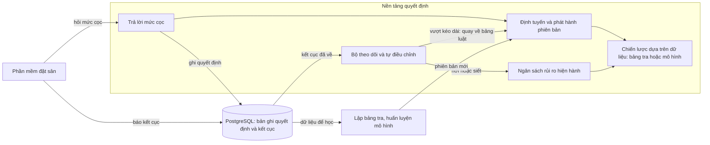

| ĐẠI HỌC QUỐC GIA TP. HỒ CHÍ MINH<br>TRƯỜNG ĐẠI HỌC<br>CÔNG NGHỆ THÔNG TIN | CỘNG HÒA XÃ HỘI CHỦ NGHĨA VIỆT NAM<br>Độc Lập - Tự Do - Hạnh Phúc |
| :---: | :---: |


# ĐỀ CƯƠNG KHÓA LUẬN TỐT NGHIỆP

> Bản thảo ngày 15/11/2026, chưa nộp. Các con số cam kết ở Mục 7 (ví dụ "trả lời trong 150 mili giây") là dự kiến; nhóm chốt chúng ở tuần thứ 2, sau khi đo lại hệ thống hiện tại, và không đổi sau khi có kết quả. Mọi con số ở Mục 1.5 lấy từ các chương trình trong `tools/research/` và chạy lại được. Nguồn được kiểm ngày 13 tới 15/11/2026; cách kiểm từng nguồn ghi ở Mục 12. Đề cương này tiếp nối [đề cương Đồ án 2](PROPOSAL_DO_AN_2.md).

**TÊN TIẾNG VIỆT:** Thiết kế và đánh giá giải pháp quyết định đặt cọc thích ứng theo rủi ro cho hệ thống đặt chỗ dịch vụ.

**TÊN TIẾNG ANH:** Design and Evaluation of an Adaptive Risk-Based Deposit Decision Solution for Service Reservation Systems.

**Thời gian thực hiện:** 14 tuần, trong khung 3–4 tháng của học kỳ kế tiếp sau Đồ án 2

**Sinh viên thực hiện:**

- Nguyễn Thành Trung – 23521683
- Đoàn Quốc Tuấn – 23521709

**Nội dung đề tài:**

## Tóm tắt đề tài

**Doanh nghiệp và câu hỏi của họ.** Một doanh nghiệp có vài chi nhánh sân cầu lông, nhận đặt sân qua web. Họ bán khung giờ, và khung giờ trống qua đi là mất. Mỗi lần khách đặt sân, doanh nghiệp phải trả lời một câu hỏi: **khách này phải trả trước bao nhiêu?**

**Vấn đề.** Hiện nay câu trả lời là một mức chung cho mọi khách (có nơi 50 %, có nơi 100 %), hoặc một bảng luật do người viết ra theo cảm tính. Có ba chỗ sai:

- **Một mức chung sai với một nhóm khách.** Thu ít thì người lạ giữ sân rồi không đến; thu nhiều thì khách quen bị đối xử như người lạ, một phần khách ngại trả trước nên không đặt, và mỗi lần hủy là một lần hoàn tiền.
- **Con số tự đặt có thể sai hẳn hướng**, và không ai biết nếu không kiểm bằng dữ liệu.
- **Hành vi của khách thay đổi theo thời gian.** Một mức cọc vừa vặn mùa này có thể thiếu ở mùa sau, và doanh nghiệp chỉ biết khi đã mất tiền, vì phải chờ tới giờ chơi mới biết khách có đến không.

**Đồ án 2 đã làm gì.** Đồ án 2 xây một hệ thống riêng chuyên trả lời câu hỏi "cọc bao nhiêu" cho phần mềm đặt sân, gọi là nền tảng quyết định. Nền tảng này chạy an toàn: nếu nó hỏng, phần mềm đặt sân tự thu cọc 100 % và khách vẫn đặt được. Nhưng bộ luật bên trong nó là **bảy con số do nhóm tự đặt** (ví dụ hạng vàng cọc 30 %), chưa ai kiểm là đúng, và không đổi khi hành vi khách đổi.

**Khóa luận làm gì.** Thay bảy con số đó bằng một giải pháp đặt cọc dựa trên dữ liệu, gồm ba phần:

1. **Ước lượng** khả năng mỗi đơn bị bỏ từ dữ liệu cũ, bằng cách đơn giản nhất còn đủ tốt: một bảng tra lập từ dữ liệu khi dữ liệu còn ít, một mô hình AI khi dữ liệu đủ nhiều để nó thật sự hơn.
2. **Quyết định**: đổi khả năng đó thành mức cọc, sao cho phần tiền doanh nghiệp có thể mất không vượt một mức họ chọn.
3. **Tự điều chỉnh** khi hành vi của khách thay đổi, dù kết cục của mỗi đơn chỉ biết được sau giờ chơi. **Đây là trọng tâm của đề tài.**

Cả ba chạy như một chiến lược mới trên nền tảng của Đồ án 2, không đổi bản giao tiếp với phần mềm đặt sân, có đường lùi khi hỏng, và tự quay về bản trước khi số đo xấu đi.

| Vấn đề (Mục 2.2) | Giải pháp của đề tài |
| :--- | :--- |
| 1. Một mức cọc không thể đúng với mọi khách | Ước lượng khả năng từng đơn bị bỏ; mức cọc tính riêng cho từng đơn |
| 2. Con số viết tay có thể sai hướng, và không ai biết | Lấy con số từ dữ liệu; doanh nghiệp chỉ chọn một điều họ hiểu được: chịu mất tối đa bao nhiêu |
| 3. Hành vi khách thay đổi theo thời gian | Đo phần tiền bị hở thực tế và tự chỉnh mức cọc, như một bộ điều nhiệt |
| 4. Kết cục của đơn đến trễ | Chỉnh ngay khi có tín hiệu (kể cả tín hiệu sớm như khách hủy); đo và báo cáo cái giá của độ trễ |
| 5. Phần mềm có thể hỏng, bản mới có thể tệ hơn | Đường lùi từng bậc; chạy thử song song; nhận một phần nhỏ đơn; tự quay về bản trước |
| 6. Người ta không tin con số của máy, và có thể có nhóm khách chịu thiệt | Lý do bằng lời cho từng quyết định; dựng lại được; đo công bằng trong cùng điều kiện đặt chỗ |

**Câu hỏi trung tâm.**

> Khi hành vi của khách thay đổi và kết cục của mỗi đơn chỉ biết được sau giờ chơi, làm sao giữ phần tiền có thể mất trong mức doanh nghiệp chọn, và đổi lại phải thu thêm bao nhiêu tiền cọc?

**Luận điểm đề tài bảo vệ.** Có thể điều chỉnh mức cọc theo từng đơn sao cho phần tiền có thể mất mà tiền cọc kiểm soát được, tính trung bình trên một giai đoạn đủ dài, không vượt mức doanh nghiệp chọn quá một sai số giảm dần theo thời gian và tăng theo độ trễ của kết cục. Điều này đúng dù mô hình dự đoán tốt hay dở, với điều kiện thu đủ cọc thì đạt được mức đó. Mô hình chỉ quyết định phải thu bao nhiêu cọc để đạt mức an toàn đó. Phần tiền có thể mất mà tiền cọc không kiểm soát được (do chính sách hoàn tiền) được đo và báo cáo riêng (Mục 2.4).

Câu hỏi phụ: cần bao nhiêu dữ liệu thì một mô hình AI mới đáng dùng hơn một bảng tra đơn giản.

**Đã thử trước trên dữ liệu thật** (hai bộ dữ liệu công khai: hơn 100.000 đơn đặt phòng khách sạn, hơn 110.000 lịch hẹn khám bệnh; Mục 1.5):

- Chia tiền cọc theo rủi ro làm phần tiền bị hở nhỏ hơn mức chung 18 % tới 36 % tùy cách định nghĩa "bỏ đơn". Một luật tự đặt theo cảm nhận thì làm tệ hơn mức chung 43 %.
- Một bảng tra đơn giản lập từ dữ liệu đạt gần bằng mô hình. Mô hình chỉ hơn khi có từ vài nghìn đơn để học.
- Khi tỷ lệ bỏ đơn tăng gần gấp đôi theo mùa, giữ cố định mức đã chọn làm phần tiền bị hở vượt mục tiêu 1,3 tới 1,7 lần. Cách tự điều chỉnh đưa nó về đúng mục tiêu, nhưng phải thu cọc cao hơn, và vài tuần đầu vẫn vượt vì kết cục chưa kịp về.

**Quy mô nhắm tới.** Một doanh nghiệp từ một sân đơn lẻ tới một chuỗi vài chi nhánh, khoảng 600 tới 1.700 đơn đặt qua web mỗi tháng (giả định ở Mục 4.3). Ở quy mô này, lượng câu hỏi gửi tới nền tảng thấp hơn năng lực đã đo của Đồ án 2 hàng nghìn lần; thứ giới hạn giải pháp là lượng dữ liệu để học và để tự điều chỉnh, không phải sức chịu của hệ thống. Khi đưa vào dùng, các bước đặt sân của khách và nhân viên giữ nguyên; thứ thay đổi là số tiền cọc của từng đơn, tiền thu tại quầy, tiền hoàn, và việc của quản lý (Mục 5.10 tới 5.13).

**Giới hạn nói trước.** Đề tài đo trên dữ liệu công khai của khách sạn và phòng khám, vì không có dữ liệu đặt sân thật nào lấy được. Nó đo được: dự đoán tốt tới đâu, chia cọc theo rủi ro giảm được bao nhiêu phần tiền bị hở, có giữ được mức rủi ro khi hành vi xấu đi không, và hệ thống có chạy an toàn không. Nó **không** đo được doanh nghiệp lãi thêm bao nhiêu hay khách có đặt nhiều hơn không, vì điều đó cần chạy trên khách thật. Đề tài cũng nói rõ khi nào nên giữ một mức chung hoặc một bảng tra đơn giản.

## Thuật ngữ dùng trong đề cương

| Thuật ngữ | Nghĩa |
| :--- | :--- |
| Đơn | Một lần khách đặt sân |
| Bỏ đơn | Khách không đến, hoặc hủy quá sát giờ nên sân không kịp bán lại |
| Tiền cọc, mức cọc | Phần tiền khách trả trước khi đặt, tính theo phần trăm giá đơn. Đề cương dùng theo nghĩa rộng: mọi khoản trả trước, từ 0 % tới 100 % giá đơn |
| Phần tiền bị hở | Phần giá đơn chưa thu trước của những đơn bị bỏ. Đây là số tiền có nguy cơ mất, chưa phải thiệt hại thật: thiệt hại thật còn tùy sân có bán lại được khung giờ không và chính sách hoàn tiền của doanh nghiệp (Mục 2.4) |
| Mức rủi ro chấp nhận | Phần tiền bị hở trung bình mà doanh nghiệp chịu được, tính theo phần trăm giá trị đơn. Do doanh nghiệp chọn |
| Chiến lược | Bộ luật quyết định mức cọc cho một đơn |
| Nền tảng quyết định | Hệ thống của Đồ án 2 (tên là TADSS). Phần mềm đặt sân hỏi nó "đơn này cọc bao nhiêu" và nhận câu trả lời |
| Kết cục | Điều thực sự xảy ra với đơn: khách đến, không đến, hoặc hủy |
| Kết cục đến trễ | Lúc quyết định mức cọc, chưa ai biết khách có đến không; điều đó chỉ biết vào giờ chơi, có khi nhiều ngày sau |
| Dữ liệu trôi | Hành vi của khách thay đổi theo thời gian (theo mùa, theo thị trường, hoặc vì chính mức cọc), nên điều học được từ dữ liệu cũ không còn đúng hẳn |
| Bảng tra | Cách ước lượng đơn giản: chia các đơn thành vài nhóm theo một hai đặc điểm (ví dụ đặt trước bao lâu), lấy tỷ lệ bỏ của từng nhóm trong dữ liệu cũ |
| Mô hình AI | Chương trình học từ các đơn cũ để ước lượng khả năng một đơn mới bị bỏ, dùng nhiều đặc điểm cùng lúc. Đây là mô hình học máy trên dữ liệu dạng bảng, không phải mô hình ngôn ngữ như ChatGPT |
| Tự điều chỉnh | Sau mỗi kết cục, hệ thống so phần tiền bị hở thực tế với mục tiêu rồi nới hoặc siết mức cọc của các đơn sau một chút |
| Mặc định an toàn | Mức cọc dùng khi hệ thống gặp sự cố. Ở SmashCourt là 100 %. "An toàn" ở đây là an toàn cho tiền của doanh nghiệp; đổi lại, khách phải trả trước toàn bộ |
| Chạy thử song song | Cho chiến lược mới tính trên đơn thật nhưng không dùng kết quả của nó, chỉ ghi lại để so với chiến lược đang dùng |
| Mốc so sánh | Cách làm đơn giản hơn mà giải pháp phải hơn được thì mới đáng dùng: mức chung, bảng luật viết tay, bảng tra |
| p95, p99 | Cách nói về thời gian trả lời. "p95 dưới 150 ms" nghĩa là 95 trên 100 lần trả lời nhanh hơn 150 mili giây |
| Cơ chế ngắt mạch | Khi một bộ phận hỏng liên tục, hệ thống tạm ngừng gọi nó và dùng ngay phương án dự phòng, để không phải chờ vô ích. Một lúc sau hệ thống thử gọi lại |
| Bản giao tiếp | Quy định hai hệ thống hỏi và trả lời nhau bằng những thông tin gì, theo định dạng nào |
| Hàng đợi thông điệp, Redis | Hai công nghệ chỉ dùng ở phần mở rộng (Mục 5.9). Hàng đợi thông điệp (RabbitMQ) chuyển tin giữa hai hệ thống và giữ tin khi bên nhận hỏng; Redis là kho dữ liệu trong bộ nhớ, đọc rất nhanh |
| Tuần-người | Đơn vị khối lượng công việc: một người làm trong một tuần |
| RQ, M, KL | Mã đánh số dùng trong đề cương. RQ1 tới RQ6 là sáu câu hỏi nghiên cứu (Mục 2.3). M1 tới M7 là bảy mục tiêu (Mục 3). KL1 tới KL13 là mười ba cam kết về kết quả, mỗi cam kết có ngưỡng đo (Mục 7) |
| Số trong ngoặc vuông | Ví dụ [14]: trỏ tới nguồn số 14 trong danh mục ở Mục 12. Nội dung chính của nguồn được nêu ngay tại chỗ dẫn, không cần mở danh mục mới hiểu được câu |

## 1. Lý do chọn đề tài

### 1.1. Tình huống: câu hỏi "trả trước bao nhiêu"

Xét một doanh nghiệp vận hành chuỗi sân cầu lông, có vài chi nhánh, nhận đặt sân qua web. Đây là loại doanh nghiệp mà phần mềm SmashCourt của Đồ án 1 được xây cho.

Thứ doanh nghiệp bán là khung giờ. Khác với hàng hóa, khung giờ không để dành được: sân trống lúc 18 giờ hôm nay thì không bán lại được vào ngày mai. Vì vậy một khách giữ sân rồi không đến gây thiệt hại thật: doanh nghiệp mất tiền của khung giờ đó, và có thể đã từ chối một khách khác.

Chuyện khách bỏ chỗ là phổ biến ở mọi ngành đặt chỗ:

- **Phòng khám:** một bài tổng hợp 105 nghiên cứu về lịch hẹn khám bệnh ở nhiều nước cho thấy trung bình 23 % lịch hẹn bệnh nhân không đến; thấp nhất là châu Đại Dương với 13 %, cao nhất là châu Phi với 43 % (Dantas và cộng sự, tạp chí Health Policy, 2018) [14].
- **Khách sạn:** bộ dữ liệu công khai Hotel Booking Demand gồm 119.390 đơn đặt phòng thật của hai khách sạn ở Bồ Đào Nha, từ tháng 7/2015 tới tháng 8/2017. Trong đó 44.224 đơn bị hủy, tức 37 % (bộ dữ liệu do António, de Almeida và Nunes công bố năm 2019; con số do nhóm tự đếm lại trên tệp dữ liệu) [16]. Phần lớn là hủy sớm: riêng trong 102.681 đơn không phải cọc, số đơn khách không đến hoặc hủy trong vòng 7 ngày trước ngày đến là 5.850, tức 5,7 %.

Cách tự bảo vệ của doanh nghiệp là bắt khách trả trước một phần hoặc toàn bộ, gọi là tiền cọc. Câu hỏi còn lại: **bao nhiêu thì vừa?**

**Vì sao lúc này câu hỏi đó nặng hơn trước.** Thị trường sân thể thao cho thuê theo giờ đang thừa sân. Báo Dân trí (ngày 05/05/2026) ghi nhận ở Hà Nội: nhiều sân pickleball "trống giờ, vắng khách kéo dài", một chủ sân cho biết doanh thu chỉ còn khoảng một phần ba so với cùng kỳ năm trước và đã sang nhượng mặt bằng, một chủ sân khác nói thị trường "đã chạm ngưỡng bão hòa" [44]. Với sân cầu lông, một bài viết của Playspace (công ty bán phần mềm đặt sân) nêu: giá thuê bị kéo xuống do nhiều sân mở gần nhau, và khách dễ rời đi nếu trải nghiệm chưa tốt [48].

Cần nói rõ độ mạnh của hai nguồn này. Bài báo Dân trí nói về sân pickleball, không phải sân cầu lông. Bài của Playspace là của bên bán phần mềm và không có số liệu. Nhóm dùng chúng như dấu hiệu của thị trường sân cho thuê theo giờ, không như số đo.

Khi sân thừa, doanh nghiệp bị ép từ hai phía cùng lúc:

- Mỗi khung giờ cao điểm bị giữ rồi bỏ trống là mất đi phần doanh thu vốn đã mỏng.
- Khách có nhiều sân để chọn. Sân đòi trả trước nhiều hơn sân bên cạnh thì dễ mất khách.

**Một điểm phần trăm đáng bao nhiêu tiền.** Phép tính dưới đây dùng số giả định để thấy độ lớn, không phải số đo. Một chuỗi có 3 chi nhánh, mỗi chi nhánh 6 sân, giờ cao điểm từ 17 tới 21 giờ, giá 100.000 đ một giờ. Doanh thu giờ cao điểm tối đa là 3 × 6 × 4 × 100.000 đ = 7,2 triệu đồng một ngày, tức khoảng 216 triệu đồng một tháng. Khi đó:

| Điều xảy ra | Mất mỗi tháng |
| :--- | ---: |
| Cứ 1 % khung giờ cao điểm bị bỏ mà không bán lại được | khoảng 2,2 triệu đồng |
| 5 % khung giờ cao điểm bị bỏ | khoảng 10,8 triệu đồng |
| Cứ 1 % khung giờ cao điểm bỏ trống vì khách chọn sân khác do ngại trả trước | khoảng 2,2 triệu đồng |

Một khung giờ trống thì mất tiền như nhau, dù vì khách bỏ hay vì khách không đặt. Phép tính này không cho biết phía nào lớn hơn; hiện doanh nghiệp không có con số của phía nào. Mức cọc vì vậy là một quyết định có tiền thật đi kèm, không phải một chi tiết cấu hình.

### 1.2. Hiện trạng ở Việt Nam: người bán kẹt giữa hai rủi ro

**Rủi ro thứ nhất: không thu trước thì bị bỏ.**

- **Bán hàng qua mạng.** Theo một bài trên Cổng thông tin điện tử Bộ Công Thương (ngày 26/10/2023), do cạnh tranh, người bán "bắt buộc phải cho phép người mua trả tiền khi nhận hàng", và tỷ lệ đơn bị bỏ ("bom hàng") của các cửa hàng trên TikTok Shop là 20–30 % tùy ngành hàng, theo thống kê của chính sàn này [46]. Báo Người Lao Động (ngày 19/07/2025) dẫn số của Hiệp hội Thương mại điện tử Việt Nam thấp hơn: 8–12 % số đơn, và tới 20 % ở vùng xa. Cũng theo bài báo, chi phí xử lý một đơn bị bỏ cao gấp hai tới ba lần đơn thường [47]. Nhóm chỉ có số của Hiệp hội qua bài báo này, chưa có báo cáo gốc.
- **Sân thể thao.** Một bài viết của TripHunter (công ty bán phần mềm đặt sân) mô tả tình huống quen thuộc: khách nhắn giữ sân nhưng không chuyển khoản, chủ sân ngại nhắc, tới sát giờ mới biết khách không đến và không kịp bán lại [36]. Bài của Playspace đã dẫn ở Mục 1.1 xếp "khách đặt rồi không đến" vào danh sách khó khăn của việc nhận đặt sân thủ công [48]. Cả hai là bài của bên bán phần mềm, nên chỉ cho thấy tình huống có thật, không cho biết nó xảy ra nhiều tới đâu. **Nhóm không tìm được số liệu thống kê công khai nào về tỷ lệ bỏ sân ở Việt Nam.** Đây là chỗ yếu nhất của phần hiện trạng; Mục 1.6 nói rõ đề tài xử lý điều này thế nào.

**Rủi ro thứ hai: thu trước nhiều thì mất khách.**

- Chính bài trên cổng Bộ Công Thương ở trên cho thấy điều này: người bán phải cho trả sau do cạnh tranh, tức là nếu đòi trả trước thì mất đơn vào tay người bán khác [46].
- Một luận án tiến sĩ ở Hoa Kỳ theo dõi khoảng 120.000 lượt đặt bàn ở sáu nhà hàng cao cấp của cùng một công ty, trước và sau khi nhà hàng bắt khách đưa thẻ tín dụng để bảo đảm. Kết quả: số lượt không đến giảm, và số lượt đặt cũng giảm; cả hai mức giảm đều đủ lớn để không thể coi là ngẫu nhiên (Hernandez, Đại học Walden, 2015) [37]. Đây là so sánh trước và sau, không có nhóm đối chứng, nên chỉ cho thấy chiều hướng.
- Một nghiên cứu về giá vé đi tới kết luận cùng chiều, bằng mô hình toán chứ không bằng số đo: vé cho hoàn lại một phần tiền mang lại doanh thu cao hơn cả hai thái cực "hoàn hết" và "không hoàn gì" (Gallego và Şahin, tạp chí Operations Research, 2010) [10].

**Hai cách người bán đang dùng để thoát thế kẹt, và cả hai đều đã gây thiệt hại thật.** Báo Dân trí (ngày 04/10/2020) ghi lại hai vụ ở ngành nhà hàng [45]:

- **Tin theo quen biết.** Một nhà hàng ở Chương Mỹ, Hà Nội nhận 20 mâm cỗ, mỗi mâm 1,2 triệu đồng. Chủ nhà hàng cho biết "do là khách quen" nên không yêu cầu đặt cọc. Khách hủy vào phút chót.
- **Một mức cọc theo thói quen.** Một nhà hàng ở Điện Biên nhận 150 mâm cỗ cưới trị giá hơn 200 triệu đồng, thu cọc 30 triệu đồng, tức khoảng 15 % (số tiền cọc theo bài báo này; các báo khác đưa con số khác nhau). Người đặt không đến. Mức cọc quen dùng cho đơn thường đã không tương xứng với một đơn lớn và rủi ro.

Lời khuyên phổ biến hiện nay vẫn là một con số theo kinh nghiệm. Ví dụ, chuyên gia được báo Người Lao Động dẫn lời trong bài nói trên đề xuất đặt cọc 10–30 % với đơn có giá trị cao [47]. Lời khuyên đó không nói vì sao là 10 % mà không phải 30 %, và áp cho khách nào.

**Pháp luật đã có sẵn công cụ, nhưng không trả lời câu hỏi "bao nhiêu".** Khoản 2 Điều 328 Bộ luật Dân sự 2015 quy định: "nếu bên đặt cọc từ chối việc giao kết, thực hiện hợp đồng thì tài sản đặt cọc thuộc về bên nhận đặt cọc" [49]; điều khoản này cho phép hai bên thỏa thuận khác. Như vậy doanh nghiệp có căn cứ để thu cọc và giữ cọc khi khách bỏ. Thu bao nhiêu, với ai, và khi khách hủy thì hoàn lại bao nhiêu là việc doanh nghiệp tự quy định trong chính sách của mình. Cần lưu ý hai điều. Trả trước toàn bộ tiền sân chưa chắc là "đặt cọc" theo nghĩa của điều luật. Và đề tài dùng chữ "tiền cọc" theo nghĩa rộng là mọi khoản trả trước; đề tài không thay đổi chính sách hủy và hoàn tiền của doanh nghiệp.

**Tóm lại hiện trạng:** người bán biết rõ cả hai rủi ro, có công cụ pháp lý, nhưng đang chọn mức cọc bằng thói quen hoặc bằng quen biết. Cả hai cách đều không dựa trên việc khách đó, đơn đó, thực sự rủi ro tới đâu.

### 1.3. Các cách đặt mức cọc đang có, và khoảng trống

**Cách 1: một mức chung cho mọi khách.** Đây là cách phổ biến nhất, và mỗi nơi chọn một mức khác nhau:

- Sân cầu lông Kỳ Hòa ở TP. Hồ Chí Minh nhận cọc 50 %, phần còn lại trả sau khi chơi (theo trang chính sách thanh toán của sân) [34].
- SmashCourt ở Đồ án 1 thu đủ 100 % khi khách đặt qua web. Doanh nghiệp an toàn, nhưng khách chịu thiệt: khách quen chưa từng bỏ sân vẫn phải trả trước toàn bộ như người lạ, và mỗi lần hủy hợp lệ là một lần hoàn tiền mặt tại chi nhánh.

Một mức chung thì quá tay với người đáng tin, và chưa đủ với người rủi ro.

**Cách 2: chủ sân nhớ mặt khách.** Chủ sân nhỏ biết ai là khách quen và cho họ đặt không cần cọc. Cách này đúng về nguyên tắc, nhưng dựa vào trí nhớ của một người. Nó không theo được khi doanh nghiệp có nhiều chi nhánh, nhân viên thay ca, khách đặt qua web lúc nửa đêm; và như vụ ở Chương Mỹ cho thấy, quen biết không phải lúc nào cũng đúng.

**Cách 3: bảng luật viết tay.** Phần mềm chia khách thành hạng và gán mỗi hạng một mức cọc. Đây là cách Đồ án 2 đang dùng (Mục 1.4). Các con số trong bảng do người viết tự đặt, không ai kiểm chúng có khớp với hành vi thật của khách hay không, và chúng không tự thay đổi khi hành vi thay đổi. Mục 1.5 cho thấy một luật tự đặt theo cảm nhận có thể sai hẳn hướng.

**Các hệ thống hiện có làm tới đâu.**

| Hệ thống | Mức cọc được quyết định thế nào | Còn thiếu gì |
| :--- | :--- | :--- |
| Sổ tay, Zalo và trí nhớ của chủ sân | Theo từng khách, bằng cảm nhận | Không mở rộng được; phụ thuộc một người |
| Phần mềm quản lý sân ở Việt Nam: PosApp và Alobo (theo trang giới thiệu của hai phần mềm) [35] | PosApp ghi tiền cọc đã thu và trừ vào hóa đơn cuối; cả hai phần mềm theo dõi công nợ của khách đặt cố định theo tháng. Mức cọc do chủ sân tự đặt | Trong các trang giới thiệu đã xem, nhóm không thấy chức năng nào đề xuất mức cọc theo từng khách |
| SmashCourt (Đồ án 1) | 100 % cho mọi đơn | Không phân biệt khách |
| SmashCourt cùng nền tảng quyết định (Đồ án 2) | Bảng theo hạng thành viên, bảy con số viết tay | Chưa kiểm bằng dữ liệu; không tự cập nhật |
| Shopee, với quyền trả tiền khi nhận hàng (theo trang trợ giúp của Shopee) [39] | Theo lịch sử của tài khoản: nhiều đơn giao không thành công thì bị tạm tắt quyền, đủ điều kiện thì tự mở lại. Trang trợ giúp không nêu ngưỡng cụ thể | Chỉ có hai mức (được hoặc không); là hệ thống riêng của một sàn lớn |
| OpenTable, nền tảng đặt bàn nhà hàng (theo trang tin ngành Restaurant Dive, 2021) [38] | Theo lịch sử của tài khoản: khách có bốn lần đặt bàn mà không đến trong mười hai tháng thì bị đình chỉ tài khoản | Chỉ có hai mức; là hệ thống riêng của một nền tảng lớn |
| Ngân hàng và bảo hiểm | Ngân hàng chấm điểm từng người vay từ hồ sơ (bài tổng hợp của Hand và Henley, 1997) [31]. Bảo hiểm ô tô giảm phí cho người không gây tai nạn và tăng phí cho người gây tai nạn (sách của Lemaire, 1995) [29] | Cần lượng dữ liệu lớn và đội ngũ chuyên trách |

**Khoảng trống.** Việc đặt điều kiện theo lịch sử của từng người đã được chứng minh ở các sàn lớn và ở ngành tài chính. Doanh nghiệp đặt chỗ cỡ nhỏ và vừa thì chưa có công cụ tương đương: một hệ thống cho mức cọc nhiều bậc theo từng đơn, lấy con số từ dữ liệu thay vì tự đặt, tự điều chỉnh khi hành vi của khách thay đổi, giải thích được, và vẫn an toàn khi hỏng. Đây là thứ đề tài xây.

### 1.4. Đồ án 2 đã làm gì, và còn thiếu gì

Đồ án 2 xây nền tảng quyết định và nối nó vào SmashCourt. Mỗi khi khách đặt sân qua web, SmashCourt hỏi nền tảng "đơn này cọc bao nhiêu", nền tảng chạy một chiến lược và trả lời.

**Điều Đồ án 2 đã bảo đảm: chạy an toàn.**

| Tình huống | Kết quả đo | Nguồn |
| :--- | :--- | :--- |
| Chiến lược bên trong nền tảng bị lỗi hoặc chậm | Nền tảng tự trả về mặc định an toàn (cọc 100 %). Việc này xảy ra 11.328 lần trong 467.731 quyết định của lượt đánh giá (các lỗi đều do bộ kiểm thử cố ý gây ra). Trong đó 10.568 lần (93 %) có câu trả lời gần như tức thì (trung vị 0 mili giây), vì cơ chế ngắt mạch đã nhận ra chiến lược đang hỏng và không gọi nó nữa. 400 lần chiến lược bị treo, nền tảng phải chờ hết thời gian cho phép (trung vị 0,42 giây). 360 lần chiến lược báo lỗi (trung vị 0,07 giây) | Lượt đánh giá đầy đủ `EV-20261017-EVAL-full-r1` (17/10/2026); đếm trên tệp bản ghi quyết định `raw/d1/decision_audit.csv` của lượt đó bằng [`tools/research/runtime_facts.py`](../../tools/research/runtime_facts.py), kết quả ở `tools/research/results/runtime_facts.json` |
| Cả nền tảng không trả lời | SmashCourt tự thu cọc 100 %. Nhờ cơ chế ngắt mạch ở phía SmashCourt, 95 trên 100 lượt đặt sân trong lúc sự cố xong trong 0,075 giây; khi chưa có cơ chế này là 1,68 giây | [Báo cáo hiệu năng](../report/PERFORMANCE_REPORT.md) Mục 6.8, lượt đo `PERF-6C-20261113-SP09` (13/11/2026) |
| Truy vết | Mỗi quyết định có đúng một bản ghi không sửa được (kiểm trên 467.731 quyết định: không thiếu, không thừa bản ghi nào); kết cục của đơn được gắn vào bản ghi đó khi SmashCourt báo về | Lượt `EV-20261017-EVAL-full-r1`, chỉ tiêu SC3 trong [báo cáo gói 5.7](../../spec/archive/phase5/PHASE5_REPORT_5.7.md) |

**Điều Đồ án 2 chưa trả lời: chiến lược nào thì tốt.** Chiến lược mặc định hiện nay (phiên bản 2.1.0) là bảy con số viết tay, đặt trong [`DefaultStrategyOptions.cs`](../../src/TADSS.Strategies.Default/DefaultStrategyOptions.cs):

| Con số | Giá trị đang dùng |
| :--- | :--- |
| Mức cọc cho khách vãng lai và hạng thường | 50 % |
| Mức cọc cho hạng bạc | 40 % |
| Mức cọc cho hạng vàng | 30 % |
| Mức cọc cho hạng bạch kim và kim cương | 20 % |
| Đơn từ giá trị này trở lên phải có người duyệt | 2.000.000 đ |
| Khách có từ số lần không đến này trở lên phải có người duyệt | 2 lần |
| Khách có từ số lần giữ chỗ rồi không thanh toán này trở lên thì bị từ chối | 5 lần |

Không con số nào được kiểm bằng dữ liệu. Trong khi đó, Đồ án 2 đã có sẵn những thứ cần để học: mọi quyết định đều được lưu, kết cục của từng đơn được báo về, và nền tảng đã có chức năng chạy thử song song một chiến lược mới. Chỉ chưa có gì dùng dữ liệu đó để làm cho chiến lược tốt lên.

Các giới hạn của Đồ án 2 mà khóa luận xử lý:

1. **Không có cách lấy con số từ dữ liệu.** Bảy con số do người viết đặt; không có công cụ nào lập lại chúng từ các quyết định và kết cục đã lưu.
2. **Mức cọc không đổi khi hành vi khách đổi.** Muốn đổi phải có người sửa cấu hình, và không có gì báo cho người đó biết lúc nào cần sửa.
3. **Không theo dõi phần tiền bị hở thực tế.** Kết cục của đơn có được báo về và lưu lại, nhưng không ai tính xem chính sách đang để hở bao nhiêu so với mục tiêu.
4. **Chưa phát hành phiên bản mới một cách có kiểm soát.** Định tuyến hiện chỉ chia theo giờ cao điểm, chi nhánh, kênh, hạng và khách vãng lai; chưa cho một phiên bản mới nhận một phần nhỏ đơn, và chưa tự quay về bản trước.
5. **Bộ nhớ đệm kết quả trên Redis không có tác dụng** (lưu câu trả lời cũ để khỏi tính lại): trong 653.942 quyết định của lượt đánh giá, không lần nào dùng lại được câu trả lời cũ, vì mỗi đơn là một câu hỏi khác nhau. Con số 653.942 là tổng của hai tệp bản ghi của lượt `EV-20261017-EVAL-full-r1`: 467.731 quyết định ở stack chính và 186.211 ở stack chạy dữ liệu khách sạn; đếm bằng [`tools/research/runtime_facts.py`](../../tools/research/runtime_facts.py).

Hai giới hạn khác được ghi nhận nhưng để ở phần mở rộng (Mục 5.9), vì phép thử ở Mục 1.5 cho thấy lợi ích của việc xử lý chúng là nhỏ: lịch sử của khách chỉ là năm số đếm do SmashCourt gửi kèm, không biết từng lần bỏ sân xảy ra khi nào; và kết cục được báo về nền tảng theo lô, mỗi 5 phút tối đa 20 đơn.

**Vì sao không chỉ là "thay bảng luật bằng mô hình".** Nghe như đổi một tệp, nhưng một chiến lược dựa trên dữ liệu kéo theo những việc mà bảng luật viết tay không cần:

| | Bảng luật viết tay | Chiến lược dựa trên dữ liệu |
| :--- | :--- | :--- |
| Con số lấy từ đâu | Người viết tự đặt | Từ dữ liệu cũ, kiểm lại được |
| Khi hành vi khách đổi | Đứng yên cho tới khi có người sửa | Phải tự phát hiện và tự điều chỉnh, trong khi kết cục lại đến trễ |
| Khả năng hỏng | Gần như không: chỉ là vài phép so sánh | Mô hình có thể treo, chậm hoặc báo lỗi đúng lúc đông khách |
| Thay phiên bản | Sửa cấu hình | Bản mới có thể tệ hơn; phải chạy thử, nhận một phần nhỏ đơn, quay về được |
| Giải thích | Đọc luật là hiểu | Phải rút ra được lý do cho từng quyết định |

Kinh nghiệm ở Google cho thấy điều tương tự: trong một hệ thống dùng mô hình, phần mô hình chỉ là một phần nhỏ, còn phần lớn công sức và rủi ro nằm ở hệ thống xung quanh (Sculley và cộng sự, 2015) [15]. Năm dòng trên ứng với các vấn đề 2 tới 6 ở Mục 2.2.

### 1.5. Đã thử trước trên dữ liệu thật

Trước khi cam kết đề tài, nhóm thử bốn câu hỏi trên hai bộ dữ liệu công khai:

- **Hotel Booking Demand** [16]: 102.681 đơn đặt phòng loại "không cọc" của hai khách sạn ở Bồ Đào Nha. Chỉ lấy đơn không cọc để hành vi của khách chưa bị tiền cọc tác động. Bộ này có giá tiền và có ngày hủy, nhưng gần như không có lịch sử khách.
- **Medical Appointment No Shows** [50]: 110.521 lịch hẹn khám của khoảng 62.000 người ở Brazil. Bộ này có lịch sử của từng người, nhưng không có giá tiền và chỉ dài sáu tuần.

Hai bộ là hai bối cảnh độc lập, khác nhau về nhãn, về giá trị và về lịch sử khách. Con số của hai bộ không được gộp thành một mức lợi ích chung. Mọi phép thử đều giả định khách cư xử như cũ khi mức cọc thay đổi; giới hạn này nói ở cuối mục.

**Cách đo.** Mỗi chiến lược gán một mức cọc cho từng đơn. Sau đó tính hai con số trên tổng giá trị các đơn: mức cọc trung bình, và phần tiền bị hở (tiền chưa thu trước của những đơn thực tế bị bỏ, chia cho tổng giá trị mọi đơn). Với bộ lịch khám không có giá tiền, mọi lịch hẹn được coi có cùng giá trị, nên con số ở đó là **chỉ số lịch hẹn bị bỏ mà chưa được bảo đảm**, không phải tiền. Mô hình học trên đơn cũ và được thử trên đơn mới hơn theo thời gian mà nó chưa thấy, chỉ dùng thông tin biết được lúc đặt. So sánh chính là ở **cùng mức cọc trung bình 50 %**: cùng một lượng tiền cọc thì chia theo kiểu nào để hở ít hơn. Mức cọc 50 % được chọn mà không nhìn kết cục của đơn thử.

#### Câu 1. Chia tiền cọc theo rủi ro có hơn mức chung không?

Trên dữ liệu khách sạn, với mô hình đơn giản nhất (hồi quy logistic: mỗi thông tin được gán một trọng số, cộng lại rồi đổi thành phần trăm), theo hai cách định nghĩa "bỏ đơn":

| | Mọi đơn bị hủy | Chỉ không đến, hoặc hủy trong 7 ngày cuối |
| :--- | ---: | ---: |
| Tỷ lệ đơn bị tính là bỏ, trong tập thử | 32 % | 4,1 % |
| Mô hình chỉ đúng đơn rủi ro hơn trong một cặp (đoán mò: 50 %) | 71 % | 68 % |
| Mức chung 50 %: phần tiền bị hở | 19,05 % tổng giá trị đơn | 1,61 % |
| Bảng luật theo hạng, mô phỏng kiểu Đồ án 2: hơn mức chung | chưa tới 1 % | chưa tới 1 % |
| Mô hình, cùng mức cọc 50 %: phần tiền bị hở | 15,6 % (giảm khoảng 18 %) | 1,03 % (giảm khoảng 36 %) |
| Mô hình, giữ phần tiền bị hở bằng mức chung: mức cọc trung bình | 40,8 % | 29,4 % |

Con số mô hình đưa ra khớp thực tế: chia đơn thành năm nhóm theo mức dự đoán, nhóm được dự đoán 10 % thì thực tế 10 % bị bỏ, nhóm 51 % thì thực tế 51 %. Bảng luật theo hạng không hơn được gì vì 96,6 % đơn đến từ khách chưa từng đặt trước đó.

Cột thứ hai gần với bài toán sân hơn: hủy sớm nhiều tuần không gây thiệt hại vì phòng còn bán lại được, và chỉ 16,6 % số đơn bị hủy rơi vào 7 ngày cuối. Đổi 7 ngày thành 1 hoặc 3 ngày thì mức giảm là khoảng 28 %. Ngưỡng 7 ngày chỉ là một cách chọn để thử trên dữ liệu tính theo ngày, không phải ngưỡng "sát giờ" đúng cho sân. Với nhãn này, con số tuyệt đối nhỏ: mức chung 50 % chỉ để hở 1,6 % tổng giá trị đơn. Ở nơi khách hiếm khi bỏ sát giờ, lợi ích chủ yếu nằm ở việc thu trước ít hơn mà rủi ro không tăng.

#### Câu 2. Có cần tới mô hình AI không, hay một bảng tra là đủ?

Cùng dữ liệu khách sạn, nhãn chặt 7 ngày, so với mức chung ở cùng mức cọc trung bình:

| Cách đặt mức cọc | Phần tiền bị hở so với mức chung |
| :--- | :--- |
| Luật người tự đặt theo cảm nhận: đặt càng xa ngày đến thì cọc càng cao (20, 40, 60, 80 %) | Tệ hơn 43 % |
| Bảng tra lập từ dữ liệu cũ, theo hai đặc điểm: thời gian đặt trước và loại khách sạn | Tốt hơn 31 % |
| Mô hình (11 đặc điểm) | Tốt hơn 36 % |

Luật tự đặt sai hẳn hướng: trong dữ liệu này, đơn bị bỏ sát ngày lại hay là đơn đặt gần ngày. Đây chính là vấn đề 2 ở Mục 2.2. Còn khoảng cách giữa mô hình và bảng tra thì có thật nhưng nhỏ:

| Phép kiểm | Bảng tra | Mô hình | Khoảng cách |
| :--- | ---: | ---: | ---: |
| Cách chia chính (học tới hết 2016, thử năm 2017) | 31 % | 36 % | 5 điểm |
| Chỉ giữ đơn thử đặt từ 01/01/2017 | 31 % | 36 % | 5 điểm |
| Học tới 08/2016, thử 09/2016 tới 08/2017 | 31 % | 37 % | 6 điểm |
| Làm tròn mức cọc lên bậc 20 % | 41 % | 43 % | 2 điểm |
| Khoảng tin cậy 95 % (lấy mẫu lại 500 lần), cách chia chính | 27 tới 34 % | 31 tới 40 % | 3 tới 7 điểm |

Tính bằng tiền, bảng tra để hở 1,12 % giá trị đơn, mô hình 1,03 %. Ở bộ lịch khám, khoảng cách còn nhỏ hơn: bảng tra (thời gian đặt trước × nhóm tuổi) giảm 42,8 %, mô hình không dùng lịch sử 43,1 %.

Khoảng cách đó phụ thuộc vào lượng dữ liệu để học. Nhóm lấy mẫu con của tập học ở nhiều cỡ, mỗi cỡ ba lần, rồi so trên cùng tập thử, theo đúng cách phân tích "đường học" của Perlich, Provost và Simonoff (2003) [64]:

| Số đơn dùng để học | Khách sạn: bảng tra | Khách sạn: mô hình | Lịch khám: bảng tra | Lịch khám: mô hình |
| ---: | ---: | ---: | ---: | ---: |
| 250 | 19,8 % | 13,3 % | 32,5 % | 27,9 % |
| 1.000 | 23,4 % | 23,1 % | 42,4 % | 42,2 % |
| 2.000 | 27,7 % | 28,8 % | 42,2 % | 42,4 % |
| 5.000 | 28,6 % | 33,2 % | 42,8 % | 43,4 % |
| Toàn bộ (66.603 và 71.369) | 30,7 % | 35,9 % | 42,8 % | 44,5 % |

Hai đường cắt nhau: dưới khoảng 1.000 đơn thì bảng tra bằng hoặc hơn mô hình, và mô hình chỉ hơn rõ từ vài nghìn đơn trở lên. Điều này khớp với kết luận của Perlich và cộng sự trên 36 bộ dữ liệu [64], và với nhận xét của Hand (2006) rằng phương pháp đơn giản thường đạt gần bằng phương pháp phức tạp [63]. Hệ quả cho đề tài: điều cần bảo vệ là "lấy con số từ dữ liệu, kiểm lại được", không phải "dùng mô hình càng phức tạp càng tốt". Ngưỡng vài nghìn đơn là của hai bộ dữ liệu này, không phải của sân cầu lông; đề tài cung cấp cách đo lại nó trên dữ liệu của từng doanh nghiệp.

#### Câu 3. Lịch sử của khách đáng bao nhiêu, và có làm khách mới chịu thiệt không?

Trên dữ liệu lịch khám, "lịch sử" của một lịch hẹn chỉ gồm những lần hẹn trước của cùng người đã diễn ra trước lúc đặt, tức kết cục đã biết lúc đặt. 43,3 % lịch thử có lịch sử như vậy.

| Cách ước lượng | Chỉ số chưa được bảo đảm giảm so với mức chung |
| :--- | ---: |
| Mô hình chỉ dùng dữ liệu của lịch hẹn | 43,1 % |
| Thêm năm số đếm thô, kiểu Đồ án 2 | 43,7 % |
| Thêm lịch sử có quên dần (lần hẹn càng cũ càng nhẹ) | 44,5 % |
| Chỉ dùng lịch sử, bỏ dữ liệu của lịch hẹn | 5,5 tới 7,6 % |

Lấy mẫu lại 500 lần: số đếm thô thêm 0,4 tới 0,9 điểm, lịch sử có quên dần thêm 1,1 tới 1,7 điểm. Tác dụng có thật nhưng nhỏ, và lịch sử một mình gần như vô dụng. Vì vậy lịch sử có quên dần được để ở phần mở rộng (Mục 5.9).

Về công bằng, xét những người thật sự đến khám, so tỷ lệ được cọc từ 20 % trở xuống:

| Phép đo | Đã có lịch sử trừ chưa có lịch sử |
| :--- | ---: |
| Mô hình **không dùng lịch sử** | 10,9 điểm |
| Mô hình có lịch sử quên dần | 9,9 điểm (khoảng tin cậy 95 %: 8,9 tới 11,0) |
| Mô hình có lịch sử, so trong cùng nhóm thời gian đặt trước × nhóm tuổi | −0,8 điểm |

Chênh lệch thô gần 10 điểm, nhưng nó vẫn có khi mô hình hoàn toàn không biết lịch sử, và gần như mất khi so trong cùng điều kiện đặt chỗ. Vậy chênh lệch đến từ chỗ người khám lại đặt lịch theo kiểu khác (đặt trước bao lâu, ở tuổi nào), không phải do hệ thống phạt người mới. Đây chính là lý do phải đo "công bằng có điều kiện" theo cách của Corbett-Davies và cộng sự (2017): so trong cùng nhóm các yếu tố chính đáng, không so thô [65]. Chênh lệch thô theo giới (nữ 37,9 %, nam 42,0 %) và theo tuổi (dưới 30 tuổi 43,3 %, từ 30 tuổi 36,8 %) cũng phải được đo lại theo cách đó.

#### Câu 4. Mức rủi ro chọn trước có giữ được khi hành vi khách xấu đi không?

Tỷ lệ bỏ sát ngày của dữ liệu khách sạn đổi theo mùa: tính theo giá trị đơn, khoảng 5 % vào hè–thu 2015, rồi 8 % vào tháng 11–12/2015 và 16 % vào tháng 1–2/2016. Chọn mức rủi ro ở mùa ít bỏ rồi áp sang mùa nhiều bỏ cho ta một lần dữ liệu trôi bất lợi **thật**, không phải giả lập.

Nhóm duyệt các đơn theo ngày đặt, như một hệ thống đang chạy. Mỗi đơn được quyết định mức cọc lúc đặt, còn kết cục của nó chỉ được biết vào ngày đến; trung vị của độ trễ này là 38 tới 74 ngày tùy giai đoạn. Mục tiêu là phần tiền bị hở mà mức chung 50 % để lại ở giai đoạn chọn. Ba cách được so:

| Giai đoạn thử | Mức chung 50 % | Giữ cố định mức đã chọn | Tự điều chỉnh khi kết cục về |
| :--- | :--- | :--- | :--- |
| Xấu đi mạnh: tỷ lệ bỏ từ 4,9 % lên 8,6 % (11/2015 tới 06/2016) | vượt mục tiêu 1,76 lần | vượt 1,68 lần, cọc trung bình 35 % | 0,99 tới 1,02 lần, cọc trung bình 57 tới 61 % |
| Xấu đi vừa: từ 3,7 % lên 5,8 % (10/2016 tới 03/2017) | vượt 1,58 lần | vượt 1,30 lần, cọc 43 % | 0,98 tới 1,01 lần, cọc 53 tới 54 % |
| Tốt lên: từ 5,5 % xuống 3,2 % (năm 2017, để đối chứng) | 0,58 lần | 0,65 lần, cọc 24,5 % | 0,83 tới 0,87 lần, cọc chỉ còn 14,6 tới 16 % |

"Tự điều chỉnh" dùng quy tắc của Gibbs và Candès (2021) [55]: mỗi khi một kết cục về, nới ngân sách rủi ro một chút nếu đơn đó hở ít hơn mục tiêu, siết lại nếu hở nhiều hơn (Mục 2.4). Ba dòng khoảng ở cột cuối là ba tốc độ điều chỉnh khác nhau; kết quả gần như không đổi theo tốc độ. Bốn điều rút ra:

- **Mọi chính sách cố định đều vượt khi hành vi xấu đi**, kể cả mức chung 50 % lẫn mô hình có mức rủi ro chọn cẩn thận. Đây là lý do thật sự để không dùng một quy tắc đứng yên.
- **Tự điều chỉnh giữ được mục tiêu tính trên cả giai đoạn**, và khi hành vi tốt lên thì tự hạ cọc cho khách.
- **Cái giá phải trả là tiền cọc**: khi khách bỏ nhiều hơn, muốn giữ rủi ro thì phải thu nhiều hơn.
- **So với ngân sách cố định tốt nhất nhìn lại** (cùng mô hình, một ngân sách duy nhất chọn khi đã biết mọi kết cục, vừa đủ đạt mục tiêu; không triển khai được, chỉ để so): khi tình hình xấu đi, tự điều chỉnh gần như bằng nó (cọc 57 tới 61 % so với 55,0 % ở giai đoạn xấu mạnh; 53 tới 54 % so với 54,1 % ở giai đoạn xấu vừa). Khi tình hình tốt lên, tự điều chỉnh nới chậm hơn nhiều (14,6 tới 16 % so với 4,6 %), tức khách trả trước nhiều hơn mức cần khoảng 10 điểm. Lý do nằm ở chính quy tắc: mỗi đơn không bị bỏ chỉ nới ngân sách một chút, mỗi đơn bị bỏ thì siết mạnh (Mục 2.4). Sự không đối xứng này là một vấn đề phải giải (RQ2).
- **Cái giá của độ trễ là vài tuần đầu**: ở giai đoạn xấu đi, một hai tháng đầu vẫn vượt khoảng 1,5 lần vì kết cục chưa kịp về. Ở sân cầu lông, khách thường đặt trước vài giờ tới vài ngày chứ không phải vài tuần, nên độ trễ ngắn hơn nhiều; đề tài đo xem độ trễ ngắn lại thì phần vượt này giảm tới đâu (RQ2).

#### Điều rút ra, và đề tài được xây quanh chúng

1. Lấy con số từ dữ liệu là phần có giá trị lớn và chắc chắn. Luật tự đặt có thể sai hẳn hướng.
2. Độ phức tạp của mô hình chỉ đáng khi có đủ dữ liệu; trước đó, bảng tra là lựa chọn đúng.
3. Lịch sử của khách giúp một chút; nó là phần mở rộng, không phải lõi.
4. Bài toán khó nhất và có giá trị nhất là giữ mức rủi ro khi hành vi khách thay đổi, với kết cục đến trễ. Đây là câu hỏi trung tâm.
5. Công bằng phải đo trong cùng điều kiện đặt chỗ; đo thô cho kết luận sai.

#### Giới hạn của các phép thử

- **Khách được giả định cư xử như cũ khi mức cọc đổi.** Các đơn khách sạn vốn không phải cọc; khi bị đòi cọc, có khách sẽ không đặt nữa, có khách sẽ giữ lời hơn. Không bộ dữ liệu nào cho thấy điều này. Phần đó chỉ kiểm được bằng mô phỏng (Mục 8).
- **Nhãn vẫn chưa phải bỏ sân.** Nhãn chặt tính theo ngày, còn bỏ sân tính theo giờ. Hủy phòng hay bỏ lịch khám cũng không gây cùng mức thiệt hại như bỏ sân sát giờ. Các phép thử cho thấy cách làm có tác dụng, không cho biết một sân sẽ bớt mất bao nhiêu tiền.
- **Dữ liệu trôi bất lợi mới thấy ở một bộ dữ liệu, theo mùa.** Những kiểu thay đổi khác (một đối thủ mở sân bên cạnh, một đợt mưa kéo dài) chưa được thử.
- **Chỉ thấy những đơn đã được tạo.** Khách đã bỏ đi vì chính sách cũ không có mặt trong dữ liệu.
- **Mô hình thử trên bộ lịch khám có dùng tuổi và giới tính** làm đặc điểm, vì bộ đó chỉ có vậy. Trong giải pháp cho SmashCourt, hai thông tin này không được dùng để quyết định mức cọc (Mục 5.2, 5.12); chúng chỉ dùng để đo công bằng.
- **Không có dữ liệu sân thật.** 215 đơn SmashCourt hiện có là dữ liệu tạo ra khi phát triển phần mềm, không phản ánh khách thật.

#### Mỗi con số lấy từ đâu

| Con số trong đề cương | Chương trình | Tệp kết quả, khóa |
| :--- | :--- | :--- |
| 102.681 đơn không cọc; 16,6 % đơn hủy rơi vào 7 ngày cuối; 5.850 đơn bỏ sát ngày | `deposit_pretest.py` | `deposit_pretest.json`, `results.dataset` |
| 71 % và 68 % (xếp đúng đơn rủi ro hơn); năm nhóm khớp thực tế | `deposit_pretest.py` | `results.all_cancellations.auc_model`, `results.strict_labels.7.auc_model`, `results.all_cancellations.calibration_model` |
| 19,05 %, 15,6 %, giảm 18 %, 40,8 %; 1,61 %, 1,03 %, giảm 36 %, 29,4 %; khoảng 28 % với 1 và 3 ngày | `deposit_pretest.py` | `results.all_cancellations`, `results.strict_labels` |
| Bảng luật theo hạng hơn mức chung chưa tới 1 %; 96,6 % đơn từ khách chưa đặt lần nào | `deposit_pretest.py` | `results.all_cancellations.tier_rule`, `results.strict_labels.7.tier_rule`, `results.all_cancellations.repeat_guest_share_test` |
| Tệ hơn 43 %, tốt hơn 31 %, tốt hơn 36 % | `deposit_pretest.py` | `results.rules_vs_model.strict_7d` |
| 31 / 36 %, 31 / 37 %, 41 / 43 %, khoảng tin cậy 27–34 %, 31–40 %, 3–7 điểm; 1,12 % và 1,03 % | `deposit_pretest.py` | `results.sensitivity_strict_7d` |
| Bảng đường học | `curve_pretest.py` | `curve_pretest.json`, `results.hotel_strict_7d`, `results.medical_noshow` |
| 43,3 % lịch có lịch sử; 42,8 %, 43,1 %, 43,7 %, 44,5 %; 5,5–7,6 %; 0,4–0,9 và 1,1–1,7 điểm | `history_pretest.py` | `history_pretest.json`, `results.dataset`, `results.uncovered_index`, `results.bootstrap_95pct_reduction_at_same_deposit` |
| 10,9; 9,9 (8,9–11,0); −0,8 điểm; tỷ lệ theo giới và tuổi | `history_pretest.py` | `results.fairness_at_same_deposit` |
| Tỷ lệ bỏ theo mùa; 1,76 / 1,68 / 0,99–1,02 lần; cọc 35 % và 57–61 %; các giai đoạn khác; độ trễ 38–74 ngày | `drift_pretest.py` | `drift_pretest.json`, `results.adverse_strong`, `results.adverse_moderate`, `results.favourable` |
| Tỷ lệ bỏ sát ngày theo tháng (khoảng 5 %, 8 %, 16 %) | `drift_pretest.py` | `drift_pretest.json`, `results.monthly_abandon_value_share` |
| Mốc nhìn lại: 55,0 %, 54,1 %, 4,6 % | `drift_pretest.py` | `drift_pretest.json`, `results.*.hindsight_fixed_eps` |
| Phần sàn 0,1–2,6 % và 3,3–5,1 %; theo tháng 0,5–3,3 %; hủy sớm 25–31 % giá trị; dạng A 20,8 % và dạng B 29,4 % / 27,5 % (Mục 2.4) | `floor_pretest.py` | `floor_pretest.json`, `results.floor`, `results.floor_monthly`, `results.formulation_comparison_strict_7d` |
| 11.328 lần lùi về mặc định, 10.568 / 400 / 360 lần và trung vị; 467.731, 186.211 và 653.942 quyết định; 0 lần dùng lại bộ nhớ đệm (Mục 1.4) | `runtime_facts.py` | `runtime_facts.json`, `results.decision_audit`, `results.decision_audit_portability`, `results.all` |

Mọi chương trình trên nằm trong `tools/research/`, đều đọc dữ liệu đã kiểm mã SHA-256, và đều có chế độ `--check`.

**Chạy lại được.** Mọi con số của mục này lấy từ năm chương trình trong [`tools/research/`](../../tools/research/README.md): `deposit_pretest.py` (câu 1, 2), `curve_pretest.py` (đường học), `history_pretest.py` (câu 3), `drift_pretest.py` (câu 4) và `floor_pretest.py` (phần sàn và hai dạng ràng buộc ở Mục 2.4). Kết quả lưu trong `tools/research/results/`. Các chương trình tải dữ liệu theo địa chỉ ghim sẵn, kiểm mã SHA-256, cho cùng kết quả ở mỗi lần chạy, và có chế độ `--check` để so với kết quả đã lưu. Nguồn dữ liệu, giấy phép, tham số và cách chạy ghi ở [hướng dẫn](../../tools/research/README.md). Việc lưu chương trình chỉ bảo đảm người khác tính lại được các con số; nó không làm dữ liệu khách sạn hay phòng khám đại diện hơn cho sân cầu lông.

### 1.6. Khi nào đề tài có ích, khi nào không

Đề tài có ích cho một doanh nghiệp khi các điều sau cùng đúng:

1. Việc trả trước có giá: hoàn tiền tốn công, hoặc khách ngại trả trước nhiều.
2. Đặc điểm của đơn (đặt trước bao lâu, khung giờ, giá) đủ để phân biệt đơn rủi ro với đơn an toàn.
3. Có đủ dữ liệu: khoảng một nghìn đơn có kết cục để lập bảng tra, vài nghìn đơn để mô hình đáng hơn bảng tra (theo hai bộ dữ liệu ở Mục 1.5; doanh nghiệp đo lại trên dữ liệu của mình).
4. Hành vi khách có thay đổi theo thời gian. Nếu nó đứng yên, một bảng tra lập một lần là đủ và phần tự điều chỉnh ít tác dụng.

**Khi nào nhóm kết luận giải pháp không đáng dùng.** Đề tài chấp nhận kết quả âm, cho loại doanh nghiệp đang xét, trong bốn trường hợp:

1. Ở cùng mức rủi ro, mô hình không giảm được mức cọc trung bình so với bảng tra quá một ngưỡng nhỏ, chốt ở tuần 2. Khi đó nên dùng bảng tra, vì nó dễ giải thích hơn.
2. Không cách nào, kể cả bảng tra, hơn được một mức chung. Khi đó nên giữ một mức chung.
3. Tự điều chỉnh không giữ được mục tiêu tốt hơn cách giữ cố định trên các giai đoạn dữ liệu trôi. Khi đó phần trọng tâm bị bác, và luận văn báo cáo đúng như vậy.
4. Khách hiếm khi bỏ sát giờ tới mức số tiền giữ lại được không bù công vận hành.

Lộ trình ở Mục 5.6 có sẵn cách xử lý cho các trường hợp này: doanh nghiệp ở lại giai đoạn đơn giản hơn cho tới khi số đo trên dữ liệu của chính họ cho thấy đáng chuyển.

**Bằng chứng từ chính các sân.** Nhóm không có dữ liệu đặt sân thật và không làm khảo sát chủ sân. Không phần mềm hay sân nào nhóm tìm được đang thu cọc theo rủi ro, nên cũng không có dữ liệu nào cho thấy khách sân cầu lông phản ứng thế nào với mức cọc khác nhau. Vì vậy đề tài đặt vấn đề bằng nguồn gián tiếp (Mục 1.1 tới 1.3), kiểm phương pháp bằng hai bộ dữ liệu công khai, và không khẳng định gì về độ lớn của vấn đề ở một sân cụ thể.

### 1.7. Những câu hỏi phản biện và câu trả lời

#### "Đặt chỗ thì trả tiền trước, nơi nào cũng vậy."

1. Thực tế không phải vậy. Ngay trong ngành sân thể thao ở Việt Nam, sân Kỳ Hòa chỉ thu cọc 50 % [34], và hai phần mềm quản lý sân đã xem (PosApp, Alobo) đều có mục công nợ cho khách tháng, tức cho khách quen trả sau [35]. Ở bán hàng qua mạng, người bán còn buộc phải cho trả sau, theo bài trên cổng Bộ Công Thương [46]. Mức trả trước là thứ mỗi nơi tự chọn.
2. Thu đủ trước có giá. Ở sáu nhà hàng trong luận án của Hernandez, bắt khách bảo đảm bằng thẻ làm số lượt đặt giảm [37].
3. Đề tài không phủ nhận cách thu đủ. Thu đủ là một lựa chọn trong hệ thống của đề tài, ứng với mức rủi ro chấp nhận bằng 0. Một nghiên cứu bằng mô hình toán còn cho thấy khi chỗ bị bỏ không thể giao cho người khác thì mức cọc tối ưu bằng toàn bộ giá (Oh và Su, 2018) [51].

#### "SmashCourt đang thu đủ 100 %. Giảm cọc chỉ thêm rủi ro, lợi ích ở đâu?"

Với nơi đang thu đủ, giải pháp không làm doanh nghiệp an toàn hơn. Nó đưa phần tiền bị hở từ 0 lên một mức nhỏ do doanh nghiệp tự chọn; đổi lại, khách đáng tin trả trước ít hơn và doanh nghiệp bớt việc hoàn tiền mặt tại chi nhánh mỗi khi khách hủy hợp lệ. Việc đổi đó có đáng không là quyết định của doanh nghiệp; đề tài cho họ thấy trước con số, và không khẳng định "doanh thu tăng".

#### "Sao không dùng một luật đơn giản?"

Đề tài dùng, và coi đó là mốc phải vượt. Phép thử ở Mục 1.5 cho ba câu trả lời: luật theo hạng gần như không hơn mức chung; luật tự đặt theo cảm nhận có thể sai hẳn hướng; còn một bảng tra đơn giản lập từ dữ liệu thì đạt gần bằng mô hình, và hơn mô hình khi dữ liệu còn ít. Vì vậy đề tài không bán "mô hình AI", mà bán cách lấy con số từ dữ liệu, chọn độ phức tạp theo lượng dữ liệu, và tự điều chỉnh khi hành vi đổi. Một bảng tra đứng yên vẫn vượt mục tiêu khi hành vi khách xấu đi, như mọi chính sách cố định khác.

#### "Phương pháp giữ mức rủi ro khi dữ liệu trôi đã có rồi. Các em làm gì mới?"

Đúng là quy tắc tự điều chỉnh không phải của nhóm: nó là của Gibbs và Candès (2021) [55], và việc áp nó khi kết quả về trễ đang được nghiên cứu trong năm 2026 [57], [58]. Đề tài không nhận là phát minh ra phương pháp. Phần đề tài làm là:

- áp phương pháp cho một bài toán quyết định thật, nơi tổn thất tính bằng tiền, độ trễ thay đổi theo từng đơn (bằng thời gian đặt trước), và có tín hiệu sớm (khách hủy trước giờ);
- đánh giá trên dữ liệu trôi bất lợi thật, không chỉ trên dữ liệu giả lập;
- đưa nó vào một hệ thống đang nhận đơn, với đường lùi, phát hành có kiểm soát và khả năng dựng lại từng quyết định.

#### "Khách bỏ sân thì nhắc lịch là xong, cần gì tới tiền cọc?"

Khách bỏ sân vì nhiều lý do, và mỗi lý do hợp với một công cụ:

| Lý do khách bỏ sân | Công cụ hợp nhất |
| :--- | :--- |
| Khách quên lịch | Nhắn nhắc lịch. Ở phòng khám, nhắc lịch làm tỷ lệ không đến giảm từ 21 % xuống 15 % (Robotham và cộng sự, 2016) [33] |
| Khách giữ chỗ nhưng không thanh toán | Đặt hạn thanh toán, hết hạn thì tự nhả sân. SmashCourt đã có từ Đồ án 2 |
| Khách đổi ý sát giờ, hoặc giữ sân mà không chắc sẽ đến | Tiền cọc: làm khách cân nhắc trước khi giữ chỗ, và bù một phần cho doanh nghiệp khi sân bị bỏ |

Nhắc lịch và tiền cọc bổ sung cho nhau. Đề tài chọn tiền cọc vì đây là quyết định SmashCourt phải đưa ra ở mọi đơn, và là chỗ Đồ án 2 để lại bảy con số chưa kiểm. Đề tài không so tiền cọc với nhắc lịch (Mục 10).

#### "Số liệu là của khách sạn và phòng khám, không phải của sân. Có chủ sân nào xác nhận vấn đề chưa?"

Chưa. Nhóm không có dữ liệu sân thật và không làm khảo sát chủ sân (Mục 1.6). Hai bộ dữ liệu được dùng để kiểm phương pháp, mỗi bộ một phần việc (Mục 8), không để chứng minh độ lớn của vấn đề ở sân cầu lông. Đề tài trả lời câu hỏi "cách làm này có đúng và an toàn không", còn câu hỏi "một sân cụ thể có đáng dùng không" thì để doanh nghiệp tự trả lời bằng phép đo mà đề tài cung cấp.

**Phần phản biện còn đúng.** Với nơi đang thu đủ, giá mỗi đơn nhỏ, khách không phàn nàn và sân luôn kín, lợi ích của đề tài là nhỏ. Đề tài không cố chứng minh điều ngược lại.

## 2. Bài toán

### 2.1. Phát biểu bằng lời

> Cho một doanh nghiệp đặt chỗ đã có nền tảng quyết định của Đồ án 2. Hãy thiết kế một giải pháp quyết định mức cọc cho từng đơn từ dữ liệu, sao cho phần tiền có thể mất không vượt mức doanh nghiệp chọn, kể cả khi hành vi của khách thay đổi theo thời gian và kết cục của mỗi đơn chỉ được biết sau giờ chơi. Chỉ ra mức phức tạp nào của cách ước lượng là đáng dùng với lượng dữ liệu đang có. Đưa giải pháp vào vận hành mà không làm mất các bảo đảm an toàn của Đồ án 2.

Bài toán có ba lớp lồng vào nhau:

- **Nghiệp vụ: đơn này cọc bao nhiêu?** Câu trả lời phải dựa trên rủi ro thật của đơn, lấy từ dữ liệu, không dựa trên con số do người viết phần mềm tự đặt.
- **Theo thời gian: con số hôm qua còn đúng hôm nay không?** Hành vi khách thay đổi, mà hệ thống chỉ biết điều đó qua những kết cục đến trễ. **Đây là lớp trọng tâm.**
- **Vận hành: làm sao để tất cả chạy trong lúc khách đang đặt sân, mà không gây hại khi nó sai hoặc hỏng?**

Đặt cọc cho sân cầu lông là tình huống dùng để kiểm chứng. Cùng bài toán xuất hiện ở mọi nơi phải quyết định điều kiện giao dịch trước khi biết kết quả, ví dụ có cho một người mua trả tiền khi nhận hàng hay không.

### 2.2. Sáu vấn đề phải giải

Mỗi vấn đề gồm ba phần: một cảnh để hình dung, tình trạng hiện nay ở SmashCourt sau Đồ án 2, và điều lời giải phải đạt.

**Vấn đề 1. Một mức cọc không thể đúng với mọi khách.**

- **Hình dung:** khách A đã đặt hai mươi lần và lần nào cũng đến. Khách B mới tạo tài khoản tối qua, đặt giờ cao điểm sáng mai. Hai người cùng phải cọc 50 %. Với khách A là thừa, với khách B là thiếu.
- **Hiện nay:** bảng luật chia khách theo hạng thành viên. Hai khách cùng hạng nhận cùng một mức cọc, dù đơn của họ rủi ro khác nhau.
- **Lời giải phải đạt:** mức cọc khác nhau theo rủi ro của từng đơn, và có số đo cho thấy cách này tốt hơn một mức chung ở cùng mức cọc trung bình.

**Vấn đề 2. Con số viết tay có thể sai hẳn hướng, và không ai biết.**

- **Hình dung:** người viết phần mềm nghĩ "đặt càng xa càng dễ bỏ" nên cho đơn đặt xa cọc cao. Trên dữ liệu khách sạn, luật đó làm tệ hơn cả mức chung 43 % (Mục 1.5).
- **Hiện nay:** bảy con số do nhóm tự đặt, chưa ai kiểm.
- **Lời giải phải đạt:** con số lấy từ dữ liệu và kiểm lại được. Doanh nghiệp chỉ phải chọn một điều họ hiểu được: trung bình chịu mất tối đa bao nhiêu phần trăm giá trị đơn. Độ phức tạp của cách ước lượng được chọn theo lượng dữ liệu, không theo ý thích.

**Vấn đề 3. Hành vi của khách thay đổi theo thời gian.**

- **Hình dung:** mùa giải phong trào, kỳ nghỉ, một đợt mưa kéo dài, hay một sân mới mở bên cạnh làm khách bỏ sân nhiều hơn. Ở dữ liệu khách sạn, tỷ lệ bỏ sát ngày tăng gần gấp đôi chỉ trong vài tháng (Mục 1.5).
- **Hiện nay:** bảy con số đứng yên cho tới khi có người sửa, và không có gì báo cho người đó biết lúc nào cần sửa.
- **Lời giải phải đạt:** phần tiền bị hở tính trung bình trên một giai đoạn đủ dài không vượt mức doanh nghiệp chọn. Khi khách bỏ nhiều hơn, hệ thống tự tăng cọc; khi khách giữ lời hơn, hệ thống tự giảm cọc. Thay đổi lớn đột ngột thì báo cho người quản lý.

**Vấn đề 4. Kết cục của đơn đến trễ.**

- **Hình dung:** khách đặt hôm thứ hai cho tối chủ nhật. Tới tối chủ nhật mới biết khách có đến không. Nếu từ thứ hai tới chủ nhật khách bắt đầu bỏ sân nhiều hơn, hệ thống không thể biết sớm hơn.
- **Hiện nay:** kết cục được báo về và lưu lại, nhưng không ai dùng nó để chỉnh chính sách.
- **Lời giải phải đạt:** dùng mọi tín hiệu ngay khi nó có (khách hủy thì biết ngay lúc hủy, không phải chờ tới giờ chơi); không coi đơn chưa có kết cục là đơn tốt; đo và báo cáo cái giá của độ trễ: vượt bao nhiêu, trong bao lâu.

**Vấn đề 5. Phần mềm có thể hỏng, và phiên bản mới có thể tệ hơn phiên bản cũ.**

- **Hình dung:** tối thứ sáu, giờ cao điểm, mô hình bị treo. Hoặc bản mô hình học lại tháng này lỡ giảm cọc quá tay cho nhóm khách hay bỏ sân.
- **Hiện nay:** Đồ án 2 có đường lùi về cọc 100 % và chức năng chạy thử song song, nhưng chưa có cách cho bản mới nhận một phần nhỏ đơn rồi tự quay về bản trước.
- **Lời giải phải đạt:** khách luôn nhận được mức cọc trong thời gian giới hạn (nửa giây). Bộ phận nào hỏng thì lùi về cách đơn giản hơn: mô hình hỏng thì dùng bảng luật, tệ nhất là cọc 100 %. Bản mới phải chạy thử, rồi nhận một phần nhỏ đơn, rồi mới nhận toàn bộ; số đo xấu đi thì tự quay về bản trước.

**Vấn đề 6. Người ta không tin một con số do máy đưa ra, và có thể có nhóm khách chịu thiệt.**

- **Hình dung:** một khách hỏi "sao tôi phải cọc cao hơn bạn tôi?". Một tháng sau có khiếu nại, doanh nghiệp phải xem lại được hôm đó hệ thống quyết định dựa trên điều gì.
- **Hiện nay:** bảng luật thì đọc là hiểu; một chiến lược dựa trên dữ liệu thì không tự giải thích.
- **Lời giải phải đạt:** mỗi quyết định có lý do bằng lời (ví dụ "đặt sát giờ cao điểm, nhóm đơn này bị bỏ 28 %") và dựng lại được từ bản ghi, kể cả mức rủi ro hệ thống đang áp lúc đó. Công bằng được đo trong cùng điều kiện đặt chỗ (Mục 1.5, câu 3). Mặc định, khách chưa có lịch sử không bị thu cao hơn chỉ vì thiếu lịch sử.

### 2.3. Câu hỏi nghiên cứu

Đề tài trả lời sáu câu hỏi. Mỗi câu có một mã (RQ1 tới RQ6) để các mục sau nhắc lại cho gọn. RQ1 là câu hỏi trung tâm, RQ3 là câu hỏi phụ quan trọng nhất.

| Mã | Câu hỏi | Trả lời bằng | Vấn đề |
| :--- | :--- | :--- | :--- |
| RQ1 (trung tâm) | Khi hành vi khách thay đổi, cách tự điều chỉnh có giữ phần tiền bị hở trung bình trong mức đã chọn không, so với giữ cố định; và đổi lại phải thu thêm bao nhiêu tiền cọc? | Các giai đoạn dữ liệu trôi thật theo mùa (khách sạn); mô phỏng cho trường hợp khách đổi hành vi vì chính mức cọc | 3 |
| RQ2 | Kết cục đến trễ làm phần vượt mục tiêu lớn tới đâu và kéo dài bao lâu; dùng tín hiệu sớm (ngày hủy) rút ngắn được bao nhiêu? | Phát lại cùng dữ liệu với độ trễ khác nhau; so khi có và không có tín hiệu sớm | 4 |
| RQ3 | Cần bao nhiêu dữ liệu thì mô hình đáng hơn bảng tra, và lịch sử khách đáng tới đâu? | Đường học trên hai bộ dữ liệu; so bảng tra, hồi quy logistic, cây tăng cường | 1, 2 |
| RQ4 | Ở cùng mức rủi ro, chia cọc theo rủi ro giảm được bao nhiêu tiền cọc so với mức chung và bảng luật theo hạng? Ở cùng tổng tiền cọc, hở ít hơn bao nhiêu? | Đo trên hai bộ dữ liệu, với giả định khách cư xử như cũ | 1, 2 |
| RQ5 | Chạy trong nền tảng có giữ bảo đảm của Đồ án 2 về thời gian trả lời và đường lùi không; một phiên bản lỗi có bị chặn và tự quay về không? | Gửi nhiều yêu cầu cùng lúc, cố ý làm hỏng từng bộ phận, phát hành một bản cố ý làm hỏng | 5 |
| RQ6 | So trong cùng điều kiện đặt chỗ, có nhóm khách nào (theo giới, tuổi, có hay chưa có lịch sử) bị thu cọc cao hơn không? | Đo trên bộ lịch khám theo định nghĩa công bằng có điều kiện | 6 |

### 2.4. Phát biểu chính xác (dành cho người đọc kỹ thuật)

Mục này gồm năm phần: tổn thất theo chính sách hoàn tiền; tách phần sàn và phần kiểm soát được; bài toán tối ưu và lời giải; bộ tự điều chỉnh và hai tầng bảo đảm; mốc so sánh cho bộ tự điều chỉnh. Các con số kiểm trên dữ liệu khách sạn lấy từ `tools/research/floor_pretest.py` và `drift_pretest.py`.

#### Tổn thất theo chính sách hoàn tiền

Chính sách hủy của SmashCourt ([ảnh chụp ngày 14/10/2026](../../tools/evidence/config/smashcourt_cancel_policies.json)) chia kết cục của một đơn thành năm loại. Gọi κ là phần tiền cọc doanh nghiệp được giữ, và r là khả năng bán lại được khung giờ:

| Loại kết cục k | Hoàn cho khách | κ (phần cọc doanh nghiệp giữ) | r (khả năng bán lại, giả định mặc định) |
| :--- | :--- | ---: | :--- |
| Khách đến | Không áp dụng | Không áp dụng | Không áp dụng; tổn thất bằng 0 |
| Không đến | 0 % | 1 | 0 |
| Hủy trong 2 giờ cuối | 0 % | 1 | 0 |
| Hủy trước 2 tới 24 giờ | 50 % số đã trả | 0,5 | 0, và thử thêm 0,5 |
| Hủy trước ít nhất 24 giờ | 100 % số đã trả | 0 | 1, và thử thêm 0,9 |

Với một đơn giá P và mức cọc d, tổn thất của kết cục k, tính theo phần của P, là:

```text
ℓₖ(d) = (1 − rₖ) · (1 − κₖ · d)
```

Đọc bằng lời: nếu khung giờ không bán lại được, doanh nghiệp mất giá đơn, trừ đi phần cọc được giữ. Đây là công thức ngân hàng dùng cho một khoản vay (tổn thất dự kiến bằng khả năng không trả, nhân phần không đòi lại được, nhân số tiền cho vay), nêu ở mục 2 tài liệu giải thích của Ủy ban Basel năm 2005 [30]. Khi khung giờ bán lại được mà doanh nghiệp vẫn giữ cọc, doanh nghiệp được lợi; đề tài không tính khoản lợi đó, để con số tổn thất luôn là phía thận trọng.

#### Phần sàn và phần kiểm soát được

Tổn thất tách được thành hai phần:

```text
ℓₖ(d) = (1 − rₖ) · (1 − κₖ)  +  (1 − rₖ) · κₖ · (1 − d)
         └── phần sàn ──┘       └── phần kiểm soát được ──┘
```

Phần sàn là tổn thất còn lại khi đã thu đủ cọc (d = 100 %): tiền cọc không làm nó nhỏ đi được, vì chính sách hoàn lại một phần hoặc toàn bộ tiền cho khách. Phần kiểm soát được bằng 0 khi thu đủ cọc và tuyến tính theo d. Tính kỳ vọng trên các loại kết cục của đơn i, với pᵢₖ là khả năng đơn i có kết cục k:

```text
Phần kiểm soát được của đơn i = qᵢ · (1 − dᵢ),   với qᵢ = Σₖ pᵢₖ · (1 − rₖ) · κₖ
```

qᵢ là **khả năng bỏ có hiệu lực** của đơn: khả năng đơn bị bỏ theo cách mà tiền cọc làm giảm được thiệt hại. Lớp ước lượng (Mục 5.2) phải dự đoán khả năng của từng loại kết cục, không chỉ "bỏ hay không bỏ".

**Lời hứa của đề tài chỉ áp cho phần kiểm soát được.** Phần sàn được đo và báo cáo riêng, vì ba lý do:

1. Phần sàn do chính sách hoàn tiền quyết định, không do tiền cọc. Nếu doanh nghiệp chọn một mức rủi ro tổng nhỏ hơn phần sàn, không mức cọc nào đạt được, và bộ tự điều chỉnh sẽ đẩy mọi đơn lên cọc 100 % mà vẫn vượt. Khi đó thứ phải sửa là chính sách hủy, không phải tiền cọc.
2. Phần sàn cũng trôi theo thời gian. Trên dữ liệu khách sạn, quy đổi "2 giờ" thành 1 ngày và "24 giờ" thành 7 ngày, phần sàn theo tháng dao động từ 0,5 % tới 3,3 % giá trị đơn (gấp khoảng 7 lần).
3. Phần sàn rất nhạy với giả định bán lại của ca hủy sớm. Trên dữ liệu khách sạn, hủy trước "24 giờ" chiếm khoảng 25 tới 31 % giá trị đơn tùy cách quy đổi. Nếu coi mọi ca này đều bán lại được, phần sàn là 0,1 tới 2,6 %; nếu 10 % không bán lại được, phần sàn lên 3,3 tới 5,1 %. Giả định bán lại của ca hủy sớm vì vậy là giả định nặng nhất của bài toán. Khi vận hành thật, SmashCourt đo được nó bằng cách đếm khung giờ bị hủy có được đặt lại hay không.

#### Bài toán tối ưu

Doanh nghiệp chọn hai con số: mục tiêu ε cho phần kiểm soát được, tính trung bình theo giá trị đơn; và, nếu muốn, một trần ε_max cho phần kiểm soát được của từng đơn. Với vᵢ là giá trị của đơn i:

```text
Chọn dᵢ cho từng đơn để
  tối thiểu       Σ vᵢ · dᵢ / Σ vᵢ                        (tiền cọc trung bình theo giá trị)
  với điều kiện   Σ vᵢ · qᵢ · (1 − dᵢ) / Σ vᵢ ≤ ε          (phần kiểm soát được, trung bình)
             và   qᵢ · (1 − dᵢ) ≤ ε_max  với mọi đơn i       (trần cho từng đơn, tùy chọn)
```

**Lời giải.** Mỗi đơn trước hết nhận mức cọc tối thiểu để thỏa trần: dᵢ = max(0, 1 − ε_max / qᵢ). Nếu phần kiểm soát được trung bình vẫn vượt ε, nâng thêm cọc lên 100 % cho các đơn có qᵢ lớn nhất trước, cho tới khi vừa đạt ε. Đây là bài toán cái túi dạng phân số: mỗi đồng cọc thu thêm ở đơn i làm giảm phần kiểm soát được qᵢ đồng, nên thu ở đơn có qᵢ lớn nhất là hiệu quả nhất. Viết gọn, với một ngưỡng θ chọn sao cho ràng buộc trung bình vừa đúng:

```text
dᵢ = 100 %                        nếu qᵢ ≥ θ
dᵢ = max(0, 1 − ε_max / qᵢ)       nếu qᵢ < θ
```

Hai trường hợp riêng cho hai cách dùng khác nhau:

| Dạng | Khi nào | Lời giải | Hệ quả cho khách |
| :--- | :--- | :--- | :--- |
| A. Chỉ ràng buộc trung bình | Không đặt trần (ε_max rất lớn) | Ngưỡng: đơn rủi ro nhất cọc 100 %, còn lại 0 % | Rẻ nhất tính trung bình, nhưng chỉ có hai mức; nhiều đơn cọc 0 % (ở SmashCourt, dưới 5.000 đ thì thu toàn bộ tại quầy) |
| B. Ràng buộc từng đơn | ε_max = ε | dᵢ = max(0, 1 − ε / qᵢ); ràng buộc trung bình tự thỏa | Mức cọc nhiều bậc; không đơn nào để hở quá ε; tốn cọc hơn |

Trên dữ liệu khách sạn (nhãn chặt 7 ngày), ở cùng phần hở 1,61 % giá trị đơn: dạng A cần cọc trung bình 20,8 %, với 70 % số đơn cọc 0 %; dạng B cần 29,4 % (27,5 % khi làm tròn lên bậc 20 %), với 34 % số đơn cọc từ 20 % trở xuống. Dạng A rẻ hơn khoảng 30 %. Lựa chọn giữa hai dạng là lựa chọn kinh doanh, không phải kỹ thuật; đề tài báo cáo cả đường ở giữa khi ε_max thay đổi. Các phép thử ở Mục 1.5 dùng dạng B.

Ví dụ với dạng B, ε = 2 % và r = 0, khi qᵢ được làm tròn lên bậc 20 %:

| Khả năng bỏ có hiệu lực qᵢ | Mức cọc tính ra | Sau khi làm tròn lên bậc 20 % |
| ---: | ---: | ---: |
| 2 % | 0 % | 0 % |
| 2,5 % | 20 % | 20 % |
| 5 % | 60 % | 60 % |
| 30 % | 93 % | 100 % |

#### Bộ tự điều chỉnh và hai tầng bảo đảm

Hệ thống không biết trước qᵢ chính xác, và hành vi khách thay đổi, nên ngưỡng θ (dạng A) hoặc ngân sách ε (dạng B) được tự điều chỉnh. Gọi λ là log của tham số đó (θ hoặc ε). Tham số càng lớn thì cọc càng ít và phần kiểm soát được càng lớn. Mỗi khi kết cục của một đơn i về:

```text
λ ← λ + η · (ε − ℓᵢ) · vᵢ / v̄          với ℓᵢ = (1 − rₖ) · κₖ · (1 − dᵢ) theo kết cục k thật của đơn i
```

Đọc bằng lời: đơn nào để hở nhiều hơn mục tiêu thì tham số siết lại, ít hơn thì nới ra, đơn càng lớn tác động càng mạnh. η là tốc độ điều chỉnh, v̄ là giá trị đơn trung bình. Đây là quy tắc của Gibbs và Candès (2021) [55], viết cho phần kiểm soát được thay cho tỷ lệ lỗi. Khách hủy thì kết cục về ngay lúc hủy, sớm hơn giờ chơi: đó là tín hiệu sớm.

**Quy tắc này không đối xứng.** Mỗi đơn không bị bỏ cộng η·ε (nhỏ, vì ε chỉ vài phần trăm); mỗi đơn bị bỏ trừ khoảng η·(1 − dᵢ) (lớn). Vì vậy tham số siết nhanh khi khách bỏ nhiều hơn, nhưng nới chậm khi khách giữ lời hơn. Phép thử ở Mục 1.5, câu 4 cho thấy đúng như vậy. Đề tài thử hai cách sửa: tốc độ nới riêng, và bản kiểu PID có thành phần tích lũy [56].

Bảo đảm cần ba điều kiện:

1. Có một mức λ_thấp mà dưới đó mọi đơn mới đều cọc 100 %. Ở dạng A, điều này đúng khi θ nhỏ hơn khả năng bỏ có hiệu lực nhỏ nhất, nên cần chặn dưới cho qᵢ. Ở dạng B, nó đúng nhờ làm tròn mức cọc lên bậc.
2. Tổn thất mỗi đơn, nhân trọng số vᵢ / v̄, bị chặn bởi một số B. Trần cho phần chưa thu của một đơn (Mục 5.3) bảo đảm điều này.
3. Mọi kết cục về trong tối đa D ngày; gọi N_D là số đơn tối đa đang chờ kết cục cùng lúc.

Dưới λ_thấp, mọi đơn mới có phần kiểm soát được bằng 0, nên λ chỉ có thể đi lên. Chỉ các đơn quyết định từ trước, còn đang chờ kết cục, mới kéo λ xuống thêm, và nhiều nhất N_D đơn như vậy. Cộng dồn các bước cập nhật, theo giá trị đơn ở cả hai vế, cho **tầng bảo đảm thứ nhất, tất định** (không cần giả định gì về khách):

```text
Phần kiểm soát được, tính trên tổng giá trị của T đơn đã có kết cục
  ≤ ε  +  (λ_đầu − λ_thấp) / (η · T)  +  B · N_D / T
```

Vế trái đúng là đại lượng doanh nghiệp quan tâm: tỷ lệ tiền bị hở trên tổng giá trị đơn. Số hạng cuối là cái giá của độ trễ viết bằng toán: tỉ lệ với số đơn đang chờ kết cục. Bảo đảm này đúng với độ trễ khác nhau theo từng đơn, chỉ cần bị chặn, và với trọng số theo giá đơn. Nhưng nó lỏng: nó giả định mọi đơn đang chờ đều bị bỏ. Với chuỗi nhỏ ở Mục 4.3 (khoảng 58 đơn mỗi ngày, đặt trước tối đa 7 ngày, nên N_D khoảng 400, và khoảng 1.700 đơn mỗi tháng), số hạng B·N_D/T trong một tháng là khoảng 24 điểm phần trăm, lớn hơn mục tiêu nhiều lần.

**Tầng bảo đảm thứ hai, theo xác suất.** Thêm hai giả định nêu rõ: khả năng bỏ có hiệu lực của các đơn đang chờ không vượt p̄, và kết cục không bị ai sắp đặt có chủ đích (độc lập khi đã biết quá khứ). Khi đó số đơn đang chờ thật sự bị bỏ chỉ khoảng p̄·N_D, nên số hạng độ trễ còn khoảng p̄·B·N_D / T, cộng một sai số ngẫu nhiên. Với p̄ khoảng 5 % và các số ở trên, số đơn đang chờ thật sự bị bỏ là khoảng 20, và số hạng độ trễ là khoảng 1,2 % trong một tháng, cùng bậc với mục tiêu, tức là có ý nghĩa thực tế. Sai số ngẫu nhiên có cỡ √(p̄·N_D) / T, khoảng 0,3 % theo bất đẳng thức Bernstein, hoặc √N_D / T, khoảng 1,2 % theo cách ước lượng thô hơn của Hoeffding. Trên một năm (khoảng 20.000 đơn), hai tầng lần lượt cho khoảng 2 % và khoảng 0,1 % cho số hạng độ trễ.

Hai bổ đề này là **phác thảo**; chứng minh đầy đủ là một phần việc của luận văn (RQ1). Nếu trường hợp có trọng số không chứng minh gọn được, đề tài chứng minh cho trường hợp không trọng số và kiểm phần có trọng số bằng thực nghiệm. Bảo đảm áp cho phần kiểm soát được **theo giả định về khả năng bán lại**; nếu giả định đó sai, tổn thất thật khác đi, nên khả năng bán lại phải được đo khi vận hành.

#### Mốc so sánh cho bộ tự điều chỉnh

Để tách giá trị của bộ tự điều chỉnh khỏi giá trị của mô hình, mốc chính là **ngân sách cố định tốt nhất nhìn lại**: cùng mô hình, một tham số duy nhất chọn khi đã biết toàn bộ kết cục của giai đoạn, vừa đủ để phần kiểm soát được của cả giai đoạn bằng mục tiêu. Mốc này không triển khai được, vì nó cần biết trước tương lai; nó cho biết bộ tự điều chỉnh còn cách cái tốt nhất mà một tham số cố định có thể đạt bao xa. Không dùng mốc "biết trước kết cục từng đơn": với mốc đó chỉ cần thu cọc đúng những đơn sẽ bị bỏ, mức cọc trung bình gần bằng 0, nên không phương pháp nào đến gần được và mốc vô dụng.

Các mốc còn lại: giữ cố định tham số chọn trên dữ liệu cũ; học lại định kỳ (mỗi tháng học lại mô hình và chọn lại tham số theo tháng trước, tức một cách thích nghi chậm hơn); mức chung theo thực hành ngành (50 % như sân Kỳ Hòa, 100 % như SmashCourt ở Đồ án 1); và bảng luật của Đồ án 2.

Bốn điều cần biết thêm:

- **Thu đủ là trường hợp riêng.** Đặt ε = 0 thì mọi đơn cọc 100 %.
- **Không cần biết cọc thấp kéo thêm bao nhiêu khách.** Số khách tăng hay giảm chỉ quyết định lợi ích lớn tới đâu. Đó là thứ không đo được nếu không thử trên khách thật, và đề tài không khẳng định gì về nó.
- **Khách có thể đổi hành vi vì chính mức cọc.** Đây là hiện tượng "dự đoán làm thay đổi điều được dự đoán" mà Perdomo và cộng sự (2020) mô tả [62]. Tầng bảo đảm thứ nhất không cần giả định gì về khách nên vẫn đúng; tầng thứ hai thì cần p̄ chặn được khả năng bỏ cả khi khách phản ứng. Mức phản ứng chỉ kiểm được bằng mô phỏng.
- **Khả năng bán lại là giả định.** Với hủy sát giờ và không đến, mặc định coi như không bán lại được, nên mức cọc ở phía thận trọng. Mức kín lịch của sân chưa phải khả năng bán lại, vì bán lại được hay không còn tùy khách hủy trước bao lâu.

## 3. Mục tiêu

**Mục tiêu tổng quát:** Thiết kế, xây dựng và đánh giá một giải pháp quyết định đặt cọc thích ứng theo rủi ro, lấy con số từ dữ liệu, giữ phần tiền có thể mất trong mức doanh nghiệp chọn kể cả khi hành vi khách thay đổi và kết cục đến trễ, và vận hành an toàn trên nền tảng của Đồ án 2.

**Mục tiêu cụ thể:**

- **M1. Ước lượng khả năng bỏ đơn** theo ba bậc: bảng tra, hồi quy logistic, và cây tăng cường nếu số đo cho thấy đáng. Chọn bậc theo đường học trên dữ liệu đang có. Con số dự đoán phải khớp thực tế; mỗi quyết định kèm lý do đọc được.
- **M2. Quy tắc tính cọc** từ khả năng bỏ đơn và ngân sách rủi ro; làm tròn theo bậc; trần cho phần chưa thu của một đơn; chuyển cho người duyệt khi đơn lớn và hệ thống chưa chắc.
- **M3. Bộ tự điều chỉnh** cập nhật ngân sách mỗi khi có kết cục; dùng tín hiệu sớm; giới hạn tốc độ thay đổi; phát hiện thay đổi lớn để báo người quản lý; lùi về bảng luật khi phần vượt kéo dài quá ngưỡng.
- **M4. Đưa vào nền tảng** dưới dạng một chiến lược mới, không đổi bản giao tiếp v2; SmashCourt-BE chỉ sửa nhỏ để nhân viên xem được lý do của mọi quyết định (Mục 5.10); thêm việc chia một phần nhỏ đơn cho phiên bản mới, tự quay về bản trước, và theo dõi phần tiền bị hở thực tế với kết cục đến trễ.
- **M5. Giữ các bảo đảm của Đồ án 2:** thời gian trả lời, đường lùi khi hỏng, truy vết từng quyết định.
- **M6. Công bằng:** đo trong cùng điều kiện đặt chỗ; mặc định không thu khách mới cao hơn chỉ vì thiếu lịch sử.
- **M7. Kiểm chứng:** đo các cam kết ở Mục 7 bằng thí nghiệm chạy lại được, kèm toàn bộ dữ liệu gốc và chương trình.

## 4. Phạm vi

### 4.1. Trong và ngoài phạm vi

| Chiều | Trong phạm vi | Ngoài phạm vi |
| :--- | :--- | :--- |
| Loại doanh nghiệp | Một doanh nghiệp cho đặt chỗ theo khung giờ; tình huống kiểm chứng là đặt sân cầu lông | Sàn có nhiều doanh nghiệp; tự động đổi giá theo nhu cầu |
| Công cụ điều tiết | Mức cọc (kể cả không cọc); chuyển cho người duyệt | Nhận quá số chỗ; phí phạt; nhắn tin nhắc lịch (có thể là cách rẻ hơn; đề tài không so, lý do ở Mục 10) |
| Dữ liệu | Hai bộ dữ liệu công khai (khoảng 119.000 đơn đặt phòng khách sạn và khoảng 110.000 lịch hẹn khám bệnh); dữ liệu phát lại và mô phỏng | Thử nghiệm trên khách thật; dữ liệu sân thật |
| Cách ước lượng | Bảng tra, hồi quy logistic, cây tăng cường (có điều kiện) | Mô hình ngôn ngữ; mô hình tự thử nhiều mức cọc trên khách thật để tối ưu |
| Thời gian | Tự điều chỉnh với kết cục đến trễ; phát hiện thay đổi lớn | Dự báo trước thay đổi của thị trường |
| Hệ thống | Một chiến lược mới trên nền tảng của Đồ án 2, bản giao tiếp v2 | Bản giao tiếp v3; hàng đợi thông điệp; kho trong bộ nhớ (đều ở phần mở rộng, Mục 5.9) |
| Điều đề tài khẳng định | Chất lượng dự đoán; quan hệ giữa mức cọc và phần tiền bị hở; giữ mục tiêu khi dữ liệu trôi; hệ thống chạy an toàn | "Tăng doanh thu thật" cho một doanh nghiệp; tiền cọc làm khách đổi hành vi ra sao |

### 4.2. Ba mức khối lượng

Quỹ thời gian: 2 sinh viên × 14 tuần = 28 tuần-người (một tuần-người là một người làm trong một tuần).

| Mức | Nội dung |
| :--- | :--- |
| **Cam kết** | Toàn bộ bảy mục tiêu M1 tới M7 ở Mục 3, với bảng tra và hồi quy logistic chạy ngay trong nền tảng |
| **Mở rộng**, làm theo thứ tự nếu có thời gian và có số đo cho thấy đáng (Mục 5.9) | (1) Cây tăng cường chạy qua một dịch vụ dự đoán riêng. (2) Sổ tin cậy có quên dần trong hệ thống, kèm bản giao tiếp v3, đường truyền sự kiện qua RabbitMQ và kho đọc nhanh trên Redis. (3) Nhắn tin nhắc lịch |
| **Đường lùi**, nếu chậm tiến độ | Bỏ cây tăng cường; bỏ bước "nhận một phần nhỏ đơn" (giữ chạy thử song song); phần công bằng chỉ báo cáo mức chênh lệch |

### 4.3. Quy mô

**Doanh nghiệp nhắm tới.** Một doanh nghiệp tự vận hành sân, từ một sân đơn lẻ tới một chuỗi vài chi nhánh, nhận đặt qua web và tại quầy. Chỉ đơn đặt qua web mới đi qua nền tảng; đơn tại quầy không có quyết định cọc (quyết định 6 của [đặc tả API cọc](../../../SmashCourt-BE/docs/api/DEPOSIT_APPROVAL_API.md)). Đề tài không nhắm tới sàn có nhiều doanh nghiệp.

**Lượng đơn.** SmashCourt chưa có khách thật, nên lượng đơn dưới đây là **giả định** để ước lượng, không phải số đo:

| Thông số (giả định) | Chuỗi nhỏ, như ví dụ ở Mục 1.1 | Một sân đơn lẻ |
| :--- | ---: | ---: |
| Số sân | 18 (3 chi nhánh × 6 sân) | 6 |
| Giờ mở cửa | 6 tới 22 giờ | 6 tới 22 giờ |
| Thời lượng trung bình một đơn | 1,5 giờ | 1,5 giờ |
| Mức kín lịch trung bình | 50 % | 50 % |
| Phần đơn đặt qua web | 60 % | 60 % |
| ⇒ Đơn qua web mỗi ngày | khoảng 58 | khoảng 19 |
| ⇒ Đơn qua web mỗi tháng | khoảng 1.700 | khoảng 580 |

Cách tính: mỗi sân mỗi ngày có 16 giờ × 50 % ÷ 1,5 giờ ≈ 5,3 đơn, nhân số sân, nhân 60 %.

**Quy mô dữ liệu quyết định giai đoạn nào dùng được.** Theo đường học ở Mục 1.5, bảng tra cần khoảng một nghìn đơn có kết cục, còn mô hình chỉ hơn bảng tra khi có vài nghìn đơn:

| | Chuỗi nhỏ | Một sân đơn lẻ |
| :--- | :--- | :--- |
| Đủ khoảng 1.000 đơn có kết cục để lập bảng tra | sau khoảng 2,5 tuần | sau khoảng 2 tháng |
| Đủ khoảng 5.000 đơn để mô hình có thể hơn bảng tra | sau khoảng 3 tháng | sau khoảng 9 tháng |

Hệ quả: một sân đơn lẻ có lẽ nên ở lại với bảng tra trong phần lớn năm đầu, và đề tài sẽ nói đúng như vậy. Ngưỡng một nghìn và năm nghìn là của hai bộ dữ liệu công khai, phải đo lại trên dữ liệu thật.

**Quy mô tín hiệu cho bộ tự điều chỉnh.** Bộ tự điều chỉnh học từ những đơn bị bỏ. Nếu khách bỏ 4 % số đơn, chuỗi nhỏ chỉ có khoảng 2 đơn bị bỏ mỗi ngày, sân đơn lẻ chưa tới 1. So với phép thử khách sạn (khoảng 110 tới 150 đơn mỗi ngày trong các giai đoạn thử, `drift_pretest.json`), tín hiệu ít hơn nhiều, nhưng kết cục về nhanh hơn nhiều (vài giờ tới vài ngày thay vì vài tuần). Hai điều này kéo về hai phía ngược nhau; đề tài đo trực tiếp bằng cách phát lại dữ liệu với lượng đơn mỗi ngày giống sân, khoảng 20 và 60 đơn (Mục 8).

**Quy mô kỹ thuật.** Chuỗi nhỏ có khoảng 58 câu hỏi mỗi ngày; giả sử 15 % dồn vào giờ đông nhất, tức khoảng 9 câu hỏi mỗi giờ. Đồ án 2 đã đo hệ thống đạt mọi chỉ tiêu ở tải danh nghĩa khoảng 51 yêu cầu mỗi giây (19 lượt dùng mỗi giây) và chỉ gãy ở khoảng 48 lượt dùng mỗi giây, do giới hạn bộ xử lý của SmashCourt-BE ([báo cáo hiệu năng](../report/PERFORMANCE_REPORT.md) Mục 6.5 và 12). Lượng câu hỏi thật thấp hơn năng lực đó hàng nghìn lần. Đây là lý do có số đo để không đưa RabbitMQ và Redis vào phần cam kết (Mục 5.7), và để không khẳng định gì về quy mô lớn hơn (Mục 10).

## 5. Giải pháp đề xuất

### 5.1. Tổng quan

**Giải pháp trả lời từng vấn đề thế nào.** Bảng dưới nối sáu vấn đề ở Mục 2.2 với phần của giải pháp xử lý nó, nơi mô tả chi tiết, và cam kết dùng để chứng minh (KL1 tới KL13 ở Mục 7).

| Vấn đề | Giải pháp làm gì | Mô tả ở | Chứng minh bằng |
| :--- | :--- | :--- | :--- |
| 1. Một mức cọc không đúng với mọi khách | Ước lượng khả năng từng đơn bị bỏ; đổi thành mức cọc riêng cho đơn | Mục 5.2, 5.3 | KL7 (chia cọc theo rủi ro), KL9 (dự đoán khớp thực tế) |
| 2. Con số viết tay có thể sai hướng | Lấy con số từ dữ liệu; chọn độ phức tạp theo lượng dữ liệu; doanh nghiệp chỉ chọn mục tiêu rủi ro | Mục 5.2, 5.3, 5.6 | KL7, KL8 (đường học) |
| 3. Hành vi khách thay đổi | Bộ tự điều chỉnh ngân sách rủi ro; phát hiện thay đổi lớn | Mục 5.4 | KL3 (giữ mục tiêu khi dữ liệu trôi), KL5 (khách đổi hành vi vì mức cọc), KL6 (phát hiện và lùi) |
| 4. Kết cục đến trễ | Dùng tín hiệu sớm; không coi đơn chưa có kết cục là đơn tốt; đo cái giá của độ trễ | Mục 5.4 | KL4 (cái giá của độ trễ) |
| 5. Phần mềm hỏng, bản mới tệ hơn | Đường lùi từng bậc; chạy thử song song; chia một phần nhỏ đơn; tự quay về bản trước | Mục 5.5 | KL1, KL2 (tốc độ, hỏng), KL10 (phát hành lỗi) |
| 6. Không tin con số của máy; nhóm khách chịu thiệt | Lý do bằng lời; bản ghi đủ để dựng lại; đo công bằng có điều kiện | Mục 5.2, 5.3, 5.5 | KL11 (truy vết), KL12 (công bằng) |

Cam kết KL13 (chạy lại toàn bộ thí nghiệm bằng một lệnh) bảo đảm mọi số đo ở cột cuối đều kiểm lại được.

**Các bộ phận và đường đi của dữ liệu.**



Hệ thống có bốn dòng chảy:

1. **Trả lời mức cọc.** Khách bấm đặt sân. Phần mềm đặt sân hỏi nền tảng. Nền tảng chọn phiên bản chiến lược theo định tuyến, chiến lược ước lượng khả năng bỏ đơn rồi tính mức cọc theo ngân sách rủi ro hiện hành, nền tảng ghi lại quyết định rồi trả lời. Khách phải chờ dòng này nên nó phải nhanh.
2. **Ghi nhận kết cục.** Khi khách đến, không đến hoặc hủy, phần mềm đặt sân báo về qua kênh báo kết cục đã có từ Đồ án 2. Khách không phải chờ dòng này.
3. **Tự điều chỉnh.** Bộ theo dõi đọc các kết cục đã về, so phần tiền bị hở thực tế với mục tiêu, rồi nới hoặc siết ngân sách. Nếu phần vượt kéo dài quá ngưỡng, nó chuyển định tuyến về bảng luật và báo người quản lý.
4. **Học và phát hành.** Định kỳ, bảng tra được lập lại hoặc mô hình được huấn luyện lại từ dữ liệu đã ghi, rồi đi qua các bước phát hành ở Mục 5.5.

**Hình dung bằng một đơn cụ thể.** Các con số là minh họa.

1. 20 giờ thứ năm, khách A mở web, chọn sân 18 tới 19 giờ thứ sáu, giá 200.000 đ, bấm "Đặt sân".
2. Phần mềm đặt sân gửi câu hỏi sang nền tảng, kèm năm số đếm lịch sử của khách A như Đồ án 2 đang làm: hai mươi lần hoàn tất, không lần nào bỏ.
3. Chiến lược ước lượng khả năng đơn này bị bỏ là khoảng 2,4 %.
4. Ngân sách rủi ro hiện hành là 2 %. Quy tắc tính cọc cho mức cọc 17 %, làm tròn lên 20 %, tức 40.000 đ, kèm lý do "khách hoàn tất 20 lần, đặt trước một ngày".
5. Nền tảng ghi lại quyết định, gồm cả phiên bản chiến lược và ngân sách lúc đó, rồi trả lời. Từ bước 2 tới đây phải xong trong nửa giây.
6. Tối thứ sáu khách đến sân, nhân viên bấm nhận sân. Phần mềm đặt sân báo kết cục "đã đến" về nền tảng.
7. Bộ theo dõi cộng đơn này vào phép tính: đơn không bị bỏ nên phần hở bằng 0, thấp hơn mục tiêu, và ngân sách được nới ra một chút.

Nếu tối thứ sáu khách A không đến, phần mềm đặt sân ghi nhận việc đó khoảng 15 tới 20 phút sau giờ bắt đầu và báo về. Phần hở của đơn là 160.000 đ, cao hơn mục tiêu, nên ngân sách bị siết lại một chút và các đơn sau đó cọc cao hơn một chút. Năm số đếm của khách A có thêm một lần không đến, nên đơn sau của chính A cũng cọc cao hơn.

Nếu có bộ phận hỏng giữa chừng, khách A vẫn đặt được sân:

| Hỏng ở đâu | Chuyện gì xảy ra |
| :--- | :--- |
| Mô hình treo hoặc báo lỗi (bước 3) | Nền tảng dùng bảng luật của Đồ án 2 |
| Bộ theo dõi ngừng, hoặc không có kết cục mới trong một thời gian dài | Giữ ngân sách gần nhất; quá ngưỡng thời gian thì chuyển về bảng luật và báo người quản lý |
| Cả nền tảng không trả lời | Phần mềm đặt sân thu cọc 100 %, như cách của Đồ án 1 |

### 5.2. Lớp ước lượng: bảng tra trước, mô hình khi đáng

**Ba bậc.** Đề tài không mặc định dùng mô hình phức tạp nhất. Nó có ba bậc, và chọn bậc bằng đường học trên dữ liệu đang có (Mục 1.5, câu 2):

1. **Bảng tra lập từ dữ liệu:** chia đơn thành vài nhóm theo một hai đặc điểm (ví dụ đặt trước bao lâu × khung giờ), lấy tỷ lệ bỏ của từng nhóm trong dữ liệu cũ; nhóm ít đơn được kéo về tỷ lệ chung để khỏi bị một vài đơn làm lệch.
2. **Hồi quy logistic:** mỗi thông tin được gán một trọng số, cộng lại rồi đổi thành phần trăm. Dùng được nhiều đặc điểm cùng lúc, vẫn dễ giải thích.
3. **Cây tăng cường:** nhiều cây quyết định nhỏ nối tiếp nhau, cây sau sửa lỗi của cây trước. Ứng viên là CatBoost (Prokhorenkova và cộng sự, 2018), loại xử lý tốt các cột kiểu phân loại như hạng khách hay kênh đặt [43]. Chỉ dùng khi đường học cho thấy nó hơn hồi quy một cách đáng kể.

Một doanh nghiệp đi dần qua ba bậc khi dữ liệu tích lũy (Mục 5.6).

**Đọc những gì.** Dữ liệu của đơn (đặt trước giờ chơi bao lâu, khung giờ và ngày trong tuần, giá đơn, số sân, kênh đặt) và năm số đếm lịch sử mà phần mềm đặt sân đã gửi kèm ở Đồ án 2. Mọi thông tin này đã có trong câu hỏi của bản giao tiếp v2, nên không phải đổi bản giao tiếp.

**Cho ra gì.** Khả năng đơn bị bỏ, và lý do đọc được. Với bảng tra, lý do là nhóm của đơn và tỷ lệ bỏ của nhóm đó. Với mô hình, lý do rút từ việc thông tin nào đẩy con số lên hay xuống nhiều nhất, theo phương pháp SHAP của Lundberg và Lee (2017) [42]. Lý do này cho biết thông tin nào làm con số dự đoán cao hay thấp; nó không khẳng định đó là nguyên nhân khiến khách bỏ sân.

**Điều phải kiểm.** Con số đưa ra phải khớp thực tế: nói 10 % thì thực tế phải gần 10 %. Mô hình thường lệch ở điểm này và cần một bước chỉnh sau khi huấn luyện; Niculescu-Mizil và Caruana (2005) đã đo hiện tượng này trên nhiều loại mô hình và đưa ra cách chỉnh [8]. Bộ tự điều chỉnh ở Mục 5.4 cũng bù được một phần sai lệch còn lại.

**Chạy trong nền tảng thế nào.** Bảng tra và hồi quy logistic được tính bằng Python từ dữ liệu, rồi xuất tham số (các tỷ lệ, các trọng số) để một chiến lược viết bằng C# thuần đọc. Cách này giữ đúng quy định của Đồ án 2 rằng chiến lược không được dùng thư viện ngoài. Cây tăng cường cần thư viện chạy mô hình (ONNX Runtime [26]), nên phải chạy ở một dịch vụ dự đoán riêng; vì vậy nó nằm ở phần mở rộng.

**Một điều cần nói rõ.** Cách ước lượng học khả năng bỏ đơn, không học thẳng mức cọc, vì không dữ liệu nào có cột "mức cọc đúng", chỉ có "khách đến hay không đến". Ngân hàng tính hạn mức vay và bảo hiểm tính phí cũng theo hai bước như vậy: ước lượng rủi ro trước, rồi tính điều kiện từ rủi ro. Mô hình ngôn ngữ lớn không phù hợp ở đây: dữ liệu là bảng số, câu trả lời cần có trong vài chục mili giây và phải dựng lại được y nguyên khi kiểm tra.

### 5.3. Lớp quyết định: từ "khả năng bỏ đơn" tới "mức cọc"

**Vì sao phải có một con số do doanh nghiệp đặt.** Dữ liệu chỉ dạy được hệ thống một điều: đơn này có bao nhiêu phần trăm khả năng bị bỏ. Để đổi sang mức cọc, phải biết doanh nghiệp sợ mất tiền sân hơn hay sợ mất khách hơn. Điều đó không nằm trong dữ liệu. Ở Đồ án 2 nó là bảy con số nằm trong mã; đề tài gom lại còn một con số có ý nghĩa rõ ràng: **mức rủi ro chấp nhận**.

Cách làm này có cơ sở. Elkan (2001) chứng minh rằng ngưỡng quyết định tốt nhất phải được tính từ chi phí của hai loại sai, và chi phí đó dữ liệu không tự cho ra, người dùng phải cung cấp [1]. Các hãng hàng không bán vượt số ghế theo cùng cách: hãng đặt một mức "khả năng phải từ chối khách" chấp nhận được, hệ thống tự tính số vé bán thêm (Talluri và van Ryzin, 2004) [9].

**Doanh nghiệp không phải tự nghĩ ra con số đó.**

1. Hệ thống chạy luật hiện tại của doanh nghiệp trên các đơn cũ và đo phần tiền bị hở trung bình. Đó là mức rủi ro doanh nghiệp đang chịu, và là giá trị mặc định.
2. Hệ thống trình vài phương án đã đo sẵn, bằng lời. Ví dụ, theo số của phép thử ở Mục 1.5 (khách sạn, mọi đơn bị hủy):
   - "Giữ rủi ro như hiện nay: cọc trung bình giảm từ 50 % xuống 40,8 %."
   - "Giữ tổng tiền cọc như hiện nay: phần tiền bị hở giảm 18 %."
   - "Thu đủ 100 % mọi đơn: không có phần tiền bị hở."
3. Doanh nghiệp chọn một phương án. Hệ thống tính mức cọc cho từng đơn theo quy tắc ở Mục 2.4, và tự điều chỉnh để giữ đúng lựa chọn đó theo thời gian (Mục 5.4).

**Mức rủi ro chấp nhận nghĩa là gì, bằng tiền.** Chọn mức 2 % nghĩa là: tính trung bình trên các đơn, doanh nghiệp chấp nhận mất không quá 2 % giá trị vì khách bỏ; với một đơn 200.000 đ là khoảng 4.000 đ. Chọn 0 % nghĩa là không chấp nhận mất đồng nào, tức thu đủ 100 % mọi đơn.

**Ví dụ tính cho hai đơn.** Các con số là minh họa. Ngân sách rủi ro hiện hành 2 %; giả sử sân không bán lại được khi khách bỏ; mức cọc làm tròn lên bậc 20 %.

| Bước | Khách A: hai mươi lần đến đủ, đặt trước một ngày | Khách B: tài khoản mới, đặt tối nay cho giờ cao điểm sáng mai |
| :--- | ---: | ---: |
| Ước lượng khả năng bỏ đơn | 2,4 % | 35 % |
| Mức cọc tính ra: 1 trừ đi (2 % chia cho dòng trên) | 17 % | 94 % |
| Làm tròn lên bậc gần nhất | 20 % | 100 % |
| Tiền cọc của đơn 200.000 đ | 40.000 đ | 200.000 đ |
| Số tiền trung bình có thể mất vì khách bỏ | 160.000 đ × 2,4 % ≈ 3.800 đ | 0 đ |

Khách B cọc cao vì đơn của B rủi ro (đặt sát giờ cao điểm), không phải vì B mới. Một khách mới đặt trước vài ngày vào giờ thấp điểm có thể được cọc thấp như khách A.

**Các lớp bảo vệ.**

- **Không thu khách mới cao hơn chỉ vì thiếu lịch sử.** Thiếu lịch sử nghĩa là hệ thống chưa chắc, không phải bằng chứng khách sẽ bỏ sân. Mặc định, khoảng dự phòng cho sự chưa chắc nằm ở ngân sách chung (Mục 5.4), không cộng riêng cho khách ít lịch sử. Phương án cộng riêng được đo ở RQ6 để thấy cái giá của nó.
- **Một lần bỏ sân không bị phạt quá tay.** Quy tắc tính cọc rất nhạy khi khả năng bỏ đơn chỉ nhỉnh hơn ngân sách: theo bảng ví dụ ở Mục 2.4, từ 2,5 % lên 5 % thì mức cọc từ 20 % lên 60 %. Một lần bỏ sân của khách quen, kể cả vì lý do bất khả kháng, có thể đẩy mức cọc lên nhiều bậc. Đề tài đo độ nhạy này và giới hạn mỗi lần mức cọc của một khách chỉ đổi một bậc. Người quản lý vẫn sửa được mức cọc bằng chức năng duyệt có từ Đồ án 2.
- **Hai chế độ.** Ở nơi đang thu đủ 100 % như SmashCourt, không ai phải trả nhiều hơn hiện nay. Ở nơi đang thu mức thấp hơn, doanh nghiệp chọn "chỉ giảm" (không đơn nào cọc cao hơn mức đang áp dụng) hoặc "phân bổ lại" (giữ tổng tiền cọc; đơn rủi ro cao cọc nhiều hơn, đơn rủi ro thấp cọc ít hơn).
- **Trần cho phần chưa thu.** Phần chưa thu của một đơn không vượt một số tiền tối đa. Trần này tránh trường hợp khách xây uy tín bằng nhiều đơn nhỏ rồi bỏ một đơn lớn, và giữ cho tổn thất mỗi đơn bị chặn, điều kiện cần cho bảo đảm của bộ tự điều chỉnh (Mục 2.4).
- **Chuyển cho người duyệt** khi đơn lớn mà hệ thống chưa đủ chắc, theo nguyên tắc "khi nào máy nên nhường cho người" của Chow (1970) và Madras và cộng sự (2018) [3], [12]. Chức năng duyệt đã có từ Đồ án 2.

### 5.4. Lớp tự điều chỉnh: giữ mức rủi ro khi hành vi khách thay đổi

Đây là phần trọng tâm của đề tài.

**Ý tưởng.** Giống một bộ điều nhiệt. Doanh nghiệp đặt "nhiệt độ" mong muốn: phần tiền bị hở trung bình ε*. Hệ thống không đoán trước thời tiết; nó đo nhiệt độ thật rồi chỉnh. Mỗi khi một kết cục về, nó so phần hở thực tế của đơn đó với mục tiêu và nới hoặc siết ngân sách rủi ro một chút, theo quy tắc ở Mục 2.4. Khi khách bỏ nhiều hơn, mọi đơn sau đó cọc cao hơn một chút; khi khách giữ lời hơn, cọc giảm dần.

**Cơ sở.** Hiện tượng hành vi thay đổi theo thời gian trong học máy được gọi là dữ liệu trôi, và đã có tổng quan đầy đủ về cách phát hiện và thích nghi (Gama và cộng sự, 2014) [59]. Quy tắc cập nhật một tham số theo từng kết quả lấy từ Gibbs và Candès (2021), những người chứng minh nó giữ được tỷ lệ sai trung bình dài hạn mà không cần giả định dữ liệu đứng yên [55]. Angelopoulos, Candès và Tibshirani (2023) mở rộng nó thành một bộ điều khiển kiểu PID cho dữ liệu có mùa và xu hướng [56]; đề tài so bản đơn giản với bản này.

**Kết cục đến trễ.** Đây là chỗ bài toán cọc khó hơn bài toán gốc của Gibbs và Candès:

- **Độ trễ khác nhau theo từng đơn**, bằng thời gian từ lúc đặt tới giờ chơi. Ở dữ liệu khách sạn, trung vị là 38 tới 74 ngày; ở sân cầu lông có lẽ là vài giờ tới vài ngày.
- **Chỉ cập nhật khi kết cục thật sự về.** Đơn chưa tới giờ chơi không được coi là "khách đã đến", vì như vậy hệ thống sẽ lạc quan một cách sai lệch.
- **Dùng tín hiệu sớm.** Khách hủy thì biết ngay lúc hủy, sớm hơn giờ chơi. Đề tài đo xem tín hiệu này rút ngắn được phần vượt ở những tuần đầu bao nhiêu (RQ2).
- **Đánh giá cũng phải tính độ trễ.** Grzenda, Gomes và Bifet (2020) chỉ ra rằng khi nhãn đến trễ, cách đánh giá thông thường cho kết quả sai, và đề xuất đánh giá lại liên tục khi nhãn về [60]. Đề tài báo cáo theo cách đó.
- **Hướng nghiên cứu đang mở.** Việc giữ bảo đảm của quy tắc khi kết quả về trễ đang được nghiên cứu trong năm 2026: với độ trễ cố định [57], và với độ trễ bất kỳ khi không theo dõi được mọi dự đoán đang chờ [58]. Hai bài này còn là bản thảo chưa bình duyệt; đề tài dùng chúng để định vị, và kiểm bằng thực nghiệm trên dữ liệu cọc chứ không dựa vào bảo đảm của chúng.

**Phát hiện thay đổi lớn và lùi.** Tự điều chỉnh xử lý thay đổi từ từ. Với thay đổi lớn đột ngột, đề tài thêm một bộ báo động theo phương pháp tổng tích lũy (CUSUM) của Page (1954): cộng dồn phần hở vượt mục tiêu theo ngày và báo khi tổng vượt ngưỡng; phương pháp này nhạy với thay đổi nhỏ mà kéo dài [61]. Khi báo động, người quản lý được nhắn; nếu phần vượt kéo dài quá ngưỡng thời gian, định tuyến tự chuyển về bảng luật của Đồ án 2 cho tới khi người quản lý xem.

**Giới hạn để không phản ứng quá tay.** Ngân sách rủi ro có chặn trên và chặn dưới; mỗi lần cập nhật chỉ đổi một chút; tốc độ η được chọn trước trên dữ liệu cũ, và đề tài báo cáo kết quả ở nhiều tốc độ.

**Khách đổi hành vi vì chính mức cọc.** Khi cọc giảm, có thể khách bỏ nhiều hơn; đây là hiện tượng "dự đoán làm thay đổi điều được dự đoán" [62]. Bộ tự điều chỉnh phản ứng với nó như với mọi thay đổi khác, vì nó đo kết cục thật. Nhưng không bộ dữ liệu nào cho biết khách phản ứng mạnh tới đâu, nên phần này kiểm bằng mô phỏng với nhiều mức phản ứng khác nhau, và được trình bày là phân tích "nếu như", không phải bằng chứng.

**Điều đã thấy ở phép thử.** Trên hai giai đoạn dữ liệu khách sạn xấu đi thật theo mùa, giữ cố định vượt mục tiêu 1,3 tới 1,7 lần, còn tự điều chỉnh giữ ở 0,98 tới 1,02 lần, với cái giá là mức cọc trung bình cao hơn và một hai tháng đầu vẫn vượt (Mục 1.5, câu 4).

### 5.5. Lớp vận hành: chạy an toàn trong nền tảng

**Một chiến lược mới, không đổi bản giao tiếp.** Giải pháp là một chiến lược mới của nền tảng, viết bằng C# thuần. Bản giao tiếp v2 cho phép thêm mã lý do mới và đã có trường lý do bằng lời, nên câu trả lời mang được lý do của từng quyết định mà không đổi bản giao tiếp. Riêng việc hiển thị lý do thì SmashCourt-BE hiện chỉ đưa lý do tới nhân viên với đơn chờ duyệt, và không đưa tới khách (quyết định Q6 của [đặc tả API cọc](../../../SmashCourt-BE/docs/api/DEPOSIT_APPROVAL_API.md)). Muốn nhân viên xem được lý do của mọi đơn, BE và FE phải sửa nhỏ (Mục 5.10).

**Ngân sách rủi ro hiện hành** được đưa vào chiến lược qua cấu hình nạp lại được khi đang chạy. Đồ án 2 đã có cơ chế này cho định tuyến; đề tài mở rộng nó cho ngân sách rủi ro, để chiến lược vẫn không phải tự giữ trạng thái. Bộ theo dõi cập nhật ngân sách; mọi lần thay đổi đều được ghi lại để dựng lại được quyết định của bất kỳ ngày nào.

**Phát hành có kiểm soát.** Mỗi phiên bản chiến lược có mã riêng, kèm dữ liệu đã dùng để học và các số đo. Phiên bản mới đi qua ba bước: chạy thử song song (đã có từ Đồ án 2), nhận một phần nhỏ đơn (thêm điều kiện chia theo tỷ lệ vào định tuyến), rồi nhận toàn bộ. Tiêu chí đi tiếp là phần tiền bị hở và mức cọc trên các đơn đã có kết cục, không phải riêng độ chính xác của dự đoán; vì kết cục đến trễ, mỗi bước phải chờ đủ số đơn có kết cục. Số đo xấu đi thì tự quay về phiên bản trước.

**Đường lùi từng bậc.** Mô hình hỏng hoặc chậm thì dùng bảng luật của Đồ án 2. Cả nền tảng không trả lời thì phần mềm đặt sân thu cọc 100 %. Mỗi chiến lược có cách xử lý lỗi riêng; ví dụ chiến lược bị treo thì không chạy lại, khác với cách Đồ án 2 đang chạy lại tối đa hai lần cho mọi chiến lược.

**Theo dõi.** Ngoài các chỉ số vận hành đã có, bổ sung: phần tiền bị hở thực tế so với mục tiêu theo tuần, ngân sách rủi ro theo thời gian, phân bố mức cọc, dự đoán còn khớp thực tế không, và số đơn đang chờ kết cục.

### 5.6. Lộ trình ba giai đoạn cho một doanh nghiệp

Một cách ước lượng dựa trên dữ liệu cần dữ liệu, mà doanh nghiệp mới dùng hệ thống thì chưa có. Giải pháp vì vậy đi theo ba giai đoạn, và nền tảng hỗ trợ việc chuyển giai đoạn mà không phải dừng hệ thống:

| Giai đoạn | Ai quyết định mức cọc | Tự điều chỉnh | Điều kiện chuyển sang giai đoạn sau |
| :--- | :--- | :--- | :--- |
| 1. Bảng luật | Bảng luật viết tay (kết quả của Đồ án 2) | Chưa có; hệ thống ghi lại mọi quyết định và kết cục | Đủ số đơn có kết cục để lập bảng tra (theo Mục 1.5: khoảng một nghìn) |
| 2. Bảng tra | Bảng tra lập từ dữ liệu của chính doanh nghiệp | Có | Đường học trên dữ liệu của doanh nghiệp cho thấy mô hình hơn bảng tra ở cùng mức rủi ro (theo Mục 1.5: từ vài nghìn đơn) |
| 3. Mô hình | Hồi quy logistic, hoặc cây tăng cường nếu đáng; bắt đầu từ một phần nhỏ đơn | Có | Số đo xấu đi thì tự quay về giai đoạn trước |

Bảng luật không bị bỏ ở giai đoạn nào: nó là điểm xuất phát, là mốc so sánh, và là đường lùi. Các ngưỡng "một nghìn" và "vài nghìn" là của hai bộ dữ liệu công khai; với mỗi doanh nghiệp, chúng được đo lại bằng chính đường học trên dữ liệu của họ.

Trong khóa luận, cơ chế chạy thử, chia một phần nhỏ đơn và tự quay về được chạy thật trên hệ thống trong môi trường thử, với các đơn phát lại từ hai bộ dữ liệu và từ chương trình mô phỏng. Khách thật phản ứng thế nào khi chiến lược quyết định mức cọc thì không kiểm; đó là việc của một đợt triển khai thật sau khóa luận (Mục 10).

### 5.7. Lựa chọn công nghệ

Mỗi công nghệ chỉ được đưa vào khi có một việc cụ thể cần nó, và có phép đo kiểm lại. Bài học từ Đồ án 2: bộ nhớ đệm trên Redis được thêm vào nhưng không có tác dụng.

| Công nghệ | Dùng cho việc gì | Kiểm bằng cam kết nào (Mục 7) |
| :--- | :--- | :--- |
| C# thuần, trong nền tảng .NET của Đồ án 2 | Chiến lược bảng tra và hồi quy logistic; bộ theo dõi và tự điều chỉnh; định tuyến chia theo tỷ lệ | KL1 (tốc độ), KL3 (giữ mục tiêu), KL10 (phát hành lỗi) |
| Python | Lập bảng tra, huấn luyện mô hình, đường học, phát lại dữ liệu, mô phỏng | KL7, KL8, KL9 |
| PostgreSQL (có sẵn) | Bản ghi quyết định, kết cục, lịch sử ngân sách rủi ro | KL11 (truy vết) |
| Cấu hình nạp lại khi đang chạy (có sẵn cho định tuyến, mở rộng cho ngân sách rủi ro) | Đưa ngân sách rủi ro và định tuyến mới vào chiến lược mà không khởi động lại | KL3, KL6 |
| Công cụ kế thừa | Cố ý gây lỗi mạng, gửi nhiều yêu cầu cùng lúc để đo sức chịu, theo dõi, kiểm thử trên hạ tầng thật | Mọi cam kết |

**Không dùng trong phần cam kết: RabbitMQ, Redis, bản giao tiếp v3.** Lý do có số đo: lịch sử khách có quên dần chỉ thêm khoảng 1 tới 2 điểm (Mục 1.5, câu 3); bản giao tiếp v2 đã đủ cho chiến lược mới; và kênh báo kết cục hiện có đủ nhanh cho bộ tự điều chỉnh, vì độ trễ của kết cục (giờ chơi) lớn hơn nhiều so với độ trễ của kênh (vài phút). Ba công nghệ này nằm ở phần mở rộng, kèm điều kiện để làm (Mục 5.9).

### 5.8. Thay đổi so với Đồ án 2

- **Chiến lược mới** cho bảng tra và hồi quy logistic, viết bằng C# thuần, không thư viện ngoài. Bảng luật của Đồ án 2 không bị bỏ: nó là mốc so sánh và đường lùi.
- **Bộ theo dõi và tự điều chỉnh** đọc kết cục đã lưu và cập nhật ngân sách rủi ro.
- **Định tuyến** thêm điều kiện chia theo tỷ lệ để một phiên bản mới nhận một phần nhỏ đơn, và có thể bị bộ theo dõi chuyển về bảng luật.
- **Tự quay về bản trước** khi số đo xấu đi.
- **Bản giao tiếp v2 giữ nguyên**, chỉ thêm mã lý do mới như v2 cho phép. SmashCourt-BE không phải sửa luồng đặt sân; chỉ cần lưu và trả lý do của mọi quyết định cho màn hình nhân viên (Mục 5.10).
- **Các bảo đảm của Đồ án 2 giữ nguyên.** Toàn bộ bộ kiểm thử của Đồ án 2 phải tiếp tục đạt.
- **Nên làm ngay trong Đồ án 2:** cho phần mềm đặt sân gửi mức kín lịch của sân (bản giao tiếp v2 đã có chỗ cho thông tin này nhưng phần mềm đặt sân chưa gửi), để có dữ liệu cho việc ước lượng khả năng bán lại về sau.

### 5.9. Phần mở rộng có điều kiện

Mỗi phần mở rộng chỉ làm khi phần cam kết đã xong và có số đo cho thấy nó đáng:

| Phần mở rộng | Làm khi nào | Đo bằng gì |
| :--- | :--- | :--- |
| Cây tăng cường qua một dịch vụ dự đoán riêng (ONNX [26]) | Đường học (RQ3) cho thấy cây tăng cường hơn hồi quy logistic quá ngưỡng chốt ở tuần 2 | Mức cọc ở cùng mức rủi ro; thời gian trả lời; đường lùi khi dịch vụ hỏng |
| Sổ tin cậy có quên dần trong hệ thống | Lịch sử có quên dần hơn năm số đếm thô quá ngưỡng chốt ở tuần 2. Phép thử hiện tại cho 0,6 tới 1,0 điểm, có lẽ là chưa đủ | Như trên, cộng độ khớp giữa sổ và bản ghi gốc |
| Bản giao tiếp v3, đường truyền sự kiện (RabbitMQ) và kho đọc nhanh (Redis) cho sổ tin cậy | Chỉ khi làm sổ tin cậy, và chỉ khi đo cho thấy cách đơn giản (đọc từ PostgreSQL, báo theo lô) không đủ | Sổ chậm hơn sự kiện bao lâu; có sự kiện nào mất hoặc bị đếm hai lần khi tắt đột ngột một bộ phận; thời gian đọc sổ |
| Nhắn tin nhắc lịch | Khi các phần trên đã xong | Không thuộc câu hỏi nghiên cứu |

Nếu làm sổ tin cậy, các vấn đề phải giải đã rõ: chuyển tin giữa hai hệ thống mà không bên nào kéo bên kia hỏng theo, đếm đúng khi một tin có thể tới hai lần hoặc không tới, và đọc sổ nhanh trong lúc khách đang chờ. Cách làm theo các tài liệu chuẩn: ghi tin cùng lúc với dữ liệu để không mất (Richardson [20]), giao ít nhất một lần và để bên nhận tự bỏ tin trùng (Kleppmann [22]; Hohpe và Woolf [19]), cấu hình hàng đợi bền theo tài liệu RabbitMQ [21], kho dữ liệu cho mô hình theo tài liệu Feast [25]. Cách ghi sổ lấy từ hệ thống uy tín của Jøsang và Ismail (2002), đếm lần tốt và lần xấu có hệ số quên [27], và cách xử lý khách ít lịch sử theo lý thuyết độ tin cậy của Bühlmann (1967) [28].

### 5.10. Khi đưa vào một doanh nghiệp thật: luồng đặt sân thay đổi thế nào

Mục này đặt giải pháp vào luồng đặt sân đang chạy của SmashCourt sau Đồ án 2, theo [đặc tả API cọc của SmashCourt-BE](../../../SmashCourt-BE/docs/api/DEPOSIT_APPROVAL_API.md), [đặc tả tích hợp với nền tảng](../contracts/INTEGRATION_SPEC.md) và chính sách hủy đang cấu hình ([ảnh chụp ngày 14/10/2026](../../tools/evidence/config/smashcourt_cancel_policies.json)). Hiện nay SmashCourt có hai chế độ: tắt cờ thì mọi đơn web cọc 100 % như Đồ án 1; bật cờ thì bảng luật bảy con số quyết định.

**Các bước của khách và nhân viên giữ nguyên. Thứ thay đổi là con số ở bước 2 và những gì chảy theo nó.**

| Bước | Hiện nay (Đồ án 2, bật cờ) | Khi có giải pháp | Ai thấy khác |
| :--- | :--- | :--- | :--- |
| 1. Khách đã đăng nhập chọn sân, bấm đặt | Như vậy | Không đổi | Không ai |
| 2. SmashCourt-BE hỏi nền tảng, gửi kèm năm số đếm lịch sử | Bảng luật trả mức cọc theo hạng, hoặc chờ duyệt, hoặc từ chối | Chiến lược mới trả mức cọc theo rủi ro của đơn và ngân sách hiện hành; vẫn có thể chờ duyệt hoặc từ chối | Khách: hai đơn cùng giá có thể có tiền cọc khác nhau |
| 3. Tiền cọc dưới 5.000 đ (kể cả 0 %) | Đơn được xác nhận ngay, không qua VNPay, thu toàn bộ tại quầy | Như vậy, nhưng xảy ra nhiều hơn vì có đơn rủi ro thấp được cọc rất thấp | Nhân viên quầy thu nhiều hơn; đơn không cọc mà bị bỏ thì mất trọn giá |
| 4. Khách trả cọc qua VNPay; giữ chỗ 10 phút, tối đa 15 phút | Như vậy | Không đổi; số tiền nhỏ hơn có thể làm ít đơn hết hạn thanh toán hơn, nhưng chưa có số đo | Không ai |
| 5. Đơn cần duyệt | Quản lý có tối đa 30 phút và chỉ khi còn ít nhất 2 giờ tới giờ chơi; không kịp thì cọc 100 %; quá hạn duyệt thì đơn bị hủy | Cơ chế không đổi; số đơn cần duyệt phụ thuộc ngưỡng mới, được đo | Quản lý: khối lượng duyệt thay đổi |
| 6. Giờ chơi: nhân viên nhận sân; quá 15 phút không đến thì đơn bị đánh dấu không đến | Như vậy | Không đổi | Không ai |
| 7. Trả sân: thu phần còn lại tại quầy (tổng tiền trừ số đã trả) | Như vậy | Như vậy; phần còn lại lớn hơn khi cọc thấp | Nhân viên: thu tiền mặt nhiều hơn |
| 8. Khách hủy: hoàn theo chính sách, bằng tiền mặt tại chi nhánh | Trước 24 giờ hoàn 100 %; trước 2 tới 24 giờ hoàn 50 %; trong 2 giờ cuối không hoàn | Chính sách không đổi; số tiền phải hoàn nhỏ hơn khi cọc thấp | Nhân viên: hoàn ít tiền mặt hơn |
| 9. SmashCourt-BE báo kết cục về nền tảng theo lô | Được lưu, không ai dùng | Bộ theo dõi dùng để tự điều chỉnh | Không ai thấy trực tiếp |
| 10. Lý do của quyết định | Khách không thấy; nhân viên chỉ thấy với đơn chờ duyệt | Nền tảng ghi lý do cho mọi quyết định. Muốn nhân viên xem được với mọi đơn thì BE phải lưu và trả trường lý do cho cả đơn đã có mức cọc, và FE phải hiện nó; hiện lý do cho khách là quyết định của doanh nghiệp | Nhân viên, quản lý |
| 11. Chủ doanh nghiệp | Không có chỗ đặt mục tiêu; muốn đổi bảy con số phải sửa cấu hình | Chọn mục tiêu rủi ro; xem phần tiền bị hở thực tế và ngân sách theo thời gian; nhận báo động | Chủ, quản lý |

**"Bỏ đơn" ở SmashCourt nên định nghĩa theo chính sách hoàn tiền.** Với một đơn giá P, cọc d, sân không bán lại được:

| Điều xảy ra | Doanh nghiệp giữ được | Doanh nghiệp mất | Công thức ở Mục 2.4 đúng không |
| :--- | :--- | :--- | :--- |
| Khách không đến, hoặc hủy trong 2 giờ cuối | Toàn bộ tiền cọc d·P | (1 − d)·P | Đúng |
| Khách hủy trước 2 tới 24 giờ | Một nửa tiền cọc, 0,5·d·P | P − 0,5·d·P nếu không bán lại được | Thiếu: tiền cọc chỉ bảo vệ được một nửa |
| Khách hủy trước 24 giờ | Không giữ gì | Thường không mất, vì còn thời gian bán lại | Không áp dụng |

Mục 2.4 dùng đúng bảng này làm hàm tổn thất: mỗi loại kết cục có phần cọc doanh nghiệp giữ (κ) riêng, và phần mà tiền cọc không bảo vệ được (phần sàn) được báo cáo riêng. Đây là chỗ giải pháp phải khớp với chính sách hoàn tiền của từng doanh nghiệp, không phải một con số chung.

### 5.11. Kết quả mang lại và tác động lên từng bên

| Bên | Được gì | Phải chịu hoặc làm thêm | Đo bằng (theo tuần) |
| :--- | :--- | :--- | :--- |
| Khách có đơn rủi ro thấp | Trả trước ít hơn; ít tiền bị kẹt khi phải hủy | Mức cọc có thể đổi theo mùa | Mức cọc trung bình và tỷ lệ đơn cọc từ 20 % trở xuống, theo nhóm đơn |
| Khách có đơn rủi ro cao | Không có gì | Ở chế độ "phân bổ lại", trả trước nhiều hơn bảng luật hiện nay; ở chế độ "chỉ giảm", không nhiều hơn hiện nay | Phân bố mức cọc |
| Nhân viên quầy | Ít lần hoàn tiền mặt hơn | Thu phần còn lại nhiều hơn; trả lời câu hỏi "sao cọc của tôi khác" | Tiền thu tại quầy mỗi ngày; số lần và số tiền hoàn |
| Quản lý chi nhánh | Thấy lý do khi duyệt; được báo khi khách bỏ nhiều bất thường | Số đơn cần duyệt có thể đổi; phải xử lý báo động | Số đơn chờ duyệt; tỷ lệ hết hạn duyệt |
| Chủ doanh nghiệp | Một con số điều khiển thay cho bảy con số; biết mình đang chịu bao nhiêu rủi ro | Chấp nhận một mức mất trung bình; chịu trách nhiệm về dữ liệu khách (Mục 5.12) | Phần tiền bị hở thực tế so với mục tiêu |
| Người vận hành kỹ thuật | Không có gì | Thêm chiến lược, bộ theo dõi, việc lập lại bảng tra định kỳ | Thời gian trả lời; tỷ lệ lùi về mặc định |

**Dòng tiền, ví dụ bằng số giả định.** Chuỗi nhỏ ở Mục 4.3, khoảng 1.700 đơn web mỗi tháng, giá trung bình 150.000 đ một đơn (1,5 giờ × 100.000 đ), tức khoảng 255 triệu đồng đặt qua web mỗi tháng.

| | Thu đủ 100 % (tắt cờ) | Bảng luật hiện nay (khoảng 50 %) | Giải pháp, mục tiêu 2 % |
| :--- | :--- | :--- | :--- |
| Tiền thu trước mỗi tháng | 255 triệu | khoảng 128 triệu | ít hơn bảng luật, mức cụ thể chưa biết với sân |
| Tiền thu tại quầy mỗi tháng | chỉ dịch vụ phát sinh | khoảng 128 triệu | nhiều hơn bảng luật, bằng phần thu trước giảm đi |
| Phần tiền bị hở nếu khách bỏ 4 % giá trị | 0 | khoảng 5,1 triệu (2 %) | giữ trung bình quanh 5,1 triệu (2 %) |

Đặt mục tiêu 2 % là giữ rủi ro như bảng luật hiện nay. Trên dữ liệu khách sạn, giữ cùng rủi ro thì cọc trung bình giảm từ 50 % xuống 29 tới 41 % (Mục 1.5). Nếu tỷ lệ đó cũng đúng ở sân, điều chưa biết, thì khách trả trước ít hơn khoảng 23 tới 53 triệu đồng mỗi tháng, và nhân viên thu thêm đúng chừng đó tại quầy. Ngược lại, khi khách bỏ nhiều hơn theo mùa, tiền thu trước tăng lên: trong phép thử khách sạn, từ 35 % lên 57 tới 61 %.

**Những gì giải pháp không làm thay đổi:** số đơn không đến (tiền cọc có thể làm khách bớt bỏ, nhưng đề tài không đo được điều này), chính sách hủy và hoàn tiền, giá sân, và đơn đặt tại quầy.

### 5.12. Hậu quả không mong muốn và cách chặn

| Hậu quả có thể xảy ra | Vì sao | Cách chặn trong thiết kế | Phần còn lại |
| :--- | :--- | :--- | :--- |
| Cùng một khách, cùng loại đơn, hôm nay cọc khác hôm qua; khách thấy khó hiểu | Ngân sách rủi ro tự điều chỉnh theo kết cục | Ngân sách chỉ đổi một lần mỗi ngày, mỗi lần một chút; mức cọc làm tròn theo bậc; doanh nghiệp công bố khung mức cọc và các yếu tố được dùng | Vẫn có thể đổi giữa các tuần. Đo số lần một khách thấy mức khác nhau cho cùng loại đơn |
| Mùa xấu, cả khách đáng tin cũng bị siết | Ngân sách là chung cho mọi đơn | Khi siết, đơn rủi ro thấp vẫn cọc thấp hơn đơn rủi ro cao; chế độ "chỉ giảm" đặt trần bằng mức hiện nay | Cọc trung bình tăng; đó là cái giá của việc giữ rủi ro (Mục 1.5, câu 4) |
| Nhiều đơn không cọc hơn (dưới 5.000 đ thì thu tại quầy) | Đơn rủi ro rất thấp được cọc gần 0 | Doanh nghiệp có thể đặt mức cọc tối thiểu cho giờ cao điểm | Đơn không cọc mà bị bỏ thì mất trọn giá; khoản này đã nằm trong phần tiền bị hở |
| Khách có tiền sử bỏ sân tạo tài khoản mới để "xóa" lịch sử | Khách mới không bị thu cao chỉ vì thiếu lịch sử | Khách mới được tính theo đặc điểm của đơn, không được hưởng mức của khách quen tốt nhất; SmashCourt-BE đã ghép lịch sử của khách vãng lai theo số điện thoại | Không chặn được hết; phần lợi của việc lách bị giới hạn ở mức của khách mới |
| Hàng chờ duyệt dài hơn, nhiều đơn hết hạn duyệt và bị hủy | Ngưỡng chuyển duyệt mới | Chọn ngưỡng theo năng lực duyệt của từng chi nhánh; theo dõi tỷ lệ hết hạn duyệt | Khách mất đơn khi quản lý bận |
| Không thấy những khách bỏ đi vì bị đòi cọc cao | Dữ liệu chỉ có đơn đã tạo | Theo dõi tỷ lệ đơn hết hạn thanh toán theo mức cọc, làm chỉ báo gián tiếp | Chỉ là chỉ báo; muốn đo thật phải thử nghiệm có kiểm soát trên khách thật |
| Máy cho một khách mức cọc cao sai, khách khiếu nại | Dự đoán có sai số | Bản ghi dựng lại được mọi quyết định; quản lý xử lý theo chính sách của doanh nghiệp; máy chỉ quyết định trong khung doanh nghiệp đặt | Trách nhiệm cuối cùng thuộc doanh nghiệp, không thuộc phần mềm |
| Sự cố làm mọi đơn lùi về cọc 100 % | Đường lùi an toàn | Cơ chế ngắt mạch ở phía SmashCourt; báo động khi tỷ lệ lùi tăng | Trong lúc sự cố, khách trả trước toàn bộ như Đồ án 1 |

**Dữ liệu cá nhân và minh bạch.** Giải pháp dùng lịch sử đặt sân của khách để quyết định số tiền khách phải trả trước, nên phải tính tới hai luật đang có hiệu lực. Đây là đọc hiểu của nhóm từ bản tóm tắt của luật, không phải tư vấn pháp lý; cần đối chiếu toàn văn trước khi áp dụng:

- **Luật Bảo vệ dữ liệu cá nhân 2025** (số 91/2025/QH15, hiệu lực từ 01/01/2026) [66]. Điều 9 yêu cầu chủ thể dữ liệu đồng ý trước khi dữ liệu được thu thập và xử lý, với sự đồng ý chỉ có giá trị khi họ biết rõ loại dữ liệu và mục đích. Điều 30 yêu cầu việc xử lý dữ liệu cá nhân bằng trí tuệ nhân tạo đúng mục đích, giới hạn trong phạm vi cần thiết, và được phân loại theo mức độ rủi ro. Hệ quả: doanh nghiệp phải ghi rõ trong điều khoản đặt sân rằng lịch sử đặt sân được dùng để tính tiền cọc, và chỉ dùng dữ liệu cần cho mục đích đó.
- **Luật Bảo vệ quyền lợi người tiêu dùng 2023** (số 19/2023/QH15, hiệu lực từ 01/07/2024) [67]. Điều 21 và Điều 27 yêu cầu doanh nghiệp thông báo đầy đủ và công khai điều kiện giao dịch chung trước khi giao dịch. Hệ quả: cách tính tiền cọc (khung mức cọc, các yếu tố được dùng, chính sách hoàn tiền) phải được công bố trước, không thể là một con số bí ẩn.

Thiết kế của đề tài đi theo hai yêu cầu này: chỉ dùng thông tin của đơn và năm số đếm lịch sử đặt sân; không dùng tuổi, giới tính hay thông tin nhân thân để quyết định; mỗi quyết định có lý do ghi lại được.

### 5.13. Triển khai, theo dõi và điều kiện dừng

**Bật dần.** Chạy thử song song ít nhất vài tuần trên đơn thật mà không ảnh hưởng ai; rồi bật cho một chi nhánh hoặc một phần nhỏ đơn; rồi mới bật toàn bộ. Lộ trình ba giai đoạn ở Mục 5.6 quyết định cách ước lượng nào được dùng.

**Tắt ngay được.** Đồ án 2 đã có công tắc bật tắt nền tảng khi đang chạy, không cần khởi động lại SmashCourt-BE (`bash deploy/tadss-flag.sh off` trong SmashCourt-BE, theo [hướng dẫn vận hành](../guides/RUNBOOK.md) mục 2.4); tắt thì mọi đơn web về cọc 100 %. Ngoài ra, định tuyến có thể chuyển về bảng luật bất cứ lúc nào.

**Theo dõi hằng tuần.** Phần tiền bị hở thực tế so với mục tiêu; mức cọc trung bình và tỷ lệ đơn cọc từ 20 % trở xuống; tỷ lệ đơn không cọc; số đơn chờ duyệt và tỷ lệ hết hạn duyệt; tỷ lệ hết hạn thanh toán theo mức cọc; tiền thu tại quầy và tiền hoàn; số khiếu nại về tiền cọc; tỷ lệ lùi về mặc định.

**Điều kiện dừng, đề xuất để chốt ở tuần 2.** Chuyển về bảng luật và báo chủ doanh nghiệp khi một trong các điều sau xảy ra: phần tiền bị hở vượt 1,5 lần mục tiêu hai tuần liền; tỷ lệ hết hạn duyệt tăng gấp đôi so với trước khi bật; số khiếu nại về tiền cọc vượt ngưỡng doanh nghiệp đặt.

## 6. Cơ sở lý thuyết

Mỗi quyết định thiết kế ở Mục 5 dựa trên một bài toán đã được nghiên cứu. Bảng dưới nói rõ: ai đã nghiên cứu, họ kết luận gì, và đề tài dùng kết luận đó thế nào. Các kết luận được nêu theo phần tóm tắt của từng công trình; số trong ngoặc vuông trỏ tới danh mục ở Mục 12.

| # | Câu hỏi thiết kế | Ai đã nghiên cứu, kết luận gì | Đề tài dùng thế nào |
| ---: | :--- | :--- | :--- |
| 1 | Giảm cọc thì doanh nghiệp chịu rủi ro gì, tính ra sao? | Ủy ban Basel, cơ quan đặt chuẩn an toàn cho ngân hàng toàn cầu: tổn thất dự kiến của một khoản vay bằng khả năng không trả × phần không đòi lại được × số tiền cho vay [30] | Giảm cọc là cho khách nợ phần chưa trả. Dùng đúng công thức này để tính phần tiền bị hở (Mục 2.4) |
| 2 | Dự đoán khả năng bỏ đơn từ thông tin lúc đặt có làm được không? | Ngân hàng làm việc tương tự từ nhiều thập kỷ: Hand và Henley (1997) tổng hợp các phương pháp chấm điểm người vay [31]. Niculescu-Mizil và Caruana (2005): con số phần trăm mô hình đưa ra thường lệch thực tế, và có cách chỉnh [8] | Lớp ước lượng (Mục 5.2), kèm bước chỉnh và phép kiểm "nói 10 % thì thực tế 10 %" |
| 3 | Mô hình đơn giản hay phức tạp? | Hand (2006): phương pháp đơn giản thường đạt gần bằng phương pháp phức tạp [63]. Perlich, Provost và Simonoff (2003), trên 36 bộ dữ liệu: mô hình đơn giản tốt hơn khi ít dữ liệu, mô hình phức tạp tốt hơn khi nhiều dữ liệu, nên phải so bằng đường học [64] | Ba bậc ước lượng và việc chọn bậc bằng đường học (Mục 5.2, 5.6) |
| 4 | Vì sao phải có mức rủi ro do doanh nghiệp đặt? | (a) Elkan (2001): ngưỡng quyết định tốt nhất tính từ chi phí của hai loại sai, và chi phí đó phải do người dùng cung cấp [1]. (b) Hàng không bán vượt số ghế theo mức dịch vụ do hãng đặt; sách chuẩn của ngành có riêng mục 4.2.1.1 cho cách làm này (Talluri và van Ryzin, 2004) [9]. (c) Angelopoulos và cộng sự (2024): người dùng chọn một mức rủi ro, phương pháp bảo đảm tổn thất trung bình không vượt mức đó, với điều kiện dữ liệu mới cùng kiểu với dữ liệu đã dùng để chỉnh [40]. (d) Tong, Feng và Li (2018): người dùng đặt trần cho một loại lỗi [41] | Mức rủi ro chấp nhận (Mục 5.3). Vì điều kiện ở (c) không giữ khi dữ liệu trôi, đề tài cần thêm lớp tự điều chỉnh |
| 5 | Hành vi thay đổi theo thời gian thì sao? | Gama và cộng sự (2014): tổng quan về dữ liệu trôi, các cách phát hiện và thích nghi, và cách đánh giá [59] | Đặt tên và phân loại vấn đề 3; cách đánh giá các giai đoạn trôi |
| 6 | Làm sao giữ mức rủi ro khi dữ liệu trôi? | Gibbs và Candès (2021): cập nhật một tham số theo từng kết quả giữ được tỷ lệ sai trung bình dài hạn mà không cần giả định dữ liệu đứng yên [55]. Angelopoulos, Candès và Tibshirani (2023): bản mở rộng kiểu PID cho dữ liệu có mùa và xu hướng [56] | Quy tắc tự điều chỉnh ngân sách rủi ro (Mục 2.4, 5.4) |
| 7 | Khi kết quả đến trễ thì sao? | Grzenda, Gomes và Bifet (2020): nhãn đến trễ thì phải đánh giá theo cách riêng [60]. El Halabi và Brandt (2026, bản thảo): phân tích quy tắc ở dòng 6 với độ trễ cố định [57]. Wang và Simeone (2026, bản thảo): kiểm soát rủi ro trực tuyến với độ trễ bất kỳ [58] | Cách xử lý và cách đánh giá kết cục đến trễ (Mục 5.4); định vị phần đề tài làm |
| 8 | Phát hiện thay đổi lớn thế nào? | Page (1954): phương pháp tổng tích lũy (CUSUM) cộng dồn độ lệch và báo khi vượt ngưỡng, nhạy với thay đổi nhỏ mà kéo dài [61] | Bộ báo động và quyết định lùi về bảng luật (Mục 5.4) |
| 9 | Nếu chính mức cọc làm khách đổi hành vi? | Perdomo và cộng sự (2020): khi dự đoán được dùng để ra quyết định, quyết định làm thay đổi điều được dự đoán; nếu bỏ qua, nó hiện ra như dữ liệu trôi [62] | Lý do bộ tự điều chỉnh đo kết cục thật; mô phỏng nhiều mức phản ứng của khách (Mục 5.4, 8) |
| 10 | Khi chưa đủ dữ liệu thì làm gì? | Laroche và cộng sự (2019): chỉ làm khác cách cũ ở những chỗ có đủ dữ liệu, còn lại giữ cách cũ [5] | Lộ trình ba giai đoạn; bảng luật làm điểm xuất phát (Mục 5.6) |
| 11 | Khi nào để người quyết định thay máy? | Chow (1970): có ngưỡng tối ưu để máy từ chối quyết định khi không chắc [3]. Madras và cộng sự (2018): máy học cả việc khi nào nên nhường cho người [12] | Chuyển cho người duyệt khi đơn lớn và hệ thống chưa chắc (Mục 5.3) |
| 12 | Dữ liệu cũ có đáng tin để học không? | Lakkaraju và cộng sự (2017): ta chỉ thấy kết cục của những quyết định đã chọn [6]. Dudík và cộng sự (2011): cách đánh giá một chính sách mới từ dữ liệu của chính sách cũ [4] | Khi mọi đơn đều cọc 100 %, không ai thấy khách cư xử thế nào ở mức cọc thấp; vì vậy phải nới từng bước và có tự điều chỉnh |
| 13 | Thế nào là công bằng? | Hardt và cộng sự (2016): "bình đẳng cơ hội", trong số người thật sự xứng đáng, tỷ lệ được quyết định có lợi phải như nhau [2]. Kleinberg và cộng sự (2017): không thể thỏa mọi định nghĩa công bằng cùng lúc [7]. Corbett-Davies và cộng sự (2017): "công bằng có điều kiện", chỉ so trong cùng nhóm các yếu tố chính đáng [65] | Đo công bằng trong số khách giữ lời, so trong cùng điều kiện đặt chỗ (Mục 1.5, câu 3; RQ6) |
| 14 | Lịch sử của khách có tác dụng gì? | Resnick và cộng sự (2000): người ta cư xử tốt khi biết việc hôm nay ảnh hưởng tới quyền lợi về sau [32]. Lemaire (1995): bảo hiểm ô tô thưởng phạt theo lịch sử [29]. Jøsang và Ismail (2002), Bühlmann (1967): cách ghi sổ uy tín và cách xét người ít lịch sử [27], [28] | Năm số đếm của Đồ án 2 trong phần cam kết; sổ tin cậy có quên dần ở phần mở rộng (Mục 5.9) |
| 15 | Làm sao hệ thống hỏng mà vẫn an toàn? | Avizienis và cộng sự (2004): bộ khái niệm chuẩn về lỗi và chịu lỗi [11]. Nygard (2018): giới hạn thời gian chờ, ngắt mạch, ngăn lỗi lan [17] | Kế thừa từ Đồ án 2; mở rộng cho bộ theo dõi và chiến lược mới |
| 16 | Đưa mô hình vào hệ thống thật khó ở đâu? | Sculley và cộng sự (2015): phần mô hình chỉ là phần nhỏ, phần lớn công sức và rủi ro nằm ở hệ thống xung quanh [15]. Paleyes và cộng sự (2022): khó khăn có ở mọi khâu [13]. Breck và cộng sự (2017): bảng kiểm mức sẵn sàng vận hành [24] | Phát hành có kiểm soát, theo dõi, lộ trình ba giai đoạn (Mục 5.5, 5.6) |
| 17 | Viết cam kết chất lượng thế nào cho đo được? | Bass và cộng sự (2021): mỗi yêu cầu chất lượng viết thành một tình huống cụ thể có ngưỡng đo [23] | Cách viết Mục 7 |
| 18 | Giải thích quyết định thế nào, dùng mô hình nào? | Lundberg và Lee (2017): phương pháp SHAP tính từng thông tin đẩy dự đoán lên hay xuống bao nhiêu [42]. Prokhorenkova và cộng sự (2018): CatBoost cho dữ liệu dạng bảng có cột phân loại [43] | Lý do bằng lời; ứng viên cây tăng cường (Mục 5.2) |

**Đã có gì, và đề tài đứng ở đâu.**

- **Tiền cọc theo rủi ro không mới.** Oh và Su (2018) tính mức cọc và giá tối ưu cho nhà hàng; khi chỗ bị bỏ không thể giao cho người khác, mức cọc tối ưu bằng toàn bộ giá [51]. Georgiadis và Tang (2014) tính chính sách cọc không hoàn lại tối ưu cho các nhóm khách chia theo khả năng đến [52]. Roy và cộng sự (2022) nêu hai hướng còn mở cho nhà hàng: chấm khả năng không đến của từng lượt đặt, và tìm hiểu tiền cọc có làm khách ngại đặt không [53]. Các mô hình toán này coi khả năng đến của từng nhóm là số cho trước, đứng yên theo thời gian.
- **Giữ mức rủi ro khi dữ liệu trôi không mới.** Phương pháp có từ năm 2021 [55], [56], và trường hợp kết quả đến trễ đang được nghiên cứu trong năm 2026 [57], [58].
- **Dự đoán khách không đến, chấm điểm người vay, đưa mô hình vào vận hành cũng đều đã có** [13] tới [16], [28], [31].

Chỗ đề tài làm là ghép những mảng này lại cho quyết định đặt cọc của một hệ thống đặt chỗ đang chạy: ước lượng rủi ro từng đơn từ dữ liệu với độ phức tạp chọn theo lượng dữ liệu; giữ phần tiền bị hở trong mức doanh nghiệp chọn bằng tự điều chỉnh, với độ trễ khác nhau theo từng đơn và có tín hiệu sớm; đánh giá trên dữ liệu trôi bất lợi thật; và vận hành có đường lùi, phát hành có kiểm soát, truy vết được. Nhóm chưa thấy công trình nào làm trọn phần này. Đây là nhận định từ lượt tra cứu ban đầu, chưa phải kết luận; ở hai tuần đầu, nhóm kiểm lại bằng một đợt tra cứu có phương pháp, ghi lại từ khóa, nơi tìm và tiêu chí chọn bài.

**Bằng chứng còn thiếu.** Tiền cọc làm khách bớt bỏ chỗ tới mức nào? Nhóm chỉ tìm được một số liệu của ngành nhà hàng, không qua bình duyệt. Theo chỉ số Resos No-Show Index, tính trên khoảng 3,77 triệu lượt đặt bàn ở 2.417 nhà hàng từ tháng 8/2025 tới tháng 7/2026, tỷ lệ không đến là 0,80 % khi có cọc hoặc giữ thẻ, so với 2,47 % khi không có [18]. Đây là so sánh quan sát, chưa kết luận được cọc là nguyên nhân. Về chiều ngược lại, một nghiên cứu gồm ba thí nghiệm hỏi ý định cho thấy chính sách hủy càng nghiêm thì người ta nói sẽ ít bỏ chỗ hơn, nhưng cũng ít muốn đặt hơn (Kim và cộng sự, 2025) [54]; nghiên cứu này đo ý định, không đo hành vi thật, và nói về phí hủy chứ không phải tiền cọc. Đề tài không khẳng định gì về tác động này; nó coi đây là điều chưa biết mà bộ tự điều chỉnh phải chịu được.

## 7. Kết quả cam kết

Mỗi cam kết có một mã (KL1 tới KL13) và được viết thành một tình huống có ngưỡng đo, theo cách viết yêu cầu chất lượng trong sách của Bass, Clements và Kazman [23]. Ngưỡng số là dự kiến; nhóm chốt ở tuần thứ 2, sau khi đo lại hệ thống hiện tại, và không đổi sau khi có kết quả.

| Mã | Về việc gì | Tình huống | Ngưỡng dự kiến |
| :--- | :--- | :--- | :--- |
| KL1 | Tốc độ | Trả lời mức cọc bằng chiến lược mới, ở lượng đơn bình thường | 95 trên 100 câu trả lời nhanh hơn 150 mili giây (p95 dưới 150 ms), bằng ngưỡng của Đồ án 2 |
| KL2 | Chiến lược hỏng | Chiến lược treo, chậm hoặc báo lỗi; bộ theo dõi ngừng | 100 % câu hỏi vẫn nhận được mức cọc hợp lệ; 99 trên 100 câu trả lời không quá 700 mili giây (p99), bằng ngưỡng của Đồ án 2 |
| KL3 (trọng tâm) | Giữ mục tiêu khi dữ liệu trôi | Phát lại các giai đoạn dữ liệu khách sạn xấu đi và tốt lên theo mùa qua nền tảng thật | Tự điều chỉnh giữ phần kiểm soát được, trung bình cả giai đoạn, trong khoảng 0,9 tới 1,1 lần mục tiêu, trong khi giữ cố định vượt; báo cáo tiền cọc so với ngân sách cố định tốt nhất nhìn lại; phần sàn báo cáo riêng |
| KL4 | Cái giá của độ trễ | Cùng dữ liệu, độ trễ khác nhau; có và không có tín hiệu sớm | Báo cáo phần vượt và thời gian vượt theo độ trễ; tín hiệu sớm làm phần vượt của các tuần đầu giảm (mức giảm chốt ở tuần 2) |
| KL5 | Khách đổi hành vi vì mức cọc | Trong mô phỏng, khách bỏ nhiều gấp đôi khi cọc thấp, và ở các mức phản ứng khác | Phần tiền bị hở quay về trong mức đã đặt; báo cáo thời gian cần ở từng mức |
| KL6 | Phát hiện và lùi | Tiêm một thay đổi lớn đột ngột vào dữ liệu phát lại | Bộ báo động báo trong số ngày chốt ở tuần 2; phần vượt kéo dài thì định tuyến tự chuyển về bảng luật |
| KL7 | Chia cọc theo rủi ro có hơn không | So năm chiến lược trên các đơn chưa thấy: mức chung, bảng luật theo hạng, bảng tra, hồi quy logistic, và cây tăng cường nếu có; thu đủ 100 % làm mốc không có phần hở | Ở cùng phần tiền bị hở, chiến lược dựa trên dữ liệu cần mức cọc trung bình thấp hơn mức chung và bảng luật theo hạng, trên cả hai bộ dữ liệu; khoảng cách giữa các bậc được báo cáo kèm khoảng tin cậy |
| KL8 | Khi nào mô hình đáng | Đường học trên hai bộ dữ liệu | Báo cáo điểm cắt giữa bảng tra và mô hình, và khoảng cách ở từng cỡ dữ liệu |
| KL9 | Dự đoán khớp thực tế | Thử trên dữ liệu chưa thấy, hai bộ dữ liệu | Tốt hơn cách đoán mọi đơn theo một tỷ lệ chung; chia năm nhóm theo mức dự đoán thì mỗi nhóm lệch thực tế không quá ngưỡng chốt ở tuần 2 |
| KL10 | Phát hành lỗi | Phát hành một phiên bản cố ý làm hỏng | Tự quay về phiên bản trước; số đơn bị ảnh hưởng không vượt phần đã cho nhận |
| KL11 | Truy vết | Chọn ngẫu nhiên một quyết định bất kỳ | Dựng lại được: phiên bản chiến lược, ngân sách rủi ro lúc đó, khả năng bỏ đơn đã ước lượng, lý do |
| KL12 | Công bằng | Trong số khách giữ lời, so theo giới, theo tuổi, và giữa khách có và chưa có lịch sử, trong cùng điều kiện đặt chỗ | Báo cáo mức chênh lệch kèm khoảng tin cậy, trước và sau khi điều chỉnh, kèm phần tiền bị hở tăng thêm do điều chỉnh. Đây là một phép đo, chưa phải chứng minh rằng chính sách công bằng |
| KL13 | Chạy lại được | Chạy lại toàn bộ thí nghiệm | Một lệnh, sinh đủ kết quả kèm dữ liệu gốc |

**Trình diễn trước hội đồng.** Sáu cảnh, chạy trên hệ thống thật. Mỗi cảnh cho thấy lời giải của một vấn đề ở Mục 2.2:

| Cảnh | Người xem thấy gì | Vấn đề |
| :--- | :--- | :--- |
| 1 | Hai đơn cùng sân, cùng giá. Đơn đặt sớm vào giờ thấp điểm được cọc thấp, đơn đặt sát giờ cao điểm phải cọc cao; mỗi quyết định kèm lý do bằng lời | 1, 6 |
| 2 | Người quản lý đổi mức rủi ro chấp nhận sang một phương án khác. Mức cọc của cùng những đơn đó thay đổi theo | 2 |
| 3 | Phát lại một mùa khách bỏ nhiều hơn. Biểu đồ cho thấy ngân sách rủi ro tự siết, và phần tiền bị hở quay về mục tiêu; đặt cạnh cách giữ cố định đang vượt | 3, 4 |
| 4 | Tắt mô hình trong lúc đang có người đặt sân. Mọi đơn vẫn đặt được; mức cọc lùi về bảng luật, rồi về 100 % khi tắt cả nền tảng | 5 |
| 5 | Phát hành một phiên bản cố ý làm hỏng. Hệ thống tự quay về bản trước; chỉ một phần nhỏ đơn bị ảnh hưởng | 5 |
| 6 | Chọn một quyết định bất kỳ đã có. Dựng lại được nó dùng phiên bản nào, ngân sách rủi ro lúc đó bao nhiêu, vì sao ra mức cọc đó | 6 |

## 8. Phương pháp thực hiện và đánh giá

**Dữ liệu.**

| Bộ dữ liệu | Nội dung | Giấy phép | Dùng để kiểm |
| :--- | :--- | :--- | :--- |
| Hotel Booking Demand [16] | 119.390 đơn đặt phòng của hai khách sạn ở Bồ Đào Nha, 07/2015 tới 08/2017; có giá tiền và ngày hủy; gần như không có lịch sử khách. Nhóm 14.587 đơn loại "không hoàn tiền" bị hủy tới 99,4 %, một con số bất thường, nên bị loại | CC BY 4.0 | Dự đoán từ dữ liệu của đơn; quy tắc tính cọc; dữ liệu trôi theo mùa; độ trễ (bằng thời gian đặt trước); tín hiệu sớm (ngày hủy) |
| Medical Appointment No Shows [50] | 110.527 lịch hẹn khám của 62.299 người, sáu tuần năm 2016; có lịch sử từng người, tuổi và giới tính; không có giá tiền | CC BY-NC-SA 4.0 (bản sao trên GitHub ghim theo commit) | Đóng góp của lịch sử khách; công bằng; đường học ở bối cảnh thứ hai |
| Dữ liệu mô phỏng | Chương trình giả lập khách đặt và bỏ đơn, tham số lấy theo hai bộ trên | Do nhóm viết | Khách đổi hành vi vì mức cọc; khả năng bán lại; thay đổi đột ngột; các tình huống dữ liệu thật không có |

Nhãn ở bộ khách sạn là "khách không đến, hoặc hủy trong K ngày trước ngày đến", với K lần lượt là 1, 3 và 7 để xem kết luận có phụ thuộc cách chọn không; nhãn "mọi đơn bị hủy" chỉ để đối chiếu. Ở bộ lịch khám, mọi lịch hẹn được coi có cùng giá trị, và kết quả được gọi là chỉ số chưa được bảo đảm, không phải tiền. Hai bộ là hai bối cảnh độc lập; con số không gộp với nhau, và không bộ nào thay được dữ liệu sân thật.

**Mốc so sánh.**

| Mốc | Là gì | Dùng để |
| :--- | :--- | :--- |
| Thu đủ 100 % | Cách của SmashCourt ở Đồ án 1, và là mức dùng khi nền tảng gặp sự cố | Mốc không có phần tiền bị hở; cho thấy giải pháp giảm được bao nhiêu tiền cọc và đổi lại chịu thêm bao nhiêu rủi ro |
| Bảng luật theo hạng | Chiến lược mặc định của Đồ án 2: cọc 50 %, 40 %, 30 %, 20 % theo hạng | Mốc chính, vì đây là thứ giải pháp thay |
| Một mức chung | Đặt bằng mức cọc trung bình của chiến lược đang so | Tách riêng tác dụng của việc chia theo rủi ro |
| Bảng tra | Cách dựa trên dữ liệu đơn giản nhất | Mốc mà mô hình phải vượt mới đáng dùng |
| Giữ cố định ngân sách | Cùng chiến lược, nhưng không tự điều chỉnh | Mốc cho câu hỏi trung tâm (RQ1) |

**Thí nghiệm.**

1. **Quyết định (RQ4).** Học trên đơn cũ, thử trên đơn mới hơn theo thời gian. Với mỗi chiến lược, đo mức cọc trung bình và phần tiền bị hở, ở cùng mức rủi ro và ở cùng tổng tiền cọc; khoảng tin cậy bằng lấy mẫu lại.
2. **Độ phức tạp (RQ3).** Đường học trên hai bộ dữ liệu cho bảng tra, hồi quy logistic và cây tăng cường; so thêm năm số đếm thô với lịch sử có quên dần.
3. **Dữ liệu trôi (RQ1, trọng tâm).** Phát lại các giai đoạn dữ liệu khách sạn xấu đi và tốt lên theo mùa qua nền tảng thật, theo thứ tự ngày đặt, với kết cục về đúng ngày đến. So giữ cố định, tự điều chỉnh bản đơn giản [55] và bản kiểu PID [56], ở nhiều tốc độ điều chỉnh.
4. **Độ trễ và lượng đơn (RQ2).** Cùng dữ liệu, rút ngắn hoặc kéo dài độ trễ bằng cách chọn đơn theo thời gian đặt trước; so khi có và không dùng ngày hủy làm tín hiệu sớm. Phát lại thêm với lượng đơn mỗi ngày giống sân (khoảng 20 và 60 đơn, Mục 4.3) bằng cách lấy mẫu con, để thấy bộ tự điều chỉnh còn giữ được mục tiêu không khi tín hiệu ít. Đánh giá lại liên tục khi kết cục về, theo Grzenda và cộng sự [60].
5. **Khách đổi hành vi (RQ1).** Trong mô phỏng, cho khả năng bỏ đơn tăng khi mức cọc giảm, ở nhiều mức phản ứng, và một lần thay đổi đột ngột; đo bộ tự điều chỉnh và bộ báo động. Các giả định được liệt kê và thay đổi để xem kết luận có còn đúng.
6. **Công bằng (RQ6).** Trên bộ lịch khám, trong số khách giữ lời, so tỷ lệ được cọc thấp theo giới, tuổi, và việc có lịch sử, trong cùng nhóm thời gian đặt trước × tuổi; kèm khoảng tin cậy.
7. **Hệ thống (RQ5).** Kế thừa cách làm của Đồ án 2: kiểm thử trên hạ tầng thật, cố ý gây lỗi, gửi nhiều yêu cầu cùng lúc để đo sức chịu. Các tình huống mới:

| Tình huống | Kiểm cam kết |
| :--- | :--- |
| Làm chiến lược mới treo, chậm, báo lỗi | KL2 |
| Dừng bộ theo dõi; ngừng báo kết cục trong một thời gian | KL2, KL6 |
| Ghi một ngân sách rủi ro hỏng vào cấu hình | KL2 |
| Phát hành một phiên bản lỗi | KL10 |
| Tiêm một thay đổi lớn đột ngột vào dữ liệu phát lại | KL6 |

**Cách làm việc.** Theo vòng hai tuần. Mỗi quyết định thiết kế có mã, lý do và bộ kiểm thử đi kèm, như đã làm ở Đồ án 2. Mọi phép đo được viết thành chương trình chạy lại được, như các chương trình ở `tools/research/`.

## 9. Kế hoạch thực hiện

| Giai đoạn | Tuần | Công việc | Kết quả | Tuần-người |
| :--- | :--- | :--- | :--- | ---: |
| 1. Khởi động | 1–2 | Tra cứu tài liệu có phương pháp; chốt các ngưỡng; thiết kế chiến lược mới, bộ theo dõi và định tuyến chia theo tỷ lệ; mở rộng phép thử dữ liệu trôi sang thêm giai đoạn và thêm độ trễ | Chương tổng quan; bảng ngưỡng; thiết kế | 4 |
| 2. Ước lượng và quyết định | 3–5 | Bảng tra, hồi quy logistic, đường học, quy tắc tính cọc trên hai bộ dữ liệu; cây tăng cường nếu đường học cho thấy đáng | Số đo RQ3, RQ4 | 6 |
| **Mốc 1** | Cuối tuần 5 | Chia cọc theo rủi ro có hơn mức chung trên cả hai bộ dữ liệu không? | Nếu không: thu hẹp lớp ước lượng về bảng tra, dồn sức cho câu hỏi trung tâm (RQ1, RQ2) và phần vận hành (RQ5) | |
| 3. Tự điều chỉnh | 6–8 | Quy tắc cập nhật với kết cục đến trễ, tín hiệu sớm, bộ báo động, chương trình mô phỏng hành vi; đo trên các giai đoạn dữ liệu trôi | Số đo RQ1, RQ2 trên dữ liệu phát lại ngoài nền tảng | 6 |
| 4. Vào nền tảng | 9–10 | Chiến lược C#, ngân sách nạp lại khi đang chạy, định tuyến chia theo tỷ lệ, tự quay về bản trước, theo dõi | Chiến lược mới trả lời các đơn phát lại trong môi trường thử | 4 |
| **Mốc 2** | Cuối tuần 10 | Ngừng thêm tính năng | Chỉ còn sửa lỗi | |
| 5. Kiểm chứng | 11–13 | Phát lại dữ liệu trôi qua nền tảng thật, cố ý gây lỗi, đo sức chịu, công bằng | Số đo của mười ba cam kết KL1 tới KL13 | 6 |
| 6. Hoàn tất | 14 | Hoàn thiện luận văn (viết dần từ tuần 1), video trình diễn, tập bảo vệ | Luận văn, mã nguồn, bộ kết quả | 2 |

**Phân công:** một sinh viên phụ trách phần nền tảng (chiến lược trong .NET, ngân sách nạp lại, định tuyến, quay về bản trước, theo dõi, gây lỗi và đo sức chịu); một sinh viên phụ trách phần dữ liệu (ước lượng, đường học, quy tắc tính cọc, tự điều chỉnh, mô phỏng, công bằng). Hai người cùng làm phần kiểm chứng và luận văn.

## 10. Rủi ro và giới hạn

| Rủi ro | Cách xử lý |
| :--- | :--- |
| Chia cọc theo rủi ro không hơn mức chung | Phép thử ở Mục 1.5 đã cho thấy có hơn trên cả hai bộ dữ liệu; Mốc 1 kiểm lại. Câu hỏi trung tâm (RQ1) vẫn đứng vì mọi chính sách cố định đều vượt khi dữ liệu trôi |
| Mô hình không hơn bảng tra | Là một kết quả được chấp nhận; đề tài khuyên dùng bảng tra (Mục 1.6) |
| Tự điều chỉnh không giữ được mục tiêu khi đưa vào nền tảng | Phép thử ngoài nền tảng đã cho thấy giữ được; nếu trong nền tảng không đạt, luận văn báo cáo đúng như vậy và tìm nguyên nhân |
| Khối lượng vượt quỹ thời gian | Đường lùi ở Mục 4.2, quyết định tại Mốc 1 và Mốc 2 |
| Đồ án 2 kết thúc muộn | Phần dữ liệu (giai đoạn 2 và 3) không phụ thuộc mã nền tảng, làm trước được |

**Giới hạn của kết luận:**

- **Không có dữ liệu và khảo sát từ sân thật.** Vấn đề được đặt bằng nguồn gián tiếp; phương pháp được kiểm trên dữ liệu khách sạn và phòng khám. Đề tài không suy ra từ đây rằng một sân sẽ bớt mất bao nhiêu tiền.
- **Không đo lợi ích kinh doanh tổng thể.** Đề tài đo phần tiền bị hở và mức cọc. Nó không đo doanh thu, lợi nhuận, số khách đặt thêm hay mức hài lòng của khách; những điều đó cần chạy trên khách thật trong một thời gian đủ dài.
- **Khách đổi hành vi vì mức cọc chỉ được kiểm bằng mô phỏng.** Kết luận ở phần đó phụ thuộc các giả định của mô phỏng, được liệt kê và thay đổi để xem độ nhạy.
- **Dữ liệu trôi thật mới có ở một bộ dữ liệu, theo mùa.** Những kiểu thay đổi khác chỉ có trong mô phỏng.
- **Bảo đảm của bộ tự điều chỉnh với độ trễ thay đổi theo đơn chưa được chứng minh bằng toán.** Đề tài kiểm bằng thực nghiệm; hai bài nghiên cứu gần nhất về độ trễ còn là bản thảo chưa bình duyệt [57], [58].
- **Công bằng mới được đo trên dữ liệu lịch khám.** Tuổi và giới tính của bệnh nhân ở một thành phố của Brazil không nói gì về khách đặt sân ở Việt Nam. Phép đo này kiểm cách làm, không chứng minh giải pháp công bằng với khách của một sân.
- **Quy mô.** Số đo lấy trên một máy với vài chục yêu cầu mỗi giây; đề tài không khẳng định gì về quy mô lớn hơn.
- **Có thể có cách rẻ hơn.** Một bài tổng hợp 26 nghiên cứu ở phòng khám cho thấy nhắn tin hoặc gọi nhắc lịch làm tỷ lệ không đến giảm một phần tư, từ 21 % xuống 15 % (Robotham và cộng sự, tạp chí BMJ Open, 2016) [33]. Đề tài không so với cách này.

## 11. Đóng góp và kết quả bàn giao

**Đóng góp dự kiến:**

1. **Một giải pháp quyết định đặt cọc thích ứng theo rủi ro**, giữ phần tiền có thể mất trong mức doanh nghiệp chọn kể cả khi hành vi khách thay đổi và kết cục đến trễ, kèm đánh giá trên dữ liệu trôi bất lợi thật. Doanh nghiệp chỉ chọn một mức rủi ro; thu đủ 100 % là một trường hợp riêng.
2. **Một bản đồ điều kiện cho việc chọn độ phức tạp:** cần bao nhiêu dữ liệu để rời bảng luật viết tay, sang bảng tra, sang mô hình; lịch sử khách đáng tới đâu; và cách để mỗi doanh nghiệp tự đo lại trên dữ liệu của mình.
3. **Hiện thực trên nền tảng của Đồ án 2 mà không đổi bản giao tiếp:** chiến lược mới, bộ theo dõi kết cục đến trễ, phát hành có kiểm soát và tự quay về, kèm bộ tình huống gây lỗi.
4. **Một bộ phép đo chạy lại được**, gồm các chương trình, dữ liệu đã ghim và kết quả, để người khác kiểm lại mọi con số.

**Kết quả bàn giao:** luận văn; mã nguồn của chiến lược mới, bộ theo dõi và phần mở rộng của nền tảng; chương trình lập bảng tra và huấn luyện mô hình; chương trình mô phỏng; bộ kết quả kèm dữ liệu gốc; video trình diễn.

## 12. Tài liệu tham khảo

Mỗi nguồn có dòng "Nội dung" nói nguồn đó kết luận gì và đề cương dùng ở đâu. Các nguồn được kiểm ngày 13 tới 15/11/2026, chia ba nhóm:

- **Nguồn dùng cho số liệu, hiện trạng và pháp lý** ([14], [16], [18], [30], [33] tới [39], [44] tới [50], [66], [67]): nhóm đã mở trang hoặc đối chiếu đúng nội dung được dẫn. Cách kiểm và giới hạn của từng nguồn ghi ngay tại nguồn đó.
- **Bài báo khoa học và sách dùng làm cơ sở lý thuyết** ([1] tới [13], [15], [17], [19] tới [29], [31], [32], [40] tới [43], [51] tới [56], [59] tới [65]): tên, tác giả, nơi đăng và năm đã được đối chiếu; nội dung nêu theo phần tóm tắt. Nhóm cần đọc toàn văn trước khi trích câu cụ thể vào luận văn.
- **Bản thảo chưa qua bình duyệt** ([57], [58]): hai bài đăng trên arXiv trong năm 2026, dùng để cho thấy hướng nghiên cứu đang được làm tới đâu, không dùng làm căn cứ cho một khẳng định nào của đề tài.

1. Elkan, C. (2001). [The Foundations of Cost-Sensitive Learning](https://dl.acm.org/doi/10.5555/1642194.1642224). IJCAI, tr. 973–978. Nội dung: ngưỡng quyết định tốt nhất tính từ chi phí của hai loại sai, do người dùng cung cấp. Dùng ở Mục 5.3 và Mục 6, dòng 4.
2. Hardt, M., Price, E., Srebro, N. (2016). [Equality of Opportunity in Supervised Learning](https://proceedings.neurips.cc/paper/2016/hash/9d2682367c3935defcb1f9e247a97c0d-Abstract.html). NIPS 29. Nội dung: định nghĩa công bằng "bình đẳng cơ hội". Dùng ở Mục 6, dòng 13.
3. Chow, C. K. (1970). [On optimum recognition error and reject tradeoff](https://ieeexplore.ieee.org/abstract/document/1054406/). IEEE Transactions on Information Theory 16(1), 41–46. Nội dung: khi nào máy nên từ chối quyết định. Dùng ở Mục 5.3 và Mục 6, dòng 11.
4. Dudík, M., Langford, J., Li, L. (2011). [Doubly Robust Policy Evaluation and Learning](https://icml.cc/2011/papers/554_icmlpaper.pdf). ICML, tr. 1097–1104. Nội dung: đánh giá một chính sách mới từ dữ liệu của chính sách cũ. Dùng ở Mục 6, dòng 12.
5. Laroche, R., Trichelair, P., Tachet des Combes, R. (2019). [Safe Policy Improvement with Baseline Bootstrapping](https://proceedings.mlr.press/v97/laroche19a.html). ICML, PMLR 97, 3652–3661. Nội dung: chỉ làm khác cách cũ ở chỗ có đủ dữ liệu. Dùng ở Mục 6, dòng 10.
6. Lakkaraju, H., Kleinberg, J., Leskovec, J., Ludwig, J., Mullainathan, S. (2017). [The Selective Labels Problem](https://dl.acm.org/doi/10.1145/3097983.3098066). KDD, tr. 275–284. Nội dung: dữ liệu chỉ có kết cục của những quyết định đã chọn. Dùng ở Mục 6, dòng 12.
7. Kleinberg, J., Mullainathan, S., Raghavan, M. (2017). [Inherent Trade-Offs in the Fair Determination of Risk Scores](https://drops.dagstuhl.de/entities/document/10.4230/LIPIcs.ITCS.2017.43). ITCS. Nội dung: không thể thỏa mọi định nghĩa công bằng cùng lúc. Dùng ở Mục 6, dòng 13.
8. Niculescu-Mizil, A., Caruana, R. (2005). [Predicting good probabilities with supervised learning](https://dl.acm.org/doi/10.1145/1102351.1102430). ICML, tr. 625–632. Nội dung: con số phần trăm của mô hình thường lệch thực tế, và cách chỉnh. Dùng ở Mục 5.2 và Mục 6, dòng 2.
9. Talluri, K., van Ryzin, G. (2004). [The Theory and Practice of Revenue Management](https://link.springer.com/book/10.1007/b139000), chương 4. Springer. Nội dung: sách chuẩn về bán tài nguyên không để dành được; mục 4.2.1.1 ("Overbooking Based on Service-Level Criteria") mô tả bán vượt chỗ theo mức dịch vụ do hãng đặt. Dùng ở Mục 5.3 và Mục 6, dòng 4.
10. Gallego, G., Şahin, Ö. (2010). [Revenue Management with Partially Refundable Fares](https://pubsonline.informs.org/doi/abs/10.1287/opre.1090.0769). Operations Research 58(4), 817–833. Nội dung: hoàn tiền một phần cho doanh thu cao hơn cả "hoàn hết" và "không hoàn". Dùng ở Mục 1.2.
11. Avizienis, A., Laprie, J.-C., Randell, B., Landwehr, C. (2004). [Basic Concepts and Taxonomy of Dependable and Secure Computing](https://dl.acm.org/doi/10.1109/TDSC.2004.2). IEEE Transactions on Dependable and Secure Computing 1(1), 11–33. Nội dung: bộ khái niệm chuẩn về lỗi và chịu lỗi. Dùng ở Mục 6, dòng 15.
12. Madras, D., Pitassi, T., Zemel, R. (2018). [Predict Responsibly: Improving Fairness and Accuracy by Learning to Defer](https://proceedings.neurips.cc/paper_files/paper/2018/hash/09d37c08f7b129e96277388757530c72-Abstract.html). NeurIPS 31. Nội dung: máy học khi nào nên nhường quyết định cho người. Dùng ở Mục 5.3 và Mục 6, dòng 11.
13. Paleyes, A., Urma, R.-G., Lawrence, N. D. (2022). [Challenges in Deploying Machine Learning: A Survey of Case Studies](https://dl.acm.org/doi/10.1145/3533378). ACM Computing Surveys 55(6). Nội dung: khó khăn khi đưa mô hình vào hệ thống thật có ở mọi khâu. Dùng ở Mục 6, dòng 16.
14. Dantas, L. F., Fleck, J. L., Cyrino Oliveira, F. L., Hamacher, S. (2018). [No-shows in appointment scheduling – a systematic literature review](https://www.sciencedirect.com/science/article/abs/pii/S0168851018300459). Health Policy 122(4), 412–421. Nội dung: tổng hợp 105 nghiên cứu, trung bình 23 % lịch hẹn khám bệnh nhân không đến (châu Phi 43 %, châu Đại Dương 13 %). Đối chiếu ngày 14/11/2026 qua phần tóm tắt của nhà xuất bản. Dùng ở Mục 1.1. Xem thêm: Carreras-García, D. và cộng sự (2020). [Patient No-Show Prediction: A Systematic Literature Review](https://www.mdpi.com/1099-4300/22/6/675). Entropy 22(6), 675.
15. Sculley, D. và cộng sự (2015). [Hidden Technical Debt in Machine Learning Systems](https://research.google/pubs/hidden-technical-debt-in-machine-learning-systems/). NIPS, tr. 2503–2511. Nội dung: trong một hệ thống có mô hình, phần mô hình chỉ là phần nhỏ. Dùng ở Mục 1.4 và Mục 6, dòng 16.
16. António, N., de Almeida, A., Nunes, L. (2019). [Hotel booking demand datasets](https://www.sciencedirect.com/science/article/pii/S2352340918315191). Data in Brief 22, 41–49. Nội dung: bộ dữ liệu 119.390 đơn đặt phòng thật của hai khách sạn ở Bồ Đào Nha (40.060 đơn của khách sạn nghỉ dưỡng, 79.330 đơn của khách sạn thành phố). Nhóm tự đếm trên tệp dữ liệu ngày 14/11/2026: 44.224 đơn bị hủy (37 %); riêng 14.587 đơn loại "không hoàn tiền" bị hủy 99,4 %. Dùng ở Mục 1.1, 1.5 và 8. Xem thêm, cùng nhóm tác giả, bài dự đoán hủy phòng trên dữ liệu của các khách sạn khác: [Predicting hotel booking cancellations to decrease uncertainty and increase revenue](https://www.tmstudies.net/index.php/ectms/article/view/1000), Tourism & Management Studies 13(2), 25–39 (2017).
17. Nygard, M. T. (2018). [Release It! Second Edition](https://pragprog.com/titles/mnee2/release-it-second-edition/), chương 5. Pragmatic Bookshelf. Nội dung: các cách giữ hệ thống ổn định khi một phần bị hỏng. Dùng ở Mục 6, dòng 15.
18. Số liệu ngành, không bình duyệt: Rojas, H. (24/10/2026). [Restaurants turn to deposits as no-show reservations persist](https://gcn.com/restaurants-deposits-no-show-reservations/22729). GCN. Nội dung: theo chỉ số Resos No-Show Index (3.768.761 lượt đặt bàn ở 2.417 nhà hàng, tháng 8/2025 tới tháng 7/2026), tỷ lệ không đến là 0,80 % khi có cọc hoặc giữ thẻ so với 2,47 % khi không có. Bài báo tự ghi đây là quan hệ quan sát được, không phải thử nghiệm có đối chứng; số liệu do một công ty bán phần mềm đặt bàn công bố. Đã mở bài ngày 14/11/2026. Dùng ở Mục 6, phần bằng chứng còn thiếu.
19. Hohpe, G., Woolf, B. (2003). [Enterprise Integration Patterns](https://dl.acm.org/doi/book/10.5555/940308). Addison-Wesley. Nội dung: các cách thiết kế hệ thống truyền tin, gồm tách tin hỏng và bỏ tin trùng. Dùng ở Mục 5.9.
20. Richardson, C. [Pattern: Transactional outbox](https://microservices.io/patterns/data/transactional-outbox.html). Xem thêm: [Microservices Patterns](https://www.manning.com/books/microservices-patterns), Manning, 2018. Nội dung: ghi tin cần gửi cùng lúc với dữ liệu để không bị mất. Dùng ở Mục 5.9.
21. Tài liệu RabbitMQ: [Reliability Guide](https://www.rabbitmq.com/docs/reliability), [Consumer Acknowledgements and Publisher Confirms](https://www.rabbitmq.com/docs/confirms), [Quorum Queues](https://www.rabbitmq.com/docs/quorum-queues), [Dead Letter Exchanges](https://www.rabbitmq.com/docs/dlx). Nội dung: cách cấu hình để tin không mất. Dùng ở Mục 5.9.
22. Kleppmann, M. (2017). [Designing Data-Intensive Applications](https://martin.kleppmann.com/2017/03/27/designing-data-intensive-applications.html), chương 11 và 12. O'Reilly. Nội dung: giao tin ít nhất một lần và bên nhận tự bỏ tin trùng. Dùng ở Mục 5.9.
23. Bass, L., Clements, P., Kazman, R. (2021). [Software Architecture in Practice, 4th Edition](https://www.oreilly.com/library/view/software-architecture-in/9780136885979/part02.xhtml), chương 3. Addison-Wesley. Nội dung: cách viết yêu cầu chất lượng thành tình huống đo được. Dùng ở Mục 6, dòng 17 và Mục 7.
24. Breck, E., Cai, S., Nielsen, E., Salib, M., Sculley, D. (2017). [The ML Test Score: A Rubric for ML Production Readiness and Technical Debt Reduction](https://research.google/pubs/the-ml-test-score-a-rubric-for-ml-production-readiness-and-technical-debt-reduction/). IEEE Big Data, tr. 1123–1132. Nội dung: bảng kiểm mức sẵn sàng vận hành của hệ thống có mô hình. Dùng ở Mục 6, dòng 16.
25. Tài liệu Feast: [Online store](https://docs.feast.dev/getting-started/components/online-store); [Building fast feature stores with Redis](https://redis.io/blog/building-feature-stores-with-redis-introduction-to-feast-with-redis/). Nội dung: cách lưu dữ liệu cho mô hình để đọc nhanh lúc quyết định. Dùng ở Mục 5.9.
26. Tài liệu ONNX Runtime: [Deploy traditional ML](https://onnxruntime.ai/docs/tutorials/traditional-ml.html); [sklearn-onnx](https://onnx.ai/sklearn-onnx/). Nội dung: chạy mô hình huấn luyện bằng Python trong chương trình viết bằng ngôn ngữ khác. Dùng ở Mục 5.2 và 5.9.
27. Jøsang, A., Ismail, R. (2002). [The Beta Reputation System](https://aisel.aisnet.org/cgi/viewcontent.cgi?article=1086&context=bled2002). 15th Bled Electronic Commerce Conference, tr. 324–337. Nội dung: hệ thống uy tín đếm lần tốt và lần xấu, có hệ số quên. Dùng ở Mục 5.9 và Mục 6, dòng 14.
28. Bühlmann, H. (1967). Experience Rating and Credibility. ASTIN Bulletin 4(3), 199–207. Thông tin xuất bản đã đối chiếu ngày 14/11/2026 qua [tài liệu học của Society of Actuaries](https://www.soa.org/globalassets/assets/Files/Edu/2018/2018-stam-23-18.pdf) và danh mục tham khảo của các bài cùng tạp chí. Nhóm chưa lấy được bài gốc; nội dung nêu theo cách các tài liệu đó mô tả. Nội dung: trộn kinh nghiệm riêng của một người với trung bình cả nhóm; lịch sử càng dài thì phần riêng càng nặng. Dùng ở Mục 5.9 và Mục 6, dòng 14.
29. Lemaire, J. (1995). [Bonus-Malus Systems in Automobile Insurance](https://link.springer.com/book/10.1007/978-94-011-0631-3). Kluwer (nay là Springer). Nội dung: hệ thống thưởng phạt của bảo hiểm ô tô ở nhiều nước. Dùng ở Mục 1.3 và Mục 6, dòng 14.
30. Basel Committee on Banking Supervision (05/07/2005). [An Explanatory Note on the Basel II IRB Risk Weight Functions](https://www.bis.org/bcbs/irbriskweight.htm). Bank for International Settlements. Nội dung: mục 2 nêu cách ngân hàng tính tổn thất dự kiến của một khoản vay, bằng khả năng không trả nhân số tiền cho vay nhân phần không đòi lại được (nguyên văn: `EL = PD * EAD * LGD`). Đã mở trang công bố ngày 14/11/2026; công thức đối chiếu qua trích đoạn của tệp PDF, cần mở tệp để ghi số trang khi trích vào luận văn. Dùng ở Mục 2.4 và Mục 6, dòng 1.
31. Hand, D. J., Henley, W. E. (1997). [Statistical Classification Methods in Consumer Credit Scoring: a Review](https://academic.oup.com/jrsssa/article/160/3/523/7102381). Journal of the Royal Statistical Society: Series A 160(3), 523–541. Nội dung: tổng hợp các phương pháp chấm điểm người vay. Dùng ở Mục 1.3 và Mục 6, dòng 2.
32. Resnick, P., Kuwabara, K., Zeckhauser, R., Friedman, E. (2000). [Reputation systems](https://dl.acm.org/doi/10.1145/355112.355122). Communications of the ACM 43(12), 45–48. Nội dung: vì sao hệ thống uy tín khiến người ta cư xử tốt. Dùng ở Mục 6, dòng 14.
33. Robotham, D., Satkunanathan, S., Reynolds, J., Stahl, D., Wykes, T. (2016). [Using digital notifications to improve attendance in clinic: systematic review and meta-analysis](https://pmc.ncbi.nlm.nih.gov/articles/PMC5093388/). BMJ Open 6(10), e012116. Nội dung: tổng hợp 26 nghiên cứu ở phòng khám; người được nhắc lịch (tin nhắn hoặc cuộc gọi) bỏ hẹn ít hơn một phần tư so với người không được nhắc, 15 % so với 21 %. Đã mở bài ngày 14/11/2026. Dùng ở Mục 1.7 và 10.
34. Sân cầu lông Kỳ Hòa. [Chính sách thanh toán](https://sancaulongkyhoa.org/chinh-sach-thanh-toan). Truy cập 13/11/2026. Nội dung: nhận cọc 50 %, phần còn lại trả sau khi chơi. Dùng ở Mục 1.3.
35. Trang giới thiệu phần mềm quản lý sân: [PosApp](https://posapp.vn/phan-mem-quan-ly-san-cau-long); [Alobo](https://www.alobo.vn/phan-mem-quan-ly-san-cau-long/). Truy cập 13/11/2026. Nội dung: phần mềm có chức năng ghi tiền cọc và công nợ khách tháng. Là trang của nhà cung cấp phần mềm, chỉ dùng làm bằng chứng về chức năng đang được bán cho chủ sân. Dùng ở Mục 1.3.
36. TripHunter. [Làm sao lấp đầy lịch thuê sân cầu lông / pickleball cả ngày?](https://ai.triphunter.vn/blogs/lam-sao-lap-day-lich-san-cau-long-pickleball-ca-ngay/). Truy cập 13/11/2026. Nội dung: mô tả tình huống khách giữ sân rồi không đến. Bài viết của nhà cung cấp phần mềm, chỉ dùng để mô tả tình huống, không dùng làm số liệu. Dùng ở Mục 1.2.
37. Hernandez, N. (2015). [Restaurant Revenue Management: Examining Reservation Policy Implications at Fine Dining Restaurants](https://scholarworks.waldenu.edu/dissertations/1283). Luận án tiến sĩ, Walden University. Nội dung: khoảng 120.000 lượt đặt bàn ở sáu nhà hàng cao cấp của cùng một công ty, nằm trong các khách sạn ở đông nam Hoa Kỳ; sau khi bắt khách bảo đảm bằng thẻ tín dụng, số lượt không đến và số lượt đặt đều giảm (p < 0,001 ở cả hai phép kiểm). Là so sánh trước và sau, không phải thí nghiệm có nhóm đối chứng; là luận án, không phải bài báo đã qua bình duyệt của tạp chí. Đã mở trang tóm tắt ngày 14/11/2026; cỡ mẫu và số nhà hàng lấy từ toàn văn. Dùng ở Mục 1.2 và 1.7.
38. Restaurant Dive (22/06/2021). [OpenTable launches initiative to combat diner no-shows](https://www.restaurantdive.com/news/opentable-launches-initiative-to-combat-diner-no-shows/602034/). Nội dung: OpenTable đình chỉ khách có bốn lần đặt bàn mà không đến trong mười hai tháng. Đã mở bài ngày 14/11/2026. Đây là trang tin ngành nhà hàng tường thuật chính sách của OpenTable; trang của chính OpenTable không mở được (hết thời gian chờ), còn kết quả tìm kiếm cho thấy điều khoản chương trình thành viên của OpenTable cũng nêu ngưỡng bốn lần trong mười hai tháng. Dùng ở Mục 1.3.
39. Shopee Việt Nam. [Hướng dẫn chọn phương thức thanh toán khi nhận hàng (COD)](https://help.shopee.vn/portal/4/article/79295). Trung tâm trợ giúp, truy cập 13/11/2026. Nội dung: tạm tắt quyền trả tiền khi nhận hàng với tài khoản có nhiều đơn giao không thành công, tự mở lại khi đủ điều kiện; trang không nêu ngưỡng cụ thể. Dùng ở Mục 1.3.
40. Angelopoulos, A. N., Bates, S., Fisch, A., Lei, L., Schuster, T. (2024). [Conformal Risk Control](https://arxiv.org/abs/2208.02814). ICLR. Nội dung: người dùng chọn một mức rủi ro, phương pháp bảo đảm tổn thất trung bình trên dữ liệu mới không vượt mức đó. Dùng ở Mục 6, dòng 4.
41. Tong, X., Feng, Y., Li, J. J. (2018). [Neyman-Pearson classification algorithms and NP receiver operating characteristics](https://pmc.ncbi.nlm.nih.gov/articles/PMC5804623). Science Advances 4(2), eaao1659. Nội dung: người dùng đặt trần cho một loại lỗi, thuật toán giảm loại lỗi còn lại. Dùng ở Mục 6, dòng 4.
42. Lundberg, S. M., Lee, S.-I. (2017). [A Unified Approach to Interpreting Model Predictions](https://proceedings.neurips.cc/paper_files/paper/2017/file/8a20a8621978632d76c43dfd28b67767-Paper.pdf). Advances in Neural Information Processing Systems 30, tr. 4765–4774. Nội dung: phương pháp SHAP, tính mức ảnh hưởng của từng thông tin đầu vào tới một dự đoán. Dùng ở Mục 5.2 và Mục 6, dòng 18.
43. Prokhorenkova, L., Gusev, G., Vorobev, A., Dorogush, A. V., Gulin, A. (2018). [CatBoost: unbiased boosting with categorical features](https://proceedings.neurips.cc/paper/2018/hash/14491b756b3a51daac41c24863285549-Abstract.html). Advances in Neural Information Processing Systems 31. Nội dung: mô hình cây tăng cường cho dữ liệu dạng bảng có cột phân loại. Dùng ở Mục 5.2 và Mục 6, dòng 18.
44. Báo Dân trí (05/05/2026). ["Vỡ mộng" kinh doanh sân pickleball tại Hà Nội](https://dantri.com.vn/the-thao/vo-mong-kinh-doanh-san-pickleball-tai-ha-noi-20260504024251158.htm). Nội dung: nhiều sân trống giờ, vắng khách kéo dài; một chủ sân cho biết doanh thu còn khoảng một phần ba so với cùng kỳ và đã sang nhượng. Bài nói về sân pickleball ở Hà Nội, không có tỷ lệ lấp đầy cụ thể. Dùng ở Mục 1.1.
45. Báo Dân trí (04/10/2020). [Vấn nạn nhức nhối: Hết "bùng cỗ" lại đến... "bom hàng"](https://dantri.com.vn/kinh-doanh/van-nan-nhuc-nhoi-het-bung-co-lai-den-bom-hang-20201003193451226.htm). Nội dung: vụ 150 mâm cỗ cưới ở Điện Biên trị giá hơn 200 triệu đồng với tiền cọc 30 triệu đồng; vụ 20 mâm cỗ ở Chương Mỹ không lấy cọc vì là khách quen. Các báo khác đưa chi tiết khác nhau về tiền cọc của vụ Điện Biên; đề cương dùng theo bài này. Dùng ở Mục 1.2.
46. Cổng thông tin điện tử Bộ Công Thương (26/10/2023). [Tạo dựng niềm tin của người tiêu dùng và tăng uy tín cho doanh nghiệp trong thương mại điện tử](https://moit.gov.vn/tin-tuc/bao-chi-voi-nguoi-dan/tao-dung-niem-tin-cua-nguoi-tieu-dung-va-tang-uy-tin-cho-doanh-nghiep-trong-thuong-mai-dien-tu.html). Nội dung: người bán buộc phải cho trả tiền khi nhận hàng; tỷ lệ đơn bị bỏ trên TikTok Shop là 20–30 % tùy ngành hàng, theo thống kê của sàn. Dùng ở Mục 1.2.
47. Báo Người Lao Động (19/07/2025). [Nhức nhối nạn "bom hàng"](https://nld.com.vn/nhuc-nhoi-nan-bom-hang-19625071822023801.htm). Nội dung: Hiệp hội Thương mại điện tử Việt Nam ước tỷ lệ đơn bị bỏ là 8–12 %, tới 20 % ở vùng xa; chi phí một đơn bị bỏ gấp hai tới ba lần đơn thường; chuyên gia đề xuất đặt cọc 10–30 % với đơn giá trị cao. Số của Hiệp hội được dẫn qua báo, nhóm chưa có báo cáo gốc. Dùng ở Mục 1.2.
48. Playspace. [Những khó khăn khi kinh doanh sân cầu lông kèm giải pháp](https://playspace.vn/blog/nhung-kho-khan-khi-kinh-doanh-san-cau-long). Truy cập 14/11/2026. Nội dung: khách đặt rồi không đến là một khó khăn của đặt lịch thủ công; giá thuê bị kéo xuống do nhiều sân mở gần nhau. Bài viết của nhà cung cấp phần mềm, không có số liệu về tỷ lệ bỏ sân. Dùng ở Mục 1.1 và 1.2.
49. Bộ luật Dân sự 2015 (số 91/2015/QH13), Điều 328: Đặt cọc, khoản 2. Nguyên văn phần được dẫn: "nếu bên đặt cọc từ chối việc giao kết, thực hiện hợp đồng thì tài sản đặt cọc thuộc về bên nhận đặt cọc". Đối chiếu ngày 14/11/2026 qua bài trích điều luật trên [Tạp chí Tòa án nhân dân điện tử](https://tapchitoaan.vn/quyen-nghia-vu-cua-cac-ben-trong-hop-dong-dat-coc-va-trach-nhiem-cua-cong-chung-tu-mot-tinh-huong-cu-the10664.html), cơ quan của Tòa án nhân dân tối cao (đăng 13/04/2024); các trang luật khác trích cùng câu chữ. Khi đưa vào luận văn nên dẫn theo bản in của Bộ luật. Dùng ở Mục 1.2.
50. Hoppen, J., Aquarela Analytics (2016). [Medical Appointment No Shows](https://www.kaggle.com/datasets/joniarroba/noshowappointments). Kaggle. Giấy phép CC BY-NC-SA 4.0: được dùng cho nghiên cứu, không dùng thương mại, phải ghi nguồn. Kaggle cần đăng nhập nên nhóm dùng bản sao trên GitHub `samhadd-ad/Medical-Appointment-noShow`, ghim theo commit `d2a909d1`, mã SHA-256 `9132d3e7…5eda27d` (đủ ở `tools/research/README.md`); bản sao không đổi giấy phép. Nhóm đã kiểm bản sao khớp số đã công bố: 110.527 lịch hẹn, 62.299 người, 22.319 lượt không đến. Nội dung: lịch hẹn khám ở thành phố Vitória, Brazil, từ 29/04 tới 08/06/2016, có tuổi và giới tính. Dùng ở Mục 1.5 và 8.
51. Oh, J., Su, X. (2018). [Reservation Policies in Queues: Advance Deposits, Spot Prices, and Capacity Allocation](https://onlinelibrary.wiley.com/doi/abs/10.1111/poms.12821). Production and Operations Management 27(4), 680–695. Nội dung: mô hình toán về tiền cọc, giá và cách chia chỗ giữa khách đặt trước và khách vãng lai ở nhà hàng; khi chỗ bị bỏ không thể giao cho người khác thì mức cọc tối ưu bằng toàn bộ giá. Đối chiếu ngày 14/11/2026 qua phần tóm tắt. Dùng ở Mục 1.7 và Mục 6.
52. Georgiadis, G., Tang, C. S. (2014). [Optimal reservation policies and market segmentation](https://www.sciencedirect.com/science/article/abs/pii/S0925527314001364). International Journal of Production Economics 154, 81–99. Nội dung: mô hình toán về tiền cọc không hoàn lại cho doanh nghiệp có số chỗ giới hạn, với bốn nhóm khách chia theo khả năng đến và mức sẵn sàng trả. Đối chiếu ngày 14/11/2026 qua phần tóm tắt. Dùng ở Mục 6.
53. Roy, D., Spiliotopoulou, E., de Vries, J. (2022). [Restaurant analytics: Emerging practice and research opportunities](https://onlinelibrary.wiley.com/doi/10.1111/poms.13809). Production and Operations Management 31(10), 3687–3709. Nội dung: bài tổng quan; mục 3.2 nêu hai hướng còn mở là chấm khả năng không đến của từng lượt đặt, và tìm hiểu tiền cọc có làm khách ngại đặt hay không. Đối chiếu ngày 14/11/2026 qua trích đoạn của bài. Dùng ở Mục 6.
54. Kim, E. L., Tang, J., Kim, M., Kim, E. J. (2025). [The Effects of Restaurant Cancellation Policies and No-Show Awareness Campaigns on Reservation Behaviors](https://onlinelibrary.wiley.com/doi/10.1111/ijcs.70069). International Journal of Consumer Studies, số 3 năm 2025, bài e70069. Nội dung: ba thí nghiệm hỏi ý định; chính sách hủy nghiêm làm người tham gia nói sẽ ít bỏ chỗ hơn nhưng cũng ít muốn đặt hơn. Đo ý định, không đo hành vi thật; nói về phí hủy, không phải tiền cọc. Đối chiếu ngày 14/11/2026 qua phần tóm tắt. Dùng ở Mục 6.
55. Gibbs, I., Candès, E. (2021). [Adaptive Conformal Inference Under Distribution Shift](https://arxiv.org/abs/2106.00170). Advances in Neural Information Processing Systems 34. Nội dung: một quy tắc cập nhật một tham số duy nhất sau mỗi kết quả (tăng khi sai nhiều hơn mục tiêu, giảm khi sai ít hơn), bảo đảm tỷ lệ sai trung bình dài hạn tiến về mục tiêu mà không cần giả định dữ liệu đứng yên. Dùng ở Mục 2.4, 5.4 và Mục 6, dòng 6.
56. Angelopoulos, A. N., Candès, E. J., Tibshirani, R. J. (2023). [Conformal PID Control for Time Series Prediction](https://proceedings.neurips.cc/paper_files/paper/2023/file/47f2fad8c1111d07f83c91be7870f8db-Paper-Conference.pdf). Advances in Neural Information Processing Systems 36, 23047–23074. Nội dung: mở rộng quy tắc trên thành một bộ điều khiển kiểu PID (theo dõi, tích lũy sai lệch, dự báo sai lệch) cho dữ liệu có mùa và xu hướng, áp được cho tổn thất tổng quát. Dùng ở Mục 5.4 và Mục 6, dòng 6.
57. El Halabi, L., Brandt, A. (07/09/2026). [Adaptive Conformal Inference Under Delayed Feedback: Coverage Guarantees and a Delay-to-Memory Diagnostic](https://arxiv.org/abs/2609.07251). Bản thảo trên arXiv, chưa bình duyệt. Nội dung: phân tích quy tắc của [55] khi kết quả về trễ đúng τ bước; độ trễ cố định. Dùng ở Mục 6, dòng 7.
58. Wang, B., Simeone, O. (12/11/2026). [Capacity-Constrained Delayed Feedback for Online Conformal Risk Control](https://arxiv.org/abs/2611.17059). Bản thảo trên arXiv, chưa bình duyệt. Nội dung: kiểm soát rủi ro trực tuyến khi kết quả về trễ (trễ bất kỳ hoặc ngẫu nhiên) và không theo dõi được mọi dự đoán đang chờ; bảo đảm rủi ro trung bình dài hạn. Dùng ở Mục 6, dòng 7.
59. Gama, J., Žliobaitė, I., Bifet, A., Pechenizkiy, M., Bouchachia, A. (2014). [A Survey on Concept Drift Adaptation](https://doi.org/10.1145/2523813). ACM Computing Surveys 46(4), 44. Nội dung: tổng quan về việc quan hệ giữa dữ liệu đầu vào và kết quả thay đổi theo thời gian, các cách phát hiện và thích nghi, cách đánh giá. Dùng ở Mục 6, dòng 5.
60. Grzenda, M., Gomes, H. M., Bifet, A. (2020). [Delayed labelling evaluation for data streams](https://doi.org/10.1007/s10618-019-00654-y). Data Mining and Knowledge Discovery 34(5), 1237–1266. Nội dung: khi nhãn đến trễ thì phải đánh giá mô hình theo cách riêng; đề xuất đánh giá lại liên tục khi nhãn về. Dùng ở Mục 6, dòng 7 và Mục 8.
61. Page, E. S. (1954). Continuous Inspection Schemes. Biometrika 41(1/2), 100–115. DOI 10.1093/biomet/41.1-2.100. Nội dung: phương pháp tổng tích lũy (CUSUM) cộng dồn độ lệch so với mục tiêu và báo động khi tổng vượt ngưỡng; nhạy với thay đổi nhỏ mà kéo dài. Đối chiếu qua thông tin xuất bản ngày 15/11/2026. Dùng ở Mục 5.4 và Mục 6, dòng 8.
62. Perdomo, J., Zrnic, T., Mendler-Dünner, C., Hardt, M. (2020). [Performative Prediction](https://proceedings.mlr.press/v119/perdomo20a.html). ICML, PMLR 119, 7599–7609. Nội dung: khi dự đoán được dùng để ra quyết định, chính quyết định làm thay đổi điều đang được dự đoán; nếu bỏ qua, điều này hiện ra như dữ liệu trôi. Dùng ở Mục 5.4 và Mục 6, dòng 9.
63. Hand, D. J. (2006). [Classifier Technology and the Illusion of Progress](https://doi.org/10.1214/088342306000000060). Statistical Science 21(1), 1–14. Nội dung: phương pháp đơn giản thường đạt gần bằng phương pháp phức tạp, và phần hơn đó dễ bị át bởi những bất định khác của bài toán thật. Dùng ở Mục 1.5 và Mục 6, dòng 3.
64. Perlich, C., Provost, F., Simonoff, J. S. (2003). [Tree Induction vs. Logistic Regression: A Learning-Curve Analysis](https://www.jmlr.org/papers/v4/perlich03a.html). Journal of Machine Learning Research 4, 211–255. Nội dung: so trên 36 bộ dữ liệu; mô hình đơn giản (hồi quy logistic) tốt hơn khi ít dữ liệu, mô hình cây tốt hơn khi nhiều dữ liệu; hai đường học thường cắt nhau ngay trong cùng một bài toán, nên phải so bằng đường học. Dùng ở Mục 1.5 và Mục 6, dòng 3.
65. Corbett-Davies, S., Pierson, E., Feller, A., Goel, S., Huq, A. (2017). [Algorithmic Decision Making and the Cost of Fairness](https://doi.org/10.1145/3097983.3098095). KDD, tr. 797–806. Nội dung: mục 2.1 định nghĩa "công bằng có điều kiện" (conditional statistical parity): tỷ lệ được quyết định có lợi phải như nhau giữa các nhóm, nhưng chỉ so trong cùng nhóm các yếu tố chính đáng. Đối chiếu bản trên arXiv ngày 15/11/2026. Dùng ở Mục 1.5 và Mục 6, dòng 13.
66. Quốc hội (26/06/2025). [Luật Bảo vệ dữ liệu cá nhân, số 91/2025/QH15](https://congbaocdn.chinhphu.vn/CongBaoCP/VanBan/2025/6/45578/57730-1-2025971-97291-2025-qh15.pdf). Công báo số 971 + 972, ngày 24/07/2025; hiệu lực từ 01/01/2026. Nội dung được dẫn: Điều 9 (sự đồng ý của chủ thể dữ liệu, chỉ có giá trị khi tự nguyện và biết rõ loại dữ liệu, mục đích); Điều 30 (xử lý dữ liệu cá nhân trong dữ liệu lớn và trí tuệ nhân tạo: đúng mục đích, trong phạm vi cần thiết, phân loại theo mức độ rủi ro). Đối chiếu ngày 15/11/2026 qua bản tóm tắt trên các trang luật và trang của Bộ Công an; cần đọc toàn văn Công báo và nghị định hướng dẫn trước khi áp dụng. Dùng ở Mục 5.12.
67. Quốc hội (20/06/2023). [Luật Bảo vệ quyền lợi người tiêu dùng, số 19/2023/QH15](https://datafiles.chinhphu.vn/cpp/files/vbpq/2023/7/luat19_2023.pdf). Công báo số 865 + 866, ngày 30/07/2023; hiệu lực từ 01/07/2024. Nội dung được dẫn: Điều 21 khoản 7 (thông báo chính xác, đầy đủ hợp đồng theo mẫu và điều kiện giao dịch chung trước khi giao dịch); Điều 27 (công khai điều kiện giao dịch chung, chỉ ràng buộc người tiêu dùng khi đã được công khai trước). Đối chiếu ngày 15/11/2026 qua bản tóm tắt; cần đọc toàn văn trước khi áp dụng. Dùng ở Mục 5.12.
