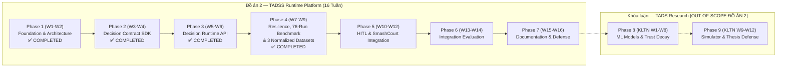

# SỔ TAY TRIỂN KHAI ĐỒ ÁN & KHÓA LUẬN (THESIS DEVELOPMENT PLAYBOOK)

Tài liệu này là **Cẩm nang Điều hướng Trung tâm (Master Navigation Hub)** cho toàn bộ dự án Đồ án 2 và Khóa luận tốt nghiệp. Mọi quy chuẩn kỹ thuật, thuật ngữ, bản đồ tài liệu, lộ trình 16 tuần và cơ chế quản trị rủi ro đều được quy chiếu tại đây.

---

## 0. BẢNG THUẬT NGỮ CHÍNH THỨC (TERMINOLOGY LOCK)

> **⚠️ BẮT BUỘC:** Không được sử dụng sai lệch hoặc hoán đổi các thuật ngữ dưới đây trong bất kỳ tài liệu hay báo cáo nào:

| Viết tắt | Tên đầy đủ | Định nghĩa | Phạm vi áp dụng |
|:---|:---|:---|:---|
| **TADSS** | Trustworthy Adaptive Decision Support System | **Nền tảng runtime engine độc lập** hỗ trợ thực thi, định tuyến, kiểm soát an toàn (resilience, fallback, idempotency, optimistic locking) và lưu vết quyết định (audit trail). Trong Đồ án 2, *"Trustworthy"* được hiểu theo khía cạnh **operational trustworthiness** (độ tin cậy vận hành hạ tầng phần mềm). | Đồ án 2 (Hệ thống) |
| **TADS** | Trustworthy Adaptive Decision Strategy | **Chiến lược quyết định thích ứng thông minh** được nghiên cứu và cài đặt trên interface của SDK. Bao gồm: Adaptive Trust Score với Time Decay ($e^{-\lambda \Delta t}$), CatBoost dự báo No-show, và Decision Trace API. | Khóa luận (Giải thuật / ML) |
| **ATDA** | Adaptive Trust Decision Architecture | **Khung kiến trúc nghiên cứu đề xuất (Proposed Architecture / Research Framework)** mô tả quan hệ phân tầng giữa Runtime Engine (TADSS) và Chiến lược thích ứng (TADS). ATDA là framework tổ chức, không phải hypothesis. | Khóa luận (Framework) |

### 🔬 Câu hỏi Nghiên cứu Kỹ thuật (Đồ án 2) & Giả thuyết Mở rộng (Khóa luận)
*   **Câu hỏi Nghiên cứu Kỹ thuật Phần mềm — Đồ án 2 (Engineering Research Questions):**
    *   *RQ1 (Resilience & SLA Continuity):* Kiến trúc đường ống chịu lỗi lồng nhau 5 tầng của Polly v8 có duy trì được Decision Continuity Rate ($\text{DCR} = 100\%$) và giới hạn độ trễ dưới ngân sách thực thi dưới áp lực tiêm lỗi 7 kịch bản (F1–F7) và suy giảm đa tầng hay không?
    *   *RQ2 (Canonical Request-Hash Caching):* Cơ chế chuẩn hóa JSON bất biến theo RFC 8785 (JCS) kết hợp bộ nhớ đệm phân tầng L1/L2 (Redis + `IMemoryCache`) có đảm bảo tính tất định 100% của khóa băm SHA-256 và duy trì $\text{DCR} = 100\%$ khi tầng Redis L2 đứt kết nối hay không?
    *   *RQ3 (Synchronous Audit & Governance Invariants):* Cơ chế Sổ cái Kiểm toán Bất biến Hai Tầng (Two-Tier Append-Only Audit Ledger) trong cùng transaction boundary EF Core có đảm bảo 100% tính toàn vẹn kiểm toán (5 bất biến `INV-A1..INV-A5`) và chuẩn hóa thành bộ dữ liệu truy xuất nguồn gốc (`INV-P1..INV-P8`) hay không?
*   **Giả thuyết Nghiên cứu & Ràng buộc Mở rộng `[OUT-OF-SCOPE ĐỒ ÁN 2 — DÀNH CHO KHÓA LUẬN]`:**
    *   *H1 (Primary Hypothesis — Khóa luận):* Chiến lược TADS khi thực thi qua nền tảng TADSS cải thiện Expected Business Utility (Hiệu ích kinh doanh kỳ vọng) so với chính sách cọc tĩnh mặc định (Static Policy).
    *   *C1 (Fairness Constraint — Khóa luận):* Đảm bảo tính công bằng cơ hội (Equal Opportunity): $\left| TPR_{\text{group A}} - TPR_{\text{group B}} \right| \le \epsilon$.
    *   *C2 (Resilience Constraint — Kế thừa từ Đồ án 2):* Đảm bảo kiểm soát độ trễ SLA và duy trì hoạt động liên tục khi có sự cố qua Polly Resilience.

### 🏛️ Mối quan hệ Phân cấp Kiến trúc
```
ATDA (Proposed Architecture / Research Framework — Khóa luận)
 ├── TADSS (Runtime Platform — Đồ án 2)
 │    ├── Decision Contract SDK (Canonical Reservation Model, Value Objects, Enums)
 │    ├── Strategy Factory (DI-based Resolution, O(1) Lookup)
 │    │    ├── DefaultDecisionStrategy (Chính sách nghiệp vụ cơ sở thông thường)
 │    │    └── MockAlternativeDecisionStrategy (Cọc động 30% giờ thường / 50% giờ cao điểm)
 │    ├── Polly v8 Resilience Pipeline (Outer Timeout 500ms, Retry 2 lần, Inner Timeout 120ms, CB, FallbackDecisionStrategy)
 │    ├── Append-only Audit Trail (Mandatory Synchronous Audit trong EF Core DB Transaction)
 │    ├── Human-in-the-loop Override API (IdempotencyKey, ExpectedVersion, No Auto-Approve)
 │    ├── Request-Hash Cache (Redis L2 / IMemoryCache L1 fallback, RFC 8785 Canonical JSON, SHA256)
 │    └── Feature Flag động (EnableTadssDecision reload qua IOptionsMonitor < 2s)
 └── TADS (Chiến lược nghiên cứu thích ứng — [OUT-OF-SCOPE ĐỒ ÁN 2 — DÀNH CHO KHÓA LUẬN])
      ├── Adaptive Trust Score + Time Decay (e^-λΔt)
      ├── CatBoost Classifier No-show Predictor
      ├── Decision Trace Explainability (GET /decisions/{id}/trace)
      └── Agent-based Simulator (1,000 agents) & Ablation Studies (20,000+ synthetic records)
```

### 🛡️ 3 Quy tắc Ranh giới Kiến trúc Cốt lõi (Architectural Boundaries)
1. **Logical Database Boundary:** TADSS sử dụng chung PostgreSQL server vật lý (Neon Cloud) với SmashCourt nhưng **cô lập 100% ở tầng Logical Schema có tên là `tadss`** (bảng nghiệp vụ SmashCourt ở `public`, bảng của TADSS duy nhất là `tadss.decision_executions`).
2. **Domain Portability Boundary:** TADSS đạt tính di động nhờ giao thức trừu tượng `Reservation` SDK. Khi mở rộng sang Coworking Space hay Phòng khám, chỉ cần viết Adapter mapping ở client, mã nguồn TADSS Core giữ nguyên.
3. **Telemetry Ownership Boundary:** Bảng `tadss.decision_executions` do Đồ án 2 thiết kế và ghi nhận telemetry kỹ thuật (`execution_time_ms`, `fallback_used`, `failure_reason`, `cache_hit`, `execution_type`), đồng thời chuẩn hóa xuất bản thành 3 bộ dữ liệu thực nghiệm (`resilience_evaluation_dataset`, `latency_caching_dataset`, `governance_audit_dataset`) phục vụ kiểm chứng RQ1–RQ3 trong Đồ án 2 và tái sử dụng cho Khóa luận.

### ⚠️ Bảng Chuẩn hóa Thuật ngữ Kỹ thuật (Technical Clarification)

| Thuật ngữ SAI (Tuyệt đối tránh) | Thuật ngữ ĐÚNG (Chuẩn hóa) | Giải thích kỹ thuật |
|:---|:---|:---|
| Semantic Cache | **Request-Hash Cache** | Cơ chế băm SHA256 payload là exact-match, không có khả năng hiểu ngữ nghĩa (semantic). |
| Immutable event chain | **Append-only Audit Trail** | Không có cơ chế hash chaining/blockchain ở DB, chỉ là cơ chế insert-only log. |
| Async Event / Outbox Audit | **Mandatory Synchronous Audit qua MediatR in-process events trong PostgreSQL transaction boundary** | TADSS phát sự kiện MediatR (`INotification`) đồng bộ ngay trong cùng transaction boundary của EF Core DbContext (fail-closed), không dùng Outbox bất đồng bộ. |
| Hot-swap strategy lúc runtime | **Thay thế Strategy ở mức Cấu hình / DI Registration** | Đăng ký Strategy qua DI Container $O(1)$, không nạp DLL động lúc đang chạy. |
| Circuit Breaker đếm 5 lỗi | **Circuit Breaker mở khi tỷ lệ lỗi vượt ngưỡng trong cửa sổ mẫu** | Polly v8 sử dụng `FailureRatio` (ví dụ 0.5) trong `SamplingDuration` (30s), min 10 requests. |
| Retry 3 lần (4 attempts) | **Retry 2 lần (3 attempts tổng cộng)** | $(3 \times 120\text{ms}) + (2 \times 30\text{ms}) = 420\text{ms} < 500\text{ms}$ SLA Budget. |
| Schema `tadss_*` | **Schema `tadss`** | PostgreSQL không dùng ký tự đại diện `*` làm tên schema. |

---

## I. TỔNG QUAN ĐỀ TÀI & ĐỊNH VỊ 3 HỌC PHẦN

### 1.1. Khóa Định vị — 3 Câu Hỏi Cốt Lõi

| Học phần | Tên chính thức đề tài | Định vị cốt lõi |
|:---|:---|:---|
| **Đồ án 1** | Xây dựng hệ thống quản lý và đặt sân cầu lông trực tuyến SmashCourt | **HOW TO BOOK A COURT** (Nghiệp vụ thương mại, CRUD, Chatbot FAQ) |
| **Đồ án 2** | Thiết kế và xây dựng nền tảng Runtime Engine ra quyết định chịu lỗi cho hệ thống đặt chỗ dịch vụ | **HOW TO EXECUTE A DECISION SAFELY** (Kiến trúc phần mềm chịu lỗi, SDK, API, Audit, Fallback) |
| **Khóa luận** | Nghiên cứu và đánh giá chiến lược quyết định thích ứng tin cậy cho nền tảng đặt chỗ dịch vụ | **HOW TO MAKE THE DECISION INTELLIGENTLY** (Nghiên cứu khoa học, Trust Score, ML, Simulator) |

### 1.2. Ma trận So sánh Phạm vi (Boundary Matrix)

| Tiêu chí | Đồ án 1 (Case Study) | Đồ án 2 (Runtime Platform) | Khóa luận (Research Strategy) |
|:---|:---|:---|:---|
| **Sản phẩm cốt lõi** | Web SmashCourt (Next.js + .NET) | TADSS Core Engine (Web API + SDK) | Chiến lược TADS trên TADSS |
| **Trọng tâm kỹ thuật** | CRUD Booking, VNPay, SignalR | Chịu lỗi (Polly), Audit Trail, Override API | Giải thuật thích ứng, Học máy, Fairness |
| **Thành phần AI** | Gemini Chatbot FAQ | Không phụ thuộc AI (Dùng Mock Strategy) | Adaptive Trust Score + CatBoost Classifier |
| **Khả năng chịu lỗi** | Chưa có (Single Point of Failure) | **Trọng tâm số 1 (Polly v8 Nested Pipeline)** | Đánh giá độ ổn định của giải thuật |
| **Thư viện SDK** | Không có | **Xây dựng `Shared.DecisionContractSDK`** | Tái sử dụng SDK và mở rộng Model |
| **Chiến lược quyết định** | Cọc tĩnh 100% (Hardcoded) | `Default` (Baseline), `Mock` (30%/50%) & `Fallback` (`NEED_APPROVAL`) | `AdaptiveTrustDecisionStrategy` |
| **Phương pháp kiểm thử** | Manual & Postman Tests | Unit Tests, Integration Tests, Failure Injection | Ablation Studies & Multi-agent Simulation |

---

## II. BẢN ĐỒ HỆ THỐNG TÀI LIỆU DỰ ÁN (PROJECT DOCUMENTATION MAP)

Tất cả các tài liệu trong workspace `TADSS-Runtime/` được tổ chức theo vai trò và phạm vi rõ ràng:

```text
TADSS-Runtime/
├── README.md                                               <-- [OVERVIEW] Tổng quan hệ thống, Phase 1–4, 510/510 tests
└── docs/
    ├── PROJECT_BLUEPRINT_AND_SYSTEM_OVERVIEW.md            <-- [BLUEPRINT] Bản thiết kế tổng thể & kiến trúc 7-project
    ├── planning/
    │   ├── MASTER_EXECUTION_PLAN.md                        <-- [MASTER] Kế hoạch thực thi 16 tuần, Owner/Reviewer, DoD
    │   ├── THESIS_DEVELOPMENT_PLAYBOOK.md                  <-- [HUB] Cẩm nang điều hướng trung tâm (Tài liệu này)
    │   ├── PROPOSAL_DO_AN_2.md                             <-- [PROPOSAL] Đề xuất chính thức Đồ án 2 nộp GVHD
    │   ├── PROJECT_WBS_MAPPING.md                          <-- [WBS] Phân rã 16 tuần, 7 Milestones, Traffic Light, Risk
    │   └── BACKLOG_SPRINTS.md                              <-- [BACKLOG] User Stories & Tasks chi tiết cho SV1 & SV2
    ├── architecture/
    │   ├── SOFTWARE_ARCHITECTURE_SPECIFICATION.md          <-- [SAS] Đặc tả bản vẽ thiết kế kỹ thuật phần mềm
    │   ├── DECISION_PERSISTENCE_INVARIANTS.md              <-- [INVARIANTS] 5 bất biến kiểm toán & quản trị (INV-A1..A5)
    │   ├── RESILIENCE_AND_FAULT_TAXONOMY.md                <-- [RESILIENCE] Phân loại 7 kịch bản lỗi (F1–F7) & Polly v8
    │   ├── ARCHITECTURE_DECISION_RECORDS.md                <-- [ADR] Tổng hợp 5 quyết định kiến trúc cốt lõi
    │   └── adr/ (ADR-001 -> ADR-005)                       <-- [ADR Detail] Chi tiết từng quyết định kiến trúc
    ├── contracts/
    │   ├── API_CONTRACT_V1.md & openapi-v1.yaml            <-- [CONTRACT] Đặc tả hợp đồng API v1.0.0 & OpenAPI 3.0.3
    │   ├── CONTRACT_V1_FREEZE.md & baseline_public_api.txt <-- [FREEZE] Hồ sơ đóng băng Contract v1.0.0 & API Surface
    │   └── INTEGRATION_SPEC.md                             <-- [SPEC] Hợp đồng tích hợp SmashCourt ↔ TADSS, Schema tadss
    └── research/
        ├── EXPERIMENTAL_DESIGN_AND_BENCHMARK_METHODOLOGY.md <-- [METHODOLOGY] Phương pháp luận thực nghiệm 5 tầng (RQ1–RQ3)
        ├── DATASET_SCHEMA_SPECIFICATION_V1.md              <-- [SCHEMA] Đặc tả đóng băng 3 bộ dữ liệu & 8 bất biến
        ├── benchmarks/WEEK8_BENCHMARK_REPORT.md            <-- [BENCHMARK] Báo cáo kết quả thực nghiệm 76 runs (Tuần 8)
        ├── datasets/WEEK9_DATASET_NORMALIZATION_REPORT.md  <-- [DATASETS] Báo cáo chuẩn hóa 3 bộ dữ liệu & Manifest (Tuần 9)
        ├── RESEARCH_PROBLEM_BACKLOG.md                     <-- [RESEARCH] 12 bài toán Enterprise AI OS (Khóa luận)
        └── RESEARCH_THESIS_DEFENSE.md                      <-- [DEFENSE] Đề cương bảo vệ Đồ án 2 & Khóa luận
```

### Chi tiết Vai trò Từng Tài liệu:

| Tài liệu | Phạm vi | Mục đích sử dụng | Độc giả chính |
|:---|:---:|:---|:---|
| [MASTER_EXECUTION_PLAN.md](file:///d:/SINH%20VIEN/HK6/DA1/SmashCourt/TADSS-Runtime/docs/planning/MASTER_EXECUTION_PLAN.md) | **Kim chỉ nam** | Kế hoạch thực thi chi tiết 16 tuần, ma trận Owner/Reviewer, Definition of Done và Ma trận Failure Test. | Toàn nhóm phát triển |
| [THESIS_DEVELOPMENT_PLAYBOOK.md](file:///d:/SINH%20VIEN/HK6/DA1/SmashCourt/TADSS-Runtime/docs/planning/THESIS_DEVELOPMENT_PLAYBOOK.md) | Toàn diện | Quy chuẩn thuật ngữ, điều hướng dự án, phân tầng scope và quy tắc ranh giới. | Toàn nhóm & GVHD |
| [PROPOSAL_DO_AN_2.md](file:///d:/SINH%20VIEN/HK6/DA1/SmashCourt/TADSS-Runtime/docs/planning/PROPOSAL_DO_AN_2.md) | Đồ án 2 | Đề xuất nghiên cứu chính thức trình Giảng viên hướng dẫn và Hội đồng duyệt đề tài. | GVHD & Hội đồng |
| [PROJECT_WBS_MAPPING.md](file:///d:/SINH%20VIEN/HK6/DA1/SmashCourt/TADSS-Runtime/docs/planning/PROJECT_WBS_MAPPING.md) | Đồ án 2 | Phân rã công việc 16 tuần, 7 Milestones, cơ chế Traffic Light, Lối thoát khẩn cấp. | Quản lý tiến độ |
| [BACKLOG_SPRINTS.md](file:///d:/SINH%20VIEN/HK6/DA1/SmashCourt/TADSS-Runtime/docs/planning/BACKLOG_SPRINTS.md) | Thực thi | Chi tiết Epics ➔ User Stories ➔ Tasks kèm phân công cụ thể Sinh viên 1 & 2. | Sinh viên code hàng ngày |
| [SOFTWARE_ARCHITECTURE_SPECIFICATION.md](file:///d:/SINH%20VIEN/HK6/DA1/SmashCourt/TADSS-Runtime/docs/architecture/SOFTWARE_ARCHITECTURE_SPECIFICATION.md) | Kỹ thuật | Bản vẽ chi tiết Class Diagram, Sequence Diagram, Component Design mở khi lập trình. | Sinh viên phát triển |
| [INTEGRATION_SPEC.md](file:///d:/SINH%20VIEN/HK6/DA1/SmashCourt/TADSS-Runtime/docs/contracts/INTEGRATION_SPEC.md) | Tích hợp | Đặc tả JSON API Contracts, DDL Schema `tadss`, Migration, Rollback và Failure Injection. | Tích hợp hệ thống |
| [ARCHITECTURE_DECISION_RECORDS.md](file:///d:/SINH%20VIEN/HK6/DA1/SmashCourt/TADSS-Runtime/docs/architecture/ARCHITECTURE_DECISION_RECORDS.md) | Kiến trúc | Lưu trữ 5 quyết định kiến trúc: Strategy Pattern, SDK-First, Polly v8, Rich Domain Model, Scope Boundary. | Chương 2-3 Báo cáo |
| [EXPERIMENTAL_DESIGN_AND_BENCHMARK_METHODOLOGY.md](file:///d:/SINH%20VIEN/HK6/DA1/SmashCourt/TADSS-Runtime/docs/research/EXPERIMENTAL_DESIGN_AND_BENCHMARK_METHODOLOGY.md) | Đồ án 2 | Thiết kế thực nghiệm 5 tầng (Layer A–E, 76 lượt chạy) và giao thức chuẩn hóa 3 bộ dữ liệu. | Chương 3-4 Báo cáo |
| [DATASET_SCHEMA_SPECIFICATION_V1.md](file:///d:/SINH%20VIEN/HK6/DA1/SmashCourt/TADSS-Runtime/docs/research/DATASET_SCHEMA_SPECIFICATION_V1.md) | Đồ án 2 | Đặc tả đóng băng schema 3 bộ dữ liệu nghiên cứu (23/19/31 cột) và 8 bất biến `INV-P1..INV-P8`. | Chương 3-4 Báo cáo |
| [RESEARCH_PROBLEM_BACKLOG.md](file:///d:/SINH%20VIEN/HK6/DA1/SmashCourt/TADSS-Runtime/docs/research/RESEARCH_PROBLEM_BACKLOG.md) | Khóa luận | 12 bài toán Enterprise AI OS làm cơ sở phát triển nghiên cứu học thuật (Pre-scoping). | Chương 1 Luận văn |
| [RESEARCH_THESIS_DEFENSE.md](file:///d:/SINH%20VIEN/HK6/DA1/SmashCourt/TADSS-Runtime/docs/research/RESEARCH_THESIS_DEFENSE.md) | Đồ án 2 & Khóa luận | Tổng hợp Research Questions (RQ1–RQ3 Đồ án 2 & RQs Khóa luận), Kịch bản phản biện. | Bảo vệ tốt nghiệp |

---

## III. PHÂN TẦNG PHẠM VI & QUẢN TRỊ RỦI RO (SCOPE TIERING & RISK SAFEGUARDS)

### 3.1. Ma trận Phân tầng Phạm vi (Scope Tiering Matrix)

```text
┌────────────────────────────────────────────────────────────────────────┐
│ [CORE TIER] (Bắt buộc 100% — Tuyệt đối không cắt)                      │
│  - Shared Decision Contract SDK (Domain Model, DTOs, Invariants)       │
│  - Decision Runtime Web API (POST /api/v1/decisions, StrategyResolver) │
│  - Executable Strategies (Default Baseline, Mock 30%/50%, Fallback)    │
│  - Polly v8 Nested Resilience Pipeline (500ms Outer, 2 Retries, 120ms) │
│  - Append-only Audit Trail (Mandatory Synchronous DB Transaction)      │
│  - Human Override API (IdempotencyKey, ExpectedVersion Concurrency)    │
│  - Feature Flag động (EnableTadssDecision reload qua IOptionsMonitor)  │
│  - SmashCourt Integration & Integration Tests                          │
├────────────────────────────────────────────────────────────────────────┤
│ [IMPORTANT TIER] (Cố gắng hoàn thành — Có phương án hạ cấp tự động)    │
│  - Redis Request-Hash Cache ──[Hạ cấp]──► IMemoryCache In-Process      │
│  - Manager Dashboard trên smashcourt-fe ──[Hạ cấp]──► Giảm độ phức tạp │
│  - Structured Logging (Serilog Console & File)                         │
│  - Retry & Circuit Breaker hoàn chỉnh                                  │
├────────────────────────────────────────────────────────────────────────┤
│ [OPTIONAL TIER] (Cắt giảm ngay khi rơi vào màu Vàng/Đỏ)                │
│  - Advanced Dashboard UI Polish (Biểu đồ, Animation phức tạp)          │
│  - External Provider Cost Guardrail                                    │
│  - Additional Benchmark Scenarios                                      │
│  - OpenTelemetry Distributed Tracing                                   │
└────────────────────────────────────────────────────────────────────────┘
```

### 3.2. Bảy Mốc Kiểm Soát Tiến Độ Cốt Lõi (7 Milestones Checkpoints)
*   **[Mốc 1: Cuối Tuần 2]** ───► **Foundation Ready (✅ COMPLETED):** Solution skeleton, Database Schema `tadss` và Contract v1 được phê duyệt.
*   **[Mốc 2: Cuối Tuần 4]** ───► **Decision Contract Ready (✅ COMPLETED):** DLL `Shared.DecisionContractSDK` biên dịch thành công, 100% pass tests.
*   **[Mốc 3: Cuối Tuần 6]** ───► **Runtime Engine Standalone (✅ COMPLETED):** Web API và DI-based Strategy Resolution chạy độc lập hoàn chỉnh.
*   **[Mốc 4: Cuối Tuần 9]** ───► **Resilient, Auditable & Benchmarked Core (✅ COMPLETED):** Polly v8 Pipeline (F1–F7), Synchronous Audit Trail, Resilient L1/L2 Request-Hash Cache, 5-Layer Benchmark (19 kịch bản $\times$ 4 VUs = 76 lượt chạy), 3 bộ dữ liệu chuẩn hóa (`INV-P1..INV-P8` 100% PASS) và `510/510` bài kiểm thử tự động hoàn tất.
*   **[Mốc 5: Cuối Tuần 12]** ───► **End-to-End Integration Ready:** SmashCourt ↔ TADSS ↔ VNPay và Manager Dashboard UI tích hợp thành công.
*   **[Mốc 6: Cuối Tuần 14]** ───► **Technical Evaluation Complete:** Vượt qua 11 kịch bản kiểm thử sự cố tích hợp, đo lường đầy đủ SLA p95 < 150ms.
*   **[Final Milestone: Cuối Tuần 16]** ───► **Defense Ready:** Hoàn thành cuốn Báo cáo 60 trang, Video Demo và Slide thuyết trình.

### 3.3. Hệ thống Đèn Giao Thông Đánh giá Tiến độ (Traffic Light System)
*   🟢 **GREEN (Đúng tiến độ):** Hoàn thành 100% các task theo kế hoạch mốc $\rightarrow$ Tiếp tục triển khai toàn bộ Scope.
*   🟡 **YELLOW (Trễ 1-2 ngày):** Kích hoạt cắt giảm tầng **Optional (Cắt Dashboard Polish, Cost Guardrail)** để tập trung tài nguyên.
*   🔴 **RED (Trễ $\ge 3$ ngày):** Kích hoạt chuyển tầng **Important/Supporting (Chuyển Redis $\rightarrow$ `IMemoryCache`, tối giản UI)**, tập trung 100% cho Core Features.

### 3.4. Lối thoát Khẩn cấp Phase 4 (Phase 4 Emergency Escape Hatch)
> Nếu đến **cuối Tuần 8 (Day 5)** mà hạ tầng Cache/Benchmark gặp tắc nghẽn môi trường:
> $\rightarrow$ **KÍCH HOẠT CHẾ ĐỘ MVP TOÀN DIỆN (Minimal Viable Product Mode):**
> 1. **Polly:** Duy trì `Outer Timeout (500ms)` + `FallbackDecisionStrategy (NEED_APPROVAL)`.
> 2. **Audit Trail:** Ghi đồng bộ trực tiếp log audit vào DB trong EF Core Transaction boundary.
> 3. **Cache:** Sử dụng `IMemoryCache` L1 cục bộ, bỏ qua phụ thuộc Redis L2.
>
> *Triết lý:* *"Tốt hơn là bàn giao 80% hệ thống chạy hoàn hảo đúng hạn thay vì bàn giao 0% do trễ deadline!"*

### 3.5. Quy tắc Tích hợp Dashboard trên `smashcourt-fe` (Task 5.4)
> Tích hợp trực tiếp các trang quản lý duyệt cọc vào thư mục `smashcourt-fe` (Next.js) hiện có để tận dụng giao diện, Tailwind và auth component sẵn có. Nếu sau **Tuần 10 Day 2** gặp trục trặc kỹ thuật lớn, chuyển ngay sang C# Razor Page / HTML Table trong vòng 1 ngày.

### 3.6. Chiến lược Viết Báo cáo Cuốn chiếu từ Tuần 10 (Task 5.3)
> *   **Tuần 10 (Phase 5):** SV1 + SV2 pair-writing Chương 1 (10-12 trang); SV1 viết Chương 2.1-2.2 (8-10 trang); SV2 viết Chương 2.3-2.4 (8-10 trang) đạt 26-32 trang (>40% khối lượng).
> *   **Tuần 15 (Phase 7):** Điền số liệu thực nghiệm vào Chương 3 & 4, vẽ sơ đồ kiến trúc và chuẩn hóa trích dẫn.
> *   **Tuần 16 (Phase 7):** Quay video demo, làm Slide thuyết trình và diễn tập bảo vệ.

### 3.7. Quy trình Họp Rà soát Hàng tuần (Weekly Checkpoint Protocol)
*   **Thời gian cố định:** Tối Chủ Nhật hàng tuần từ 20:00 - 20:30 (30 phút).
*   **Cấu trúc 10-10-10:**
    1. *Rà soát công việc (10 phút):* Đối chiếu tiến độ thực tế, xác định màu tiến độ (🟢/🟡/🔴).
    2. *Đánh giá rủi ro (10 phút):* Ra quyết định kích hoạt Scope Tiering nếu rơi vào màu Vàng hoặc Đỏ.
    3. *Kế hoạch tuần tới (10 phút):* Chốt Top 3 ưu tiên của từng thành viên và deadline cam kết.
*   **Lưu trữ:** Ghi biên bản họp ngắn gọn vào `docs/weekly-logs/week-{N}.md` và commit lên Git.

---

## IV. LỘ TRÌNH TRIỂN KHAI 16 TUẦN & MA TRẬN PHÂN CÔNG (16-WEEK WBS & RACI)



### Ma trận Trách nhiệm Chi tiết (Owner + Reviewer Model):

| Phase | Tuần | Deliverables Chính | Sinh viên 1 (Backend/Runtime Owner) | Sinh viên 2 (Contract/UI Owner) |
|:---|:---:|:---|:---|:---|
| **Phase 1** | **W1 — W2** | JSON API Spec, SQL Schema `tadss`, Solution Setup | Thiết kế DB Schema `tadss`, dựng Clean Architecture Solution .NET 8 | Đặc tả JSON Schema Request/Response, viết Integration Spec v1 |
| **Phase 2** | **W3 — W4** | DLL `Shared.DecisionContractSDK`, Unit Tests >80% | Lập trình Rich Domain Model `Reservation`, Invariants, Behavior Rules | Định nghĩa DTOs, Value Objects, Enums, viết bộ Unit Tests SDK |
| **Phase 3** | **W5 — W6** | Web API `DecisionRuntime.TADSS`, Swagger UI | Xây dựng Web API Core, Strategy Resolver DI Lookup $O(1)$, Synchronous Audit & L1/L2 Cache | Lập trình `DefaultDecisionStrategy` (Baseline) và `MockAlternativeDecisionStrategy` (30%/50%) |
| **Phase 4** | **W7 — W9** | Polly v8 (F1–F7), 5-Layer Benchmark (76 runs), 3 Normalized Datasets (`INV-P1..P8`) | Tuần 7: Polly v8 Pipeline + Fault Matrix (F1–F7); Tuần 8: Resilience/Stress Benchmark (Layer B, D, E) | Tuần 7: Resilient L1/L2 Cache Verification; Tuần 8: Cache Benchmark (Layer A, C); Tuần 9: Dataset Normalizer & Provenance Manifest |
| **Phase 5** | **W10 — W12**| Override API, Dashboard UI, SmashCourt Integration | Override API (Idempotency, Concurrency), Feature Flag reload, SmashCourt Backend | Dựng Dashboard UI trên `smashcourt-fe`, cùng SV1 viết Chương 1 & 2 Báo cáo |
| **Phase 6** | **W13 — W14**| Integration Test Matrix (11 test cases), SLA Benchmark | Kịch bản Failure Injection, đo lường KPI (p95<150ms), Portability Mock | Kiểm thử tích hợp VNPay, đối soát bảng Test Matrix |
| **Phase 7** | **W15 — W16**| Báo cáo hoàn chỉnh (60 trang), Video Demo & Slide | Hoàn thiện Chương 3 & 4 Báo cáo, quay Video Demo, diễn tập thuyết trình | Hoàn thiện sơ đồ kiến trúc, làm Slide thuyết trình 20-25 slides |

---

## V. CÁC QUYẾT ĐỊNH KIẾN TRÚC KỸ THUẬT ĐÃ CHỐT (CORE ADR SUMMARY)

### 5.1. Luồng Quyết định & Phê duyệt (NeedApproval ➔ Block Payment)
```text
DecisionResult.Status:
  ├── Approved      ──► Tiếp tục luồng đặt sân ──► Tạo giao dịch VNPay
  ├── NeedApproval  ──► Booking.Status = PendingDecisionApproval (TẠM CHẶN VNPAY)
  │                      └── Chờ Manager duyệt trên Dashboard:
  │                            ├── [Approve]  ──► Duyệt mức cọc đề xuất ──► Tiếp tục sang VNPay
  │                            └── [Override] ──► Sửa mức cọc (kèm Reason) ──► Tiếp tục sang VNPay
  └── Rejected      ──► Hủy Booking ──► Thông báo lý do từ chối
```

### 5.2. Chuỗi Chịu lỗi Polly v8 (Resilience SLA Budget)
```text
┌── Outer Timeout: 500ms (Overall Request SLA Budget) ───────────┐
│                                                                │
│  Fallback: FallbackDecisionStrategy (NEED_APPROVAL, 100%)      │
│   └── Overhead < 10ms sau khi failure được xác định            │
│                                                                │
│  Retry Policy (Tối đa 2 retries = 3 attempts, base delay 30ms) │
│   │                                                            │
│   └── Circuit Breaker (Sampling 30s, tối thiểu 10 requests)    │
│        └── Inner Timeout: 120ms per attempt                    │
│             └── Strategy.EvaluateAsync()                       │
│                                                                │
└────────────────────────────────────────────────────────────────┘
```

### 5.3. Chuẩn hóa Payload Băm SHA-256 (Request-Hash Caching)
*   **Tách biệt Request Identity và Strategy Identity:**
    $$\text{RequestHash} = \text{SHA256}(\text{Canonical}(\text{DecisionRequest}))$$
    Namespace Cache Key: `decision:hash:{requestHash}:{strategyName}:v{strategyVersion}`
*   **Quy trình 4 bước chuẩn hóa (Payload Canonicalization - RFC 8785 JCS):**
    1. Sắp xếp các key trong JSON Payload / Metadata theo thứ tự bảng chữ cái (Alphabetical sort).
    2. Chuẩn hóa chuỗi định danh (UUID) và in hoa (`ToUpperInvariant`) các trường phân loại (`CustomerTier`, `BookingType`, `PaymentStatus`, `Priority`).
    3. Chuẩn hóa định dạng timestamp (`StartTime`, `EndTime`) về giây chuẩn UTC (`yyyy-MM-ddTHH:mm:ssZ`, cắt bỏ phần nhiễu sub-second ticks và **loại trừ `RequestedAt`** khỏi đối tượng băm; **TUYỆT ĐỐI giữ nguyên giá trị nghiệp vụ giờ/phút, không làm tròn đến giờ chẵn**).
    4. Định dạng tiền tệ bất biến (`F2`, `InvariantCulture`), xóa bỏ khoảng trắng thừa (whitespace) và chuẩn hóa biểu diễn trường `null`.
*   **Chính sách TTL (Operational / Experimental Configuration):**
    *   Cấu hình mặc định cho baseline vận hành và thực nghiệm (`Default TTL for benchmark baseline`): `TtlHours = 24` (24 giờ, cấu hình qua `TadssCacheOptions`, không phải bất biến kiến trúc cứng).
    *   `AdaptiveDecisionStrategy` (Khóa luận): Có thể cấu hình TTL ngắn hoặc vô hiệu hóa qua options để tránh stale decisions khi điểm Trust Score thay đổi.

### 5.4. Append-Only Audit Trail & Idempotency / Concurrency
*   **Bảng dữ liệu:** `tadss.decision_executions` lưu đồng bộ (fail-closed) toàn bộ thông số thực thi (`execution_type` thuộc `'AUTOMATED' | 'CACHE_HIT' | 'FALLBACK'`).
*   **No Auto-Approve:** Quá hạn thời gian duyệt, booking giữ nguyên `PendingDecisionApproval` hoặc tự động hết hạn, tuyệt đối không tự động duyệt.
*   **Idempotency Key & Decision Identity:** Ràng buộc `UNIQUE(decision_id)` kết hợp Partial Unique Index `uq_decision_idempotency_key ON (idempotency_key) WHERE idempotency_key IS NOT NULL` ngăn chặn tuyệt đối gửi lệnh thực thi/duyệt trùng lặp.
*   **Single-Override Guard & Optimistic Concurrency:** Kiểm tra bất biến `IsOverridden` (chỉ cho phép ghi đè 1 lần duy nhất) kết hợp cột `version` (`IsConcurrencyToken()`, tự động tăng qua `AuditTimestampInterceptor`) ngăn chặn xung đột khi 2 Manager cùng duyệt 1 đơn.

### 5.5. Phân luồng Nghiệp vụ tại Client (SmashCourt Business Routing)
*   **VIP/Loyal Fast-Track:** Khách hàng Gold/Platinum được SmashCourt chuyển thẳng sang VNPay, không gọi TADSS.
*   **Last-minute booking (< 24h):** Hạn chế trạng thái `NeedApproval` để tránh trễ giờ thi đấu.
*   **Peak/Off-Peak Routing:** Gọi `MockAlternativeDecisionStrategy` (30% giờ thường / 50% giờ cao điểm) để kiểm chứng Strategy Pattern.
*   **Emergency Valve:** Khi tắt cờ `EnableTadssDecision = false`, SmashCourt lập tức tự động áp dụng mức cọc tĩnh mặc định 100%, cô lập sự cố hoàn toàn.

---

## VI. TIÊU CHÍ THÀNH CÔNG & CHỈ SỐ THIẾT KẾ (DESIGN TARGETS)

> **Lưu ý:** Các chỉ số dưới đây là **Design Targets (Mục tiêu thiết kế kỹ thuật phần mềm)** được kiểm chứng qua các kịch bản kiểm thử, không phải cam kết môi trường production:

| Mã | Chỉ số Thiết kế | Mục tiêu Kiểm chứng | Phương pháp Đo lường |
|:---|:---|:---|:---|
| **SC1** | Thời gian xử lý thông thường | Latency p95 < 150ms | Đo lường các request thành công không qua cache và không retry. |
| **SC2** | Thời gian xử lý khi gặp sự cố | Overall Request SLA <= 500ms | Cưỡng chế bởi Polly Outer Timeout khi xảy ra retry/timeout. |
| **SC3** | Tính nhất quán của Audit Log | 100% kịch bản kiểm thử ghi nhận đúng log | Kiểm tra bảng `tadss.decision_executions` sau mỗi kịch bản test. |
| **SC4** | Cơ chế chống ghi trùng | Chặn 100% duplicate commands | Bắn liên tiếp 2 Override command cùng `IdempotencyKey`. |
| **SC5** | Tốc độ Reload Feature Flag | Hot reload dynamic dưới 2 giây | Thay đổi cấu hình trong `appsettings.json` qua `IOptionsMonitor`. |
| **SC6** | Tính độc lập tên miền (Portability) | Xử lý thành công request từ Coworking Space | Gửi mock request phòng họp qua Adapter mà không sửa code TADSS Core. |

---

## VII. ĐỊNH HƯỚNG PHÁT TRIỂN KHÓA LUẬN (THESIS EXTENSION) `[OUT-OF-SCOPE ĐỒ ÁN 2 — DÀNH CHO KHÓA LUẬN]`

Nền tảng TADSS sau khi hoàn thành ở Đồ án 2 sẽ được chuyển giao nguyên vẹn làm hạ tầng thực nghiệm cho Khóa luận tốt nghiệp (12 tuần):
1. **Mô hình Trọng số Thích ứng (Adaptive Trust Model):** Cài đặt hàm suy hao thời gian $e^{-\lambda \Delta t}$ tính điểm uy tín khách hàng dựa trên lịch sử bùng lịch/đúng hẹn.
2. **Mô hình Học máy CatBoost:** Huấn luyện trên tập dữ liệu tổng hợp (Synthetic Dataset 20,000+ records) dự đoán xác suất no-show. Mục tiêu thiết kế: AUC-ROC > 0.75, Precision > 0.70.
3. **Thực nghiệm Mô phỏng Đa tác tử (Multi-Agent Simulation):** Giả lập 1,000 khách hàng (Loyal, Regular, Risky, New) tương tác trong môi trường kinh doanh giả lập để chạy các nghiên cứu cắt giảm (Ablation Studies), kiểm chứng giả thuyết H1 và đánh giá độ công bằng Equal Opportunity.

---

*Tài liệu đã được khóa cứng đồng bộ 100% thông số kỹ thuật — Đóng vai trò làm Navigation Hub chính thức cho toàn bộ dự án.*
