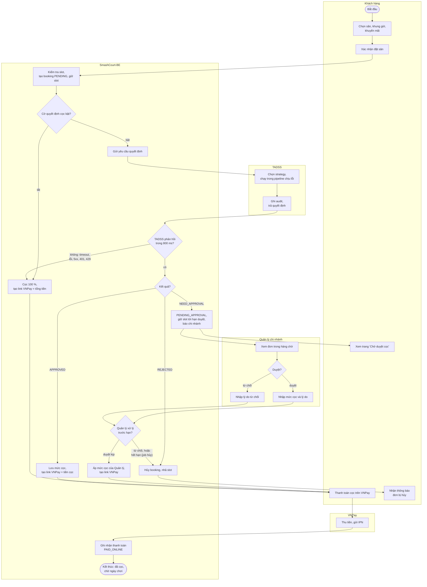
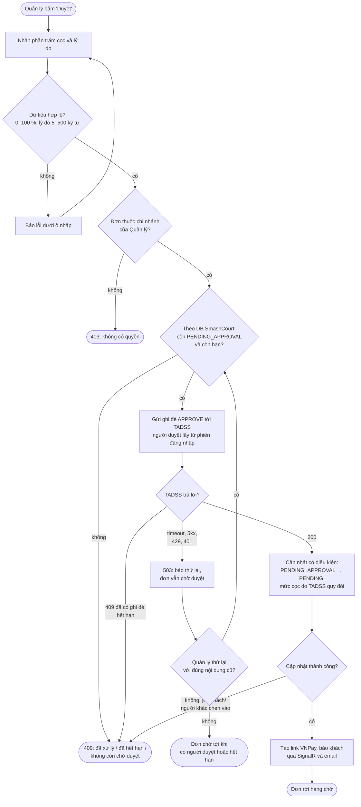
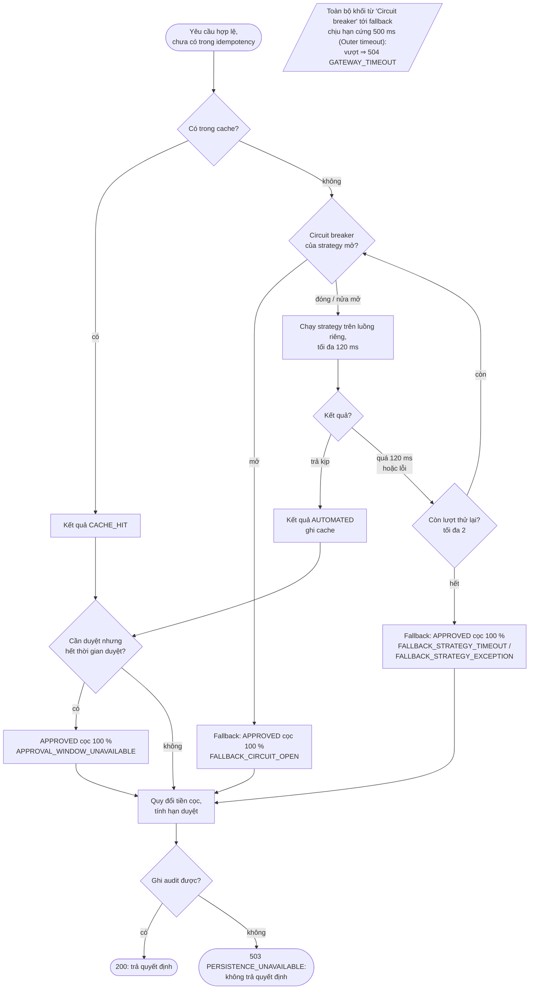
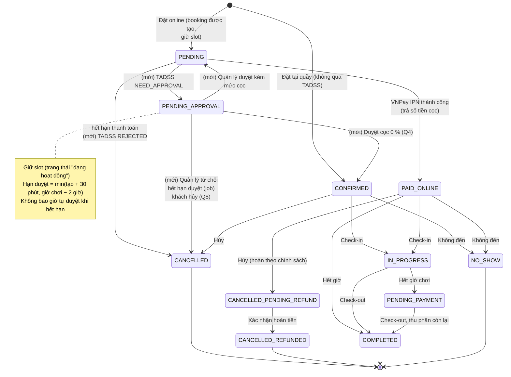
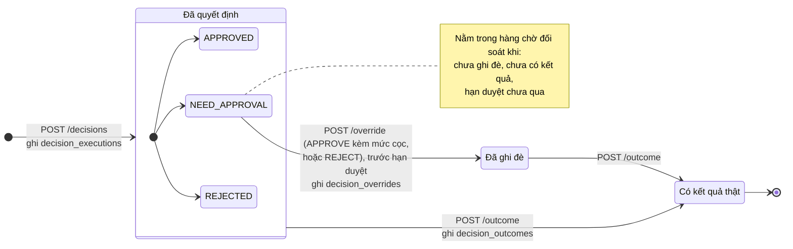

# SƠ ĐỒ HOẠT ĐỘNG VÀ SƠ ĐỒ TRẠNG THÁI: QUY TRÌNH ĐẶT CỌC

| | |
| :--- | :--- |
| **Mục đích** | Sơ đồ hoạt động (góc nhìn quy trình nghiệp vụ, có làn theo bên tham gia) và sơ đồ trạng thái để đưa vào báo cáo Đồ án 2 |
| **Trạng thái** | Mục 1, 2, 4: **thiết kế Phase 6**. Mục 3, 5: **hiện trạng** (TADSS) |
| **Nguồn sự thật** | [`INTEGRATION_SPEC.md`](../contracts/INTEGRATION_SPEC.md), [`DEPOSIT_APPROVAL_API.md`](../../../SmashCourt-BE/docs/api/DEPOSIT_APPROVAL_API.md), [`RESILIENCE_AND_FAULT_TAXONOMY.md`](../architecture/RESILIENCE_AND_FAULT_TAXONOMY.md), [`DECISION_PERSISTENCE_INVARIANTS.md`](../architecture/DECISION_PERSISTENCE_INVARIANTS.md). Khi khác nhau, các tài liệu đó đúng |
| **Bộ sơ đồ** | [`ARCHITECTURE_DIAGRAMS.md`](ARCHITECTURE_DIAGRAMS.md) · [`USE_CASES.md`](USE_CASES.md) · [`SEQUENCE_DIAGRAMS.md`](SEQUENCE_DIAGRAMS.md) · tài liệu này |
| **Cập nhật** | 17/10/2026 |

---

## 1. Quy trình đặt sân có cọc, từ đầu đến cuối

*Thiết kế Phase 6.* Mỗi làn là một bên tham gia. Quy trình kết thúc khi khách đã cọc (chờ ngày chơi) hoặc đơn bị hủy.

Ghi chú: nhánh "hết hạn" do job chạy mỗi phút thực hiện, **không bao giờ tự duyệt** (UC-DEPOSIT-09). Thanh toán không kịp trước hạn thanh toán thì job hiện có của Đồ án 1 hủy booking (không vẽ để sơ đồ gọn).

## 2. Quy trình Quản lý duyệt mức cọc

*Thiết kế Phase 6.* Chi tiết hơn bước "Quản lý xử lý" ở Mục 1: các điểm kiểm tra và cách xử lý khi TADSS không phản hồi.

## 3. Pipeline quyết định bên trong TADSS

*Hiện trạng.* Một lời gọi strategy đi qua các lớp Polly (tham số mặc định của `Tadss:Resilience`). Mọi lỗi của strategy kết thúc ở **cọc 100 %**, không ở hàng chờ của Quản lý (D-13).

## 4. Vòng đời booking sau khi có TADSS

*Thiết kế Phase 6.* Trạng thái và chuyển trạng thái của Đồ án 1 lấy theo `Helpers/BookingStatusTransition.cs` của SmashCourt-BE; phần **mới** do TADSS là `PENDING_APPROVAL` và các chuyển trạng thái có nhãn "(mới)".

Ảnh hưởng lên mã của BE khi hiện thực trạng thái này:

| Chỗ trong BE | Thay đổi |
| :--- | :--- |
| `Models/Enums/BookingStatus.cs`, enum `booking_status` của PostgreSQL | Thêm `PENDING_APPROVAL` |
| `BookingStatusTransition.CanTransition` | Thêm 5 chuyển trạng thái có nhãn "(mới)" (chuyển `PENDING → CANCELLED` đã có) |
| `BookingStatusTransition.GetActiveStatuses` | Thêm `PENDING_APPROVAL` để time grid, kiểm tra trùng giờ và lịch theo ngày coi slot là đã có người giữ |
| Job hủy `PENDING` quá hạn (Job-01) | Không đụng `PENDING_APPROVAL` (đơn chờ duyệt có job riêng, UC-DEPOSIT-09) |
| Hủy và hoàn tiền từ `PAID_ONLINE` | Số tiền hoàn tính trên số đã thanh toán (tiền cọc), không còn là `finalTotal` (chốt khi hiện thực T6.9) |

## 5. Vòng đời một quyết định trong TADSS

*Hiện trạng.* Bản ghi quyết định **bất biến**: không bao giờ bị sửa hay xóa (trigger chặn `UPDATE`/`DELETE`/`TRUNCATE`). Ghi đè và kết quả là bản ghi riêng, mỗi loại tối đa một bản cho một quyết định.

| Bảng (schema `tadss`) | Nội dung | Ràng buộc |
| :--- | :--- | :--- |
| `decision_executions` | Quyết định: request, strategy và phiên bản, kết quả, lý do, thời gian xử lý, có dùng fallback/cache, bản `PRIMARY` hay `SHADOW` | Bất biến; idempotency key duy nhất cho bản `PRIMARY` |
| `decision_overrides` | Ghi đè của người duyệt: hành động, mức cọc, người duyệt, lý do, thời điểm | Bất biến; tối đa một bản mỗi quyết định |
| `decision_outcomes` | Kết quả thật: `COMPLETED`, `NO_SHOW`, `CANCELLED_BY_CUSTOMER`, `CANCELLED_BY_STAFF`, `PAYMENT_EXPIRED`, `APPROVAL_EXPIRED`, `REJECTED` | Bất biến; tối đa một bản mỗi quyết định |

