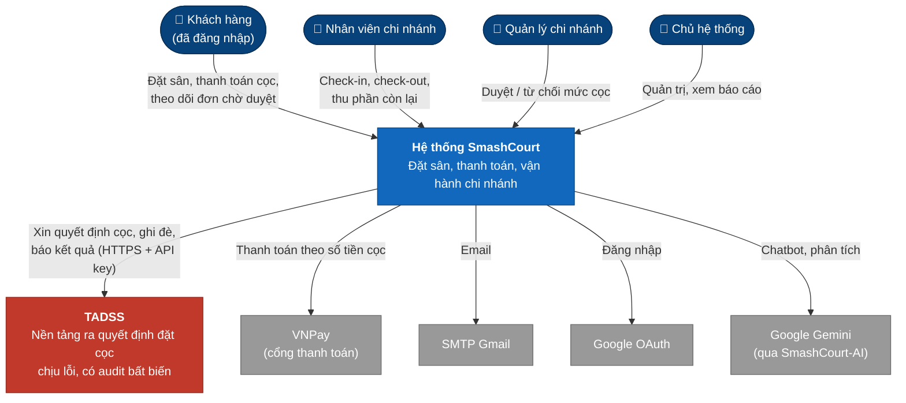
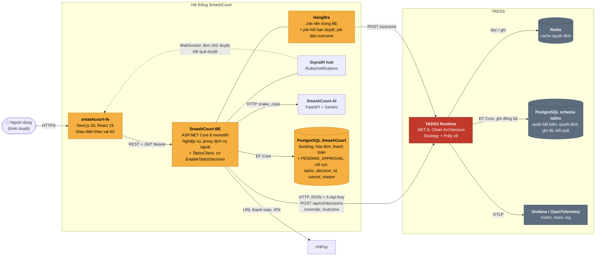
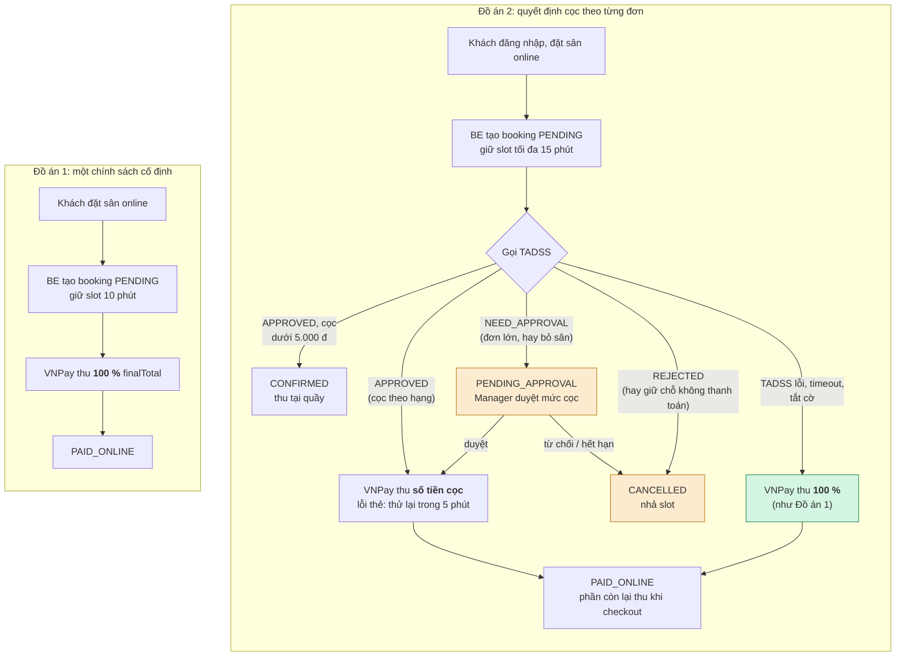
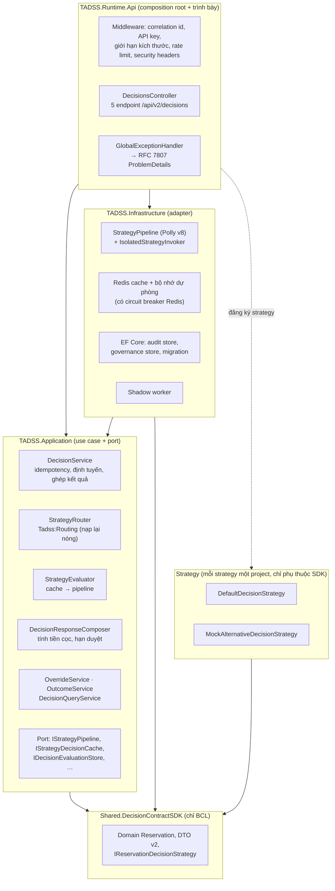
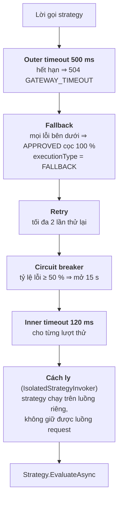

# SƠ ĐỒ KIẾN TRÚC: TADSS TRONG HỆ THỐNG SMASHCOURT

| | |
| :--- | :--- |
| **Mục đích** | Bộ sơ đồ kiến trúc để đưa vào báo cáo Đồ án 2: TADSS nằm ở đâu, giao tiếp với ai, và làm SmashCourt thay đổi những gì |
| **Phạm vi** | Mức hệ thống (ngữ cảnh, container), so sánh trước/sau, cấu trúc bên trong TADSS |
| **Nguồn sự thật** | Contract và luồng tích hợp: [`INTEGRATION_SPEC.md`](../contracts/INTEGRATION_SPEC.md). Cấu trúc project: [`SOFTWARE_ARCHITECTURE_SPECIFICATION.md`](../architecture/SOFTWARE_ARCHITECTURE_SPECIFICATION.md). Pipeline chịu lỗi: [`RESILIENCE_AND_FAULT_TAXONOMY.md`](../architecture/RESILIENCE_AND_FAULT_TAXONOMY.md). Khi sơ đồ khác các tài liệu đó, tài liệu đó đúng |
| **Bộ sơ đồ** | Tài liệu này (kiến trúc) · [`USE_CASES.md`](USE_CASES.md) (use case) · [`SEQUENCE_DIAGRAMS.md`](SEQUENCE_DIAGRAMS.md) (tuần tự) · [`ACTIVITY_AND_STATE_DIAGRAMS.md`](ACTIVITY_AND_STATE_DIAGRAMS.md) (hoạt động, trạng thái) |
| **Cập nhật** | 18/10/2026 (đồng bộ thiết kế Phase 6: quyết định P6, DEPOSIT_APPROVAL_API Mục 11) |

**Quy ước trạng thái.** Mỗi sơ đồ ghi rõ một trong hai nhãn:

- **Hiện trạng**: đã có trong mã (TADSS hoàn thành Phase 5; SmashCourt của Đồ án 1).
- **Thiết kế Phase 6**: phần SmashCourt-BE/FE sẽ hiện thực ở Phase 6 (02/11 – 29/11/2026), theo [`DEPOSIT_APPROVAL_API.md`](../../../SmashCourt-BE/docs/api/DEPOSIT_APPROVAL_API.md) (Q1…Q12 đã chốt ở Mục 9, các quyết định Phase 6 ở Mục 11 của tài liệu đó).

---

## 1. Sơ đồ ngữ cảnh (C4 mức 1)

*Thiết kế Phase 6* (mũi tên SmashCourt → TADSS chỉ có từ Phase 6; các phần khác là hiện trạng).

TADSS là một **hệ thống riêng**, không có giao diện người dùng và chỉ có một client là SmashCourt-BE. Người dùng cuối không bao giờ gọi TADSS trực tiếp.

Điểm cần nêu trong báo cáo:

- **Quyền sở hữu không đổi**: booking, thanh toán, khách hàng vẫn thuộc SmashCourt. TADSS chỉ trả lời câu hỏi "đơn này cọc bao nhiêu, hay cần người duyệt" và lưu lại vì sao.
- **Phụ thuộc mềm**: SmashCourt vẫn hoạt động khi TADSS dừng (cọc 100 %, như Đồ án 1).

## 2. Sơ đồ container (C4 mức 2)

*Thiết kế Phase 6* (kết nối BE ↔ TADSS và các cột mới của DB SmashCourt là Phase 6; container TADSS là hiện trạng).

Chú thích màu: **cam** là container của SmashCourt **phải sửa** ở Phase 6 (chữ nghiêng là phần thêm); **đỏ** là TADSS (đã xong).

| Kết nối | Giao thức | Hướng | Ghi chú |
| :--- | :--- | :--- | :--- |
| FE → BE | REST, access token JWT ở header `Authorization: Bearer` (refresh token trong cookie HTTP-only) | FE gọi | FE **chỉ** gọi BE, không bao giờ thấy `decisionId` của TADSS |
| BE → TADSS | HTTP JSON, header `X-Api-Key`, `X-Idempotency-Key`, `X-Correlation-ID` | BE gọi | Timeout phía BE `TadssConfig:TimeoutMs` (800 ms); TADSS tự giới hạn 500 ms cho pipeline strategy |
| Hangfire → TADSS | HTTP, như trên | Job gọi | Báo kết quả thật của booking (`COMPLETED`, `NO_SHOW`, …) |
| BE → FE (SignalR) | WebSocket | BE đẩy | Best-effort: FE luôn tải lại qua REST |
| TADSS → PostgreSQL | EF Core | Ghi đồng bộ trước khi trả lời | Fail-closed: không ghi được audit thì không trả quyết định (503) |

Hai database tách biệt về sở hữu: không có khóa ngoại giữa schema `tadss` và bảng của SmashCourt. Liên kết là **logic**: `tadss.decision_executions.reservation_id` = `bookings.id`, và BE lưu `tadss_decision_id` trên booking (mức cọc lưu trên hóa đơn).

## 3. So sánh trước và sau khi có TADSS

*Hiện trạng (Đồ án 1) so với Thiết kế Phase 6 (Đồ án 2).*

Ảnh hưởng của TADSS lên SmashCourt, theo từng phần:

| Phần của SmashCourt | Đồ án 1 | Đồ án 2 (Phase 6) |
| :--- | :--- | :--- |
| Ai được đặt online | Khách đăng nhập (FE từ 12/05/2026); BE vẫn nhận đặt ẩn danh qua API | Chỉ khách đăng nhập `CUSTOMER`; khách vãng lai đặt qua nhân viên |
| Số tiền khách trả online | Luôn 100 % `finalTotal` | `deposit.amount` do TADSS tính (theo hạng: 50 % / 40 % / 30 % / 20 %), hoặc mức Manager duyệt; 100 % khi có sự cố; 0 (thu tại quầy) khi cọc dưới 5.000 đ |
| Thời gian giữ slot chờ thanh toán | 10 phút, nhưng bấm "Thanh toán lại" gia hạn không giới hạn; thanh toán lỗi là hủy đơn | Tối đa 15 phút kể từ lúc đặt hoặc lúc duyệt; thanh toán lỗi còn 5 phút để thử lại hoặc tự hủy |
| Trạng thái booking | `PENDING` → `PAID_ONLINE` → … | Thêm `PENDING_APPROVAL` (giữ slot tới hạn duyệt) |
| Vai trò Manager | Không tham gia đặt sân | Duyệt mức cọc / từ chối đơn chờ duyệt, theo chi nhánh của mình |
| Checkout tại quầy | Thu dịch vụ phát sinh | Thu `finalTotal − tổng đã thanh toán` (gồm phần tiền sân chưa cọc) |
| Hủy và hoàn tiền | Hoàn `finalTotal × %`, giờ tính lệch 7 giờ | Hoàn trên số đã trả, đúng múi giờ; khách tự hủy được đơn chưa thanh toán; mọi lần hủy ghi lý do (`cancel_reason`) |
| Job nền | Hủy `PENDING` quá hạn, no-show, … | Thêm: hủy đơn hết hạn duyệt (không bao giờ tự duyệt), báo kết quả booking về TADSS |
| Thông báo realtime | Booking tạo/hủy/thanh toán | Thêm: đơn chờ duyệt, kết quả duyệt, hàng chờ thay đổi |
| Dữ liệu | Không lưu lý do chính sách | Mỗi quyết định có audit bất biến ở TADSS (strategy, lý do, thời gian xử lý, fallback, ghi đè, kết quả thật) |
| Khi thành phần quyết định hỏng | Không áp dụng | Tự quay về cọc 100 %; khách không thấy lỗi |

Chính sách cụ thể của strategy mặc định (`DefaultDecisionStrategy` 2.1.0, tham số mặc định):

| Điều kiện (xét theo thứ tự) | Kết quả | `reasonCode` |
| :--- | :--- | :--- |
| ≥ 5 lần hết hạn thanh toán và nhiều hơn số lần hoàn tất | `REJECTED` | `REPEATED_PAYMENT_EXPIRY` |
| `totalPrice` ≥ 2.000.000 VND | `NEED_APPROVAL` | `HIGH_VALUE_REVIEW` |
| Khách có ≥ 2 lần không đến | `NEED_APPROVAL` | `NO_SHOW_HISTORY_REVIEW` |
| Còn lại: theo hạng (vãng lai và STANDARD 50 %, SILVER 40 %, GOLD 30 %, PLATINUM/DIAMOND 20 %) | `APPROVED` | `TIER_DEPOSIT` |

Strategy mặc định 2.1.0 trả `REJECTED` khi khách lặp lại việc giữ chỗ rồi để hết hạn thanh toán (từ 5 lần và nhiều hơn số lần hoàn tất, mã `REPEATED_PAYMENT_EXPIRY`); quy tắc này xét trước hai quy tắc duyệt. Cọc không bù được thiệt hại của việc giữ slot mà không thanh toán, nên đây là trường hợp từ chối có căn cứ; còn khách hay bỏ sân thì xử lý bằng cọc, không từ chối tự động. Cần duyệt nhưng không còn đủ thời gian trước giờ chơi thì runtime đổi thành `APPROVED` cọc 100 % (`APPROVAL_WINDOW_UNAVAILABLE`, [`INTEGRATION_SPEC.md`](../contracts/INTEGRATION_SPEC.md) Mục 1.1).

## 4. Cấu trúc bên trong TADSS Runtime

*Hiện trạng.* Clean Architecture nhiều project; mũi tên là hướng phụ thuộc được phép (kiểm bằng test kiến trúc UT-14).

Pipeline chịu lỗi của **mỗi** strategy (lớp ngoài cùng ở trên):

Tham số trên là mặc định của `Tadss:Resilience` ([`CONFIGURATION_REFERENCE.md`](../guides/CONFIGURATION_REFERENCE.md#tadssresilience)). Fallback **không** đưa đơn vào hàng chờ của Manager (quyết định D-13): sự cố kỹ thuật luôn thành cọc 100 %, còn `NEED_APPROVAL` chỉ dành cho bất định nghiệp vụ.

