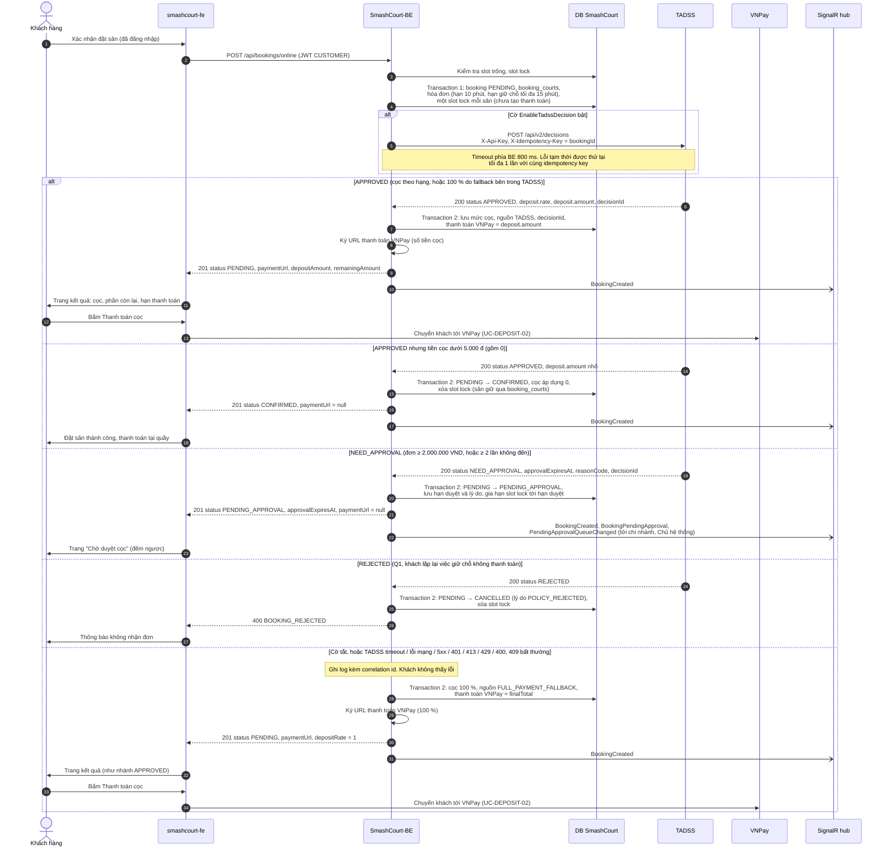
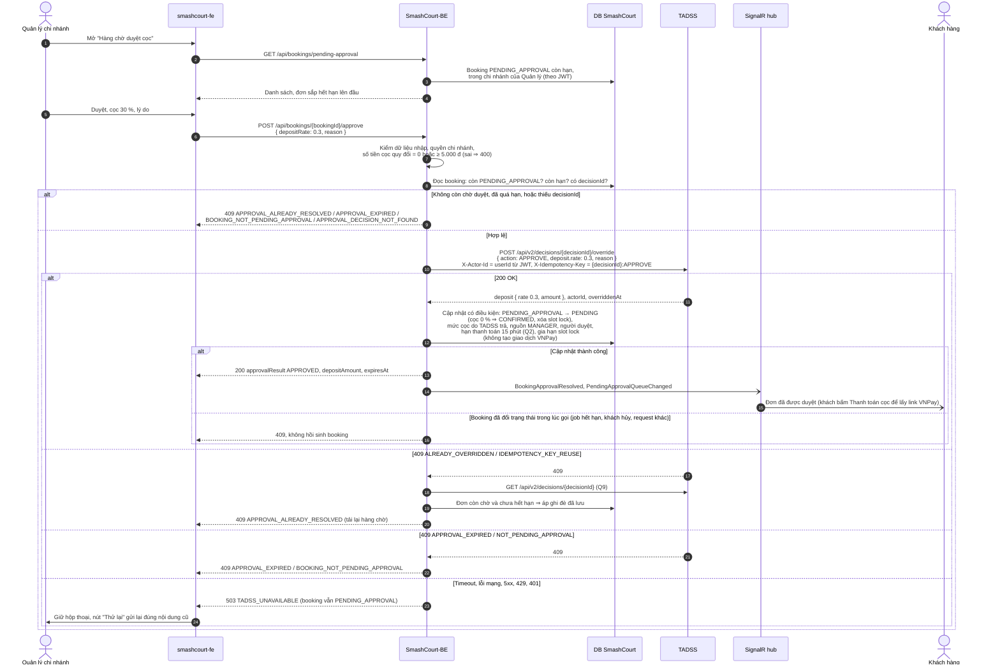
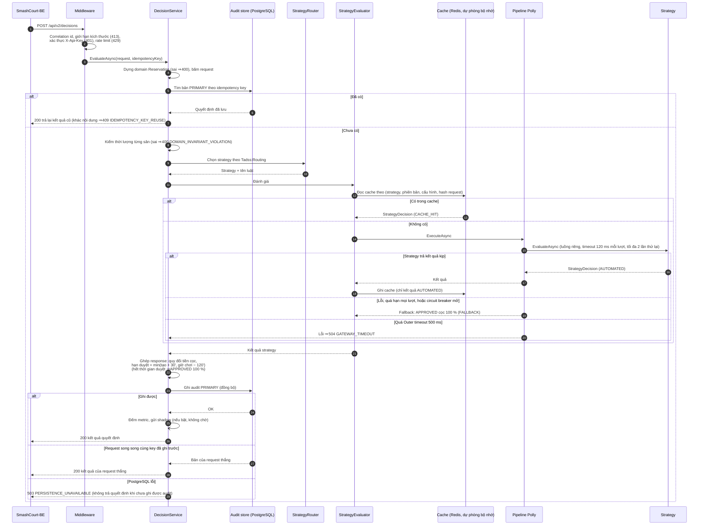
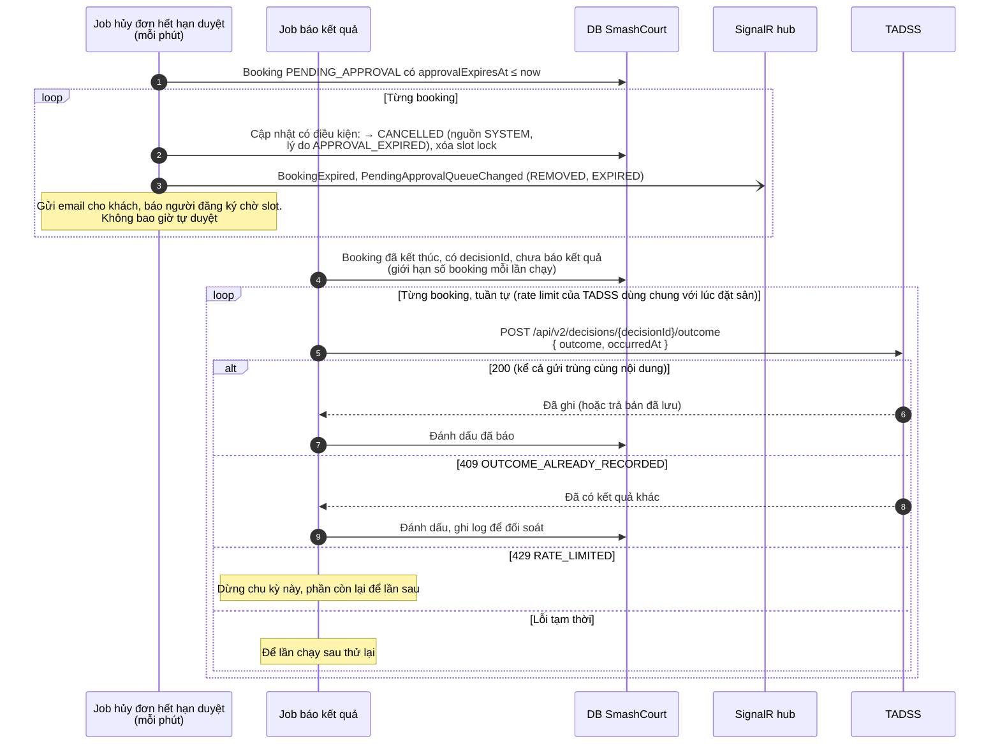
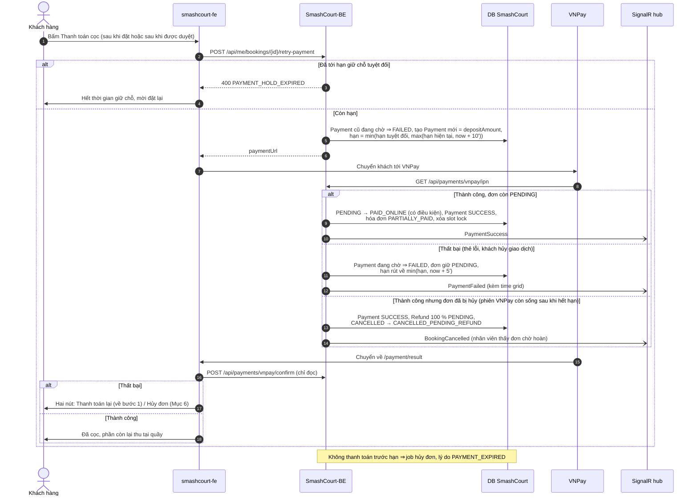
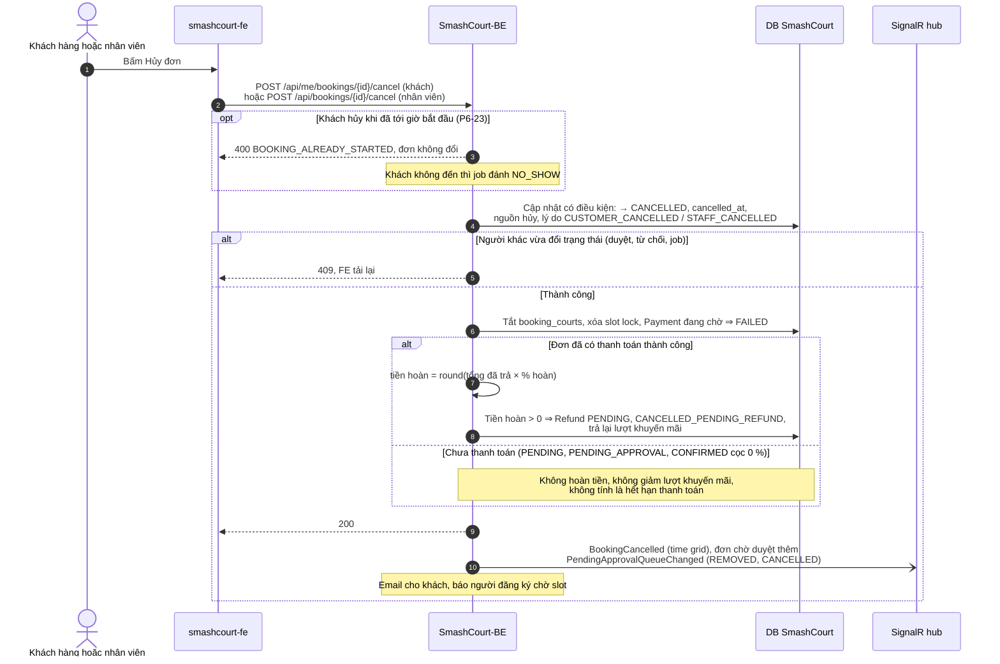

# SƠ ĐỒ TUẦN TỰ: LUỒNG ĐẶT CỌC QUA TADSS

| | |
| :--- | :--- |
| **Mục đích** | Sơ đồ tuần tự để đưa vào báo cáo Đồ án 2: thông điệp giữa FE, BE, TADSS, VNPay và database trong các luồng có quyết định cọc |
| **Trạng thái** | Mục 1, 2, 4, 5, 6: **thiết kế Phase 6** (BE/FE chưa hiện thực). Mục 3: **hiện trạng** (bên trong TADSS, đã có trong mã) |
| **Nguồn sự thật** | [`INTEGRATION_SPEC.md`](../contracts/INTEGRATION_SPEC.md) (BE ↔ TADSS), [`DEPOSIT_APPROVAL_API.md`](../../../SmashCourt-BE/docs/api/DEPOSIT_APPROVAL_API.md) (BE ↔ FE). Khi khác nhau, các tài liệu đó đúng |
| **Use case tương ứng** | [`USE_CASES.md`](USE_CASES.md) |
| **Bộ sơ đồ** | [`ARCHITECTURE_DIAGRAMS.md`](ARCHITECTURE_DIAGRAMS.md) · [`USE_CASES.md`](USE_CASES.md) · tài liệu này · [`ACTIVITY_AND_STATE_DIAGRAMS.md`](ACTIVITY_AND_STATE_DIAGRAMS.md) |
| **Cập nhật** | 18/10/2026 (đồng bộ thiết kế Phase 6: quyết định P6, DEPOSIT_APPROVAL_API Mục 11; thêm Mục 5, 6) |

---

## 1. Đặt sân online có quyết định cọc (UC-DEPOSIT-01)

*Thiết kế Phase 6.* Điểm thiết kế quan trọng: BE **không** gọi TADSS bên trong transaction ghi booking. Booking và slot lock được ghi trước (transaction 1), gọi TADSS sau đó, rồi áp kết quả bằng cập nhật có điều kiện trạng thái (transaction 2). Nếu BE dừng giữa hai bước, booking `PENDING` chưa có thanh toán sẽ bị job hủy `PENDING` quá hạn dọn sau 10 phút, với lý do `SYSTEM_CLEANUP` (không tính vào lịch sử của khách, không báo kết quả cho TADSS). Đặt sân online bắt buộc đăng nhập.

## 2. Quản lý duyệt hoặc từ chối mức cọc (UC-DEPOSIT-05, 06, 07)

*Thiết kế Phase 6.* Khác với lúc đặt sân, khi duyệt **không có** đường lùi cọc 100 %: TADSS không phản hồi thì Quản lý được báo thử lại và đơn vẫn chờ.

Từ chối (`POST /api/bookings/{bookingId}/reject`) đi cùng đường trên với `action: REJECT`, không gửi `deposit`, khóa `{decisionId}:REJECT`; nhánh 200 chuyển `PENDING_APPROVAL → CANCELLED` (lý do `APPROVAL_REJECTED`), xóa slot lock, báo người đăng ký chờ slot và phát thêm `BookingCancelled`.

## 3. Bên trong TADSS khi xử lý một yêu cầu quyết định (UC-TADSS-01)

*Hiện trạng.* Thứ tự đúng theo `DecisionService` và `StrategyEvaluator` trong mã.

## 4. Hết hạn duyệt và báo kết quả về TADSS (UC-DEPOSIT-09, 10)

*Thiết kế Phase 6.*

Ánh xạ trạng thái booking sang `outcome`: [`USE_CASES.md`](USE_CASES.md) Mục 5.10.

## 5. Thanh toán cọc, thanh toán thất bại và thanh toán lại (UC-DEPOSIT-02)

*Thiết kế Phase 6.* Thanh toán thất bại **không** hủy đơn: khách có tối đa 5 phút để thanh toán lại hoặc tự hủy. Mọi lần thanh toán lại không kéo dài quá hạn giữ chỗ tuyệt đối (15 phút từ lúc đặt, hoặc từ lúc duyệt với đơn cần duyệt). Sau khi duyệt, link VNPay chỉ sinh khi khách bấm "Thanh toán cọc".

## 6. Hủy đơn và hoàn tiền (UC-DEPOSIT-04, 12)

*Thiết kế Phase 6.* Mọi đường hủy đi qua một dịch vụ hủy chung trong BE: cập nhật có điều kiện ghi đủ trạng thái, thời điểm, nguồn hủy và **lý do hủy** trong một câu lệnh; tiền hoàn tính trên **số đã trả**, % hoàn theo chính sách hủy tính đúng múi giờ. Khách chỉ tự hủy được **trước giờ bắt đầu** (P6-23); từ giờ bắt đầu chỉ nhân viên hủy được, đơn khách không đến do job đánh `NO_SHOW`.

Các đường hủy khác (Manager từ chối, TADSS từ chối, job hết hạn duyệt, job hết hạn thanh toán) dùng cùng dịch vụ với lý do `APPROVAL_REJECTED`, `POLICY_REJECTED`, `APPROVAL_EXPIRED`, `PAYMENT_EXPIRED` (hoặc `SYSTEM_CLEANUP` khi đơn chưa có giao dịch nào).
