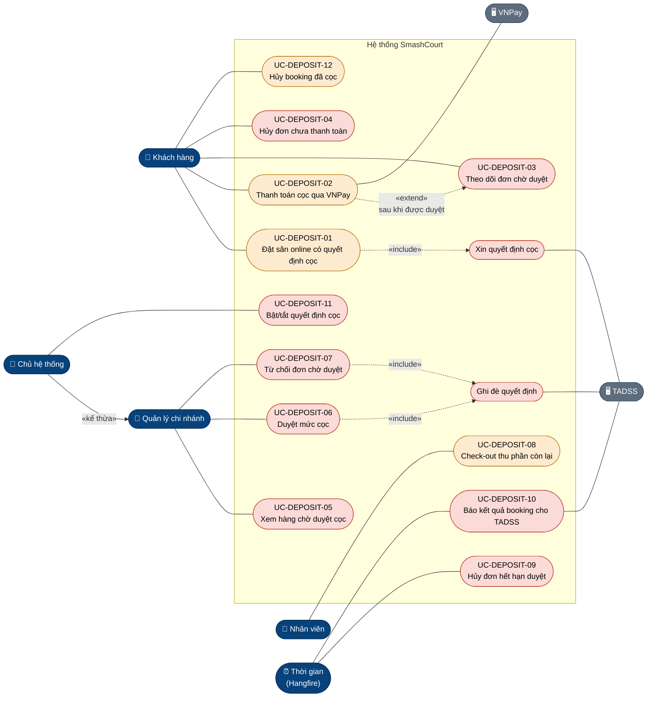
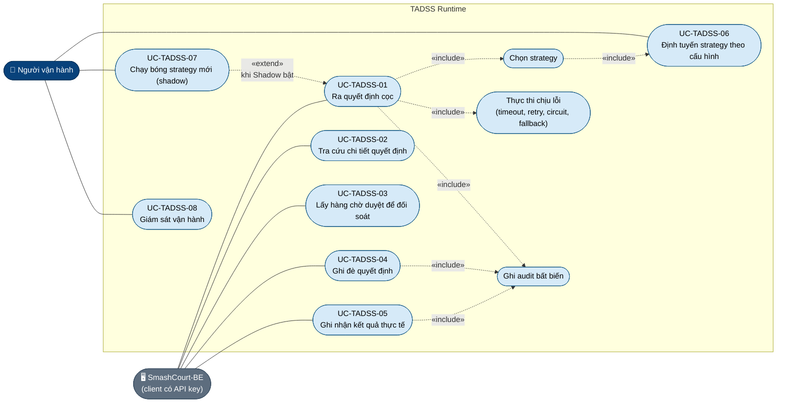

# USE CASE: ẢNH HƯỞNG CỦA TADSS LÊN SMASHCOURT

| | |
| :--- | :--- |
| **Mục đích** | Sơ đồ và đặc tả use case để đưa vào báo cáo Đồ án 2: các use case **mới** và **thay đổi** khi SmashCourt dùng TADSS ra quyết định đặt cọc, cùng các use case của chính TADSS |
| **Trạng thái** | Phần SmashCourt là **thiết kế Phase 6** (chưa hiện thực trong mã BE/FE); phần TADSS là **hiện trạng** (đã có trong mã, Phase 5) |
| **Nguồn sự thật** | Hợp đồng BE ↔ FE: [`DEPOSIT_APPROVAL_API.md`](../../../SmashCourt-BE/docs/api/DEPOSIT_APPROVAL_API.md). Hợp đồng BE ↔ TADSS: [`INTEGRATION_SPEC.md`](../contracts/INTEGRATION_SPEC.md). Kịch bản kiểm thử E2E: [`E2E_TEST_SPECIFICATION.md`](../research/E2E_TEST_SPECIFICATION.md). Khi khác nhau, các tài liệu đó đúng |
| **Use case của Đồ án 1** | [`SmashCourt-BE/docs/use-cases/`](../../../SmashCourt-BE/docs/use-cases/) (không lặp lại ở đây; tài liệu này chỉ mô tả phần mới hoặc phần đổi) |
| **Bộ sơ đồ** | [`ARCHITECTURE_DIAGRAMS.md`](ARCHITECTURE_DIAGRAMS.md) · tài liệu này · [`SEQUENCE_DIAGRAMS.md`](SEQUENCE_DIAGRAMS.md) · [`ACTIVITY_AND_STATE_DIAGRAMS.md`](ACTIVITY_AND_STATE_DIAGRAMS.md) |
| **Cập nhật** | 18/10/2026 (đồng bộ thiết kế Phase 6: quyết định P6, DEPOSIT_APPROVAL_API Mục 11) |

**Quyết định nghiệp vụ.** Các hành vi đánh dấu `(Qn)` theo bảng quyết định đã chốt ở Mục 9 của `DEPOSIT_APPROVAL_API.md` (Q1…Q12, review T5.29 ngày 18/10/2026); các quyết định thiết kế Phase 6 (đặt online bắt buộc đăng nhập, giữ chỗ 15 phút, thanh toán lỗi không hủy đơn, lý do hủy, hoàn trên số đã trả…) ở Mục 11 của tài liệu đó. Đổi quyết định nào thì sửa cả hai tài liệu.

---

## 1. Tác nhân

| Tác nhân | Loại | Vai trò trong luồng cọc |
| :--- | :--- | :--- |
| Khách hàng | Chính | Đặt sân, thanh toán cọc, theo dõi đơn chờ duyệt, hủy đơn. Đặt online bắt buộc đăng nhập (`CUSTOMER`); khách vãng lai chỉ đặt tại quầy qua nhân viên |
| Quản lý chi nhánh | Chính | Xem hàng chờ duyệt của chi nhánh mình, duyệt kèm mức cọc hoặc từ chối (`BRANCH_MANAGER`) |
| Chủ hệ thống | Chính | Như Quản lý nhưng trên mọi chi nhánh (`OWNER`); bật/tắt quyết định cọc qua cấu hình |
| Nhân viên chi nhánh | Chính | Check-out và thu phần còn lại tại quầy (`STAFF`) |
| Thời gian (Hangfire) | Chính, hệ thống | Kích hoạt job định kỳ: hủy đơn hết hạn duyệt, báo kết quả booking |
| TADSS | Phụ, hệ thống | Trả quyết định cọc, nhận ghi đè và kết quả; không có giao diện người dùng |
| VNPay | Phụ, hệ thống | Thu tiền cọc, gửi IPN |

## 2. Sơ đồ use case phía SmashCourt

*Thiết kế Phase 6.* Chỉ vẽ các use case liên quan đến cọc; use case khác của Đồ án 1 giữ nguyên.

Chú thích: **đỏ nhạt** là use case mới; **cam nhạt** là use case của Đồ án 1 bị thay đổi. Chủ hệ thống **kế thừa** Quản lý chi nhánh (làm được UC-DEPOSIT-05/06/07, nhưng trên mọi chi nhánh), cộng thêm UC-DEPOSIT-11.

## 3. Sơ đồ use case phía TADSS

*Hiện trạng.* TADSS là nền tảng dùng chung; client duy nhất hiện nay là SmashCourt-BE. Người vận hành chỉ thao tác qua cấu hình và Grafana.

| Mã | Use case | Endpoint / cơ chế | Ghi chú |
| :--- | :--- | :--- | :--- |
| UC-TADSS-01 | Ra quyết định cọc | `POST /api/v2/decisions` | Idempotent theo `X-Idempotency-Key`; trả `APPROVED` (kèm `deposit`), `NEED_APPROVAL` (kèm `approvalExpiresAt`) hoặc `REJECTED` |
| UC-TADSS-02 | Tra cứu chi tiết quyết định | `GET /api/v2/decisions/{decisionId}` | Gồm request, kết quả, override, outcome |
| UC-TADSS-03 | Lấy hàng chờ duyệt để đối soát | `GET /api/v2/decisions/pending-approvals` | BE **không** dùng cho màn hình hàng chờ (đọc DB của BE), chỉ để đối soát |
| UC-TADSS-04 | Ghi đè quyết định | `POST /api/v2/decisions/{decisionId}/override` | Tối đa một override mỗi quyết định; `X-Actor-Id` là người duyệt |
| UC-TADSS-05 | Ghi nhận kết quả thực tế | `POST /api/v2/decisions/{decisionId}/outcome` | Nhãn kết quả cho phân tích và Khóa luận |
| UC-TADSS-06 | Định tuyến strategy | Cấu hình `Tadss:Routing`, nạp lại nóng | Chọn strategy theo từng request (giờ cao điểm, hạng, kênh) |
| UC-TADSS-07 | Chạy bóng strategy mới | Cấu hình `Tadss:Shadow` | Strategy thứ hai chạy song song, chỉ ghi audit `SHADOW`, không ảnh hưởng kết quả trả về |
| UC-TADSS-08 | Giám sát vận hành | Grafana (metric, trace, log qua OpenTelemetry) | Tỷ lệ fallback, trạng thái circuit breaker, độ trễ p95/p99 |

## 4. Danh mục use case phía SmashCourt

| Mã | Tên | Loại | Tác nhân | Endpoint BE (Phase 6) | Kiểm thử E2E |
| :--- | :--- | :--- | :--- | :--- | :--- |
| UC-DEPOSIT-01 | Đặt sân online có quyết định cọc | Thay đổi UC-BOOKING-01 | Khách hàng; phụ: TADSS | `POST /api/bookings/online` | E2E-01, 02, 05, 06 |
| UC-DEPOSIT-02 | Thanh toán cọc qua VNPay | Thay đổi UC thanh toán VNPay | Khách hàng; phụ: VNPay | VNPay callback/IPN; `POST /api/me/bookings/{id}/retry-payment` | E2E-01, 02 |
| UC-DEPOSIT-03 | Theo dõi đơn chờ duyệt | Mới | Khách hàng | `GET /api/me/bookings/{id}`; SignalR `BookingApprovalResolved` | E2E-02, 03 |
| UC-DEPOSIT-04 | Hủy đơn chưa thanh toán (chờ duyệt, chờ thanh toán) | Thay đổi UC hủy booking (Q8) | Khách hàng (nhân viên hủy hộ) | `POST /api/me/bookings/{id}/cancel`, `POST /api/bookings/{id}/cancel` | E2E-01 (biến thể thẻ lỗi) |
| UC-DEPOSIT-05 | Xem hàng chờ duyệt cọc | Mới | Quản lý, Chủ hệ thống | `GET /api/bookings/pending-approval` | E2E-08, 10 |
| UC-DEPOSIT-06 | Duyệt mức cọc | Mới | Quản lý, Chủ hệ thống; phụ: TADSS | `POST /api/bookings/{bookingId}/approve` | E2E-02, 07, 11, 12 |
| UC-DEPOSIT-07 | Từ chối đơn chờ duyệt | Mới | Quản lý, Chủ hệ thống; phụ: TADSS | `POST /api/bookings/{bookingId}/reject` | E2E-03 |
| UC-DEPOSIT-08 | Check-out thu phần còn lại | Thay đổi UC check-out | Nhân viên | `POST /api/bookings/{id}/checkout`, `/complete-payment` | E2E-09 |
| UC-DEPOSIT-09 | Hủy đơn hết hạn duyệt | Mới | Thời gian | Job Hangfire (không có endpoint) | E2E-04 |
| UC-DEPOSIT-10 | Báo kết quả booking cho TADSS | Mới | Thời gian; phụ: TADSS | Job Hangfire → `POST /api/v2/decisions/{id}/outcome` | — (kiểm ở BE-IT-09) |
| UC-DEPOSIT-11 | Bật/tắt quyết định cọc | Mới | Chủ hệ thống | Cấu hình `TadssConfig:EnableTadssDecision` (không có màn hình) | E2E-05 |
| UC-DEPOSIT-12 | Hủy booking đã cọc (hoàn theo số đã trả) | Thay đổi UC hủy booking online | Khách hàng (nhân viên hủy hộ) | `POST /api/me/bookings/{id}/cancel`, `POST /api/bookings/{id}/cancel` | — |

Đặt sân tại quầy (`WALK_IN`) **không đổi**: không gọi TADSS, không có cọc (E2E-13).

---

## 5. Đặc tả use case

### 5.1. UC-DEPOSIT-01: Đặt sân online có quyết định cọc

| Thông tin | Nội dung |
| :--- | :--- |
| **Tên Use case** | Đặt sân online có quyết định cọc |
| **Mã Use case** | UC-DEPOSIT-01 (thay đổi UC-BOOKING-01 của Đồ án 1) |
| **Mô tả** | Là khách hàng, tôi muốn đặt sân online và chỉ phải trả trước một khoản cọc phù hợp với mình thay vì luôn trả 100 %, để giữ sân với chi phí trả trước thấp hơn |
| **Tác nhân** | Khách hàng đã đăng nhập (`CUSTOMER`) |
| **Tác nhân phụ** | TADSS, VNPay |
| **Mức độ ưu tiên** | Cao |
| **Điều kiện kích hoạt** | Khách bấm "Xác nhận đặt sân" ở bước cuối của màn hình đặt sân |
| **Điều kiện tiên quyết** | Như UC-BOOKING-01 (chi nhánh và sân hoạt động, slot còn trống). TADSS **không** bắt buộc phải hoạt động |
| **Điều kiện cuối (thành công)** | Một trong bốn kết quả: (a) booking `PENDING`, có mức cọc, khách thấy tóm tắt cọc và thanh toán **số tiền cọc** qua VNPay; (d) cọc dưới mức thanh toán online tối thiểu (gồm 0): booking `CONFIRMED`, thu toàn bộ tại quầy; (b) booking `PENDING_APPROVAL`, slot được giữ tới hạn duyệt, Quản lý chi nhánh nhận thông báo; (c) booking bị hủy và khách nhận thông báo không nhận đơn (khi strategy trả `REJECTED`, ví dụ khách lặp lại việc giữ chỗ không thanh toán) |
| **Đảm bảo tối thiểu** | Lỗi của TADSS không bao giờ làm hỏng booking hay hiện lỗi cho khách: khi đó khách trả 100 % như Đồ án 1 |

#### Luồng chính (nhánh `APPROVED`)

1. Khách (đã đăng nhập) thực hiện các bước chọn chi nhánh, sân, khung giờ, khuyến mãi và xác nhận của UC-BOOKING-01. **Khác Đồ án 1:** bắt buộc đăng nhập, không còn nhánh nhập thông tin khách vãng lai (bước 15–16, 16a của UC-BOOKING-01); màn xác nhận không còn nói "sẽ chuyển tới trang thanh toán tổng tiền" vì mức cọc chỉ biết sau khi đặt.
2. Hệ thống kiểm tra dữ liệu và slot (như UC-BOOKING-01, bước 21–22).
3. Hệ thống tạo booking `PENDING`, chi tiết sân, hóa đơn và slot lock (chưa tạo giao dịch thanh toán).
4. Hệ thống dựng yêu cầu quyết định: từng sân và giá, tổng tiền sau giảm giá, hạng thành viên đã ánh xạ, lịch sử của khách theo lý do hủy (số lần hoàn tất, không đến, tự hủy, hết hạn thanh toán; không tính hết hạn duyệt, bị từ chối, nhân viên hủy), mức lấp đầy của khung giờ.
5. Hệ thống gửi yêu cầu tới TADSS với khóa idempotency là mã booking.
6. TADSS trả `APPROVED` kèm tỷ lệ và số tiền cọc.
7. Hệ thống lưu mức cọc, nguồn `TADSS` và mã quyết định lên booking/hóa đơn; tạo giao dịch VNPay đúng **số tiền cọc**, hạn thanh toán 10 phút, hạn giữ chỗ tối đa 15 phút; link VNPay hết hạn trước hạn thanh toán 2 phút (P6-27).
8. Hệ thống phát sự kiện `BookingCreated` (time grid thấy slot bị giữ).
9. Hệ thống hiển thị trang kết quả: tổng tiền, tiền cọc, phần còn lại thu tại quầy, đồng hồ tới hạn thanh toán; khách bấm "Thanh toán cọc" để sang VNPay (tiếp tục ở UC-DEPOSIT-02).

#### Luồng thay thế

- **(6a) TADSS trả `NEED_APPROVAL`** (đơn ≥ 2.000.000 VND, hoặc khách có từ 2 lần không đến)
  1. Hệ thống chuyển booking sang `PENDING_APPROVAL`, lưu hạn duyệt `approvalExpiresAt` và lý do cần duyệt; gia hạn slot lock tới hạn duyệt.
  2. Hệ thống phát `BookingPendingApproval` và `PendingApprovalQueueChanged` tới chi nhánh và Chủ hệ thống.
  3. Hệ thống hiển thị trang "Chờ duyệt cọc" với mã đơn và đồng hồ đếm tới hạn duyệt. Không chuyển tới VNPay.
  4. Use case kết thúc; tiếp tục ở UC-DEPOSIT-03 (khách) và UC-DEPOSIT-05/06/07 (Quản lý).
- **(6b) TADSS trả `REJECTED`** (Q1; strategy mặc định trả khi khách có từ 5 lần giữ chỗ hết hạn thanh toán và nhiều hơn số lần hoàn tất)
  1. Hệ thống hủy booking (lý do `POLICY_REJECTED`, không tính vào lịch sử hết hạn thanh toán của khách), xóa slot lock.
  2. Hệ thống hiển thị "Rất tiếc, đơn đặt sân này không được chấp nhận…" (mã `BOOKING_REJECTED`). Không hiển thị lý do của TADSS.
- **(5a) Cờ `EnableTadssDecision` tắt**
  1. Hệ thống bỏ qua bước 5–6, áp cọc 100 %, nguồn `FULL_PAYMENT_FALLBACK`; tiếp tục bước 7.
- **(6d) TADSS trả `APPROVED` nhưng số tiền cọc dưới mức thanh toán online tối thiểu** (mặc định 5.000 đ, gồm 0; hoặc tổng tiền bằng 0)
  1. Hệ thống xác nhận booking `CONFIRMED`, không tạo giao dịch VNPay, thu toàn bộ tại quầy; trang kết quả báo "thanh toán tại quầy".
- **(6e) TADSS trả `NEED_APPROVAL` nhưng hạn duyệt không dùng được lúc hệ thống nhận** (hạn đã qua do độ trễ mạng hoặc lệch đồng hồ khi đặt sát mốc 2 giờ trước giờ chơi; hoặc hạn sau giờ chơi; P6-24)
  1. Hệ thống không dùng quyết định này, áp cọc 100 %, nguồn `FULL_PAYMENT_FALLBACK`, không lưu mã quyết định; tiếp tục bước 7. Khách thanh toán được ngay thay vì chờ một lần duyệt không thể xảy ra.
- **(6c) TADSS trả cọc 100 % do sự cố bên trong TADSS** (strategy lỗi, quá hạn, circuit breaker mở; hoặc cần duyệt nhưng không kịp trước giờ chơi)
  1. Hệ thống xử lý như luồng chính (đây là một `APPROVED` hợp lệ, nguồn `TADSS`).

#### Luồng ngoại lệ

- **(5b) TADSS không phản hồi trong 800 ms, lỗi mạng, 5xx, 401, 413, 429, hoặc 400/409 bất thường**
  1. Hệ thống ghi log kèm correlation id; thử lại tối đa một lần với cùng khóa idempotency nếu lỗi tạm thời.
  2. Vẫn lỗi: áp cọc 100 %, nguồn `FULL_PAYMENT_FALLBACK`; tiếp tục bước 7. Khách **không** thấy lỗi.
- **(3a) Slot vừa bị người khác đặt** (race condition): như UC-BOOKING-01 (22a).
- **(1a) Chưa đăng nhập**: hệ thống chuyển tới trang đăng nhập (API trả 401).
- Các ngoại lệ khác (sân ngừng hoạt động, khuyến mãi không hợp lệ): như UC-BOOKING-01.

#### Quy tắc nghiệp vụ

1. Khách **không** tự chọn mức cọc; mức cọc do TADSS hoặc Quản lý quyết định.
2. Mọi sự cố kỹ thuật (TADSS lỗi, không phản hồi, tắt cờ, fallback của TADSS, không kịp duyệt) đều dẫn tới cọc 100 %. `NEED_APPROVAL` chỉ dành cho bất định nghiệp vụ.
3. Số tiền cọc do TADSS quy đổi tại một nơi: `round(finalTotal × tỷ lệ)`, VND không có số lẻ.
4. Chỉ booking `ONLINE` gọi TADSS.
5. Cùng một booking gọi lại TADSS (thử lại) không sinh quyết định mới (idempotency theo mã booking).
6. Hạn duyệt = sớm hơn trong hai mốc: 30 phút sau khi đặt, hoặc 2 giờ trước giờ chơi. Không còn thời gian duyệt thì TADSS trả cọc 100 % thay vì đưa vào hàng chờ; hạn duyệt đã qua lúc hệ thống nhận cũng xử lý như vậy (6e).

#### Yêu cầu phi chức năng

1. Thời gian thêm vào luồng đặt sân do gọi TADSS: tối đa 800 ms (timeout phía BE); TADSS tự giới hạn pipeline strategy 500 ms.
2. Không gọi TADSS bên trong transaction ghi booking (không giữ kết nối/khóa DB trong lúc chờ mạng).

### 5.2. UC-DEPOSIT-02: Thanh toán cọc qua VNPay

| Thông tin | Nội dung |
| :--- | :--- |
| **Tên / Mã** | Thanh toán cọc qua VNPay · UC-DEPOSIT-02 (thay đổi UC thanh toán VNPay của Đồ án 1) |
| **Mô tả** | Khách thanh toán **số tiền cọc** (không còn luôn là 100 %) để giữ sân |
| **Tác nhân / phụ** | Khách hàng / VNPay |
| **Điều kiện kích hoạt** | Khách được chuyển tới VNPay sau UC-DEPOSIT-01, hoặc bấm "Thanh toán" sau khi đơn được duyệt (UC-DEPOSIT-03) |
| **Điều kiện tiên quyết** | Booking `PENDING`, chưa quá hạn thanh toán, đã có mức cọc |
| **Điều kiện cuối** | Booking `PAID_ONLINE`, hóa đơn `PARTIALLY_PAID` (kể cả khi cọc 100 %: giữ nguyên hành vi IPN hiện tại); phần còn lại = `finalTotal − depositAmount` |

**Luồng chính** ([`SEQUENCE_DIAGRAMS.md`](SEQUENCE_DIAGRAMS.md) Mục 5). Như UC thanh toán VNPay của Đồ án 1, khác ở ba điểm: (1) số tiền trên URL VNPay là `depositAmount`; (2) màn hình kết quả hiển thị số đã cọc và phần còn lại sẽ thu tại quầy; (3) thanh toán thất bại **không** còn hủy booking ngay (luồng c).

#### Luồng thay thế

- **(a) Thanh toán lại** (`retry-payment`): chỉ cho booking `PENDING` chưa quá hạn; số tiền vẫn là `depositAmount`; hạn được gia hạn nhưng không vượt **hạn giữ chỗ tuyệt đối** (15 phút từ lúc đặt hoặc lúc duyệt); link mới hết hạn trước hạn thanh toán 2 phút. Còn dưới 3 phút ⇒ hệ thống từ chối "Không còn đủ thời gian thanh toán, vui lòng đặt lại" (`PAYMENT_HOLD_EXPIRED`), không gia hạn, không tạo link (P6-27). Booking `PENDING_APPROVAL` gọi chức năng này nhận lỗi "Chỉ có thể thanh toán lại cho đơn đang chờ thanh toán".
- **(b) Thanh toán sau khi được duyệt**: hạn thanh toán là 15 phút sau khi duyệt (cấu hình `TadssConfig:ApprovedPaymentWindowMinutes`), không vượt giờ chơi (Q2); link VNPay sinh khi khách bấm "Thanh toán cọc".
- **(c) Thanh toán thất bại** (thẻ lỗi, khách hủy trên VNPay): booking vẫn chờ thanh toán thêm tối đa 5 phút; trang kết quả cho "Thanh toán lại" hoặc "Hủy đơn".
- **(d) Link quá hạn** (khách để trang VNPay quá lâu): VNPay báo hết thời gian chờ thanh toán (mã `15`), không trừ tiền và không gửi IPN; đơn giữ hạn cũ; trang kết quả báo link quá hạn, khách bấm "Thanh toán lại" nếu còn thời gian (a), không thì job hủy khi hết hạn.
- **Trang kết quả** đọc `bookingStatus` do hệ thống trả (P6-28): tiêu đề theo trạng thái đơn, không theo riêng kết quả của VNPay; tiền về sau khi đơn đã hủy hiển thị đơn đã hủy kèm hoàn tiền tại chi nhánh.

**Luồng ngoại lệ.** Hết hạn thanh toán: job hủy booking `PENDING` và nhả slot, lý do hủy `PAYMENT_EXPIRED`. Tiền về sau khi đơn đã hủy: hệ thống tạo yêu cầu hoàn 100 %, nhân viên xử lý ở hàng "Chờ hoàn tiền".

### 5.3. UC-DEPOSIT-03: Theo dõi đơn chờ duyệt

| Thông tin | Nội dung |
| :--- | :--- |
| **Tên / Mã** | Theo dõi đơn chờ duyệt · UC-DEPOSIT-03 (mới) |
| **Mô tả** | Khách xem đơn đang chờ Quản lý duyệt mức cọc và nhận kết quả để thanh toán |
| **Tác nhân** | Khách hàng đã đăng nhập |
| **Điều kiện tiên quyết** | Booking của chính khách ở `PENDING_APPROVAL` |
| **Điều kiện cuối** | Khách biết kết quả: được duyệt (có nút thanh toán cọc), bị từ chối, hoặc hết hạn |

#### Luồng chính

1. Khách mở trang chi tiết đơn (hoặc đang ở trang "Chờ duyệt cọc" sau UC-DEPOSIT-01).
2. Hệ thống hiển thị mã đơn, sân, giờ, tổng tiền và đồng hồ đếm tới hạn duyệt. Không hiển thị lý do cần duyệt.
3. Quản lý duyệt (UC-DEPOSIT-06); hệ thống phát `BookingApprovalResolved` tới khách.
4. Trang tải lại chi tiết đơn: trạng thái `PENDING`, hiển thị tỷ lệ cọc, số tiền cọc, phần còn lại, hạn thanh toán và nút "Thanh toán cọc".
5. Khách bấm "Thanh toán cọc" ⇒ UC-DEPOSIT-02.

#### Luồng thay thế

- **(3a) Bị từ chối** (UC-DEPOSIT-07): trang hiển thị "Đã hủy" kèm thông báo; slot đã được nhả.
- **(3b) Hết hạn duyệt** (UC-DEPOSIT-09): trang hiển thị "Đã hủy" do hết hạn duyệt.
- **(3c) Không nhận được sự kiện realtime** (mất kết nối): trang tải lại qua REST khi mở lại, khi kết nối lại hoặc khi tab được focus. Kết quả đúng không phụ thuộc vào việc nhận được sự kiện.
- **(3d) Không mở ứng dụng**: khách nhận email dẫn tới lịch sử đặt sân; email không chứa link VNPay (link chỉ sinh khi bấm "Thanh toán cọc").

### 5.4. UC-DEPOSIT-04: Hủy đơn chưa thanh toán

| Thông tin | Nội dung |
| :--- | :--- |
| **Tên / Mã** | Hủy đơn chưa thanh toán · UC-DEPOSIT-04 (mở rộng UC hủy booking online; Q8) |
| **Tác nhân** | Khách hàng (nhân viên hủy hộ qua chức năng hủy hiện có) |
| **Điều kiện tiên quyết** | Booking `PENDING_APPROVAL`; `PENDING` chưa thanh toán (ví dụ sau khi thanh toán thất bại); hoặc `CONFIRMED` online cọc 0 % |
| **Điều kiện cuối** | Booking `CANCELLED` (lý do `CUSTOMER_CANCELLED`, hoặc `STAFF_CANCELLED` khi nhân viên hủy hộ), slot được nhả, đơn rời hàng chờ của Quản lý; **không** phát sinh hoàn tiền (chưa thanh toán), không bị tính là hết hạn thanh toán |

**Luồng chính.** (Endpoint hủy hiện chỉ nhận `CONFIRMED`/`PAID_ONLINE`; Phase 6 thêm `PENDING_APPROVAL` và `PENDING` chưa thanh toán, ví dụ sau khi thanh toán thất bại.) Khách bấm "Hủy đơn" → xác nhận → hệ thống chuyển sang `CANCELLED` bằng cập nhật có điều kiện trạng thái (ghi thời điểm, nguồn và lý do hủy trong một câu lệnh), xóa slot lock, chuyển giao dịch VNPay đang chờ sang thất bại, **không** giảm lượt dùng khuyến mãi (chưa từng được tính), phát `BookingCancelled` (và `PendingApprovalQueueChanged` `REMOVED`/`CANCELLED` nếu đơn đang chờ duyệt). Sau đó job ở UC-DEPOSIT-10 báo kết quả `CANCELLED_BY_CUSTOMER` (hoặc `CANCELLED_BY_STAFF`) cho TADSS. Sơ đồ: [`SEQUENCE_DIAGRAMS.md`](SEQUENCE_DIAGRAMS.md) Mục 6.

**Luồng ngoại lệ.** Quản lý vừa duyệt/từ chối trước đó một khoảnh khắc: cập nhật có điều kiện thất bại, hệ thống báo đơn đã thay đổi trạng thái và tải lại.

### 5.5. UC-DEPOSIT-05: Xem hàng chờ duyệt cọc

| Thông tin | Nội dung |
| :--- | :--- |
| **Tên / Mã** | Xem hàng chờ duyệt cọc · UC-DEPOSIT-05 (mới) |
| **Mô tả** | Quản lý xem các đơn đang chờ mình quyết định mức cọc, đơn sắp hết hạn lên đầu |
| **Tác nhân** | Quản lý chi nhánh (chi nhánh được gán), Chủ hệ thống (mọi chi nhánh) |
| **Điều kiện tiên quyết** | Đã đăng nhập với vai trò `BRANCH_MANAGER` hoặc `OWNER` |
| **Điều kiện cuối** | Danh sách đơn `PENDING_APPROVAL` còn hạn của phạm vi được phép |

#### Luồng chính

1. Quản lý mở màn hình "Hàng chờ duyệt cọc".
2. Hệ thống xác định phạm vi chi nhánh từ tài khoản (Quản lý: chi nhánh được gán; Chủ hệ thống: mọi chi nhánh hoặc chi nhánh đã chọn).
3. Hệ thống đọc **từ DB của SmashCourt** các booking `PENDING_APPROVAL` có hạn duyệt chưa qua, sắp theo hạn duyệt tăng dần, phân trang.
4. Mỗi dòng hiển thị: mã đơn, khách (tên, SĐT, hạng), ngày giờ, sân, tổng tiền, **lý do cần duyệt** (ví dụ "Khách có 3 lần không đến (ngưỡng 2)"), hạn duyệt, ghi chú của khách.
5. Có đơn mới hoặc đơn rời hàng chờ: hệ thống phát `PendingApprovalQueueChanged`, màn hình tự tải lại (E2E-10).

#### Luồng ngoại lệ

- **(2a) Quản lý chọn chi nhánh không phải của mình**: 403 "Bạn không có quyền thao tác chi nhánh này" (E2E-08).
- **(2b) Nhân viên hoặc khách truy cập**: 403; giao diện ẩn chức năng.

**Quy tắc nghiệp vụ.** Hàng chờ không gọi TADSS mỗi lần mở (trạng thái booking của SmashCourt là nguồn sự thật). Lý do cần duyệt chỉ hiển thị cho nhân viên, không hiển thị cho khách (Q6).

### 5.6. UC-DEPOSIT-06: Duyệt mức cọc

| Thông tin | Nội dung |
| :--- | :--- |
| **Tên Use case** | Duyệt mức cọc |
| **Mã Use case** | UC-DEPOSIT-06 (mới) |
| **Mô tả** | Là Quản lý chi nhánh, tôi muốn duyệt một đơn đang chờ và tự quyết định mức cọc, để giữ được khách tốt mà vẫn kiểm soát rủi ro bỏ sân |
| **Tác nhân** | Quản lý chi nhánh, Chủ hệ thống |
| **Tác nhân phụ** | TADSS |
| **Mức độ ưu tiên** | Cao |
| **Điều kiện kích hoạt** | Quản lý bấm "Duyệt" trên một đơn ở hàng chờ (UC-DEPOSIT-05) |
| **Điều kiện tiên quyết** | Booking `PENDING_APPROVAL`, còn hạn duyệt, thuộc chi nhánh của Quản lý, có mã quyết định TADSS |
| **Điều kiện cuối (thành công)** | TADSS ghi nhận ghi đè (người duyệt, mức cọc, lý do); booking `PENDING` với mức cọc do Quản lý chọn, nguồn `MANAGER`, hạn thanh toán 15 phút; khách được báo |
| **Đảm bảo tối thiểu** | Không bao giờ có hai kết quả duyệt cho cùng một đơn; booking đã hết hạn/đã hủy không bao giờ bị "hồi sinh" |

#### Luồng chính

1. Quản lý bấm "Duyệt" trên một đơn.
2. Hệ thống hiển thị hộp thoại: ô **phần trăm cọc** (0–100, tối đa 2 chữ số thập phân), ô **lý do** (bắt buộc, 5–500 ký tự), và số tiền cọc dự tính.
3. Quản lý nhập, ví dụ 30 % và "Khách quen, đã gọi xác nhận", rồi bấm "Xác nhận". Giao diện khóa nút trong lúc chờ.
4. Hệ thống kiểm tra dữ liệu nhập, quyền chi nhánh, và trạng thái theo DB của SmashCourt: vẫn `PENDING_APPROVAL`, chưa quá hạn duyệt.
5. Hệ thống gửi ghi đè `APPROVE` kèm tỷ lệ 0,3 tới TADSS; người duyệt lấy từ phiên đăng nhập; khóa idempotency `{mã quyết định}:APPROVE`.
6. TADSS ghi ghi đè vào audit và trả số tiền cọc đã quy đổi.
7. Hệ thống cập nhật booking (có điều kiện trạng thái): `PENDING_APPROVAL → PENDING`, lưu mức cọc **do TADSS trả về**, nguồn `MANAGER`, người duyệt, thời điểm duyệt; đặt hạn thanh toán 15 phút (Q2) và gia hạn slot lock. Không tạo giao dịch VNPay: khách tự lấy link khi bấm thanh toán.
8. Hệ thống phát `BookingApprovalResolved` và `PendingApprovalQueueChanged`; gửi email báo khách thanh toán cọc (dẫn tới lịch sử đặt sân).
9. Hệ thống báo "Duyệt đơn thành công, đã thông báo khách thanh toán cọc"; đơn rời hàng chờ.

#### Luồng thay thế

- **(3a) Duyệt mức 0 %** (Q4, miễn cọc): không có gì để thanh toán nên booking chuyển thẳng `CONFIRMED`, không tạo VNPay; toàn bộ tiền thu tại quầy như đặt tại quầy.
- **(5a) Thử lại sau lỗi 503** với đúng nội dung cũ, trong khi TADSS thực ra đã ghi lần trước: TADSS trả lại ghi đè đã lưu; hệ thống tiếp tục bước 7 như bình thường.

#### Luồng ngoại lệ

- **(4a) Dữ liệu nhập sai** (tỷ lệ ngoài 0–100 %, quá 2 chữ số thập phân, lý do thiếu/quá ngắn; số tiền cọc quy đổi lớn hơn 0 nhưng dưới 5.000 đ): báo lỗi dưới ô nhập, quay lại bước 3. Không gọi TADSS.
- **(4b) Đơn của chi nhánh khác**: 403 "Bạn không có quyền xử lý đơn của chi nhánh này".
- **(4c) Đơn đã được xử lý** (Quản lý khác vừa duyệt/từ chối, hoặc chính Quản lý bấm lần hai): 409 "Đơn này đã được xử lý trước đó"; tải lại hàng chờ (E2E-07, E2E-12).
- **(4d) Đã quá hạn duyệt**: 409 "Đơn đã hết hạn duyệt"; không gọi TADSS (E2E-04).
- **(4e) Đơn không ở trạng thái chờ duyệt** (đơn tại quầy, đơn chưa từng cần duyệt, khách đã hủy): 409 "Đơn không còn ở trạng thái chờ duyệt" (E2E-13).
- **(6a) TADSS không phản hồi / 5xx / 429 / 401**: 503 "Hệ thống duyệt cọc tạm thời không phản hồi…"; booking **vẫn** `PENDING_APPROVAL`; hộp thoại giữ giá trị đã nhập, nút "Thử lại" gửi lại đúng nội dung cũ (E2E-11). **Không** có đường lùi cọc 100 % khi duyệt.
- **(6b) TADSS báo đã có ghi đè khác / đã hết hạn**: 409 như (4c)/(4d). Nếu TADSS đã có ghi đè mà đơn trong SmashCourt vẫn chờ duyệt và còn hạn (Q9), hệ thống đọc chi tiết quyết định và áp ghi đè đã lưu để hai bên khớp nhau.
- **(6c) TADSS không tìm thấy quyết định** (dữ liệu lệch, Q10): 409 "Không tìm thấy quyết định cọc của đơn…"; đơn sẽ bị hủy khi hết hạn duyệt.
- **(7a) Booking đổi trạng thái trong lúc gọi TADSS** (job hết hạn, khách hủy, request duyệt khác ghi trước): cập nhật có điều kiện thất bại ⇒ 409; hệ thống không hồi sinh booking và đối soát theo chi tiết quyết định của TADSS.

#### Quy tắc nghiệp vụ

1. Mỗi quyết định có tối đa một ghi đè (TADSS bảo đảm bằng ràng buộc duy nhất).
2. Người duyệt lấy từ phiên đăng nhập, không lấy từ dữ liệu client gửi.
3. Số tiền cọc luôn do TADSS quy đổi; giao diện chỉ hiển thị số BE trả về.
4. Không bao giờ tự duyệt; hết hạn mà chưa duyệt được thì đơn bị hủy (UC-DEPOSIT-09).

### 5.7. UC-DEPOSIT-07: Từ chối đơn chờ duyệt

| Thông tin | Nội dung |
| :--- | :--- |
| **Tên / Mã** | Từ chối đơn chờ duyệt · UC-DEPOSIT-07 (mới) |
| **Tác nhân / phụ** | Quản lý chi nhánh, Chủ hệ thống / TADSS |
| **Điều kiện tiên quyết** | Như UC-DEPOSIT-06 |
| **Điều kiện cuối** | TADSS ghi ghi đè `REJECT`; booking `CANCELLED` (nguồn hủy: nhân viên, lý do `APPROVAL_REJECTED`; không tính vào lịch sử hết hạn thanh toán của khách), slot được nhả, người đăng ký chờ slot được báo; khách được báo; không hoàn tiền (chưa thanh toán) |

**Luồng chính.** Giống UC-DEPOSIT-06 bước 1–6, khác: hộp thoại chỉ có ô **lý do**; ghi đè gửi `REJECT` (không kèm mức cọc), khóa `{mã quyết định}:REJECT`; bước 7 chuyển `PENDING_APPROVAL → CANCELLED`, xóa slot lock, báo người đăng ký chờ slot; bước 8 phát thêm `BookingCancelled` cho time grid (E2E-03).

**Luồng ngoại lệ.** Như UC-DEPOSIT-06 (4a)…(7a), trừ phần mức cọc.

### 5.8. UC-DEPOSIT-08: Check-out thu phần còn lại

| Thông tin | Nội dung |
| :--- | :--- |
| **Tên / Mã** | Check-out thu phần còn lại · UC-DEPOSIT-08 (thay đổi UC check-out của Đồ án 1) |
| **Tác nhân** | Nhân viên chi nhánh |
| **Điều kiện tiên quyết** | Booking `IN_PROGRESS` hoặc `PENDING_PAYMENT`; hóa đơn `PARTIALLY_PAID` (đã cọc) hoặc `UNPAID` (cọc 0 %, cọc dưới mức tối thiểu, đặt tại quầy) |
| **Điều kiện cuối** | Booking `COMPLETED`, hóa đơn `PAID`; số đã thu tại quầy = phần còn lại |

**Luồng chính.** Như UC check-out hiện có, khác ở số tiền thu tại quầy: hiển thị và thu **`finalTotal − tổng đã thanh toán`** (bằng `finalTotal − depositAmount` khi đã cọc; bằng 0 thì không tạo khoản thu), trong đó `finalTotal` gồm cả dịch vụ phát sinh sau khi check-in (Đồ án 1 chỉ thu phần dịch vụ phát sinh vì khách đã trả 100 % tiền sân) (E2E-09).

**Quy tắc nghiệp vụ.** Mức cọc tính trên tổng tiền lúc đặt; dịch vụ thêm sau đó chỉ làm tăng phần còn lại, không đổi tiền cọc.

### 5.9. UC-DEPOSIT-09: Hủy đơn hết hạn duyệt

| Thông tin | Nội dung |
| :--- | :--- |
| **Tên / Mã** | Hủy đơn hết hạn duyệt · UC-DEPOSIT-09 (mới) |
| **Tác nhân** | Thời gian (job Hangfire chạy mỗi phút, như job hủy `PENDING` quá hạn hiện có) |
| **Điều kiện kích hoạt** | Lịch chạy định kỳ |
| **Điều kiện cuối** | Mọi booking `PENDING_APPROVAL` có hạn duyệt đã qua chuyển sang `CANCELLED` (nguồn hủy: hệ thống); slot được nhả |

#### Luồng chính

1. Job tìm các booking `PENDING_APPROVAL` có `approvalExpiresAt ≤ now`.
2. Với từng booking (tối đa 100 booking mỗi lần chạy): khóa booking, kiểm lại hạn duyệt, chuyển sang `CANCELLED` (lý do `APPROVAL_EXPIRED`) bằng cập nhật có điều kiện trạng thái, hóa đơn `EXPIRED`, xóa slot lock, báo người đăng ký chờ slot, gửi email cho khách. Lần hủy này **không** tính vào lịch sử hết hạn thanh toán của khách (lỗi không ở khách).
3. Job phát `BookingExpired` (khách, chi nhánh, time grid) và `PendingApprovalQueueChanged` (`REMOVED`/`EXPIRED`).
4. Kết quả `APPROVAL_EXPIRED` được báo cho TADSS qua UC-DEPOSIT-10.

**Luồng ngoại lệ.** Quản lý duyệt đúng lúc job chạy: bên ghi trước thắng; nếu job thắng, yêu cầu duyệt nhận 409 và booking không bị hồi sinh (UC-DEPOSIT-06, 7a).

**Quy tắc nghiệp vụ.** **Không bao giờ tự duyệt** khi hết hạn: bỏ trống quyết định là hủy, không phải chấp nhận.

### 5.10. UC-DEPOSIT-10: Báo kết quả booking cho TADSS

| Thông tin | Nội dung |
| :--- | :--- |
| **Tên / Mã** | Báo kết quả booking cho TADSS · UC-DEPOSIT-10 (mới) |
| **Tác nhân / phụ** | Thời gian (job Hangfire) / TADSS |
| **Mục đích** | Gắn nhãn kết quả thật cho từng quyết định, làm dữ liệu đánh giá chính sách cọc và huấn luyện strategy thích ứng của Khóa luận |
| **Điều kiện tiên quyết** | Booking có mã quyết định TADSS và đã ở trạng thái kết thúc |
| **Điều kiện cuối** | TADSS lưu đúng một kết quả cho quyết định đó |

#### Ánh xạ trạng thái booking → kết quả gửi TADSS

| Booking kết thúc với | Kết quả gửi |
| :--- | :--- |
| `COMPLETED`, hoặc `PENDING_PAYMENT` (hết giờ chơi, chờ nhân viên check-out), **có** thời điểm check-in | `COMPLETED` |
| `NO_SHOW` (job phát hiện không đến), **không có** thời điểm check-in | `NO_SHOW` |
| Trạng thái mâu thuẫn dữ liệu check-in | Không gửi; giữ lại, ghi log Error để người vận hành xem |
| Khách hủy | `CANCELLED_BY_CUSTOMER` |
| Nhân viên hủy (trừ từ chối duyệt) | `CANCELLED_BY_STAFF` |
| Hết hạn thanh toán cọc | `PAYMENT_EXPIRED` |
| Hết hạn duyệt (UC-DEPOSIT-09) | `APPROVAL_EXPIRED` |
| Quản lý từ chối (UC-DEPOSIT-07), hoặc TADSS trả `REJECTED` khi đặt | `REJECTED` |
| BE tự dọn booking dở dang (dừng giữa hai bước ghi) | Không gửi; ghi log để đối soát |

Kết quả xác định theo trạng thái cuối và **lý do hủy** lưu trên booking (`cancel_reason`), không theo nguồn hủy. Thời điểm xảy ra cố định (giờ kết thúc chơi, hoặc thời điểm hủy) để gửi lại nhiều lần vẫn trùng nội dung.

**Luồng chính.** Job (mỗi 5 phút) chọn các booking đã kết thúc nhưng chưa báo kết quả, booking cập nhật gần nhất trước (để quyết định cũ bị TADSS từ chối vĩnh viễn không chặn booking mới) → gửi **tuần tự**, giới hạn số booking mỗi lần chạy (TADSS giới hạn tần suất theo client, dùng chung với lúc đặt sân) → TADSS trả 200 → đánh dấu đã báo.

**Luồng ngoại lệ.** TADSS không phản hồi trong 5 giây, lỗi 5xx, 429, trang lỗi của đường hầm, hoặc response không khớp quyết định đã gửi: dừng lần chạy này, không đánh dấu, để lần chạy sau thử lại (gửi trùng cùng nội dung được TADSS chấp nhận và trả lại bản đã lưu). TADSS báo đã có kết quả khác (409): ghi log để đối soát, không gửi lại. TADSS báo không có quyết định (`DECISION_NOT_FOUND`) hoặc nội dung sai: ghi log, để lần sau, gửi tiếp booking khác.

### 5.11. UC-DEPOSIT-11: Bật/tắt quyết định cọc

| Thông tin | Nội dung |
| :--- | :--- |
| **Tên / Mã** | Bật/tắt quyết định cọc · UC-DEPOSIT-11 (mới) |
| **Tác nhân** | Chủ hệ thống (qua người vận hành; **không có màn hình**) |
| **Cơ chế** | Cấu hình `TadssConfig:EnableTadssDecision`, đọc qua `IOptionsMonitor` nên có hiệu lực trong vòng 2 giây, không cần khởi động lại BE |
| **Điều kiện cuối** | Tắt: đơn **mới** đặt online cọc 100 % (`FULL_PAYMENT_FALLBACK`), như Đồ án 1 (E2E-05). Bật: đơn mới đi qua TADSS |

**Quy tắc nghiệp vụ.** Cờ chỉ chi phối việc xin quyết định **khi đặt sân** (Q7): đơn đã `PENDING_APPROVAL` vẫn duyệt/từ chối qua TADSS; không tự đổi các đơn đó sang cọc 100 %.

### 5.12. UC-DEPOSIT-12: Hủy booking đã cọc

| Thông tin | Nội dung |
| :--- | :--- |
| **Tên / Mã** | Hủy booking đã cọc · UC-DEPOSIT-12 (thay đổi UC hủy booking online của Đồ án 1; Q12) |
| **Tác nhân** | Khách hàng (nhân viên hủy hộ qua chức năng hủy hiện có) |
| **Điều kiện tiên quyết** | Booking `PAID_ONLINE` (đã thanh toán cọc hoặc 100 %) |
| **Điều kiện cuối** | Booking `CANCELLED_PENDING_REFUND` (có tiền hoàn) hoặc `CANCELLED`; số tiền hoàn **không bao giờ vượt số khách đã trả** |

#### Luồng chính

Như UC hủy booking online của Đồ án 1, khác ở cách tính tiền hoàn: `tiền hoàn = round(tổng các khoản đã thanh toán thành công × % hoàn)`, với % hoàn lấy theo chính sách hủy hiện có (theo số giờ trước giờ chơi, tính đúng múi giờ: mã Đồ án 1 tính dư 7 giờ nên có thể hoàn nhiều hơn chính sách sát các mốc). Tiền hoàn **luôn trả bằng tiền mặt tại chi nhánh đặt sân** (nhân viên xác nhận ở hàng "Chờ hoàn tiền"), không hoàn qua cổng thanh toán; đơn có nhiều khoản đã trả thì mỗi khoản một yêu cầu hoàn, khách nhận một lần tổng tiền. Sau đó job ở UC-DEPOSIT-10 báo kết quả `CANCELLED_BY_CUSTOMER` (hoặc `CANCELLED_BY_STAFF`) cho TADSS.

#### Quy tắc nghiệp vụ

1. Đồ án 1 tính `tiền hoàn = finalTotal × % hoàn`, đúng khi khách luôn trả 100 %. Khi chỉ cọc một phần, cách cũ hoàn vượt số đã trả (ví dụ cọc 30 %, hủy sớm được hoàn 100 % ⇒ hoàn 100 % tổng tiền); đây là lỗi B-1 đã ghi nhận và được sửa bằng quy tắc trên.
2. Booking online tạo trước khi có cọc (đã trả 100 %) cho cùng kết quả như cách tính cũ.
3. Khách chỉ tự hủy được trước giờ bắt đầu (P6-23). Từ giờ bắt đầu, BE trả 400 `BOOKING_ALREADY_STARTED` và FE ẩn nút hủy; đơn khách không đến do job đánh `NO_SHOW`, nhờ đó lịch sử gửi TADSS không ghi nhầm "hủy muộn" thay cho "không đến". Nhân viên vẫn hủy hộ được.
