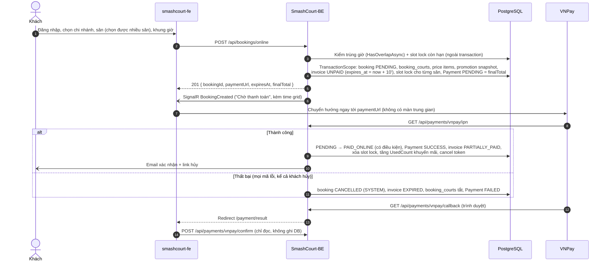

# ĐẶC TẢ PHASE 6 — TÍCH HỢP CỌC TADSS VÀO SMASHCOURT-BE VÀ SMASHCOURT-FE

| | |
| :--- | :--- |
| **Phạm vi** | Phase 6 (W09–W12, 02/11 – 29/11/2026): Epic 6A `SmashCourt-BE` (SV1, T6.1…T6.10), Epic 6B `smashcourt-fe` (SV2, T6.11…T6.15). `TADSS-Runtime` không đổi mã (contract v2.0.0 đóng băng; strategy mặc định 2.1.0) |
| **Nhánh** | `SmashCourt-BE`: `feat/phase-6-deposit` tách từ `develop` tại `8320f8a` (20/10/2026; mã đã lần theo ở Mục 2 là `master` `4f6af8c`). `smashcourt-fe`: `feat/phase-6-deposit` tách từ `master`. Người dùng tạo nhánh và merge |
| **Ngày lập** | 18/10/2026; rà soát lại toàn tuyến FE → BE → TADSS cùng ngày; rà soát thời gian và múi giờ 19/10 (Mục 3.3) |
| **Trạng thái** | Người dùng đã duyệt P6-01…P6-27 (P6-22, P6-23 chốt 19/10; P6-24…P6-27 chốt 27/10 khi rà soát plan 6A-5). Plan chi tiết từng gói (kết quả ghi ở cuối mỗi plan): 6A-1 [PHASE6_PLAN_6A-1_FOUNDATION.md](PHASE6_PLAN_6A-1_FOUNDATION.md) (3 plan con a, b, c) ✅; 6A-2 [PHASE6_PLAN_6A-2_ONLINE_BOOKING.md](PHASE6_PLAN_6A-2_ONLINE_BOOKING.md) (plan con 2a, 2b, 2c) ✅; 6A-3 [PHASE6_PLAN_6A-3_APPROVAL.md](PHASE6_PLAN_6A-3_APPROVAL.md) ✅ (24/10, `023e7c8`); 6A-4 [PHASE6_PLAN_6A-4_PAYMENT_CANCEL_CHECKOUT.md](PHASE6_PLAN_6A-4_PAYMENT_CANCEL_CHECKOUT.md) ✅ (25/10, `f554fad`, kèm rà soát hồi quy Phase 6); 6A-5 [PHASE6_PLAN_6A-5_JOBS.md](PHASE6_PLAN_6A-5_JOBS.md) ✅ (27/10, `fd29a51`); 6A-6 [PHASE6_PLAN_6A-6_FINALIZE.md](PHASE6_PLAN_6A-6_FINALIZE.md) (plan 29/10, chưa code; P6-28…P6-30 chốt 29/10). Thử VNPay sandbox 28/10 (10.1 bước 2): các luồng thanh toán đạt; xác nhận khe hở P6-27, thêm N-36 và ghi chú FE ở 8.2; T-5 đề xuất sửa cùng P6-27. Epic 6B (FE) chưa bắt đầu |
| **Hợp đồng liên quan** | [`DEPOSIT_APPROVAL_API.md`](../../SmashCourt-BE/docs/api/DEPOSIT_APPROVAL_API.md) (BE ↔ FE, đã cập nhật theo spec này, tóm tắt ở Mục 11 của file đó), [`INTEGRATION_SPEC.md`](../docs/contracts/INTEGRATION_SPEC.md) (BE ↔ TADSS) |
| **Danh mục test** | [`EXPERIMENTAL_DESIGN_AND_BENCHMARK_METHODOLOGY.md`](../docs/research/EXPERIMENTAL_DESIGN_AND_BENCHMARK_METHODOLOGY.md) Mục 4.7–4.8, [`E2E_TEST_SPECIFICATION.md`](../docs/research/E2E_TEST_SPECIFICATION.md) |
| **Gate M6** | Toàn bộ test case BE trong danh mục đạt; FE build + lint + Playwright (trên mock) đạt; không còn task tính năng mở (MASTER_EXECUTION_PLAN) |

**Đây là tài liệu duy nhất của Phase 6**: gồm luồng đang chạy, các vấn đề tìm thấy, quyết định kèm lý do, thiết kế, kiểm thử, triển khai và truy vết. Quy ước: "đơn" = booking; giờ là giờ Việt Nam trừ khi ghi UTC; R-x là phát hiện của review T5.29 (DEPOSIT_APPROVAL_API Mục 10); N-x là phát hiện khi lần theo mã; P6-x là quyết định của Phase 6 (không dùng mã D-x để khỏi trùng các quyết định D-01…D-14 của TADSS).

| Mục | Nội dung |
| :--- | :--- |
| 1 | Tóm tắt; bản đồ luồng → sơ đồ, use case, mục thiết kế (1.1) |
| 2 | Luồng đang chạy FE → BE → TADSS |
| 3 | Vấn đề tìm thấy (R-x, N-x, T-x thời gian) |
| 4 | Quyết định (P6-x), thông số, lý do chọn |
| 5 | Chia gói, thứ tự |
| 6 | Thiết kế DB (T6.1) |
| 7 | Thiết kế BE |
| 8 | Thiết kế FE |
| 9 | Kiểm thử |
| 10 | Triển khai, xác minh trước khi làm, rollback |
| 11 | Rủi ro |
| 12 | Truy vết vấn đề → nơi xử lý |
| 13 | Tài liệu đã đồng bộ |

---

## 1. TÓM TẮT

**Luồng cọc dự kiến khả thi trên mã hiện có, không phải đổi kiến trúc:**

- Lớp chặn trùng giờ thật là ràng buộc DB `excl_booking_courts_no_overlap` trên `booking_courts` đang hoạt động. Đơn `PENDING_APPROVAL` vẫn giữ `booking_courts.is_active = true` nên **sân không bao giờ bị đặt trùng**, kể cả khi quên thêm trạng thái mới vào danh sách nào đó; quên chỉ gây sai hiển thị và sai thông báo lỗi.
- BE đã có mẫu cập nhật có điều kiện trạng thái (`UpdateWithStatusCheckAsync`, `AtomicUpdatePaymentSuccessAsync`) cho các thao tác chạy song song (duyệt, từ chối, hết hạn, IPN).
- IPN thành công đã chuyển `PENDING → PAID_ONLINE` có điều kiện và đặt hóa đơn `PARTIALLY_PAID`: cọc một phần chỉ cần `Payment.Amount = depositAmount`.
- Duyệt cọc 0 % chạy được với check-out hiện có (hóa đơn `UNPAID` ⇒ thu toàn bộ).

**Thay đổi lớn so với Đồ án 1** (chi tiết Mục 4): đặt online bắt buộc đăng nhập; mức cọc do TADSS hoặc Manager quyết; giữ chỗ tối đa 15 phút; thanh toán thất bại không hủy đơn ngay; mọi đường hủy ghi lý do hủy; hoàn tiền trên số đã trả và đúng múi giờ; check-out thu phần còn lại.

**Lỗi có sẵn của Đồ án 1 được sửa luôn:** hoàn vượt số đã trả (R-1), check-out thu thiếu (R-3), `retry-payment` giữ slot vô hạn (N-20), tiền về sau khi hủy không có bản ghi (N-11, N-15), % hoàn lệch 7 giờ (N-18), `finalTotal = 0` làm hỏng đặt sân (N-7), hủy đơn chưa thu tiền làm lệch lượt khuyến mãi (N-8, N-22), khuyến mãi không điều kiện bỏ qua giới hạn lượt (N-26), IPN không tính lượt khuyến mãi (N-27), mã giảm số tiền cố định lỗi 500 (N-28), đặt sân đồng thời lỗi 500 (N-29), email đơn tại quầy không gửi vì hạn link hủy sai kiểu giờ (T-3), "hôm nay" ở FE ra ngày hôm qua trước 07:00 (T-7), ngày/tháng bị đảo ở vài màn FE (T-8).

### 1.1. Bản đồ luồng và sơ đồ

Sơ đồ của báo cáo (`docs/report/`) đã được đối chiếu với P6-01…P6-21 ngày 18/10/2026 và render kiểm (18 sơ đồ); cập nhật theo P6-24…P6-26 và render kiểm lại ngày 27/10 (tuần tự 4, hoạt động 1, trạng thái booking). **Quy tắc:** đổi một quyết định trong spec này thì sửa sơ đồ và use case ở cột tương ứng trong cùng đợt, rồi chạy lại render và `check_docs`.

| Luồng | Tuần tự | Hoạt động / trạng thái | Use case | Thiết kế |
| :--- | :--- | :--- | :--- | :--- |
| Tổng thể: TADSS ở đâu, đổi gì so với Đồ án 1 | — | — | [Sơ đồ use case](../docs/report/USE_CASES.md#2-sơ-đồ-use-case-phía-smashcourt) | [Ngữ cảnh](../docs/report/ARCHITECTURE_DIAGRAMS.md#1-sơ-đồ-ngữ-cảnh-c4-mức-1) · [Container](../docs/report/ARCHITECTURE_DIAGRAMS.md#2-sơ-đồ-container-c4-mức-2) · [Trước/sau](../docs/report/ARCHITECTURE_DIAGRAMS.md#3-so-sánh-trước-và-sau-khi-có-tadss) |
| Đặt sân online, 5 nhánh kết quả | [Tuần tự 1](../docs/report/SEQUENCE_DIAGRAMS.md#1-đặt-sân-online-có-quyết-định-cọc-uc-deposit-01) | [Hoạt động 1](../docs/report/ACTIVITY_AND_STATE_DIAGRAMS.md#1-quy-trình-đặt-sân-có-cọc-từ-đầu-đến-cuối) | [UC-01](../docs/report/USE_CASES.md#51-uc-deposit-01-đặt-sân-online-có-quyết-định-cọc) | 7.6 |
| Thanh toán cọc, thất bại, thanh toán lại, tiền về sau khi hủy | [Tuần tự 5](../docs/report/SEQUENCE_DIAGRAMS.md#5-thanh-toán-cọc-thanh-toán-thất-bại-và-thanh-toán-lại-uc-deposit-02) | [Hoạt động 1](../docs/report/ACTIVITY_AND_STATE_DIAGRAMS.md#1-quy-trình-đặt-sân-có-cọc-từ-đầu-đến-cuối) | [UC-02](../docs/report/USE_CASES.md#52-uc-deposit-02-thanh-toán-cọc-qua-vnpay) | 7.5, 7.8 |
| Khách theo dõi đơn chờ duyệt | [Tuần tự 2](../docs/report/SEQUENCE_DIAGRAMS.md#2-quản-lý-duyệt-hoặc-từ-chối-mức-cọc-uc-deposit-05-06-07) (bước báo khách) | [Hoạt động 1](../docs/report/ACTIVITY_AND_STATE_DIAGRAMS.md#1-quy-trình-đặt-sân-có-cọc-từ-đầu-đến-cuối) | [UC-03](../docs/report/USE_CASES.md#53-uc-deposit-03-theo-dõi-đơn-chờ-duyệt) | 8.2 |
| Manager xem hàng chờ, duyệt, từ chối | [Tuần tự 2](../docs/report/SEQUENCE_DIAGRAMS.md#2-quản-lý-duyệt-hoặc-từ-chối-mức-cọc-uc-deposit-05-06-07) | [Hoạt động 2](../docs/report/ACTIVITY_AND_STATE_DIAGRAMS.md#2-quy-trình-quản-lý-duyệt-mức-cọc) | [UC-05](../docs/report/USE_CASES.md#55-uc-deposit-05-xem-hàng-chờ-duyệt-cọc) · [UC-06](../docs/report/USE_CASES.md#56-uc-deposit-06-duyệt-mức-cọc) · [UC-07](../docs/report/USE_CASES.md#57-uc-deposit-07-từ-chối-đơn-chờ-duyệt) | 7.7, 8.3 |
| Hủy đơn chưa thanh toán; hủy đơn đã cọc và hoàn tiền | [Tuần tự 6](../docs/report/SEQUENCE_DIAGRAMS.md#6-hủy-đơn-và-hoàn-tiền-uc-deposit-04-12) | [Trạng thái booking](../docs/report/ACTIVITY_AND_STATE_DIAGRAMS.md#4-vòng-đời-booking-sau-khi-có-tadss) | [UC-04](../docs/report/USE_CASES.md#54-uc-deposit-04-hủy-đơn-chưa-thanh-toán) · [UC-12](../docs/report/USE_CASES.md#512-uc-deposit-12-hủy-booking-đã-cọc) | 7.9 |
| Check-out thu phần còn lại | — | [Trạng thái booking](../docs/report/ACTIVITY_AND_STATE_DIAGRAMS.md#4-vòng-đời-booking-sau-khi-có-tadss) | [UC-08](../docs/report/USE_CASES.md#58-uc-deposit-08-check-out-thu-phần-còn-lại) | 7.10 |
| Hết hạn duyệt; báo kết quả về TADSS | [Tuần tự 4](../docs/report/SEQUENCE_DIAGRAMS.md#4-hết-hạn-duyệt-và-báo-kết-quả-về-tadss-uc-deposit-09-10) | [Trạng thái booking](../docs/report/ACTIVITY_AND_STATE_DIAGRAMS.md#4-vòng-đời-booking-sau-khi-có-tadss) · [Trạng thái quyết định](../docs/report/ACTIVITY_AND_STATE_DIAGRAMS.md#5-vòng-đời-một-quyết-định-trong-tadss) | [UC-09](../docs/report/USE_CASES.md#59-uc-deposit-09-hủy-đơn-hết-hạn-duyệt) · [UC-10](../docs/report/USE_CASES.md#510-uc-deposit-10-báo-kết-quả-booking-cho-tadss) | 7.11 |
| Bật/tắt quyết định cọc | [Tuần tự 1](../docs/report/SEQUENCE_DIAGRAMS.md#1-đặt-sân-online-có-quyết-định-cọc-uc-deposit-01) (nhánh cờ tắt) | [Hoạt động 1](../docs/report/ACTIVITY_AND_STATE_DIAGRAMS.md#1-quy-trình-đặt-sân-có-cọc-từ-đầu-đến-cuối) | [UC-11](../docs/report/USE_CASES.md#511-uc-deposit-11-bậttắt-quyết-định-cọc) | 7.1 |
| Vòng đời booking (mọi trạng thái, chuyển mới) | — | [Trạng thái booking](../docs/report/ACTIVITY_AND_STATE_DIAGRAMS.md#4-vòng-đời-booking-sau-khi-có-tadss) | — | 7.12 |
| Bên trong TADSS (hiện trạng, không đổi) | [Tuần tự 3](../docs/report/SEQUENCE_DIAGRAMS.md#3-bên-trong-tadss-khi-xử-lý-một-yêu-cầu-quyết-định-uc-tadss-01) | [Hoạt động 3](../docs/report/ACTIVITY_AND_STATE_DIAGRAMS.md#3-pipeline-quyết-định-bên-trong-tadss) · [Trạng thái quyết định](../docs/report/ACTIVITY_AND_STATE_DIAGRAMS.md#5-vòng-đời-một-quyết-định-trong-tadss) | — | 2.4 · [Bên trong TADSS](../docs/report/ARCHITECTURE_DIAGRAMS.md#4-cấu-trúc-bên-trong-tadss-runtime) |

---

## 2. LUỒNG ĐANG CHẠY FE → BE → TADSS

Lần theo mã `smashcourt-fe` (`master`) và `SmashCourt-BE` (`master`, `4f6af8c`) ngày 18/10/2026.

### 2.1. Đặt sân online và thanh toán (Đồ án 1)



Điểm cần biết:

- **FE chỉ cho đặt online khi đã đăng nhập** từ commit FE `4130360` (12/05/2026): trang đặt sân và trang kết quả thanh toán nằm trong `app/(customer)` có `RoleGuard allowedRole="CUSTOMER"`. **BE vẫn nhận đặt ẩn danh** nếu gọi thẳng API. Dữ liệu cũ có 60 đơn online của khách vãng lai, đơn cuối 25/05/2026.
- **Chỉ IPN ghi DB.** `vnpay/confirm` gọi `HandleVnPayReturnAsync` là hàm chỉ đọc, dù comment ở `PaymentController` nói "Confirm làm fallback". Không có IPN tới BE thì đơn mãi `PENDING` rồi bị job hủy.
- Thư viện `VNPAY.NET 2.1.0` **không gửi `vnp_ExpireDate`** (đã kiểm trong DLL): BE không đặt được hạn phiên VNPay; URL đã ký nên không thêm tham số được. Thư viện gửi `vnp_CreateDate` theo **UTC** (chạy thử 19/10, T-5). **Thử sandbox 28/10 (kết quả ở 10.1 bước 2):** trang thanh toán VNPay sống khoảng 15 phút kể từ lúc khách mở, dài hơn hạn giữ chỗ 10 phút của BE, nên khách trả được sau khi Job-01 đã hủy đơn; VNPay có kiểm `vnp_ExpireDate` (đã qua ⇒ từ chối ngay khi mở) và đọc nó theo GMT+7.
- **Thanh toán lại** (`POST /api/me/bookings/{id}/retry-payment`): vô hiệu Payment `PENDING` cũ, tạo Payment mới bằng `FinalTotal`, đặt hạn = `now + 10'`, **không giới hạn số lần**.
- **Job** (Hangfire, mỗi phút): Job-01 hủy `PENDING` có hóa đơn `UNPAID` quá hạn (`CancelSource = SYSTEM`, hóa đơn `EXPIRED`) bằng cập nhật **không** có điều kiện, không có `[DisableConcurrentExecution]`; Job-03 xóa slot lock hết hạn; Job-02 kết thúc đơn hết giờ; Job-04 đánh `NO_SHOW` cho `CONFIRMED`/`PAID_ONLINE` không check-in.
- FE gửi bộ lọc trạng thái dạng **số** (`BookingStatus.PENDING = 0`…); màn xác nhận đặt sân ghi "Tổng tiền thanh toán… sẽ được chuyển đến trang thanh toán"; `NotificationDispatcher` chỉ đăng ký các sự kiện hiện có.
- Dịch vụ chỉ thêm được khi `IN_PROGRESS`/`PENDING_PAYMENT` (`CanModifyServices`: "Service chỉ order tại sân").

### 2.2. Hủy, check-in, check-out

| Thao tác | Trạng thái được phép | Hoàn tiền | Ghi chú mã |
| :--- | :--- | :--- | :--- |
| Khách hủy trong app (`POST /api/me/bookings/{id}/cancel`) | `CONFIRMED`, `PAID_ONLINE` | `FinalTotal × %` | Cập nhật có điều kiện nhưng chỉ đặt `status` (không `cancelled_at`) |
| Hủy bằng link email (`/api/bookings/cancel/{token}`) | `CONFIRMED`, `PAID_ONLINE` | `FinalTotal × %` (cả xem trước) | Token sinh ở IPN thành công, ở đơn a′ và ở duyệt 0 % (D8) |
| Nhân viên hủy (`POST /api/bookings/{id}/cancel`) | `PENDING`, `CONFIRMED`, `PAID_ONLINE` | `FinalTotal × %` | Cập nhật **không** điều kiện; luôn giảm `UsedCount` khuyến mãi; không vô hiệu Payment chờ |
| Check-in | `CONFIRMED`, `PAID_ONLINE`, trong ±15' giờ bắt đầu | — | Quy đổi múi giờ đúng (`ConvertTimeToUtc`) |
| Check-out / complete-payment | `IN_PROGRESS`, `PENDING_PAYMENT` | — | `UNPAID` ⇒ thu `FinalTotal`; `PARTIALLY_PAID` ⇒ **chỉ thu `ServiceFee`** |

`CalculateRefundPercentAsync` lấy giờ chơi (giờ Việt Nam) trừ `UtcNow` ⇒ số giờ còn lại **dư 7 giờ**; hạn link hủy coi giờ chơi là UTC ⇒ hết hạn sau giờ chơi 7 giờ. Khách hủy trong app **không kiểm giờ bắt đầu**; Job-04 đánh `NO_SHOW` sau giờ bắt đầu 15', chạy 5 phút/lần (T-4).

### 2.3. Ba lớp "giữ sân"

| Lớp | Ở đâu | Tác dụng | Nếu `PENDING_APPROVAL` không được tính |
| :--- | :--- | :--- | :--- |
| Ràng buộc DB `excl_booking_courts_no_overlap` | `booking_courts` có `is_active = true` | **Chặn trùng thật** | Vẫn chặn |
| `slot_locks` | Tạo lúc đặt, hạn = hạn hóa đơn | Kiểm trước ("đang trong quá trình thanh toán"); time grid hiện `LOCKED` "còn X phút" và khóa nút | Hết 10' lock bị xóa ⇒ time grid hiện trống |
| Danh sách trạng thái trong mã (11 chỗ, N-5) | Repository, service | Kiểm trùng trước, time grid, lịch, chặn tạm ngưng sân/chi nhánh | Khách khác thấy trống, bấm đặt, bị DB chặn ⇒ `SLOT_UNAVAILABLE` và bị ghi `slot_interest` sai; Owner tạm ngưng được sân đang có đơn chờ duyệt |

Ràng buộc DB khác liên quan: `chk_bookings_cancelled_at` (trạng thái hủy phải có `cancelled_at`), `uq_slot_locks_booking` (một lock mỗi booking, trong khi mã tạo một lock mỗi sân), `chk_payments_amount_positive` (`amount > 0`), `chk_invoices_expires_at`. Integration test BE dựng DB bằng `EnsureCreatedAsync()` nên **không có** các ràng buộc này.

### 2.4. Phía TADSS (đã đối chiếu với mã runtime)

| Hành vi TADSS | BE phải tính tới |
| :--- | :--- |
| Hạn duyệt `approvalExpiresAt = min(tạo + 30', giờ chơi − 120')`; không kịp ⇒ `APPROVED` 100 % (`APPROVAL_WINDOW_UNAVAILABLE`) | Hạn thanh toán 15' sau duyệt không bao giờ vượt giờ chơi |
| Quy đổi cọc một nơi: `round(totalPrice × rate)`, `MidpointRounding.AwayFromZero`, VND 0 chữ số; override tính trên `totalPrice` đã lưu lúc đánh giá | BE tự tính trước để kiểm mức tối thiểu phải dùng đúng công thức này |
| Strategy 2.1.0: `REJECTED` khi `paymentExpiredCount ≥ 5` và `> completedCount`; `NEED_APPROVAL` khi đơn ≥ 2.000.000 hoặc `noShowCount ≥ 2`; còn lại cọc theo hạng 50/40/30/20 % | Lịch sử BE gửi phải đúng nghĩa (N-1) |
| Outcome chống trùng theo **nội dung** (`outcome`, `occurredAt`); khác ⇒ 409 `OUTCOME_ALREADY_RECORDED` | `occurredAt` phải cố định giữa các lần gửi lại |
| Rate limit token bucket **theo `ClientId`**: 100 request, nạp 100/giây | Job outcome và đánh giá lúc đặt sân dùng chung client `smashcourt-be` (N-24) |
| Override: tối đa một mỗi quyết định; cùng key cùng nội dung ⇒ trả bản đã lưu | Nút "Thử lại" sau 503 phải gửi lại đúng nội dung |

---

## 3. VẤN ĐỀ TÌM THẤY

Mức: **Cao** = phải có quyết định trước khi code; **TB** = phải có trong thiết kế; **Thấp** = ghi nhận. "Có từ trước" = lỗi của Đồ án 1, Phase 6 làm nó lộ rõ hơn.

### 3.1. Review T5.29 (R-1…R-8)

| # | Mức | Vấn đề |
| :---: | :--- | :--- |
| R-1 | Cao | Hoàn tiền tính trên `FinalTotal` ⇒ hoàn vượt số đã trả khi khách chỉ cọc một phần |
| R-2 | Cao | Endpoint hủy của khách và nhân viên không nhận `PENDING_APPROVAL` |
| R-3 | Cao | Check-out với hóa đơn `PARTIALLY_PAID` chỉ thu dịch vụ phát sinh ⇒ bỏ sót phần tiền sân chưa cọc |
| R-4 | TB | TADSS trả 400/409 khi đặt sân chưa có quy tắc |
| R-5 | TB | Gọi TADSS bên trong transaction ghi booking |
| R-6 | TB | Thời gian REST không có offset; FE đếm ngược phải hiểu là `+07:00` |
| R-7 | Thấp | `message` của `BookingCreated` cố định "Chờ thanh toán" |
| R-8 | Thấp | Nhánh `REJECTED` không được ghi `slot_interest` |

### 3.2. Lần theo mã (N-1…N-36)

| # | Mức | Vấn đề | Hệ quả |
| :---: | :--- | :--- | :--- |
| N-1 | Cao | Phase 5 coi `payment_expired` = mọi booking hủy có `cancel_source = SYSTEM`. Sau Phase 6, `SYSTEM` gồm hết hạn thanh toán, hết hạn duyệt, TADSS từ chối, dọn đơn dở dang | Quy tắc `REJECTED` phạt khách vì Manager duyệt chậm và tự củng cố (mỗi lần bị từ chối lại +1, khách bị khóa vĩnh viễn ở kênh online); job outcome không phân biệt được `PAYMENT_EXPIRED` / `APPROVAL_EXPIRED` / `REJECTED` |
| N-2 | Cao | IPN thất bại (kể cả khách bấm "Hủy giao dịch" trên VNPay) ⇒ hủy đơn ngay; đường này không cập nhật có điều kiện, không kiểm Payment có phải bản mới nhất | Đơn Manager vừa duyệt mất sau một lần thẻ lỗi; IPN thất bại của link cũ hủy nhầm đơn đang trả bằng link mới |
| N-3 | Cao | FE luôn `window.location.href = paymentUrl` (`useBookingSubmit.ts:67`, `BookingForm.tsx:100`) | `PENDING_APPROVAL` có `paymentUrl = null` ⇒ khách bị đưa tới `/null`; BE mới không được bật cờ trước khi FE mới lên |
| N-4 | TB | Enum trạng thái là số ở FE | `PENDING_APPROVAL` phải là giá trị cuối (`10`); PostgreSQL `ADD VALUE` không dùng được trong cùng transaction; Npgsql nạp enum lúc khởi tạo ⇒ khởi động lại BE |
| N-5 | TB | 11 danh sách trạng thái rải rác (`BookingStatusTransition`, `BookingRepository` ×2, `TimeGridService`, `BranchRepository`, `CourtRepository` ×2, `CourtService` ×3, `ReportRepository`, FE) | Thiếu một chỗ là slot hiện trống hoặc tạm ngưng được sân đang giữ |
| N-6 | TB | `retry-payment` luôn đặt hạn `now + 10'` | Sau khi duyệt, bấm thanh toán có thể **rút ngắn** hạn |
| N-7 | TB | `payments.amount > 0`; VNPay có mức tối thiểu mỗi giao dịch (tài liệu VNPay ghi 5.000 đ, cần xác minh) | `finalTotal = 0` hiện làm hỏng transaction đặt sân (**có từ trước**); cọc TADSS bằng 0 hoặc rất nhỏ không thanh toán được |
| N-8 | TB | Nhân viên hủy đơn `PENDING` vẫn giảm `UsedCount`, dù online chỉ tăng ở IPN thành công (**có từ trước**) | Phase 6 thêm 4 đường hủy đơn chưa thu tiền ⇒ lệch số lượt khuyến mãi |
| N-9 | TB | Test BE không có ràng buộc DB thật. Hai điểm cần xác minh: (1) `chk_bookings_cancelled_at` trong khi `UpdateWithStatusCheckAsync` chỉ đặt `status`; (2) `uq_slot_locks_booking` trong khi mã tạo một lock mỗi sân (dữ liệu có 19 đơn online nhiều sân đã thanh toán) | Nếu hai ràng buộc có thật: khách hủy trong app và đặt nhiều sân online đang hỏng; BE-IT xanh vẫn hỏng trên Neon |
| N-10 | Thấp | Mức cọc chỉ biết sau khi `POST /api/bookings/online` tạo đơn | "Tóm tắt cọc trước thanh toán" phải là màn kết quả sau POST |
| N-11 | Thấp | Hủy đơn `PENDING` không vô hiệu Payment chờ; IPN thành công trên đơn đã hủy bị bỏ qua (**có từ trước**) | Tiền bị trừ, không có bản ghi |
| N-12 | Thấp | Doanh thu chỉ cộng hóa đơn `PAID` (**có từ trước**) | Cọc bị giữ khi `NO_SHOW` / hủy muộn không vào doanh thu |
| N-13 | Thấp | Email xác nhận chỉ có `TotalAmount`; màn khách/nhân viên chưa có cọc, phần còn lại | Khách và nhân viên không thấy số phải thu |
| N-14 | Thấp | Khách vãng lai không có đường quay lại đơn trước khi thanh toán | Hết tác dụng vì P6-01 |
| N-15 | TB | BE không đặt được hạn phiên VNPay (`VNPAY.NET` không gửi `vnp_ExpireDate`) | Gửi URL VNPay qua email không dùng được; tiền có thể về sau khi đơn đã hủy |
| N-16 | Thấp | `vnpay/confirm` chỉ đọc | E2E thanh toán cần URL IPN công khai trỏ vào BE |
| N-17 | Thấp | Tài khoản thử có nhiều đơn hết hạn; Phase 5 đo ngưỡng 5 từ chối 37 % đơn online trên dữ liệu thử | Bật 2.1.0 trên `staging` với tài khoản cũ ⇒ từ chối hàng loạt |
| N-18 | TB | % hoàn tính dư 7 giờ; link hủy hết hạn sau giờ chơi 7 giờ (một phần của B-2) | Hoàn nhiều hơn chính sách sát các mốc; số FE xem trước khác số BE hoàn |
| N-19 | Thấp | Dịch vụ chỉ thêm sau check-in | Tình huống "dịch vụ thêm trước khi duyệt" không xảy ra |
| N-20 | Cao | `retry-payment` không giới hạn số lần hay tổng thời gian (**có từ trước**) | Giữ slot tới giờ chơi mà không trả, và không bao giờ bị đếm hết hạn |
| N-21 | TB | Time grid khóa ô `LOCKED`; `slot_interest` chỉ đăng ký được khi đặt thất bại vì trùng, không có endpoint riêng | Người khác không chờ được slot đang giữ (đơn cần duyệt giữ tới 45') |
| N-22 | TB | `GetUserUsageCountAsync` (giới hạn khuyến mãi mỗi khách) đếm mọi booking có khuyến mãi, kể cả đơn đã hủy | Khách mất lượt khi đơn hết hạn hoặc bị TADSS/Manager từ chối |
| N-23 | Thấp | Báo cáo của Owner đếm "đã hủy" theo trạng thái | Gộp cả đơn bị từ chối và hết hạn duyệt vào tỷ lệ hủy |
| N-24 | TB | Rate limit TADSS theo client, dùng chung giữa job outcome và đánh giá lúc đặt | Job gửi dồn ⇒ khách đặt sân nhận 429 ⇒ cọc 100 % |
| N-25 | Thấp | Màn xác nhận đặt sân ghi "chuyển tới trang thanh toán" tổng tiền; `NotificationDispatcher` chưa có sự kiện mới | Sai thông tin cho khách; không có thông báo realtime cho luồng duyệt |
| N-26 | Cao | Khuyến mãi **không có điều kiện** bỏ qua kiểm `UsageLimit`/`UsagePerUserLimit`: `BookingService.ValidateAndApplyPromotionAsync` trả sớm trước `PromotionEngineService.ValidatePromotionDirectAsync` (**có từ trước**; phát hiện 23/10 ở 6A-2c Task 4, P-17…P-19) | Mã giới hạn N lượt dùng vô hạn, cả online lẫn tại quầy. **Đã sửa 23/10:** mọi khuyến mãi đều qua bộ kiểm lượt; unit + BE-IT |
| N-27 | Cao | IPN nạp payment bằng `PaymentRepository.GetByTransactionRefAsync` không `Include` `BookingPromotion` nên `HandleVnPayIpnAsync` không thấy khuyến mãi (**có từ trước**; phát hiện 23/10, P-14) | Đơn online trả qua VNPay **không bao giờ** tăng `UsedCount`, trong khi hủy vẫn giảm ⇒ lượt thấp hơn thực tế, giới hạn tổng vô tác dụng với đơn online. **Đã sửa 23/10:** thêm `Include`; BE-IT P-14 (IPN ký thật) |
| N-28 | Cao | Cột `booking_promotions.discount_value_snapshot` là `numeric(5,2)` kèm CHECK `0 < giá trị ≤ 100` (chỉ hợp với khuyến mãi phần trăm), trong khi `promotions.discount_value` của loại `FIXED` tới 99.999.999,99; EF khai `(12,2)` nên build không bắt được (**có từ trước**; phát hiện 23/10 khi seed BE-IT) | Mọi đơn (online và tại quầy) dùng mã `FIXED` > 100 đ lỗi 500 `numeric field overflow` khi ghi. **Chốt 23/10: sửa schema.** Script `SmashCourt-BE/docs/database/phase6_fix_promotion_snapshot.sql` (cột `numeric(12,2)`, CHECK `chk_booking_promotions_discount_value` theo `discount_type_snapshot`; chạy lại được; đã thử trên PostgreSQL 17 với dữ liệu cũ và các biên). Hai bản schema dump và `schema_snapshot.py` đã cập nhật; BE-IT dùng lại mã `FIXED` và có ca N-28 cho cả online lẫn tại quầy. **Đã áp `tadss-dev` 24/10** (`schema_snapshot.py`: "đã áp đủ", schema trùng bản trong repo; 29 dòng cũ giữ nguyên); `main` cùng đợt với `phase6_deposit.sql` |
| N-29 | Cao | Mọi `TransactionScope` của BE (14 chỗ) dùng mức mặc định **Serializable**; hai đơn ghi cùng lúc (kể cả khác sân, khác chi nhánh) có thể lỗi `40001` khi commit. Hai đơn cùng sân cùng giờ chèn đồng thời còn bị PostgreSQL hủy một bên bằng **deadlock `40P01`** ở bước kiểm exclusion constraint, trong khi BE chỉ nhận diện `23P01` (**có từ trước**; phát hiện 23/10 bằng BE-IT đồng thời) | Giờ cao điểm hoặc khách bấm đặt hai lần ⇒ người thua nhận **500** thay vì 400 "slot đã có người đặt". **Đã sửa 23/10 cho đặt online:** transaction 1 và 2 dùng `TransactionScopeHelper.ReadCommitted()` (an toàn vì không trùng sân nhờ exclusion constraint, đổi trạng thái qua câu cổng, mã đơn từ sequence); `IsOverlapConstraintViolation` duyệt cả chuỗi exception, nhận `23P01` của hai exclusion constraint và `40P01` trên `booking_courts`/`slot_locks`. BE-IT 8 vòng × 3 request đồng thời; bỏ từng bản sửa ⇒ đỏ. **Còn lại (6A-4):** 12 transaction cũ (hủy, IPN, thanh toán lại, tại quầy, check-out…) giữ Serializable vì còn đọc rồi ghi không điều kiện, hạ mức cô lập ở đó sẽ thành mất cập nhật; chuyển sang `ReadCommitted()` cùng lúc viết lại bằng câu cổng |
| N-30 | Cao | Job-04 đánh `NO_SHOW` bằng `SaveChanges` không điều kiện; chạy `*/5` nên trùng mốc hết hạn check-in (giờ chơi + 15') của khung bắt đầu lúc :00/:30; "sân còn bận" loại trừ cả lô đang xử lý (**có từ trước**, phát hiện 26/10) | Check-in hoặc lệnh hủy của nhân viên vừa commit bị ghi đè thành `NO_SHOW`: sân của khách đang chơi bị nhả (đặt chồng được), đơn chờ hoàn không xác nhận hoàn được, TADSS nhận nhãn `NO_SHOW` sai |
| N-31 | TB | Job-02 kết thúc đơn hết giờ bằng `SaveChanges` không điều kiện và chọn `COMPLETED`/`PENDING_PAYMENT` theo hóa đơn đọc trước khi khóa (**có từ trước**, 26/10) | Check-out đúng lúc job chạy bị ghi đè `COMPLETED → PENDING_PAYMENT`: hóa đơn `PAID` mà đơn hiện chờ thu tiền, báo cáo doanh thu thiếu (không thu trùng: check-out lại tính còn 0) |
| N-32 | Thấp | Email "slot đã trống" của Job-01 và Job-04 dẫn tới `/booking?courtId=…`; FE không có trang này (**có từ trước**, 26/10) | Người nhận gặp trang 404 |
| N-33 | TB | BE nhận nguyên `approvalExpiresAt` của `NEED_APPROVAL`, không so với lúc nhận hay giờ chơi (26/10) | Đặt sát mốc giờ chơi − 2 giờ: độ trễ mạng hoặc lệch đồng hồ làm đơn vào hàng chờ với hạn đã qua; không ai duyệt được, job hủy `APPROVAL_EXPIRED`, khách mất đơn và lỗi bị tính cho chi nhánh |
| N-34 | TB | Lệnh gửi outcome dùng chung timeout 800 ms với lúc đặt sân, trong khi DB Neon của TADSS tự tạm dừng khi vắng và mất 1–3 giây để thức (26/10) | Lần gửi đầu mỗi chu kỳ có thể timeout ⇒ chu kỳ dừng; outcome có thể bị trì hoãn kéo dài |
| N-35 | Thấp | `BookingStatusTransition` còn cạnh `PAID_ONLINE → COMPLETED` ("Không đến nhưng hết giờ") không mã nào dùng (26/10) | Nếu sau này dùng, `COMPLETED` không còn nghĩa là khách đã đến |
| N-36 | TB | `POST /api/payments/vnpay/confirm` đặt `isSuccess` theo mã VNPay trả về (`vnp_ResponseCode = 00`), không theo trạng thái đơn, và response không có trạng thái đơn (**có từ trước**; thấy khi thử sandbox 28/10, ca 4) | Khách trả bằng trang VNPay đã mở sau khi job hủy đơn: response vẫn `isSuccess = true`, câu "Thanh toán thành công! Vui lòng đợi hệ thống xác nhận." trong khi đơn đã `CANCELLED_PENDING_REFUND`; FE dựa vào `isSuccess` sẽ báo sai cho khách |
| N-37 | TB | DB **không bắt buộc** đơn đã hủy có `cancel_reason`: `chk_bookings_cancel_reason` chỉ cấm lý do ở đơn chưa hủy (**có từ trước**, P6-04; plan 6A-6 ghi nhầm là DB đã chặn, phát hiện khi làm Task 9, 31/10). Mã hiện tại không tạo ra trường hợp này (mọi đường hủy nhận `BookingCancelReason` không null; đơn cũ đã backfill theo quy tắc Phase 5; DB dev 31/10: 0/103 đơn hủy thiếu lý do) | Một đường hủy mới viết sai hoặc script sửa tay sẽ âm thầm làm hỏng đầu vào TADSS: đơn có quyết định ⇒ `TadssOutcomeMapper` trả Invalid, outcome **không bao giờ** gửi (mất nhãn đánh giá); đơn có khách ⇒ `CustomerHistoryCalculator` không đếm lần hủy (khách tự hủy, hết hạn thanh toán) ⇒ khách trông đáng tin hơn, TADSS có thể đòi cọc thấp hơn; còn lại chỉ thiếu lý do khi hiển thị và 409 duyệt trễ ra mã chung |

### 3.3. Thời gian và múi giờ (T-1…T-13)

Lần theo mã ngày 19/10/2026: mọi chỗ BE dùng `DateTime`/`DateOnly`/`TimeOnly`, mọi chỗ FE gọi `new Date(...)`, `toISOString`, và các trường thời gian gửi sang VNPay, TADSS.

**Quy ước đang chạy (đúng, giữ nguyên):**

| Tầng | Quy ước |
| :--- | :--- |
| DB | Mốc thời điểm là `timestamptz` (UTC). `date`/`time` của booking, giá, khuyến mãi, giờ mở cửa là **giờ tường VN** |
| BE | Npgsql `EnableLegacyTimestampBehavior = false`: đọc ra `Kind = Utc`; ghi `DateTime` vào `timestamptz` **bắt buộc** `Kind = Utc` (kiểu khác ⇒ Npgsql ném lỗi). "Hôm nay"/"bây giờ" theo VN qua `DateTimeHelper`; giờ chơi → UTC qua `ToUtcFromVietnam` (check-in, Job-02, Job-04, slot interest đã đúng). Hangfire chạy theo `VNTimezone`; container BE đặt `TZ=Asia/Ho_Chi_Minh` |
| REST | `VietnamDateTimeConverter` ghi mọi `DateTime` thành `dd/MM/yyyy HH:mm:ss` giờ VN, **không offset**; `DateOnly` là `yyyy-MM-dd`, `TimeOnly` là `HH:mm:ss`; dashboard tự định dạng `yyyy-MM-ddTHH:mm:ss` giờ VN. Chiều vào: `DateTime.TryParse` theo culture máy chủ; FE gửi ISO hoặc `yyyy-MM-dd` nên đúng |
| SignalR | JSON mặc định (không qua converter VN) ⇒ ISO UTC có `Z`; FE `new Date(...)` đọc đúng |
| FE | `parseBackendDate` (`src/shared/utils/date.ts`) và các hàm định dạng của booking khách đọc đúng `dd/MM/yyyy`; giờ tường VN được hiểu là giờ của trình duyệt |

Luồng đặt sân, lịch sử đơn, hạn thanh toán, time grid, check-in, job và dashboard hiển thị **đúng**. Các lỗi dưới đây nằm ở phép tính phía sau, ở màn phụ, hoặc chỉ xảy ra trong khung 00:00–07:00.

**Phân loại (người dùng chốt 19/10):** mục nào là lỗi thật (ra kết quả sai) thì sửa trong Phase 6, kể cả lỗi có sẵn ở báo cáo; mục không phải lỗi (giả định môi trường, hành vi hiện tại đúng) thì **để nguyên, không sửa** để tránh ảnh hưởng. Mọi lỗi thật đều có test kiểm trước và sau khi sửa (9.1, 9.4).

| # | Mức | Vấn đề (vị trí) | Hệ quả | Xử lý |
| :---: | :--- | :--- | :--- | :--- |
| T-1 | TB | `CalculateRefundPercentAsync` (`BookingService.cs:2123`) lấy giờ tường VN trừ `UtcNow` (= N-18) | % hoàn tính dư 7 giờ: hoàn cao hơn chính sách khi hủy sát mốc; tới 7 giờ sau giờ bắt đầu vẫn có thể được hoàn | P6-08 |
| T-2 | TB | Hạn link hủy đơn online `GenerateCancelTokenData` (`PaymentService.cs:519`) gọi `SpecifyKind(giờ VN, Utc)` (= N-18) | Link hủy dùng được tới 7 giờ sau giờ chơi | P6-08 |
| T-3 | TB | Hạn link hủy đơn tại quầy (`BookingService.SendConfirmationEmailAsync`, dòng 2473) = `min(giờ VN Kind = Unspecified, UtcNow + 24h)`; phép so sánh bỏ qua `Kind` nên đơn trong khoảng 31 giờ tới chọn giá trị `Unspecified` rồi ghi vào `timestamptz` | Npgsql ném lỗi, `catch` nuốt ⇒ **email xác nhận đơn tại quầy không được gửi** (gần như mọi đơn đặt trong ngày). Suy từ hành vi Npgsql 6+; BE-IT xác nhận khi sửa | P6-22, 7.9 |
| T-4 | Cao | Khách hủy trong app không kiểm giờ bắt đầu (`CancelByCustomerAsync`); Job-04 đánh `NO_SHOW` sau giờ bắt đầu 15', chạy 5 phút/lần | Trong 15–20' sau giờ bắt đầu, khách không đến vẫn tự hủy được: đơn thành `CUSTOMER_CANCELLED` (tính `lateCancelled`) thay vì `NO_SHOW` ⇒ né quy tắc `noShowCount ≥ 2` của strategy 2.1.0 (C2); trước khi sửa T-1 còn có thể được hoàn tiền | P6-23 |
| T-5 | Thấp | `VNPAY.NET 2.1.0` gửi `vnp_CreateDate` theo UTC (chạy thử: `20261018170329` lúc giờ VN là `20261019000329`); đặc tả VNPay ghi GMT+7; không gửi `vnp_ExpireDate` | Sandbox vẫn nhận (luồng hiện chạy). Nếu sau này dùng API truy vấn hoặc hoàn tiền của VNPay phải gửi đúng chuỗi `CreateDate` đã gửi lúc tạo. Hạn giữ chỗ do BE kiểm (P6-02), tiền về muộn do P6-07 | Không phải lỗi quan sát được (sandbox nhận, thanh toán thành công); thay thư viện tạo URL ảnh hưởng lớn ⇒ **để nguyên**. Kiểm lại ở 10.1 bước 2; nếu VNPay báo hết hạn hoặc từ chối vì giờ thì nâng thành lỗi. **Kiểm 28/10 (10.1 bước 2):** `CreateDate` UTC vẫn được nhận, nhưng `vnp_ExpireDate` gửi theo UTC bị coi là đã qua (mã 15). **Chốt 29/10:** sửa cùng P6-27 ở 6A-6, vì gửi `vnp_ExpireDate` buộc BE tự dựng URL đã ký (thư viện không có tham số này) và khi đó gửi cả hai mốc theo GMT+7 |
| T-6 | TB | Contract TADSS bắt buộc offset, thiếu ⇒ 400 `VALIDATION_ERROR`. Spec mới ghi `+07:00` cho `items`; `requestedAt`, `memberSince`, `lastCompletedAt`, `occurredAt` chưa nêu cách đổi; `approvalExpiresAt` TADSS trả theo UTC | DTO dùng `DateTime` hoặc đi qua converter VN ⇒ mất offset ⇒ 400 ⇒ nhánh (d) cọc 100 % **âm thầm** cho mọi đơn | P6-22, 7.3, 7.4, 7.11 |
| T-7 | TB | FE lấy "hôm nay" bằng `new Date().toISOString().split("T")[0]` (khoảng 20 chỗ: `useBookingForm`, `CourtAndTimeSelectionStep` (`min`), `walkinBooking.types`, `filter.types`, `BookingManagementBase`, `BookingCalendarView`, `BookingFilterToolbar`, `CourtManagementBase`, `CourtFilters`, `useCourtManagement`, 4 panel AI) | Từ 00:00 tới 06:59 giờ VN ra **ngày hôm qua**: nhân viên mở ca sớm thấy lịch, sân của hôm qua; đặt tại quầy mặc định hôm qua; ô ngày của khách cho chọn hôm qua (BE chặn) | P6-22, 8.1 |
| T-8 | TB | FE gọi `new Date(...)` thẳng trên chuỗi `dd/MM/yyyy HH:mm:ss`. V8 đọc thành `MM/dd`: ngày ≤ 12 **đảo ngày và tháng, không báo lỗi**; ngày > 12 ra `Invalid Date` (chạy thử bằng Node 19/10). Vị trí: `PromotionSelector` (hạn khuyến mãi lúc đặt sân, qua `shared/utils/dateFormatter.formatDate`), `SessionManagementTab`, `BranchManagerTab` (`assignedAt`), `OwnerPromotionsPage`/`StaffPromotionsPage` (sắp theo `createdAt`), panel AI và `ChatPanel` (`generatedAt`, thử `new Date` trước khi đọc `dd/MM`) | Hạn khuyến mãi, ngày gán quản lý, phiên đăng nhập, thời điểm tạo gợi ý AI sai trong 12 ngày đầu tháng; sắp xếp khuyến mãi sai | P6-22, 8.1, 8.2 |
| T-9 | Thấp | Biên ngày cho `users.created_at` dựng bằng `ToDateTime(..., DateTimeKind.Utc)` (`ReportRepository.cs:103, 1347, 1457`); xu hướng khách mới nhóm theo `CreatedAt.Date` UTC (dòng 1476); `ReportService.cs:45` mặc định `toDate` theo ngày UTC | Khách đăng ký 00:00–06:59 tính sang ngày trước; số khách mới theo ngày lệch | Lỗi thật ⇒ sửa: P6-22, 7.14 |
| T-10 | Thấp | Dashboard Manager: `upcomingLimit = TimeOnly(now + 30')` (`ReportRepository.cs:277, 344`) quay vòng qua nửa đêm | 23:30–23:59 danh sách "sắp bắt đầu" sai | Lỗi thật ⇒ sửa: P6-22, 7.14 |
| T-11 | Thấp | `LoyaltyTransactionQuery.FromDate/ToDate` (`DateTime` từ query, `Kind = Unspecified`) so với `timestamptz` (`CustomerManagementRepository.cs:266, 271`) | Gọi kèm bộ lọc ngày ⇒ Npgsql ném lỗi ⇒ 500. FE hiện chưa gọi hàm này | Lỗi thật của API ⇒ sửa: P6-22, 7.14 |
| T-12 | Thấp | Giờ tường VN ở FE được hiểu theo múi giờ trình duyệt (`parseBackendDate`, `CourtTrack`, `calculateHoursUntil`, `canCheckIn`) | Máy đặt múi giờ khác VN ⇒ đếm ngược, ô quá giờ, xem trước hoàn tiền lệch | Không phải lỗi (giả định người dùng ở VN) ⇒ để nguyên; chỉ đồng hồ đếm ngược **mới** tính bằng `+07:00` (R-6); Mục 11 |
| T-13 | Thấp | Chiều vào của BE đọc `DateTime` bằng `DateTime.TryParse` theo culture máy chủ | FE gửi lại chính chuỗi `dd/MM/yyyy` BE trả ra sẽ bị đọc sai. Hiện FE không làm vậy; body mới của Phase 6 (duyệt, từ chối) không có trường thời gian | Không phải lỗi ⇒ để nguyên; quy tắc FE ở P6-22 cho mã mới |
| T-14 | TB | **Nguồn đồng hồ** (câu hỏi của người dùng 19/10, chi tiết dưới bảng): mốc UTC do máy chạy BE cấp (`DateTime.UtcNow`), không do Neon; Neon chỉ cấp `now()` cho cột mà mã không gán; TADSS, VNPay, trình duyệt mỗi bên một đồng hồ | Đồng hồ máy chạy BE sai (Docker trên WSL2 trôi giờ sau khi máy ngủ) ⇒ hạn giữ chỗ, hạn duyệt, % hoàn, no-show lệch theo; lệch giữa các máy ⇒ hạn hiển thị và hạn kiểm khác nhau vài giây tới vài phút | Kiểm ở 10.1 bước 3 và ca 9.4; mã mới dùng `TimeProvider` (7.14) để test được |
| T-15 | TB | Hàng việc cần xử lý của dashboard Manager/Staff trả `createdAt = booking.CreatedAt.ToString("yyyy-MM-ddTHH:mm:ss")` (`ReportRepository.ToManagerDashboardActionItem`): mốc UTC nhưng không có offset, trong khi mọi giờ khác của cùng DTO là giờ tường VN (tìm thấy khi rà ngày giờ 30/10) | FE (`ActionQueueItem`, `formatDateTime`) đọc chuỗi không offset theo giờ máy ⇒ "Tạo lúc" **sớm 7 giờ** (đơn tạo 20:58 hiện 13:58) | Lỗi thật ⇒ sửa (plan 6A-6 Task 8a), giữ wire |
| T-16 | TB | So sánh với kỳ trước của dashboard Owner/Manager (`ReportService.GetComparisonPeriods`): độ dài kỳ tính bằng `(ToDate 23:59:59.9999999 − FromDate 00:00).TotalDays + 1` nên kỳ trước dài hơn một ngày; dùng `filter.FromDate!.Value`/`ToDate!.Value` thay khoảng đã chuẩn hóa (tìm thấy khi rà ngày giờ 30/10) | % thay đổi doanh thu, số đơn, tỉ lệ lấp đầy so với kỳ dài hơn (1 ngày so với 2, 7 so với 8, 30 so với 31); gọi API chỉ với một trong hai ngày ⇒ `InvalidOperationException` ⇒ 500 | Lỗi thật ⇒ sửa (plan 6A-6 Task 8b), giữ wire |

**T-14 — giờ "hiện tại" lấy từ đâu (đã kiểm 19/10):**

| Thời điểm | Nguồn | Ghi chú |
| :--- | :--- | :--- |
| `created_at` của booking, hóa đơn, Payment, slot lock, user; `expires_at`; `cancelled_at`; `paid_at`; mọi so sánh hạn trong service và job | `DateTime.UtcNow` của **máy chạy BE**: `dotnet run` ⇒ đồng hồ Windows; Docker ⇒ đồng hồ VM Linux của Docker Desktop (WSL2) | Mã gán tường minh nên EF không dùng default của DB. UTC không phụ thuộc múi giờ của máy, chỉ phụ thuộc đồng hồ máy chạy đúng hay không |
| Cột có `HasDefaultValueSql("now()")` mà mã **không** gán; dữ liệu chèn bằng SQL | `now()` của **Neon** (giờ bắt đầu transaction) | EF chỉ dùng default khi thuộc tính để giá trị mặc định của CLR |
| Lịch Hangfire | Đồng hồ máy chạy BE, theo `VNTimezone` | |
| `approvalExpiresAt`, `evaluatedAt`, `overriddenAt`, `reportedAt` | `TimeProvider` của **máy chạy TADSS** | BE so `approvalExpiresAt` với đồng hồ BE |
| `vnp_CreateDate` | Đồng hồ máy chạy BE (UTC, T-5) | |
| Đồng hồ đếm ngược, ô quá giờ, "hôm nay" ở FE | Đồng hồ **trình duyệt** | |

Đo lúc 00:16 ngày 19/10 giờ VN: đồng hồ Windows lệch giờ chuẩn (header `Date` của Google) không quá 2 giây. Docker Desktop đang tắt nên chưa đo được container; Docker Desktop trên WSL2 có thể trôi giờ sau khi máy ngủ hoặc ngủ đông, cần đo lại trước E2E (10.1).

**Đo lại 20/10/2026 23:53 giờ VN (chuẩn: NTP `time.windows.com` và header `Date` của Google, Cloudflare):**

| Đồng hồ | Lệch so với chuẩn | Ghi chú |
| :--- | :--- | :--- |
| Máy chạy BE/TADSS (Windows, múi giờ SE Asia Standard Time) | chậm khoảng 1,7 s | Dịch vụ Windows Time chạy nhưng **chưa đồng bộ** (nguồn "Local CMOS Clock"). `DateTime.UtcNow` khớp chuẩn vì múi giờ máy đặt đúng; UTC chỉ sai nếu múi giờ máy bị đặt sai rồi chỉnh giờ tường cho "đúng VN" |
| Docker Desktop VM (WSL2) | +0,04 s so với máy (±0,05) | Đang theo sát đồng hồ máy; đo lại sau khi máy ngủ |
| Neon `tadss-dev` và `main` | +1,9 s so với máy (±0,2) | Tức gần đúng chuẩn; chỉ dùng cho cột mặc định `now()`, không dùng trong logic (7.14) |

Kết luận: BE và TADSS chạy cùng một máy nên không lệch nhau; lệch 1,7–1,9 s giữa máy và Neon chỉ ảnh hưởng mốc ở mức giây, không đổi kết quả nghiệp vụ (hạn tính bằng phút). Nên đồng bộ lại giờ máy trước E2E (`w32tm /resync` bằng PowerShell quản trị, sau khi cấu hình nguồn giờ).

---

## 4. QUYẾT ĐỊNH

### 4.1. Tiêu chí chọn phương án

Xếp theo ưu tiên khi mâu thuẫn:

| # | Tiêu chí | Lý do |
| :---: | :--- | :--- |
| C1 | Không mất tiền: tiền khách đã trả luôn có bản ghi và đường hoàn | Lỗi tiền nặng nhất với hệ thống đang vận hành |
| C2 | Không phạt sai khách: lịch sử gửi TADSS phản ánh đúng hành vi | Strategy 2.1.0 từ chối tự động dựa trên lịch sử |
| C3 | Slot không bị giữ vô ích lâu | Doanh thu của sân là giờ sân bán được |
| C4 | Ít việc tay cho nhân viên | Việc tay chỉ chấp nhận cho trường hợp hiếm |
| C5 | Vừa sức Phase 6 | Không để Gate M6 trượt |
| C6 | Không đổi contract TADSS 2.0.0 | Contract đã đóng băng |

### 4.2. Danh sách quyết định

Q1…Q12 của DEPOSIT_APPROVAL_API Mục 9 vẫn giữ, trừ những điểm sửa dưới đây (Q2 hạn 15', Q3 không còn khách vãng lai, Q8 thêm `PENDING`).

| # | Quyết định | Vấn đề |
| :--- | :--- | :--- |
| **P6-01** | **Đặt online bắt buộc đăng nhập `CUSTOMER`.** `POST /api/bookings/online` thêm policy `CustomerOnly`; các trường `guestName`/`guestPhone`/`guestEmail` giữ trong DTO nhưng BE bỏ qua. Khách vãng lai đặt qua nhân viên (tại quầy hoặc gọi điện) như hiện nay | N-14, khớp FE từ 12/05/2026 |
| **P6-02** | **Thời gian giữ chỗ:** hạn lúc đặt 10'; thanh toán thất bại rút hạn về `min(hạn, now + 5')`; thanh toán lại `min(hạn tuyệt đối, max(hạn, now + 10'))`; **hạn giữ chỗ tuyệt đối 15'** cho đơn thường (từ lúc đặt) và đơn đã duyệt (từ lúc duyệt, Q2) | N-6, N-20 |
| **P6-03** | **IPN thất bại không hủy đơn:** Payment `FAILED`, đơn giữ `PENDING` trong ân hạn; khách thanh toán lại hoặc bấm "Hủy đơn" | N-2 |
| **P6-04** | **Cột `cancel_reason`** cho mọi đường hủy (7 giá trị, Mục 4.4.1); backfill dữ liệu cũ theo quy tắc Phase 5 | N-1 |
| **P6-05** | **`paymentExpiredCount` chỉ đếm `cancel_reason = PAYMENT_EXPIRED`** | N-1 |
| **P6-06** | **Cọc 0 hoặc dưới `MinOnlinePaymentAmount` (5.000 đ):** đơn `CONFIRMED`, không VNPay, cọc **áp dụng** lưu 0 (số TADSS quyết định vẫn trong audit TADSS), thu toàn bộ tại quầy. Manager nhập tỷ lệ ra số tiền > 0 nhưng < mức tối thiểu ⇒ 400 | N-7 |
| **P6-07** | **Tiền về sau khi đơn đã hủy** ⇒ Payment `SUCCESS` + Refund 100 % `PENDING` + `CANCELLED_PENDING_REFUND` (hàng "Chờ hoàn tiền" có sẵn) | N-11, N-15 |
| **P6-08** | **Hoàn tiền** = `round(Σ Payment SUCCESS × % hoàn)`; % hoàn tính đúng múi giờ; hạn link hủy cũng sửa | R-1, N-18 |
| **P6-09** | **Khách tự hủy đơn chưa thanh toán** (`PENDING`, `PENDING_APPROVAL`), không hoàn tiền, `CUSTOMER_CANCELLED`; nhân viên hủy được `PENDING_APPROVAL` | R-2 |
| **P6-10** | **Duyệt không tạo Payment/URL VNPay**: chỉ chuyển `PENDING_APPROVAL → PENDING` và đặt hạn; khách lấy link bằng `retry-payment` ("Thanh toán cọc"). Email/SignalR dẫn khách tới lịch sử đặt sân; email **không** chứa URL VNPay | N-15 |
| **P6-11** | **Gọi TADSS ngoài transaction**: transaction 1 ghi booking `PENDING` + chi tiết + hóa đơn + slot lock (chưa Payment); gọi TADSS; transaction 2 áp kết quả bằng cập nhật có điều kiện | R-5 |
| **P6-12** | **Check-out thu `finalTotal − Σ Payment SUCCESS`** (không âm; bằng 0 thì không tạo Payment) | R-3 |
| **P6-13** | **Một slot lock cho mỗi sân**: script T6.1 `DROP CONSTRAINT IF EXISTS uq_slot_locks_booking`; EF đổi `Booking.SlotLock` thành `ICollection<SlotLock> SlotLocks` | N-9 |
| **P6-14** | **Mọi cập nhật sang trạng thái hủy** ghi `status`, `cancelled_at`, `cancel_source`, `cancel_reason` (và `cancelled_by` nếu có) **trong một câu lệnh** có điều kiện trạng thái | N-9 |
| **P6-15** | **`PENDING_APPROVAL` = 10** (cuối enum C#); thêm vào từng danh sách trạng thái đang có `PENDING`; test buộc mọi giá trị enum được phân loại | N-4, N-5 |
| **P6-16** | **Integration test BE chạy trên schema thật** (`schema_smashcourt.sql` dump lại sau khi áp script T6.1, xem 9.2) thay `EnsureCreated` | N-9 |
| **P6-17** | **Thứ tự triển khai:** DB → BE với `EnableTadssDecision = false` → FE → bật cờ | N-3 |
| **P6-18** | **Giới hạn khuyến mãi mỗi khách** chỉ đếm booking không ở trạng thái hủy (`BookingStatusTransition.GetCancelledStatuses`); đơn còn giữ lượt (chờ thanh toán, chờ duyệt) hay đã dùng (hoàn thành, không đến) vẫn tính. **Làm sớm ở 6A-2c (23/10)** vì sửa N-26 khiến giới hạn này được kiểm thật | N-22 |
| **P6-19** | **Job outcome gửi tuần tự, tối đa 20 đơn mỗi chu kỳ**, gặp 429 thì dừng chu kỳ | N-24 |
| **P6-20** | **Không làm trong Phase 6:** doanh thu theo tiền thực thu; tách báo cáo "đã hủy" theo lý do | N-12, N-23 |
| **P6-21** | ~~Tùy chọn: nút "Báo tôi khi trống" trên ô đang giữ, endpoint `POST /api/slot-interests`~~ **Không làm trong Phase 6 (chốt 29/10):** cần cả BE và FE, không ảnh hưởng Gate M6; ghi vào hướng phát triển | N-21 |
| **P6-22** | **Quy tắc thời gian** (chi tiết 7.14, 8.1): BE so sánh và lưu thời điểm ở UTC, giờ chơi đổi bằng `DateTimeHelper.ToUtcFromVietnam`, không `SpecifyKind(giờ VN, Utc)`, không trừ giờ tường VN cho `UtcNow`; DTO TADSS dùng `DateTimeOffset` có offset; service/job mới nhận `TimeProvider`; FE lấy "hôm nay" theo giờ VN, đọc chuỗi BE chỉ qua `parseBackendDate`. **Sửa mọi lỗi thật:** T-1, T-2, T-3, T-6, T-7, T-8, T-9, T-10, T-11. **Để nguyên** (không phải lỗi): T-5 (chốt 29/10: sửa cùng P6-27 ở 6A-6), T-12, T-13 | T-1…T-3, T-5…T-14 |
| **P6-23** | **Khách không tự hủy khi đã tới giờ bắt đầu** (trong app và bằng link; `UtcNow ≥ ToUtcFromVietnam(ngày, giờ bắt đầu sớm nhất)`) ⇒ 400 `BOOKING_ALREADY_STARTED`, kiểm trước mọi thay đổi; FE ẩn nút hủy từ giờ bắt đầu. Nhân viên vẫn hủy được. Đơn khách không đến do Job-04 đánh `NO_SHOW` | T-4 |
| **P6-24** | **Hạn duyệt không dùng được lúc nhận** (chốt 27/10): `NEED_APPROVAL` có `approvalExpiresAt ≤ decidedAt` (mốc transaction 2 dùng để ghi đơn, đồng hồ BE) hoặc sau giờ bắt đầu chơi sớm nhất ⇒ quyết định không dùng được (INTEGRATION_SPEC §4.3): cọc 100 % (nhánh d, hoặc a′ nếu dưới mức tối thiểu), không lưu `tadss_decision_id`; log Warning (hạn đã qua) hoặc Error (sau giờ chơi). Hạn còn, dù ngắn, vẫn đi chờ duyệt; ngưỡng tối thiểu là việc của TADSS ở phiên bản sau | N-33 |
| **P6-25** | **Job ghi trạng thái booking phải có điều kiện** (chốt 27/10): Job-01, Job-04, Job-02 xử lý từng đơn trong một transaction Read Committed; câu cập nhật có điều kiện (hoặc khóa rồi đọc lại dưới khóa) chạy đầu tiên; thua thì bỏ qua, không ghi gì; nhả sân, hóa đơn, Payment và thông báo chỉ sau khi thắng; "sân còn bận" tính sau khi thắng, chỉ loại trừ chính đơn đó | N-30, N-31 |
| **P6-26** | **Báo outcome** (chốt 27/10): `COMPLETED`/`PENDING_PAYMENT` ⇒ `COMPLETED` chỉ khi có `checked_in_at`; `NO_SHOW` chỉ khi không có; lệch ⇒ không gửi, không đánh dấu, log Error. Chọn đơn `updated_at` mới nhất trước. Lỗi riêng một đơn (mã `DECISION_NOT_FOUND`, `VALIDATION_ERROR`, `DOMAIN_INVARIANT_VIOLATION`) ⇒ làm tiếp; mọi lỗi hệ thống ⇒ dừng chu kỳ. Kiểm response (đúng `decisionId`, `outcome`, `occurredAt` tới µs). Timeout riêng 5 giây cho lệnh gửi outcome | N-24, N-34 |
| **P6-27** | **Hạn link thanh toán** (chốt 27/10, gói 6A-6): `IPaymentGateway` nhận hạn thanh toán; VNPay gửi `vnp_ExpireDate` sớm hơn `expires_at` một khoảng đệm (giá trị chốt sau khi đo độ trễ IPN trên sandbox); không thêm ân hạn giữ sân; tiền về sau khi hủy vẫn theo P6-07, không hồi sinh đơn. Xác minh tài liệu VNPay và sandbox trước khi code; khoảng đệm không phải bảo đảm tuyệt đối. **Đã thử sandbox 28/10 (10.1 bước 2):** khe hở có thật (trang VNPay sống ~15 phút từ lúc mở; khách trả được 41 giây sau khi Job-01 hủy, BE ghi `CANCELLED_PENDING_REFUND` đúng P6-07); VNPay từ chối link có `vnp_ExpireDate` đã qua (mã 15) và đọc mốc này theo GMT+7; độ trễ IPN đo được 4–11 giây (IPN thất bại tới 53 giây). Đề xuất khoảng đệm **2 phút**; `vnp_CreateDate`/`vnp_ExpireDate` theo GMT+7 (T-5); BE tự dựng URL đã ký (chuỗi ký sắp xếp theo khóa, mã hóa kiểu form, HMAC-SHA512, đã kiểm trùng chữ ký của thư viện). **Chốt 29/10 (plan 6A-6, D1–D4):** khoảng đệm 2 phút (`BookingPayment:PaymentLinkBufferMinutes`); link phải sống ít nhất 1 phút, còn ít hơn (`expiresAt − 2' − now < 1'`) ⇒ không tạo link, 400 `PAYMENT_HOLD_EXPIRED` (phương án A); luật ở `PaymentHoldPolicy` (không gắn cổng), `IPaymentGateway` nhận mốc UTC; `VnPayService` tự dựng URL, `vnp_CreateDate`/`vnp_ExpireDate` GMT+7, `vnp_TxnRef` = GUID 32 ký tự, gỡ `VNPAY.NET` khỏi BE (project test giữ làm đối chứng chữ ký); response đặt sân và `retry-payment` thêm `paymentLinkExpiresAt`. Thử sandbox trước khi code (plan 6A-6 Task 0, 30/10): link tự dựng trả được thật; VNPay chặn cả khi trang đã mở trước hạn mà bấm trả sau hạn (mã 15), đồng hồ trang theo `vnp_ExpireDate` (10.1 bước 2) | N-15 |
| **P6-28** | **`vnpay/confirm` trả trạng thái đơn** (chốt 29/10, gói 6A-6): response thêm `bookingStatus`; câu thông báo chọn ở một hàm theo kết quả cổng, trạng thái đơn và trạng thái Payment của chính giao dịch; chỉ hứa "hoàn đủ tại chi nhánh" khi đơn `CANCELLED_PENDING_REFUND` và Payment của giao dịch đã `SUCCESS`, các ca hủy khác dùng câu trung tính; `isSuccess` giữ nghĩa "cổng báo giao dịch thành công". FE rẽ nhánh theo `bookingStatus` | N-36 |
| **P6-29** | **Bộ kiểm SC6 viết bằng C#** (chốt 29/10, gói 6A-6): LINQ chỉ đọc trong project test, dùng `BookingStatusTransition` (không file SQL chép lại danh sách trạng thái); đọc trong một snapshot (`REPEATABLE READ`); điều 4 tách 4a (đơn đang giữ sân có dòng sân bị tắt) và 4b (chồng giờ giữa các dòng đang giữ sân; `PENDING_PAYMENT` đã được Job-02 nhả sân là ngoại lệ khai báo tường minh); tự chạy sau mỗi test HTTP của BE (đơn sinh ra hoặc bị sửa trong test); staging chạy cùng bộ kiểm qua test chỉ bật khi có biến môi trường, kết quả `PASS`/`FAIL`/`INCONCLUSIVE` (lỗi gọi API không bao giờ tính là đạt); điều 5 gọi `GET /api/v2/decisions/{id}` của TADSS, chỉ 404 `DECISION_NOT_FOUND` là vi phạm; **điều 6 (thêm 31/10, N-37): đơn đã hủy phải có `cancel_reason`**, kiểm trong C# vì DB không chặn, mô tả vi phạm ghi mức ảnh hưởng (CRITICAL: đơn có quyết định TADSS, outcome không gửi được; HIGH: đơn có khách, lịch sử gửi TADSS bỏ sót lần hủy; LOW: khách vãng lai) và `cancel_source`; điều phần DB đã chặn bằng ràng buộc thì kiểm ràng buộc | BE-IT-20, SC6 |
| **P6-30** | **LT-04 và hộp thư giả** (chốt 29/10, gói 6A-6): mỗi lượt đặt rồi khách hủy ngay (không sinh `PAYMENT_EXPIRED`, không giữ sân); mỗi khách ảo một tập sân và giờ riêng ở ngày xa, giá dưới ngưỡng duyệt; email ở E-STAGING và LT-04 vào Mailpit (file compose phụ của BE, khóa `Smtp:EnableSsl`). 6A-6 viết và chạy thử với cờ tắt (chỉ chứng minh script, đặt/hủy, Mailpit, SC6, không chứng minh mức cọc TADSS); lượt 20 VU × 10 phút ở Phase 7 với cờ bật so mức cọc với giá trị kỳ vọng độc lập lấy từ cấu hình strategy | LT-04 |

### 4.3. Thông số thời gian và tiền

| Thông số | Giá trị | Ở đâu |
| :--- | :--- | :--- |
| Hạn thanh toán lúc đặt | 10' | `BookingPayment:InitialHoldMinutes` |
| Gia hạn mỗi lần thanh toán lại | tới `now + 10'`, không vượt hạn tuyệt đối | `BookingPayment:RetryExtendMinutes` |
| Ân hạn sau thanh toán thất bại | 5', chỉ rút ngắn | `BookingPayment:PaymentFailureGraceMinutes` |
| Hạn giữ chỗ tuyệt đối đơn thường | 15' kể từ lúc đặt | `BookingPayment:PaymentHoldMaxMinutes` |
| Hạn thanh toán sau duyệt (= hạn tuyệt đối đơn đã duyệt) | 15', không vượt giờ chơi | `TadssConfig:ApprovedPaymentWindowMinutes` |
| Thời gian Manager có để duyệt | `min(tạo + 30', giờ chơi − 2 giờ)` | TADSS `Tadss:Approval` (không đổi) |
| Số tiền thanh toán online tối thiểu | 5.000 đ (xác minh trên sandbox) | `BookingPayment:MinOnlinePaymentAmount` |
| Khoảng đệm của link thanh toán (P6-27) | 2' trước hạn thanh toán; link sống tối thiểu 1' | `BookingPayment:PaymentLinkBufferMinutes` (6A-6) |

Slot bị giữ tối đa: đơn thường 15'; đơn cần duyệt 45' (30' + 15'); sau khi thanh toán lỗi rồi bỏ đi 5'.

### 4.4. Lý do chọn (các quyết định có nhiều phương án)

#### 4.4.1. Lý do hủy (P6-04, P6-05)

| Phương án | C2 | C4 | C5 | Nhận xét |
| :--- | :---: | :---: | :---: | :--- |
| **(a) Cột mới `cancel_reason`** | ✅ | ✅ | ✅ | Chọn. `cancel_source` giữ nghĩa "ai hủy", cột mới là "vì sao hủy" |
| (b) Thêm giá trị vào `cancel_source_enum` | ✅ | ✅ | ⚠️ | Trộn hai nghĩa; mọi chỗ đọc `cancel_source` phải đổi |
| (c) Suy ra từ dữ liệu khác | ⚠️ | ✅ | ❌ | Mỗi nơi đọc lặp lại logic suy luận, dễ lệch |

| `cancel_reason` | Đường hủy | `cancel_source` | Lịch sử gửi TADSS | Outcome |
| :--- | :--- | :--- | :--- | :--- |
| `PAYMENT_EXPIRED` | Job-01 hết hạn thanh toán (kể cả sau khi đã duyệt) | `SYSTEM` | `paymentExpiredCount` | `PAYMENT_EXPIRED` |
| `APPROVAL_EXPIRED` | Job hết hạn duyệt | `SYSTEM` | Không tính (lỗi của chi nhánh) | `APPROVAL_EXPIRED` |
| `APPROVAL_REJECTED` | Manager từ chối | `STAFF` | Không tính | `REJECTED` |
| `POLICY_REJECTED` | TADSS `REJECTED` lúc đặt | `SYSTEM` | Không tính (tránh tự củng cố) | `REJECTED` |
| `CUSTOMER_CANCELLED` | Khách hủy trong app hoặc bằng link | `CUSTOMER` / `LINK` | `cancelledCount` / `lateCancelledCount` theo tỷ lệ hoàn | `CANCELLED_BY_CUSTOMER` |
| `STAFF_CANCELLED` | Nhân viên hủy | `STAFF` | Không tính (INTEGRATION_SPEC §3.3) | `CANCELLED_BY_STAFF` |
| `SYSTEM_CLEANUP` | Job-01 gặp đơn `PENDING` **chưa có mức cọc và chưa có Payment** (BE dừng giữa hai transaction). Sửa 27/10: đơn đã được duyệt cọc mà khách chưa bấm thanh toán cũng chưa có Payment nhưng là `PAYMENT_EXPIRED` | `SYSTEM` | Không tính (lỗi của BE) | Không gửi |

Không cần giá trị `PAYMENT_FAILED`: theo P6-03 thanh toán thất bại không kết thúc đơn. Khách thẻ lỗi bấm "Hủy đơn" ⇒ `CUSTOMER_CANCELLED`; để mặc tới hết ân hạn ⇒ `PAYMENT_EXPIRED` như mọi lần giữ chỗ không trả (ngưỡng 5 và "nhiều hơn số lần hoàn tất" đủ rộng cho vài lần thẻ lỗi thật). Backfill dữ liệu cũ đúng quy tắc Phase 5 nên số liệu RP dựng lại vẫn như cũ.

#### 4.4.2. Thanh toán thất bại và thời gian giữ slot (P6-02, P6-03)

Hai lợi ích đối nghịch: khách đang trả tiền (nhất là đơn vừa được duyệt) cần được thử lại; khách khác đang thấy ô `LOCKED` và không đặt được. Thời gian slot còn bị giữ sau khi khách thanh toán lỗi rồi bỏ đi:

| Phương án | Đơn thường | Đơn đã duyệt | Thử lại được? | Nhận xét |
| :--- | :---: | :---: | :---: | :--- |
| (a) Như Đồ án 1: hủy ngay | 0 | 0 | Không | Đơn vừa duyệt mất sau một lần thẻ lỗi; IPN của link cũ hủy nhầm đơn |
| (b) Giữ tới hết hạn | ≤ 10' (thực tế vô hạn vì N-20) | ≤ 15' | Có | Giữ quá lâu cho người đã bỏ đi |
| **(c) Ân hạn 5' + hạn giữ chỗ tuyệt đối 15'** | ≤ 5' | ≤ 5' | Có | **Chọn.** Cân bằng hai bên; đóng lỗ hổng N-20 |

Khách tự nhả slot ngay bằng nút "Hủy đơn" (P6-09).

#### 4.4.3. Khách vãng lai (P6-01)

| Phương án | Nhận xét |
| :--- | :--- |
| (a) Mọi việc qua nhân viên | Đơn được duyệt của khách vãng lai hầu như không thanh toán được |
| (b) Link quản lý đơn bằng token riêng | Thêm 2 cột, 3 endpoint công khai, 1 trang FE cho một luồng giao diện không còn cung cấp |
| (c) Mở rộng cancel token | Đổi ngữ nghĩa token đang chạy, dễ hỏng luồng hủy |
| **(d) Bắt đăng nhập ở BE** | **Chọn** (người dùng, 18/10): FE đã bắt đăng nhập từ 12/05/2026; BE chỉ khớp lại. Khách vãng lai vẫn đặt qua nhân viên |

#### 4.4.4. Cọc 0 hoặc quá nhỏ (P6-06)

Giá sân thật khoảng 75.000 đ/giờ, cọc tối thiểu của strategy 20 % ⇒ thường ≥ 15.000 đ; số nhỏ chỉ khi khuyến mãi lớn hoặc Manager nhập tỷ lệ thấp. Khoản cọc vài nghìn đồng không có tác dụng răn đe.

| Phương án | Nhận xét |
| :--- | :--- |
| (a) Làm tròn lên mức tối thiểu | Số thu khác số TADSS quyết ⇒ audit lệch |
| **(b) Coi như 0: `CONFIRMED`, thu tại quầy** | **Chọn.** Cùng nhánh với duyệt 0 % (Q4); hiếm xảy ra |
| (c) Thu 100 % | Phạt khách vì khuyến mãi lớn |

#### 4.4.5. Tiền về sau khi đơn đã hủy (P6-07)

| Phương án | Nhận xét |
| :--- | :--- |
| (a) Chỉ ghi log | Đối soát tay, dễ sót (vi phạm C1) |
| **(b) Payment `SUCCESS` + Refund 100 % `PENDING` + `CANCELLED_PENDING_REFUND`** | **Chọn.** Dùng lại hàng "Chờ hoàn tiền" và nút xác nhận hoàn có sẵn |
| (c) Khôi phục đơn nếu sân còn trống | Trái nguyên tắc không hồi sinh booking; slot có thể đã bán |

#### 4.4.6. Các quyết định còn lại

- **Hoàn tiền đúng múi giờ (P6-08):** sửa cùng R-1 vì cùng hàm, dùng `DateTimeHelper.ToUtcFromVietnam` như check-in. Một số ca hủy sát mốc chính sách sẽ được hoàn ít hơn trước, đúng chính sách đã công bố.
- **Danh sách trạng thái (P6-15):** không gom 11 danh sách về một chỗ vì chúng khác nhau có chủ đích (có nơi tính `PENDING_PAYMENT`, có nơi không); thêm `PENDING_APPROVAL` vào đúng chỗ đang có `PENDING` và dùng test phân loại để lần sau không sót.
- **Khách tự hủy đơn chưa trả (P6-09):** slot nhả sớm, khách trung thực không bị đếm hết hạn. Người cố tình giữ chỗ có thể hủy trước hạn để né quy tắc 2.1.0, nhưng slot được nhả sớm hơn nên hại ít hơn.
- **Không đổi contract (C6):** `paymentExpiredCount`, `outcome` giữ đúng tên và nghĩa của INTEGRATION_SPEC; BE chỉ tính đúng.

---

## 5. CHIA GÓI VÀ THỨ TỰ

### 5.1. Epic 6A — SmashCourt-BE

| Gói | Nội dung | Task | Tuần | Test (danh mục) | Hoàn thành khi |
| :--- | :--- | :--- | :---: | :--- | :--- |
| **6A-1** Nền | Script DB (Mục 6), enum + entity + `SmashCourtContext` + `MapEnum`; phân loại trạng thái (P6-15); fixture integration trên schema thật (P6-16); cấu hình (7.1); `TadssClient` (7.3); dựng request + lịch sử (7.4), thời gian theo 7.14 | T6.1, T6.2, T6.3 | W09 | BE-UT-01, 02, 06, 09, 11, 12; BE-IT-01; CT-04 | Người dùng đã áp script lên `staging`; build + test xanh; luồng cũ không đổi khi cờ tắt |
| **6A-2** Đặt sân | `CreateOnlineAsync` hai transaction, 5 nhánh kết quả, bắt đăng nhập, DTO mới (7.6) | T6.4 | W10 | BE-UT-07; BE-IT-02, 03, 04, 16, 17, 19, 24 | Các nhánh chạy với WireMock; cờ tắt = hành vi Đồ án 1 (trừ các sửa lỗi) |
| **6A-3** Duyệt | Hàng chờ, duyệt, từ chối, đồng bộ Q9 (7.7); email chờ duyệt / đã duyệt / bị từ chối (7.13); **kéo từ 6A-4 (chốt 24/10):** số tiền và hạn của `retry-payment` (7.8 dòng 1) để luồng "duyệt ⇒ trả cọc" chạy trọn và BE-IT-07 đạt trong gói | T6.5, T6.6 | W10 | BE-UT-03, 04, 05, 08 (dòng duyệt, thanh toán lại); BE-IT-05, 06, 07, 11…15, 18 | Ma trận lỗi Mục 5 của DEPOSIT_APPROVAL_API đủ |
| **6A-4** Thanh toán, hủy, check-out | `retry-payment`: phần số tiền theo cọc và hạn giữ chỗ đã làm ở 6A-3, còn mức cô lập; IPN P6-03, P6-07; dịch vụ hủy chung (7.9); hoàn tiền P6-08; hạn link hủy online và tại quầy (T-2, T-3) đã làm trước ở 6A-2 (2b Task 4, D8); chặn khách hủy sau giờ bắt đầu (P6-23); giảm lượt khuyến mãi khi hủy (7.9 bước 5; P6-18 đã làm ở 6A-2c); mức cô lập của 12 transaction cũ (N-29); check-out P6-12 | T6.6, T6.9 | W11 | BE-UT-08, 10, 12; BE-IT-10, 21, 22, 23, 25 | Không còn đường mất tiền đã biết |
| **6A-5** Job | Job-01 sửa (lý do, có điều kiện); job hết hạn duyệt; job outcome (7.11). **Bổ sung 27/10:** Job-04 và Job-02 có điều kiện (P6-25); kiểm hạn duyệt lúc nhận (P6-24); outcome theo P6-26 | T6.7, T6.8 | W11 | BE-UT-01, 09; BE-IT-04, 08, 09, 21, 26 | Không tự duyệt; outcome không gửi lặp, không tranh rate limit; nhãn không mâu thuẫn `checked_in_at`; job không ghi đè thao tác của nhân viên |
| **6A-6** Hoàn thiện | Bộ test theo danh mục, truy vấn SC6 (BE-IT-20), script k6 E2E cùng SV2; sửa lỗi thời gian có sẵn ở báo cáo, dashboard, lọc điểm (T-9…T-11, 7.14); tùy chọn P6-21; **hạn link thanh toán (P6-27, chốt 27/10; đã thử sandbox 28/10, 10.1 bước 2) kèm T-5**; `vnpay/confirm` trả trạng thái đơn (N-36, P6-28); bộ kiểm SC6 bằng C# (P6-29); Mailpit, LT-04 (P6-30); P6-21 không làm. Plan: [PHASE6_PLAN_6A-6_FINALIZE.md](PHASE6_PLAN_6A-6_FINALIZE.md) | T6.10 | W12 | BE-IT-20, 25; Gate M6 | Mọi BE-UT/BE-IT đạt |

**Đầu vào cho plan 6A-6 (rà soát và chốt 29/10; chi tiết ở plan, mục 0.3):**

| # | Hạng mục | Chốt |
| :---: | :--- | :--- |
| 1 | P6-27 + T-5 | Khoảng đệm 2 phút, phương án A (còn dưới 3 phút ⇒ 400 `PAYMENT_HOLD_EXPIRED`), BE tự dựng URL GMT+7, thêm `paymentLinkExpiresAt`; thử sandbox trước khi code (plan Task 0) |
| 2 | N-36 | Làm trong 6A-6 (P6-28) |
| 3 | T-9…T-11 | Sửa theo 7.14; T-10 không cần `TimeProvider` (repository dashboard đã nhận `now`, test gọi với `now = 23:45`) |
| 4 | BE-IT-20 (SC6) | Bộ kiểm bằng C#, không file SQL (P6-29); ràng buộc DB `chk_bookings_pending_approval`, `excl_booking_courts_no_overlap` kiểm bằng ca DB; `chk_bookings_cancel_reason` chỉ cấm lý do ở đơn chưa hủy, không bắt buộc đơn hủy có lý do, nên "đơn hủy có lý do" (Phụ-1) kiểm trong C# (phát hiện khi làm Task 9, 31/10); điều 4 xét theo trạng thái đơn, không lọc `is_active`; điều 2 chỉ xét đơn còn hạn duyệt |
| 4a | N-37 (31/10) | Bộ kiểm SC6 thêm điều 6 "đơn đã hủy có lý do" (P6-29); **ràng buộc DB để gói sau** (Mục 11): không đổi schema trong 6A-6 |
| 5 | k6 LT-04, P6-21 | LT-04 theo P6-30 (6A-6 viết và chạy thử, Phase 7 chạy chính thức); P6-21 không làm |
| 6 | Môi trường | Điều tra lỗi SMTP `Network unreachable` trong container (plan Task 13) |

Sau 6A-6, Gate M6 còn cần FE 6B (build, lint, Playwright trên MSW); 6B chưa bắt đầu và là đường găng của Phase 6 (W09–W12, 02/11–29/11).

### 5.2. Epic 6B — smashcourt-fe

| Gói | Nội dung | Task | Tuần | Test | Hoàn thành khi |
| :--- | :--- | :--- | :---: | :--- | :--- |
| **6B-1** Nền FE | Type, hàm API, sự kiện SignalR + `NotificationDispatcher`, mock MSW theo ví dụ DEPOSIT_APPROVAL_API; hàm giờ VN và sửa T-7, T-8 (8.1); thiết kế UI | T6.11 | W09 | FE-03, FE-12 | Mock khớp hợp đồng; thiết kế được duyệt |
| **6B-2** Khách | Màn xác nhận, kết quả đặt sân, chờ duyệt, thanh toán cọc, kết quả thanh toán (thử lại/hủy), lịch sử, hủy, ẩn nút hủy từ giờ bắt đầu (8.2) | T6.12 | W10 | FE-04, 08, 09, 11, 12 | Rẽ nhánh theo `status`/`code` |
| **6B-3** Manager/Owner | Hàng chờ duyệt, hộp thoại duyệt/từ chối, realtime, badge (8.3) | T6.13 | W11 | FE-05…FE-08, FE-10 | Mọi mã lỗi có thông điệp |
| **6B-4** Staff | Trạng thái mới ở danh sách/lịch/time grid; hủy đơn chờ duyệt; check-out hiện `remainingAmount` (8.4) | T6.14 | W11 | FE-09 | — |
| **6B-5** Kiểm thử | Playwright trên MSW cho E2E-01…14; `tsc` vào CI | T6.15, T5.25 | W12 | FE-01, FE-02 | Gate M6 |

Phụ thuộc: 6B-1 chỉ cần DEPOSIT_APPROVAL_API (không chờ BE). 6B-2…6B-4 chạy được trên MSW; nối BE thật khi 6A-2/6A-3 xong.

---

## 6. THIẾT KẾ DB (T6.1)

Schema SmashCourt không dùng EF migration. Script SQL đặt ở `SmashCourt-BE/docs/database/phase6_deposit.sql` (thư mục mới, cạnh `docs/api/`), người dùng tự áp: **nhánh `staging` trước**, Neon chính sau Gate M6. Sau khi áp: cập nhật `TADSS-Runtime/docs/database/schema_smashcourt.sql` (pg_dump) và **khởi động lại BE**.

Branch Neon (chốt 19/10/2026): project SmashCourt-BE có `main` (production) và `tadss-dev`. Trong spec này **`staging` là `tadss-dev`**: branch chép nguyên schema và dữ liệu từ `main`, vừa để test vừa để implement Phase 6; ổn mới đưa lên `main`. DB của TADSS là project Neon riêng (PostgreSQL 18). So sánh schema bằng `python TADSS-Runtime/tools/database/schema_snapshot.py --target main --target tadss-dev` (chỉ đọc; chuỗi kết nối trong `TADSS-Runtime/data/private/db-urls.env`, gitignore).

### 6.1. Kiểm tra trước khi áp (chỉ đọc)

```sql
SELECT conname, pg_get_constraintdef(oid) FROM pg_constraint
WHERE conname IN ('chk_bookings_cancelled_at', 'uq_slot_locks_booking', 'excl_booking_courts_no_overlap',
                  'excl_slot_locks_no_overlap', 'chk_payments_amount_positive', 'chk_invoices_expires_at');
SELECT enum_range(NULL::booking_status);
```

Có `chk_bookings_cancelled_at` ⇒ thử khách hủy một đơn `PAID_ONLINE` trên `staging` để biết luồng hiện tại có hỏng không. Có `uq_slot_locks_booking` ⇒ thử đặt online 2 sân.

Kết quả 19/10/2026 (bằng `schema_snapshot.py` và truy vấn chỉ đọc):

- `main` và `tadss-dev` giống hệt nhau và khớp `schema_smashcourt.sql` (chỉ khác `DEFAULT PRIVILEGES` do Neon thêm). Cả hai có `chk_bookings_cancelled_at`, `uq_slot_locks_booking`, cột `cancel_source` đủ 4 giá trị; script 6.2 chưa áp.
- Mã BE khớp DB: 31 bảng, 271 cột trùng `HasColumnName`; kiểu, NULL, 90 giá trị mặc định và 21 enum khớp. Thừa nhưng không phải lỗi (để nguyên): `HasPostgresEnum`/`MapEnum` của `PaymentTiming` (cột là `integer` qua `HasConversion<int>`), kiểu `court_status_old` không dùng, 3 job Hangfire định kỳ tên cũ (`daily-token-cleanup`, `daily-user-cleanup`, `hourly-otp-cleanup`) gọi lại các method dọn dẹp hiện có.
- TADSS: 4/4 migration; cột, ràng buộc, index khớp bản dựng từ migration trong mã.
- Hangfire trên `tadss-dev`: không có job chờ, không lock, không server; dữ liệu không có đơn mở hay đăng ký theo dõi khung giờ nên lần khởi động đầu không đổi dữ liệu, không gửi email.
- Script 6.2 chạy thử sạch trên bản dựng từ `schema_smashcourt.sql` (PostgreSQL 17 local).
- `uq_slot_locks_booking` (probe EF Core 8 + Npgsql 8.0.11, cùng mapping 1-1 `Booking.SlotLock`, PostgreSQL thật): đặt online 2 sân A, B ⇒ cả khi có lẫn không có ràng buộc, DB chỉ còn lock của B vì EF xóa lock A như bản ghi "mồ côi" của quan hệ 1-1. Bỏ ràng buộc vì vậy **không đổi hành vi mã hiện tại**. Lỗi có sẵn (cả production): sân A không có lock nên time grid hiện `LOCKED` (nhờ booking `PENDING`) nhưng không có đếm ngược; đặt trùng vẫn bị chặn bởi `HasOverlapAsync` và `excl_booking_courts_no_overlap`. Sửa ở 6A-1 theo P6-13 (`ICollection<SlotLock>`); khi đó bắt buộc đã bỏ ràng buộc, nếu không lock thứ hai vi phạm unique. Test: đặt online 2 sân ⇒ 2 lock, time grid cả hai sân có đếm ngược (thêm vào BE-IT-02).

### 6.2. Script

```sql
-- Phần 1: giá trị enum mới. Chạy riêng, tự commit (giá trị mới không dùng được trong cùng transaction tạo ra nó).
ALTER TYPE public.booking_status ADD VALUE IF NOT EXISTS 'PENDING_APPROVAL';

-- Phần 2
BEGIN;

CREATE TYPE public.deposit_source AS ENUM ('TADSS', 'MANAGER', 'FULL_PAYMENT_FALLBACK');
CREATE TYPE public.approval_result AS ENUM ('APPROVED', 'REJECTED');
CREATE TYPE public.booking_cancel_reason AS ENUM (
    'PAYMENT_EXPIRED', 'APPROVAL_EXPIRED', 'APPROVAL_REJECTED', 'POLICY_REJECTED',
    'CUSTOMER_CANCELLED', 'STAFF_CANCELLED', 'SYSTEM_CLEANUP');

ALTER TABLE public.bookings
    ADD COLUMN tadss_decision_id uuid,
    ADD COLUMN approval_expires_at timestamp with time zone,
    ADD COLUMN approval_reason_code character varying(64),
    ADD COLUMN approval_reasons text[],
    ADD COLUMN approval_result public.approval_result,
    ADD COLUMN approval_resolved_by uuid,
    ADD COLUMN approval_resolved_at timestamp with time zone,
    ADD COLUMN approval_resolution_note character varying(500),
    ADD COLUMN cancel_reason public.booking_cancel_reason,
    ADD COLUMN tadss_outcome_reported_at timestamp with time zone,
    ADD CONSTRAINT fk_bookings_approval_resolved_by FOREIGN KEY (approval_resolved_by) REFERENCES public.users(id) ON DELETE RESTRICT,
    ADD CONSTRAINT chk_bookings_pending_approval CHECK (
        status <> 'PENDING_APPROVAL'::public.booking_status
        OR (tadss_decision_id IS NOT NULL AND approval_expires_at IS NOT NULL)),
    ADD CONSTRAINT chk_bookings_approval_resolution CHECK ((approval_result IS NULL) = (approval_resolved_at IS NULL)),
    ADD CONSTRAINT chk_bookings_cancel_reason CHECK (
        cancel_reason IS NULL
        OR status = ANY (ARRAY['CANCELLED'::public.booking_status, 'CANCELLED_PENDING_REFUND'::public.booking_status,
                               'CANCELLED_REFUNDED'::public.booking_status]));

ALTER TABLE public.invoices
    ADD COLUMN deposit_rate numeric(5,4),
    ADD COLUMN deposit_amount numeric(12,2),
    ADD COLUMN deposit_source public.deposit_source,
    ADD COLUMN hold_deadline timestamp with time zone,
    ADD CONSTRAINT chk_invoices_deposit_rate_range CHECK (deposit_rate IS NULL OR (deposit_rate >= 0 AND deposit_rate <= 1)),
    ADD CONSTRAINT chk_invoices_deposit_amount_positive CHECK (deposit_amount IS NULL OR deposit_amount >= 0),
    ADD CONSTRAINT chk_invoices_deposit_fields CHECK (
        (deposit_source IS NULL) = (deposit_amount IS NULL) AND (deposit_rate IS NULL) = (deposit_amount IS NULL));

CREATE UNIQUE INDEX uq_bookings_tadss_decision ON public.bookings (tadss_decision_id) WHERE tadss_decision_id IS NOT NULL;
CREATE INDEX idx_bookings_pending_approval ON public.bookings (approval_expires_at)
    WHERE status = 'PENDING_APPROVAL'::public.booking_status;
CREATE INDEX idx_bookings_outcome_pending ON public.bookings (updated_at)
    WHERE tadss_decision_id IS NOT NULL AND tadss_outcome_reported_at IS NULL;

-- P6-13: một slot lock cho mỗi sân của đơn (excl_slot_locks_no_overlap vẫn chặn chồng giờ)
ALTER TABLE public.slot_locks DROP CONSTRAINT IF EXISTS uq_slot_locks_booking;

-- P6-04: backfill lý do hủy cho dữ liệu cũ, đúng quy tắc phân loại của Phase 5 (export_smashcourt_bookings.sql)
UPDATE public.bookings
SET cancel_reason = CASE cancel_source
        WHEN 'SYSTEM' THEN 'PAYMENT_EXPIRED'
        WHEN 'STAFF' THEN 'STAFF_CANCELLED'
        WHEN 'CUSTOMER' THEN 'CUSTOMER_CANCELLED'
        WHEN 'LINK' THEN 'CUSTOMER_CANCELLED'
    END::public.booking_cancel_reason
WHERE status = ANY (ARRAY['CANCELLED'::public.booking_status, 'CANCELLED_PENDING_REFUND'::public.booking_status,
                          'CANCELLED_REFUNDED'::public.booking_status])
  AND cancel_source IS NOT NULL AND cancel_reason IS NULL;

COMMIT;
```

Ghi chú:

- Mọi cột mới cho phép `NULL`; đơn cũ có mọi trường cọc `NULL` (`depositSource = null` là "không áp dụng cọc").
- `deposit_*` nằm trên hóa đơn (tiền); dữ liệu quyết định và duyệt nằm trên booking. `approval_expires_at` giữ lại sau khi duyệt/hủy để tra cứu.
- `hold_deadline` `NULL` (đơn tạo trước khi deploy) được hiểu là `created_at + PaymentHoldMaxMinutes`.
- **Không rollback được giá trị enum.** Rollback mã = tắt cờ; cột mới để nguyên.

---

## 7. THIẾT KẾ BE

Tên file/thư mục theo skill `smashcourt-be-architecture`. Mọi service/repo/job mới phải đăng ký DI (`Program.cs` hoặc `HangfireExtensions.AddHangfireServices`).

### 7.1. Cấu hình

Hai lớp settings trong `Configurations/`, đọc qua `IOptionsMonitor<T>` (đổi cấu hình có hiệu lực < 2 giây, BE-IT-19), kiểm khi khởi động (`ValidateOnStart`).

| Lớp / section | Khóa | Mặc định | Ràng buộc |
| :--- | :--- | :--- | :--- |
| `TadssSettings` / `TadssConfig` | `EnableTadssDecision` | `false` | — |
| | `BaseUrl` | `http://localhost:5296` | URL tuyệt đối khi cờ bật |
| | `ApiKey` | — | User Secrets / biến môi trường, không ghi `appsettings.json`; bắt buộc khi cờ bật |
| | `TimeoutMs` | `800` | 100…5000 |
| | `ApprovedPaymentWindowMinutes` | `15` | 1…60 |
| | `BranchTimeZone` | `Asia/Ho_Chi_Minh` | Mã IANA |
| `BookingPaymentSettings` / `BookingPayment` | `InitialHoldMinutes` | `10` | Thay hằng `AddMinutes(10)` ở `CreateBookingDetailsAsync` |
| | `RetryExtendMinutes` | `10` | Thay hằng ở `RetryPaymentAsync` |
| | `PaymentFailureGraceMinutes` | `5` | ≤ `PaymentHoldMaxMinutes` |
| | `PaymentHoldMaxMinutes` | `15` | ≥ `InitialHoldMinutes` |
| | `MinOnlinePaymentAmount` | `5000` | ≥ 1; sandbox 30/10: VNPay chặn 4.000 đ lúc trả (10.1 bước 2) |
| | `PaymentLinkBufferMinutes` (6A-6, P6-27) | `2` | ≥ 0; `InitialHoldMinutes` và `RetryExtendMinutes` ≥ khoảng đệm + 1 phút (link sống tối thiểu `PaymentHoldPolicy.MinPaymentLinkLifetime`) |

Hạng thành viên ánh xạ theo **thứ hạng `MinPoints` tăng dần** (INTEGRATION_SPEC §4.2), không dùng bảng tên.

### 7.2. Enum và entity

| Thay đổi | File |
| :--- | :--- |
| `PENDING_APPROVAL = 10` | `Models/Enums/BookingStatus.cs` |
| Enum mới `DepositSource`, `ApprovalResult`, `BookingCancelReason` | `Models/Enums/` (mỗi enum một file) + `HasPostgresEnum` (`SmashCourtContext`) + `MapEnum` (`Program.cs`) + fixture test |
| `Booking`: `TadssDecisionId`, `ApprovalExpiresAt`, `ApprovalReasonCode`, `ApprovalReasons` (`List<string>?`, `text[]`), `ApprovalResult`, `ApprovalResolvedBy`, `ApprovalResolvedAt`, `ApprovalResolutionNote`, `CancelReason`, `TadssOutcomeReportedAt`; `SlotLock` → `ICollection<SlotLock> SlotLocks` (P6-13) | `Models/Entities/Booking.cs`, `Data/SmashCourtContext.cs` |
| `Invoice`: `DepositRate`, `DepositAmount`, `DepositSource`, `HoldDeadline` | `Models/Entities/Invoice.cs` |

### 7.3. Client TADSS (T6.2)

Thư mục `Integrations/Tadss/` theo mẫu `Integrations/AI/`: `ITadssClient`, `TadssClient` (typed `HttpClient` đăng ký `AddHttpClient`), DTO trong `Integrations/Tadss/DTOs/` viết tay theo JSON schema v2 (BE **không** reference SDK). JSON camelCase, enum dạng chuỗi. Mọi trường thời gian của DTO là `DateTimeOffset`; client dùng `JsonSerializerOptions` riêng, **không** dùng `VietnamDateTimeConverter` của MVC (T-6, P6-22).

| Hàm | Endpoint TADSS | Header | Thử lại trong client |
| :--- | :--- | :--- | :--- |
| `EvaluateAsync(request, bookingId)` | `POST /api/v2/decisions` | `X-Api-Key`, `X-Idempotency-Key = bookingId`, `X-Correlation-ID` | Một lần, cùng key, khi timeout / lỗi mạng / 5xx; **không** thử lại 4xx (gồm 413, 429) |
| `OverrideAsync(decisionId, request, actorId)` | `POST /{decisionId}/override` | + `X-Actor-Id`, `X-Idempotency-Key = {decisionId}:{APPROVE\|REJECT}` | Không (Manager bấm "Thử lại") |
| `GetDecisionAsync(decisionId)` | `GET /{decisionId}` | `X-Api-Key` | Không (dùng cho Q9) |
| `ReportOutcomeAsync(decisionId, request)` | `POST /{decisionId}/outcome` | + `X-Idempotency-Key = {decisionId}:OUTCOME` | Không (job thử lại ở chu kỳ sau) |

Kết quả kiểu `TadssCallResult<T>`: thành công kèm `T`, hoặc thất bại kèm `TadssFailureKind` (`Timeout`, `Network`, `Http`, `InvalidResponse`), mã HTTP, `code` RFC 7807, `Retry-After`. `InvalidResponse` (chốt 20/10) là 2xx nhưng body không parse được, thiếu trường bắt buộc, `status` lạ, vi phạm INV-7 (`APPROVED` không có `deposit`, `NEED_APPROVAL` không có `approvalExpiresAt`) hoặc `deposit` ngoài phạm vi của schema (`rate` ∉ [0, 1], `amount` < 0; bổ sung 22/10, F1), hoặc `reservationId` khác booking đã gửi (so theo GUID; chốt 24/10: quyết định của đơn khác, VD TADSS trả nhầm bản đã lưu khi lỗi idempotency, không bao giờ được áp; log Error ghi cả hai id; đơn đi dự phòng như mọi sự cố TADSS, không lưu `decisionId`. 6A-3 áp cùng nguyên tắc cho override: `decisionId` trả về phải khớp quyết định đã gửi): **không** thử lại (nguyên nhân cố định như trang HTML của ngrok, `BaseUrl` sai), service xử lý như lỗi TADSS (nhánh (d)), log Error kèm correlation id, idempotency key, status, `Content-Type`, độ dài và 200 ký tự đầu của body. Client **không ném** exception cho lỗi TADSS (chỉ ném `OperationCanceledException` khi caller hủy token, không tính là timeout, không thử lại); service quyết định ánh xạ. Timeout theo `TimeoutMs` cho từng lần gọi. `BaseUrl`, `ApiKey`, `TimeoutMs` đọc từ `IOptionsMonitor` ở **mỗi lần gọi** (đổi cấu hình có hiệu lực ngay, không phụ thuộc vòng đời `HttpClient`). Không ghi `X-Api-Key` vào log. Khóa API cho client `smashcourt-be` tạo bằng `tools/security/hash_api_key.py` của TADSS.

### 7.4. Dựng request và lịch sử khách (T6.3)

`Services/BookingDepositService.cs` (`IBookingDepositService`) dựng request từ booking vừa ghi ở transaction 1 và gọi client.

- `items`: mỗi `booking_court` đang hoạt động một item (sắp theo ngày, giờ bắt đầu, sân để request tất định); `resourceId = courtId`, `resourceTypeId = courtTypeId`, `price` = phí sân của dòng đó trước giảm giá, đọc lại từ DB bằng tổng `booking_price_items.unit_price` (cùng quy tắc bản export Phase 5; bằng `CourtPriceResultDto.CourtFee` lúc đặt khi khung giá khớp: kiểm trên `tadss-dev` 21/10/2026, mọi đơn từ 07/05/2026 đều khớp, 17 đơn cũ 22/04–06/05 lệch do cấu hình khung giá cũ), thời gian ISO 8601 có offset `+07:00`.
- `totalPrice = invoice.FinalTotal`, `currency = "VND"`, `channel = "ONLINE"`, `branchTimeZone` theo cấu hình, `requestedAt` = giờ tạo booking.
- Thời gian (7.14): `items[].startTime/endTime` và `lastCompletedAt` dựng từ `date` + `time` (giờ tường VN) thành `DateTimeOffset` offset `+07:00`; `requestedAt` (`bookings.created_at`), `memberSince` (`users.created_at`) là mốc UTC, gửi offset `+00:00` hoặc đổi sang `+07:00` (cùng thời điểm). Không bao giờ gửi chuỗi thiếu offset.
- `customer`: luôn `isGuest = false` (P6-01), `customerId`, `tier` theo thứ hạng, `memberSince = users.created_at`.
- `history` (repo mới `ICustomerHistoryRepository` / `CustomerHistoryRepository`): đếm các booking **đã kết thúc trước** booking đang xét của cùng `customer_id`, theo bảng 4.4.1: `completedCount` + `lastCompletedAt` (`COMPLETED`, mốc = giờ kết thúc chơi muộn nhất), `noShowCount` (`NO_SHOW`), `cancelledCount` / `lateCancelledCount` (`CUSTOMER_CANCELLED`; đã thanh toán và tỷ lệ hoàn lớn nhất < 100 ⇒ `late`), `paymentExpiredCount` (`PAYMENT_EXPIRED` duy nhất).
- `demand` (tùy chọn; **chưa gửi ở 6A-1**, strategy 2.1.0 không dùng, ghi vào backlog nếu strategy sau cần): `occupancyRate` = số sân hoạt động của chi nhánh có booking hiệu lực giao khung giờ (không tính booking này) / số sân hoạt động; `waitlistCount` = số `slot_interests` còn hạn giao khung giờ.
- `metadata.promotionCode` nếu có khuyến mãi.

### 7.5. Chính sách giữ chỗ (P6-02)

Hàm thuần `Services/Deposit/PaymentHoldPolicy.cs` (đổi tên từ `Helpers/PaymentHoldHelper` khi dọn kiến trúc 24/10; dùng chung cho đặt sân, duyệt, thanh toán lại, IPN), nhận thời điểm và settings làm tham số:

| Thời điểm | `expires_at` | `hold_deadline` |
| :--- | :--- | :--- |
| Đặt sân (nhánh thanh toán) | `now + InitialHoldMinutes` | `now + PaymentHoldMaxMinutes` |
| Duyệt mức cọc > 0 | `min(now + ApprovedPaymentWindowMinutes, giờ bắt đầu chơi)` | bằng `expires_at` |
| IPN thất bại | `min(expires_at, now + PaymentFailureGraceMinutes)` | không đổi |
| Thanh toán lại | `min(hold_deadline, max(expires_at, now + RetryExtendMinutes))` | không đổi; `now ≥ hold_deadline` ⇒ 400 `PAYMENT_HOLD_EXPIRED` |

**Thứ tự làm (A7, chốt 22/10):** mỗi dòng là một hàm tĩnh riêng của `PaymentHoldPolicy`; 6A-2 chỉ làm dòng "đặt sân", dòng duyệt làm ở 6A-3, hai dòng còn lại ở 6A-4. **Đã làm ở 6A-3 (24/10):** dòng duyệt `TryForApproval(now, playStartUtc, approvedWindowMinutes, out window)` và dòng thanh toán lại `TryForRetry(now, expiresAt, holdDeadline, retryExtendMinutes, out window)` (kéo từ 6A-4 cùng `retry-payment`); cả hai trả `false` thay vì trả mốc đã qua. Còn dòng IPN thất bại ở 6A-4. Đơn online luôn một ngày và một giờ chung (`CreateOnlineBookingDto`), nên "giờ bắt đầu chơi" là một mốc duy nhất. Dòng duyệt và thanh toán lại phải báo được "quá hạn tuyệt đối" cho caller (không trả mốc đã qua) để trả 400 `PAYMENT_HOLD_EXPIRED`; cách báo cụ thể (đề xuất mẫu `Try…(out window)`) chốt khi làm 6A-3, 6A-4.

Slot lock của đơn luôn có `expires_at` bằng `expires_at` của hóa đơn (đơn `PENDING_APPROVAL`: bằng `approval_expires_at`).

### 7.6. Đặt sân online (T6.4)

Sơ đồ: [Tuần tự 1](../docs/report/SEQUENCE_DIAGRAMS.md#1-đặt-sân-online-có-quyết-định-cọc-uc-deposit-01) · [Hoạt động 1](../docs/report/ACTIVITY_AND_STATE_DIAGRAMS.md#1-quy-trình-đặt-sân-có-cọc-từ-đầu-đến-cuối) · [UC-01](../docs/report/USE_CASES.md#51-uc-deposit-01-đặt-sân-online-có-quyết-định-cọc).

`POST /api/bookings/online` thêm `[Authorize(Policy = AuthorizationPolicies.CustomerOnly)]` (P6-01). Trong `BookingService.CreateOnlineAsync`:

1. Kiểm tra như hiện tại (sân, chi nhánh, trùng giờ, slot lock, giá, khuyến mãi). **Đứng đầu (A9, chốt 22/10):** giờ bắt đầu chơi `ToUtcFromVietnam(ngày, giờ bắt đầu) ≤ now` ⇒ 400 `BAD_REQUEST` "Khung giờ đã bắt đầu hoặc đã qua, vui lòng chọn khung giờ khác" (trước đây `Validate` của DTO chỉ so ngày); đồng hồ `TimeProvider`.
2. **Transaction 1:** booking `PENDING`, `booking_courts`, price items, promotion snapshot, hóa đơn (`expires_at`, `hold_deadline` theo 7.5), **một slot lock mỗi sân**. Không tạo Payment. Bắt 23P01 như hiện tại, thêm `40P01` (deadlock của exclusion constraint khi hai đơn chèn đồng thời) và chạy ở **Read Committed** (N-29, chốt 23/10).
3. Cờ tắt ⇒ nhánh (d) ngay, không gọi TADSS. Cờ bật ⇒ `IBookingDepositService.EvaluateAsync`.
4. **Transaction 2:** cập nhật có điều kiện `status = PENDING` theo bảng (câu cổng trước, lệnh phụ sau, cùng transaction). Thua điều kiện (rất hiếm; trong khoảng giữa hai transaction chỉ nhân viên hủy chạm được đơn `PENDING` chưa có Payment) ⇒ log Error (`bookingId`, nhánh định áp, trạng thái đọc lại), không tạo Payment, không tăng lượt khuyến mãi, không phát sự kiện, trả **409 `CONFLICT`** `data = null` cho mọi nhánh kể cả (c) (chốt 21/10, plan 6A-2 D7; thay "trả trạng thái hiện có" vì đơn lúc đó luôn đã bị hủy, 201 "đặt thành công" kèm `CANCELLED` tự mâu thuẫn).

**Quyết định không khớp đơn và lỗi dựng request (chốt 22/10, F1/F2):** `APPROVED` có `deposit.amount > finalTotal` hoặc `deposit.currency ≠ VND` ⇒ không dùng quyết định, dự phòng 100 % (d, hoặc a′ nếu đơn dưới mức tối thiểu), không lưu `tadss_decision_id`, log Error. Lỗi khi dựng request trong `DecideAsync` (không đọc được snapshot hay lịch sử, dữ liệu sai `Kind`…) ⇒ cũng dự phòng 100 % kèm log Error có exception, không ném; chỉ `OperationCanceledException` được ném. `EvaluateAsync` giữ hợp đồng ném lỗi cho caller khác.

**Hạn duyệt không dùng được (P6-24, gói 6A-5, chốt 27/10):** `NEED_APPROVAL` có `approvalExpiresAt ≤ decidedAt` (mốc mà transaction 2 dùng để ghi đơn) hoặc sau giờ bắt đầu chơi sớm nhất ⇒ không dùng quyết định, đi bước 5 với nguồn `FULL_PAYMENT_FALLBACK` (d, hoặc a′), không lưu `tadss_decision_id`; log Warning (hạn đã qua: độ trễ mạng, lệch đồng hồ) hoặc Error (sau giờ chơi: TADSS vi phạm công thức hạn duyệt). Hạn còn hiệu lực, dù ngắn, vẫn đi nhánh (b). Không đặt ngưỡng tối thiểu phía BE.

Transaction 1 đã commit thì bước 3–4 **luôn chạy tới cùng**, không dừng theo `RequestAborted` khi khách ngắt kết nối (chốt 21/10, plan 6A-2 D6): dừng giữa chừng để lại booking `PENDING` không Payment/`deposit_*`, giữ slot vô ích, và cho khách lách `REJECTED`/`NEED_APPROVAL` bằng `retry-payment`. Thời gian chờ do `TimeoutMs` của client giới hạn; đơn "lửng" chỉ còn khi BE bị dừng cứng (`SYSTEM_CLEANUP`, 7.11).

| Kết quả TADSS | Booking | Hóa đơn | Payment / VNPay | Response |
| :--- | :--- | :--- | :--- | :--- |
| (a) `APPROVED`, `deposit.amount ≥ MinOnlinePaymentAmount` | `PENDING`, `tadss_decision_id` | `deposit_*` từ TADSS, `deposit_source = TADSS` | Payment `PENDING` = `deposit.amount`, URL | 201 `status = PENDING` |
| (a′) Số tiền cần thu online `A_online < MinOnlinePaymentAmount` (gồm 0): `APPROVED` với `deposit.amount` nhỏ, **hoặc** cờ tắt / TADSS lỗi với `finalTotal` nhỏ | `CONFIRMED`, `tadss_decision_id` (nếu có quyết định) | `deposit_rate = 0`, `deposit_amount = 0`, `deposit_source` = nguồn chính sách (`TADSS` hoặc `FULL_PAYMENT_FALLBACK`), `expires_at = NULL`, `payment_timing = POSTPAID` | Không; xóa slot lock; có khuyến mãi ⇒ tăng `UsedCount` (cùng transaction); ghi token hủy (`cancel_token_hash`, `cancel_token_expires_at`) trong câu cổng, email xác nhận kèm link hủy sau commit (D8) | 201 `status = CONFIRMED`, `paymentUrl = null`, `expiresAt = null`, `remainingAmount = finalTotal`; log Warning kèm `A_online` |
| (b) `NEED_APPROVAL` | `PENDING_APPROVAL`, `tadss_decision_id`, `approval_expires_at`, `approval_reason_code`, `approval_reasons` | `expires_at = NULL`, `deposit_* = NULL` | Không; slot lock gia hạn tới `approval_expires_at` | 201 `status = PENDING_APPROVAL` |
| (c) `REJECTED` | `CANCELLED`, `cancel_source = SYSTEM`, `cancel_reason = POLICY_REJECTED`, `cancelled_at`, `tadss_decision_id`; `booking_courts.is_active = false` | `payment_status = EXPIRED` | Không; xóa slot lock | 400 `BOOKING_REJECTED`; **không** ghi `slot_interest` (R-8), không giảm `UsedCount` |
| (d) Cờ tắt; timeout, lỗi mạng, 5xx, 401, 413, 429; 400/409 bất thường (log Error, R-4); và `finalTotal ≥ MinOnlinePaymentAmount` | `PENDING`, không `tadss_decision_id` | `deposit_rate = 1`, `deposit_amount = finalTotal`, `deposit_source = FULL_PAYMENT_FALLBACK` | Payment = `finalTotal`, URL | 201 `status = PENDING` |

- **Thứ tự chọn nhánh (chốt 21/10, plan 6A-2 D5; thay câu cũ "`finalTotal = 0` ⇒ a′"):**
  1. Cờ tắt ⇒ chính sách `FULL_PAYMENT_FALLBACK`, `A_online = finalTotal` ⇒ bước 5.
  2. TADSS lỗi (mọi `TadssFailureKind`) ⇒ như bước 1. Lỗi kỹ thuật **không bao giờ** thành `APPROVED`: không có `decisionId`.
  3. `REJECTED` ⇒ (c), dừng; `NEED_APPROVAL` ⇒ (b), dừng. Bước này **không xét tiền**: đơn 0 đ vẫn bị từ chối hoặc chờ duyệt (strategy xét lịch sử khách, không chỉ giá), BE không tự duyệt.
  4. `APPROVED` (gồm fallback của runtime TADSS và `APPROVAL_WINDOW_UNAVAILABLE`, nguồn `TADSS`) ⇒ `A_online = deposit.amount` ⇒ bước 5.
  5. `A_online < MinOnlinePaymentAmount` ⇒ (a′); ngược lại (a) với nguồn `TADSS` hoặc (d) với nguồn `FULL_PAYMENT_FALLBACK`, VNPay = `A_online`.

  Hệ quả: không bao giờ tạo link VNPay dưới mức tối thiểu (sửa N-7 và ca `0 < finalTotal < 5.000 đ` của nhánh d, xảy ra cả khi cờ tắt). Đơn a′ **không** miễn phí: thu đủ `finalTotal` tại quầy (P6-12).
- **Ngoại lệ có chủ đích:** cờ bật, TADSS lỗi cả hai lần và `finalTotal < MinOnlinePaymentAmount` ⇒ (a′) với nguồn `FULL_PAYMENT_FALLBACK`, đơn `CONFIRMED` chưa qua đánh giá rủi ro, log Warning. Lý do: "cọc 100 %" không thu online được, hành vi trùng lúc cờ tắt, giữ quy tắc lỗi TADSS không lộ ra endpoint đặt sân; tiền bị rủi ro < 5.000 đ. Không trả 503.
- **Quyết định mồ côi (giới hạn chấp nhận):** client thử lại một lần cùng `X-Idempotency-Key` và request tất định, nên TADSS trả lại quyết định đã lưu nếu lần 1 đã ghi (INTEGRATION_SPEC 3.9). Chỉ khi cả hai lần lỗi, TADSS có thể giữ một quyết định mà BE không lưu `decisionId` (đơn đi d/a′); quyết định này có `reservationId = bookingId` để đối soát, `NEED_APPROVAL` mồ côi tự hết hạn ở TADSS và không hiện ở hàng chờ Manager (đọc DB BE). 6A-6 thêm truy vấn đối soát (9.3).
- **Đơn online `CONFIRMED` không qua VNPay (chốt 21/10, plan 6A-2 D3):** mọi lần chuyển đơn online sang `CONFIRMED` mà không có IPN (nhánh a′, duyệt 0 % ở 7.7) đặt `payment_timing = POSTPAID` và tăng `UsedCount` của khuyến mãi (nếu có) trong **cùng transaction** của lần chuyển. Lý do: `UsedCount` chỉ tăng khi đơn chắc chắn (tại quầy lúc tạo, online ở IPN); đơn không có IPN mà không tăng thì giới hạn tổng của khuyến mãi bị vượt (VD mã giảm 100 % ⇒ `finalTotal = 0` ⇒ a′, cả khi cờ tắt). `POSTPAID` là dấu hiệu 7.9 bước 5 dùng để giảm lượt khi hủy, nên tăng/giảm luôn khớp.
- **Nhánh (c) dùng lõi hủy chung (chốt 21/10, plan 6A-2 D1):** `BookingRepository.CancelWithStatusCheckAsync` là một lệnh `ExecuteUpdateAsync` có điều kiện trạng thái ghi đủ cột hủy (P6-14), không chứa logic hóa đơn, Payment, khuyến mãi, sân; `tadss_decision_id`, nhả sân, hóa đơn `EXPIRED` là các lệnh riêng cùng transaction. 7.7 (từ chối), 7.9, 7.11 gọi lại lõi này. Không raw SQL, không concurrency token.
- `BookingCreated` phát **sau** transaction 2, mang trạng thái cuối, `message` theo trạng thái (R-7); nhánh (b) phát thêm `BookingPendingApproval` và `PendingApprovalQueueChanged` (`ADDED`/`NEW`). Nhánh (c) phát `BookingCancelled` kèm time grid.
- `OnlineBookingResponse` theo DEPOSIT_APPROVAL_API 3.1 (thêm `bookingCode`, `status`, trường cọc, `approvalExpiresAt`; `paymentUrl`, `expiresAt` nullable). `BookingDto` thêm trường cọc, `cancelReason` và lý do cần duyệt (lý do chỉ ở endpoint nhân viên).

### 7.7. Duyệt và từ chối (T6.5, T6.6)

Sơ đồ: [Tuần tự 2](../docs/report/SEQUENCE_DIAGRAMS.md#2-quản-lý-duyệt-hoặc-từ-chối-mức-cọc-uc-deposit-05-06-07) · [Hoạt động 2](../docs/report/ACTIVITY_AND_STATE_DIAGRAMS.md#2-quy-trình-quản-lý-duyệt-mức-cọc) · [UC-06](../docs/report/USE_CASES.md#56-uc-deposit-06-duyệt-mức-cọc) · [UC-07](../docs/report/USE_CASES.md#57-uc-deposit-07-từ-chối-đơn-chờ-duyệt).

`Services/BookingApprovalService.cs` (`IBookingApprovalService`), endpoint trong `BookingController` theo DEPOSIT_APPROVAL_API Mục 4 (policy `OwnerOrManager`).

- **Hàng chờ:** đọc DB của BE (`status = PENDING_APPROVAL`, `approval_expires_at > now`), phạm vi chi nhánh qua `IBranchScopeResolver`, sắp `approval_expires_at`, `created_at`, `id`. Không gọi TADSS.
- **Thứ tự kiểm** như DEPOSIT_APPROVAL_API 4.2 bước 1–4; chọn mã 409:

| Thứ tự | Điều kiện | Mã |
| :---: | :--- | :--- |
| a | `approval_resolved_at IS NOT NULL` | `APPROVAL_ALREADY_RESOLVED` |
| b | `cancel_reason = APPROVAL_EXPIRED`, hoặc `status = PENDING_APPROVAL` và `approval_expires_at ≤ now` | `APPROVAL_EXPIRED` |
| c | Còn lại | `BOOKING_NOT_PENDING_APPROVAL` |

- **Duyệt:** BE tự tính `amount = round(finalTotal × depositRate)` (công thức `DepositCalculator` của TADSS; tính trên `totalPrice` đã gửi lúc đặt, bằng `finalTotal` hiện tại vì dịch vụ chỉ thêm được sau check-in) trước khi gọi TADSS; `0 < amount < MinOnlinePaymentAmount` ⇒ 400 `VALIDATION_ERROR` (`errors.DepositRate`, P6-06). Gọi override (`deposit.rate`). TADSS 200 ⇒ cập nhật có điều kiện `PENDING_APPROVAL →`:
  - mức cọc TADSS trả > 0: `PENDING`; hóa đơn `deposit_*` theo TADSS, `deposit_source = MANAGER`, `expires_at`/`hold_deadline` theo 7.5; slot lock gia hạn tới `expires_at`; **không** tạo Payment (P6-10);
  - mức cọc 0 (Q4): `CONFIRMED`; `deposit_rate = 0`, `deposit_amount = 0`, `deposit_source = MANAGER`, `payment_timing = POSTPAID`; xóa slot lock; có khuyến mãi ⇒ tăng `UsedCount` trong cùng transaction (quy tắc "đơn online `CONFIRMED` không qua VNPay" ở 7.6); ghi token hủy trong câu cổng bằng `CancelTokenHelper` (D8). Test: duyệt 0 % có/không khuyến mãi; duyệt > 0 % không đổi lượt tới khi IPN; từ chối/hết hạn duyệt không đổi lượt; duyệt đơn `finalTotal = 0` (mọi tỷ lệ ra 0 ⇒ nhánh 0 %, `POSTPAID`, khuyến mãi +1 đúng một lần); duyệt tỷ lệ ra số tiền > 0 nhưng < mức tối thiểu ⇒ 400 (P6-06); **H-03**: duyệt > 0 % lúc 20' sau khi đặt rồi `retry-payment` ⇒ thành công, `hold_deadline = expires_at = min(lúc duyệt + 15', giờ bắt đầu)`, không `PAYMENT_HOLD_EXPIRED` (transaction 2 của 6A-2 giữ nguyên `hold_deadline` của lúc đặt, nên duyệt **phải** ghi đè);
  - cả hai: `approval_result = APPROVED`, `approval_resolved_by` (JWT), `approval_resolved_at`, `approval_resolution_note = reason`.
- **Từ chối:** override `REJECT` (bỏ khóa `deposit`). TADSS 200 ⇒ qua dịch vụ hủy chung (7.9) với `cancel_reason = APPROVAL_REJECTED`, `cancel_source = STAFF`, `cancelled_by` = Manager; `approval_result = REJECTED`.
- **Lỗi TADSS** ánh xạ theo DEPOSIT_APPROVAL_API Mục 5 (không có đường lùi 100 %). `ALREADY_OVERRIDDEN` / `IDEMPOTENCY_KEY_REUSE` mà booking còn chờ và chưa hết hạn ⇒ đọc `GET /{decisionId}`, áp override đã lưu như một lần duyệt/từ chối thành công, vẫn trả 409 (Q9).
- **Chốt khi làm 6A-3 (24/10), xem plan 6A-3:**
  - **Câu cổng** của duyệt, từ chối và đồng bộ: `status = PENDING_APPROVAL AND approval_expires_at > now`; không bao giờ ghi kết quả cho đơn quá hạn kể cả khi job hết hạn duyệt chưa chạy. Giờ duyệt (`approval_resolved_at`, mốc tính hạn trả cọc) là lúc BE ghi, sau khi TADSS trả lời; giờ chơi đã tới lúc đó ⇒ 409 `APPROVAL_EXPIRED`, không ghi, log Error.
  - **Nhánh sau duyệt theo số tiền TADSS trả**, cùng quy tắc a′: dưới `MinOnlinePaymentAmount` (gồm 0) ⇒ `CONFIRMED`; số TADSS trả vượt tổng đơn hoặc sai tiền tệ ⇒ 503, không ghi.
  - **Từ chối dùng lõi hủy** `CancelWithStatusCheckAsync` cộng các lệnh nhả sân (như nhánh c của 6A-2), **chưa** qua dịch vụ hủy chung: đơn chờ duyệt chưa có tiền, chưa tăng lượt khuyến mãi, chưa đổi trạng thái sân. **Chốt 24/10 (6A-4, C4):** từ chối giữ câu cập nhật có điều kiện riêng (cần thêm điều kiện "còn hạn duyệt"), không chuyển sang `BookingCancellationService`; chuyển chỉ đổi chỗ code mà thêm rủi ro. Job hết hạn duyệt (6A-5) dùng dịch vụ hủy chung.
  - **Client kiểm response ghi đè** (mã quyết định, hành động, có/không mức cọc, phạm vi cọc) và chi tiết quyết định (mã quyết định); lệch ⇒ `InvalidResponse` ⇒ 503. Giữ tên trường lỗi của TADSS (`ErrorFields`) để tách 400 về `deposit.rate` với 400 khác.
  - **Đồng bộ Q9:** áp đúng ghi đè đã lưu (cùng câu cổng), phát sự kiện và gửi email như duyệt thường, luôn trả 409. Người duyệt bên TADSS không phải user của BE (gọi thẳng TADSS, hoặc GUID của database khác) ⇒ vẫn áp, để trống `approval_resolved_by`, log Warning ghi `actorId`.
  - **Email từ chối không ghi lý do của Quản lý** (ghi chú nội bộ, cùng nguyên tắc Q6 và payload SignalR).
- **Sau commit:** `BookingApprovalResolved`, `PendingApprovalQueueChanged` (`REMOVED`/`APPROVED|REJECTED`); từ chối thêm `BookingCancelled` (time grid). Email cho khách: cọc > 0: "đã duyệt, vui lòng thanh toán cọc trước HH:mm" kèm link `{FrontendBaseUrl}/bookings` (không URL VNPay); cọc 0 %: "đã duyệt, đơn đã xác nhận, thanh toán tại quầy" kèm link hủy (D8, cùng mẫu với đơn a′), không nói tới thanh toán cọc; từ chối: "đơn không được nhận".

### 7.8. Thanh toán (T6.6, T6.9)

Sơ đồ: [Tuần tự 5](../docs/report/SEQUENCE_DIAGRAMS.md#5-thanh-toán-cọc-thanh-toán-thất-bại-và-thanh-toán-lại-uc-deposit-02) · [UC-02](../docs/report/USE_CASES.md#52-uc-deposit-02-thanh-toán-cọc-qua-vnpay).

`PaymentService`:

- **`RetryPaymentAsync`** ("Thanh toán ngay"/"Thanh toán cọc"): giữ điều kiện `status = PENDING`; số tiền = `deposit_amount` (đơn cũ không có cọc: `finalTotal`); hạn theo 7.5; quá `hold_deadline` ⇒ 400 `PAYMENT_HOLD_EXPIRED`. Payment `PENDING` cũ đánh `FAILED` như hiện tại. **Đã làm ở 6A-3 (chốt 24/10):** kiểm hạn giữ chỗ **trước** hạn thanh toán (hạn thanh toán không bao giờ vượt hạn giữ chỗ, nên kiểm sau thì `PAYMENT_HOLD_EXPIRED` không bao giờ xảy ra); đơn trước Phase 6 không có `hold_deadline` ⇒ coi là `created_at + PaymentHoldMaxMinutes`. Mức cô lập của transaction này đổi ở 6A-4 (N-29).
- **IPN thành công:** giữ `AtomicUpdatePaymentSuccessAsync` (`PENDING → PAID_ONLINE`). Đánh các Payment `PENDING` khác của hóa đơn thành `FAILED`. Hóa đơn `PARTIALLY_PAID` như hiện tại; email xác nhận ghi đã cọc / còn lại.
- **IPN thành công nhưng đơn đã hủy** (P6-07): Payment `SUCCESS` (`paid_at`), Refund 100 % `PENDING`, đơn `CANCELLED → CANCELLED_PENDING_REFUND` có điều kiện, giữ `cancel_reason`; log Warning; email báo khách sẽ được hoàn tiền; phát `BookingCancelled` để nhân viên thấy đơn trong hàng "Chờ hoàn tiền".
- **IPN thất bại** (P6-03): chỉ khi Payment đang `PENDING` ⇒ `FAILED`; đơn không đổi; hạn rút theo 7.5 (cả slot lock); phát `PaymentFailed` kèm time grid. Payment không còn `PENDING` (link cũ) ⇒ chỉ log.
- Kiểm số tiền VNPay = `payment.Amount` giữ nguyên. Sửa comment sai "Confirm làm fallback" ở `PaymentController`.
- **Đã làm ở 6A-4 (24/10):**
  - **Nghiệp vụ không gắn cổng** (người dùng yêu cầu, vì sẽ thêm phương thức thanh toán khác). Mỗi cổng hiện thực `IPaymentGateway` (`VnPayService`: tạo link, kiểm chữ ký, chuẩn hóa kết quả thành `GatewayPaymentResult`) và được chọn qua `IPaymentGatewayResolver` theo `PaymentTxMethod`. Nghiệp vụ dùng chung nằm ở `OnlinePaymentStarter` (tạo link và Payment `PENDING` cho cả đặt sân lẫn thanh toán lại) và `PaymentResultService` (áp kết quả). IPN của VNPay chỉ còn hai bước: đọc kết quả qua cổng, giao cho `PaymentResultService`.
  - **Chống lặp theo Payment:** ghi `SUCCESS` có điều kiện `status <> SUCCESS`, ghi `FAILED` có điều kiện `status = PENDING`. Kết quả thành công của link cũ đã bị đánh `FAILED` vẫn được ghi nhận khi tiền về.
  - **Trả hai lần cho đơn còn hiệu lực (C1, chốt 24/10):** `VNPAY.NET` không gửi hạn phiên nên link cũ vẫn trả được. Payment vẫn ghi `SUCCESS`, đơn không đổi, log Warning. Khoản thừa được trừ vào phần thu tại quầy khi check-out (`finalTotal − Σ SUCCESS`); vượt cả tổng đơn thì check-out thu 0 và log Error để chi nhánh hoàn tiền mặt. Đơn đã `COMPLETED`/`NO_SHOW` ⇒ log Error.
  - **Tiền về khi đơn đã ở `CANCELLED_REFUNDED`:** thêm Refund 100 % cho khoản mới và đưa đơn về `CANCELLED_PENDING_REFUND` (7.12). Đơn đang `CANCELLED_PENDING_REFUND` thì chỉ thêm Refund.
  - **Thanh toán thất bại:** chỉ rút hạn khi đơn còn `PENDING` (`ShortenPaymentWindowAsync`, không bao giờ kéo dài). `PaymentFailed` kèm lưới giờ khi hạn được rút; đơn không còn chờ thì không kèm.
  - **Thanh toán lại:** gia hạn bằng câu cập nhật có điều kiện "đơn còn `PENDING`" (`ExtendPaymentWindowAsync`); thua ⇒ 409 `CONFLICT`, không tạo link. Tạo link qua cùng cổng với Payment trước của đơn.
  - **Thứ tự khóa (phát hiện khi chạy cả suite, 24/10):** mọi luồng khóa dòng booking trước dòng Payment (`IBookingRepository.LockAsync` ở đầu xử lý kết quả thanh toán). Trước khi sửa, IPN khóa Payment rồi chờ booking trong khi lệnh hủy giữ booking và chờ Payment ⇒ deadlock `40P01` (500 hoặc mất lần ghi nhận tiền). `PaymentLockOrderTests` tái hiện ổn định.

### 7.9. Hủy (T6.9)

Sơ đồ: [Tuần tự 6](../docs/report/SEQUENCE_DIAGRAMS.md#6-hủy-đơn-và-hoàn-tiền-uc-deposit-04-12) · [Trạng thái booking](../docs/report/ACTIVITY_AND_STATE_DIAGRAMS.md#4-vòng-đời-booking-sau-khi-có-tadss) · [UC-04](../docs/report/USE_CASES.md#54-uc-deposit-04-hủy-đơn-chưa-thanh-toán) · [UC-12](../docs/report/USE_CASES.md#512-uc-deposit-12-hủy-booking-đã-cọc).

Tách `Services/BookingCancellationService.cs` (`IBookingCancellationService`) làm **một nơi** cho phần chung của mọi đường hủy; các method hủy hiện có của `BookingService` (nhân viên, khách, link) và các đường mới gọi vào đây.

| Đường hủy | Trạng thái được hủy | `cancel_source` / `cancel_reason` | Hoàn tiền |
| :--- | :--- | :--- | :--- |
| Khách trong app | `PENDING`, `PENDING_APPROVAL`, `CONFIRMED`, `PAID_ONLINE` | `CUSTOMER` / `CUSTOMER_CANCELLED` | Chỉ khi có Payment `SUCCESS` |
| Link hủy (email) | `CONFIRMED`, `PAID_ONLINE` (như hiện tại) | `LINK` / `CUSTOMER_CANCELLED` | Như trên |
| Nhân viên | `PENDING`, `PENDING_APPROVAL`, `CONFIRMED`, `PAID_ONLINE` | `STAFF` / `STAFF_CANCELLED` | Như trên |
| Manager từ chối | `PENDING_APPROVAL` | `STAFF` / `APPROVAL_REJECTED` | Không |
| TADSS `REJECTED` | `PENDING` (transaction 2) | `SYSTEM` / `POLICY_REJECTED` | Không |
| Job hết hạn duyệt | `PENDING_APPROVAL` | `SYSTEM` / `APPROVAL_EXPIRED` | Không |
| Job-01 hết hạn thanh toán | `PENDING` | `SYSTEM` / `PAYMENT_EXPIRED`; hóa đơn chưa có mức cọc **và** chưa có Payment nào ⇒ `SYSTEM_CLEANUP` (sửa 27/10, 4.4.1) | Không |

Phần chung (mọi đường):

1. Cập nhật có điều kiện trạng thái (P6-14), một câu lệnh ghi đủ cột hủy (lõi hủy `CancelWithStatusCheckAsync`, D1 của 6A-2); thua ⇒ 409 `CONFLICT` (đường người dùng) hoặc bỏ qua (job). **`expectedStatuses` là đúng trạng thái đã đọc** (một giá trị), không phải cả danh sách "được hủy": số tiền hoàn, Payment và lượt khuyến mãi tính từ dữ liệu vừa đọc, trạng thái đổi giữa lúc đọc và lúc ghi (VD IPN vừa chuyển `PAID_ONLINE`) thì lệnh phải thua. Lý do: `CancelByStaffAsync` hiện không điều kiện, không transaction, nên ghi đè được kết quả transaction 2 của 6A-2 hoặc IPN (đơn a/d bị hủy trong khi khách đang trả tiền ⇒ tiền vào đơn đã hủy). Test 6A-4: nhân viên đọc `PENDING`, transaction 2/IPN đổi trạng thái trước khi nhân viên ghi ⇒ 409, không ghi đè.
2. `booking_courts.is_active = false`, xóa slot lock, trả sân về `AVAILABLE` nếu không bận (logic hiện có).
3. Payment `PENDING` của hóa đơn ⇒ `FAILED` (N-11).
4. Hoàn tiền: có Payment `SUCCESS` ⇒ `refundAmount = round(Σ SUCCESS × % hoàn)`, `% hoàn` từ `cancel_policies` theo số giờ tới giờ chơi tính bằng `DateTimeHelper.ToUtcFromVietnam` (P6-08); > 0 ⇒ Refund `PENDING` + `CANCELLED_PENDING_REFUND`; = 0 với đơn đã trả ⇒ `CANCELLED`. **Chốt 24/10 (C2):**
   - Mỗi Payment `SUCCESS` một Refund `round((amount − refunded_amount) × %)`. Bảng `refunds` gắn một Payment, mà `refunded_amount` không được vượt `amount` của Payment đó.
   - Đơn một Payment cho đúng công thức trên; đơn nhiều Payment lệch tối đa 1 đ mỗi Payment do làm tròn từng phần.
   - `ConfirmRefundAsync` xác nhận mọi Refund `PENDING` của đơn và cộng dồn `refunded_amount`.
   - **Hoàn tiền luôn bằng tiền mặt tại chi nhánh đặt sân** (người dùng chốt 24/10): BE không gọi API hoàn tiền của cổng thanh toán.
5. `UsedCount` khuyến mãi chỉ giảm khi hóa đơn có Payment `SUCCESS` hoặc `PaymentTiming = POSTPAID` (N-8). Test đủ vòng đời: a/d đã trả ⇒ −1; a/d bỏ ngang ⇒ 0; a′ và duyệt 0 % (`POSTPAID`) ⇒ −1; chờ duyệt bị hủy ⇒ 0; tại quầy trả sau/trả ngay ⇒ −1; `UsedCount` không âm. `PromotionRepository.GetUserUsageCountAsync` bỏ booking ở trạng thái hủy (P6-18).
6. Sau commit: email, `NotifySlotInterestedUsersAsync`, `BookingCancelled`/`BookingExpired`; đơn đang `PENDING_APPROVAL` thêm `PendingApprovalQueueChanged` (`REMOVED`/`CANCELLED|REJECTED|EXPIRED`).

`GetCancelInfoAsync` (xem trước khi hủy bằng link) dùng cùng công thức. Hạn link hủy = `min(ToUtcFromVietnam(ngày, giờ bắt đầu), UtcNow + 24h)`, dùng **một hàm chung** `CancelTokenHelper` cho cả đơn online (`PaymentService.GenerateCancelTokenData`, T-2) và đơn tại quầy (`BookingService.SendConfirmationEmailAsync`, T-3); kết quả luôn `Kind = Utc`. Hàm được viết sớm ở 6A-2 (2b Task 4, cho đơn a′ và duyệt 0 %, D8); ba đường phát token (IPN, đơn tại quầy, a′/duyệt 0 %) đều dùng hàm này ngay từ 6A-2, nên T-2 và T-3 được sửa ở đó; T-1 (% hoàn) vẫn ở 6A-4. Hủy bằng link hoặc trong app với đơn không có Payment (a′, duyệt 0 %): hoàn 0, không tạo Refund, đơn thành `CANCELLED` (không `CANCELLED_PENDING_REFUND`), xem trước hiển thị hoàn 0.

P6-23: đường hủy của khách (app, link) kiểm `UtcNow ≥ ToUtcFromVietnam(ngày, giờ bắt đầu sớm nhất)` ⇒ 400 `BOOKING_ALREADY_STARTED` trước bước 1 (không đổi dữ liệu, không tiêu token); đường của nhân viên không đổi. Link hủy vốn hết hạn ở giờ bắt đầu (sau khi sửa T-2) nên kiểm này là lớp thứ hai.

**Đã làm ở 6A-4 (24/10):** `Services/BookingCancellationService` nhận cả 4 hàm (`CancelByStaffAsync`, `CancelByCustomerAsync`, `CancelByTokenAsync`, `GetCancelInfoAsync`), chuyển khỏi `BookingService`; route và response không đổi. Luật thuần nằm ở `Services/Cancellation/CancellationPolicy`.
- **Hủy bằng link sửa lỗi có sẵn:** mã cũ tiêu token **trước** khi kiểm hạn, trạng thái, và ngoài transaction hủy, nên lỗi ở bước sau làm link chết mà đơn không bị hủy. Thứ tự mới: token tồn tại ⇒ tài khoản bị khóa ⇒ đã hủy (thành công) ⇒ token đã dùng ⇒ hết hạn ⇒ đã tới giờ bắt đầu ⇒ trạng thái. Sau đó tiêu token và hủy trong cùng một transaction; thua ở bất kỳ bước nào thì rollback cả việc tiêu token.
- **Khách hủy trong app** vô hiệu link hủy trong email ngay trong transaction hủy.
- **Nhả sân dùng một cách cho mọi đường:** chỉ đưa sân về `AVAILABLE` khi không còn đơn khác giữ và sân không `SUSPENDED`/`IN_USE`/`INACTIVE`. Bản của nhân viên trước đây không kiểm sân bận.
- Mốc "đã qua giờ chơi ⇒ 0 %" giữ đúng mã cũ (`< 0`). Chính sách cho phép mốc 0 giờ, nên đúng giờ bắt đầu vẫn áp mốc đó; đường của khách đã bị chặn bởi P6-23 trước bước này.
- **Sửa 25/10 (rà soát hồi quy Phase 6), hủy bằng link trả lượt khuyến mãi:** `BookingRepository.GetByCancelTokenAsync` không `Include` `BookingPromotion`, nên bước 5 không bao giờ chạy ở đường link (mã cũ cũng không trả lượt ở đường này). Hậu quả: đơn đã trả VNPay hoặc `POSTPAID` hủy qua link vẫn giữ lượt, giới hạn tổng của mã hết sớm. Đã thêm `Include`. BE-IT: một Theory chạy cả ba đường (link, khách, nhân viên) với đơn đã trả có khuyến mãi (`UsedCount` 3 → 4 ở IPN → 3 sau hủy), cùng ca đơn duyệt 0 % (`POSTPAID`) hủy qua link. Unit test không bắt được vì mock gán sẵn `BookingPromotion`.
- **Sửa 25/10, chữ trong email hủy khi hoàn 0 đ (lỗi có sẵn):** mã cũ luôn ghi "không được hoàn tiền do hủy quá gần giờ chơi", kể cả đơn chưa trả đồng nào hủy trước nhiều ngày. P6-09 cho khách tự hủy đơn `PENDING`/`PENDING_APPROVAL` nên câu sai xuất hiện thường hơn. `EmailService.SendCancelConfirmationAsync` nhận thêm `hasPaidAmount` (bắt buộc): đơn chưa có Payment `SUCCESS` ⇒ "Đơn chưa được thanh toán nên không phát sinh khoản hoàn tiền nào."; đơn đã trả mà hoàn 0 đ giữ câu cũ; hoàn > 0 không đổi. `BookingNotificationService` lấy cờ từ Payment `SUCCESS` của hóa đơn (cùng tiêu chí với `CancellationPolicy`). Test: `CancelEmailTests` (unit) + 2 BE-IT; đột biến 5/5 bị bắt. FE (`CancelBookingModal`, `BookingDetailModal`, trang hủy bằng link) còn cùng câu khi hoàn 0 %, để lại cho phần FE.

### 7.10. Check-out (T6.9)

Sơ đồ: [UC-08](../docs/report/USE_CASES.md#58-uc-deposit-08-check-out-thu-phần-còn-lại).

`CheckoutAsync`: `remaining = max(0, latestInvoice.FinalTotal − Σ Payment SUCCESS)`; > 0 ⇒ Payment `CASH SUCCESS` = `remaining`; hóa đơn `PAID`. Thay hai nhánh `UNPAID`/`PARTIALLY_PAID` hiện tại (cho cùng kết quả với walk-in và đơn trả 100 %).

**Đã làm ở 6A-4 (24/10):**
- `Σ Payment SUCCESS` lấy từ `GetCollectedAmountAsync`, đã trừ phần đã hoàn. Trả thừa (C1) ⇒ thu 0 và log Error ghi số tiền thừa.
- Hóa đơn `PAID` bằng câu đổi trạng thái (`SetPaymentStatusAsync`), không ghi đè các cột khác.
- Check-out và thêm/bớt dịch vụ đều khóa dòng booking trước (check-out: câu cập nhật có điều kiện trạng thái; dịch vụ: `TryLockForServiceChangeAsync`). Hai thao tác vì thế chạy nối tiếp, không bao giờ có dịch vụ chưa thu nằm trên hóa đơn `PAID`.

### 7.11. Job (T6.7, T6.8)

Sơ đồ: [Tuần tự 4](../docs/report/SEQUENCE_DIAGRAMS.md#4-hết-hạn-duyệt-và-báo-kết-quả-về-tadss-uc-deposit-09-10) · [UC-09](../docs/report/USE_CASES.md#59-uc-deposit-09-hủy-đơn-hết-hạn-duyệt) · [UC-10](../docs/report/USE_CASES.md#510-uc-deposit-10-báo-kết-quả-booking-cho-tadss).

| Job | Lịch | Việc |
| :--- | :--- | :--- |
| Job-01 `CancelExpiredPendingBookingsAsync` (sửa) | 1 phút | Đơn `PENDING`, hóa đơn `UNPAID`, `expires_at <= now` (sửa 27/10, khớp "Thanh toán lại") ⇒ dịch vụ hủy chung với `PAYMENT_EXPIRED` / `SYSTEM_CLEANUP`; từng đơn: khóa booking, kiểm lại hạn dưới khóa, Payment chờ ⇒ `FAILED`, hóa đơn `EXPIRED` (P6-25); tối đa 100 đơn mỗi lần; slot lock hết hạn của đơn khác để Job-03 dọn |
| `BookingApprovalJob.ExpireApprovalsAsync` (mới, `Jobs/BookingApprovalJob.cs`) | 1 phút | Đơn `PENDING_APPROVAL`, `approval_expires_at ≤ now` ⇒ hủy `APPROVAL_EXPIRED`; email khách; **không bao giờ tự duyệt**; tối đa 100 đơn mỗi lần |
| `TadssOutcomeJob.ReportOutcomesAsync` (mới, `Jobs/TadssOutcomeJob.cs`) | 5 phút | Đơn có `tadss_decision_id`, chưa `tadss_outcome_reported_at`, đã kết thúc ⇒ gửi outcome **tuần tự, tối đa 20 đơn mỗi chu kỳ** (P6-19), gặp 429 thì dừng chu kỳ; 200 hoặc 409 `OUTCOME_ALREADY_RECORDED` ⇒ ghi `tadss_outcome_reported_at`; lỗi khác ⇒ để chu kỳ sau. Chạy cả khi `EnableTadssDecision = false` (cờ chỉ chi phối việc đánh giá lúc đặt, Q7). Bổ sung 27/10 theo P6-26: kiểm `checked_in_at`, mới nhất trước, dừng chu kỳ ở mọi lỗi hệ thống, kiểm response, timeout 5 giây |
| Job-04 `DetectNoShowBookingsAsync` (sửa, P6-25) | 5 phút | `CONFIRMED`/`PAID_ONLINE` chưa check-in, quá giờ chơi + 15' ⇒ `NO_SHOW` bằng câu điều kiện "trạng thái chưa đổi và `checked_in_at IS NULL`"; thắng mới nhả sân và báo người chờ slot (link trang chủ, N-32) |
| Job-02 `ProcessExpiredActiveBookingsAsync` (sửa, P6-25) | 1 phút | Đơn hết giờ chơi: khóa booking, đọc lại trạng thái và hóa đơn dưới khóa ⇒ `COMPLETED` (hóa đơn `PAID`) hoặc `PENDING_PAYMENT`; đơn đã đổi (vừa check-out) thì bỏ qua |

Hai job mới và Job-01 gắn `[DisableConcurrentExecution]` như các job khác của `BookingJob`.

Ánh xạ outcome theo bảng 4.4.1; booking `COMPLETED` hoặc `PENDING_PAYMENT` có `checked_in_at` ⇒ `COMPLETED`, `NO_SHOW` không có `checked_in_at` ⇒ `NO_SHOW`, lệch ⇒ không gửi (P6-26). `occurredAt` cố định để chống trùng theo nội dung của TADSS: `COMPLETED`, `NO_SHOW` ⇒ giờ kết thúc chơi muộn nhất (giờ tường VN, gửi offset `+07:00`); các lý do hủy ⇒ `cancelled_at` đọc từ DB (UTC, độ chính xác µs nên lần gửi lại trùng nội dung); `SYSTEM_CLEANUP` không gửi, ghi `tadss_outcome_reported_at` kèm log Warning. "Đã kết thúc" xét bằng `ToUtcFromVietnam(ngày, giờ kết thúc) ≤ UtcNow` như Job-02.

### 7.12. Phân loại trạng thái (P6-15)

Sơ đồ: [Trạng thái booking](../docs/report/ACTIVITY_AND_STATE_DIAGRAMS.md#4-vòng-đời-booking-sau-khi-có-tadss).

Thêm `PENDING_APPROVAL` vào: `BookingStatusTransition.GetActiveStatuses` và `CanTransition` (`PENDING_APPROVAL → PENDING | CONFIRMED | CANCELLED`; thêm `PENDING → CONFIRMED` cho nhánh (a′), `CANCELLED → CANCELLED_PENDING_REFUND` cho P6-07, và từ 6A-4 cả `CANCELLED_REFUNDED → CANCELLED_PENDING_REFUND` khi tiền của một link khác về sau khi đã hoàn xong; ghi nhận `PAID_ONLINE → CANCELLED` khi hoàn 0 % đã có trong mã nhưng chưa có trong `CanTransition`); `BookingRepository` (heatmap, `GetActiveByCourtAndDateAsync`); `TimeGridService` (ô `LOCKED`, `lockRemainingSeconds` tới `approval_expires_at`); `BranchRepository`/`CourtRepository.HasActiveBookingsAsync`; `CourtRepository` timeline; `CourtService` (active, nhãn "Chờ duyệt", timeline); `ReportRepository` (sân sắp tới = `GetLiveCourtBookingStatuses`, dự báo = `GetForecastBookingStatuses`; **không** thêm vào `GetCheckInWaitingStatuses` vì nhân viên chưa check-in được đơn chưa duyệt). **Không** thêm vào Job-01/02/04, `GetNoShowEligibleStatuses`, check-in. Danh sách hủy của nhân viên (`CancelByStaffAsync`) làm ở 6A-4 cùng dịch vụ hủy chung.

Test BE-UT-11: mỗi giá trị của `BookingStatus` phải nằm trong ít nhất một tập có tên ở `BookingStatusTransition` hoặc trong danh sách "cố ý không giữ sân"; thêm giá trị enum mới mà không phân loại ⇒ test đỏ.

### 7.13. Mã lỗi, sự kiện, email

- `Common/ErrorCodes.cs` nhóm `// ─── Deposit Approval ───`: các mã của DEPOSIT_APPROVAL_API Mục 5, gồm `PAYMENT_HOLD_EXPIRED` (400) và `BOOKING_ALREADY_STARTED` (400, P6-23).
- `Common/Constants/SignalREvents.cs`: `BookingPendingApproval`, `BookingApprovalResolved`, `PendingApprovalQueueChanged` (DEPOSIT_APPROVAL_API Mục 6).
- `Templates/`: email chờ duyệt, đã duyệt, bị từ chối, hết hạn duyệt, tiền về sau khi hủy (**chốt 24/10, C3:** tiền về sau khi hủy dùng lại email hủy có sẵn `SendCancelConfirmationAsync` với số hoàn = số vừa về, không thêm mẫu; **6A-4 đã thêm** dòng "Đã cọc / Còn lại thu tại quầy" vào `BookingConfirmation.html` khi khách mới trả một phần) (6A-3 đã làm `BookingPendingApproval.html`, `DepositApproved.html`, `ApprovalRejected.html`, model `DepositApprovalEmailModel`; email đã duyệt ghi tiền cọc, phần còn lại, hạn trả cọc, N-13); email xác nhận thanh toán thêm "đã cọc / còn lại"; email xác nhận kèm link hủy cho đơn a′ và duyệt 0 % (D8) dùng lại mẫu `BookingConfirmation.html` như đơn tại quầy (E2). Hạn ghi trong email ("thanh toán cọc trước HH:mm") lấy `expires_at` đổi bằng `DateTimeHelper.ToVietnamTime`, định dạng `HH:mm dd/MM/yyyy`.

### 7.14. Quy tắc thời gian (P6-22)

| Việc | Cách làm | Cấm |
| :--- | :--- | :--- |
| So sánh "đã tới giờ / quá hạn" | Hai vế đều UTC: `DateTimeHelper.GetUtcNow()` với cột `timestamptz` hoặc `ToUtcFromVietnam(date, time)` | Trừ giờ tường VN (`date.ToDateTime(time)`) cho `UtcNow` (T-1) |
| Ghi mốc thời điểm vào DB | `DateTime` có `Kind = Utc` | `SpecifyKind(giờ VN, Utc)` (T-2); `Kind = Unspecified` (T-3) |
| "Hôm nay", giờ trong ngày | `GetTodayInVietnam()`, `GetVietnamNow()` | `DateOnly.FromDateTime(DateTime.UtcNow)` |
| Gửi TADSS | `DateTimeOffset`: giờ chơi `+07:00`, mốc DB theo UTC; đọc `approvalExpiresAt` bằng `.UtcDateTime` trước khi lưu | `DateTime` trong DTO TADSS; serialize qua converter VN (T-6) |
| Trả FE | Giữ converter VN (`dd/MM/yyyy HH:mm:ss`), không đổi wire | Định dạng mới cho trường mới |

`BookingJob` đang có bản sao riêng của `ToUtcFromVietnam`; mã mới dùng `DateTimeHelper.ToUtcFromVietnam`.

**Đồng hồ (T-14):** service và job **mới** của Phase 6 cần "bây giờ" (`BookingApprovalService`, `BookingCancellationService`, `BookingApprovalJob`, `TadssOutcomeJob`) nhận `TimeProvider` qua DI (`AddSingleton(TimeProvider.System)`) và lấy `GetUtcNow().UtcDateTime`; `PaymentHoldPolicy` nhận `now` làm tham số. `BookingDepositService` không đọc đồng hồ: mọi mốc của request lấy từ DB (`bookings.created_at`), nên request tất định và gọi lại cùng `bookingId` không bị 409. Test cố định thời điểm (00:30, 06:59, 23:45 giờ VN, đúng mốc chính sách hủy, đúng giờ bắt đầu) bằng `FakeTimeProvider`. Mã cũ không đụng tới thì giữ `DateTime.UtcNow`. Không dùng `now()` của DB cho logic mới; cột mới (`hold_deadline`, `approval_resolved_at`, `tadss_outcome_reported_at`, `cancelled_at`) do BE gán.

**Sửa lỗi có sẵn ngoài luồng cọc (T-9…T-11), giữ nguyên wire:**

| # | Chỗ sửa | Cách sửa |
| :---: | :--- | :--- |
| T-9 | `ReportRepository` (khách mới, xu hướng khách mới), `ReportService.cs:45` | Biên `[ToUtcFromVietnam(fromDate, 00:00), ToUtcFromVietnam(toDate + 1 ngày, 00:00))`; nhóm theo ngày VN của `created_at` (đổi `ToVietnamTime` trước khi lấy ngày); `toDate` mặc định `GetTodayInVietnam()` |
| T-10 | `ReportRepository` (KPI, thẻ sân) | Nếu `now + 30'` sang ngày hôm sau thì giới hạn là cuối ngày (`TimeOnly.MaxValue`), một hàm `UpcomingLimit` cho hai chỗ; thẻ "nguy cơ không đến" so `nowTime − StartTime ≤ 15'` thay `StartTime.AddMinutes(15) ≥ nowTime` (cùng lỗi quay vòng, tìm thấy khi làm Task 7) |
| T-11 | `CustomerManagementRepository.GetLoyaltyTransactionsAsync` | Lấy phần ngày của `FromDate`/`ToDate`, biên `[DateTimeHelper.StartOfVietnamDayUtc(from); EndOfVietnamDayUtcExclusive(to))` (dùng chung với T-9; ngày cuối của lịch không tràn) |
| T-15 | `ReportRepository.ToManagerDashboardActionItem` | `createdAt` đổi sang giờ VN (`DateTimeHelper.ToVietnamTime`) trước khi định dạng, như các giờ khác của DTO |
| T-16 | `ReportService.GetComparisonPeriods` | Nhận khoảng đã chuẩn hóa (`fromDate`, `toDate` từ `ValidateDateRange`); kỳ trước = cùng số ngày, liền trước: `[fromDate − n; fromDate − 1]` với `n = toDate − fromDate + 1` (tính bằng `DateOnly`); trước `fromDate` không đủ `n` ngày (sát ngày đầu của lịch) ⇒ không so sánh, `*ChangePercent = null` thay vì 500 |

---

## 8. THIẾT KẾ FE

Tên file/thư mục theo skill `smashcourt-fe-architecture`.

### 8.1. Nền (6B-1)

- `src/features/booking/shared/types/booking.types.ts`: `BookingStatus.PENDING_APPROVAL = 10`; `DepositSource`; `BookingDto` và `OnlineBookingResponse` theo DEPOSIT_APPROVAL_API 2.2, 3.1 (`paymentUrl`, `expiresAt` nullable; `cancelReason`).
- Types hàng chờ: `src/features/booking-approval/shared/types/booking-approval.types.ts` (`PendingApprovalBookingDto`, `ApproveBookingRequest`, `RejectBookingRequest`, `BookingApprovalResultDto`).
- API: `src/api/booking-approval.api.ts` (`fetchPendingApprovals`, `approveBooking`, `rejectBooking`), JSDoc "METHOD /api/route".
- `src/lib/signalr-events.ts`: ba sự kiện mới; đăng ký vào `src/features/notifications/NotificationDispatcher.tsx` (toast cho Manager/Owner/khách theo nhóm nhận) và các hook tải lại (`useRealtimeRefresh`).
- Hàm giờ VN trong `src/shared/utils/date.ts` (P6-22): `getTodayVN()` trả `yyyy-MM-dd` theo `Asia/Ho_Chi_Minh` (`Intl.DateTimeFormat`), không theo UTC; `parseBackendDateVN()` đọc `dd/MM/yyyy HH:mm:ss` thành thời điểm `+07:00` cho đồng hồ đếm ngược (R-6, không phụ thuộc múi giờ máy, T-12).
- Thay `new Date().toISOString().split("T")[0]` bằng `getTodayVN()` ở các chỗ liệt kê trong T-7 (khoảng 20 chỗ); điều hướng ngày trước/sau trong `useBookingSchedule`, `CourtFilters` cộng ngày trên chuỗi `yyyy-MM-dd`, không qua `toISOString`.
- Chuỗi thời gian BE trả về chỉ đọc qua `parseBackendDate`/`formatDateTime` của `src/shared/utils/date.ts`: sửa `SessionManagementTab`, `BranchManagerTab`, `OwnerPromotionsPage`, `StaffPromotionsPage`, các panel AI và `ChatPanel` (đọc `dd/MM` trước, T-8). `src/shared/utils/dateFormatter.ts` chuyển sang gọi `parseBackendDate` để mọi nơi import nó đọc đúng. Không gửi lại chuỗi `dd/MM/yyyy` lên BE (T-13): ngày gửi lên là `yyyy-MM-dd`.
- MSW: handler và dữ liệu mẫu chép từ ví dụ DEPOSIT_APPROVAL_API (FE-03).
- **Ghi chú từ BE 6A-5 (27/10):** `PendingApprovalQueueChanged` có thêm `reason = EXPIRED` (đơn rời hàng chờ vì hết hạn duyệt); `BookingExpired` nay phát cho cả đơn hết hạn thanh toán lẫn hết hạn duyệt (khách, chi nhánh, OWNER, lưới giờ; câu thông báo khác nhau theo lý do). Kiểu `cancelReason` gồm đủ 7 giá trị của `BookingCancelReason` (thêm `PAYMENT_EXPIRED`, `APPROVAL_EXPIRED`, `SYSTEM_CLEANUP` do job ghi). Mock MSW cần ca đơn bị job hủy (`cancelSource = SYSTEM`).

### 8.2. Khách (6B-2)

Sơ đồ: [Hoạt động 1](../docs/report/ACTIVITY_AND_STATE_DIAGRAMS.md#1-quy-trình-đặt-sân-có-cọc-từ-đầu-đến-cuối) · [UC-01](../docs/report/USE_CASES.md#51-uc-deposit-01-đặt-sân-online-có-quyết-định-cọc) · [UC-02](../docs/report/USE_CASES.md#52-uc-deposit-02-thanh-toán-cọc-qua-vnpay) · [UC-03](../docs/report/USE_CASES.md#53-uc-deposit-03-theo-dõi-đơn-chờ-duyệt) · [UC-04](../docs/report/USE_CASES.md#54-uc-deposit-04-hủy-đơn-chưa-thanh-toán).

| Màn | Vị trí | Hành vi |
| :--- | :--- | :--- |
| Xác nhận đặt sân | `BookingConfirmationStep.tsx` (sửa) | Bỏ câu "Tổng tiền thanh toán… sẽ được chuyển đến trang thanh toán"; thay bằng "Tổng tiền đơn; mức cọc được xác định sau khi đặt, phần còn lại thu tại quầy" |
| Chọn ngày, khuyến mãi | `CourtAndTimeSelectionStep`, `useBookingForm`, `PromotionSelector` (sửa) | Ngày mặc định và `min` theo `getTodayVN()` (T-7); hạn khuyến mãi đọc qua `parseBackendDate` (T-8) |
| Ghi chú FE từ BE 6A-2 (22/10) | `useBookingSubmit.ts`, `BookingForm.tsx`, `payment.types.ts`/`booking.types.ts`, `CourtTrack.tsx`, `BookingCard`/`BookingDetailModal` | **C1:** `paymentUrl` thành `string \| null`; null ⇒ chuyển tới màn kết quả/lịch sử, không `window.location.href = null` (đơn a′ xảy ra cả khi cờ tắt, VD đơn giảm 100 %). **C2:** đơn `CANCELLED` có `cancelReason = POLICY_REJECTED` hiện nhãn "Không được nhận" trong lịch sử, không ẩn; BE không đẩy `BookingCancelled` cho chính khách. **A9:** `CourtTrack.tsx` khóa slot khi giờ bắt đầu `<=` bây giờ (hiện `<`), và tính lại khi trang mở lâu (hiện `useMemo` không phụ thuộc thời gian); BE cũng chặn bằng 400 `BAD_REQUEST`. **Thứ tự triển khai (chốt 23/10):** FE chưa sửa C1 ở thời điểm này; vì ngay khi cờ tắt BE đã trả `paymentUrl = null` cho đơn a′ (đơn < 5.000 đ), **không đưa BE Phase 6 lên môi trường dùng chung có FE thật trước khi FE xử lý C1**. **Sự kiện (2c Task 3, 23/10):** thêm 3 hằng `BOOKING_PENDING_APPROVAL`, `BOOKING_APPROVAL_RESOLVED`, `PENDING_APPROVAL_QUEUE_CHANGED` vào `src/lib/signalr-events.ts` (giá trị trùng tên, khớp `SignalREvents.cs`) và đăng ký trong `NotificationDispatcher`; `BookingCreated` nay có `status` `PENDING` / `PENDING_APPROVAL` / `CONFIRMED`, `message` theo trạng thái; đơn bị từ chối chỉ phát `BookingCancelled` cho nhân viên và lưới giờ |
| Kết quả đặt sân | `app/(customer)/bookings/result/page.tsx` → `src/features/booking/customer/components/booking-result/BookingResultPage.tsx` | `useBookingSubmit` không redirect thẳng mà chuyển tới trang này với `bookingId` (dữ liệu response giữ trong state/sessionStorage, tải lại bằng `GET /api/me/bookings/{id}`). `PENDING`: cọc, còn lại, đồng hồ tới `expiresAt`, nút "Thanh toán cọc" ⇒ `paymentUrl`. `CONFIRMED`: "Đặt sân thành công, thanh toán tại quầy". `PENDING_APPROVAL`: "Chờ chi nhánh xác nhận", `bookingCode`, đồng hồ tới `approvalExpiresAt`, nút "Hủy đơn"; nghe `BookingApprovalResolved` ⇒ tải lại. `BOOKING_REJECTED` hiện tại bước xác nhận, gợi ý chọn khung giờ khác |
| Kết quả thanh toán | `PaymentResult.tsx` (sửa) | Thất bại: hai nút "Thanh toán lại" (`retry-payment`) và "Hủy đơn" (thay "Đặt lại"); `PAYMENT_HOLD_EXPIRED` ⇒ báo hết thời gian giữ chỗ |
| Lịch sử / chi tiết | `BookingCard`, `BookingDetailModal` (sửa) | Nhãn `PENDING_APPROVAL`, `CONFIRMED` online ("thanh toán tại quầy"); cọc / còn lại; nút "Thanh toán cọc" khi `PENDING` và chưa quá `expiresAt`; hủy được `PENDING`, `PENDING_APPROVAL`; lý do hủy theo `cancelReason` |
| Xem trước hoàn tiền | `customer/utils/bookingStatus.ts`, `CancelBookingModal` | `calculateRefundInfo` nhận **số đã thanh toán** (`depositAmount` khi `PAID_ONLINE`, 0 khi chưa trả), không còn `finalTotal` |
| Hủy sau giờ bắt đầu (P6-23) | `customer/utils/bookingStatus.ts` (`canCancel`), `BookingCard`, `BookingDetailModal`, `CancelBookingModal`, trang hủy bằng link | Ẩn nút hủy khi đã tới giờ bắt đầu (tính bằng `+07:00`); `BOOKING_ALREADY_STARTED` ⇒ "Đơn đã tới giờ chơi, không thể tự hủy; vui lòng liên hệ chi nhánh" |
| Email "slot đã trống" (ghi chú 27/10, N-32) | `bookings/new` | BE gửi link trang chủ (trang chủ tự chuyển khách đã đăng nhập tới `/bookings/new`). Muốn email mở sẵn đúng sân và giờ thì `/bookings/new` phải đọc tham số `courtId`, `date`, `start`, `end` và BE gửi lại link có tham số; tùy chọn, làm cùng P6-21 nếu còn thời gian |
| Ghi chú FE từ BE 6A-5 (27/10) | `BookingResultPage`, `BookingCard`, `BookingDetailModal`, `PaymentResult.tsx`, `customer/utils/bookingStatus.ts` | **Nhãn lý do hủy** theo `cancelReason`: `PAYMENT_EXPIRED` "Hết hạn thanh toán", `APPROVAL_EXPIRED` "Chi nhánh chưa xác nhận kịp, bạn chưa bị trừ tiền", `SYSTEM_CLEANUP` "Đơn chưa hoàn tất, sân đã được trả lại", `POLICY_REJECTED`/`APPROVAL_REJECTED` "Không được nhận". **Đơn chờ duyệt quá hạn:** job hủy trong vòng 1 phút sau `approvalExpiresAt`; đồng hồ về 0 thì hiện "Đang chờ chi nhánh phản hồi…" và tải lại khi nhận `BookingExpired` (hoặc sau 60 giây), không tự hiện "đã hủy" trước khi BE xác nhận. **P6-24:** TADSS yêu cầu duyệt nhưng hạn đã qua lúc BE nhận ⇒ BE trả `status = PENDING`, `depositSource = FULL_PAYMENT_FALLBACK` (cọc 100 %); FE luôn rẽ nhánh theo `status`, không giả định đơn sẽ vào hàng chờ. **Thanh toán lại đơn đã bị job hủy** ⇒ 400 `BAD_REQUEST` ("Chỉ có thể thanh toán lại cho đơn đang chờ thanh toán"): hiện "Đơn đã hết hạn, vui lòng đặt lại" và nút về `/bookings/new`. **Tiền về sau khi hủy** (khách trả bằng tab cũ): đơn thành `CANCELLED_PENDING_REFUND` ⇒ màn kết quả thanh toán hiện "Đã nhận tiền nhưng đơn đã hết hạn; tiền được hoàn đủ tại chi nhánh". **Email hết hạn duyệt** dẫn tới `/bookings` (lịch sử): trang phải hiện được đơn `CANCELLED` với nhãn trên |
| Ghi chú FE từ thử VNPay sandbox (28/10; số liệu ở 10.1 bước 2) | `PaymentResult.tsx`, `src/api/payment.api.ts` + `payment.types.ts`, `BookingResultPage`, `BookingCard`, `BookingDetailModal`, layout/guard của `(customer)` | **Kết quả thanh toán đọc trạng thái đơn, không tin `isSuccess` (N-36):** sau `POST /api/payments/vnpay/confirm`, gọi `GET /api/me/bookings/{bookingId}` và rẽ nhánh theo `status`: `PAID_ONLINE` ⇒ thành công; `CANCELLED_PENDING_REFUND` ⇒ "Đã nhận tiền nhưng đơn đã hết hạn; tiền được hoàn đủ tại chi nhánh"; `PENDING` mà `isSuccess = true` ⇒ "Đang xác nhận thanh toán…", hỏi lại mỗi 2–3 giây tới 60 giây (IPN đo được 4–11 giây, thường về trước trình duyệt), hết 60 giây vẫn `PENDING` thì báo "Chưa nhận được xác nhận, xem lại trong lịch sử đặt sân", **không** báo thất bại; `PENDING` mà `isSuccess = false` ⇒ màn thất bại theo `responseCode` (`24` khách hủy, `79`/`13` sai OTP…) với hai nút "Thanh toán lại"/"Hủy đơn". Từ 6A-6 (P6-28) response của `confirm` có `bookingStatus` (cùng tên enum với chi tiết đơn): rẽ nhánh theo trường này, chỉ gọi chi tiết đơn khi phải hỏi lại lúc `PENDING`. **Hạn sau thất bại:** IPN thất bại rút hạn còn 5 phút ⇒ đồng hồ đếm ngược luôn đọc `expiresAt` từ BE (chi tiết đơn hoặc response `retry-payment`, hạn mới = now + 10 phút nhưng không quá hạn giữ chỗ), không tự tính từ giờ tạo đơn. **Mở link thanh toán:** BE không lưu URL; luôn dùng link mới nhất (response đặt sân hoặc `retry-payment`) và mở ngay. Từ 6A-6 (P6-27) link hết hạn trước `expiresAt` 2 phút; response đặt sân và `retry-payment` có `paymentLinkExpiresAt`; quá hạn thì VNPay hiện trang lỗi riêng ("giao dịch hết hạn") và **không quay về FE** ⇒ quá `paymentLinkExpiresAt` thì không mở link cũ mà gọi `retry-payment` (BE trả 400 `PAYMENT_HOLD_EXPIRED` khi đơn còn dưới 3 phút; FE không cần biết khoảng đệm), tải lại đơn khi khách quay lại tab FE (`visibilitychange`). Trang VNPay có đồng hồ riêng (hiện khoảng 15 phút từ lúc mở), khác `expiresAt`: FE chỉ hiển thị hạn của BE. **Quay về từ VNPay là tải trang mới:** access token trong bộ nhớ mất, nên `/payment/result` (sau `RoleGuard` CUSTOMER) phải khôi phục phiên bằng refresh cookie trước khi guard chuyển sang đăng nhập, và nếu phải đăng nhập lại thì giữ nguyên query `vnp_*` để quay về đúng trang kết quả (kiểm khi làm 6B-2; lúc thử 28/10 callback đưa sang FE trên Vercel, khác tên miền với phiên đang đăng nhập, nên gặp trang đăng nhập). **Thử FE với BE local:** callback đi qua ngrok (trang cảnh báo một lần, bấm "Visit Site") rồi tới `FrontendBaseUrl` của BE; FE local thì đặt `FrontendBaseUrl = http://localhost:3000`. **MSW:** ca `confirm` thành công mà đơn `CANCELLED_PENDING_REFUND`; ca `PENDING` vài giây rồi `PAID_ONLINE`; ca thất bại mã `24` và `79` |
| Tác động của 6A-6 lên FE (rà soát 30/10, BE đã xong Task 1–5) | `payment.types.ts`, `booking.types.ts` (`OnlineBookingResponse`), `PaymentResult.tsx`, `useRetryPayment.ts`, `useBookingSubmit.ts`, `BookingDetailModal` | **FE hiện tại (develop, trước 6B) vẫn chạy được với BE mới:** mọi thay đổi API là thêm trường hoặc thêm một trường hợp của mã lỗi sẵn có; luồng đặt sân ⇒ mở link ngay, thanh toán lại ⇒ mở link ngay, trang kết quả đọc `isSuccess` + `message` đều không vỡ. **6B phải làm:** (1) `OnlineBookingResponse` thêm `status`, `paymentLinkExpiresAt` và các trường cọc; rẽ nhánh theo `status`, không `window.location.href = paymentUrl` khi `paymentUrl` null (N-3, có từ 6A-2). (2) `PaymentConfirmationDto` thêm `bookingStatus`, `responseCode`; tiêu đề và biểu tượng trang kết quả theo `bookingStatus` (P6-28; hiện FE luôn hiện "Thanh toán thành công!" khi `isSuccess`, nên ca tiền về sau khi hủy có tiêu đề xanh dù `message` đã đúng); mã `15` (link quá hạn) ⇒ màn thất bại kèm nút "Thanh toán lại". (3) `useRetryPayment` xử lý lỗi theo `code` (`PAYMENT_HOLD_EXPIRED` có hai câu: hết hạn giữ chỗ, hoặc còn dưới 3 phút) thay cho dò chuỗi `message`. (4) Quá `paymentLinkExpiresAt` thì không mở lại link cũ, gọi `retry-payment`. (5) Câu "thanh toán trước …" ở FE (nếu hiển thị) dùng `expiresAt` cho ý "đơn tự hủy lúc"; email "đã duyệt cọc" đã ghi mốc muộn nhất còn bấm thanh toán được (`expiresAt` − khoảng đệm − 1'), FE không phải tính |

### 8.3. Manager / Owner (6B-3)

Sơ đồ: [Hoạt động 2](../docs/report/ACTIVITY_AND_STATE_DIAGRAMS.md#2-quy-trình-quản-lý-duyệt-mức-cọc) · [UC-05](../docs/report/USE_CASES.md#55-uc-deposit-05-xem-hàng-chờ-duyệt-cọc) · [UC-06](../docs/report/USE_CASES.md#56-uc-deposit-06-duyệt-mức-cọc) · [UC-07](../docs/report/USE_CASES.md#57-uc-deposit-07-từ-chối-đơn-chờ-duyệt).

- Trang: `app/manager/booking-approvals/page.tsx`, `app/owner/booking-approvals/page.tsx` → `src/features/booking-approval/{manager,owner}/` (`ManagerBookingApprovalPage`, `OwnerBookingApprovalPage`), phần dùng chung ở `src/features/booking-approval/shared/` (`PendingApprovalTable`, `ApproveBookingDialog`, `RejectBookingDialog`, hook `usePendingApprovals`).
- Menu: `src/layouts/manager/navigation/manager.navigation.ts`, `src/layouts/owner/navigation/owner.navigation.ts`; badge = `totalItems`.
- Hộp thoại duyệt: phần trăm (0…100, tối đa 2 chữ số thập phân) ⇒ `depositRate = % / 100`; hiện trước "Số tiền cọc ≈ …" (cùng công thức làm tròn) và báo trước nếu dưới mức tối thiểu; `reason` 5..500 code point. Xử lý mọi `code` của DEPOSIT_APPROVAL_API Mục 5; 503 giữ hộp thoại và nút "Thử lại" gửi lại **đúng** nội dung.
- Realtime: `BookingPendingApproval`, `PendingApprovalQueueChanged` ⇒ gọi lại hàng chờ; tải lại khi focus/kết nối lại.
- **Ghi chú từ BE 6A-5 (27/10):** đơn tự rời hàng chờ khi quá hạn duyệt (`PendingApprovalQueueChanged` `REMOVED`/`EXPIRED`, trong vòng 1 phút sau hạn); dòng sắp hết hạn nên có đồng hồ đếm ngược và tô màu cảnh báo. Bấm duyệt đúng lúc job vừa hủy ⇒ 409 `APPROVAL_EXPIRED` (thông điệp có sẵn ở DEPOSIT_APPROVAL_API Mục 5); đóng hộp thoại và tải lại hàng chờ.
- Đơn chờ duyệt có `finalTotal = 0` (6A-2 D5): hộp thoại ghi rõ "Đơn 0 đ: duyệt là xác nhận không cọc, thu tại quầy"; tỷ lệ nhập nào cũng ra 0 nên có thể ẩn ô tỷ lệ.

### 8.4. Staff (6B-4)

`shared/utils/bookingStatus.ts` (nhãn), `shared/utils/bookingRules.ts` (`canCancel` thêm `PENDING_APPROVAL`), `BookingFilterToolbar` (tùy chọn lọc "Chờ duyệt cọc"), `BookingDetailDrawer` (cọc, đã trả, còn lại khi check-out; lý do cần duyệt; lý do hủy), time grid/lịch hiện nhãn "Chờ duyệt".

**Ghi chú từ BE 6A-5 (27/10):** Job-04 và Job-02 không còn ghi đè thao tác của nhân viên. Check-in đúng lúc job vừa đánh `NO_SHOW` ⇒ 409 `CONFLICT` (nạp đơn trước lúc job ghi) hoặc 400 (đơn đã là `NO_SHOW`, quá khung check-in): hiện "Đơn đã bị đánh không đến, vui lòng tải lại" và tải lại danh sách. Đơn hết giờ chơi mà chưa check-out chuyển `PENDING_PAYMENT` ("chờ thu tiền"; đơn trả cọc online luôn vào trạng thái này vì hóa đơn `PARTIALLY_PAID`): check-out thu `remainingAmount`. Đơn bị job hủy có `cancelSource = SYSTEM` (hiện "Hệ thống" thay vì tên người hủy).

### 8.5. Kiểm thử (6B-5)

Playwright trên MSW cho E2E-01…E2E-14 (FE-02), `tsc --noEmit` vào CI (FE-01).

---

## 9. KIỂM THỬ

### 9.1. Mã test mới

Các mã hiện có giữ nguyên ý nghĩa, đã sửa chi tiết theo spec này trong methodology Mục 4.7–4.8. Mã mới:

| Mã | Nội dung | Gói |
| :--- | :--- | :--- |
| BE-UT-08 | `PaymentHoldPolicy`: bốn thời điểm của 7.5, biên (đúng hạn, trước/sau 1 giây, hạn tuyệt đối, giờ chơi); dòng "đặt sân" ở 6A-2, dòng duyệt ở 6A-3, hai dòng còn lại ở 6A-4 | 6A-2, 6A-3, 6A-4 |
| BE-UT-09 | Lịch sử khách theo `cancel_reason` và ánh xạ outcome (bảng 4.4.1) | 6A-1, 6A-5 |
| BE-UT-10 | % hoàn ở mỗi mốc chính sách (đúng mốc, trước/sau 1 phút) theo giờ VN; hoàn trên số đã trả | 6A-4 |
| BE-UT-11 | Mọi giá trị `BookingStatus` được phân loại (7.12) | 6A-1 |
| BE-UT-12 | Quy tắc thời gian (7.14): request TADSS mọi trường có offset (giờ chơi `+07:00`, mốc DB đúng thời điểm), hợp lệ theo `decision-request.schema.json`; `approvalExpiresAt` lưu đúng UTC; hạn link hủy online và tại quầy `Kind = Utc`, bằng giờ bắt đầu khi đơn trong 24 giờ tới; P6-23 chặn đúng ở giờ bắt đầu, trước 1 phút vẫn hủy được, nhân viên hủy được; thời điểm cố định bằng `FakeTimeProvider` (00:30, 06:59, 23:45 giờ VN) | 6A-1, 6A-2 (2b Task 4), 6A-4 |
| BE-IT-25 | Lỗi thời gian có sẵn, trên schema thật (P6-16): tạo đơn tại quầy trong ngày cho khách có email ⇒ ghi được `cancel_token_expires_at`, email được gửi (T-3); khách đăng ký lúc 00:30 giờ VN được tính đúng ngày ở báo cáo khách mới và xu hướng (T-9); "sắp bắt đầu" lúc 23:45 không quay vòng (T-10); lọc giao dịch điểm theo ngày trả 200 và đủ cả ngày cuối (T-11); mọi cột thời gian mới do BE ghi có giá trị bằng đồng hồ test (T-14) | 6A-4, 6A-6 |
| BE-IT-21 | Thanh toán thất bại: đơn giữ `PENDING`, hạn rút về 5'; thanh toán lại thành công; bỏ đi ⇒ `PAYMENT_EXPIRED`; bấm thanh toán lại liên tục dừng ở `hold_deadline` (400 `PAYMENT_HOLD_EXPIRED`); IPN thất bại của link cũ không đổi đơn | 6A-4 |
| BE-IT-22 | Tiền về sau khi hủy ⇒ Refund 100 % `PENDING`, `CANCELLED_PENDING_REFUND` | 6A-4 |
| BE-IT-23 | Khách/nhân viên hủy đơn `PENDING`/`PENDING_APPROVAL`: không hoàn, không giảm `UsedCount`, Payment chờ ⇒ `FAILED`, `cancel_reason` đúng, đơn rời hàng chờ; đơn đã hủy không tính vào giới hạn khuyến mãi mỗi khách | 6A-4 |
| BE-IT-24 | Đặt online không đăng nhập ⇒ 401; vai trò khác `CUSTOMER` ⇒ 403; cọc nhỏ/0 ⇒ `CONFIRMED` (a′) | 6A-2 |
| BE-IT-26 | Job ghi trạng thái có điều kiện (P6-25), DB thật có điểm chặn: Job-04 thua check-in / lệnh hủy, Job-02 thua check-out, Job-01 thua gia hạn / IPN ⇒ không đổi đơn, không side effect | 6A-5 |
| FE-11 | Trang kết quả thanh toán thất bại: "Thanh toán lại" gọi `retry-payment`, "Hủy đơn" gọi hủy, `PAYMENT_HOLD_EXPIRED` có thông điệp; trang kết quả đặt sân rẽ nhánh `CONFIRMED` | 6B-2 |
| FE-12 | Hàm giờ VN (8.1): `getTodayVN()` lúc 00:30 và 06:59 giờ VN ra đúng ngày VN; `parseBackendDate("05/10/2026 07:00:00")` là 05/10 (không đảo tháng); đồng hồ đếm ngược đúng khi trình duyệt đặt múi giờ khác VN; nút hủy của khách ẩn từ giờ bắt đầu, `BOOKING_ALREADY_STARTED` có thông điệp (P6-23) | 6B-1, 6B-2 |

### 9.2. Hạ tầng test BE

Fixture integration (`PostgreSqlIntegrationFixture`) dựng DB bằng `schema_smashcourt.sql` thay `EnsureCreatedAsync` (P6-16), để ràng buộc `CHECK`, exclusion, enum PostgreSQL có mặt trong BE-IT. Chốt 19/10/2026: fixture **chỉ** dùng `schema_smashcourt.sql` đã dump lại sau khi áp `phase6_deposit.sql` lên `staging`; hiện thực 20/10 (6A-1a): PostgreSQL `postgres:17.6-alpine`, nạp bằng `psql` trong container từ **bản sao** `SmashCourt-BE.Tests/TestData/Database/schema_smashcourt.sql` (CI của BE chỉ có repo BE; `SchemaCopySyncTests` so với bản chuẩn khi có thư mục TADSS-Runtime); không chạy `phase6_deposit.sql` trong fixture (chạy lần hai sẽ lỗi ở `CREATE TYPE`). `phase6_deposit.sql` chỉ để áp lên Neon. TADSS giả lập bằng WireMock theo response mẫu kiểm bằng JSON schema v2 (CT-04).

Lệch so với plan khi hiện thực 6A-2a (23/10): BE không có `IEmailService` nên `EmailService.SendAsync` thành `protected virtual` để host test ghi lại thư; `TimeoutMs` của host test là 400 ms; xem "Kết quả thực hiện" của PHASE6_PLAN_6A-2a_TEST_HOST.md.

Rate limit của BE (B1/D9, chốt 22/10): cả 6 policy (`login`, `booking`, `sensitive`, `ai-public`, `ai-user`, `ai-management`) trước đây là **một bộ đếm chung cho cả hệ thống** (`AddFixedWindowLimiter` không có khóa phân vùng): ví dụ `login` 5 lượt/phút chung ⇒ người thứ 6 đăng nhập trong phút đó, ai cũng vậy, nhận 429. Sửa: mỗi policy đếm **theo từng người** (khóa phân vùng `user:{id}` nếu đã đăng nhập, ngược lại `ip:{địa chỉ}` sau `UseForwardedHeaders`; không xác định được địa chỉ ⇒ một khóa chung `unknown`), `UseRateLimiter` chuyển xuống **sau** `UseAuthentication` (trước đó chạy trước xác thực nên không biết người dùng), giới hạn và độ dài cửa sổ đọc từ cấu hình `RateLimiting:{policy}:PermitLimit|WindowSeconds` (mặc định đúng bằng giá trị hiện tại, kiểm khi khởi động: ≥ 1), thân phản hồi 429 giữ nguyên. Hai khóa cho test host: `Hangfire:Enabled` (mặc định `true`) và giới hạn rate limit đặt cao. Giới hạn đã biết (E1): `ForwardedHeadersOptions` tin `X-Forwarded-For` từ mọi nguồn nên khóa `ip:` lách được bằng IP giả khi truy cập thẳng cổng BE; không sửa ở 6A-2.

### 9.3. SC6

Bộ truy vấn bất biến (methodology Mục 5) giữ 5 điều; điều 1 hiểu "cọc đã áp dụng" là `invoices.deposit_amount` (đơn (a′)/0 % có giá trị 0). Thêm hai kiểm tra phụ, cùng BE-IT-20: đơn đã hủy có `cancel_reason`; đơn `PENDING` có `hold_deadline` (trừ đơn tạo trước Phase 6). Thêm truy vấn đối soát quyết định mồ côi (7.6): số quyết định `PRIMARY` của TADSS có `reservationId` trùng một booking BE không lưu `tadss_decision_id` (báo cáo, không phải điều kiện đạt).

### 9.4. Ca kiểm theo thay đổi (đối chiếu khi code)

| Thay đổi | Ca phải chạy | Kết quả đúng |
| :--- | :--- | :--- |
| Hai transaction (P6-11) | Dừng BE sau transaction 1 | Đơn `PENDING` không Payment, bị dọn với `SYSTEM_CLEANUP`, không tính vào `paymentExpiredCount`, không gửi outcome |
| `NEED_APPROVAL` giữ slot | Khách B mở time grid sau 15' | Ô `LOCKED`; B đặt bị `SLOT_UNAVAILABLE` ở bước kiểm trước, không phải ở ràng buộc DB |
| `REJECTED` | E2E-14, rồi đặt lại | 400 `BOOKING_REJECTED`; `paymentExpiredCount` **không tăng** sau lần bị từ chối |
| Hết hạn duyệt | E2E-04 | `APPROVAL_EXPIRED`; không tăng `paymentExpiredCount`; `UsedCount` khuyến mãi không đổi |
| Cọc 0 / nhỏ | Manager duyệt 0 %; khuyến mãi 100 %; Manager nhập 1 % cho đơn nhỏ | `CONFIRMED`, không Payment, check-out thu toàn bộ; 1 % ⇒ 400 |
| Thanh toán thất bại (P6-03) | Thẻ lỗi lúc phút 3, thử lại trong 5'; thẻ lỗi rồi bỏ đi | Đơn vẫn `PENDING`, thanh toán lại được; bỏ đi ⇒ slot nhả ở phút 8, time grid cập nhật |
| Hạn tuyệt đối (P6-02) | Duyệt 09:00, retry 09:02; đơn thường retry liên tục | Hạn vẫn 09:15; đơn thường dừng ở `createdAt + 15'` |
| Hoàn tiền (P6-08) | Cọc 30 %, hủy sớm (100 %); hủy sát mốc chính sách | Hoàn 30 % tổng; % đúng mốc theo giờ VN |
| Email đơn tại quầy (T-3) | Nhân viên tạo đơn trong ngày cho khách có email | Email xác nhận gửi được; `cancel_token_expires_at` = giờ bắt đầu theo UTC |
| Khách hủy sau giờ bắt đầu (T-4, P6-23) | Đơn `PAID_ONLINE`, sau giờ bắt đầu 5', khách bấm hủy | 400 `BOOKING_ALREADY_STARTED`; Job-04 đánh `NO_SHOW`; outcome `NO_SHOW` |
| "Hôm nay" ở FE (T-7) | Đặt đồng hồ máy 06:30 giờ VN, mở lịch nhân viên và màn đặt tại quầy | Ngày mặc định là hôm nay theo giờ VN |
| Request TADSS (T-6) | Bắt request gửi WireMock | Mọi trường thời gian có offset; không đơn nào rơi nhánh (d) vì 400 `VALIDATION_ERROR` |
| Báo cáo, dashboard, lọc điểm (T-9…T-11) | BE-IT-25 | Số khách mới đúng ngày VN; danh sách sắp bắt đầu đúng lúc 23:45; lọc điểm 200 |
| Đồng hồ các máy (T-14) | 10.1 bước 3, chạy lại sau khi máy ngủ dậy | Lệch ≤ 5 giây giữa BE (IDE và Docker), TADSS, Neon và giờ chuẩn |
| Check-out (P6-12) | Cọc 30 % + dịch vụ 20.000 đ | Thu 70 % + 20.000 đ; hóa đơn `PAID` |
| Enum số (P6-15) | Lọc nhân viên theo từng trạng thái cũ | Như trước Phase 6 |
| Hai Manager | E2E-07 | 200 và 409 `APPROVAL_ALREADY_RESOLVED` |
| Job outcome (P6-19) | 100 đơn chờ báo + khách đặt sân cùng lúc | Job gửi ≤ 20/chu kỳ, tuần tự; đặt sân không nhận 429 |
| Hạn duyệt không dùng được (P6-24) | TADSS giả trả `NEED_APPROVAL` với hạn đã qua lúc BE ghi đơn; với hạn sau giờ chơi | 201 `PENDING`, cọc 100 %, `FULL_PAYMENT_FALLBACK`, không `tadss_decision_id`, không có đơn chờ duyệt |
| Job không ghi đè (P6-25) | Nhân viên check-in / hủy đúng lúc Job-04 chạy; check-out đúng lúc Job-02 chạy | Thao tác của nhân viên giữ nguyên; job bỏ qua đơn, không nhả sân, không phát sự kiện |
| Nhãn outcome (P6-26) | Đơn `PENDING_PAYMENT` có check-in; đơn `NO_SHOW` có `checked_in_at` (dữ liệu lệch); TADSS sập rồi lên lại; TADSS trả 200 sai `decisionId` | `COMPLETED`; không gửi + log Error; chu kỳ dừng rồi gửi lại cùng nội dung; không đánh dấu |

---

## 10. TRIỂN KHAI

### 10.1. Xác minh trước khi bắt đầu 6A-1

1. Truy vấn 6.1 trên `staging`: `chk_bookings_cancelled_at`, `uq_slot_locks_booking` có thật không (quyết định cách viết câu lệnh hủy và slot lock). **Đã làm 19/10/2026:** cả hai có thật (kết quả ở 6.1).
2. VNPay sandbox (đầu 6A-4): mức tiền tối thiểu; IPN có được gọi khi khách bấm "Hủy giao dịch" không; URL IPN công khai trỏ vào BE (N-16); trang VNPay có báo hết hạn hoặc từ chối vì `vnp_CreateDate` theo UTC không (T-5). **Đã làm 28/10/2026** (kết quả dưới danh sách này); mức tiền tối thiểu và hạn link kiểm thêm 30/10 (plan 6A-6 Task 0), rồi thử lại với BE thật sau khi code (Task 16, cùng ngày).
3. Đồng hồ (T-14), trước mỗi đợt E2E và sau khi máy ngủ dậy: so giờ UTC của Windows (`date -u`), của container BE (`docker exec <container> date -u`), của Neon (`SELECT now()` trên `staging`) và của TADSS (`evaluatedAt` trong response) với giờ chuẩn. Lệch > 5 giây ⇒ đồng bộ (`w32tm /resync` trên Windows; `wsl --shutdown` rồi mở lại Docker Desktop cho container) rồi mới chạy.

**Kết quả bước 2, thử VNPay sandbox 28/10/2026.** BE chạy Docker từ mã 6A-5 (`fd29a51`) trên `tadss-dev`, cờ TADSS tắt nên mọi đơn cọc 100 %; IPN đi qua ngrok; giờ dưới đây là giờ VN; đơn thử BK-20261028-000146…000153 (ghi chú "TEST VNPAY").

| Ca | Quan sát | Kết luận |
| :--- | :--- | :--- |
| Trả thành công (3 lần) | IPN tới BE sau 4, 4 và 11 giây tính từ `vnp_PayDate`, trước hoặc cùng lúc trình duyệt quay về; đơn `PAID_ONLINE`, hóa đơn `PARTIALLY_PAID` (đúng thiết kế: check-out mới chốt `PAID`) | Đạt |
| Khách bấm "Hủy thanh toán" trên VNPay | VNPay gửi IPN `vnp_ResponseCode = 24` cùng lúc trình duyệt quay về; đơn giữ `PENDING`, hạn rút về lúc nhận IPN + 5 phút; hết ân hạn thì Job-01 hủy với `PAYMENT_EXPIRED` | Đạt (P6-03) |
| Sai OTP quá số lần | VNPay đẩy khách ra, IPN mã `79` tới sau 53 giây; hạn rút về lúc nhận IPN + 5 phút; `retry-payment` cấp link mới, hạn = now + 10 phút (trong hạn giữ chỗ 15 phút); trả lại thành công | Đạt |
| Trả trên trang VNPay đã mở, sau khi Job-01 hủy đơn | Tạo link 22:22:34, hạn 22:32:33, Job-01 hủy 22:33:08, khách trả 22:33:49 (VNPay vẫn nhận), IPN 22:33:56 ⇒ đơn `CANCELLED_PENDING_REFUND`, Refund 120.000 đ `PENDING`; gửi lại đúng IPN đó ⇒ "đã được ghi nhận trước đó, bỏ qua" | BE đúng P6-07; khe hở N-15 có thật ⇒ P6-27. `vnpay/confirm` vẫn báo thành công (N-36) |
| Lần thử đầu của ca trên: khách dừng ở bước OTP khoảng 10 phút | VNPay báo "Đơn hàng không tồn tại hoặc đã được xử lý", không có IPN | Phiên OTP của ngân hàng giả lập hết hạn; không liên quan BE |
| `vnp_ExpireDate` (link tự ký, chữ ký trùng cách ký của thư viện) | Hạn đã qua ⇒ trang lỗi mã 15 ("Transaction time expired") ngay khi mở; hạn sau 15 phút nhưng ghi theo UTC (lệch −7 giờ) cũng ⇒ mã 15; không gửi ⇒ trang sống khoảng 15 phút từ lúc **mở**, không tính theo `vnp_CreateDate` | VNPay tôn trọng hạn link, đọc theo GMT+7 |
| `vnp_CreateDate` theo UTC (T-5) | Không bị từ chối | Chưa gây lỗi; sửa cùng P6-27 (đề xuất) |
| Job-01 trên DB thật | Hủy đúng 5 đơn quá hạn, log "1 ứng viên: đã hủy 1, bỏ qua 0, lỗi 0" | Đạt (6A-5) |
| Mức tiền tối thiểu (30/10, Task 0 S3, S4) | Link 5.000 đ và 4.000 đ đều mở được trang chọn phương thức; trả 4.000 đ qua NCB bị từ chối ở bước nhập thẻ: "Số tiền giao dịch không hợp lệ… hạn mức tối thiểu và tối đa của từng ngân hàng" | VNPay không chặn lúc mở link mà chặn lúc trả; `MinOnlinePaymentAmount` giữ 5.000 đ (đơn dưới mức này đi nhánh a′, không có link) |
| Link tự ký có `vnp_ExpireDate`, hai mốc GMT+7 (30/10, Task 0 S1) | Tạo 00:04:16, hạn 00:19:16 (qua nửa đêm giờ VN); trả 50.000 đ bằng thẻ NCB thành công; URL VNPay chuyển về có `vnp_ResponseCode = 00`, `vnp_TransactionStatus = 00`, đúng số tiền và `vnp_TxnRef`, chữ ký của VNPay kiểm đúng bằng HashSecret (BE tắt nên trang đích là lỗi của ngrok, không ảnh hưởng kết quả) | Cách tự dựng URL thanh toán được thật; gỡ rủi ro của commit `2c26ef7` |
| Đồng hồ trang VNPay khi có `vnp_ExpireDate` (30/10, Task 0 S4) | "Giao dịch hết hạn sau" đếm đúng tới `vnp_ExpireDate` của link (6 phút 25 giây lúc 00:12:51 cho hạn 00:19:16), không còn ~15 phút kể từ lúc mở như khi không gửi | VNPay dùng hạn của link làm hạn của trang |
| Mở trước hạn link, trả sau hạn (30/10, Task 0 S2) | Link tạo 00:13:20, hạn 00:16:20; khách mở ngay, dừng ở trang nhập thẻ, tiếp tục sau hạn ⇒ trang "Giao dịch đã quá thời gian chờ thanh toán. Quý khách vui lòng thực hiện lại giao dịch" (00:16:52); VNPay chuyển về `ReturnUrl` với `vnp_ResponseCode = 15`, `vnp_TransactionStatus = 02`, chữ ký đúng; không trừ tiền | **VNPay chặn cả lúc trả**, không chỉ lúc mở: khoảng đệm P6-27 có tác dụng đầy đủ với khe hở "trang đã mở". Còn lại chỉ rủi ro IPN trễ hơn khoảng đệm (P6-07 giữ). IPN mã 15: không gửi (dòng dưới) |
| BE thật sau 6A-6 (30/10, plan 6A-6 Task 16; BE `9945121`, đơn BK-20261030-000154…000156, ghi chú "TEST VNPAY 6A-6") | Link do BE tạo: `vnp_ExpireDate` = hạn thanh toán − 2', hai mốc giờ VN, `vnp_TxnRef` GUID. Đơn A trả ngay ⇒ IPN `00` sau 2 giây, `PAID_ONLINE`, `confirm` ⇒ `bookingStatus = PAID_ONLINE`. Đơn B mở lúc link còn 26 giây, trả sau hạn ⇒ mã `15`, **không có IPN** (theo dõi 8 phút), `confirm` ⇒ `isSuccess = false`, `bookingStatus = PENDING`; Job-01 hủy B, C khoảng 1' sau hạn. `retry-payment` khi còn 2'55" tới hạn giữ chỗ ⇒ 400 `PAYMENT_HOLD_EXPIRED`, đơn không đổi | P6-27, P6-28 đạt trên BE thật. Link quá hạn không sinh IPN nên đơn giữ hạn cũ tới Job-01 (không qua nhánh thất bại P6-03) |

Môi trường (ghi lại để lần sau chạy nhanh):

- Terminal sandbox cũ bị VNPay chặn: mọi link, kể cả link ký đúng tài liệu, ra trang lỗi mã 71 "Website này chưa được phê duyệt", dù trang quản trị merchant vẫn bình thường. Đã đăng ký terminal mới ngày 28/10. Sandbox chỉ cho mỗi email và mỗi tên miền website đăng ký một lần.
- IPN URL khai ở trang "VNPAYGW SIT Testing", theo từng terminal. Terminal chưa khai thì VNPay không gọi IPN: khách trả xong mà đơn nằm `PENDING` tới khi Job-01 hủy.
- `docker-compose.yml` của BE truyền mã terminal và HashSecret từ `.env`, đè lên `appsettings.Development.json`; hai nơi phải cùng giá trị (lệch ⇒ VNPay báo sai chữ ký).
- Ngrok bản miễn phí chèn trang cảnh báo khi **trình duyệt** quay về callback (bấm "Visit Site" một lần); IPN của VNPay (User-Agent `VNPAY GATEWAY/2.0`) đi thẳng.
- `FrontendBaseUrl` trong cấu hình Development đang trỏ FE trên Vercel, nên callback đưa khách sang bản deploy; thử với FE local thì đổi thành `http://localhost:3000`.
- Một lần gửi email trong container BE lỗi `Network unreachable` (SMTP), các lần sau không thấy lỗi; dữ liệu không ảnh hưởng vì bước email tự bắt lỗi. Chưa tìm nguyên nhân.

### 10.2. Thứ tự (P6-17)

1. `staging` (`tadss-dev`): kiểm 6.1 → áp script 6.2 → `schema_snapshot.py --target tadss-dev` ra "đã áp đủ" → dump lại `schema_smashcourt.sql` từ `tadss-dev` → khởi động lại BE.
2. BE mới, `EnableTadssDecision = false`: hồi quy luồng cũ (đặt, thanh toán, thanh toán lỗi, hủy, check-out). Hành vi mới P6-01…P6-18 (trừ đánh giá TADSS) có hiệu lực ngay cả khi cờ tắt.
3. FE mới.
4. Tạo khóa API cho client `smashcourt-be`: mã băm vào cấu hình TADSS, khóa gốc vào User Secrets của BE. Kiểm không còn đơn hủy nào có `cancel_reason` NULL (lịch sử khách bỏ qua các đơn đó; backfill lại nếu có). Bật cờ trên `staging`, chạy E2E với persona sạch (N-17).
5. Neon chính và `master`: sau Gate M6.

### 10.3. Rollback

Tắt cờ: đơn mới về cọc 100 %, đơn đang chờ vẫn duyệt được (Q7). Mã quay về bản trước được vì cột mới cho phép `NULL`; riêng giá trị enum `PENDING_APPROVAL` không xóa được.

---

## 11. RỦI RO

| Rủi ro | Ứng phó |
| :--- | :--- |
| `BookingService` (3.000 dòng) sửa nhiều chỗ, dễ hồi quy | Tách `BookingDepositService`, `BookingApprovalService`, `BookingCancellationService`; BE-IT trên schema thật trước khi sửa (6A-1) |
| Mức tối thiểu VNPay khác 5.000 đ | Cấu hình được; xác minh đầu 6A-4 |
| IPN không tới được BE ở `staging` | URL IPN công khai (ngrok hoặc host staging) cấu hình trên VNPay sandbox trước E2E |
| Dữ liệu thử nhiều đơn hết hạn ⇒ 2.1.0 từ chối hàng loạt | Persona E2E sạch; khi so số liệu với Phase 5, ghi chú định nghĩa `paymentExpiredCount` hẹp hơn |
| SV2 làm FE trước khi BE xong | Mock MSW theo DEPOSIT_APPROVAL_API (6B-1) |
| Đơn đang chạy lúc deploy | `hold_deadline = NULL` hiểu là `created_at + 15'` |
| Job outcome tranh rate limit với đặt sân | P6-19 |
| Request TADSS thiếu offset ⇒ mọi đơn âm thầm cọc 100 % (T-6) | 7.14, BE-UT-12; theo dõi log Error của nhánh (d) với 400 trên `staging` |
| Máy người dùng đặt múi giờ khác VN (T-12) | Chấp nhận; đồng hồ đếm ngược mới tính `+07:00` |
| Đồng hồ máy chạy BE hoặc container trôi giờ (T-14) | Đo ở 10.1 bước 3 trước E2E; mã mới test bằng `FakeTimeProvider` nên kết quả test không phụ thuộc đồng hồ máy |
| **Bật cờ TADSS trước khi xong 6A-4** (ghi nhận khi rà soát 6A-2, 24/10): check-out đơn đã cọc chỉ thu phí dịch vụ, hụt phần tiền sân còn lại (R-3); `retry-payment` thu `finalTotal` thay vì cọc; nhân viên chưa hủy được đơn `PENDING_APPROVAL` | Giữ `EnableTadssDecision = false` tới hết 6A-5 (đã chốt). **Đã sửa ở 6A-3/6A-4 (24/10):** R-3, `retry-payment` theo cọc, dịch vụ hủy chung nhận `PENDING_APPROVAL`. **Xong 6A-5 (27/10):** job hết hạn duyệt, job outcome, Job-01 ghi lý do, kiểm hạn duyệt lúc nhận ⇒ đủ điều kiện kỹ thuật để bật cờ; bật cờ là quyết định riêng của người dùng. Còn mở: hạn link VNPay (6A-6, P6-27; đã thử sandbox 28/10), tiền vẫn an toàn nhờ P6-07 |
| TADSS trả `approvalExpiresAt` đã qua hoặc sau giờ bắt đầu chơi (độ trễ mạng, lệch đồng hồ T-14, hoặc TADSS tính sai) | **6A-5 (P6-24, chốt 27/10):** BE coi là quyết định không dùng được ⇒ cọc 100 %, không lưu `decisionId`. Sửa ghi nhận cũ: hạn sau giờ chơi chỉ xảy ra khi TADSS vi phạm công thức hạn duyệt, không do đồng hồ; lệch đồng hồ và độ trễ mạng chỉ gây ca hạn vừa qua lúc BE nhận. Trước 6A-5: BE nhận nguyên (chỉ kiểm có mặt, INV-7); đơn vẫn giữ sân qua `booking_courts`. 6A-3 chặn duyệt khi `approvalExpiresAt ≤ now` (409) và hạn thanh toán sau duyệt lấy `min(…, giờ bắt đầu chơi)` (7.5); job hết hạn duyệt (6A-5) dọn đơn |
| Đơn a′ có khuyến mãi bị khách tự hủy (link email, app) hoặc nhân viên hủy trước 6A-4 | **Đã sửa ở 6A-4 (24/10):** mọi đường hủy trả lượt theo `CancellationPolicy.ShouldReleasePromotionUse` (đã có tiền về hoặc `POSTPAID`); BE-IT kiểm đơn chưa trả không trả lượt. **Bổ sung 25/10:** đường link thiếu `Include` `BookingPromotion` nên chưa trả lượt (ghi nhận này trước đó nói quá); đã sửa, BE-IT kiểm cả ba đường với đơn đã trả và đơn `POSTPAID` hủy bằng link (7.9) |
| Lỗi sau khi thắng câu cổng ở transaction 2 (VD dựng URL VNPay ném lỗi vì thiếu cấu hình hoặc IP máy khách) | Transaction 2 rollback cả câu cổng ⇒ đơn `PENDING` không cọc, không Payment, khách nhận 500; Job-01 hủy khi hết `expires_at` (10 phút; lý do `SYSTEM_CLEANUP` từ 6A-5). Ngoài đời request luôn có IP; cấu hình VNPay kiểm lúc khởi động |
| `DeductLoyaltyPointsAsync` (xác nhận hoàn) ghi `loyalty_transactions.type = DEDUCT`, vi phạm `chk_loyalty_earn_booking_id` (chỉ cho `EARN`/`ADJUST`); có từ Đồ án 1, phát hiện 25/10 bằng test thăm dò | Luồng thật không chạm tới: giao dịch `EARN` chỉ ghi lúc check-out, đơn đã check-out không hủy hay hoàn được, nên nhánh trừ điểm là mã chết. Không sửa (lỗi không xảy ra); nếu sau này cho hoàn tiền đơn đã check-out thì phải sửa ràng buộc hoặc ghi `ADJUST` kèm `note` |
| Job-01 ghi nhiều dòng bằng `SaveChanges`, chưa theo thứ tự "khóa booking trước Payment" (ghi nhận 24/10) | Có thể deadlock với IPN hoặc lệnh hủy trên cùng đơn; 6A-5 viết lại Job-01 qua dịch vụ hủy chung (cùng thứ tự khóa); Job-04, Job-02 cùng kiểu lỗi (N-30, N-31) sửa cùng gói theo P6-25 |
| 12 transaction cũ còn Serializable (N-29) | **Đã sửa ở 6A-4 (24/10):** cả 12 chuyển `TransactionScopeHelper.ReadCommitted()` cùng lúc viết lại bằng câu cập nhật có điều kiện. Hai scope lồng (tích điểm trong check-out, trừ điểm trong xác nhận hoàn) đổi cùng scope ngoài: scope lồng **khai rõ** mức cô lập khác scope ngoài thì .NET ném `ArgumentException` lúc chạy (bị `EarnLoyaltyPointsAsync` nuốt ⇒ check-out vẫn 200 mà không cộng điểm). `CheckoutFlowTests` kiểm số điểm trong DB để bắt lỗi này (25/10). `ConcurrencyRegressionTests` chạy hai request song song cho từng thao tác: bên thua nhận 409/400, không có 500 |
| Hai Quản lý duyệt cùng lúc, response TADSS của người thắng về chậm hơn lần đồng bộ của người thua (ghi nhận 24/10, 6A-3) | Người thua đồng bộ ghi đè của người thắng vào đơn trước, nên người thắng thua câu cổng và **cả hai nhận 409**. Dữ liệu vẫn đúng (mức cọc và người duyệt là của người thắng), chỉ thông báo cho người thắng sai; tải lại thấy đúng. Chấp nhận: cửa sổ rất hẹp, sửa (coi "đơn đã được chính mình duyệt cùng nội dung" là 200) trái quy tắc "hai lần bấm song song ⇒ một 409" của API doc 7 |
| Người duyệt bên TADSS không phải user của BE khi đồng bộ Q9 | `approval_resolved_by` để trống, ai duyệt tra ở audit TADSS và log Warning; chỉ xảy ra khi gọi thẳng TADSS (Swagger dev) hoặc BE dùng database khác với lúc ghi đè |
| Outcome tồn bị chặn khi có từ 20 đơn bị TADSS từ chối vĩnh viễn (hoặc lệch dữ liệu check-in) mới hơn nó (P6-26, ghi nhận 27/10) | Cần hai điều kiện hiếm cùng lúc; log tổng mỗi chu kỳ có tuổi của đơn chưa báo cũ nhất. Chữa tận gốc bằng trạng thái thử lại theo từng đơn kèm dead-letter (đổi schema), sau Phase 6 |
| Link VNPay không có hạn: khách trả tiền sau khi đơn hết hạn, hoặc IPN về sau lúc Job-01 hủy (N-15; E1, E2 khi rà soát 6A-5) | Tiền an toàn nhờ P6-07. Sửa gốc ở 6A-6 (P6-27); khoảng đệm giảm rủi ro, không phải bảo đảm tuyệt đối. **Đã tái hiện trên sandbox 28/10** (10.1 bước 2): khách trả 41 giây sau khi Job-01 hủy, BE ghi chờ hoàn đúng |
| `vnpay/confirm` báo thành công cho khoản tiền về sau khi đơn đã hủy (N-36) | FE không dựa vào `isSuccess` mà đọc trạng thái đơn (8.2). Đề xuất 6A-6: response thêm trạng thái đơn và câu thông báo theo trạng thái |
| Terminal VNPay sandbox bị chặn hoặc chưa khai IPN URL (gặp 28/10) | Trước mỗi đợt E2E mở thử một link do BE tạo (phải tới trang chọn phương thức thanh toán) và kiểm IPN URL của đúng terminal; ghi chú môi trường ở 10.1 bước 2 |
| DB Neon của TADSS ngủ làm lệnh gửi outcome timeout (N-34) | Timeout riêng 5 giây (P6-26). Lệnh đánh giá lúc đặt giữ 800 ms (DB ngủ ⇒ cọc 100 %, như đã chấp nhận). Healthcheck của TADSS không chạm DB; không đổi trong Phase 6 |
| Cạnh `PAID_ONLINE → COMPLETED` không dùng (N-35) | Giữ nguyên; nhãn outcome kiểm `checked_in_at` (P6-26) |
| Đơn đã hủy thiếu `cancel_reason` (N-37): DB không chặn, hỏng đầu vào TADSS (outcome không gửi, lịch sử khách bỏ sót) | Bộ kiểm SC6 điều 6 bắt trong mọi test HTTP (6A-6 Task 10) và trên staging (Task 11). **Việc để lại (chốt 31/10, gói sau 6A-6):** thêm ràng buộc `chk_bookings_cancelled_has_reason CHECK (status NOT IN ('CANCELLED','CANCELLED_PENDING_REFUND','CANCELLED_REFUNDED') OR cancel_reason IS NOT NULL)` bằng script `docs/database/phase6_*.sql` (người dùng chạy lên Neon); trước khi chạy đếm lại đơn hủy thiếu lý do (phải 0) và cập nhật bản dump schema + bản sao trong BE |

---

## 12. TRUY VẾT VẤN ĐỀ → NƠI XỬ LÝ

| Vấn đề | Xử lý ở | Gói |
| :--- | :--- | :--- |
| R-1 hoàn vượt số đã trả | P6-08, 7.9 | 6A-4 |
| R-2 không hủy được đơn chờ duyệt | P6-09, 7.9 | 6A-4 |
| R-3 check-out thu thiếu | P6-12, 7.10 | 6A-4 |
| R-4 TADSS 400/409 lúc đặt | 7.6 nhánh (d) | 6A-2 |
| R-5 gọi TADSS trong transaction | P6-11, 7.6 | 6A-2 |
| R-6 giờ REST không offset | 8.1 | 6B-1 |
| R-7 message `BookingCreated` cố định | 7.6 | 6A-2 |
| R-8 không ghi `slot_interest` khi `REJECTED` | 7.6 nhánh (c) | 6A-2 |
| N-1 `paymentExpiredCount` lẫn nguồn hủy | P6-04, P6-05, 4.4.1, 7.4 | 6A-1 |
| N-2 IPN thất bại hủy đơn | P6-03, 7.8 | 6A-4 |
| N-3 FE redirect vô điều kiện; thứ tự triển khai | 8.2, P6-17 | 6B-2 |
| N-4 enum số ở FE | P6-15, 8.1 | 6A-1, 6B-1 |
| N-5 11 danh sách trạng thái | P6-15, 7.12 | 6A-1 |
| N-6 thanh toán lại rút ngắn hạn | P6-02, 7.5 | 6A-3 (kéo từ 6A-4, 24/10) |
| N-7 tiền 0 / dưới mức VNPay | P6-06, 7.6 (a′), 7.7 | 6A-2, 6A-3 |
| N-8 giảm `UsedCount` sai | 7.9 bước 5 | 6A-4 |
| N-9 ràng buộc DB không có trong test; 2 ràng buộc cần xác minh | P6-13, P6-14, P6-16, 6.1, 10.1 | 6A-1 |
| N-10 tóm tắt cọc chỉ có sau POST | 8.2 | 6B-2 |
| N-11 Payment chờ khi hủy | 7.9 bước 3, P6-07 | 6A-4 |
| N-12 doanh thu chỉ tính `PAID` | P6-20 (không làm) | — |
| N-13 email/hiển thị số tiền | 7.13, 8.2, 8.4 | 6A-3, 6B-2 |
| N-14 khách vãng lai không tự hủy | Hết tác dụng: P6-01 | — |
| N-15 không kiểm soát hạn URL VNPay | P6-10, P6-07 | 6A-3, 6A-4 |
| N-16 IPN phải tới được BE | 10.1, 11 | Phase 7 (E-STAGING) |
| N-17 dữ liệu thử nhiều đơn hết hạn | 10.2 bước 4, 11 | Phase 7 |
| N-18 lệch 7 giờ khi hoàn tiền | P6-08 | 6A-4 |
| N-19 dịch vụ chỉ thêm sau check-in | Ghi vào DEPOSIT_APPROVAL_API Mục 7; không đổi mã | — |
| N-20 thanh toán lại giữ slot vô hạn | P6-02 | 6A-3 (kéo từ 6A-4, 24/10) |
| N-21 người khác không chờ được slot đang giữ | P6-21: không làm trong Phase 6 (chốt 29/10), hướng phát triển | — |
| N-22 giới hạn khuyến mãi mỗi khách đếm cả đơn hủy | P6-18 | 6A-2c (làm sớm 23/10) |
| N-26 khuyến mãi không điều kiện bỏ qua giới hạn lượt | Sửa lỗi có sẵn | 6A-2c |
| N-27 IPN không tính lượt khuyến mãi | Sửa lỗi có sẵn | 6A-2c |
| N-28 cột snapshot khuyến mãi `numeric(5,2)` | Script `phase6_fix_promotion_snapshot.sql` | 6A-2c (đã áp `tadss-dev` 24/10; `main` sau Gate M6) |
| N-29 đặt đồng thời lỗi 500 (Serializable, deadlock exclusion) | `TransactionScopeHelper.ReadCommitted`, nhận `40P01` | 6A-2c (đặt online), 6A-4 (12 transaction còn lại) |
| N-30 Job-04 ghi đè check-in / lệnh hủy | P6-25, 7.11 | 6A-5 ✅ |
| N-31 Job-02 ghi đè check-out | P6-25, 7.11 | 6A-5 ✅ |
| N-32 link "slot đã trống" 404 | 7.11 (dùng `SlotInterestNotificationService`) | 6A-5 ✅ |
| N-33 hạn duyệt không dùng được lúc nhận | P6-24, 7.6, INTEGRATION_SPEC §4.3 | 6A-5 ✅ |
| N-34 timeout gửi outcome khi DB TADSS ngủ | P6-26, 7.11 | 6A-5 ✅ |
| N-35 cạnh `PAID_ONLINE → COMPLETED` thừa | Không sửa; Mục 11 | — |
| Định nghĩa `SYSTEM_CLEANUP` xếp nhầm đơn đã duyệt chưa thanh toán | 4.4.1 (sửa 27/10) | 6A-5 ✅ |
| N-15 hạn link VNPay (sửa gốc) | P6-27 (thử sandbox 28/10, 10.1 bước 2) | 6A-6 |
| N-36 `vnpay/confirm` báo thành công theo mã VNPay | P6-28 (BE trả `bookingStatus`); 8.2 (FE rẽ nhánh theo trạng thái đơn) | 6A-6, 6B-2 |
| N-37 DB không bắt buộc đơn hủy có lý do | P6-29 (SC6 điều 6); ràng buộc DB để gói sau (Mục 11) | 6A-6 (bộ kiểm), sau 6A-6 (ràng buộc) |
| N-23 báo cáo "đã hủy" gộp từ chối/hết hạn duyệt | P6-20 (không làm) | — |
| N-24 job outcome tranh rate limit | P6-19 | 6A-5 ✅ |
| N-25 màn xác nhận và `NotificationDispatcher` | 8.1, 8.2 | 6B-1, 6B-2 |
| T-1 % hoàn lệch 7 giờ | P6-08, 7.9 | 6A-4 |
| T-2 hạn link hủy online lệch 7 giờ; T-3 email đơn tại quầy không gửi | P6-22, 7.9 | 6A-2 (2b Task 4) |
| T-4 khách hủy sau giờ bắt đầu né `NO_SHOW` | P6-23, 7.9, 8.2 | 6A-4, 6B-2 |
| T-5 `vnp_CreateDate` theo UTC | P6-27 (chốt 29/10): BE tự dựng URL, hai mốc theo GMT+7 | 6A-6 |
| T-6 thời gian request/response TADSS | P6-22, 7.3, 7.4, 7.11, 7.14 | 6A-1, 6A-5 ✅ |
| T-7 "hôm nay" ở FE theo UTC | P6-22, 8.1, 8.2 | 6B-1, 6B-2 |
| T-8 FE đảo ngày/tháng | P6-22, 8.1, 8.2 | 6B-1, 6B-2 |
| T-9, T-10, T-11 báo cáo, dashboard, lọc điểm | P6-22, 7.14 | 6A-6 |
| T-15 giờ tạo đơn trong hàng việc lệch 7 giờ; T-16 kỳ so sánh dài hơn một ngày, 500 khi thiếu một ngày | 3.3, 7.14 | 6A-6 |
| T-12 múi giờ trình duyệt | Để nguyên (không phải lỗi); Mục 11 | — |
| T-13 BE đọc `DateTime` theo culture | Để nguyên (không phải lỗi); quy tắc FE ở P6-22 | — |
| T-14 nguồn đồng hồ | 3.3, 7.14, 10.1 bước 3, Mục 11 | 6A-1 (`TimeProvider`), Phase 7 (đo) |

---

## 13. TÀI LIỆU ĐÃ ĐỒNG BỘ (18/10/2026)

| Repo | Tài liệu | Nội dung đã sửa theo spec này |
| :--- | :--- | :--- |
| SmashCourt-BE | `docs/api/DEPOSIT_APPROVAL_API.md` | Bắt đăng nhập; nhánh (a′); hạn giữ chỗ; thanh toán lại; Mục 3.6 (thanh toán thất bại, tiền về sau hủy); `cancelReason`; khuyến mãi mỗi khách; `PAYMENT_HOLD_EXPIRED`; Q2/Q3/Q8; Mục 11 |
| SmashCourt-BE | `docs/use-cases/05`, `07`, `08-huy-booking-tai-quay`, `08-thanh-toan-online-vnpay`, `10` | Ghi chú "Thay đổi ở Phase 6" ở đầu file (giữ nguyên nội dung Đồ án 1) |
| TADSS-Runtime | `docs/contracts/INTEGRATION_SPEC.md` §4.1, §4.2 | 15 phút; bỏ `TierMapping`; định nghĩa `paymentExpiredCount`; BE luôn gửi `isGuest = false` (không đổi wire) |
| TADSS-Runtime | `docs/research/EXPERIMENTAL_DESIGN_AND_BENCHMARK_METHODOLOGY.md` | BE-UT-08…11, BE-IT-21…24, FE-11; sửa BE-UT-02/03/05/07, BE-IT-07/08/09/10/17/20/23, FE-04, điều 1 SC6 |
| TADSS-Runtime | `docs/research/E2E_TEST_SPECIFICATION.md` | Q2 = 15'; không khách vãng lai online; E2E-02/07/12 không Payment lúc duyệt; biến thể thẻ lỗi của E2E-01; Mục 7 |
| SmashCourt-BE | `docs/api/DEPOSIT_APPROVAL_API.md` 2.1 (26/10) | `paymentStatus` của đơn đã hủy theo đúng mã: `EXPIRED`, `UNPAID` hoặc `PARTIALLY_PAID`; thêm hai trạng thái chờ hoàn và đã hoàn |
| TADSS-Runtime | `docs/contracts/INTEGRATION_SPEC.md` §4.3, §4.4 (27/10) | Hạn duyệt không dùng được lúc nhận (P6-24); job ghi trạng thái có điều kiện, outcome theo P6-26 (không đổi wire) |
| TADSS-Runtime | `docs/report/USE_CASES.md`, `SEQUENCE_DIAGRAMS.md` (tuần tự 4), methodology (BE-IT-04, 08, 09, 26) (27/10) | Theo P6-24…P6-26 |
| TADSS-Runtime | `docs/report/USE_CASES.md`, `SEQUENCE_DIAGRAMS.md`, `ACTIVITY_AND_STATE_DIAGRAMS.md`, `ARCHITECTURE_DIAGRAMS.md` | Đồng bộ toàn bộ P6-01…P6-21 (rà soát lần hai 18/10): thêm tuần tự 5 (thanh toán, thất bại, thanh toán lại, tiền về sau hủy) và tuần tự 6 (hủy, hoàn tiền); UC-DEPOSIT-04 đổi tên "Hủy đơn chưa thanh toán"; strategy 2.1.0; cọc dưới mức tối thiểu, duyệt 0 %, Q9, kiểm mức tối thiểu khi duyệt; 18 sơ đồ render kiểm |
| TADSS-Runtime | `docs/planning/BACKLOG_SPRINTS.md`, `docs/PHASE5_SUMMARY.md` | Mô tả T6.x và mã test; phạm vi danh mục |

**Rà soát thời gian 19/10/2026 (Mục 3.3):** `DEPOSIT_APPROVAL_API.md` Mục 1.3 (FE gửi ngày `yyyy-MM-dd`), Mục 11 (P6-22); methodology thêm BE-UT-12, FE-12 và sửa BE-UT-10; `BACKLOG_SPRINTS.md` T6.3, T6.9, T6.10, T6.11, T6.12; `PHASE5_SUMMARY.md` phạm vi danh mục. P6-23 chốt cùng ngày: `DEPOSIT_APPROVAL_API.md` 3.4, Mục 5 (`BOOKING_ALREADY_STARTED`, dòng 21; nối lại bảng bị tách giữa dòng 18 và 19), Mục 7, Mục 11; report: Tuần tự 6 (nhánh 400), trạng thái booking (nhãn "khách chỉ trước giờ bắt đầu"), UC-DEPOSIT-12 quy tắc 3 (render lại 2 sơ đồ đạt); methodology BE-UT-12, BE-IT-25, FE-12.

Không sửa (có lý do): `PHASE5_SUMMARY.md` dòng PT-03 "chưa chốt (Q-6)" là mô tả thiết kế lượt đánh giá Phase 5, đổi nhãn sau lượt full 2.1.0; `SmashCourt-BE/docs/3.1-kien-truc-he-thong.md` lệch mã từ Đồ án 1, báo cáo mới dùng `docs/report/`.
